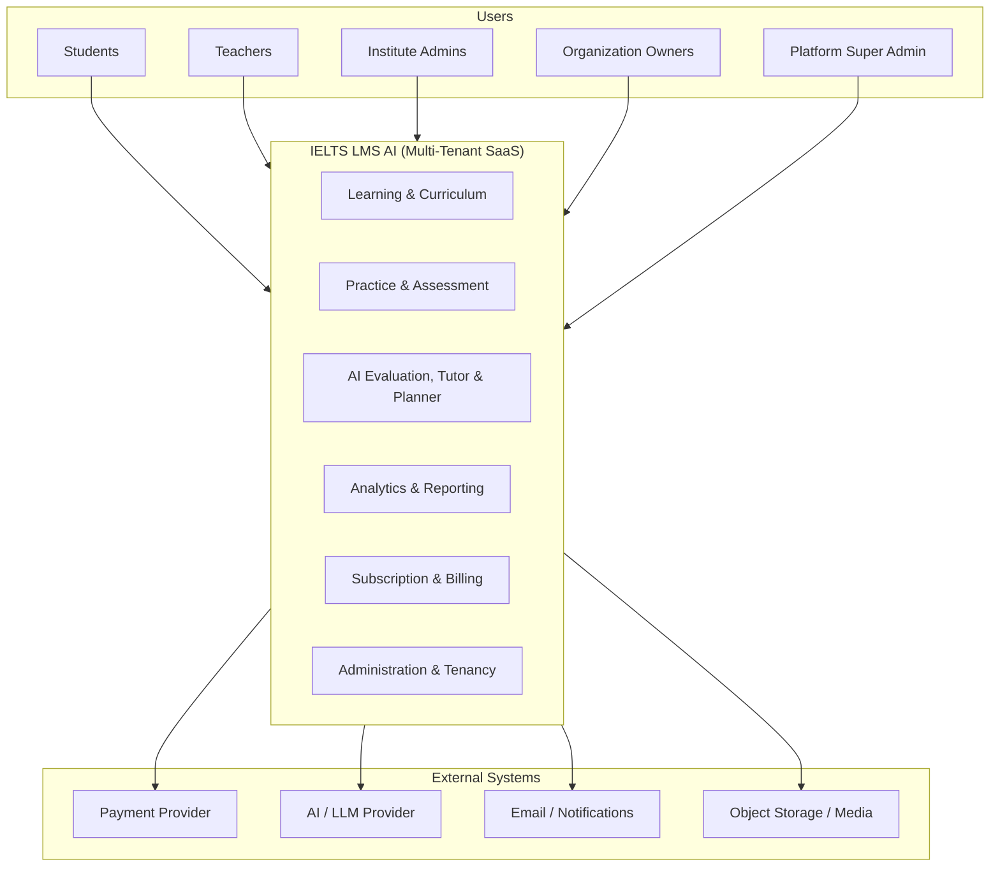
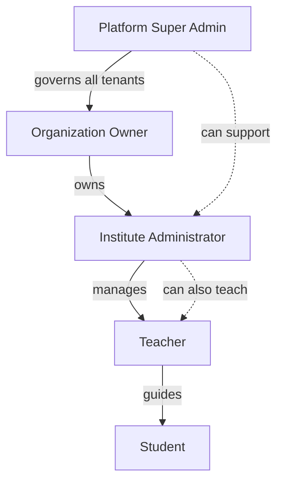
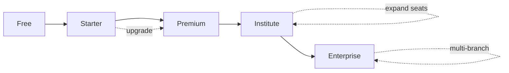
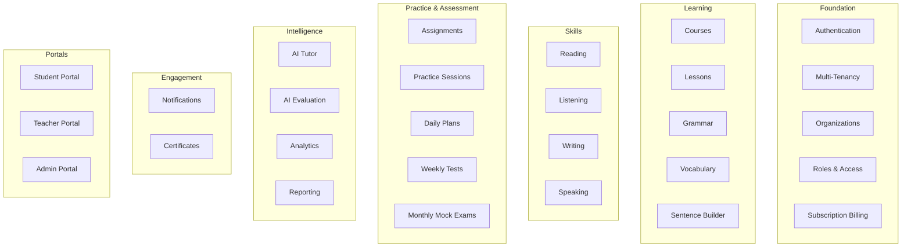
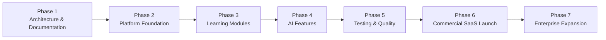

# Product Vision — IELTS LMS AI

| Field | Value |
| --- | --- |
| **Product Name** | IELTS LMS AI |
| **Document** | 01 — Product Vision |
| **Version** | 1.0 |
| **Status** | Architecture & Planning |
| **Document Owner** | Product & Architecture |
| **Last Updated** | 2026-07-18 |
| **Audience** | Product, Engineering, Design, Leadership, Stakeholders |

> **Purpose of this document.** This is the foundational document of the IELTS LMS AI repository. It defines *what* we are building, *who* it serves, *why* it exists, and *where* it is going. Every subsequent document — Business Requirements, Product Requirements, Software Requirements Specification, Domain-Driven Design, ERD, API, Architecture, AI, Security, and Testing — must align with the vision, principles, and scope defined here. Where a later document needs to deviate, that deviation must be justified and this document updated to preserve a single source of truth.

---

## Table of Contents

1. [Executive Summary](#1-executive-summary)
2. [Product Overview](#2-product-overview)
3. [Product Vision](#3-product-vision)
4. [Target Users & Personas](#4-target-users--personas)
5. [Business Model](#5-business-model)
6. [Product Goals](#6-product-goals)
7. [Product Principles](#7-product-principles)
8. [Core Capabilities](#8-core-capabilities)
9. [Success Metrics](#9-success-metrics)
10. [Out of Scope (Version 1)](#10-out-of-scope-version-1)
11. [High-Level Roadmap](#11-high-level-roadmap)
12. [Quality Requirements](#12-quality-requirements)
13. [Assumptions & Constraints](#13-assumptions--constraints)
14. [Glossary](#14-glossary)
15. [Related Documents](#15-related-documents)

---

## 1. Executive Summary

**IELTS LMS AI** is a cloud-native, AI-powered, multi-tenant enterprise Learning Management System (LMS) purpose-built for IELTS preparation. It is a commercial Software-as-a-Service (SaaS) platform — **not** a personal learning application — designed to serve individual learners, teachers, coaching centers, language institutes, universities, and organizations across the globe.

The platform delivers an end-to-end IELTS ecosystem: structured learning, deliberate practice, realistic computer-based assessment, AI-driven evaluation and tutoring, actionable analytics, and subscription-based commercialization. It supports both **IELTS Academic** and **IELTS General Training** tracks and mirrors the official **Computer-Based IELTS (CB-IELTS)** experience so learners practice in conditions that match the real exam.

Our ambition is for IELTS LMS AI to become one of the world's most comprehensive AI-powered IELTS preparation platforms — a system where a student can prepare for the official exam entirely within the platform, and where an institution can run its entire IELTS program on top of our infrastructure.

---

## 2. Product Overview

### 2.1 What It Is

IELTS LMS AI is a multi-tenant SaaS LMS focused exclusively on IELTS. It combines:

- **Learning** — structured curriculum for grammar, vocabulary, sentence building, and the four IELTS skills.
- **Practice** — daily exercises, skill drills, and full-length practice sessions.
- **Assessment** — weekly tests and monthly mock exams that emulate the CB-IELTS interface and timing.
- **AI** — automated Writing and Speaking evaluation aligned to IELTS band descriptors, plus an AI tutor and AI study planner.
- **Analytics** — progress tracking, band estimation, and dashboards for learners, teachers, and administrators.
- **Commercialization** — tiered subscriptions from individual learners to enterprise organizations.

### 2.2 What It Is Not

- It is **not** a single-user consumer study app.
- It is **not** a generic LMS retrofitted for IELTS; the domain model is IELTS-native.
- It is **not** a content marketplace, social network, or live-tutoring service (see [Out of Scope](#10-out-of-scope-version-1)).

### 2.3 Product Context

---

## 3. Product Vision

> **Vision Statement.** To become one of the world's most comprehensive AI-powered IELTS preparation platforms — enabling any learner to prepare for the official Computer-Based IELTS exam entirely within the platform, and any institution to deliver world-class IELTS training without building the underlying technology themselves.

### 3.1 The Learner Promise

A student who commits to the platform should be able to move from their current level to their target band using a single, coherent system that:

- Assesses their starting point and defines a **personalized learning path**.
- Provides **daily learning plans** that fit their schedule and target date.
- Teaches the fundamentals — **grammar, vocabulary, and sentence building** — as building blocks for the four skills.
- Builds skill mastery across **Reading, Listening, Writing, and Speaking**.
- Reinforces learning through **daily exercises, weekly tests, and monthly mock exams**.
- Delivers **AI-powered Writing and Speaking evaluation** aligned to official band descriptors, with actionable feedback.
- Offers an **AI tutor** for on-demand guidance and an **AI study planner** that adapts to progress.
- Tracks **progress and estimated band improvement** through clear analytics.
- Recognizes achievement with **certificates** and keeps the learner motivated.

### 3.2 The Institution Promise

An institute, university, or organization should be able to run its entire IELTS program on the platform:

- Onboard cohorts of learners under an isolated tenant.
- Assign teachers, manage classes, and distribute assignments.
- Monitor cohort and individual performance through dashboards and reports.
- Operate under a commercial plan that scales with their size.

### 3.3 Vision Themes

| Theme | Description |
| --- | --- |
| **Exam-realistic** | Practice and assessment mirror the official CB-IELTS experience. |
| **AI-native** | AI is core to evaluation, tutoring, and personalization — not a bolt-on. |
| **Outcome-driven** | Everything is oriented toward measurable band improvement. |
| **Multi-tenant by design** | Built from day one for institutions, not retrofitted. |
| **Globally scalable** | Architected to serve learners and organizations worldwide. |

---

## 4. Target Users & Personas

The platform serves five primary personas. Each has distinct goals, pain points, expected features, and success criteria.

### 4.1 Persona: Individual Student

| Attribute | Detail |
| --- | --- |
| **Who** | A self-motivated IELTS candidate (Academic or General Training) preparing for university, immigration, or professional goals. |
| **Goals** | Achieve a target band by a target date; understand weaknesses; practice under realistic conditions; get reliable feedback on Writing and Speaking. |
| **Pain Points** | Expensive private tutoring; unreliable or generic feedback; fragmented resources; uncertainty about current level and progress; lack of realistic CB-IELTS practice. |
| **Expected Features** | Personalized learning path, daily plans, skill practice, AI Writing/Speaking evaluation, AI tutor, mock exams, progress analytics, band estimation, certificates. |
| **Success Criteria** | Measurable band improvement; confidence entering the real exam; sustained engagement; feedback perceived as accurate and actionable. |

### 4.2 Persona: Teacher

| Attribute | Detail |
| --- | --- |
| **Who** | An IELTS instructor working independently or within an institute, responsible for guiding learners. |
| **Goals** | Manage classes and assignments efficiently; identify struggling students; supplement (not be replaced by) AI feedback; demonstrate learner progress. |
| **Pain Points** | Time-consuming manual grading (especially Writing/Speaking); limited visibility into individual progress; difficulty scaling personal attention across many students. |
| **Expected Features** | Teacher portal, class and assignment management, AI-assisted grading with override, student progress dashboards, feedback tools, reporting. |
| **Success Criteria** | Reduced grading workload; improved cohort outcomes; clear visibility into student performance; ability to intervene early. |

### 4.3 Persona: Institute Administrator

| Attribute | Detail |
| --- | --- |
| **Who** | An operational administrator at a coaching center or language institute managing teachers, students, and courses. |
| **Goals** | Onboard and manage users; organize classes and curricula; monitor institute-wide performance; control access and roles. |
| **Pain Points** | Manual student administration; lack of consolidated reporting; difficulty enforcing roles and access; no single system of record. |
| **Expected Features** | Admin portal, user and role management, class/course organization, institute-level analytics and reporting, subscription/seat management within their tenant. |
| **Success Criteria** | Smooth onboarding; accurate institute-wide reporting; efficient administration; high teacher and student adoption. |

### 4.4 Persona: Organization Owner

| Attribute | Detail |
| --- | --- |
| **Who** | The decision-maker/owner of a university department, enterprise, or multi-branch institution procuring the platform. |
| **Goals** | Deliver IELTS preparation at scale; demonstrate ROI and outcomes; ensure data security and compliance; manage commercial relationship. |
| **Pain Points** | Building or integrating technology in-house; ensuring data isolation and compliance; proving learning outcomes; managing cost at scale. |
| **Expected Features** | Enterprise plan, multi-branch/tenant management, organization-wide analytics, security and compliance assurances, billing and contract management, priority support. |
| **Success Criteria** | Predictable cost; demonstrable outcomes; strong security/compliance posture; scalable rollout across branches or departments. |

### 4.5 Persona: Platform Super Admin

| Attribute | Detail |
| --- | --- |
| **Who** | An internal operator of IELTS LMS AI responsible for the platform across all tenants. |
| **Goals** | Ensure platform health, security, and availability; manage tenants and plans; oversee content and AI quality; support customers. |
| **Pain Points** | Operating a multi-tenant system reliably; monitoring AI quality and cost; enforcing global policy; supporting diverse tenants. |
| **Expected Features** | Global administration, tenant lifecycle management, plan and feature-flag control, platform-wide observability, content governance, AI quality monitoring. |
| **Success Criteria** | High availability and performance; secure tenant isolation; controlled AI cost and quality; efficient support operations. |

### 4.6 Persona Relationships

---

## 5. Business Model

IELTS LMS AI is a **subscription-based, multi-tenant SaaS**. Revenue is generated through tiered plans that scale from a single learner to a global enterprise. Plans gate feature access, usage limits (including AI evaluation volume), seat counts, and support levels.

### 5.1 Subscription Tiers

| Plan | Primary Audience | Positioning | Representative Entitlements |
| --- | --- | --- | --- |
| **Free** | Trial / evaluation learners | Acquisition & funnel entry | Limited lessons, capped daily practice, limited AI evaluations, basic progress tracking. |
| **Starter** | Individual students (budget) | Affordable self-study | Broader curriculum access, higher practice limits, moderate AI evaluation quota, basic analytics, certificates. |
| **Premium** | Serious individual students | Full self-study experience | Full curriculum, unlimited/high practice limits, full AI evaluation, AI tutor & planner, mock exams, advanced analytics, band estimation. |
| **Institute** | Coaching centers, language schools | Team/cohort delivery | Multi-seat tenant, teacher & admin portals, class/assignment management, institute analytics, seat-based billing. |
| **Enterprise** | Universities, large organizations | Strategic, at-scale delivery | Everything in Institute plus multi-branch tenancy, enterprise security/compliance, SSO (future), custom limits, SLAs, priority support, custom contracts. |

> Specific price points, exact quotas, and entitlement matrices are defined in the Business Requirements and Product Requirements documents. This document defines the *shape* of the model, not final pricing.

### 5.2 How Subscriptions Fit the Platform

- **Tenancy** — Institute and Enterprise plans provision isolated tenants; Free/Starter/Premium are individual accounts (which may still belong to the shared/default tenant context).
- **Entitlements** — Plans map to feature flags and usage quotas enforced consistently across portals and APIs.
- **AI economics** — AI evaluation and tutoring incur variable cost; plans meter AI usage to align price with cost and protect margins.
- **Expansion** — Upgrades, seat additions, and enterprise contracts drive expansion revenue; the Free plan drives top-of-funnel acquisition.

### 5.3 Commercial Principles

- Pricing tiers must not compromise **future scalability** — quotas and entitlements are configuration, not hard-coded assumptions.
- Every gated capability must be expressible as an **entitlement/feature flag** so plans can evolve without re-architecture.
- Billing integrates with an external payment provider; the platform never becomes a system of record for raw payment credentials.

---

## 6. Product Goals

### 6.1 Short-Term Goals (0–6 months)

- Complete architecture and planning documentation (this repository).
- Establish the platform foundation: multi-tenancy, authentication, RBAC, and core data model.
- Validate the CB-IELTS-style assessment experience direction.

### 6.2 Medium-Term Goals (6–18 months)

- Deliver the core learning modules (grammar, vocabulary, sentence builder, four skills).
- Ship AI Writing and Speaking evaluation and the AI tutor/planner.
- Launch weekly tests and monthly mock exams with analytics and band estimation.
- Introduce subscription billing and go to market with Free/Starter/Premium.

### 6.3 Long-Term Vision (18+ months)

- Expand into Institute and Enterprise segments at global scale.
- Continuously improve AI evaluation accuracy and personalization.
- Position IELTS LMS AI as a category-leading AI-powered IELTS platform.

### 6.4 Goal Dimensions

| Dimension | Goals |
| --- | --- |
| **Business Goals** | Sustainable subscription revenue; strong Free→Paid conversion; expansion into institutional and enterprise segments; defensible market position. |
| **Technical Goals** | Cloud-native, modular, multi-tenant architecture; high availability and performance; maintainable and testable codebase; clean separation of concerns. |
| **Learning Goals** | Measurable band improvement; high lesson completion; realistic exam preparation; effective, personalized learning paths. |
| **AI Goals** | Accurate, consistent evaluation aligned to IELTS band descriptors; helpful AI tutoring; adaptive study planning; controlled AI cost and quality. |
| **Scalability Goals** | Scale from single learners to enterprise tenants without re-architecture; horizontal scalability; global reach; elastic handling of assessment peaks. |

---

## 7. Product Principles

These principles guide every product and engineering decision. Later documents must not contradict them.

| Principle | What It Means |
| --- | --- |
| **AI First** | AI is central to evaluation, tutoring, and personalization — designed in, not added on. |
| **Computer-Based IELTS Experience** | Practice and assessment emulate the official CB-IELTS interface, timing, and interaction model. |
| **Mobile Responsive** | Fully responsive web experience across devices (native mobile apps are out of scope for V1). |
| **Performance** | Fast, responsive experiences; assessment and AI feedback within predictable, acceptable latency. |
| **Security** | Security and tenant isolation are non-negotiable and built into the architecture. |
| **Accessibility** | Designed toward inclusive, accessibility-conscious experiences (e.g., WCAG-aligned intent). |
| **Enterprise Ready** | RBAC, multi-tenancy, auditability, and compliance suitable for organizations. |
| **Cloud Native** | Built for the cloud — containerized, horizontally scalable, and observable. |
| **Modular** | Clear domain boundaries and modular design enabling independent evolution. |
| **Scalable** | Architecture avoids assumptions that block future scale. |
| **Testable** | Designed for automated testing at unit, integration, and end-to-end levels. |
| **Maintainable** | Clean, well-documented, and consistent — optimized for long-term ownership. |

---

## 8. Core Capabilities

The platform is organized into capability areas. Each is described at a high level here and specified in detail in later documents.

### 8.1 Capability Map

### 8.2 Capability Descriptions

| Capability | High-Level Description |
| --- | --- |
| **Authentication** | Secure identity and sign-in for all user types; foundation for RBAC and tenancy. |
| **Multi-Tenant** | Isolated tenants for institutes and organizations; consistent tenant context across the platform. |
| **Organizations** | Modeling of institutes, universities, and organizations, including branches and hierarchy. |
| **Courses** | Structured IELTS courses spanning Academic and General Training tracks. |
| **Lessons** | Learning units within courses, combining instruction and practice. |
| **Grammar** | Grammar learning modules as foundational language building blocks. |
| **Vocabulary** | Vocabulary acquisition and reinforcement modules. |
| **Sentence Builder** | Guided sentence construction to bridge grammar/vocabulary to skills. |
| **Reading** | IELTS Reading practice and assessment (Academic & General Training). |
| **Listening** | IELTS Listening practice and assessment with audio media. |
| **Writing** | IELTS Writing tasks with AI-assisted evaluation. |
| **Speaking** | IELTS Speaking practice with AI-assisted evaluation. |
| **Assignments** | Teacher- or system-assigned work tied to courses and learners. |
| **Practice Sessions** | Focused, on-demand practice across skills and sub-skills. |
| **Daily Plans** | Personalized daily learning schedules aligned to goals and target dates. |
| **Weekly Tests** | Regular checkpoint assessments to measure progress. |
| **Monthly Mock Exams** | Full-length, CB-IELTS-style mock exams with band estimation. |
| **Analytics** | Learner, class, institute, and platform performance insights. |
| **Notifications** | Timely reminders and updates across channels (e.g., email/in-app). |
| **Certificates** | Recognition of milestones and completion. |
| **Subscription Billing** | Plan management, entitlements, and integration with a payment provider. |
| **Admin Portal** | Administration for institutes/organizations and platform operators. |
| **Teacher Portal** | Tools for class, assignment, grading, and progress management. |
| **Student Portal** | The learner's primary experience across learning, practice, and assessment. |
| **AI Tutor** | On-demand AI guidance and explanations for learners. |
| **AI Evaluation** | Automated Writing and Speaking scoring aligned to IELTS band descriptors. |
| **Reporting** | Exportable and shareable reports for teachers, admins, and organizations. |

---

## 9. Success Metrics

Success is measured across engagement, learning outcomes, commercial performance, and platform health. Targets below are directional for V1 and refined in the Business/Product requirements.

### 9.1 Engagement Metrics

| Metric | Definition | Direction |
| --- | --- | --- |
| **Daily Active Users (DAU)** | Unique users active per day | ↑ |
| **Monthly Active Users (MAU)** | Unique users active per month | ↑ |
| **DAU/MAU Stickiness** | Ratio of DAU to MAU | ↑ |
| **Average Study Time** | Mean active learning time per active user | ↑ |
| **Retention Rate** | Users returning across defined periods | ↑ |

### 9.2 Learning Outcome Metrics

| Metric | Definition | Direction |
| --- | --- | --- |
| **Lesson Completion Rate** | % of started lessons completed | ↑ |
| **Course Completion** | % of learners completing a course | ↑ |
| **Writing Improvement** | Change in AI-evaluated Writing performance over time | ↑ |
| **Speaking Improvement** | Change in AI-evaluated Speaking performance over time | ↑ |
| **Estimated Band Improvement** | Change in estimated overall band from baseline | ↑ |
| **Student Satisfaction** | Satisfaction score (e.g., CSAT/NPS) | ↑ |

### 9.3 Commercial Metrics

| Metric | Definition | Direction |
| --- | --- | --- |
| **Subscription Conversion** | Free→Paid conversion rate | ↑ |
| **Plan Upgrade Rate** | Movement to higher tiers | ↑ |
| **Seat Expansion** | Growth in seats within Institute/Enterprise tenants | ↑ |

### 9.4 Platform Health Metrics

| Metric | Definition | Target (Directional) |
| --- | --- | --- |
| **System Availability** | Uptime of the platform | High availability (e.g., ≥ 99.9%) |
| **Performance Targets** | Latency for key interactions (page, assessment, AI feedback) | Predictable, low latency within defined SLOs |
| **AI Evaluation Turnaround** | Time to return AI Writing/Speaking feedback | Within acceptable, published bounds |

> Precise SLOs, error budgets, and analytics definitions are formalized in the Non-Functional Requirements and Observability documentation.

---

## 10. Out of Scope (Version 1)

To protect focus and delivery, the following are explicitly **out of scope for Version 1**. They may be reconsidered in later phases.

| Out of Scope (V1) | Rationale |
| --- | --- |
| **Native Mobile Apps** | V1 targets a fully responsive web experience; native apps deferred. |
| **Offline Learning** | Requires sync/complexity not justified for V1; platform is cloud-native and online-first. |
| **Live Video Classes** | Real-time video teaching is a separate product surface; not part of V1. |
| **Marketplace** | Third-party content/marketplace deferred to preserve focus. |
| **Community Forums** | Social/community features deferred. |
| **Gamification beyond basic achievements** | Only basic achievements/certificates in V1; deeper gamification deferred. |

> Being out of scope for V1 does **not** mean architecturally excluded. The architecture must avoid decisions that would block these from being added later.

---

## 11. High-Level Roadmap

This roadmap describes product phases only — no technical implementation detail. Phases are sequential in intent but may overlap in execution.

| Phase | Name | Focus |
| --- | --- | --- |
| **Phase 1** | Architecture & Documentation | Define vision, requirements, architecture, and design across the repository. |
| **Phase 2** | Platform Foundation | Multi-tenancy, authentication, RBAC, organizations, and core data model. |
| **Phase 3** | Learning Modules | Courses, lessons, grammar, vocabulary, sentence builder, and the four skills. |
| **Phase 4** | AI Features | AI Writing/Speaking evaluation, AI tutor, and AI study planner. |
| **Phase 5** | Testing & Quality | Comprehensive testing, quality hardening, and performance validation. |
| **Phase 6** | Commercial SaaS Launch | Subscription billing, plans, and go-to-market for individual tiers. |
| **Phase 7** | Enterprise Expansion | Institute and enterprise capabilities, scale, and global expansion. |

---

## 12. Quality Requirements

This and every subsequent document must meet the following standards:

- **Professionally written** to the quality bar expected of leading enterprise software organizations.
- **Correct Markdown structure** — clear heading hierarchy, tables, and lists.
- **Diagrams where useful** — Mermaid diagrams to convey structure and flow.
- **Maintainable** — easy to update as the product evolves; single source of truth.
- **Future-proof** — no assumptions that conflict with future scalability or the roadmap.
- **Enterprise-suitable** — appropriate for stakeholders, engineering, and external review.

---

## 13. Assumptions & Constraints

| # | Assumption / Constraint | Notes |
| --- | --- | --- |
| A1 | The platform is **online-first and cloud-native**. | Offline is out of scope for V1. |
| A2 | AI evaluation depends on an **external LLM provider**. | Provider/model choices are deferred to the AI architecture; cost and quality are actively managed. |
| A3 | Billing depends on an **external payment provider**. | The platform is not a system of record for raw payment credentials. |
| A4 | The experience emulates **Computer-Based IELTS**. | Alignment with official formats is a guiding constraint, not a claim of official affiliation. |
| A5 | The platform is **multi-tenant from day one**. | Individual and organizational accounts coexist without re-architecture. |
| A6 | Final pricing, quotas, and entitlements are defined later. | This document defines the model shape, not exact numbers. |

> **Note:** IELTS is a trademark of its respective owners. IELTS LMS AI is a preparation platform and does not claim official affiliation or endorsement.

---

## 14. Glossary

| Term | Definition |
| --- | --- |
| **IELTS** | International English Language Testing System. |
| **Academic / General Training** | The two IELTS tracks supported by the platform. |
| **CB-IELTS** | Computer-Based IELTS — the exam experience the platform emulates. |
| **LMS** | Learning Management System. |
| **SaaS** | Software as a Service. |
| **Tenant** | An isolated customer context (e.g., an institute or organization). |
| **RBAC** | Role-Based Access Control. |
| **Band** | The IELTS scoring scale used to express proficiency. |
| **Entitlement** | A feature or quota granted by a subscription plan. |
| **SLO / SLA** | Service Level Objective / Agreement. |

---

## 15. Related Documents

This Product Vision is the foundation for the documents below. Each will be created later and must align with this vision. Links are placeholders until the documents exist.

| # | Document | Purpose |
| --- | --- | --- |
| 02 | **Business Requirements Document (BRD)** | Business drivers, stakeholders, and high-level requirements. |
| 03 | **Product Requirements Document (PRD)** | Detailed product requirements and feature definitions. |
| 04 | **Functional Requirements** | Specific functional behaviors of the system. |
| 05 | **Non-Functional Requirements** | Performance, availability, scalability, and quality attributes. |
| 06 | **Software Requirements Specification (SRS)** | Consolidated formal software requirements. |
| 07 | **Domain-Driven Design (DDD)** | Domain model, bounded contexts, and ubiquitous language. |
| 08 | **Event Storming** | Domain events, commands, and workflows. |
| 09 | **Database Design (ERD)** | Entity-relationship model and data design. |
| 10 | **API Specification** | API contracts, resources, and conventions. |
| 11 | **Authentication & Authorization** | Identity, RBAC, and access control design. |
| 12 | **Multi-Tenant Architecture** | Tenancy model and isolation strategy. |
| 13 | **Clean Architecture** | Layering, dependencies, and separation of concerns. |
| 14 | **Frontend Architecture** | Web client architecture and patterns. |
| 15 | **Backend Architecture** | Server-side architecture and services. |
| 16 | **AI Architecture** | AI evaluation, tutoring, planning, and prompt management. |
| 17 | **Infrastructure** | Cloud infrastructure, deployment, and environments. |
| 18 | **Security** | Security architecture, threat model, and compliance. |
| 19 | **Testing Strategy** | Testing approach across unit, integration, and end-to-end. |

---

*End of Document — 01 Product Vision (v1.0).*
