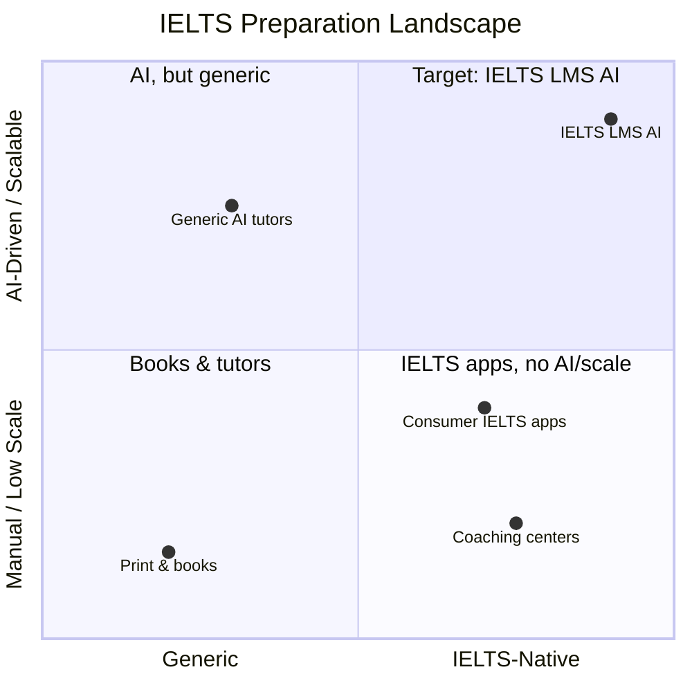
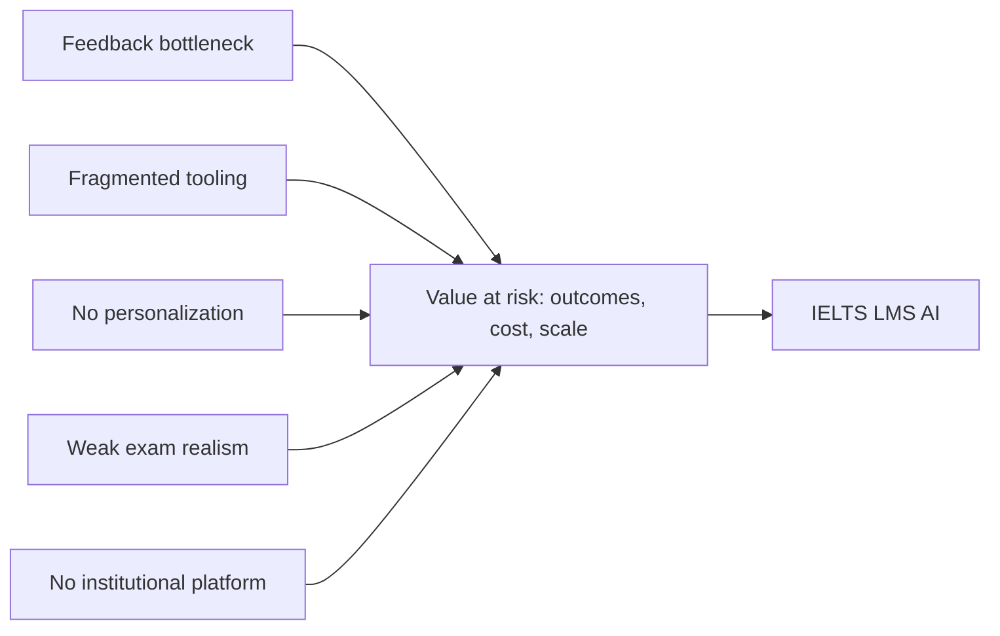
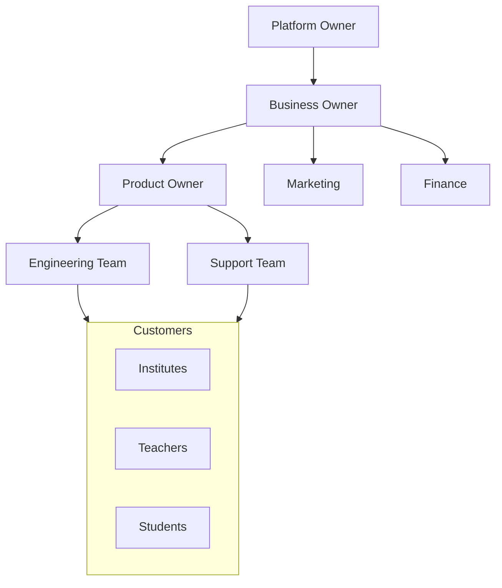
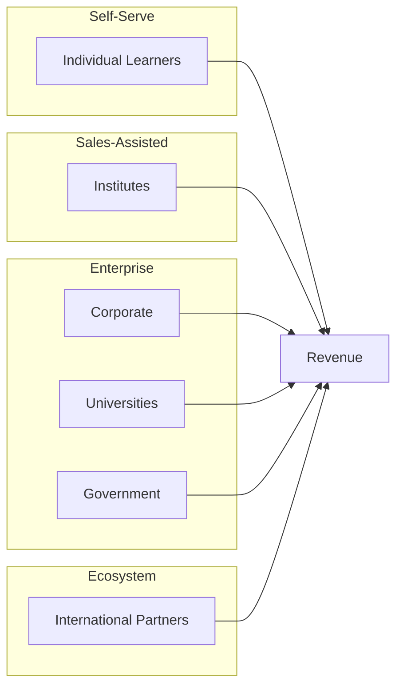
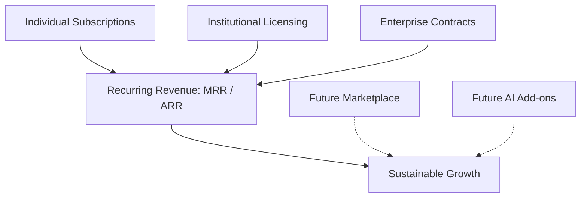
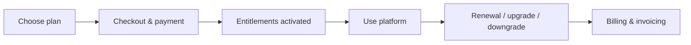
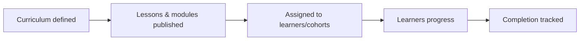
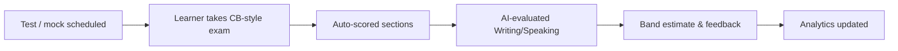
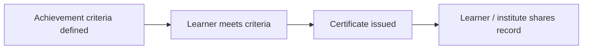
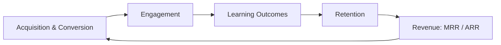

# Business Requirements Document (BRD) — IELTS LMS AI

| Field | Value |
| --- | --- |
| **Product Name** | IELTS LMS AI |
| **Document** | 02 — Business Requirements Document (BRD) |
| **Version** | 1.0 |
| **Status** | Architecture & Planning |
| **Document Owner** | Business Analysis & Product |
| **Last Updated** | 2026-07-18 |
| **Audience** | Founders, Stakeholders, Investors, Architects, Engineering Leadership |
| **Aligns With** | [01_Product_Vision.md](./01_Product_Vision.md) |

> **Purpose of this document.** This Business Requirements Document (BRD) explains *why* IELTS LMS AI exists, the business problems it solves, the value it delivers, and the outcomes we expect. It expands the business perspective established in the [Product Vision](./01_Product_Vision.md) without duplicating its content, and keeps terminology consistent across the repository. It is written for executive and engineering-leadership audiences and is the bridge between the vision and the detailed product/functional requirements that follow.

---

## Table of Contents

1. [Executive Summary](#1-executive-summary)
2. [Business Opportunity](#2-business-opportunity)
3. [Problem Statement](#3-problem-statement)
4. [Proposed Business Solution](#4-proposed-business-solution)
5. [Business Objectives](#5-business-objectives)
6. [Stakeholders](#6-stakeholders)
7. [Business Scope](#7-business-scope)
8. [Customer Segments](#8-customer-segments)
9. [Business Capabilities](#9-business-capabilities)
10. [Subscription Strategy](#10-subscription-strategy)
11. [Revenue Model](#11-revenue-model)
12. [Business Processes](#12-business-processes)
13. [Success Metrics (KPIs)](#13-success-metrics-kpis)
14. [Risks](#14-risks)
15. [Assumptions](#15-assumptions)
16. [Constraints](#16-constraints)
17. [Business Rules](#17-business-rules)
18. [Future Business Opportunities](#18-future-business-opportunities)
19. [Related Documents](#19-related-documents)

---

## 1. Executive Summary

IELTS preparation is a large, global, and persistently underserved market. Every year, millions of candidates sit the IELTS exam for study, migration, and professional registration, yet most preparation happens through fragmented channels: static books, generic video courses, expensive one-to-one coaching, and consumer apps that were never designed for institutions. Quality feedback on Writing and Speaking — the two skills most candidates struggle with — is scarce, slow, and expensive because it depends on limited expert human time.

**IELTS LMS AI** addresses this gap with a cloud-native, AI-powered, multi-tenant SaaS Learning Management System dedicated to IELTS. As defined in the [Product Vision](./01_Product_Vision.md), it is a commercial platform — not a personal study app — serving individual learners, teachers, coaching centers, language institutes, universities, and organizations. It supports both **IELTS Academic** and **IELTS General Training**, mirrors the **Computer-Based IELTS (CB-IELTS)** experience, and delivers an end-to-end ecosystem spanning learning, practice, assessment, AI evaluation and tutoring, analytics, and subscription billing.

The business thesis is straightforward: **AI makes high-quality, personalized IELTS preparation scalable and affordable, while multi-tenancy makes the platform sellable to institutions as infrastructure.** Automated Writing and Speaking evaluation aligned to official band descriptors removes the primary bottleneck in IELTS coaching; a tenant-isolated architecture lets us monetize the same platform across individual, institutional, and enterprise segments through tiered subscriptions and contracts.

This BRD makes the case for that thesis to founders, investors, and leadership, and defines the business requirements — objectives, scope, stakeholders, segments, capabilities, revenue model, KPIs, risks, and rules — that the [PRD](./03_Product_Requirements.md) and subsequent specifications will implement.

---

## 2. Business Opportunity

### 2.1 The Current IELTS Preparation Market

IELTS is one of the world's most widely recognized English-language proficiency tests, accepted by tens of thousands of organizations across education, immigration, and professional bodies. Demand is global and recurring, driven by structural forces that are independent of any single economy:

- **Migration and study-abroad** demand from South Asia, the Middle East, Africa, Southeast Asia, Latin America, and East Asia.
- **Professional registration** requirements in healthcare, engineering, and other regulated fields.
- **University admissions** for English-medium programs worldwide.

The preparation market that surrounds this demand is large but structurally fragmented across the categories below.

| Segment | Typical Offering | Limitations |
| --- | --- | --- |
| Print & self-study books | Practice tests, tips | No feedback, no adaptivity, no analytics |
| Consumer mobile apps | Drills, flashcards | Single-user, not institution-ready, shallow evaluation |
| Generic online course platforms | Recorded video lessons | Not IELTS-native, no exam simulation, weak assessment |
| Coaching centers & tutors | Human instruction & feedback | Expensive, capacity-limited, inconsistent quality |
| Test-prep chains | Blended classroom + material | Costly to scale, limited personalization |

### 2.2 Existing Pain Points

- **Feedback bottleneck.** Reliable Writing and Speaking evaluation depends on scarce expert examiners, making it slow and expensive.
- **Fragmentation.** Learners stitch together books, apps, videos, and tutors with no unified progress view.
- **Lack of personalization.** Most offerings are one-size-fits-all rather than adaptive to a learner's level and target band.
- **Weak exam realism.** Few tools faithfully reproduce the CB-IELTS interface, timing, and constraints.
- **Institutional gap.** Coaching centers and universities lack an affordable, brandable platform to deliver and manage IELTS programs at scale.

### 2.3 Market Gaps

The upper-right quadrant — **IELTS-native and AI-driven at scale, sold to both learners and institutions** — is essentially unoccupied. That is the opportunity IELTS LMS AI targets.

### 2.4 Digital Transformation Opportunity

Coaching centers and institutions increasingly need to operate online, measure outcomes, and differentiate on results. A multi-tenant SaaS platform lets them digitize their entire IELTS program — enrollment, curriculum delivery, assessment, and reporting — without building technology in-house. This transforms IELTS LMS AI from a study tool into **operating infrastructure** for IELTS education providers.

### 2.5 AI Opportunity

AI is the decisive lever. Language-model-based evaluation, aligned to official band descriptors, can deliver near-instant, consistent, and explainable feedback on Writing and Speaking at a fraction of the cost of human examiners. The same AI foundation powers a tutor, an adaptive study planner, and content assistance. AI converts the market's most expensive, least scalable activity — expert feedback — into a scalable software capability, which is the core of the platform's economic advantage.

---

## 3. Problem Statement

The platform exists to resolve distinct but connected problems experienced by each participant in the IELTS ecosystem.

### 3.1 Students

- Cannot get fast, consistent, affordable feedback on Writing and Speaking.
- Struggle to know their current level and what to study next.
- Practice in tools that do not resemble the real CB-IELTS exam.
- Lack a single, coherent view of progress toward a target band.

### 3.2 Teachers

- Spend disproportionate time grading and giving repetitive feedback instead of teaching.
- Lack tooling to assign, track, and analyze student practice at scale.
- Have limited visibility into where individual students and cohorts are struggling.

### 3.3 Institutes (Coaching Centers & Language Institutes)

- Have no affordable, brandable platform to deliver IELTS programs online.
- Cannot easily measure learning outcomes or demonstrate results to prospective students.
- Depend on manual administration for enrollment, cohorts, and reporting.

### 3.4 Organizations (Universities, Enterprises, Government Programs)

- Need to train or screen large populations with governance, security, and reporting.
- Require data isolation, compliance, and centralized administration that consumer tools cannot provide.

### 3.5 Administrators (Institute & Platform)

- Lack centralized control over users, roles, content, and subscriptions.
- Have no unified analytics across cohorts, tenants, or the whole platform.
- Face operational overhead from fragmented, non-integrated tools.

---

## 4. Proposed Business Solution

IELTS LMS AI resolves these problems with a single, integrated, multi-tenant platform. The mapping below ties each problem class to the business solution it receives.

| Problem | Business Solution | Value Delivered |
| --- | --- | --- |
| Slow, costly Writing/Speaking feedback | AI evaluation aligned to band descriptors | Instant, consistent, affordable feedback at scale |
| Learners don't know what to study | Personalized learning paths + AI study planner | Higher engagement and faster improvement |
| Weak exam realism | CB-IELTS-style tests and mock exams | Confidence and readiness for the real exam |
| Fragmented tools | End-to-end ecosystem in one platform | Unified progress, less friction, better retention |
| No institutional platform | Multi-tenant, brandable institute/enterprise tiers | New revenue channels; institutions run programs on us |
| Grading overhead for teachers | AI-assisted evaluation + assignment tooling | Teachers focus on teaching, not repetitive grading |
| Fragmented administration | Admin portals, RBAC, tenant management | Centralized control, governance, and reporting |

In business terms, the platform converts a **service-heavy, capacity-constrained industry** into a **software-driven, scalable one**, and packages that capability so it can be sold to individuals and institutions alike. Detailed feature definitions are deferred to the [PRD](./03_Product_Requirements.md); this document establishes the business rationale and requirements.

---

## 5. Business Objectives

### 5.1 Short-Term Objectives (0–6 months)

- Complete architecture and documentation (this phase) to de-risk delivery.
- Establish the platform foundation: multi-tenancy, authentication, RBAC, and billing scaffolding.
- Validate AI evaluation quality for Writing and Speaking against band descriptors.
- Onboard an initial set of pilot learners and at least one pilot institute.

### 5.2 Medium-Term Objectives (6–18 months)

- Launch the commercial SaaS with Free, Starter, and Premium tiers.
- Release the Institute tier and onboard paying coaching centers.
- Demonstrate measurable band improvement and publish outcome evidence.
- Reach sustainable unit economics on individual subscriptions.

### 5.3 Long-Term Objectives (18+ months)

- Launch the Enterprise tier for universities, corporates, and government programs.
- Expand internationally with localization and regional partnerships.
- Establish IELTS LMS AI as a recognized category leader in AI-powered IELTS preparation.

### 5.4 Revenue Objectives

- Grow **Monthly Recurring Revenue (MRR)** and **Annual Recurring Revenue (ARR)** predictably across tiers.
- Diversify revenue across individual subscriptions, institutional licensing, and enterprise contracts.
- Improve gross margin over time as AI and infrastructure costs are optimized.

### 5.5 Growth Objectives

- Build a repeatable acquisition motion for individual learners.
- Establish an institutional sales motion with land-and-expand within organizations.
- Increase retention and expansion revenue (upgrades, seats, add-ons).

### 5.6 Global Expansion Objectives

- Support multi-region deployment and data residency requirements.
- Localize the experience for priority markets.
- Cultivate a partner ecosystem (resellers, agencies, institutions) for international reach.

---

## 6. Stakeholders

| Stakeholder | Interest / Role | Primary Concerns |
| --- | --- | --- |
| **Platform Owner** | Owns the platform strategy and P&L | Market position, ROI, long-term value |
| **Business Owner** | Accountable for commercial success | Revenue, margins, growth, pricing |
| **Product Owner** | Owns product direction and backlog | Roadmap, requirements, outcomes |
| **Engineering Team** | Designs, builds, and operates the platform | Architecture, scalability, quality, delivery |
| **Teachers** | Deliver instruction and use teacher tooling | Time savings, class insight, control |
| **Students** | End learners preparing for IELTS | Results, affordability, experience |
| **Institutes** | Customers delivering IELTS programs | Branding, outcomes, administration, cost |
| **Support Team** | Customer support and success | Reliability, tooling, issue resolution |
| **Marketing** | Demand generation and positioning | Messaging, funnel, conversion |
| **Finance** | Financial planning and control | Billing accuracy, revenue recognition, cost |

---

## 7. Business Scope

### 7.1 In Scope (Version 1)

- Multi-tenant SaaS platform supporting IELTS Academic and General Training.
- Learning modules: grammar, vocabulary, sentence building, Reading, Listening, Writing, Speaking.
- Practice, daily plans, weekly tests, and monthly mock exams in a CB-IELTS-style experience.
- AI Writing evaluation, AI Speaking evaluation, AI tutor, and AI study planner.
- Progress tracking, analytics dashboards, and certificates.
- Subscription billing across Free, Starter, Premium, Institute, and Enterprise tiers.
- Role-based portals: Student, Teacher, and Admin.

### 7.2 Out of Scope (Version 1)

Consistent with the [Product Vision](./01_Product_Vision.md), the following are explicitly excluded from Version 1:

- Native mobile applications (the web experience is responsive).
- Offline learning.
- Live video classes / synchronous tutoring.
- Content or teacher marketplaces.
- Community forums / social networking.
- Gamification beyond basic achievements.

### 7.3 Future Scope

- Marketplaces (content, teacher, institution).
- Public API platform and AI add-on marketplace.
- White-label solutions and native mobile apps.
- Expanded partner ecosystem and additional languages/exams.

---

## 8. Customer Segments

| Segment | Description | Buying Motion | Primary Value |
| --- | --- | --- | --- |
| **Individual Learners** | Self-directed candidates preparing for IELTS | Self-serve subscription | Affordable, personalized, AI-graded prep |
| **Institutes** | Coaching centers & language schools | Sales-assisted subscription | Brandable platform, outcomes, administration |
| **Corporate Training** | Enterprises upskilling employees | Contract / enterprise | Governance, reporting, scale |
| **Universities** | Higher-education institutions | Contract / enterprise | Admissions readiness, cohort analytics |
| **Government Programs** | Public-sector language initiatives | Contract / procurement | Compliance, data residency, scale |
| **International Partners** | Resellers, agencies, distributors | Partnership / white-label | Regional reach and localized delivery |

---

## 9. Business Capabilities

The capabilities below are described from a **business** perspective — the value each delivers and to whom. Technical realization is deferred to the architecture and functional documents.

| Capability | Business Description | Primary Beneficiary |
| --- | --- | --- |
| **Authentication** | Secure, trusted access to the right accounts and tenants | All users |
| **Multi-Tenancy** | Isolated, brandable environments per customer | Institutes, Enterprises |
| **Learning** | Structured IELTS curriculum and skills instruction | Students |
| **Testing** | Weekly tests and monthly CB-IELTS-style mock exams | Students, Teachers |
| **AI** | Automated evaluation, tutoring, and study planning | Students, Teachers |
| **Reporting** | Outcome and activity reporting across cohorts/tenants | Teachers, Admins |
| **Analytics** | Insights into progress, engagement, and band estimation | All roles |
| **Subscriptions** | Tiered access and monetization | Business, Finance |
| **Billing** | Accurate invoicing, payments, and revenue tracking | Finance |
| **Certificates** | Recognized proof of achievement | Students, Institutes |
| **Notifications** | Timely reminders and communications | All users |
| **Administration** | Centralized control of users, roles, content, tenants | Admins |

---

## 10. Subscription Strategy

Subscriptions are the primary monetization mechanism and the control plane for feature access. The tiers align with those defined in the [Product Vision](./01_Product_Vision.md) and progress from individual self-serve to institutional and enterprise contracts.

| Capability Area | Free | Starter | Premium | Institute | Enterprise |
| --- | --- | --- | --- | --- | --- |
| Core learning modules | Limited | ✅ | ✅ | ✅ | ✅ |
| Practice & daily plans | Limited | ✅ | ✅ | ✅ | ✅ |
| Weekly tests | ✅ (capped) | ✅ | ✅ | ✅ | ✅ |
| Monthly mock exams | Trial | Limited | ✅ | ✅ | ✅ |
| AI Writing evaluation | Trial | Quota | ✅ | ✅ | ✅ |
| AI Speaking evaluation | Trial | Quota | ✅ | ✅ | ✅ |
| AI tutor & study planner | Limited | Limited | ✅ | ✅ | ✅ |
| Analytics dashboards | Basic | Standard | Advanced | Cohort-level | Org-level |
| Certificates | — | ✅ | ✅ | ✅ | ✅ |
| Teacher tools | — | — | — | ✅ | ✅ |
| Multi-user / cohorts | — | — | — | ✅ | ✅ |
| Branding / white-label options | — | — | — | Limited | ✅ |
| Admin & governance | — | — | — | Institute | Organization |
| Support level | Community | Standard | Priority | Priority | Dedicated / SLA |

> Specific quotas, limits, and entitlements are defined as business rules and refined in the [PRD](./03_Product_Requirements.md). Entitlements are enforced by the platform based on the active plan.

---

## 11. Revenue Model

IELTS LMS AI monetizes through multiple, complementary streams that grow with the customer base and product surface.

| Stream | Description | Segment | Horizon |
| --- | --- | --- | --- |
| **Subscriptions** | Recurring individual plans (Starter, Premium) | Individual Learners | V1 |
| **Institutional Licensing** | Seat- or cohort-based Institute plans | Institutes | V1 |
| **Enterprise Contracts** | Custom contracts with SLAs, governance, residency | Enterprises, Universities, Government | V1–V2 |
| **Future Marketplace** | Revenue share on content/teacher marketplaces | Ecosystem | Future |
| **Future AI Add-ons** | Premium AI capabilities and higher quotas | All segments | Future |

**Commercial principles:** transparent pricing, no lock-in traps, expansion through value (upgrades, seats, add-ons), and margin improvement as AI/infrastructure costs are optimized.

---

## 12. Business Processes

High-level business workflows are described below. These are business journeys, not technical sequences; detailed flows appear in the functional documents.

### 12.1 Student Journey

### 12.2 Teacher Journey

### 12.3 Institute Journey

### 12.4 Subscription Journey

### 12.5 Course Journey

### 12.6 Assessment Journey

### 12.7 Certificate Journey

---

## 13. Success Metrics (KPIs)

Business performance is measured across acquisition, engagement, learning outcomes, and commercial and platform health. Targets are set per phase and refined during planning.

| Category | KPI | Definition / Intent |
| --- | --- | --- |
| Growth | **User Growth** | Net new users over period |
| Growth | **Subscription Conversion** | Free → paid conversion rate |
| Retention | **Retention Rate** | Users active over successive periods |
| Retention | **Churn** | Rate of subscription cancellation |
| Revenue | **MRR** | Monthly Recurring Revenue |
| Revenue | **ARR** | Annual Recurring Revenue |
| Revenue | **ARPU / LTV** | Average revenue per user; lifetime value |
| Engagement | **Lesson Completion** | Rate of assigned lessons completed |
| Engagement | **Mock Test Completion** | Rate of scheduled mock exams completed |
| Outcomes | **Band Improvement** | Estimated band gain over time |
| Satisfaction | **Customer Satisfaction (CSAT)** | Post-interaction satisfaction |
| Satisfaction | **NPS** | Net Promoter Score |
| Platform | **Platform Availability** | Uptime against SLO/SLA |

---

## 14. Risks

| # | Risk | Category | Impact | Likelihood | Mitigation |
| --- | --- | --- | --- | --- | --- |
| R1 | AI evaluation not accurate enough vs. examiners | Technical | High | Medium | Calibrate to band descriptors; human-in-the-loop validation; continuous evaluation |
| R2 | Slower-than-expected adoption | Market | High | Medium | Pilots, outcome evidence, targeted acquisition |
| R3 | Strong incumbent or new entrant competition | Market | Medium | Medium | IELTS-native depth, institutional moat, AI advantage |
| R4 | Data privacy / regulatory non-compliance | Compliance | High | Low–Med | Privacy-by-design, data residency, audits |
| R5 | Rising AI / infrastructure cost pressure | Business | Medium | Medium | Quotas, cost optimization, tiered pricing |
| R6 | Scalability or reliability shortfalls | Technical | High | Low | Cloud-native architecture, SLOs, load testing |
| R7 | Content quality / IELTS alignment issues | Operational | Medium | Medium | Expert review, versioned content, feedback loops |
| R8 | Key-person / delivery execution risk | Operational | Medium | Medium | Documentation-first, clear ownership, phased delivery |
| R9 | Pricing / packaging misalignment | Business | Medium | Medium | Experimentation, segment research, iteration |

---

## 15. Assumptions

- Global demand for IELTS preparation remains strong and recurring.
- AI models can evaluate Writing and Speaking to a quality acceptable to learners and institutions, with appropriate calibration and oversight.
- Customers will adopt a web-first, responsive experience in Version 1 (native apps deferred).
- Institutions will pay for a brandable, outcome-measuring platform delivered as SaaS.
- Reliable third-party providers exist for payments, AI/LLM, email, and cloud infrastructure.
- The platform can meet applicable data-protection and residency requirements for target markets.
- Content can be produced and maintained in alignment with official IELTS band descriptors and formats.

---

## 16. Constraints

| Constraint | Description |
| --- | --- |
| **Budget** | Delivery must fit funding available for the current and near-term phases; AI/infra costs must be managed within margin targets. |
| **Technology** | Cloud-native, multi-tenant SaaS; web-first responsive client; dependence on third-party AI, payment, and cloud providers. |
| **Timeline** | Phased delivery per the roadmap; commercial launch gated on foundation, learning modules, and AI quality. |
| **Compliance** | Must satisfy applicable data-protection, privacy, and (where relevant) accessibility and procurement requirements. |
| **Scalability** | Architecture must not preclude global, multi-region, high-volume growth or enterprise isolation needs. |

---

## 17. Business Rules

The following business rules govern platform behavior and constrain downstream requirements. They are stated at the business level; enforcement details belong in the functional and architecture documents.

| # | Rule |
| --- | --- |
| BR-1 | Every user belongs to exactly one tenant context. |
| BR-2 | Every tenant owns and controls its own data; tenant data is isolated. |
| BR-3 | Subscription plan and entitlements determine feature and quota access. |
| BR-4 | Certificates are issued only when defined passing/achievement criteria are met. |
| BR-5 | Mock exams and tests contribute to progress analytics and band estimation. |
| BR-6 | Only authorized roles (per RBAC) can create or manage content. |
| BR-7 | AI-generated evaluations are aligned to IELTS band descriptors and are advisory estimates, not official scores. |
| BR-8 | Billing actions (upgrade, downgrade, cancellation) take effect according to defined subscription rules. |
| BR-9 | Personal and learner data is processed in accordance with applicable privacy and residency requirements. |
| BR-10 | Platform Super Admin actions on tenants are auditable. |

---

## 18. Future Business Opportunities

Beyond Version 1, the platform can expand along several high-value directions. These are deliberately out of scope now but must not be architecturally precluded.

| Opportunity | Description |
| --- | --- |
| **Marketplace** | A general marketplace for IELTS content and services. |
| **Teacher Marketplace** | Independent teachers offering services/content with revenue share. |
| **Institution Marketplace** | Discovery and enrollment across participating institutions. |
| **API Platform** | Public APIs for partners to integrate platform capabilities. |
| **AI Marketplace** | Add-on AI capabilities and premium models. |
| **White-label Solution** | Fully branded deployments for partners and enterprises. |
| **Mobile Apps** | Native iOS/Android applications. |
| **Partner Ecosystem** | Resellers, agencies, and distribution partners for global reach. |

---

## 19. Related Documents

| # | Document | Relationship |
| --- | --- | --- |
| 01 | [Product Vision](./01_Product_Vision.md) | Foundation this BRD aligns with and expands from a business perspective. |
| 03 | [Product Requirements Document (PRD)](./03_Product_Requirements.md) | Translates these business requirements into detailed product requirements. |
| 04 | [Functional Requirements](./04_Functional_Requirements.md) | Specifies functional behaviors that realize the business capabilities. |
| 05 | [Non-Functional Requirements](./05_Non_Functional_Requirements.md) | Defines quality attributes (performance, scalability, security). |
| 06 | [Software Requirements Specification (SRS)](./06_SRS.md) | Consolidates formal software requirements. |

---

*End of Document — 02 Business Requirements Document (v1.0).*
