# Product Requirements Document (PRD) — IELTS LMS AI

| Field | Value |
| --- | --- |
| **Product Name** | IELTS LMS AI |
| **Document** | 03 — Product Requirements Document (PRD) |
| **Version** | 1.0 |
| **Status** | Architecture & Planning |
| **Document Owner** | Product Management |
| **Last Updated** | 2026-07-18 |
| **Audience** | Engineering, UX/UI Design, QA, Architecture, Product, Leadership |
| **Aligns With** | [01_Product_Vision.md](./01_Product_Vision.md), [02_Business_Requirements_Document.md](./02_Business_Requirements_Document.md) |

> **Purpose of this document.** This Product Requirements Document (PRD) is the **master product specification** for IELTS LMS AI. It defines *what* the product must do — its goals, personas, journeys, modules, features, and requirements — in enough detail that engineering, design, QA, and architecture teams can build the system from it. It deliberately does **not** describe *how* the system will be implemented; implementation is the concern of the architecture, API, data, and engineering documents that follow. This PRD builds directly on the [Product Vision](./01_Product_Vision.md) and [Business Requirements Document](./02_Business_Requirements_Document.md) and preserves their terminology.

---

## Table of Contents

1. [Introduction](#1-introduction)
2. [Product Overview](#2-product-overview)
3. [Product Goals](#3-product-goals)
4. [User Personas](#4-user-personas)
5. [User Journeys](#5-user-journeys)
6. [Product Modules](#6-product-modules)
7. [Feature Requirements](#7-feature-requirements)
8. [Functional Scope (MoSCoW)](#8-functional-scope-moscow)
9. [Non-Functional Expectations](#9-non-functional-expectations)
10. [AI Features](#10-ai-features)
11. [Subscription Model](#11-subscription-model)
12. [Success Metrics](#12-success-metrics)
13. [Assumptions](#13-assumptions)
14. [Constraints](#14-constraints)
15. [Out of Scope (Version 1)](#15-out-of-scope-version-1)
16. [Future Vision (3–5 Years)](#16-future-vision-35-years)
17. [Related Documents](#17-related-documents)
18. [Appendix: Requirement ID Index](#18-appendix-requirement-id-index)

---

## 1. Introduction

### 1.1 Document Purpose

This PRD translates the business intent captured in the [Product Vision](./01_Product_Vision.md) and [BRD](./02_Business_Requirements_Document.md) into a concrete, testable product specification. It is the authoritative reference for scope and behavior during Version 1 and the baseline against which future changes are proposed.

### 1.2 Scope of This Document

- **In:** product goals, personas, journeys, functional modules, feature-level requirements, functional scope prioritization, subscription feature matrix, AI feature requirements, product KPIs, assumptions, constraints, and out-of-scope declarations.
- **Out:** implementation design, code, database schemas, API contracts, and infrastructure. These are covered by later documents referenced in [§17](#17-related-documents).

### 1.3 Intended Audience

| Audience | How they use this PRD |
| --- | --- |
| Product Managers | Source of truth for scope, priority, and acceptance. |
| Engineers & Architects | Basis for architecture, design, and estimation. |
| UX/UI Designers | Input for flows, wireframes, and interaction design. |
| QA Engineers | Basis for test plans and acceptance verification. |
| Leadership & Stakeholders | Understanding of what V1 delivers and why. |

### 1.4 Requirement Notation

- Requirements use stable IDs of the form `PRD-<MODULE>-<NNN>` (e.g., `PRD-AUTH-001`).
- Priority uses **MoSCoW**: **Must**, **Should**, **Could**, **Won't (this release)**.
- The key words **MUST**, **SHOULD**, **MAY** are used in the sense of RFC 2119 where capitalized.
- Terminology follows the [Glossary in the Product Vision](./01_Product_Vision.md#14-glossary).

---

## 2. Product Overview

IELTS LMS AI is a cloud-native, AI-powered, multi-tenant SaaS Learning Management System dedicated to IELTS preparation. It supports both **IELTS Academic** and **IELTS General Training**, mirrors the **Computer-Based IELTS (CB-IELTS)** experience, and serves individual students, teachers, coaching institutes, universities, organizations, and enterprise customers.

The platform delivers a complete preparation ecosystem across five pillars — **Learn, Practice, Assess, Improve (AI), and Manage (Commerce & Administration)** — under strict tenant isolation and role-based access control.

---

## 3. Product Goals

### 3.1 Primary Goals

| ID | Goal |
| --- | --- |
| PG-01 | Deliver an end-to-end CB-IELTS preparation ecosystem covering Learn, Practice, Assess, Improve, and Manage. |
| PG-02 | Provide AI-powered Writing and Speaking evaluation aligned to official IELTS band descriptors. |
| PG-03 | Support both IELTS Academic and General Training tracks with track-appropriate content and scoring. |
| PG-04 | Operate as a secure, tenant-isolated multi-tenant SaaS suitable for institutions and enterprises. |

### 3.2 Secondary Goals

| ID | Goal |
| --- | --- |
| SG-01 | Provide teachers and administrators with actionable analytics and cohort management. |
| SG-02 | Offer personalized, adaptive learning paths and daily plans. |
| SG-03 | Enable self-serve onboarding for individuals and assisted onboarding for institutions. |

### 3.3 Business Goals

Aligned with the [BRD](./02_Business_Requirements_Document.md): grow paid subscriptions, land institutional and enterprise contracts, achieve strong retention and conversion, and establish IELTS LMS AI as a category leader. Detailed KPIs are in [§12](#12-success-metrics).

### 3.4 User Goals

| User | Goal |
| --- | --- |
| Student | Reach a target band efficiently with clear feedback and a realistic exam experience. |
| Teacher | Manage learners, assign work, and monitor progress with minimal administrative overhead. |
| Institute/Tenant Admin | Run an IELTS program on a branded, manageable platform. |
| Platform Admin | Operate a reliable, compliant, scalable service. |

### 3.5 AI Goals

| ID | Goal |
| --- | --- |
| AIG-01 | Provide consistent, rubric-aligned evaluation of Writing and Speaking with actionable feedback. |
| AIG-02 | Predict estimated band scores and detect learner weaknesses. |
| AIG-03 | Personalize study plans and recommendations based on performance. |
| AIG-04 | Keep AI features safe, explainable, and governed via managed prompts and human oversight. |

### 3.6 Scalability Goals

Support growth from individual learners to large multi-tenant institutions and enterprises without architectural rework, including elastic handling of assessment and AI-evaluation workloads. Detailed targets live in the [NFR](./05_Non_Functional_Requirements.md).

### 3.7 Accessibility Goals

Target **WCAG 2.1 AA** conformance across learner-facing experiences, including keyboard navigation, screen-reader support, captions/transcripts for audio, and adequate time-accommodation handling in practice modes. Full validation requires manual testing with assistive technologies and expert review; specifics are defined in the [NFR](./05_Non_Functional_Requirements.md).

---

## 4. User Personas

This section defines the six primary personas the product must serve. Personas are distinct from **roles** (the technical RBAC constructs defined in [Authentication & Authorization](./11_Authentication_Authorization.md)); a single role may map to one or more personas.

### 4.1 Persona: Student

| Attribute | Detail |
| --- | --- |
| **Summary** | An IELTS candidate preparing for Academic or General Training, self-enrolled or enrolled by an institute. |
| **Goals** | Reach a target band by a target date; know current level; get quality feedback on Writing/Speaking; practice in realistic CB-IELTS conditions. |
| **Responsibilities** | Complete lessons and daily plans; submit practice, tests, and mock exams; review AI feedback; track progress. |
| **Pain Points** | Slow/expensive feedback; fragmented tools; unclear progress; low exam realism; uncertainty about readiness. |
| **Permissions** | Access enrolled content and own submissions; view own analytics/certificates; manage own profile; no access to other learners' data. |
| **Success Criteria** | Measurable band improvement, high lesson/mock completion, confidence at exam booking, satisfaction (CSAT/NPS). |

### 4.2 Persona: Teacher

| Attribute | Detail |
| --- | --- |
| **Summary** | An instructor within a tenant who guides learners, curates content, and reviews performance. |
| **Goals** | Improve learner outcomes at scale; spend less time on rote grading; identify struggling students early. |
| **Responsibilities** | Assign content and assignments; monitor cohort progress; review/override AI feedback where permitted; support learners. |
| **Pain Points** | Manual grading burden; limited visibility across many students; inconsistent feedback quality. |
| **Permissions** | Manage assigned classes/cohorts and their content and submissions within the tenant; view cohort analytics; cannot manage billing or tenant settings. |
| **Success Criteria** | Reduced grading time, improved cohort band gains, high assignment completion, positive learner feedback. |

### 4.3 Persona: Institute Administrator

| Attribute | Detail |
| --- | --- |
| **Summary** | Operational administrator of a coaching center or language institute tenant. |
| **Goals** | Run IELTS programs efficiently; manage teachers and students; demonstrate outcomes; control costs. |
| **Responsibilities** | Manage users and classes; assign licenses/seats; configure institute branding and settings; review institute analytics. |
| **Pain Points** | No unified management tooling; manual enrollment; limited reporting; difficulty proving ROI. |
| **Permissions** | Full administration **within their tenant**: users, classes, content assignment, seats, reports; no cross-tenant access; billing per delegation. |
| **Success Criteria** | Smooth onboarding, high utilization of seats, strong cohort outcomes, renewals. |

### 4.4 Persona: Tenant Administrator

| Attribute | Detail |
| --- | --- |
| **Summary** | The top-level owner of a tenant (organization/university/enterprise), potentially overseeing multiple institutes or departments. |
| **Goals** | Govern the organization's use of the platform; manage subscription/contract; ensure compliance and data governance. |
| **Responsibilities** | Own tenant configuration, subscription/billing, roles delegation, and organization-wide reporting. |
| **Pain Points** | Procurement complexity; compliance/data-residency concerns; need for consolidated reporting across units. |
| **Permissions** | Highest authority **within the tenant**, including billing, org structure, delegated admin roles; strictly no cross-tenant access. |
| **Success Criteria** | Predictable spend, governance satisfied, organization-wide adoption and outcomes, contract renewal. |

### 4.5 Persona: Platform Super Admin

| Attribute | Detail |
| --- | --- |
| **Summary** | Internal operator of the IELTS LMS AI platform (the vendor). |
| **Goals** | Keep the platform reliable, secure, and compliant; manage tenants, plans, and global content; operate AI governance. |
| **Responsibilities** | Tenant lifecycle, global catalog/plan management, platform monitoring, incident response, AI/prompt governance, audit oversight. |
| **Pain Points** | Operating multi-tenant scale safely; balancing global changes with tenant isolation; abuse and cost control. |
| **Permissions** | Cross-tenant operational access governed by strict audit logging and least privilege; access to tenant data is constrained and logged. |
| **Success Criteria** | Availability/SLO adherence, secure operations, efficient tenant onboarding, controlled AI cost and quality. |

### 4.6 Persona: Customer Support

| Attribute | Detail |
| --- | --- |
| **Summary** | Platform or tenant support agent assisting users with issues. |
| **Goals** | Resolve issues quickly; maintain high CSAT; escalate effectively. |
| **Responsibilities** | Handle tickets, guide users, perform bounded account actions, escalate defects/incidents. |
| **Pain Points** | Insufficient context/visibility; lack of safe tooling for account actions; unclear escalation paths. |
| **Permissions** | Scoped support tooling (e.g., read account state, trigger safe actions) with full audit logging; no unrestricted data access. |
| **Success Criteria** | Low time-to-resolution, high CSAT, accurate escalation, minimal repeat contacts. |

---

## 5. User Journeys

This section documents the primary end-to-end journeys the product must support. Journeys describe user-observable behavior; detailed flows and edge cases are refined in [Functional Requirements](./04_Functional_Requirements.md).

### 5.1 Student Registration

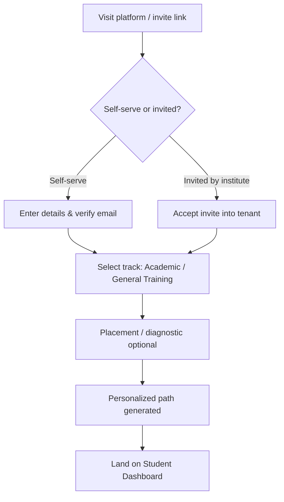

### 5.2 Tenant Registration

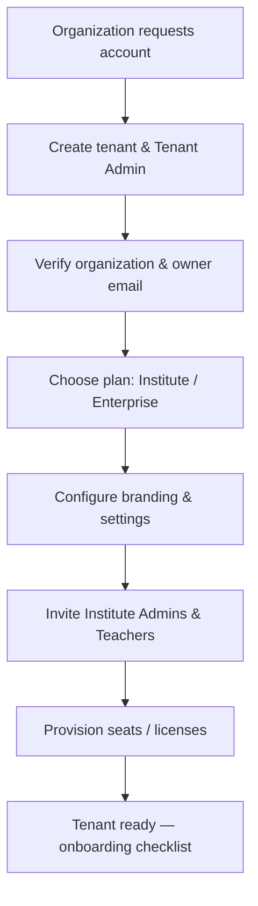

### 5.3 Subscription Purchase

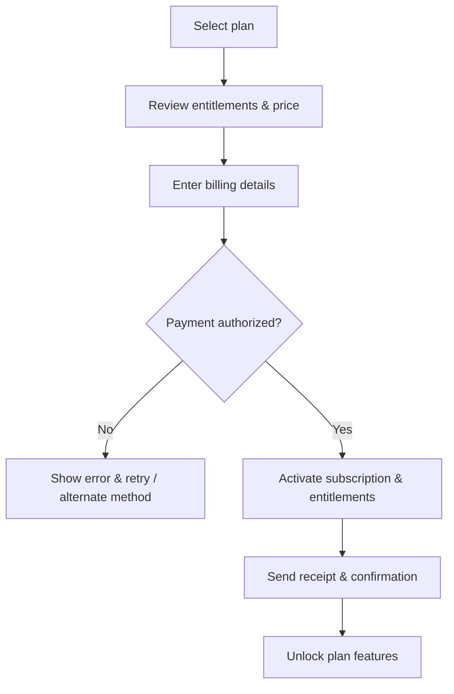

### 5.4 Daily Learning

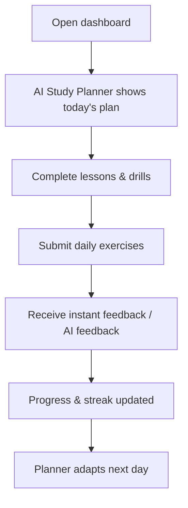

### 5.5 Completing a Lesson

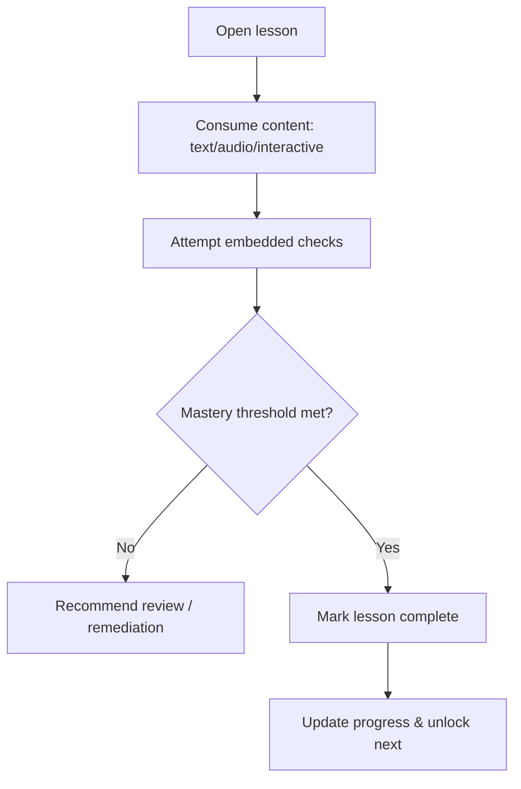

### 5.6 Taking Practice Exercises

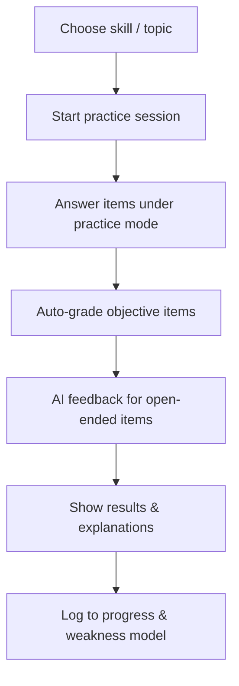

### 5.7 Taking Weekly Tests

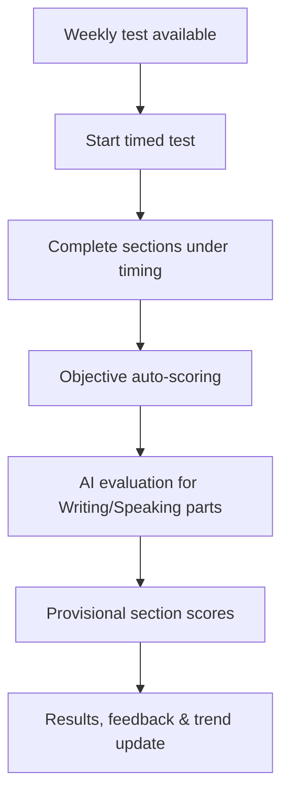

### 5.8 Taking Monthly Mock Exams

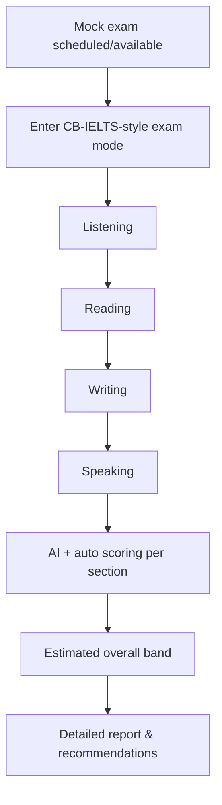

### 5.9 AI Writing Evaluation

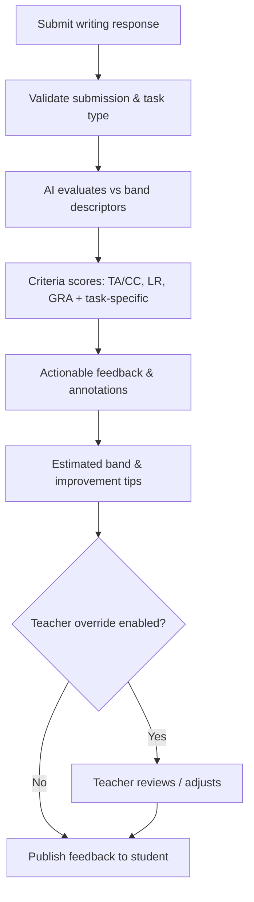

### 5.10 AI Speaking Evaluation

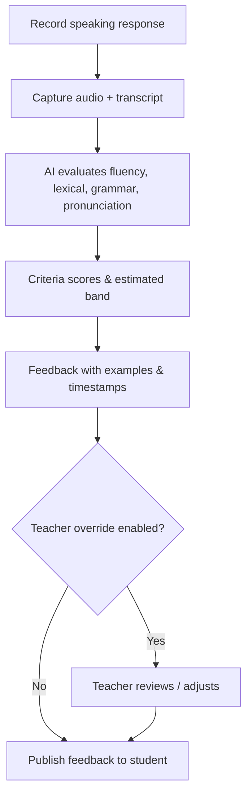

### 5.11 Certificate Generation

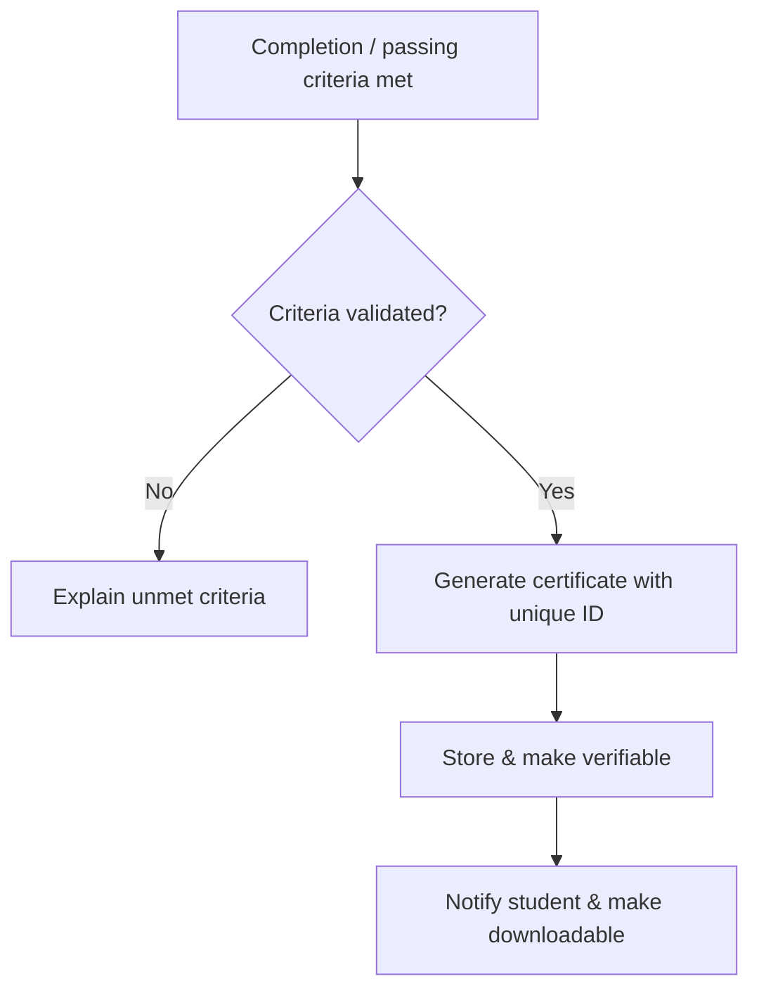

### 5.12 Teacher Management

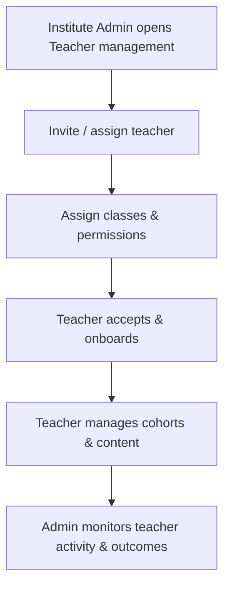

### 5.13 Institute Administration

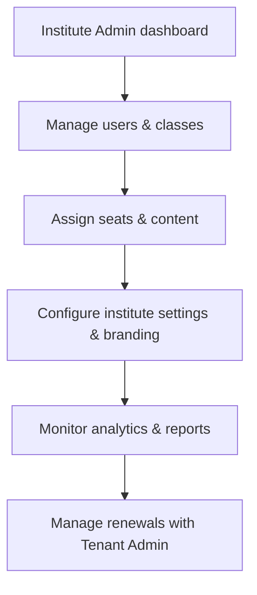

---

## 6. Product Modules

Each module below is defined by **Purpose**, **Business Value**, **Key Features**, **User Interactions**, **Dependencies**, **Acceptance Criteria**, and **Future Enhancements**. Modules are grouped into functional domains. Detailed, testable behaviors are elaborated in [Functional Requirements](./04_Functional_Requirements.md); this section defines the product-level intent and boundaries.

### 6.A Platform & Identity Domain

#### 6.A.1 Authentication

- **Purpose:** Verify user identity and establish secure, tenant-scoped sessions.
- **Business Value:** Foundational trust and security; gate to all functionality; enterprise readiness (SSO).
- **Key Features:** Email/password sign-in, email verification, password reset, MFA (optional), session management, SSO/SAML/OIDC readiness for Enterprise, tenant-aware login.
- **User Interactions:** Register, sign in/out, verify email, reset password, enable MFA.
- **Dependencies:** Users, Tenants, Roles, Notifications, Audit Logs.
- **Acceptance Criteria:** Users can authenticate into the correct tenant; failed attempts are rate-limited and logged; MFA and SSO can be enabled per plan/tenant.
- **Future Enhancements:** Passwordless/passkeys, social login, adaptive risk-based auth.

#### 6.A.2 Organizations

- **Purpose:** Represent a customer organization (institute, university, enterprise) as a top-level commercial entity.
- **Business Value:** Enables institutional sales, consolidated governance, and reporting.
- **Key Features:** Organization profile, hierarchy (org → institutes/departments), ownership, contract linkage.
- **User Interactions:** Create/configure organization, view org-wide structure and reports.
- **Dependencies:** Tenants, Users, Roles, Billing/Subscriptions.
- **Acceptance Criteria:** An organization maps to exactly one tenant; org structure supports sub-units; org-wide reporting aggregates sub-units.
- **Future Enhancements:** Multi-tenant enterprise groups; cross-org partner relationships.

#### 6.A.3 Tenants

- **Purpose:** Provide the isolation boundary for all data and configuration.
- **Business Value:** Core multi-tenant SaaS enabler; security and compliance guarantee.
- **Key Features:** Tenant lifecycle (create/suspend/close), tenant settings, branding, isolation enforcement, per-tenant configuration.
- **User Interactions:** Tenant Admin configures settings; Super Admin manages tenant lifecycle.
- **Dependencies:** Organizations, Users, Roles, Subscriptions, all data-owning modules.
- **Acceptance Criteria:** Every user and record belongs to exactly one tenant; no cross-tenant data access outside audited Super Admin operations. See [Multi-Tenant Architecture](./12_Multi_Tenant_Architecture.md).
- **Future Enhancements:** Tenant data residency selection; per-tenant encryption keys.

#### 6.A.4 Users

- **Purpose:** Represent all human actors within a tenant.
- **Business Value:** Central identity for access, personalization, and analytics.
- **Key Features:** User profiles, lifecycle (invite/activate/deactivate), status, tenant membership, persona/role assignment.
- **User Interactions:** Admins manage users; users manage their own profile.
- **Dependencies:** Tenants, Roles, Permissions, Authentication.
- **Acceptance Criteria:** Users are uniquely identified within a tenant; deactivated users cannot authenticate; user actions are attributable.
- **Future Enhancements:** Bulk import/SCIM provisioning; user merge.

#### 6.A.5 Roles

- **Purpose:** Define named sets of permissions mapped to responsibilities.
- **Business Value:** Scalable, auditable access management (RBAC).
- **Key Features:** System roles (Student, Teacher, Institute Admin, Tenant Admin, Support, Super Admin), custom roles (higher tiers), role assignment.
- **User Interactions:** Admins assign roles; higher tiers define custom roles.
- **Dependencies:** Users, Permissions, Tenants.
- **Acceptance Criteria:** Access is determined by role; role changes take effect within the session policy; changes are audited. See [Authentication & Authorization](./11_Authentication_Authorization.md).
- **Future Enhancements:** Attribute-based access control (ABAC) overlays.

#### 6.A.6 Permissions

- **Purpose:** Fine-grained authorization primitives that roles are composed from.
- **Business Value:** Precise least-privilege control; compliance.
- **Key Features:** Permission catalog, role-permission mapping, enforcement points, tenant-scoping.
- **User Interactions:** Mostly indirect (via roles); advanced admins inspect effective permissions.
- **Dependencies:** Roles, Users, all protected modules.
- **Acceptance Criteria:** Every protected action checks a permission; denied actions are handled gracefully and logged.
- **Future Enhancements:** Delegated administration; time-bound permissions.

### 6.B Experience & Profile Domain

#### 6.B.1 Dashboard

- **Purpose:** Role-appropriate landing view summarizing status and next actions.
- **Business Value:** Engagement, orientation, and quick access to value.
- **Key Features:** Persona-specific widgets (student progress, teacher cohorts, admin KPIs), today's plan, alerts.
- **User Interactions:** View summaries, drill into modules, act on recommendations.
- **Dependencies:** Progress Tracking, Analytics, Notifications, AI Study Planner.
- **Acceptance Criteria:** Each persona sees only permitted data; key metrics load within performance targets.
- **Future Enhancements:** Configurable/customizable dashboards.

#### 6.B.2 Profile

- **Purpose:** Manage personal information, preferences, and settings.
- **Business Value:** Personalization, localization, accessibility preferences.
- **Key Features:** Profile details, target band/date, language/locale, accessibility preferences, notification preferences.
- **User Interactions:** View/edit profile and preferences.
- **Dependencies:** Users, Notifications, Settings.
- **Acceptance Criteria:** Changes persist and apply; sensitive changes require re-auth where appropriate.
- **Future Enhancements:** Learning-style preferences feeding personalization.

### 6.C Learning Domain

#### 6.C.1 Courses

- **Purpose:** Organize structured learning content into coherent programs.
- **Business Value:** Core learning value; institutional program delivery.
- **Key Features:** Course catalog, Academic/General Training variants, modules/units, enrollment, prerequisites.
- **User Interactions:** Students enroll and consume; teachers/admins assign; authors curate.
- **Dependencies:** Lessons, Learning Paths, Users, Subscriptions.
- **Acceptance Criteria:** Courses are track-aware; enrollment respects entitlements; completion is tracked.
- **Future Enhancements:** Adaptive course sequencing; institute-authored courses.

#### 6.C.2 Learning Paths

- **Purpose:** Personalized ordered sequences toward a target band.
- **Business Value:** Differentiator; drives outcomes and retention.
- **Key Features:** Path generation from diagnostics/goals, adaptivity, milestones, remediation branches.
- **User Interactions:** Follow path; planner adjusts based on performance.
- **Dependencies:** AI Study Planner, Courses, Progress Tracking, Band Prediction.
- **Acceptance Criteria:** Each learner has a path aligned to track and goal; path adapts to performance.
- **Future Enhancements:** Multi-goal paths; teacher-tunable paths.

#### 6.C.3 Grammar

- **Purpose:** Teach and reinforce grammatical accuracy relevant to IELTS.
- **Business Value:** Underpins Writing/Speaking band gains.
- **Key Features:** Grammar lessons, targeted drills, error explanations, AI Grammar Coach hooks.
- **User Interactions:** Learn concepts, practice, review mistakes.
- **Dependencies:** Lessons, Practice Sessions, AI Grammar Coach, Progress Tracking.
- **Acceptance Criteria:** Grammar topics map to skills; drills auto-grade; errors feed the weakness model.
- **Future Enhancements:** Contextual grammar correction inside writing.

#### 6.C.4 Vocabulary

- **Purpose:** Build topic and band-relevant vocabulary.
- **Business Value:** Improves Lexical Resource across skills.
- **Key Features:** Word lists, spaced repetition, usage examples, AI Vocabulary Coach hooks.
- **User Interactions:** Learn, review (spaced repetition), practice usage.
- **Dependencies:** Lessons, Practice Sessions, AI Vocabulary Coach, Progress Tracking.
- **Acceptance Criteria:** Vocabulary reviews schedule correctly; mastery tracked; feeds recommendations.
- **Future Enhancements:** Personalized vocabulary from a learner's own writing.

#### 6.C.5 Sentence Builder

- **Purpose:** Develop sentence construction and complexity.
- **Business Value:** Bridges grammar/vocabulary to productive skills.
- **Key Features:** Guided construction exercises, transformations, AI Sentence Builder feedback.
- **User Interactions:** Build/transform sentences; receive AI feedback.
- **Dependencies:** Grammar, Vocabulary, AI features, Progress Tracking.
- **Acceptance Criteria:** Exercises validate structure; AI feedback is actionable; progress tracked.
- **Future Enhancements:** Genre-specific construction (essays, letters).

### 6.D Skills & Practice Domain

#### 6.D.1 Reading

- **Purpose:** Develop and assess IELTS Reading skills.
- **Business Value:** Core skill; high-volume practice and analytics.
- **Key Features:** Academic/GT passages, all IELTS question types, timed CB-style interface, auto-scoring.
- **User Interactions:** Read passages, answer items, review explanations.
- **Dependencies:** Practice Sessions, Assessments, Progress Tracking.
- **Acceptance Criteria:** Question types render and auto-score correctly; timing matches exam; results feed analytics.
- **Future Enhancements:** Adaptive difficulty; AI-generated passages (governed).

#### 6.D.2 Listening

- **Purpose:** Develop and assess IELTS Listening skills.
- **Business Value:** Core skill; requires reliable audio delivery.
- **Key Features:** Audio sections, accents variety, CB-style playback rules, auto-scoring, transcripts for review.
- **User Interactions:** Listen, answer, review with transcript.
- **Dependencies:** File Management (audio), Practice Sessions, Assessments.
- **Acceptance Criteria:** Audio plays reliably per exam rules; scoring accurate; captions/transcripts available for accessibility.
- **Future Enhancements:** Adaptive listening; pronunciation-linked drills.

#### 6.D.3 Writing

- **Purpose:** Develop and assess IELTS Writing (Task 1 & Task 2).
- **Business Value:** Highest-value AI differentiator (feedback bottleneck).
- **Key Features:** Task 1 (Academic/GT variants) and Task 2 prompts, word count, timed mode, AI Writing Evaluation.
- **User Interactions:** Compose responses, submit, review AI feedback and band estimate.
- **Dependencies:** AI Writing Evaluation, Assessments, Progress Tracking, Teacher override.
- **Acceptance Criteria:** Submissions evaluated against official criteria; feedback actionable; teacher override supported where enabled.
- **Future Enhancements:** Inline suggestions during drafting (practice mode only).

#### 6.D.4 Speaking

- **Purpose:** Develop and assess IELTS Speaking (Parts 1–3).
- **Business Value:** Second major AI differentiator; scalable speaking feedback.
- **Key Features:** Prompt delivery, audio recording, AI Speaking Evaluation across criteria, part-structured flow.
- **User Interactions:** Record responses, review feedback and band estimate.
- **Dependencies:** File Management (audio), AI Speaking Evaluation, Assessments.
- **Acceptance Criteria:** Recording reliable; evaluation covers fluency, lexical, grammar, pronunciation; feedback with timestamps.
- **Future Enhancements:** Simulated live examiner dialogue (governed AI).

#### 6.D.5 Practice Sessions

- **Purpose:** Flexible, self-directed skill practice outside formal assessments.
- **Business Value:** Volume of engagement; weakness targeting.
- **Key Features:** Skill/topic selection, practice mode (hints/explanations), instant feedback, logging.
- **User Interactions:** Start sessions, answer, review, repeat.
- **Dependencies:** Reading/Listening/Writing/Speaking, Progress Tracking, AI features.
- **Acceptance Criteria:** Sessions record results; feedback available; feeds weakness model and recommendations.
- **Future Enhancements:** Smart practice queues from weaknesses.

#### 6.D.6 Assignments

- **Purpose:** Teacher-assigned tasks with due dates and tracking.
- **Business Value:** Institutional workflow; accountability.
- **Key Features:** Create/assign, due dates, submission tracking, grading (auto + AI + teacher), feedback.
- **User Interactions:** Teachers assign/grade; students submit; admins monitor.
- **Dependencies:** Users, Roles, Skills modules, Notifications, Analytics.
- **Acceptance Criteria:** Assignments track status per student; overdue handling; grades recorded and visible.
- **Future Enhancements:** Rubric templates; peer review.

### 6.E Planning & Assessment Domain

#### 6.E.1 Daily Planner

- **Purpose:** Provide adaptive daily study plans.
- **Business Value:** Habit formation, retention, outcomes.
- **Key Features:** Daily plan generation, goals/streaks, reminders, adaptation to progress and target date.
- **User Interactions:** View/complete daily plan; adjust availability.
- **Dependencies:** AI Study Planner, Learning Paths, Notifications, Progress Tracking.
- **Acceptance Criteria:** Each active learner has a daily plan; plan adapts; reminders respect preferences.
- **Future Enhancements:** Calendar integration; smart rescheduling.

#### 6.E.2 Weekly Assessments

- **Purpose:** Regular timed checkpoints to measure progress.
- **Business Value:** Trend measurement; motivation; teacher insight.
- **Key Features:** Weekly timed tests, mixed skills, auto + AI scoring, trend reporting.
- **User Interactions:** Take weekly tests; review results and trends.
- **Dependencies:** Skills modules, AI evaluation, Analytics, Progress Tracking.
- **Acceptance Criteria:** Weekly tests are timed and scored; results contribute to trends and analytics.
- **Future Enhancements:** Adaptive weekly difficulty.

#### 6.E.3 Monthly Mock Exams

- **Purpose:** Full-length CB-IELTS simulations.
- **Business Value:** Readiness signal; premium value; band estimation.
- **Key Features:** Full four-skill exam, exam-mode UI/timing, combined scoring, estimated overall band, detailed report.
- **User Interactions:** Take mock exams; review comprehensive report.
- **Dependencies:** All skills modules, AI evaluation, Band Prediction, Analytics.
- **Acceptance Criteria:** Mock replicates exam structure and timing; produces per-section and estimated overall band with report.
- **Future Enhancements:** Proctoring options; scheduled cohort mocks.

### 6.F Insights Domain

#### 6.F.1 Progress Tracking

- **Purpose:** Record and represent learner progress over time.
- **Business Value:** Core outcome visibility; motivation; teacher/admin insight.
- **Key Features:** Completion, scores, streaks, mastery, band trend, per-skill breakdown.
- **User Interactions:** View progress; teachers/admins view cohort progress.
- **Dependencies:** All learning/assessment modules, Analytics.
- **Acceptance Criteria:** Progress updates accurately from activities; visible per persona scope.
- **Future Enhancements:** Predictive progress projections.

#### 6.F.2 Analytics

- **Purpose:** Aggregate insights for learners, teachers, and administrators.
- **Business Value:** Decision-making, ROI evidence, engagement.
- **Key Features:** Dashboards, cohort analytics, engagement/outcome metrics, exports.
- **User Interactions:** Explore dashboards; filter; export (per permission).
- **Dependencies:** Progress Tracking, Assessments, Reports.
- **Acceptance Criteria:** Analytics respect tenant/persona scope; metrics are consistent with source data.
- **Future Enhancements:** Custom analytics builder; benchmarking.

#### 6.F.3 Achievements

- **Purpose:** Recognize milestones to drive motivation.
- **Business Value:** Engagement and retention.
- **Key Features:** Badges/milestones (basic gamification), streak rewards.
- **User Interactions:** Earn/view achievements.
- **Dependencies:** Progress Tracking, Notifications.
- **Acceptance Criteria:** Achievements trigger on defined criteria; visible to learner.
- **Future Enhancements:** Leaderboards (opt-in), richer gamification (post-V1).

#### 6.F.4 Certificates

- **Purpose:** Issue verifiable certificates on meeting criteria.
- **Business Value:** Tangible value; institutional proof of completion.
- **Key Features:** Criteria-based issuance, unique verifiable IDs, downloadable format, tenant branding.
- **User Interactions:** Earn/download/verify certificates.
- **Dependencies:** Assessments, Progress Tracking, Tenants (branding).
- **Acceptance Criteria:** Certificates issue only when criteria met; each is uniquely verifiable.
- **Future Enhancements:** Public verification portal; digital credentials/standards.

### 6.G Communication Domain

#### 6.G.1 Notifications

- **Purpose:** Timely, preference-aware notifications across channels.
- **Business Value:** Engagement, retention, operational awareness.
- **Key Features:** In-app and email notifications, preferences, templates, event triggers.
- **User Interactions:** Receive/manage notifications and preferences.
- **Dependencies:** Users, most modules (as event sources), Settings.
- **Acceptance Criteria:** Notifications respect preferences; delivery attempts logged.
- **Future Enhancements:** Push (with future mobile apps), SMS, digest scheduling.

#### 6.G.2 Messaging

- **Purpose:** Bounded communication between teachers and students within a tenant.
- **Business Value:** Support and guidance; engagement.
- **Key Features:** Teacher↔student messaging, announcements to cohorts, moderation controls.
- **User Interactions:** Send/receive messages; teachers post announcements.
- **Dependencies:** Users, Roles, Notifications.
- **Acceptance Criteria:** Messaging is tenant-scoped and permission-bound; content is auditable per policy.
- **Future Enhancements:** Group discussions (aligned with future community scope).

### 6.H Commerce Domain

#### 6.H.1 Billing

- **Purpose:** Manage invoicing, payments, and financial records.
- **Business Value:** Revenue operations; enterprise procurement.
- **Key Features:** Invoices, payment processing via provider, receipts, tax handling, billing history.
- **User Interactions:** Tenant/Individual manage billing; Finance reconciles.
- **Dependencies:** Subscriptions, Payment provider, Organizations/Tenants.
- **Acceptance Criteria:** Payments recorded accurately; receipts/invoices generated; failures handled gracefully.
- **Future Enhancements:** Multi-currency, purchase orders, dunning automation.

#### 6.H.2 Subscriptions

- **Purpose:** Manage plans, entitlements, and lifecycle.
- **Business Value:** Core monetization; feature gating.
- **Key Features:** Plan catalog (Free/Starter/Premium/Institute/Enterprise), entitlements/quotas, upgrade/downgrade, renewals, trials.
- **User Interactions:** Select/upgrade/cancel; admins manage tenant plans.
- **Dependencies:** Billing, Tenants, Permissions/Entitlements.
- **Acceptance Criteria:** Entitlements enforce feature access; plan changes apply predictably; renewals handled.
- **Future Enhancements:** Usage-based add-ons (e.g., AI credits).

#### 6.H.3 Coupons

- **Purpose:** Support discounts and promotions.
- **Business Value:** Acquisition and conversion levers.
- **Key Features:** Coupon codes, discount types, validity/limits, applicability rules.
- **User Interactions:** Apply coupons at checkout; admins create campaigns.
- **Dependencies:** Billing, Subscriptions.
- **Acceptance Criteria:** Valid coupons apply correctly; invalid/expired rejected; usage limits enforced.
- **Future Enhancements:** Referral and affiliate codes.

### 6.I Administration Domain

#### 6.I.1 Reports

- **Purpose:** Structured, exportable reporting for stakeholders.
- **Business Value:** Governance, ROI, compliance evidence.
- **Key Features:** Standard report templates, scheduling, export (per permission), tenant scoping.
- **User Interactions:** Generate/schedule/export reports.
- **Dependencies:** Analytics, Progress Tracking, Billing.
- **Acceptance Criteria:** Reports reflect scoped, accurate data; exports respect permissions.
- **Future Enhancements:** Custom report builder.

#### 6.I.2 Settings

- **Purpose:** Configure platform, tenant, and user-level options.
- **Business Value:** Flexibility, branding, governance.
- **Key Features:** Tenant settings/branding, feature toggles per entitlement, localization, user preferences.
- **User Interactions:** Admins configure tenant; users set preferences.
- **Dependencies:** Tenants, Users, Subscriptions.
- **Acceptance Criteria:** Settings persist and scope correctly; entitlement-gated toggles enforced.
- **Future Enhancements:** Policy templates; configuration versioning.

#### 6.I.3 Admin Portal

- **Purpose:** Administrative surface for tenant and platform management.
- **Business Value:** Operational efficiency and control.
- **Key Features:** User/role management, seat/license management, tenant configuration, monitoring views (scoped).
- **User Interactions:** Institute/Tenant Admins and Super Admin operate within scope.
- **Dependencies:** Users, Roles, Tenants, Subscriptions, Audit Logs.
- **Acceptance Criteria:** Admin actions are scoped and audited; least privilege enforced.
- **Future Enhancements:** Bulk operations; automation workflows.

#### 6.I.4 Teacher Portal

- **Purpose:** Teacher-focused surface for cohort and content management.
- **Business Value:** Teaching efficiency; outcomes.
- **Key Features:** Class management, assignments, submission review, cohort analytics.
- **User Interactions:** Teachers manage classes, assign, grade, and review.
- **Dependencies:** Assignments, Skills modules, Analytics, Messaging.
- **Acceptance Criteria:** Teachers only access assigned cohorts; grading and review flows function.
- **Future Enhancements:** Lesson planning tools.

#### 6.I.5 Student Portal

- **Purpose:** Learner-focused surface for the full learning experience.
- **Business Value:** Primary value delivery to the largest user base.
- **Key Features:** Dashboard, learning path, practice/tests/mocks, feedback, progress, certificates.
- **User Interactions:** Students learn, practice, assess, and track.
- **Dependencies:** Most learning/assessment/AI modules.
- **Acceptance Criteria:** Students access only their own data and entitled features.
- **Future Enhancements:** Personalized home experience.

### 6.J AI Domain

#### 6.J.1 AI Tutor

- **Purpose:** On-demand conversational guidance for learners.
- **Business Value:** Scalable tutoring; engagement and differentiation.
- **Key Features:** Q&A, explanations, guided help, context-aware of learner progress, governed prompts.
- **User Interactions:** Ask questions; receive guided help.
- **Dependencies:** AI provider, Prompt Management, Progress Tracking.
- **Acceptance Criteria:** Responses are relevant, safe, and within scope; usage governed by entitlements.
- **Future Enhancements:** Multi-agent tutoring (see [§10.12](#1012-future-multi-agent-ai-system)).

#### 6.J.2 AI Writing Evaluation

- **Purpose:** Automated evaluation of writing against IELTS band descriptors.
- **Business Value:** Removes the feedback bottleneck; premium differentiator.
- **Key Features:** Criterion scoring (Task Achievement/Response, Coherence & Cohesion, Lexical Resource, Grammatical Range & Accuracy), actionable feedback, band estimate, teacher override.
- **User Interactions:** Submit writing; review feedback; teachers adjust where enabled.
- **Dependencies:** Writing, AI provider, Prompt Management, Band Prediction.
- **Acceptance Criteria:** Evaluations align to official criteria and are reproducible within tolerance; feedback is specific and actionable.
- **Future Enhancements:** Inline drafting suggestions (practice mode).

#### 6.J.3 AI Speaking Evaluation

- **Purpose:** Automated evaluation of speaking against IELTS band descriptors.
- **Business Value:** Scalable speaking feedback; differentiator.
- **Key Features:** Criterion scoring (Fluency & Coherence, Lexical Resource, Grammatical Range & Accuracy, Pronunciation), transcript, timestamped feedback, band estimate, teacher override.
- **User Interactions:** Record; review feedback; teachers adjust where enabled.
- **Dependencies:** Speaking, File Management, AI provider, Prompt Management.
- **Acceptance Criteria:** Evaluation covers all criteria; feedback references specific moments; reproducible within tolerance.
- **Future Enhancements:** Interactive examiner simulation.

#### 6.J.4 AI Study Planner

- **Purpose:** Generate and adapt personalized study plans.
- **Business Value:** Outcomes, retention, personalization at scale.
- **Key Features:** Goal/target-date planning, daily/weekly plans, adaptation to performance, weakness targeting.
- **User Interactions:** Receive/follow plans; planner adapts automatically.
- **Dependencies:** Learning Paths, Progress Tracking, Weakness Detection, Band Prediction.
- **Acceptance Criteria:** Plans align to goals and adapt to performance and availability.
- **Future Enhancements:** Multi-goal and constraint-aware planning.

#### 6.J.5 Band Prediction

- **Purpose:** Estimate current and projected band scores.
- **Business Value:** Readiness signal; motivation; planning input.
- **Key Features:** Per-skill and overall estimates, confidence indication, trend projection.
- **User Interactions:** View estimates and projections.
- **Dependencies:** Assessments, AI evaluation, Analytics.
- **Acceptance Criteria:** Estimates are clearly framed as predictions with appropriate caveats; consistent with performance data.
- **Future Enhancements:** Calibration against real exam outcomes (opt-in).

#### 6.J.6 Audit Logs

- **Purpose:** Immutable record of security- and governance-relevant actions.
- **Business Value:** Compliance, security, accountability.
- **Key Features:** Actor, action, target, timestamp, tenant scope; tamper-evident storage; query/export (scoped).
- **User Interactions:** Admins/Super Admin review; Support references within scope.
- **Dependencies:** All modules performing sensitive actions.
- **Acceptance Criteria:** Sensitive actions are logged with sufficient context; logs are protected and scoped.
- **Future Enhancements:** SIEM integration; anomaly detection.

#### 6.J.7 Activity Logs

- **Purpose:** Record user learning/product activity for analytics and support.
- **Business Value:** Insight, personalization, troubleshooting.
- **Key Features:** Activity events, session context, tenant scoping.
- **User Interactions:** Indirect; surfaced via analytics/support tools.
- **Dependencies:** Most product modules, Analytics.
- **Acceptance Criteria:** Activity is captured accurately and scoped; used to power analytics/recommendations.
- **Future Enhancements:** Real-time activity streams.

#### 6.J.8 File Management

- **Purpose:** Manage media and documents (audio, uploads, certificates).
- **Business Value:** Enables Listening/Speaking, submissions, and certificates.
- **Key Features:** Secure upload/storage/retrieval, access control, media handling for audio, retention rules.
- **User Interactions:** Upload/download within permissions.
- **Dependencies:** Object storage, Tenants, Permissions.
- **Acceptance Criteria:** Files are tenant-scoped and access-controlled; media serves reliably.
- **Future Enhancements:** CDN acceleration; virus scanning.

#### 6.J.9 Support Center

- **Purpose:** Help resources and ticketing for users.
- **Business Value:** Retention, satisfaction, reduced churn.
- **Key Features:** Help articles, ticket submission, status tracking, escalation.
- **User Interactions:** Search help; submit/track tickets.
- **Dependencies:** Users, Notifications, Feedback System.
- **Acceptance Criteria:** Users can find help and raise tickets; agents manage within scope.
- **Future Enhancements:** AI support assistant; SLA automation.

#### 6.J.10 Feedback System

- **Purpose:** Capture product feedback and satisfaction signals.
- **Business Value:** Product improvement; CSAT/NPS measurement.
- **Key Features:** In-product feedback, ratings, CSAT/NPS surveys, routing.
- **User Interactions:** Submit feedback/ratings; respond to surveys.
- **Dependencies:** Users, Analytics, Notifications.
- **Acceptance Criteria:** Feedback captured and routed; satisfaction metrics computed.
- **Future Enhancements:** Closed-loop feedback follow-up.

---

## 7. Feature Requirements

This section specifies representative major features using a consistent template: **Description, User Story, Priority, Business Rules, Preconditions, Postconditions, Success Criteria, Error Scenarios, Acceptance Criteria.** Requirement IDs (`PRD-<MODULE>-<NNN>`) are stable references used across QA, design, and architecture. This is a representative — not exhaustive — set; the full functional decomposition lives in [Functional Requirements](./04_Functional_Requirements.md).

### 7.1 Authentication

#### PRD-AUTH-001 — Tenant-Aware Sign-In

- **Description:** Users authenticate into the correct tenant context using their credentials.
- **User Story:** *As a user, I want to sign in and land in my organization's workspace so that I only see my tenant's data.*
- **Priority:** Must
- **Business Rules:** Every user belongs to exactly one tenant; sessions are tenant-scoped; failed attempts are rate-limited.
- **Preconditions:** User account exists and is active; email verified.
- **Postconditions:** Authenticated, tenant-scoped session established; sign-in event logged.
- **Success Criteria:** Valid credentials grant access to the correct tenant; invalid credentials are rejected.
- **Error Scenarios:** Wrong password; unverified email; deactivated account; rate-limit exceeded; tenant suspended.
- **Acceptance Criteria:** Given valid credentials, when a user signs in, then they access their tenant workspace and the event is audited; repeated failures trigger throttling.

#### PRD-AUTH-002 — Multi-Factor Authentication (MFA)

- **Description:** Optional second factor for account protection, enforceable by tenant policy.
- **User Story:** *As a Tenant Admin, I want to require MFA so that accounts are better protected.*
- **Priority:** Should
- **Business Rules:** MFA policy configurable per tenant; enterprise tenants may enforce it.
- **Preconditions:** User authenticated with primary factor; MFA method enrolled.
- **Postconditions:** Session established only after successful second factor.
- **Success Criteria:** Users with MFA must pass the second factor; recovery path exists.
- **Error Scenarios:** Invalid code; lost device; expired challenge.
- **Acceptance Criteria:** When MFA is enforced, then sign-in requires a valid second factor and provides a secure recovery flow.

### 7.2 Subscriptions & Billing

#### PRD-SUBS-001 — Subscription Purchase & Activation

- **Description:** Purchase a plan and activate its entitlements.
- **User Story:** *As a customer, I want to purchase a plan so that I unlock its features.*
- **Priority:** Must
- **Business Rules:** Subscriptions determine feature access; entitlements activate only on successful payment.
- **Preconditions:** Authenticated user with rights to purchase; valid billing details.
- **Postconditions:** Active subscription; entitlements applied; receipt issued.
- **Success Criteria:** Successful payment unlocks features immediately; failures leave prior state intact.
- **Error Scenarios:** Declined payment; provider outage; duplicate purchase; currency issues.
- **Acceptance Criteria:** Given authorized payment, when purchase completes, then entitlements activate and a receipt is sent; on failure, no entitlement change occurs.

#### PRD-SUBS-002 — Plan Upgrade / Downgrade

- **Description:** Change between plans with correct proration and entitlement changes.
- **User Story:** *As a customer, I want to change plans so that my access matches my needs.*
- **Priority:** Should
- **Business Rules:** Upgrades apply immediately; downgrades apply per policy (e.g., next cycle); entitlements adjust accordingly.
- **Preconditions:** Active subscription; permission to manage billing.
- **Postconditions:** Updated plan and entitlements; adjusted billing.
- **Success Criteria:** Access reflects the new plan per timing rules.
- **Error Scenarios:** Payment failure on upgrade; loss of access to data exceeding new limits.
- **Acceptance Criteria:** When a plan changes, then entitlements and billing update per policy and the user is informed of effects.

### 7.3 AI Writing Evaluation

#### PRD-AIWE-001 — Automated Writing Evaluation

- **Description:** Evaluate a writing submission against IELTS band descriptors and return criteria scores and feedback.
- **User Story:** *As a student, I want instant, rubric-aligned feedback on my writing so that I can improve efficiently.*
- **Priority:** Must
- **Business Rules:** Evaluation aligns to official criteria (Task Achievement/Response, Coherence & Cohesion, Lexical Resource, Grammatical Range & Accuracy); teacher override configurable; AI feedback flagged as AI-generated.
- **Preconditions:** Valid submission for a supported task type; entitlement present.
- **Postconditions:** Criteria scores, estimated band, and actionable feedback stored and shown; contributes to analytics.
- **Success Criteria:** Feedback returned within performance targets; consistent for equivalent inputs.
- **Error Scenarios:** Unsupported/oversized input; AI provider timeout; low-confidence result.
- **Acceptance Criteria:** Given a valid submission, when evaluation completes, then criteria scores, an estimated band, and actionable feedback are produced and recorded; failures degrade gracefully with retry.

### 7.4 AI Speaking Evaluation

#### PRD-AISE-001 — Automated Speaking Evaluation

- **Description:** Evaluate a recorded speaking response for fluency, lexical resource, grammar, and pronunciation.
- **User Story:** *As a student, I want feedback on my spoken responses so that I can improve my speaking band.*
- **Priority:** Must
- **Business Rules:** Aligns to official speaking criteria; audio retained per data policy; teacher override configurable.
- **Preconditions:** Captured audio of acceptable quality; entitlement present.
- **Postconditions:** Transcript, criteria scores, estimated band, and feedback stored and shown.
- **Success Criteria:** Feedback returned within targets; robust to typical accents/noise within stated limits.
- **Error Scenarios:** Inaudible/short audio; transcription failure; provider timeout.
- **Acceptance Criteria:** Given acceptable audio, when evaluation completes, then transcript, criteria scores, estimated band, and feedback are produced; poor audio prompts re-record.

### 7.5 Assessment — Monthly Mock Exam

#### PRD-MOCK-001 — Full CB-IELTS Mock Exam

- **Description:** Deliver a full four-skill mock exam emulating CB-IELTS conditions and produce an estimated overall band.
- **User Story:** *As a student, I want a realistic full mock so that I can gauge exam readiness.*
- **Priority:** Must
- **Business Rules:** Section order and timing emulate CB-IELTS; mock results contribute to analytics and band prediction.
- **Preconditions:** Entitlement present; mock available; environment checks (audio) passed.
- **Postconditions:** Per-section scores, estimated overall band, and a detailed report stored.
- **Success Criteria:** Exam runs under timing with autosave; results and recommendations generated.
- **Error Scenarios:** Disconnection mid-exam; audio failure; timer edge cases.
- **Acceptance Criteria:** Given a started mock, when completed (or safely resumed after disruption), then section scores, an estimated overall band, and a report are produced.

### 7.6 Certificates

#### PRD-CERT-001 — Certificate Issuance

- **Description:** Issue a verifiable certificate when passing/completion criteria are met.
- **User Story:** *As a student, I want a certificate when I meet criteria so that I can evidence my achievement.*
- **Priority:** Should
- **Business Rules:** Certificates require defined passing criteria; each has a unique verifiable ID; issuance is tenant-scoped.
- **Preconditions:** Criteria satisfied and validated.
- **Postconditions:** Certificate generated, stored, verifiable, and downloadable.
- **Success Criteria:** Only qualifying users receive certificates; verification resolves authenticity.
- **Error Scenarios:** Criteria not met; revocation needed; verification lookup failure.
- **Acceptance Criteria:** Given met criteria, when issuance runs, then a uniquely identified, verifiable certificate is produced and the student is notified.

### 7.7 Feature Requirement Summary (Representative)

| Requirement ID | Feature | Priority |
| --- | --- | --- |
| PRD-AUTH-001 | Tenant-aware sign-in | Must |
| PRD-AUTH-002 | Multi-factor authentication | Should |
| PRD-SUBS-001 | Subscription purchase & activation | Must |
| PRD-SUBS-002 | Plan upgrade / downgrade | Should |
| PRD-AIWE-001 | Automated writing evaluation | Must |
| PRD-AISE-001 | Automated speaking evaluation | Must |
| PRD-MOCK-001 | Full CB-IELTS mock exam | Must |
| PRD-CERT-001 | Certificate issuance | Should |

> The complete, exhaustive requirement catalog (all modules, all requirements) is maintained in [Functional Requirements](./04_Functional_Requirements.md), which uses the same ID scheme.

---

## 8. Functional Scope (MoSCoW)

The following prioritization defines Version 1 delivery. It aligns with the [BRD Business Scope](./02_Business_Requirements_Document.md#7-business-scope) and the [Vision roadmap](./01_Product_Vision.md#11-high-level-roadmap).

### 8.1 Must Have (MVP)

| Area | Scope |
| --- | --- |
| Identity & Tenancy | Authentication, Users, Tenants, Roles, Permissions, multi-tenant isolation |
| Commerce | Subscriptions, Billing, plan entitlements |
| Learning | Courses, Lessons, Grammar, Vocabulary, Reading, Listening, Writing, Speaking content delivery |
| Practice & Assessment | Practice Sessions, Daily Planner, Weekly Tests, Monthly Mock Exams (CB-IELTS style) |
| AI | Writing Evaluation, Speaking Evaluation, Band Prediction, AI Study Planner |
| Insights | Progress Tracking, core Analytics, Reports |
| Platform | Notifications, Profile, Dashboards, Admin/Teacher/Student portals, Audit Logs |

### 8.2 Should Have

| Area | Scope |
| --- | --- |
| Learning | Sentence Builder, Learning Paths refinement, Assignments |
| Engagement | Achievements, Certificates, Messaging |
| AI | Grammar Coach, Vocabulary Coach, Weakness Detection, Personalized Recommendations |
| Commerce | Coupons, advanced billing management |
| Support | Support Center, Feedback System |

### 8.3 Could Have

| Area | Scope |
| --- | --- |
| Experience | Configurable dashboards, richer gamification (basic) |
| AI | Sentence Builder AI enhancements, deeper explainability |
| Admin | Advanced custom roles, delegated administration |

### 8.4 Won't Have (This Release / Future Releases)

Native mobile apps, offline learning, live video classes, marketplaces, community forums, and advanced gamification. See [§15 Out of Scope](#15-out-of-scope-version-1) and [§16 Future Vision](#16-future-vision-35-years).

---

## 9. Non-Functional Expectations

Non-functional requirements are summarized here and specified in full in the [Non-Functional Requirements](./05_Non_Functional_Requirements.md) document.

| Attribute | Expectation (Summary) |
| --- | --- |
| **Security** | Tenant isolation, least-privilege RBAC, encryption in transit/at rest, auditability, secure AI handling. |
| **Performance** | Responsive interactions; AI evaluation within acceptable latency targets; efficient assessment delivery. |
| **Scalability** | Elastic scaling from individuals to large tenants without rearchitecture; scalable AI and assessment workloads. |
| **Availability** | High availability with defined SLOs; graceful degradation of non-critical features. |
| **Reliability** | Durable data, consistent scoring, safe retries for AI operations. |
| **Accessibility** | Target WCAG 2.1 AA for learner-facing experiences. |
| **Localization** | Multi-language UI readiness and locale-aware formatting; content localization over time. |

---

## 10. AI Features

High-level AI requirements. Detailed AI design, governance, and prompt management are specified in [AI Architecture](./16_AI_Architecture.md).

| AI Feature | Requirement (High-Level) | Priority |
| --- | --- | --- |
| **AI Tutor** | Conversational, context-aware guidance grounded in curriculum; safe and scoped to IELTS. | Must |
| **Grammar Coach** | Detect and explain grammar issues with corrective guidance. | Should |
| **Vocabulary Coach** | Recommend and reinforce vocabulary aligned to level and goals. | Should |
| **Sentence Builder AI** | Assist construction of well-formed sentences with feedback. | Could |
| **Writing Evaluation** | Rubric-aligned scoring and actionable feedback for writing tasks. | Must |
| **Speaking Evaluation** | Rubric-aligned scoring and feedback for spoken responses. | Must |
| **Band Prediction** | Estimate overall and per-skill band from performance data. | Must |
| **Study Planner** | Generate and adapt personalized study plans to target date/band. | Must |
| **Weakness Detection** | Identify skill/topic weaknesses to target practice. | Should |
| **Personalized Recommendations** | Recommend next best actions/content. | Should |
| **Prompt Management** | Governed, versioned, auditable prompts; no secrets embedded; human oversight. | Must |
| **Future Multi-Agent AI System** | Orchestrated specialized agents (tutor, evaluator, planner) collaborating. | Won't (V1) |

**Cross-cutting AI requirements:** all AI outputs are labeled as AI-generated; evaluations are explainable and aligned to official descriptors; teacher override is supported where configured; AI operations are safe, rate-limited, cost-governed, and auditable; low-confidence outputs are flagged.

---

## 11. Subscription Model

Feature availability by plan. This operationalizes the [Vision Business Model](./01_Product_Vision.md#5-business-model) and [BRD Subscription Strategy](./02_Business_Requirements_Document.md#10-subscription-strategy) as product entitlements. (● = included, ◐ = limited/quota, ○ = not included.)

| Capability | Free | Starter | Premium | Institute | Enterprise |
| --- | --- | --- | --- | --- | --- |
| Core learning (Grammar/Vocab/Reading/Listening) | ◐ | ● | ● | ● | ● |
| Writing & Speaking practice | ◐ | ● | ● | ● | ● |
| AI Writing/Speaking evaluation | ◐ (quota) | ◐ (quota) | ● | ● | ● |
| AI Tutor & Study Planner | ○ | ◐ | ● | ● | ● |
| Weekly tests | ◐ | ● | ● | ● | ● |
| Monthly mock exams | ○ | ◐ | ● | ● | ● |
| Certificates | ○ | ◐ | ● | ● | ● |
| Multi-user / cohort management | ○ | ○ | ○ | ● | ● |
| Institute analytics & reporting | ○ | ○ | ○ | ● | ● |
| Branding / white-label readiness | ○ | ○ | ○ | ◐ | ● |
| SSO / advanced security | ○ | ○ | ○ | ◐ | ● |
| Custom roles & delegated admin | ○ | ○ | ○ | ◐ | ● |
| Priority support / SLA | ○ | ○ | ◐ | ● | ● |

### 11.1 Upgrade Paths

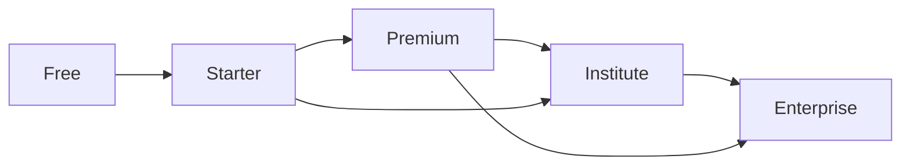

- **Individuals:** Free → Starter → Premium as commitment grows.
- **Institutions:** Premium/Starter → Institute when multi-user management is needed.
- **Large organizations:** Institute → Enterprise for SSO, white-label, custom roles, and SLAs.
- Upgrades apply immediately; downgrades follow policy (typically next cycle) with clear communication of entitlement changes (see PRD-SUBS-002).

---

## 12. Success Metrics

Product KPIs align with the [Vision Success Metrics](./01_Product_Vision.md#9-success-metrics) and [BRD KPIs](./02_Business_Requirements_Document.md#13-success-metrics-kpis).

| Category | KPI | Intent |
| --- | --- | --- |
| Engagement | DAU, MAU, DAU/MAU stickiness | Habitual usage |
| Engagement | Average study time, streak retention | Depth of engagement |
| Learning | Lesson completion rate | Content effectiveness |
| Learning | Mock exam completion rate | Assessment adoption |
| Learning | Estimated band improvement | Core outcome |
| Learning | Writing/Speaking improvement | AI value proof |
| Commercial | Subscription conversion rate | Monetization |
| Commercial | MRR / ARR growth | Revenue health |
| Commercial | Churn / retention rate | Durability |
| Satisfaction | CSAT, NPS | Experience quality |
| Platform | Availability vs SLO | Reliability |
| Platform | AI evaluation latency & success rate | AI reliability |

---

## 13. Assumptions

- Learners have reliable internet and a modern browser (V1 is web-first; see Out of Scope).
- AI evaluation is decision-support, not an official IELTS score, and is communicated as an estimate.
- Official IELTS band descriptors and formats remain the alignment reference.
- Tenants own and are responsible for the learners and content they manage.
- Third-party providers (payments, AI/LLM, email, storage) are available via integration.
- Content for Academic and General Training is authored/curated to platform standards.

---

## 14. Constraints

| Type | Constraint |
| --- | --- |
| **Technology** | Web-first delivery in V1; cloud-native, multi-tenant architecture; browser-based CB-IELTS emulation. |
| **Compliance** | Data privacy and residency obligations; auditability; secure handling of learner data and audio. |
| **Timeline** | Phased delivery per the roadmap; MVP scope constrained to Must-have items. |
| **Budget** | AI usage governed by cost controls and plan quotas. |
| **Scalability** | Must not adopt designs that block future scale (per role guidance and NFR). |
| **Legal/IP** | Respect IELTS trademark usage; the platform is preparation, not official testing. |

---

## 15. Out of Scope (Version 1)

Consistent with the [Vision Out of Scope](./01_Product_Vision.md#10-out-of-scope-version-1):

- Native mobile applications (iOS/Android).
- Offline learning.
- Live video classes / synchronous tutoring.
- Content or teacher marketplaces.
- Community forums / social networking.
- Gamification beyond basic achievements.
- Official IELTS score issuance (the platform provides estimates only).

---

## 16. Future Vision (3–5 Years)

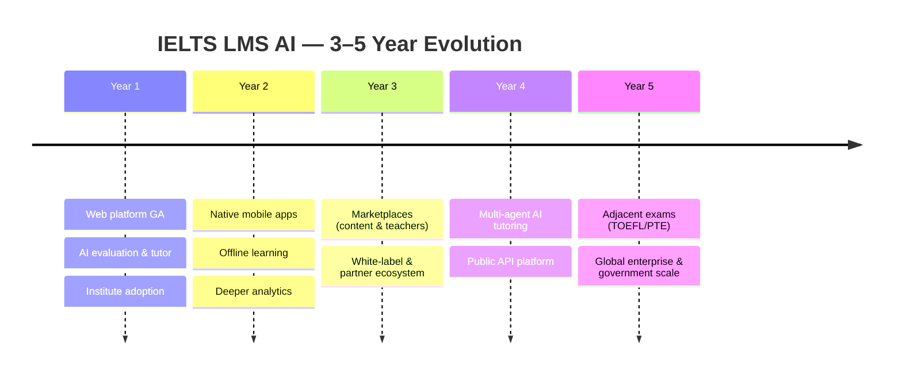

Over three to five years, IELTS LMS AI evolves from a web-first IELTS preparation platform into a broader English-proficiency preparation ecosystem: native mobile and offline experiences, content and teacher marketplaces, a public API platform, white-label and partner distribution, a multi-agent AI tutoring system, and expansion into adjacent exams — while preserving multi-tenant isolation, security, and outcome focus.

---

## 17. Related Documents

| # | Document | Relationship |
| --- | --- | --- |
| 01 | [Product Vision](./01_Product_Vision.md) | Foundational vision this PRD implements. |
| 02 | [Business Requirements Document](./02_Business_Requirements_Document.md) | Business drivers this PRD operationalizes. |
| 04 | [Functional Requirements](./04_Functional_Requirements.md) | Exhaustive functional behaviors and requirement catalog. |
| 05 | [Non-Functional Requirements](./05_Non_Functional_Requirements.md) | Quality attributes referenced in §9. |
| 06 | [Software Requirements Specification (SRS)](./06_SRS.md) | Consolidated formal requirements. |
| 07 | [Domain-Driven Design](./07_Domain_Driven_Design.md) | Domain model and bounded contexts. |
| 09 | [Database Design (ERD)](./09_Database_Design_ERD.md) | Data model realizing these entities. |
| 10 | [API Specification](./10_API_Specification.md) | API contracts for these capabilities. |
| 11 | [Authentication & Authorization](./11_Authentication_Authorization.md) | Identity and RBAC design. |
| 12 | [Multi-Tenant Architecture](./12_Multi_Tenant_Architecture.md) | Tenancy and isolation model. |
| 13 | [Clean Architecture](./13_Clean_Architecture.md) | Structural/architectural approach. |
| 16 | [AI Architecture](./16_AI_Architecture.md) | AI evaluation, tutoring, planning, and prompt governance. |

---

## 18. Appendix: Requirement ID Index

| Requirement ID | Title | Module | Priority |
| --- | --- | --- | --- |
| PRD-AUTH-001 | Tenant-Aware Sign-In | Authentication | Must |
| PRD-AUTH-002 | Multi-Factor Authentication | Authentication | Should |
| PRD-SUBS-001 | Subscription Purchase & Activation | Subscriptions | Must |
| PRD-SUBS-002 | Plan Upgrade / Downgrade | Subscriptions | Should |
| PRD-AIWE-001 | Automated Writing Evaluation | AI Writing Evaluation | Must |
| PRD-AISE-001 | Automated Speaking Evaluation | AI Speaking Evaluation | Must |
| PRD-MOCK-001 | Full CB-IELTS Mock Exam | Monthly Mock Exams | Must |
| PRD-CERT-001 | Certificate Issuance | Certificates | Should |

> This index lists the representative requirements defined in this PRD. The complete catalog across all modules is maintained in [Functional Requirements](./04_Functional_Requirements.md) using the same `PRD-<MODULE>-<NNN>` scheme.

---

*End of Document — 03 Product Requirements Document (v1.0).*
