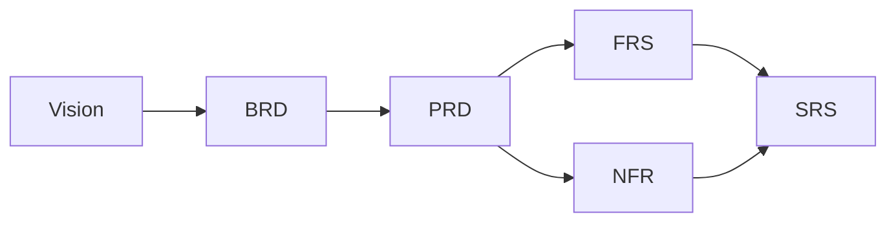

# Non-Functional Requirements (NFR) — IELTS LMS AI

| Field | Value |
| --- | --- |
| **Product Name** | IELTS LMS AI |
| **Document** | 05 — Non-Functional Requirements (NFR) |
| **Version** | 1.0 |
| **Status** | Architecture & Planning |
| **Document Owner** | Architecture & Quality |
| **Last Updated** | 2026-07-18 |
| **Audience** | Engineering, Architecture, SRE/Ops, Security, QA, Product |
| **Aligns With** | [01_Product_Vision.md](./01_Product_Vision.md), [02_Business_Requirements_Document.md](./02_Business_Requirements_Document.md), [03_Product_Requirements_Document.md](./03_Product_Requirements_Document.md), [04_Functional_Requirements.md](./04_Functional_Requirements.md) |

> **Purpose of this document.** This document specifies the **quality attributes** ("how well" the system must behave) that complement the functional behavior in the [FRS](./04_Functional_Requirements.md). Requirements are **implementation-neutral** and include **measurable targets** wherever possible so they can be verified. Each requirement carries a stable ID of the form `NFR-<AREA>-<NNN>`. Concrete technology and infrastructure choices are deferred to the architecture, infrastructure, and security documents referenced in [§26](#26-related-documents).

---

## 1. Introduction

### 1.1 Conventions

- IDs: `NFR-<AREA>-<NNN>` (e.g., `NFR-PERF-001`).
- **Priority:** Must / Should / Could.
- Targets are **initial objectives** for Version 1 and will be ratified against production baselines; they are stated to be testable, not to prescribe implementation.
- Percentiles use `pXX` (e.g., p95 = 95th percentile). Terminology follows the [Vision Glossary](./01_Product_Vision.md#14-glossary).

### 1.2 Area Index

| Area | Prefix | Area | Prefix |
| --- | --- | --- | --- |
| Performance | PERF | Encryption | ENC |
| Scalability | SCAL | Key Management | KEY |
| Availability | AVAIL | File Upload Security | UPL |
| Reliability | REL | Compliance | COMP |
| Security | SEC | Privacy / GDPR | PRIV |
| Maintainability | MAINT | Observability | OBS |
| Extensibility | EXT | Monitoring | MON |
| Usability | USE | Logging | LOG |
| Accessibility | A11Y | Auditing | AUD |
| Localization / i18n | I18N | Caching | CACHE |
| Cloud Readiness | CLOUD | Disaster Recovery | DR |
| Backup | BAK | Business Continuity | BCP |
| API Performance | APIP | DB Performance | DBP |
| Frontend Performance | FEP | AI Performance | AIP |
| Storage | STOR | Infrastructure | INFRA |
| Browser/Device Support | CLIENT | Responsive Design | RESP |
| SEO | SEO | Future Mobile | MOBILE |
| Rate Limiting | RATE | Session Mgmt | SESS |

---

## 2. Performance (PERF)

| ID | Requirement | Target | Priority |
| --- | --- | --- | --- |
| NFR-PERF-001 | Interactive API responses (non-AI, cached/simple reads) | p95 ≤ 300 ms, p99 ≤ 800 ms | Must |
| NFR-PERF-002 | Standard write operations | p95 ≤ 600 ms | Must |
| NFR-PERF-003 | Maximum acceptable response time for non-AI synchronous requests | ≤ 2 s (hard ceiling; else async) | Must |
| NFR-PERF-004 | Initial authenticated page load (web, broadband) | ≤ 2.5 s first meaningful content | Should |
| NFR-PERF-005 | Concurrent interactive users per tenant without degradation | Scales horizontally; no fixed cap by design | Must |
| NFR-PERF-006 | Assessment delivery (item navigation in exam mode) | ≤ 200 ms perceived transition | Should |

Long-running operations (AI evaluation, large reports) MUST be asynchronous with progress/status, not blocking synchronous calls.

---

## 3. Scalability (SCAL)

| ID | Requirement | Target | Priority |
| --- | --- | --- | --- |
| NFR-SCAL-001 | Horizontal scalability of stateless services | Scale out without code change | Must |
| NFR-SCAL-002 | Multi-tenant growth | Individual → large institutions without rearchitecture | Must |
| NFR-SCAL-003 | Assessment & AI-evaluation burst handling (e.g., monthly mock windows) | Elastic queue-backed scaling | Must |
| NFR-SCAL-004 | Data growth | Partition/scale strategy that avoids hot spots per tenant | Should |
| NFR-SCAL-005 | Auto-scaling responsiveness | Scale-out reaction ≤ 2 min under sustained load | Should |

---

## 4. Availability (AVAIL)

| ID | Requirement | Target | Priority |
| --- | --- | --- | --- |
| NFR-AVAIL-001 | Platform monthly uptime (core learner-facing services) | ≥ 99.9% | Must |
| NFR-AVAIL-002 | Enterprise-tier SLA target | ≥ 99.95% (contractual) | Should |
| NFR-AVAIL-003 | Graceful degradation of non-critical features (e.g., AI) | Core learning remains usable | Must |
| NFR-AVAIL-004 | Planned maintenance | Zero-downtime or scheduled low-traffic windows with notice | Should |

---

## 5. Reliability (REL)

| ID | Requirement | Target | Priority |
| --- | --- | --- | --- |
| NFR-REL-001 | Data durability for submissions, scores, certificates | No acknowledged-write loss | Must |
| NFR-REL-002 | AI operation resilience | Safe retries; idempotent; no duplicate scoring | Must |
| NFR-REL-003 | Scoring consistency for equivalent inputs | Deterministic objective scoring; bounded AI variance | Must |
| NFR-REL-004 | Error budget policy | Defined per SLO; ties to release gating | Should |

---

## 6. Security (SEC)

Security is elaborated in [Security](./18_Security.md) and [Authentication & Authorization](./11_Authentication_Authorization.md); the following are binding NFRs.

| ID | Requirement | Target/Standard | Priority |
| --- | --- | --- | --- |
| NFR-SEC-001 | Tenant data isolation | No cross-tenant data access; enforced at every layer | Must |
| NFR-SEC-002 | OWASP Top 10 mitigation | No known unmitigated OWASP Top 10 issues at release | Must |
| NFR-SEC-003 | Least-privilege RBAC | Every protected action authorized; default deny | Must |
| NFR-SEC-004 | Input validation & output encoding | All external input validated; injection-safe | Must |
| NFR-SEC-005 | Secrets management | No secrets in code/logs; managed secret store | Must |
| NFR-SEC-006 | Dependency & vulnerability management | Regular scanning; critical patches within defined SLA | Must |
| NFR-SEC-007 | Security testing | SAST/DAST and periodic pen tests before major releases | Should |

### 6.1 Password Policies (SEC)

| ID | Requirement | Target | Priority |
| --- | --- | --- | --- |
| NFR-SEC-010 | Minimum password strength | ≥ 12 chars or passphrase; complexity or length-based policy | Must |
| NFR-SEC-011 | Password storage | Salted, adaptive one-way hashing (never reversible) | Must |
| NFR-SEC-012 | Breached-credential and brute-force protection | Lockout/backoff + optional breached-password check | Should |

---

## 7. Password Policies (SEC subset)

| ID | Requirement | Target | Priority |
| --- | --- | --- | --- |
| NFR-SEC-013 | Configurable password policy per tenant | Length, complexity, rotation optional | Must |
| NFR-SEC-014 | Password reset security | Time-boxed, single-use tokens; no user enumeration | Must |
| NFR-SEC-015 | MFA availability | TOTP/second factor available; enforceable by tenant | Should |

---

## 8. Authentication (AUTH-NFR)

| ID | Requirement | Target | Priority |
| --- | --- | --- | --- |
| NFR-AUTH-001 | Tenant-aware authentication | Sessions bound to a single tenant | Must |
| NFR-AUTH-002 | SSO readiness (SAML/OIDC) for enterprise | Standards-based federation | Should |
| NFR-AUTH-003 | Credential transport | Only over TLS; never in URLs/logs | Must |

---

## 9. Authorization (AUTHZ-NFR)

| ID | Requirement | Target | Priority |
| --- | --- | --- | --- |
| NFR-AUTHZ-001 | Enforcement at every protected entry point | Default-deny; server-side checks | Must |
| NFR-AUTHZ-002 | Tenant + role scoping on all data access | No implicit cross-tenant reads | Must |
| NFR-AUTHZ-003 | Privilege change propagation | Effective within session policy window | Should |

---

## 10. Session Management (SESS)

| ID | Requirement | Target | Priority |
| --- | --- | --- | --- |
| NFR-SESS-001 | Session token security | Signed/opaque tokens; secure, HTTP-only where applicable | Must |
| NFR-SESS-002 | Idle & absolute session timeouts | Configurable; sensible secure defaults | Must |
| NFR-SESS-003 | Session revocation | Immediate on logout / credential change | Must |
| NFR-SESS-004 | Concurrent session policy | Configurable per tenant | Could |

---

## 11. Encryption (ENC)

| ID | Requirement | Target/Standard | Priority |
| --- | --- | --- | --- |
| NFR-ENC-001 | Encryption in transit | TLS 1.2+ everywhere (prefer 1.3) | Must |
| NFR-ENC-002 | Encryption at rest | Strong symmetric encryption (e.g., AES-256) for data stores/backups | Must |
| NFR-ENC-003 | Sensitive field handling | PII protected; no plaintext secrets | Must |

---

## 12. Key Management (KEY)

| ID | Requirement | Target | Priority |
| --- | --- | --- | --- |
| NFR-KEY-001 | Centralized key management | Managed KMS/secret store | Must |
| NFR-KEY-002 | Key rotation | Documented rotation without downtime | Should |
| NFR-KEY-003 | Separation of duties | No single actor can both access secrets and disable audit | Should |
| NFR-KEY-004 | Per-tenant key option (future) | Enterprise data isolation enhancement | Could |

---

## 13. Rate Limiting (RATE)

| ID | Requirement | Target | Priority |
| --- | --- | --- | --- |
| NFR-RATE-001 | Authentication endpoints | Throttled per identity/IP to deter brute force | Must |
| NFR-RATE-002 | AI endpoints | Per-user/tenant quotas aligned to entitlements | Must |
| NFR-RATE-003 | General API rate limits | Fair-use limits with clear error semantics | Should |
| NFR-RATE-004 | Abuse protection | Adaptive limits under attack conditions | Should |

---

## 14. File Upload Security (UPL)

| ID | Requirement | Target | Priority |
| --- | --- | --- | --- |
| NFR-UPL-001 | Type & size validation | Allowlist types; enforce size caps | Must |
| NFR-UPL-002 | Malware scanning | Scan uploads (audio, documents) before serving | Should |
| NFR-UPL-003 | Storage isolation | Tenant-scoped, access-controlled object storage | Must |
| NFR-UPL-004 | Safe serving | No direct execution; signed/expiring access URLs | Must |

---

## 15. Maintainability (MAINT)

| ID | Requirement | Target | Priority |
| --- | --- | --- | --- |
| NFR-MAINT-001 | Modular architecture | Clear module boundaries; low coupling | Must |
| NFR-MAINT-002 | Code quality gates | Linting, formatting, review required to merge | Must |
| NFR-MAINT-003 | Automated test coverage | Meaningful coverage on critical paths (target ≥ 80% on core domains) | Should |
| NFR-MAINT-004 | Documentation currency | Docs updated with behavior changes | Should |

---

## 16. Extensibility (EXT)

| ID | Requirement | Target | Priority |
| --- | --- | --- | --- |
| NFR-EXT-001 | Pluggable AI providers | Swap/augment providers without core rewrite | Must |
| NFR-EXT-002 | New content/question types | Added without schema-breaking changes | Should |
| NFR-EXT-003 | Integration readiness | API-first design for future integrations/marketplace | Should |

---

## 17. Usability (USE)

| ID | Requirement | Target | Priority |
| --- | --- | --- | --- |
| NFR-USE-001 | Task success on core flows | ≥ 90% unaided completion in usability testing | Should |
| NFR-USE-002 | Consistent design system | Shared components and patterns | Must |
| NFR-USE-003 | CB-IELTS fidelity | Exam mode closely mirrors official interface conventions | Must |
| NFR-USE-004 | Error clarity | Actionable, non-technical error messages | Must |

---

## 18. Accessibility — WCAG (A11Y)

| ID | Requirement | Target/Standard | Priority |
| --- | --- | --- | --- |
| NFR-A11Y-001 | Conformance target | WCAG 2.1 AA for learner-facing experiences | Must |
| NFR-A11Y-002 | Keyboard operability | All interactive functions keyboard-accessible | Must |
| NFR-A11Y-003 | Screen-reader support | Proper semantics/labels/roles | Must |
| NFR-A11Y-004 | Audio accessibility | Captions/transcripts for listening/learning content | Must |
| NFR-A11Y-005 | Color & contrast | Meets AA contrast; not color-only cues | Must |
| NFR-A11Y-006 | Time accommodations | Support extended-time settings in practice modes | Should |

> Full WCAG validation requires manual testing with assistive technologies and expert accessibility review; automated checks alone are insufficient.

---

## 19. Localization & Internationalization (I18N)

| ID | Requirement | Target | Priority |
| --- | --- | --- | --- |
| NFR-I18N-001 | Internationalization-ready UI | Externalized strings; no hard-coded copy | Must |
| NFR-I18N-002 | Locale-aware formatting | Dates, numbers, time zones | Must |
| NFR-I18N-003 | Multi-language UI support | Add languages without code changes | Should |
| NFR-I18N-004 | RTL readiness | Layout supports right-to-left scripts | Could |
| NFR-I18N-005 | Content localization | Framework for localized learning content over time | Could |

---

## 20. Cloud Readiness, Infrastructure & Storage (CLOUD / INFRA / STOR)

| ID | Requirement | Target | Priority |
| --- | --- | --- | --- |
| NFR-CLOUD-001 | Cloud-native, containerized, stateless services | Portable across environments | Must |
| NFR-CLOUD-002 | Infrastructure as Code | Reproducible environments | Should |
| NFR-CLOUD-003 | Multi-environment support | Dev/Staging/Prod parity | Must |
| NFR-INFRA-001 | Environment isolation | Separate data and credentials per environment | Must |
| NFR-STOR-001 | Object storage for media/uploads | Durable, tenant-scoped, lifecycle-managed | Must |
| NFR-STOR-002 | Storage durability | High-durability managed storage | Must |

Concrete cloud/provider choices are defined in [Infrastructure](./17_Infrastructure.md).

---

## 21. Observability, Monitoring, Logging & Auditing (OBS / MON / LOG / AUD)

| ID | Requirement | Target | Priority |
| --- | --- | --- | --- |
| NFR-OBS-001 | Structured, correlated telemetry | Trace IDs across requests; tenant-tagged (no PII in traces) | Must |
| NFR-MON-001 | Health & SLO monitoring | Dashboards for latency, errors, saturation | Must |
| NFR-MON-002 | Alerting thresholds | Alert on p95 latency > target for 5 min; error rate > 2% for 5 min; availability < SLO | Must |
| NFR-LOG-001 | Centralized application logging | Aggregated, searchable, retention-policied | Must |
| NFR-LOG-002 | Log hygiene | No secrets/PII in logs | Must |
| NFR-AUD-001 | Security & admin audit trail | Immutable, tamper-evident audit logs for sensitive actions | Must |
| NFR-AUD-002 | Audit retention | Retained per compliance policy | Must |

---

## 22. Caching (CACHE)

| ID | Requirement | Target | Priority |
| --- | --- | --- | --- |
| NFR-CACHE-001 | Cache read-heavy/reference data | Reduce latency and load | Should |
| NFR-CACHE-002 | Cache correctness | Tenant-scoped keys; explicit invalidation | Must |
| NFR-CACHE-003 | No sensitive data in shared caches without protection | Enforced | Must |

---

## 23. Resilience: DR, Backup & Business Continuity (DR / BAK / BCP)

| ID | Requirement | Target | Priority |
| --- | --- | --- | --- |
| NFR-BAK-001 | Automated backups of critical data | Regular, encrypted backups | Must |
| NFR-BAK-002 | Backup restore testing | Periodic verified restore drills | Should |
| NFR-DR-001 | Recovery Point Objective (RPO) | ≤ 15 minutes for critical data | Must |
| NFR-DR-002 | Recovery Time Objective (RTO) | ≤ 4 hours for core services | Must |
| NFR-BCP-001 | Business continuity plan | Documented roles, runbooks, comms | Should |
| NFR-BCP-002 | Multi-AZ resilience | No single-AZ dependency for core services | Should |

Details are elaborated in [Infrastructure](./17_Infrastructure.md); this section sets the binding objectives.

---

## 24. Component Performance: API, Database, Frontend, AI (APIP / DBP / FEP / AIP)

### 24.1 API Performance (APIP)

| ID | Requirement | Target | Priority |
| --- | --- | --- | --- |
| NFR-APIP-001 | Read endpoint latency | p95 ≤ 300 ms | Must |
| NFR-APIP-002 | Write endpoint latency | p95 ≤ 600 ms | Must |
| NFR-APIP-003 | Payload efficiency | Pagination and field selection for large collections | Should |

### 24.2 Database Performance (DBP)

| ID | Requirement | Target | Priority |
| --- | --- | --- | --- |
| NFR-DBP-001 | Indexed query latency | p95 ≤ 50 ms for primary-key/indexed reads | Must |
| NFR-DBP-002 | No unbounded queries | All list queries paginated/bounded | Must |
| NFR-DBP-003 | Tenant-scoped access paths | Tenant key present in access patterns | Must |

### 24.3 Frontend Performance (FEP)

| ID | Requirement | Target | Priority |
| --- | --- | --- | --- |
| NFR-FEP-001 | Largest Contentful Paint (LCP) | ≤ 2.5 s on broadband | Should |
| NFR-FEP-002 | Interaction responsiveness (INP) | ≤ 200 ms | Should |
| NFR-FEP-003 | Bundle discipline | Code-splitting; lazy-load heavy views | Should |

### 24.4 AI Performance (AIP)

| ID | Requirement | Target | Priority |
| --- | --- | --- | --- |
| NFR-AIP-001 | Writing evaluation turnaround | p95 ≤ 30 s (async with status) | Must |
| NFR-AIP-002 | Speaking evaluation turnaround | p95 ≤ 60 s (async with status) | Must |
| NFR-AIP-003 | AI Tutor first response | p95 ≤ 5 s | Should |
| NFR-AIP-004 | Cost governance | Per-tenant/user quotas; budget alerts | Must |
| NFR-AIP-005 | Graceful degradation | Clear fallback when AI unavailable | Must |

AI design and governance are specified in [AI Architecture](./16_AI_Architecture.md).

---

## 25. Client Support, Responsive Design, SEO & Future Mobile (CLIENT / RESP / SEO / MOBILE)

| ID | Requirement | Target | Priority |
| --- | --- | --- | --- |
| NFR-CLIENT-001 | Browser support | Latest 2 versions of major evergreen browsers (Chrome, Edge, Firefox, Safari) | Must |
| NFR-CLIENT-002 | Device support | Desktop, laptop, tablet; responsive down to common mobile widths | Must |
| NFR-RESP-001 | Responsive design | Fluid layouts across breakpoints | Must |
| NFR-RESP-002 | Exam-mode ergonomics | Optimized for desktop/laptop as primary exam surface | Should |
| NFR-SEO-001 | Public pages SEO | Semantic markup, metadata, crawlability for marketing/public pages | Should |
| NFR-SEO-002 | Performance-for-SEO | Public pages meet Core Web Vitals targets | Should |
| NFR-MOBILE-001 | Future mobile compatibility | API-first design enables future native apps (out of scope for V1) | Should |

---

## 26. Compliance, Privacy & GDPR (COMP / PRIV)

| ID | Requirement | Target/Standard | Priority |
| --- | --- | --- | --- |
| NFR-COMP-001 | Data protection alignment | GDPR-ready data handling practices | Must |
| NFR-PRIV-001 | Data subject rights | Support access, export, and erasure workflows | Must |
| NFR-PRIV-002 | Consent & purpose limitation | Collect only necessary data; documented purposes | Must |
| NFR-PRIV-003 | Data minimization in AI | Minimize PII sent to AI providers; document data flows | Must |
| NFR-PRIV-004 | Data residency (future) | Regional data residency options for enterprise | Could |
| NFR-COMP-002 | Audit & retention policies | Documented retention aligned to legal requirements | Must |

Detailed compliance treatment lives in [Security](./18_Security.md); professional legal/compliance review is required before launch.

---

## 27. Verification & Traceability

Each NFR is intended to be **testable**. Verification methods include load/performance testing (PERF, APIP, DBP, FEP, AIP, SCAL), security testing and reviews (SEC, AUTHZ, ENC, UPL, RATE), accessibility audits (A11Y), chaos/DR drills (AVAIL, REL, DR, BCP), and observability validation (OBS, MON, LOG, AUD). Cross-document traceability (Vision → BRD → PRD → FRS → NFR) is consolidated in the [SRS](./06_Software_Requirements_Specification.md#requirements-traceability).

---

## 28. Related Documents

| # | Document | Relationship |
| --- | --- | --- |
| 01 | [Product Vision](./01_Product_Vision.md) | Quality goals originate here. |
| 03 | [Product Requirements Document](./03_Product_Requirements_Document.md) | Non-functional expectations summarized there, detailed here. |
| 04 | [Functional Requirements](./04_Functional_Requirements.md) | Functional behaviors these attributes qualify. |
| 06 | [Software Requirements Specification](./06_Software_Requirements_Specification.md) | Consolidates FRS + NFR with traceability. |
| 17 | [Infrastructure](./17_Infrastructure.md) | Realizes cloud, DR, and storage requirements. |
| 18 | [Security](./18_Security.md) | Realizes security, privacy, and compliance requirements. |

---

*End of Document — 05 Non-Functional Requirements (v1.0).*