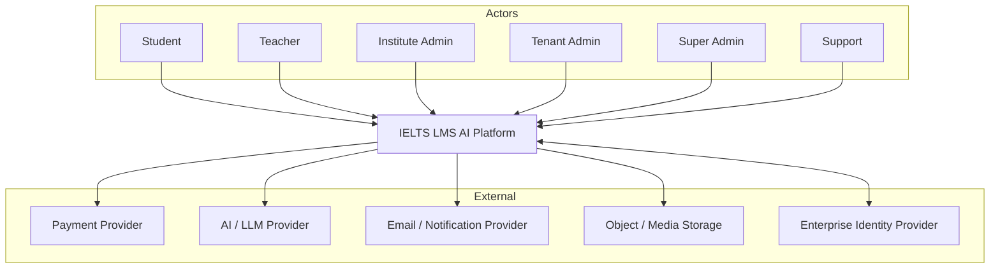
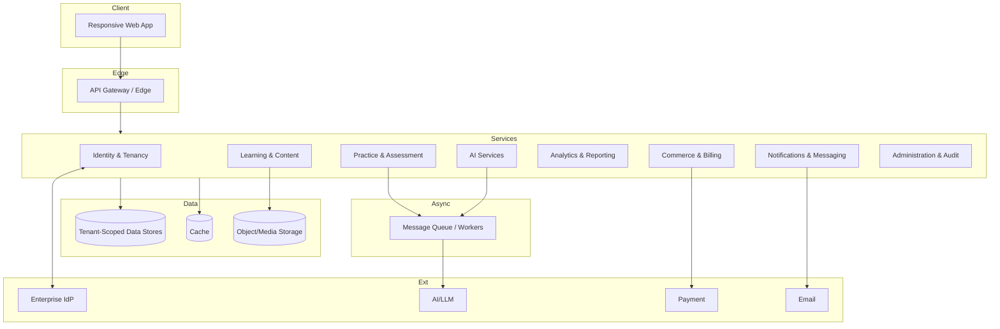
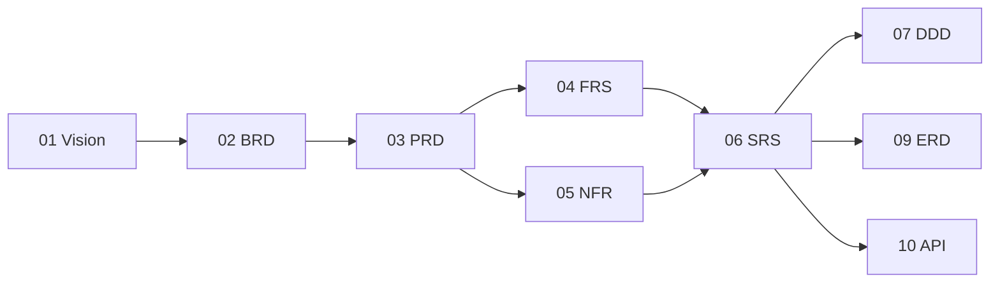

# Software Requirements Specification (SRS) — IELTS LMS AI

| Field | Value |
| --- | --- |
| **Product Name** | IELTS LMS AI |
| **Document** | 06 — Software Requirements Specification (SRS) |
| **Version** | 1.0 |
| **Status** | Architecture & Planning |
| **Document Owner** | Requirements Engineering & Architecture |
| **Last Updated** | 2026-07-18 |
| **Audience** | Engineering, Architecture, QA, Product, Security, Stakeholders |
| **Standard** | IEEE 830 / ISO/IEC/IEEE 29148-inspired |
| **Aligns With** | [01_Product_Vision.md](./01_Product_Vision.md), [02_Business_Requirements_Document.md](./02_Business_Requirements_Document.md), [03_Product_Requirements_Document.md](./03_Product_Requirements_Document.md), [04_Functional_Requirements.md](./04_Functional_Requirements.md), [05_Non_Functional_Requirements.md](./05_Non_Functional_Requirements.md) |

> **Purpose of this document.** This Software Requirements Specification (SRS) consolidates the functional and non-functional requirements of IELTS LMS AI into a single, IEEE-inspired reference. It does not restate every requirement in full; instead it establishes system context, product perspective, user classes, interfaces, constraints, and — critically — the **requirements traceability** that links Vision → BRD → PRD → FRS → NFR. It is **implementation-neutral**.

---

## Table of Contents

1. [Introduction](#1-introduction)
2. [Overall Description](#2-overall-description)
3. [System Features](#3-system-features)
4. [External Interface Requirements](#4-external-interface-requirements)
5. [System Architecture Overview](#5-system-architecture-overview)
6. [Requirements Traceability](#requirements-traceability)
7. [Requirement Prioritization](#7-requirement-prioritization)
8. [Business Rules Summary](#8-business-rules-summary)
9. [Future Enhancements](#9-future-enhancements)
10. [Glossary](#10-glossary)
11. [Appendices](#11-appendices)
12. [Related Documents](#12-related-documents)

---

## 1. Introduction

### 1.1 Purpose

This SRS specifies the software requirements for **IELTS LMS AI Version 1.0**. It is intended for the engineering, architecture, QA, product, and security teams responsible for designing, building, verifying, and operating the platform, and for stakeholders who need an authoritative requirements reference.

### 1.2 Scope

IELTS LMS AI is a cloud-native, AI-powered, multi-tenant SaaS Learning Management System for IELTS preparation, supporting **IELTS Academic** and **IELTS General Training** and mirroring the **Computer-Based IELTS (CB-IELTS)** experience. It provides learning, practice, assessment, AI evaluation and tutoring, analytics, and subscription commerce across five domains: **Learn, Practice, Assess, Improve (AI), and Manage (Commerce & Administration)**. Detailed scope is defined in the [Vision](./01_Product_Vision.md) and [PRD](./03_Product_Requirements_Document.md); out-of-scope items are in [§2.7](#27-out-of-scope-summary).

### 1.3 Definitions, Acronyms, and Abbreviations

Terminology follows the [Vision Glossary](./01_Product_Vision.md#14-glossary). Key terms: **Tenant** (isolation boundary), **Entitlement** (plan-granted capability/quota), **CB-IELTS**, **Band**, **RBAC**, **SLO/SLA**, **p95/p99** (latency percentiles). A consolidated glossary appears in [§10](#10-glossary).

### 1.4 References

- [01 Product Vision](./01_Product_Vision.md)
- [02 Business Requirements Document](./02_Business_Requirements_Document.md)
- [03 Product Requirements Document](./03_Product_Requirements_Document.md)
- [04 Functional Requirements](./04_Functional_Requirements.md)
- [05 Non-Functional Requirements](./05_Non_Functional_Requirements.md)
- Forward references: [DDD](./07_Domain_Driven_Design.md), [ERD](./09_Database_Design.md), [API Specification](./10_API_Specification.md), [Authentication & Authorization](./11_Authentication_Authorization.md), [Multi-Tenant Architecture](./12_Multi_Tenant_Architecture.md), [Clean Architecture](./13_Clean_Architecture.md), [AI Architecture](./16_AI_Architecture.md), [Infrastructure](./17_Infrastructure.md), [Security](./18_Security.md), [Testing Strategy](./19_Testing_Strategy.md).

### 1.5 Overview

[§2](#2-overall-description) gives the overall description and context; [§3](#3-system-features) summarizes system features; [§4](#4-external-interface-requirements) defines interfaces; [§5](#5-system-architecture-overview) gives an implementation-neutral architecture overview; the [traceability section](#requirements-traceability) maps requirements across documents.

---

## 2. Overall Description

### 2.1 System Context

### 2.2 Product Perspective

IELTS LMS AI is a **new, self-contained SaaS product** (not a component of a larger system). It is multi-tenant by design, integrates with external providers for payments, AI/LLM, email/notifications, media storage, and (for enterprise) identity federation. Internally it is organized into cohesive domains with clear boundaries, elaborated in [DDD](./07_Domain_Driven_Design.md) and [Clean Architecture](./13_Clean_Architecture.md).

### 2.3 Product Functions (Summary)

- Identity, tenancy, and access control (multi-tenant, RBAC).
- Structured learning (courses, lessons, grammar, vocabulary, sentence building).
- Skill practice and assessment (reading, listening, writing, speaking; daily/weekly/monthly).
- AI evaluation (writing, speaking), AI tutor, AI study planner, band prediction.
- Analytics, reporting, progress tracking, certificates.
- Subscription, billing, coupons, notifications, messaging, support, feedback.
- Administration portals (admin, teacher, student) and audit/activity logging.

Full decomposition is in the [FRS](./04_Functional_Requirements.md); quality attributes are in the [NFR](./05_Non_Functional_Requirements.md).

### 2.4 User Classes and Characteristics

| User Class | Characteristics | Primary Needs |
| --- | --- | --- |
| Student | Global learners; varied devices/bandwidth; goal-driven | Learning, feedback, exam realism, progress |
| Teacher | Instructors within a tenant | Cohort management, efficient feedback |
| Institute Admin | Operational admin of an institute tenant | User/seat management, reporting |
| Tenant Admin | Top-level owner of a tenant | Governance, billing, org-wide reporting |
| Super Admin | Platform operator (vendor) | Tenant lifecycle, global config, AI governance |
| Support | Platform/tenant support agents | Scoped tooling, escalation |

Detailed personas are in the [PRD](./03_Product_Requirements_Document.md#4-user-personas).

### 2.5 Operating Environment

- **Delivery:** Cloud-native, browser-based web application; responsive for desktop and mobile web (no native mobile app in V1 — see [NFR-MOBILE](./05_Non_Functional_Requirements.md)).
- **Clients:** Modern evergreen browsers per [NFR-CLIENT](./05_Non_Functional_Requirements.md).
- **Backend:** Cloud-hosted, horizontally scalable services with managed data stores, object storage, and queue-backed async processing (implementation-neutral; see [Infrastructure](./17_Infrastructure.md)).
- **External services:** Payment, AI/LLM, email/notification, storage, enterprise IdP.

### 2.6 Constraints

| ID | Constraint |
| --- | --- |
| CON-01 | Must enforce strict multi-tenant isolation at every layer. |
| CON-02 | Must align AI evaluation to official IELTS band descriptors and label AI-generated output. |
| CON-03 | Must target WCAG 2.1 AA for learner-facing experiences. |
| CON-04 | Must be implementation-neutral at specification stage; technology choices deferred to architecture docs. |
| CON-05 | Long-running/AI operations must be asynchronous, not blocking synchronous calls. |
| CON-06 | Must comply with applicable data-protection regulations (see [NFR-PRIV/COMP](./05_Non_Functional_Requirements.md)). |

### 2.7 Out of Scope (Summary)

Native mobile apps, offline learning, live video classes, marketplaces, community forums, and advanced gamification are out of scope for V1. See [Vision §10](./01_Product_Vision.md#10-out-of-scope-version-1) and [PRD §15](./03_Product_Requirements_Document.md#15-out-of-scope-version-1).

### 2.8 Assumptions and Dependencies

- **Assumptions:** external AI/LLM and payment providers are available and contractually usable; users have internet connectivity and a supported browser; IELTS format assumptions hold for V1.
- **Dependencies:** payment provider, AI/LLM provider, email/notification provider, object storage, and (enterprise) identity provider. Provider outages degrade the corresponding features gracefully per [NFR-AVAIL-003](./05_Non_Functional_Requirements.md).

---

## 3. System Features

This section summarizes system features and links each to its authoritative functional requirements in the [FRS](./04_Functional_Requirements.md). Each feature inherits applicable NFRs from the [NFR](./05_Non_Functional_Requirements.md).

| Feature | Description | FRS Reference | Priority |
| --- | --- | --- | --- |
| SF-01 Authentication & Identity | Tenant-aware auth, MFA/SSO readiness | FR-AUTH-* | Must |
| SF-02 Tenancy & Organizations | Tenant lifecycle, org hierarchy, isolation | FR-TEN-*, FR-ORG-* | Must |
| SF-03 Users, Roles & Permissions | RBAC, user lifecycle | FR-USER-*, FR-ROLE-*, FR-PERM-* | Must |
| SF-04 Learning & Curriculum | Courses, lessons, grammar, vocab, sentence builder | FR-COURSE-*, FR-LESSON-*, FR-GRAMMAR-*, FR-VOCAB-*, FR-SENT-* | Must |
| SF-05 Skills Practice | Reading, listening, writing, speaking, practice sessions | FR-READ-*, FR-LISTEN-*, FR-WRITE-*, FR-SPEAK-*, FR-PRAC-* | Must |
| SF-06 Planning & Assessment | Daily planner, assignments, weekly tests, monthly mocks | FR-DAILY-*, FR-ASGN-*, FR-WEEK-*, FR-MOCK-* | Must |
| SF-07 AI Services | Tutor, writing/speaking evaluation, band prediction | FR-AITUTOR-*, FR-AIWE-*, FR-AISE-*, FR-BAND-* | Must |
| SF-08 Insights | Progress, analytics, reports, certificates | FR-PROG-*, FR-ANLY-*, FR-RPT-*, FR-CERT-* | Must |
| SF-09 Commerce | Subscription, billing, coupons | FR-SUBS-*, FR-BILL-*, FR-COUP-* | Must |
| SF-10 Communication & Support | Notifications, messaging, support, feedback | FR-NOTIF-*, FR-MSG-*, FR-SUP-*, FR-FEED-* | Should |
| SF-11 Administration & Auditing | Portals, audit/activity logs, settings | FR-ADMIN-*, FR-AUDIT-*, FR-ACTLOG-*, FR-SET-* | Must |

---

## 4. External Interface Requirements

### 4.1 User Interface Requirements

| ID | Requirement |
| --- | --- |
| UI-01 | Responsive web UI for desktop and mobile web; consistent design system ([NFR-USE-002](./05_Non_Functional_Requirements.md)). |
| UI-02 | Exam mode mirrors CB-IELTS conventions (timing, navigation, single-play audio) ([NFR-USE-003](./05_Non_Functional_Requirements.md)). |
| UI-03 | WCAG 2.1 AA conformance for learner-facing experiences ([NFR-A11Y-*](./05_Non_Functional_Requirements.md)). |
| UI-04 | Localization-ready UI with externalized strings ([NFR-I18N-*](./05_Non_Functional_Requirements.md)). |
| UI-05 | Clear, actionable error and empty states ([NFR-USE-004](./05_Non_Functional_Requirements.md)). |

### 4.2 Software Interfaces

| ID | Interface | Purpose | Notes |
| --- | --- | --- | --- |
| SI-01 | Payment provider | Subscriptions, billing | Tokenized; PCI handled by provider ([NFR-COMP](./05_Non_Functional_Requirements.md)) |
| SI-02 | AI/LLM provider | Evaluation, tutor, planning | Pluggable providers ([NFR-EXT-001](./05_Non_Functional_Requirements.md)) |
| SI-03 | Email/notification provider | Transactional/notification delivery | Retry/fallback ([FR-NOTIF-001](./04_Functional_Requirements.md)) |
| SI-04 | Object/media storage | Audio, documents, media | Tenant-scoped, access-controlled ([NFR-UPL-*](./05_Non_Functional_Requirements.md)) |
| SI-05 | Enterprise IdP (SAML/OIDC) | SSO for enterprise tenants | Optional per plan ([NFR-AUTH-002](./05_Non_Functional_Requirements.md)) |

The platform's own API contract conventions are defined in the [API Specification](./10_API_Specification.md).

### 4.3 Hardware Interfaces

| ID | Requirement |
| --- | --- |
| HI-01 | No proprietary hardware; standard client devices (desktop/laptop/tablet/mobile web). |
| HI-02 | Microphone access required for speaking capture ([FR-SPEAK-001](./04_Functional_Requirements.md)); audio output for listening. |
| HI-03 | Server-side hardware abstracted by cloud infrastructure ([Infrastructure](./17_Infrastructure.md)). |

### 4.4 Communication Interfaces

| ID | Requirement |
| --- | --- |
| CI-01 | All client-server communication over HTTPS/TLS 1.2+ ([NFR-ENC-001](./05_Non_Functional_Requirements.md)). |
| CI-02 | Asynchronous processing via queues for AI/long-running tasks ([CON-05](#26-constraints)). |
| CI-03 | Webhooks/callbacks from external providers handled securely (verified signatures). |

---

## 5. System Architecture Overview

This overview is **implementation-neutral**; detailed design is in [Clean Architecture](./13_Clean_Architecture.md), [Backend](./15_Backend_Architecture.md), [Frontend](./14_Frontend_Architecture.md), and [AI Architecture](./16_AI_Architecture.md).

**Key architectural qualities (from NFR):** stateless horizontally scalable services ([NFR-SCAL-001](./05_Non_Functional_Requirements.md)), queue-backed async for AI/assessment bursts ([NFR-SCAL-003](./05_Non_Functional_Requirements.md)), tenant isolation at every layer ([NFR-SEC-001](./05_Non_Functional_Requirements.md)), and graceful degradation ([NFR-AVAIL-003](./05_Non_Functional_Requirements.md)).

---

## Requirements Traceability

Traceability links business intent to functional and non-functional requirements so every requirement has a justified origin and a verification path. IDs reference the respective documents.

### 6.1 Vision → BRD → PRD → FRS → NFR (Representative)

| Vision Theme | BRD Objective | PRD Module/Feature | FRS Requirement(s) | Key NFRs |
| --- | --- | --- | --- | --- |
| End-to-end CB-IELTS ecosystem | Modernize IELTS prep | Mock Exams, Skills | FR-MOCK-001, FR-READ/LISTEN/WRITE/SPEAK-001 | NFR-USE-003, NFR-PERF-006 |
| AI evaluation at scale | Remove feedback bottleneck | AI Writing/Speaking Eval | FR-AIWE-001, FR-AISE-001 | NFR-AIP-*, NFR-REL-002/003 |
| Multi-tenant institutional platform | Institutional/enterprise sales | Tenants, Orgs, RBAC | FR-TEN-001, FR-ORG-001, FR-USER-001 | NFR-SEC-001, NFR-AUTHZ-002 |
| Personalized learning | Learner outcomes | Learning Paths, Daily Planner | FR-PATH-001, FR-DAILY-001 | NFR-AIP-*, NFR-PERF-001 |
| Commercialization | Revenue/MRR/ARR | Subscription, Billing | FR-SUBS-001, FR-BILL-001 | NFR-SEC-005, NFR-COMP-* |
| Actionable insights | Prove outcomes | Analytics, Reports, Progress | FR-ANLY-001, FR-RPT-001, FR-PROG-001 | NFR-PERF-001, NFR-DBP-* |
| Trust & safety | Compliance & security | Auth, Audit, Permissions | FR-AUTH-003, FR-AUDIT-001 | NFR-SEC-*, NFR-AUD-* |

### 6.2 Coverage Matrix (Domain-Level)

| Domain | PRD | FRS | NFR |
| --- | --- | --- | --- |
| Identity & Tenancy | §6.A | FR-AUTH/ORG/TEN/USER/ROLE/PERM | NFR-SEC/AUTH/AUTHZ/SESS |
| Learning | §6.C | FR-COURSE/LESSON/GRAMMAR/VOCAB/SENT | NFR-PERF/FEP/A11Y |
| Skills & Practice | §6.D | FR-READ/LISTEN/WRITE/SPEAK/PRAC | NFR-PERF/USE/A11Y |
| Planning & Assessment | §6.E | FR-DAILY/ASGN/WEEK/MOCK | NFR-SCAL/REL/PERF |
| AI | §6.J | FR-AITUTOR/AIWE/AISE/BAND | NFR-AIP/REL/RATE/EXT |
| Insights | §6.F | FR-PROG/ANLY/RPT/CERT | NFR-DBP/PERF |
| Commerce | §6.H | FR-SUBS/BILL/COUP | NFR-SEC/COMP/PRIV |
| Communication & Support | §6.G/§6.J | FR-NOTIF/MSG/SUP/FEED | NFR-AVAIL/REL |
| Administration | §6.I/§6.J | FR-ADMIN/AUDIT/ACTLOG/SET | NFR-AUD/OBS/SEC |

Full requirement-level traceability will be maintained as a living matrix as detailed design proceeds.

---

## 7. Requirement Prioritization

Prioritization follows **MoSCoW**, consistent with [PRD §8](./03_Product_Requirements_Document.md#8-functional-scope-moscow).

| Priority | Definition | Examples |
| --- | --- | --- |
| Must | Required for V1; release-blocking | Auth, tenancy, core learning/assessment, AI writing/speaking eval, subscriptions |
| Should | Important but not release-blocking | Sentence Builder, certificates, coupons, messaging, weakness detection |
| Could | Desirable if capacity allows | Configurable dashboards, advanced explainability |
| Won't (V1) | Explicitly deferred | Native mobile, offline, marketplaces, live classes |

---

## 8. Business Rules Summary

Consolidated from the [BRD](./02_Business_Requirements_Document.md#17-business-rules) and enforced across FRS/NFR.

| ID | Business Rule | Enforced By |
| --- | --- | --- |
| BR-01 | Every user belongs to exactly one tenant. | FR-AUTH-*, FR-USER-*, NFR-SEC-001 |
| BR-02 | Every tenant owns and isolates its own data. | FR-TEN-*, NFR-SEC-001, NFR-AUTHZ-002 |
| BR-03 | Subscriptions/entitlements determine feature access. | FR-SUBS-*, FR-COURSE-001 |
| BR-04 | Certificates require passing/completion criteria. | FR-CERT-001 |
| BR-05 | Mock/weekly assessments contribute to analytics and band trend. | FR-WEEK-001, FR-MOCK-001, FR-PROG-001 |
| BR-06 | Only authorized roles can manage content/administration. | FR-ROLE-*, FR-PERM-*, FR-ADMIN-* |
| BR-07 | AI outputs are labeled and aligned to official band descriptors. | FR-AIWE-001, FR-AISE-001, CON-02 |
| BR-08 | Cross-tenant access is restricted to audited Super Admin operations. | FR-ADMIN-001, NFR-AUD-* |

---

## 9. Future Enhancements

Aligned with the [Vision roadmap](./01_Product_Vision.md#11-high-level-roadmap) and [PRD Future Vision](./03_Product_Requirements_Document.md#16-future-vision-35-years): native mobile apps, offline learning, live classes, marketplaces (teacher/institution/AI), API platform, white-label, multi-agent AI system, and partner ecosystem. These must not compromise the V1 architecture's tenant isolation or extensibility ([NFR-EXT-*](./05_Non_Functional_Requirements.md)).

---

## 10. Glossary

| Term | Definition |
| --- | --- |
| Tenant | Isolation boundary for a customer's users, data, and configuration. |
| Entitlement | Capability/quota granted by a subscription plan. |
| CB-IELTS | Computer-Based IELTS exam experience emulated by the platform. |
| Band | IELTS proficiency score scale. |
| RBAC | Role-Based Access Control. |
| SLO / SLA | Service Level Objective / Agreement. |
| p95 / p99 | 95th / 99th percentile latency. |
| MoSCoW | Must / Should / Could / Won't prioritization. |
| Academic / General Training | The two IELTS tracks supported. |

Full glossary: [Vision §14](./01_Product_Vision.md#14-glossary).

---

## 11. Appendices

### Appendix A — Requirement ID Schemes

| Scheme | Document | Example |
| --- | --- | --- |
| `PRD-<MODULE>-<NNN>` | PRD | PRD-AUTH-001 |
| `FR-<MODULE>-<NNN>` | FRS | FR-AUTH-001 |
| `NFR-<AREA>-<NNN>` | NFR | NFR-SEC-001 |
| `SF-<NN>` | SRS features | SF-01 |
| `BR-<NN>` | Business rules | BR-01 |
| `CON-<NN>` | Constraints | CON-01 |

### Appendix B — Document Map

### Appendix C — Verification Approach

Each requirement is verifiable by inspection, demonstration, test, or analysis. The [Testing Strategy](./19_Testing_Strategy.md) defines how FRS and NFR requirements are validated across unit, integration, end-to-end, performance, security, and accessibility testing.

---

## 12. Related Documents

| # | Document | Relationship |
| --- | --- | --- |
| 01 | [Product Vision](./01_Product_Vision.md) | Foundational scope and vision. |
| 02 | [Business Requirements Document](./02_Business_Requirements_Document.md) | Business drivers and objectives. |
| 03 | [Product Requirements Document](./03_Product_Requirements_Document.md) | Product modules and features. |
| 04 | [Functional Requirements](./04_Functional_Requirements.md) | Detailed functional requirements. |
| 05 | [Non-Functional Requirements](./05_Non_Functional_Requirements.md) | Quality attributes and targets. |
| 07 | [Domain-Driven Design](./07_Domain_Driven_Design.md) | Domain model and bounded contexts (forthcoming). |
| 09 | [Database Design (ERD)](./09_Database_Design.md) | Data model (forthcoming). |
| 10 | [API Specification](./10_API_Specification.md) | API contracts (forthcoming). |

---

*End of Document — 06 Software Requirements Specification (v1.0).*
