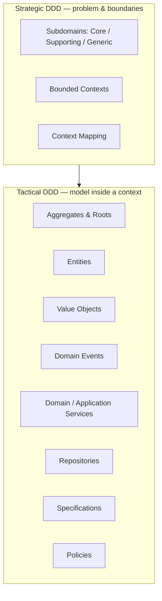
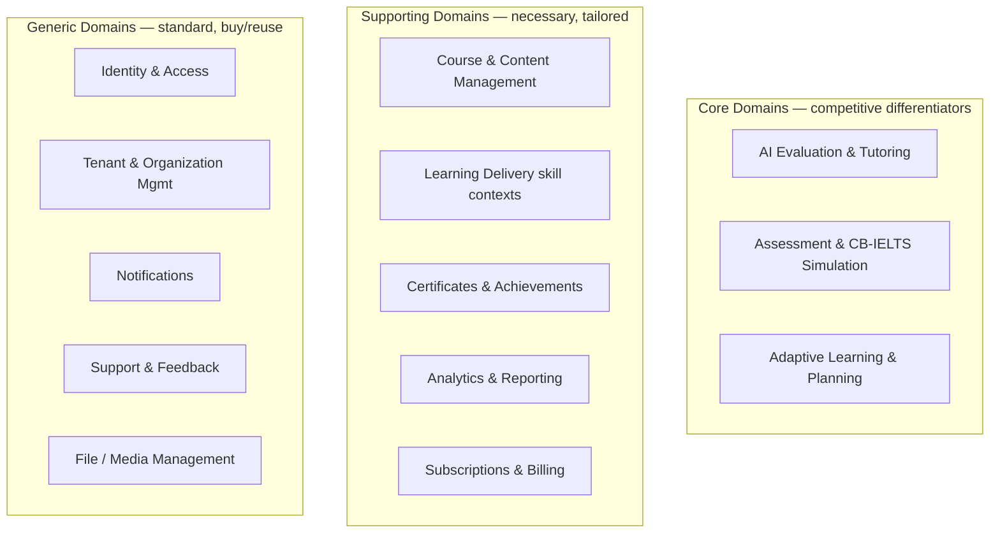
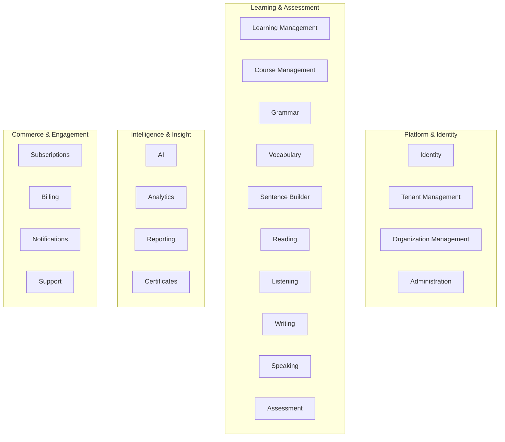
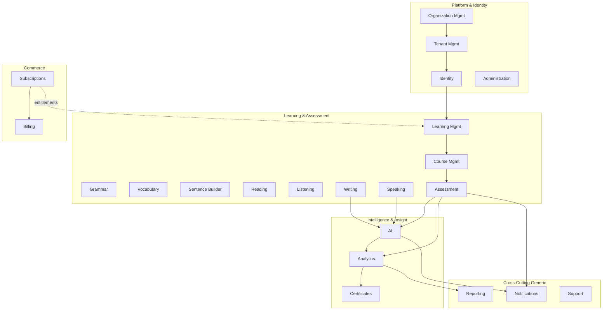
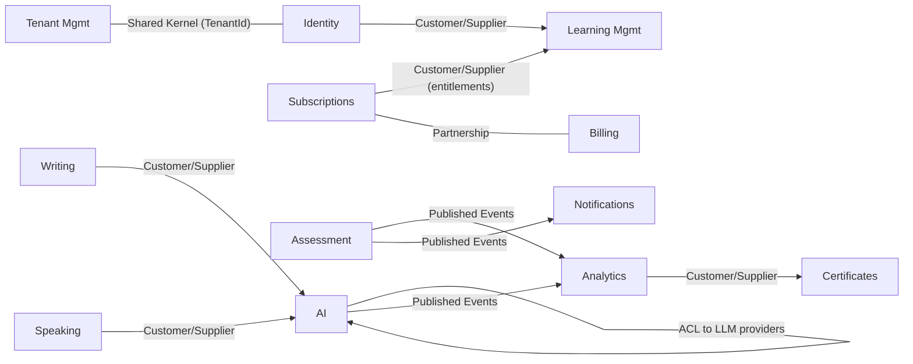
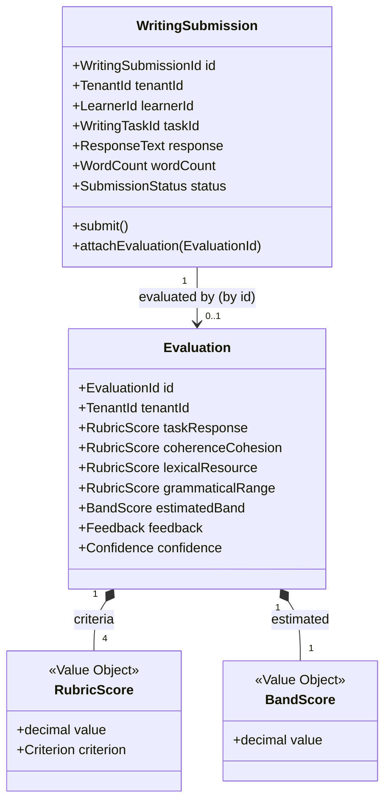
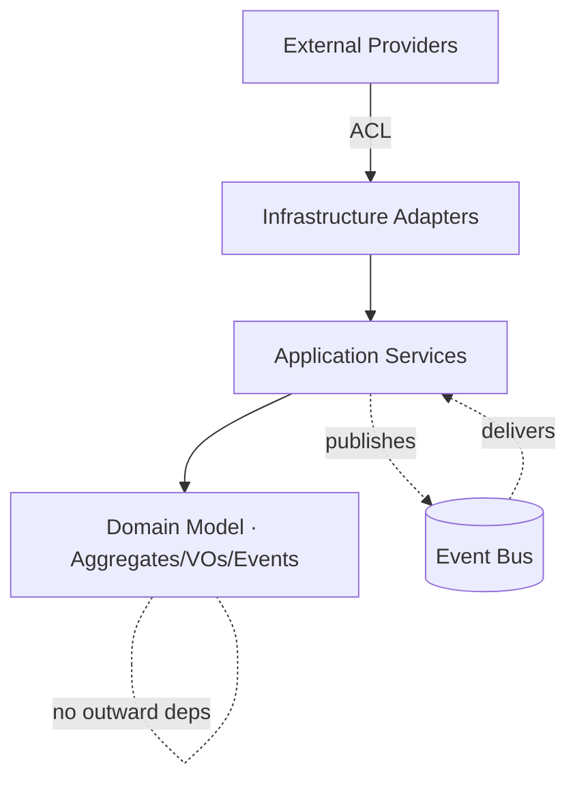

# Domain-Driven Design (DDD) — IELTS LMS AI

| Field | Value |
| --- | --- |
| **Product Name** | IELTS LMS AI |
| **Document** | 07 — Domain-Driven Design (DDD) |
| **Version** | 1.0 |
| **Status** | Architecture & Planning |
| **Document Owner** | Domain & Solution Architecture |
| **Last Updated** | 2026-07-18 |
| **Audience** | Architects, Engineering Leads, Senior Engineers, QA, Product |
| **Aligns With** | [01_Product_Vision.md](./01_Product_Vision.md), [02_Business_Requirements_Document.md](./02_Business_Requirements_Document.md), [03_Product_Requirements_Document.md](./03_Product_Requirements_Document.md), [04_Functional_Requirements.md](./04_Functional_Requirements.md), [05_Non_Functional_Requirements.md](./05_Non_Functional_Requirements.md), [06_Software_Requirements_Specification.md](./06_Software_Requirements_Specification.md) |

> **Purpose of this document.** This document defines the **domain model** for IELTS LMS AI using strategic and tactical Domain-Driven Design. It is the **source of truth** for the system's business concepts, boundaries, and rules; the [Event Storming](./08_Event_Storming.md) model and [Database Design / ERD](./09_Database_Design_ERD.md) are **derived from it**. It is **implementation-independent** — no code, ORM models, or SQL — and serves as the architectural blueprint for all subsequent design.

---

## Table of Contents

1. [Introduction](#1-introduction)
2. [DDD Philosophy](#2-ddd-philosophy)
3. [Ubiquitous Language](#3-ubiquitous-language)
4. [Strategic Design: Domains & Subdomains](#4-strategic-design-domains--subdomains)
5. [Bounded Contexts](#5-bounded-contexts)
6. [Context Mapping](#6-context-mapping)
7. [Tactical Design Building Blocks](#7-tactical-design-building-blocks)
8. [Aggregates & Aggregate Roots](#8-aggregates--aggregate-roots)
9. [Domain Events](#9-domain-events)
10. [Domain & Application Services](#10-domain--application-services)
11. [Invariants, Policies & Business Rules](#11-invariants-policies--business-rules)
12. [Module Boundaries & Dependency Rules](#12-module-boundaries--dependency-rules)
13. [Bounded Context Catalog](#13-bounded-context-catalog)
14. [Future Domain Evolution](#14-future-domain-evolution)
15. [Related Documents](#15-related-documents)

---

## 1. Introduction

IELTS LMS AI is a multi-tenant SaaS platform whose business complexity — learning, assessment, AI evaluation, commerce, and multi-tenant administration — benefits from an explicit domain model. This document applies Domain-Driven Design to:

- Establish a **Ubiquitous Language** shared by business and engineering.
- Partition the problem space into **subdomains** and the solution space into **bounded contexts**.
- Define **tactical building blocks** (aggregates, entities, value objects, domain events, services, repositories, specifications, policies) per context.
- Make **boundaries, ownership, and dependency rules** explicit so the platform can evolve safely.

The model deliberately avoids implementation concerns; persistence, APIs, and infrastructure are addressed in [ERD](./09_Database_Design_ERD.md), [API Specification](./10_API_Specification.md), and [Clean Architecture](./13_Clean_Architecture.md).

---

## 2. DDD Philosophy

| Principle | Application in IELTS LMS AI |
| --- | --- |
| **Model the domain, not the database** | Business concepts (Submission, Evaluation, Enrollment) drive the model; storage is derived later. |
| **Ubiquitous Language** | One consistent vocabulary across Vision → BRD → PRD → FRS → this model. |
| **Bounded Contexts** | Each context owns its model and language; the same word may differ across contexts (e.g., "Attempt"). |
| **Explicit boundaries** | Contexts integrate through events and well-defined contracts, not shared tables. |
| **Aggregates enforce invariants** | Consistency boundaries protect business rules within a transaction. |
| **Tenant isolation is intrinsic** | Tenancy is a first-class modeling concern, not an afterthought (see [Multi-Tenant Architecture](./12_Multi_Tenant_Architecture.md)). |
| **AI as a bounded capability** | AI is modeled as its own context with anti-corruption boundaries to external providers. |

### 2.1 Strategic vs Tactical DDD

---

## 3. Ubiquitous Language

### 3.1 Business Terminology

This glossary extends the [Vision Glossary](./01_Product_Vision.md#14-glossary); terms here are binding across the domain model, event model, and ERD.

| Term | Definition | Primary Context |
| --- | --- | --- |
| **Tenant** | Isolation boundary owning all data/config for one customer. | Tenant Management |
| **Organization** | Commercial entity mapped 1:1 to a tenant; may contain sub-units. | Organization Management |
| **User** | A human actor within a tenant. | Identity |
| **Role / Permission** | Named permission set / fine-grained authorization primitive. | Identity |
| **Learner (Student)** | User preparing for IELTS. | Learning Management |
| **Course / Lesson / Module** | Structured learning container / unit / grouping. | Course Management |
| **Learning Path** | Ordered, adaptive sequence toward a target band. | Learning Management |
| **Enrollment** | A learner's registration in a course. | Course Management |
| **Attempt** | A recorded try at a practice item, test, or exam section. | Assessment / skill contexts |
| **Submission** | Learner-produced response (writing text, speaking audio). | Writing / Speaking |
| **Evaluation** | Rubric-aligned scoring + feedback for a submission. | AI |
| **Band** | IELTS score (per-skill and overall, 0–9 in 0.5 steps). | Assessment / AI |
| **Mock Exam** | Full CB-IELTS-style timed exam across four skills. | Assessment |
| **Entitlement** | Plan-granted capability or quota. | Subscriptions |
| **Subscription / Plan** | Active commercial agreement / catalog offering. | Subscriptions |
| **Invoice / Payment** | Billing record / payment transaction. | Billing |
| **Certificate** | Verifiable evidence of achievement. | Certificates |
| **Progress** | Aggregated learner advancement signals. | Analytics |
| **Prompt** | Governed, versioned instruction to an AI provider. | AI |

### 3.2 Language Rules

- The **same term may mean different things in different contexts**; each context section states its local meaning. Example: *Attempt* in Reading is a set of question answers; in Speaking it is a recorded audio response.
- **Cross-context references use identifiers**, never shared entities.
- Event names are **past tense** (`WritingEvaluated`); command names are **imperative** (`SubmitWriting`).

---

## 4. Strategic Design: Domains & Subdomains

### 4.1 Domain Classification

### 4.2 Rationale

| Class | Subdomains | Why |
| --- | --- | --- |
| **Core** | AI Evaluation & Tutoring, Assessment/CB-IELTS, Adaptive Learning & Planning | These deliver the platform's unique value (scalable rubric-aligned feedback, realistic exams, personalization) per the [Vision](./01_Product_Vision.md#3-vision). Invest most modeling effort here. |
| **Supporting** | Content, skill delivery, certificates, analytics, commerce | Essential and somewhat tailored, but not the core differentiator. |
| **Generic** | Identity, tenancy, notifications, support, files | Well-understood; favor standard patterns/managed services. |

> **Note:** *Supporting* does not mean simple. Subscriptions & Billing is commercially critical; it is classified supporting because it uses well-known commerce patterns rather than being the product's differentiator.

---

## 5. Bounded Contexts

The solution space is divided into the following bounded contexts. Each is elaborated in the [Bounded Context Catalog](#13-bounded-context-catalog).

| # | Bounded Context | Class | Core Responsibility |
| --- | --- | --- | --- |
| BC-01 | Identity | Generic | Authentication, users, roles, permissions |
| BC-02 | Tenant Management | Generic | Tenant lifecycle & isolation |
| BC-03 | Organization Management | Generic | Organization structure & hierarchy |
| BC-04 | Learning Management | Core | Paths, planning, progress orchestration |
| BC-05 | Course Management | Supporting | Courses, modules, lessons, enrollment |
| BC-06 | Grammar | Supporting | Grammar learning & practice |
| BC-07 | Vocabulary | Supporting | Vocabulary learning & progress |
| BC-08 | Sentence Builder | Supporting | Sentence construction practice |
| BC-09 | Reading | Supporting | Reading practice & scoring |
| BC-10 | Listening | Supporting | Listening practice & scoring |
| BC-11 | Writing | Core-adjacent | Writing tasks & submissions |
| BC-12 | Speaking | Core-adjacent | Speaking tasks & audio submissions |
| BC-13 | Assessment | Core | Weekly tests, monthly mock exams, results |
| BC-14 | AI | Core | Evaluation, tutoring, band prediction, prompts |
| BC-15 | Analytics | Supporting | Progress aggregation & insights |
| BC-16 | Reporting | Supporting | Scoped, exportable reports |
| BC-17 | Certificates | Supporting | Issuance & verification |
| BC-18 | Subscriptions | Supporting | Plans & entitlements |
| BC-19 | Billing | Supporting | Invoices, payments, coupons |
| BC-20 | Notifications | Generic | Multi-channel delivery |
| BC-21 | Administration | Generic | Platform/tenant admin operations |
| BC-22 | Support | Generic | Tickets & feedback |

### 5.1 Bounded Context Landscape

---

## 6. Context Mapping

Context maps describe the **integration relationships** between bounded contexts and the patterns governing them.

### 6.1 Context Map

### 6.2 Relationship Patterns

| Relationship | Upstream → Downstream | Pattern | Notes |
| --- | --- | --- | --- |
| Tenant ↔ Identity | Tenant Mgmt ↔ Identity | **Shared Kernel** | `TenantId` value object shared as a minimal, stable kernel. |
| Identity → Learning | Identity → Learning Mgmt | **Customer/Supplier** | Learning consumes identity/roles; no reverse dependency. |
| Subscriptions → Learning | Subscriptions → Learning/skills | **Customer/Supplier** | Entitlements gate feature access downstream. |
| Writing/Speaking → AI | skill contexts → AI | **Customer/Supplier** | Skill contexts request evaluation; AI supplies results. |
| AI → LLM Providers | AI → external | **Anti-Corruption Layer** | ACL isolates the domain from provider models/APIs. |
| Assessment → Analytics | Assessment → Analytics | **Published Language (events)** | Analytics subscribes to domain events; no shared store. |
| Analytics → Certificates | Analytics → Certificates | **Customer/Supplier** | Certificate criteria consume analytics/results. |
| Subscriptions ↔ Billing | — | **Partnership** | Co-evolving commerce capability. |
| Payment Provider → Billing | external → Billing | **Anti-Corruption Layer** | ACL normalizes provider webhooks/records. |
| Identity ↔ Enterprise IdP | Identity ↔ external | **Anti-Corruption Layer / Conformist** | Federation adapts to external IdP protocols. |

### 6.3 Integration Principles

- **Events over shared data:** contexts integrate through published domain/integration events; no cross-context database sharing.
- **ACL at every external edge:** LLM providers, payment providers, email, and IdPs are wrapped by anti-corruption layers.
- **Tenant scoping is universal:** every cross-context message carries `TenantId`; no message is processed without it.
- **Downstream never dictates upstream:** dependency direction follows the [dependency rules](#12-module-boundaries--dependency-rules).

---

## 7. Tactical Design Building Blocks

This section defines how each building block is used across the model. Concrete per-context instances are cataloged in [§13](#13-bounded-context-catalog).

| Block | Definition | Convention in IELTS LMS AI |
| --- | --- | --- |
| **Entity** | Object with identity and lifecycle. | Identified by a domain identity value object (e.g., `LearnerId`). |
| **Value Object** | Immutable, equality-by-value concept. | `BandScore`, `TenantId`, `Money`, `DateRange`, `Email`, `RubricScore`. |
| **Aggregate** | Consistency boundary around entities/VOs. | Transactions never span aggregates; reference other aggregates by ID. |
| **Aggregate Root** | Entry point enforcing aggregate invariants. | Only roots are obtained from repositories. |
| **Domain Event** | A fact that happened in the domain. | Past-tense, immutable, tenant-scoped (e.g., `WritingEvaluated`). |
| **Domain Service** | Domain logic not owned by a single aggregate. | Stateless; expressed in ubiquitous language (e.g., `BandCalculationService`). |
| **Application Service** | Orchestrates use cases across aggregates/contexts. | Transaction/permission boundary; no business rules of its own. |
| **Repository** | Collection-like access to aggregate roots. | One repository per aggregate root; returns fully-formed aggregates. |
| **Factory** | Encapsulates complex creation with invariants. | Used where creation logic is non-trivial (e.g., `MockExamFactory`). |
| **Specification** | Reusable predicate for selection/validation. | e.g., `EligibleForCertificateSpecification`. |
| **Policy** | A rule reacting to events ("whenever…then…"). | Drives reactive behavior; see [Event Storming](./08_Event_Storming.md). |

---

## 8. Aggregates & Aggregate Roots

### 8.1 Aggregate Design Rules

- **AR-1:** An aggregate is the transactional consistency boundary; invariants hold within it at all times.
- **AR-2:** Reference other aggregates **by identity only** (no object navigation across boundaries).
- **AR-3:** Modify **one aggregate per transaction**; cross-aggregate consistency is **eventual** via domain events.
- **AR-4:** Every aggregate root carries `TenantId` (except platform-global reference data explicitly marked tenant-agnostic).
- **AR-5:** Keep aggregates small; prefer multiple small aggregates over a large one.

### 8.2 Key Aggregates (by context)

| Aggregate Root | Context | Key Invariants |
| --- | --- | --- |
| `Tenant` | Tenant Mgmt | Unique identifier; lifecycle state transitions valid. |
| `User` | Identity | Unique within tenant; active state required to authenticate. |
| `Role` | Identity | Permission composition valid; system roles immutable. |
| `Course` | Course Mgmt | Published courses have ≥1 lesson; track-tagged. |
| `Enrollment` | Course Mgmt | One active enrollment per learner+course; entitlement-checked. |
| `LearningPath` | Learning Mgmt | Ordered milestones; target date in future. |
| `WritingSubmission` | Writing | Immutable after submit; one active evaluation. |
| `SpeakingSubmission` | Speaking | Audio present; one active evaluation. |
| `Evaluation` | AI | Criteria scores within valid ranges; labeled AI-generated. |
| `MockExam` | Assessment | Single active session per learner; section order enforced. |
| `Subscription` | Subscriptions | Entitlements match plan; state machine valid. |
| `Invoice` | Billing | Line items reconcile to total; immutable once issued. |
| `Certificate` | Certificates | Issued only if criteria met; unique verifiable ID. |

### 8.3 Example Aggregate Diagram — Writing Submission & Evaluation

---

## 9. Domain Events

### 9.1 Event Conventions

- Named in **past tense**, immutable, and **tenant-scoped** (`TenantId` always present).
- Carry the minimal facts needed by subscribers; identifiers over full payloads.
- Cataloged fully in [Event Storming](./08_Event_Storming.md); this section lists the canonical set.

### 9.2 Canonical Domain Events (Representative)

| Event ID | Domain Event | Emitting Context |
| --- | --- | --- |
| EVT-IDN-01 | `UserRegistered` | Identity |
| EVT-IDN-02 | `EmailVerified` | Identity |
| EVT-IDN-03 | `RoleAssigned` | Identity |
| EVT-TEN-01 | `TenantProvisioned` | Tenant Mgmt |
| EVT-SUB-01 | `SubscriptionActivated` | Subscriptions |
| EVT-BIL-01 | `PaymentSucceeded` | Billing |
| EVT-BIL-02 | `PaymentFailed` | Billing |
| EVT-CRS-01 | `LearnerEnrolled` | Course Mgmt |
| EVT-LRN-01 | `LessonCompleted` | Learning Mgmt |
| EVT-WRT-01 | `WritingSubmitted` | Writing |
| EVT-AI-01 | `WritingEvaluated` | AI |
| EVT-SPK-01 | `SpeakingSubmitted` | Speaking |
| EVT-AI-02 | `SpeakingEvaluated` | AI |
| EVT-ASM-01 | `MockExamCompleted` | Assessment |
| EVT-AI-03 | `BandPredicted` | AI |
| EVT-ANL-01 | `ProgressRecalculated` | Analytics |
| EVT-CRT-01 | `CertificateIssued` | Certificates |
| EVT-NOT-01 | `NotificationDispatched` | Notifications |

---

## 10. Domain & Application Services

### 10.1 Domain Services (Representative)

| Service | Context | Responsibility |
| --- | --- | --- |
| `BandCalculationService` | Assessment/AI | Aggregate section results into overall estimated band. |
| `EntitlementService` | Subscriptions | Resolve effective entitlements for a tenant/user. |
| `CertificateEligibilityService` | Certificates | Evaluate `EligibleForCertificateSpecification`. |
| `PlanAdaptationService` | Learning Mgmt | Adjust learning path/daily plan from progress signals. |
| `WeaknessDetectionService` | AI/Analytics | Derive weakness profile from performance history. |

### 10.2 Application Services (Use-Case Orchestration)

Application services orchestrate use cases (e.g., "SubmitWriting", "PurchaseSubscription", "CompleteMockExam"), enforce permissions and tenant scope, manage the transaction boundary, and publish resulting domain events. They contain **no business rules** — those live in aggregates, domain services, and policies. See [Clean Architecture](./13_Clean_Architecture.md) for layering.

---

## 11. Invariants, Policies & Business Rules

### 11.1 Cross-Cutting Invariants

| ID | Invariant |
| --- | --- |
| INV-01 | Every tenant-owned entity has a non-null `TenantId`; access is always tenant-scoped. |
| INV-02 | No transaction modifies more than one aggregate. |
| INV-03 | Entitlement checks precede access to plan-gated capabilities. |
| INV-04 | Submissions are immutable once submitted; corrections create new submissions. |
| INV-05 | Evaluations produce criteria scores within valid IELTS ranges and are labeled AI-generated. |
| INV-06 | Certificates are issued only when eligibility criteria are satisfied. |
| INV-07 | State transitions follow each aggregate's defined state machine. |

### 11.2 Policies (Reactive Rules)

| ID | Policy (Whenever … then …) |
| --- | --- |
| POL-01 | Whenever `PaymentSucceeded`, then activate/renew the subscription and apply entitlements. |
| POL-02 | Whenever `PaymentFailed`, then enter dunning/grace and notify the customer. |
| POL-03 | Whenever `WritingSubmitted`/`SpeakingSubmitted`, then request AI evaluation. |
| POL-04 | Whenever `WritingEvaluated`/`SpeakingEvaluated`, then update progress and notify the learner. |
| POL-05 | Whenever `MockExamCompleted`, then trigger band prediction and analytics recalculation. |
| POL-06 | Whenever criteria are met (`ProgressRecalculated`), then evaluate certificate eligibility. |
| POL-07 | Whenever `TenantProvisioned`, then initialize default roles, settings, and admin invite. |

Full policy/event wiring, failure scenarios, and compensating actions are in [Event Storming](./08_Event_Storming.md).

---

## 12. Module Boundaries & Dependency Rules

### 12.1 Domain Responsibilities

Each bounded context is a module with a single responsibility area (see [§13](#13-bounded-context-catalog)). Modules expose behavior through application services and integrate via events; internal models are private.

### 12.2 Dependency Rules

- **DEP-1:** Dependencies point **inward** toward the domain (see [Clean Architecture](./13_Clean_Architecture.md)); the domain depends on nothing external.
- **DEP-2:** Contexts depend on **abstractions/contracts and events**, not on each other's internal models.
- **DEP-3:** Generic/supporting contexts must not depend on core contexts' internals; the reverse is allowed only via published contracts.
- **DEP-4:** External systems are reached only through **anti-corruption layers**.
- **DEP-5:** No cyclic dependencies between contexts; integration cycles are broken with events.

---

## 13. Bounded Context Catalog

Each context defines: **Purpose, Responsibilities, Owned Entities, Events, Services, Relationships, Dependencies, External Interfaces.** Owned entities map to logical entities in the [ERD](./09_Database_Design_ERD.md).

### 13.1 Identity (BC-01)

- **Purpose:** Authenticate users and manage roles/permissions within a tenant.
- **Responsibilities:** Registration, credentials, sessions, MFA, RBAC.
- **Owned Entities:** `User`, `Role`, `Permission`, `UserRole`, `RolePermission`, `RefreshToken`.
- **Events:** `UserRegistered`, `EmailVerified`, `RoleAssigned`, `PermissionChanged`, `PasswordReset`.
- **Services:** `AuthenticationService` (app), `AuthorizationService` (domain).
- **Relationships:** Shared Kernel with Tenant Mgmt (`TenantId`); Customer/Supplier to all downstream contexts.
- **Dependencies:** Tenant Mgmt; Notifications (verification/reset).
- **External Interfaces:** Enterprise IdP (SAML/OIDC) via ACL.

### 13.2 Tenant Management (BC-02)

- **Purpose:** Own the tenant lifecycle and isolation boundary.
- **Responsibilities:** Provision/suspend/close tenants; tenant settings/branding.
- **Owned Entities:** `Tenant`, `SystemSettings` (tenant-scoped), `FeatureFlag` (tenant overrides).
- **Events:** `TenantProvisioned`, `TenantSuspended`, `TenantClosed`, `TenantSettingsUpdated`.
- **Services:** `TenantProvisioningService` (app).
- **Relationships:** Shared Kernel with Identity; upstream to all contexts.
- **Dependencies:** Organization Mgmt (ownership); Subscriptions (plan).
- **External Interfaces:** None directly.

### 13.3 Organization Management (BC-03)

- **Purpose:** Represent the customer organization and its structure.
- **Responsibilities:** Organization profile, hierarchy (institutes/departments).
- **Owned Entities:** `Organization`, `OrgUnit`.
- **Events:** `OrganizationCreated`, `OrgStructureChanged`.
- **Services:** `OrganizationService` (app).
- **Relationships:** Upstream to Tenant Mgmt (1:1 org↔tenant).
- **Dependencies:** Tenant Mgmt.
- **External Interfaces:** None.

### 13.4 Learning Management (BC-04)

- **Purpose:** Orchestrate the learner journey: paths, daily plans, progress.
- **Responsibilities:** Learning path generation/adaptation, daily planning, progress aggregation.
- **Owned Entities:** `LearningPath`, `DailyPlan`, `ProgressTracking`, `StudySession`.
- **Events:** `LearningPathGenerated`, `DailyPlanGenerated`, `LessonCompleted`, `ProgressRecorded`.
- **Services:** `PlanAdaptationService` (domain), `LearningOrchestrationService` (app).
- **Relationships:** Customer of Identity, Subscriptions, Course Mgmt; supplier to Analytics.
- **Dependencies:** Course Mgmt, AI (planner), Assessment.
- **External Interfaces:** None directly.

### 13.5 Course Management (BC-05)

- **Purpose:** Manage structured content and enrollment.
- **Responsibilities:** Courses, modules, lessons, enrollment.
- **Owned Entities:** `Course`, `Module`, `Lesson`, `Enrollment`.
- **Events:** `CoursePublished`, `LearnerEnrolled`, `LessonCompleted`.
- **Services:** `EnrollmentService` (app).
- **Relationships:** Supplier to Learning Mgmt; customer of Subscriptions (entitlements).
- **Dependencies:** Subscriptions, File Management (media).
- **External Interfaces:** Media/object storage via adapter.

### 13.6 Assessment (BC-06)

- **Purpose:** Deliver and score practice, weekly tests, and monthly mock exams.
- **Responsibilities:** Test/exam lifecycle, timing, objective scoring, orchestration of AI-scored parts.
- **Owned Entities:** `WeeklyAssessment`, `MonthlyMockExam`, `MockExamResult`, `Assignment`.
- **Events:** `WeeklyAssessmentCompleted`, `MockExamStarted`, `MockExamCompleted`, `AssignmentSubmitted`.
- **Services:** `MockExamFactory` (factory), `BandCalculationService` (domain, shared with AI).
- **Relationships:** Customer of skill contexts and AI; supplier to Analytics and Certificates.
- **Dependencies:** Reading, Listening, Writing, Speaking, AI.
- **External Interfaces:** None directly.

### 13.7 Grammar (BC-07)

- **Purpose:** Teach and assess grammar foundations.
- **Responsibilities:** Grammar topics, drills, AI grammar coaching hooks.
- **Owned Entities:** `GrammarTopic`, `GrammarAttempt`.
- **Events:** `GrammarCompleted`.
- **Services:** `GrammarPracticeService` (app).
- **Relationships:** Supplier to Learning Mgmt/Analytics; customer of AI (coach).
- **Dependencies:** AI, Progress (via events).
- **External Interfaces:** None.

### 13.8 Vocabulary (BC-08)

- **Purpose:** Build and reinforce vocabulary.
- **Responsibilities:** Vocabulary items, spaced practice, progress.
- **Owned Entities:** `VocabularyWord`, `VocabularyProgress`.
- **Events:** `VocabularyCompleted`.
- **Services:** `VocabularyPracticeService` (app).
- **Relationships:** Supplier to Learning Mgmt/Analytics; customer of AI (coach).
- **Dependencies:** AI.
- **External Interfaces:** None.

### 13.9 Sentence Builder (BC-09)

- **Purpose:** Practice sentence construction.
- **Responsibilities:** Sentence exercises, attempts, AI feedback hooks.
- **Owned Entities:** `SentenceExercise`, `SentenceAttempt`.
- **Events:** `SentenceAttemptEvaluated`.
- **Services:** `SentenceBuilderService` (app).
- **Relationships:** Customer of AI; supplier to Analytics.
- **Dependencies:** AI.
- **External Interfaces:** None.

### 13.10 Reading (BC-10)

- **Purpose:** Develop and assess reading.
- **Responsibilities:** Passages, questions, attempts, auto-scoring.
- **Owned Entities:** `ReadingPassage`, `ReadingQuestion`, `ReadingAttempt`.
- **Events:** `ReadingAttemptScored`.
- **Services:** `ReadingScoringService` (domain).
- **Relationships:** Supplier to Assessment/Analytics.
- **Dependencies:** Assessment (composition into tests).
- **External Interfaces:** None.

### 13.11 Listening (BC-11)

- **Purpose:** Develop and assess listening.
- **Responsibilities:** Audio assets, questions, attempts, auto-scoring, playback rules.
- **Owned Entities:** `ListeningAudio`, `ListeningQuestion`, `ListeningAttempt`.
- **Events:** `ListeningAttemptScored`.
- **Services:** `ListeningScoringService` (domain).
- **Relationships:** Supplier to Assessment/Analytics.
- **Dependencies:** File Management (audio), Assessment.
- **External Interfaces:** Media/object storage via adapter.

### 13.12 Writing (BC-12)

- **Purpose:** Capture writing responses for evaluation.
- **Responsibilities:** Writing tasks, submissions, routing to AI.
- **Owned Entities:** `WritingTask`, `WritingSubmission`.
- **Events:** `WritingSubmitted`.
- **Services:** `WritingSubmissionService` (app).
- **Relationships:** Customer of AI; supplier to Assessment/Analytics.
- **Dependencies:** AI, File Management.
- **External Interfaces:** None directly.

### 13.13 Speaking (BC-13)

- **Purpose:** Capture spoken responses for evaluation.
- **Responsibilities:** Speaking tasks, audio capture, routing to AI.
- **Owned Entities:** `SpeakingTask`, `SpeakingAttempt`.
- **Events:** `SpeakingSubmitted`.
- **Services:** `SpeakingSubmissionService` (app).
- **Relationships:** Customer of AI; supplier to Assessment/Analytics.
- **Dependencies:** AI, File Management (audio).
- **External Interfaces:** Media/object storage via adapter.

### 13.14 AI (BC-14) — Core

- **Purpose:** Provide evaluation, tutoring, band prediction, planning, and recommendations.
- **Responsibilities:** Rubric-aligned evaluation, band prediction, tutor interactions, prompt governance; isolate external LLM providers.
- **Owned Entities:** `Evaluation` (writing/speaking), `BandPrediction`, `AIPrompt`, `AIResponse`, `AIProvider`.
- **Events:** `WritingEvaluated`, `SpeakingEvaluated`, `BandPredicted`, `TutorInteractionCompleted`.
- **Services:** `EvaluationService`, `BandPredictionService`, `TutoringService`, `WeaknessDetectionService`,
  `IPromptCompositionService` (app; Phase 7 Sprint 1) — the single path every capability handler binds an
  `AIPrompt.SystemTemplate` + typed variables + user content into the final system/user message pair
  through; enforces "no unescaped user text in the system portion" structurally (user content never
  participates in template substitution) and rejects (not truncates) variable values that themselves
  contain template syntax.
- **Relationships:** Supplier to Writing, Speaking, Assessment, Learning, Analytics.
- **Dependencies:** External LLM providers via **ACL**; prompt governance.
- **External Interfaces:** LLM/AI provider APIs (ACL-wrapped). See [AI Architecture](./16_AI_Architecture.md).
- **Prompt governance (Phase 7 Sprint 2):** `AIPrompt` versions are authored as drafts and promoted via
  an explicit activation step scoped to `(TenantId, Feature, Scope)` — activation deactivates whatever
  else was active in that exact slot, never a different `Scope` (the A/B-slot mechanic: two scopes for
  one feature can each carry their own independently active version). Rollback restores the version
  active immediately before the current one, derived from existing rows rather than a new history
  table, and records actor/timestamp/reason via the existing `AuditLog` mechanism (action `"Rollback"`)
  rather than a second audit path. A version referenced by any `AIResponse` is never mutated or
  hard-deleted — retiring only soft-deletes, and is rejected while the version is still active for its
  slot. Actual A/B traffic-split assignment (which scope a given call resolves to) remains a
  composition-engine concern for whenever real experiment routing is built — out of this sprint's scope.

### 13.15 Analytics (BC-15)

- **Purpose:** Compute insights and progress metrics.
- **Responsibilities:** Progress recalculation, cohort/institute analytics, weakness profiles.
- **Owned Entities:** `ProgressTracking` (read/derived), `AnalyticsSnapshot` (read model).
- **Events:** `ProgressRecalculated`, `AnalyticsUpdated`.
- **Services:** `AnalyticsProjectionService` (app).
- **Relationships:** Subscriber to assessment/AI/learning events; supplier to Reporting/Certificates.
- **Dependencies:** Event streams from many contexts.
- **External Interfaces:** None.

### 13.16 Certificates (BC-16)

- **Purpose:** Issue and verify certificates.
- **Responsibilities:** Eligibility evaluation, issuance, verification, revocation.
- **Owned Entities:** `Certificate`, `Achievement`.
- **Events:** `CertificateIssued`, `CertificateRevoked`, `AchievementEarned`.
- **Services:** `CertificateEligibilityService` (domain), `CertificateIssuanceService` (app).
- **Relationships:** Customer of Analytics/Assessment.
- **Dependencies:** Analytics, Notifications.
- **External Interfaces:** Optional third-party verification (future).

### 13.17 Subscriptions (BC-17)

- **Purpose:** Manage plans and entitlements.
- **Responsibilities:** Plan lifecycle, subscription state machine, entitlement resolution, coupons.
- **Owned Entities:** `Subscription`, `SubscriptionPlan`, `Coupon`.
- **Events:** `SubscriptionActivated`, `SubscriptionChanged`, `SubscriptionCancelled`, `SubscriptionRenewed`.
- **Services:** `EntitlementService` (domain), `SubscriptionService` (app).
- **Relationships:** Partnership with Billing; supplier to all gated contexts.
- **Dependencies:** Billing.
- **External Interfaces:** None directly.

### 13.18 Billing (BC-18)

- **Purpose:** Handle invoices and payments.
- **Responsibilities:** Invoicing, payment capture/reconciliation, dunning.
- **Owned Entities:** `Invoice`, `Payment`.
- **Events:** `InvoiceIssued`, `PaymentSucceeded`, `PaymentFailed`, `RefundIssued`.
- **Services:** `BillingService` (app), payment provider **ACL**.
- **Relationships:** Partnership with Subscriptions.
- **Dependencies:** Payment provider.
- **External Interfaces:** Payment provider APIs/webhooks (ACL-wrapped).

### 13.19 Reporting (BC-19)

- **Purpose:** Produce exportable, scoped reports.
- **Responsibilities:** Report generation, scheduling, export.
- **Owned Entities:** `ReportDefinition` (read model), `ReportRun`.
- **Events:** `ReportGenerated`.
- **Services:** `ReportingService` (app).
- **Relationships:** Customer of Analytics/Billing.
- **Dependencies:** Analytics.
- **External Interfaces:** Export targets via adapter.

### 13.20 Notifications (BC-20)

- **Purpose:** Deliver multi-channel notifications.
- **Responsibilities:** Compose/deliver notifications, manage templates and preferences, log delivery.
- **Owned Entities:** `Notification`, `NotificationTemplate`, `EmailLog`.
- **Events:** `NotificationDispatched`, `NotificationFailed`.
- **Services:** `NotificationService` (app), email provider **ACL**.
- **Relationships:** Subscriber to events across contexts.
- **Dependencies:** Email/notification provider.
- **External Interfaces:** Email/notification provider (ACL-wrapped).

### 13.21 Administration (BC-21)

- **Purpose:** Platform/tenant administrative operations.
- **Responsibilities:** User/class management, settings, audit oversight, global catalog/plan mgmt (Super Admin).
- **Owned Entities:** `AuditLog`, `ActivityLog`, `SystemSettings` (platform-scoped), `FeatureFlag`, `BackgroundJob`.
- **Events:** `AdminActionPerformed`, `AuditLogged`, `ActivityLogged`.
- **Services:** `AdministrationService` (app).
- **Relationships:** Cross-cutting; consumes/administers other contexts within authority.
- **Dependencies:** Identity, Tenant Mgmt.
- **External Interfaces:** None directly.

### 13.22 Support (BC-22)

- **Purpose:** Handle support tickets and feedback.
- **Responsibilities:** Ticket lifecycle, feedback capture, routing/escalation.
- **Owned Entities:** `SupportTicket`, `Feedback`.
- **Events:** `TicketOpened`, `TicketResolved`, `FeedbackSubmitted`.
- **Services:** `SupportService` (app).
- **Relationships:** Customer of Identity/Notifications.
- **Dependencies:** Notifications.
- **External Interfaces:** Optional external helpdesk (future) via adapter.

---

## 14. Future Domain Evolution

| Horizon | Evolution | Domain Impact |
| --- | --- | --- |
| Near | Multi-agent AI orchestration | AI context introduces agent coordination; new events (`AgentTaskCompleted`). |
| Near | Content marketplace | New Marketplace context; Course Mgmt exposes publishable content contracts. |
| Mid | Database-per-tenant option | No domain change; isolation strategy shifts (see [ERD §migration](./09_Database_Design_ERD.md)). |
| Mid | Temporal history / audit replay | Event-sourced sub-contexts where valuable (Assessment, Billing). |
| Long | Adaptive learning engine | Learning Mgmt gains richer adaptation domain services. |
| Long | Partner/enterprise groups | Organization Mgmt extends to multi-tenant enterprise groups. |

**Evolution principles:** preserve bounded-context boundaries; add new contexts rather than overloading existing ones; integrate via events; keep tenant isolation invariant across all changes.

---

## 15. Related Documents

| # | Document | Relationship |
| --- | --- | --- |
| 01 | [Product Vision](./01_Product_Vision.md) | Vision and scope this model realizes. |
| 02 | [Business Requirements](./02_Business_Requirements_Document.md) | Business drivers behind domains. |
| 03 | [Product Requirements](./03_Product_Requirements_Document.md) | Modules/features mapped to contexts. |
| 04 | [Functional Requirements](./04_Functional_Requirements.md) | Behaviors realized by aggregates/services. |
| 05 | [Non-Functional Requirements](./05_Non_Functional_Requirements.md) | Quality constraints on the model. |
| 06 | [Software Requirements Specification](./06_Software_Requirements_Specification.md) | Consolidated requirements & traceability. |
| 08 | [Event Storming](./08_Event_Storming.md) | Event/command/policy model derived from this. |
| 09 | [Database Design / ERD](./09_Database_Design_ERD.md) | Logical data model derived from this. |
| 13 | [Clean Architecture](./13_Clean_Architecture.md) | Layering and dependency enforcement. |
| 16 | [AI Architecture](./16_AI_Architecture.md) | AI context internals and governance. |

---

*End of Document — 07 Domain-Driven Design (v1.0).*
