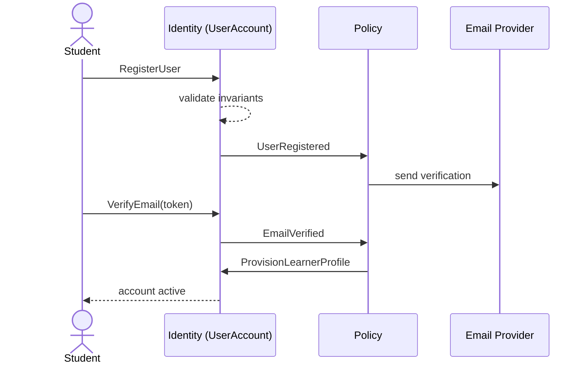
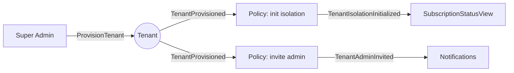
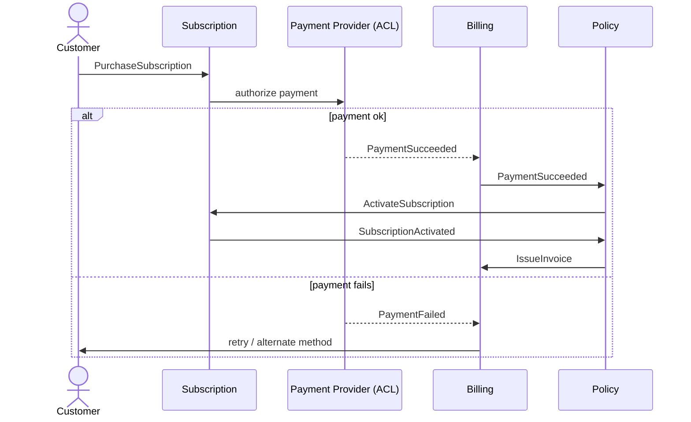
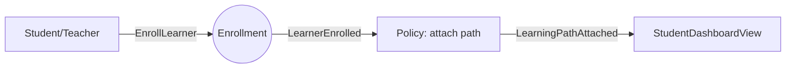
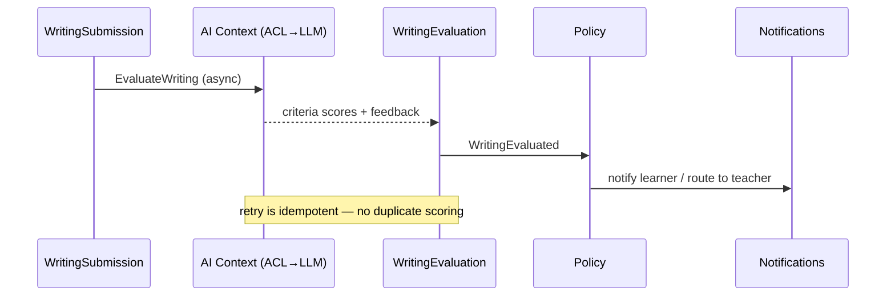
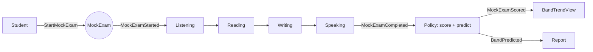
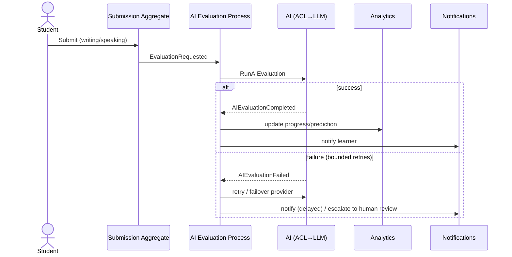
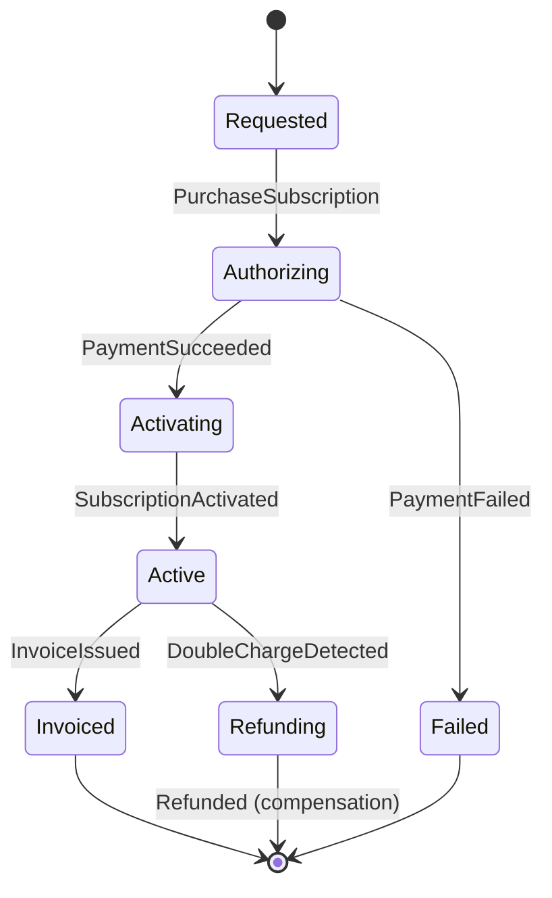

# Event Storming — IELTS LMS AI

| Field | Value |
| --- | --- |
| **Product Name** | IELTS LMS AI |
| **Document** | 08 — Event Storming / Event-Driven Model |
| **Version** | 1.0 |
| **Status** | Architecture & Planning |
| **Document Owner** | Domain & Solution Architecture |
| **Last Updated** | 2026-07-18 |
| **Audience** | Architects, Engineering Leads, Senior Engineers, QA, Product |
| **Aligns With** | [01_Product_Vision.md](./01_Product_Vision.md) … [06_Software_Requirements_Specification.md](./06_Software_Requirements_Specification.md), [07_Domain_Driven_Design.md](./07_Domain_Driven_Design.md) |

> **Purpose of this document.** This document models the **event-driven business behavior** of IELTS LMS AI using Event Storming. It builds directly on the [Domain-Driven Design model](./07_Domain_Driven_Design.md) (the source of truth) and expresses each major workflow as a flow of **actors → commands → aggregates → domain events → policies → read models**, including **failure scenarios** and **compensating actions**. It is **implementation-independent**: no code, message-broker configuration, or SQL.

---

## Table of Contents

1. [Introduction & Notation](#1-introduction--notation)
2. [Building Blocks](#2-building-blocks)
3. [Actors](#3-actors)
4. [External Systems](#4-external-systems)
5. [Aggregates & Read Models Overview](#5-aggregates--read-models-overview)
6. [Event Catalog](#6-event-catalog)
7. [Workflows](#7-workflows)
8. [Process Managers, Sagas & Long-Running Processes](#8-process-managers-sagas--long-running-processes)
9. [Policy Catalog](#9-policy-catalog)
10. [Related Documents](#10-related-documents)

---

## 1. Introduction & Notation

Event Storming is a collaborative modeling technique that discovers a domain through the **events** that occur within it. This document captures the results as a durable reference. Events are named in **past tense** and are **immutable facts**; every event and command is **tenant-scoped** (`TenantId` implicit unless a platform-level operation).

### 1.1 Color Legend (Event Storming Convention)

| Element | Convention | Meaning |
| --- | --- | --- |
| 🟧 **Domain Event** | Orange | A fact that happened (past tense). |
| 🟦 **Command** | Blue | An intent/request to change state. |
| 🟨 **Actor** | Yellow | A user or role issuing a command. |
| 🟪 **Policy** | Purple | Reactive rule: "whenever <event> then <command>". |
| 🟩 **Read Model** | Green | A projection supporting a query/decision. |
| 🟫 **Aggregate** | Tan | Consistency boundary handling commands, emitting events. |
| 🩷 **External System** | Pink | Third-party system (payment, LLM, email, IdP). |

### 1.2 Diagram Conventions

Each workflow provides an **event-flow diagram** (command → aggregate → event → policy) and, where interactions are non-trivial, a **sequence diagram** including external systems and compensating actions.

---

## 2. Building Blocks

The building blocks align 1:1 with the [DDD tactical model](./07_Domain_Driven_Design.md#7-tactical-design-building-blocks):

- **Command:** imperative intent (`SubmitWriting`), may be rejected by invariants.
- **Domain Event:** past-tense fact (`WritingSubmitted`), immutable, published for subscribers.
- **Aggregate:** handles commands, enforces invariants, emits events.
- **Policy:** listens to events and issues follow-up commands (reactive glue).
- **Read Model:** query-optimized projection built from events.
- **Process Manager / Saga:** coordinates multi-step, multi-aggregate or cross-context processes, including compensation.

---

## 3. Actors

| Actor | Description | Reference |
| --- | --- | --- |
| Student / Learner | Prepares for IELTS; issues learning/practice/assessment commands. | [PRD §4.1](./03_Product_Requirements_Document.md#41-persona-student) |
| Teacher | Manages cohorts, assignments, and reviews. | [PRD §4.2](./03_Product_Requirements_Document.md#42-persona-teacher) |
| Institute Admin | Administers an institute within a tenant. | [PRD §4.3](./03_Product_Requirements_Document.md#43-persona-institute-administrator) |
| Tenant Admin | Owns tenant config, subscription, governance. | [PRD §4.4](./03_Product_Requirements_Document.md#44-persona-tenant-administrator) |
| Platform Super Admin | Operates the platform across tenants (audited). | [PRD §4.5](./03_Product_Requirements_Document.md#45-persona-platform-super-admin) |
| Support Agent | Bounded support actions. | [PRD §4.6](./03_Product_Requirements_Document.md#46-persona-customer-support) |
| System (Scheduler/AI) | Automated actor issuing time- or event-triggered commands. | — |

---

## 4. External Systems

| External System | Role | Integration Pattern |
| --- | --- | --- |
| Payment Provider | Charges, receipts, webhooks. | Anti-Corruption Layer ([Billing](./07_Domain_Driven_Design.md)) |
| AI / LLM Provider | Writing/Speaking evaluation, tutoring, prediction. | Anti-Corruption Layer ([AI context](./16_AI_Architecture.md)) |
| Email / Notification Provider | Message delivery. | ACL / adapter |
| Object / Media Storage | Audio, documents, certificates. | Adapter |
| Enterprise Identity Provider | SSO/federation (SAML/OIDC). | ACL / Conformist |

---

## 5. Aggregates & Read Models Overview

### 5.1 Key Aggregates (from DDD)

`UserAccount`, `Tenant`, `Organization`, `Course`, `Enrollment`, `LearningPath`, `DailyPlan`, `WritingSubmission`, `SpeakingAttempt`, `WritingEvaluation`, `SpeakingEvaluation`, `ReadingAttempt`, `ListeningAttempt`, `WeeklyAssessment`, `MockExam`, `Certificate`, `Subscription`, `Invoice`, `Payment`, `BandPrediction`, `ProgressRecord`, `Notification`, `SupportTicket`.

### 5.2 Key Read Models

| Read Model | Purpose | Fed By (events) |
| --- | --- | --- |
| `StudentDashboardView` | Today's plan, progress, alerts. | Progress/plan/evaluation events |
| `CohortProgressView` | Teacher cohort monitoring. | Progress/assignment/assessment events |
| `InstituteAnalyticsView` | Institute/org KPIs. | Progress/assessment/enrollment events |
| `BandTrendView` | Band trend over time per learner. | Evaluation/assessment/prediction events |
| `SubscriptionStatusView` | Current plan & entitlements. | Subscription/billing events |
| `CertificateVerificationView` | Public certificate verification. | Certificate events |
| `NotificationInboxView` | User notifications. | Notification events |
| `AuditTrailView` | Compliance/audit queries. | Audit events (all contexts) |

---

## 6. Event Catalog

Representative domain/integration events by context. All events are past-tense, immutable, and tenant-scoped. IDs use `EVT-<CTX>-<NNN>`.

| ID | Event | Emitting Aggregate | Context |
| --- | --- | --- | --- |
| EVT-IDN-001 | `UserRegistered` | UserAccount | Identity |
| EVT-IDN-002 | `EmailVerified` | UserAccount | Identity |
| EVT-IDN-003 | `PasswordResetRequested` | UserAccount | Identity |
| EVT-IDN-004 | `PasswordReset` | UserAccount | Identity |
| EVT-IDN-005 | `RoleAssigned` | UserAccount | Identity |
| EVT-IDN-006 | `PermissionsChanged` | Role | Identity |
| EVT-TEN-001 | `TenantProvisioned` | Tenant | Tenant Mgmt |
| EVT-TEN-002 | `TenantSuspended` | Tenant | Tenant Mgmt |
| EVT-SUB-001 | `SubscriptionActivated` | Subscription | Subscriptions |
| EVT-SUB-002 | `SubscriptionRenewed` | Subscription | Subscriptions |
| EVT-SUB-003 | `SubscriptionCancelled` | Subscription | Subscriptions |
| EVT-BIL-001 | `PaymentSucceeded` | Payment | Billing |
| EVT-BIL-002 | `PaymentFailed` | Payment | Billing |
| EVT-BIL-003 | `InvoiceIssued` | Invoice | Billing |
| EVT-CRS-001 | `LearnerEnrolled` | Enrollment | Course Mgmt |
| EVT-CRS-002 | `LessonCompleted` | Enrollment | Course Mgmt |
| EVT-GRM-001 | `GrammarActivityCompleted` | GrammarProgress | Grammar |
| EVT-VOC-001 | `VocabularyActivityCompleted` | VocabularyProgress | Vocabulary |
| EVT-WRT-001 | `WritingSubmitted` | WritingSubmission | Writing |
| EVT-WRT-002 | `WritingEvaluated` | WritingEvaluation | AI/Writing |
| EVT-SPK-001 | `SpeakingSubmitted` | SpeakingAttempt | Speaking |
| EVT-SPK-002 | `SpeakingEvaluated` | SpeakingEvaluation | AI/Speaking |
| EVT-RDG-001 | `ReadingAttemptSubmitted` | ReadingAttempt | Reading |
| EVT-RDG-002 | `ReadingAttemptScored` | ReadingAttempt | Reading |
| EVT-LSN-001 | `ListeningAttemptSubmitted` | ListeningAttempt | Listening |
| EVT-LSN-002 | `ListeningAttemptScored` | ListeningAttempt | Listening |
| EVT-PLN-001 | `DailyPlanGenerated` | DailyPlan | Learning Mgmt |
| EVT-WKA-001 | `WeeklyAssessmentCompleted` | WeeklyAssessment | Assessment |
| EVT-MCK-001 | `MockExamStarted` | MockExam | Assessment |
| EVT-MCK-002 | `MockExamCompleted` | MockExam | Assessment |
| EVT-MCK-003 | `MockExamScored` | MockExam | Assessment |
| EVT-BND-001 | `BandPredicted` | BandPrediction | AI |
| EVT-PRG-001 | `ProgressRecalculated` | ProgressRecord | Analytics |
| EVT-ANL-001 | `AnalyticsUpdated` | (projection) | Analytics |
| EVT-CRT-001 | `CertificateIssued` | Certificate | Certificates |
| EVT-NOT-001 | `NotificationDispatched` | Notification | Notifications |
| EVT-AUD-001 | `AuditEntryRecorded` | AuditLog | Administration |
| EVT-ACT-001 | `ActivityLogged` | ActivityLog | Administration |

---

## 7. Workflows

Each workflow specifies: **Actor, Command, Business Rules, Domain Events, Policies, Read Models, Failure Scenarios, Compensating Actions**, plus diagrams.

---

### 7.1 Student Registration

- **Actor:** Prospective Student (or Institute Admin via invite)
- **Command:** `RegisterUser` / `AcceptInvite`
- **Business Rules:** Unique email within tenant; password policy; invite token valid; tenant active. ([FR-AUTH-001](./04_Functional_Requirements.md))
- **Domain Events:** `UserRegistered` → `EmailVerificationRequested` → `EmailVerified` → (optional) `LearnerProfileCreated`
- **Policies:** *Whenever `UserRegistered`, then send verification.* *Whenever `EmailVerified`, then provision learner profile & default path.*
- **Read Models:** `StudentDashboardView` (initialized), `NotificationInboxView`
- **Failure Scenarios:** Duplicate email; expired invite; verification token expired; tenant suspended.
- **Compensating Actions:** Purge unverified account after expiry window; allow verification resend.

---

### 7.2 Tenant Creation

- **Actor:** Super Admin (or automated enterprise onboarding)
- **Command:** `ProvisionTenant`
- **Business Rules:** Unique tenant identifier; initial Tenant Admin defined; plan selected. ([FR-TEN-001](./04_Functional_Requirements.md))
- **Domain Events:** `TenantProvisioned` → `TenantAdminInvited` → `TenantIsolationInitialized`
- **Policies:** *Whenever `TenantProvisioned`, then invite Tenant Admin and initialize isolation & defaults.*
- **Read Models:** `SubscriptionStatusView`, `AuditTrailView`
- **Failure Scenarios:** Duplicate identifier; invalid plan; admin invite failure.
- **Compensating Actions:** Roll back partially provisioned tenant; retry admin invite.

---

### 7.3 Subscription Purchase

- **Actor:** Customer (Tenant Admin / individual)
- **Command:** `PurchaseSubscription`
- **Business Rules:** Entitlements activate only on `PaymentSucceeded`; plan must be valid; idempotent purchase. ([FR-SUBS-001](./04_Functional_Requirements.md))
- **Domain Events:** `SubscriptionRequested` → `PaymentSucceeded` → `SubscriptionActivated` → `InvoiceIssued`
- **Policies:** *Whenever `PaymentSucceeded`, then activate subscription & apply entitlements.* *Whenever `SubscriptionActivated`, then issue invoice & notify.*
- **Read Models:** `SubscriptionStatusView`, `NotificationInboxView`
- **Failure Scenarios:** Payment declined; provider timeout; duplicate purchase.
- **Compensating Actions:** On `PaymentFailed`, leave prior state intact; on double charge, refund via Billing saga.

---

### 7.4 Course Enrollment

- **Actor:** Student (self) or Teacher/Admin (assignment)
- **Command:** `EnrollLearner`
- **Business Rules:** Entitlement present; course published; no duplicate active enrollment. ([FR-COURSE-001](./04_Functional_Requirements.md))
- **Domain Events:** `LearnerEnrolled` → `LearningPathAttached`
- **Policies:** *Whenever `LearnerEnrolled`, then attach/refresh learning path and initialize progress.*
- **Read Models:** `StudentDashboardView`, `CohortProgressView`
- **Failure Scenarios:** No entitlement; unpublished course; already enrolled.
- **Compensating Actions:** Reverse enrollment on entitlement check failure.

---

### 7.5 Lesson Completion

- **Actor:** Student
- **Command:** `CompleteLesson`
- **Business Rules:** Enrolled in parent course; completion criteria met. ([FR-LESSON-001](./04_Functional_Requirements.md))
- **Domain Events:** `LessonCompleted` → `ProgressRecalculated` → (optional) `NextContentUnlocked`
- **Policies:** *Whenever `LessonCompleted`, then recalculate progress and unlock next.*
- **Read Models:** `StudentDashboardView`, `BandTrendView`
- **Failure Scenarios:** Criteria unmet; lost progress on interruption.
- **Compensating Actions:** Restore from autosave; idempotent completion.

---

### 7.6 Exercise Submission (Practice)

- **Actor:** Student
- **Command:** `SubmitPractice`
- **Business Rules:** Valid session; objective items auto-graded. ([FR-PRAC / skill FRs](./04_Functional_Requirements.md))
- **Domain Events:** `PracticeSubmitted` → `PracticeScored` → `ProgressRecalculated`
- **Policies:** *Whenever `PracticeSubmitted`, then score objective items and route open-ended items to AI.*
- **Read Models:** `StudentDashboardView`, `BandTrendView`
- **Failure Scenarios:** Timeout (auto-submit); connectivity loss.
- **Compensating Actions:** Resume from autosave; reconcile late signals idempotently.

---

### 7.7 Grammar Completion

- **Actor:** Student
- **Command:** `CompleteGrammarActivity`
- **Business Rules:** Activity belongs to learner's path/entitlement.
- **Domain Events:** `GrammarActivityCompleted` → `ProgressRecalculated` → `WeaknessSignalRecorded`
- **Policies:** *Whenever `GrammarActivityCompleted`, then update weakness model and recommendations.*
- **Read Models:** `StudentDashboardView`, `CohortProgressView`
- **Failure Scenarios:** AI coach timeout (fallback to rule-based checks).
- **Compensating Actions:** Retry coaching asynchronously.

---

### 7.8 Vocabulary Completion

- **Actor:** Student
- **Command:** `CompleteVocabularyActivity`
- **Business Rules:** Spaced-repetition scheduling; entitlement present.
- **Domain Events:** `VocabularyActivityCompleted` → `VocabularyProgressUpdated` → `ProgressRecalculated`
- **Policies:** *Whenever `VocabularyActivityCompleted`, then schedule next review (spaced repetition).*
- **Read Models:** `StudentDashboardView`
- **Failure Scenarios:** Scheduling conflict (rebalanced).
- **Compensating Actions:** Recompute review schedule.

---

### 7.9 Writing Submission

- **Actor:** Student
- **Command:** `SubmitWriting`
- **Business Rules:** Length/task-type valid; entitlement/quota available. ([FR-WRITE-001](./04_Functional_Requirements.md))
- **Domain Events:** `WritingSubmitted` → `EvaluationRequested`
- **Policies:** *Whenever `WritingSubmitted`, then request AI evaluation (async).* 
- **Read Models:** `StudentDashboardView` (pending state)
- **Failure Scenarios:** Empty/oversized; quota exceeded; evaluation unavailable (queued).
- **Compensating Actions:** Save draft; queue with status; allow resubmission.

---

### 7.10 Writing Evaluation

- **Actor:** System (AI) / Teacher (override)
- **Command:** `EvaluateWriting`
- **Business Rules:** Align to official criteria; label AI-generated; low-confidence flagged; teacher override configurable. ([FR-AIWE-001](./04_Functional_Requirements.md))
- **Domain Events:** `WritingEvaluated` → `ProgressRecalculated` → `BandPredicted` (contrib) → (optional) `TeacherReviewRequested`
- **Policies:** *Whenever `WritingEvaluated`, then update progress and notify learner (or route to teacher if override enabled).*
- **Read Models:** `BandTrendView`, `StudentDashboardView`, `CohortProgressView`
- **Failure Scenarios:** Provider timeout; low confidence; malformed output.
- **Compensating Actions:** Safe retry (idempotent, no duplicate scoring); fallback to queue; escalate to human review.

---

### 7.11 Speaking Submission

- **Actor:** Student
- **Command:** `SubmitSpeaking`
- **Business Rules:** Acceptable audio; part valid; audio retained per data policy. ([FR-SPEAK-001](./04_Functional_Requirements.md))
- **Domain Events:** `SpeakingSubmitted` → `TranscriptionRequested` → `EvaluationRequested`
- **Policies:** *Whenever `SpeakingSubmitted`, then transcribe and request evaluation (async).*
- **Read Models:** `StudentDashboardView` (pending)
- **Failure Scenarios:** Poor audio; capture failure; quota exceeded.
- **Compensating Actions:** Allow re-record; queue; resubmission.

---

### 7.12 Speaking Evaluation

- **Actor:** System (AI) / Teacher (override)
- **Command:** `EvaluateSpeaking`
- **Business Rules:** Align to official speaking criteria; label AI-generated; low-confidence flagged. ([FR-AISE-001](./04_Functional_Requirements.md))
- **Domain Events:** `SpeakingEvaluated` → `ProgressRecalculated` → `BandPredicted` (contrib) → (optional) `TeacherReviewRequested`
- **Policies:** *Whenever `SpeakingEvaluated`, then update progress and notify (or route to teacher).*
- **Read Models:** `BandTrendView`, `StudentDashboardView`
- **Failure Scenarios:** Transcription/eval timeout; low confidence.
- **Compensating Actions:** Idempotent retry; fallback queue; human review.

---

### 7.13 Reading Test

- **Actor:** Student
- **Command:** `SubmitReadingAttempt`
- **Business Rules:** Track-appropriate items; timing enforced in timed mode. ([FR-READ-001](./04_Functional_Requirements.md))
- **Domain Events:** `ReadingAttemptSubmitted` → `ReadingAttemptScored` → `ProgressRecalculated`
- **Policies:** *Whenever `ReadingAttemptSubmitted`, then auto-score objective items.*
- **Read Models:** `BandTrendView`, `StudentDashboardView`
- **Failure Scenarios:** Timeout (auto-submit); interruption.
- **Compensating Actions:** Resume from autosave.

---

### 7.14 Listening Test

- **Actor:** Student
- **Command:** `SubmitListeningAttempt`
- **Business Rules:** Playback rules per mode; captions in learning mode. ([FR-LISTEN-001](./04_Functional_Requirements.md))
- **Domain Events:** `ListeningAttemptSubmitted` → `ListeningAttemptScored` → `ProgressRecalculated`
- **Policies:** *Whenever `ListeningAttemptSubmitted`, then auto-score.*
- **Read Models:** `BandTrendView`, `StudentDashboardView`
- **Failure Scenarios:** Audio load failure; timeout.
- **Compensating Actions:** Retry playback; resume from autosave.

---

### 7.15 Daily Plan Generation

- **Actor:** System (Scheduler) / Student (recompute)
- **Command:** `GenerateDailyPlan`
- **Business Rules:** Respect entitlements; achievable daily load; adapt to progress. ([FR-DAILY-001](./04_Functional_Requirements.md))
- **Domain Events:** `DailyPlanGenerated` → (on completion) `DailyPlanAdapted`
- **Policies:** *Whenever `ProgressRecalculated`, then adapt upcoming daily plans.*
- **Read Models:** `StudentDashboardView`
- **Failure Scenarios:** Planner unavailable (fallback to template/last plan).
- **Compensating Actions:** Serve last known plan; regenerate when service recovers.

---

### 7.16 Weekly Assessment

- **Actor:** Student
- **Command:** `TakeWeeklyAssessment`
- **Business Rules:** Timed; objective auto-scored; open-ended AI-evaluated. ([FR-WEEK-001](./04_Functional_Requirements.md))
- **Domain Events:** `WeeklyAssessmentStarted` → `WeeklyAssessmentCompleted` → `ProgressRecalculated` → `BandPredicted`
- **Policies:** *Whenever `WeeklyAssessmentCompleted`, then score, evaluate open-ended parts, and update trend.*
- **Read Models:** `BandTrendView`, `CohortProgressView`
- **Failure Scenarios:** Timeout; evaluation backlog (provisional → final).
- **Compensating Actions:** Provisional scores then finalize; resume within window.

---

### 7.17 Monthly Mock Exam

- **Actor:** Student
- **Command:** `StartMockExam` / `SubmitMockSection`
- **Business Rules:** Full CB-IELTS structure; single active session; exam-mode timing. ([FR-MOCK-001](./04_Functional_Requirements.md))
- **Domain Events:** `MockExamStarted` → per-section `...Submitted`/`...Scored` → `MockExamCompleted` → `MockExamScored` → `BandPredicted`
- **Policies:** *Whenever `MockExamCompleted`, then score all sections, estimate overall band, and produce report.*
- **Read Models:** `BandTrendView`, `StudentDashboardView`, `InstituteAnalyticsView`
- **Failure Scenarios:** Interruption (policy-based resume); partial evaluation.
- **Compensating Actions:** Resume per policy; finalize when all sections evaluated.

---

### 7.18 Certificate Generation

- **Actor:** System / Authorized Admin
- **Command:** `IssueCertificate`
- **Business Rules:** Passing/completion criteria met; unique verifiable ID. ([FR-CERT-001](./04_Functional_Requirements.md))
- **Domain Events:** `CertificateIssued`
- **Policies:** *Whenever criteria met (`EligibleForCertificate`), then issue certificate and notify.*
- **Read Models:** `CertificateVerificationView`, `NotificationInboxView`
- **Failure Scenarios:** Criteria unmet; generation failure; verification lookup failure.
- **Compensating Actions:** Revoke on error; regenerate; retry verification propagation.

---

### 7.19 Subscription Renewal

- **Actor:** System (Scheduler) / Customer
- **Command:** `RenewSubscription`
- **Business Rules:** Auto-renew at cycle end unless cancelled; dunning on failure. ([FR-SUBS-003](./04_Functional_Requirements.md))
- **Domain Events:** `RenewalDue` → `PaymentSucceeded` → `SubscriptionRenewed` (or `PaymentFailed` → `SubscriptionPastDue`)
- **Policies:** *Whenever `RenewalDue`, then attempt payment.* *Whenever `PaymentFailed`, then start dunning/grace.*
- **Read Models:** `SubscriptionStatusView`
- **Failure Scenarios:** Payment failure; expired card.
- **Compensating Actions:** Grace period; retry schedule; downgrade/suspend on exhaustion.

---

### 7.20 Payment Success

- **Actor:** External Payment Provider (webhook)
- **Command:** `RecordPaymentResult(success)`
- **Business Rules:** Idempotent webhook handling; verified signatures. ([Billing ACL](./07_Domain_Driven_Design.md))
- **Domain Events:** `PaymentSucceeded` → `InvoiceIssued`
- **Policies:** *Whenever `PaymentSucceeded`, then activate/renew subscription and issue invoice.*
- **Read Models:** `SubscriptionStatusView`
- **Failure Scenarios:** Duplicate webhook; signature mismatch.
- **Compensating Actions:** Deduplicate; reject unverified; reconcile.

---

### 7.21 Payment Failure

- **Actor:** External Payment Provider (webhook)
- **Command:** `RecordPaymentResult(failure)`
- **Business Rules:** No entitlement change on failure; start dunning.
- **Domain Events:** `PaymentFailed` → `SubscriptionPastDue` (if renewal)
- **Policies:** *Whenever `PaymentFailed`, then notify and begin grace/dunning.*
- **Read Models:** `SubscriptionStatusView`, `NotificationInboxView`
- **Failure Scenarios:** Repeated failures.
- **Compensating Actions:** Retry schedule; eventual suspension per policy.

---

### 7.22 Role Assignment

- **Actor:** Admin (Institute/Tenant/Super)
- **Command:** `AssignRole`
- **Business Rules:** Assigner authorized; role within tenant scope. ([FR-ROLE-001](./04_Functional_Requirements.md))
- **Domain Events:** `RoleAssigned`
- **Policies:** *Whenever `RoleAssigned`, then refresh effective permissions and audit.*
- **Read Models:** `AuditTrailView`
- **Failure Scenarios:** Unauthorized assignment; invalid role.
- **Compensating Actions:** Revert assignment; audit denial.

---

### 7.23 Permission Changes

- **Actor:** Admin
- **Command:** `ChangePermissions`
- **Business Rules:** Least privilege; changes audited; plan-bound custom roles.
- **Domain Events:** `PermissionsChanged`
- **Policies:** *Whenever `PermissionsChanged`, then invalidate affected sessions' cached authz and audit.*
- **Read Models:** `AuditTrailView`
- **Failure Scenarios:** Privilege escalation attempt (blocked/audited).
- **Compensating Actions:** Roll back; alert security.

---

### 7.24 Password Reset

- **Actor:** User
- **Command:** `RequestPasswordReset` / `ResetPassword`
- **Business Rules:** Time-boxed single-use token; no user enumeration. ([FR-AUTH](./04_Functional_Requirements.md), [NFR-SEC-014](./05_Non_Functional_Requirements.md))
- **Domain Events:** `PasswordResetRequested` → `PasswordReset`
- **Policies:** *Whenever `PasswordResetRequested`, then send reset link.* *Whenever `PasswordReset`, then revoke sessions.*
- **Read Models:** `NotificationInboxView`, `AuditTrailView`
- **Failure Scenarios:** Expired/invalid token; reuse attempt.
- **Compensating Actions:** Reissue token; audit.

---

### 7.25 Email Verification

- **Actor:** User
- **Command:** `VerifyEmail`
- **Business Rules:** Valid, unexpired token; single use. ([FR-AUTH-002](./04_Functional_Requirements.md))
- **Domain Events:** `EmailVerified`
- **Policies:** *Whenever `EmailVerified`, then activate account and provision profile.*
- **Read Models:** `StudentDashboardView`
- **Failure Scenarios:** Expired token.
- **Compensating Actions:** Resend verification.

---

### 7.26 Notification Delivery

- **Actor:** System
- **Command:** `DispatchNotification`
- **Business Rules:** Respect preferences; essential notices never suppressed. ([FR-NOTIF-001](./04_Functional_Requirements.md))
- **Domain Events:** `NotificationDispatched` → `NotificationDelivered` / `NotificationFailed`
- **Policies:** *Whenever a channel fails, then retry/fallback channel.*
- **Read Models:** `NotificationInboxView`
- **Failure Scenarios:** Provider outage.
- **Compensating Actions:** Retry/queue; fallback channel; digest batching.

---

### 7.27 AI Evaluation (Generic)

- **Actor:** System (AI)
- **Command:** `RunAIEvaluation`
- **Business Rules:** Governed prompts; rate/cost limits; labeled AI output; low-confidence flagged. ([AI Architecture](./16_AI_Architecture.md))
- **Domain Events:** `AIEvaluationRequested` → `AIEvaluationCompleted` / `AIEvaluationFailed`
- **Policies:** *Whenever `AIEvaluationFailed`, then retry (bounded) or fall back to queue/human review.*
- **Read Models:** `BandTrendView`
- **Failure Scenarios:** Provider timeout; cost threshold; malformed output.
- **Compensating Actions:** Idempotent retry; provider failover (ACL); human escalation.

---

### 7.28 Band Prediction

- **Actor:** System (AI)
- **Command:** `PredictBand`
- **Business Rules:** Uses performance history; explainable; per-skill + overall. ([FR-BAND-001](./04_Functional_Requirements.md))
- **Domain Events:** `BandPredicted`
- **Policies:** *Whenever new evaluation/assessment completes, then recompute prediction.*
- **Read Models:** `BandTrendView`, `StudentDashboardView`
- **Failure Scenarios:** Insufficient data (wider confidence interval).
- **Compensating Actions:** Defer prediction until minimum data present.

---

### 7.29 Progress Calculation

- **Actor:** System
- **Command:** `RecalculateProgress`
- **Business Rules:** Idempotent; valid score ranges; eventual consistency with async evals. ([FR-PROG-001](./04_Functional_Requirements.md))
- **Domain Events:** `ProgressRecalculated`
- **Policies:** *Whenever any learning/assessment/evaluation event occurs, then recalculate progress.*
- **Read Models:** `StudentDashboardView`, `BandTrendView`, `CohortProgressView`
- **Failure Scenarios:** Duplicate/late signals.
- **Compensating Actions:** Idempotent reconciliation.

---

### 7.30 Analytics Update

- **Actor:** System
- **Command:** `UpdateAnalytics`
- **Business Rules:** Role/tenant scoped; no cross-tenant aggregation for tenant users. ([FR-ANLY-001](./04_Functional_Requirements.md))
- **Domain Events:** `AnalyticsUpdated`
- **Policies:** *Whenever `ProgressRecalculated`/assessment events, then update analytics projections.*
- **Read Models:** `InstituteAnalyticsView`, `CohortProgressView`, `BandTrendView`
- **Failure Scenarios:** Heavy recompute (bounded/aggregated).
- **Compensating Actions:** Incremental/async projection rebuild.

---

### 7.31 Audit Logging

- **Actor:** System
- **Command:** `RecordAuditEntry`
- **Business Rules:** Immutable, append-only; captures who/what/when/scope. ([FR-AUDIT-001](./04_Functional_Requirements.md))
- **Domain Events:** `AuditEntryRecorded`
- **Policies:** *Whenever a security/administrative/financial action occurs, then record an audit entry.*
- **Read Models:** `AuditTrailView`
- **Failure Scenarios:** Write failure (must not silently drop).
- **Compensating Actions:** Durable buffer + retry; alert on audit-pipeline failure.

---

### 7.32 Activity Logging

- **Actor:** System
- **Command:** `RecordActivity`
- **Business Rules:** Behavioral/telemetry logging; privacy-respecting. ([FR-ACTLOG](./04_Functional_Requirements.md))
- **Domain Events:** `ActivityLogged`
- **Policies:** *Whenever a notable user action occurs, then log activity for analytics/support.*
- **Read Models:** `InstituteAnalyticsView`, support views
- **Failure Scenarios:** High volume (sampling/batching).
- **Compensating Actions:** Buffer/backpressure; async ingestion.

---

## 8. Process Managers, Sagas & Long-Running Processes

Some workflows span multiple aggregates/contexts and require coordination and compensation.

| ID | Process / Saga | Spans | Trigger | Compensation |
| --- | --- | --- | --- | --- |
| SAGA-01 | **Subscription Purchase Saga** | Subscriptions, Billing, Payment (ext) | `PurchaseSubscription` | Refund / revert activation on failure |
| SAGA-02 | **Subscription Renewal Saga** | Subscriptions, Billing, Notifications | `RenewalDue` | Grace/dunning; downgrade/suspend |
| SAGA-03 | **Mock Exam Lifecycle** | Assessment, Writing, Speaking, AI, Analytics | `StartMockExam` | Resume/finalize; discard incomplete on abandon |
| SAGA-04 | **AI Evaluation Process** | Writing/Speaking, AI, Analytics, Notifications | `SubmitWriting`/`SubmitSpeaking` | Retry/failover/human review |
| SAGA-05 | **Certificate Issuance** | Analytics, Certificates, Notifications | `EligibleForCertificate` | Revoke on error |
| SAGA-06 | **Tenant Onboarding** | Tenant, Identity, Subscriptions, Notifications | `ProvisionTenant` | Roll back partial provisioning |
| PM-01 | **Daily Plan Adaptation** (long-running) | Learning Mgmt, Analytics | `ProgressRecalculated` | Fallback to template |
| PM-02 | **Dunning Process** (long-running) | Billing, Subscriptions, Notifications | `PaymentFailed` | Suspend after retries |

### 8.1 Example — AI Evaluation Process (SAGA-04)

### 8.2 Example — Subscription Purchase Saga (SAGA-01)

---

## 9. Policy Catalog

| ID | Policy (Whenever → Then) | Source Event | Issues Command |
| --- | --- | --- | --- |
| POL-01 | Whenever `UserRegistered` → send verification | `UserRegistered` | `SendVerification` |
| POL-02 | Whenever `EmailVerified` → provision learner profile | `EmailVerified` | `ProvisionLearnerProfile` |
| POL-03 | Whenever `PaymentSucceeded` → activate/renew subscription | `PaymentSucceeded` | `ActivateSubscription` |
| POL-04 | Whenever `PaymentFailed` → begin dunning/grace | `PaymentFailed` | `StartDunning` |
| POL-05 | Whenever `LearnerEnrolled` → attach learning path | `LearnerEnrolled` | `AttachLearningPath` |
| POL-06 | Whenever `LessonCompleted` → recalc progress & unlock next | `LessonCompleted` | `RecalculateProgress` |
| POL-07 | Whenever `WritingSubmitted` → request AI evaluation | `WritingSubmitted` | `RunAIEvaluation` |
| POL-08 | Whenever `WritingEvaluated` → update progress & notify/route | `WritingEvaluated` | `RecalculateProgress` |
| POL-09 | Whenever `SpeakingSubmitted` → transcribe & evaluate | `SpeakingSubmitted` | `RunAIEvaluation` |
| POL-10 | Whenever `MockExamCompleted` → score & predict band | `MockExamCompleted` | `ScoreMockExam` |
| POL-11 | Whenever `EligibleForCertificate` → issue certificate | `ProgressRecalculated` | `IssueCertificate` |
| POL-12 | Whenever any eval/assessment completes → recompute prediction | multiple | `PredictBand` |
| POL-13 | Whenever `ProgressRecalculated` → adapt daily plan & analytics | `ProgressRecalculated` | `GenerateDailyPlan`, `UpdateAnalytics` |
| POL-14 | Whenever `RoleAssigned`/`PermissionsChanged` → refresh authz & audit | multiple | `RefreshAuthorization` |
| POL-15 | Whenever a notification channel fails → retry/fallback | `NotificationFailed` | `DispatchNotification` |
| POL-16 | Whenever a governed action occurs → record audit entry | multiple | `RecordAuditEntry` |

---

## 10. Related Documents

| # | Document | Relationship |
| --- | --- | --- |
| 03 | [Product Requirements](./03_Product_Requirements_Document.md) | User journeys realized as event flows here. |
| 04 | [Functional Requirements](./04_Functional_Requirements.md) | Commands/rules trace to FR IDs. |
| 07 | [Domain-Driven Design](./07_Domain_Driven_Design.md) | Source of aggregates, events, and boundaries. |
| 09 | [Database Design / ERD](./09_Database_Design_ERD.md) | Persistence derived from these aggregates/events. |
| 16 | [AI Architecture](./16_AI_Architecture.md) | AI evaluation/prediction event handling. |

---

*End of Document — 08 Event Storming (v1.0).*
