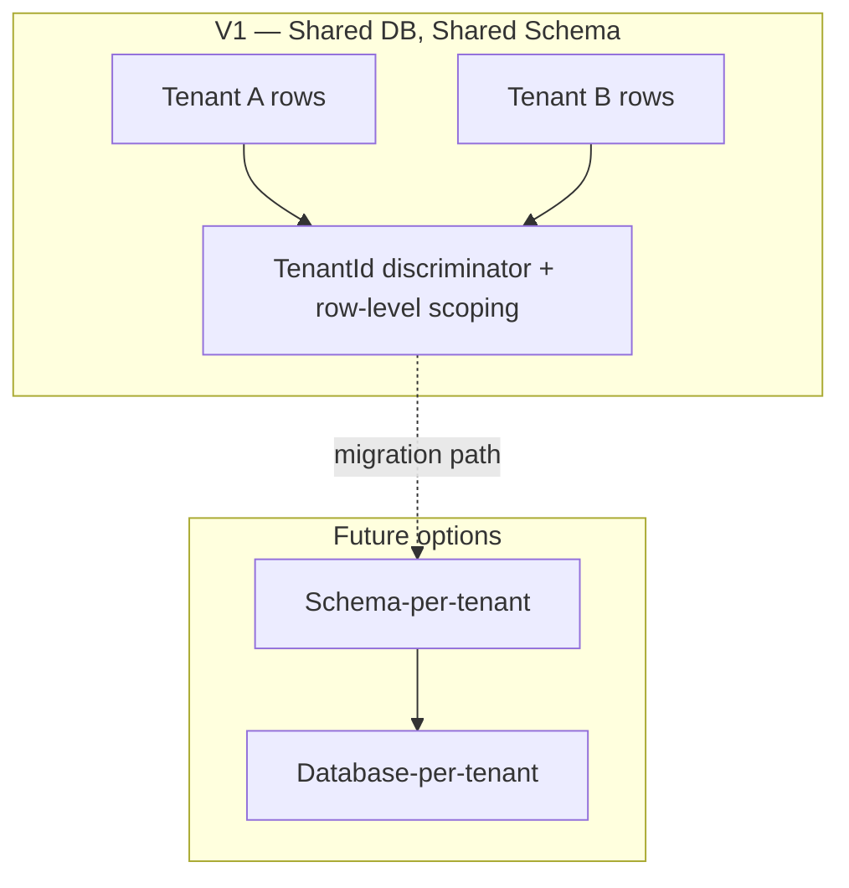
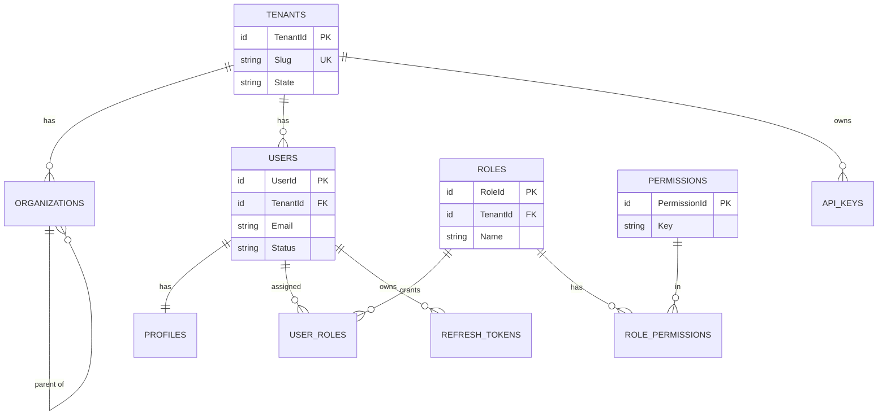
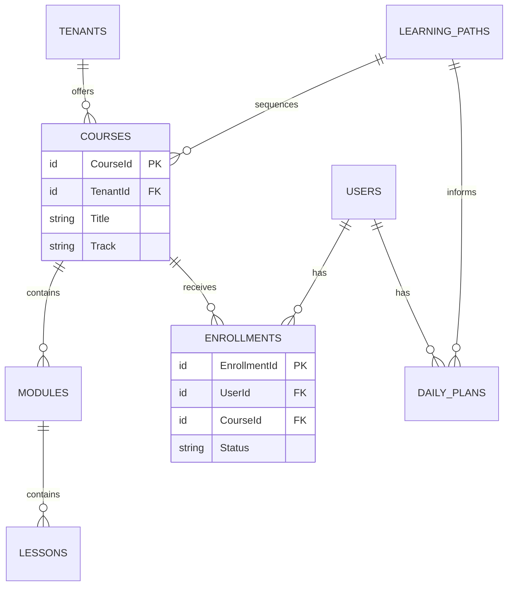
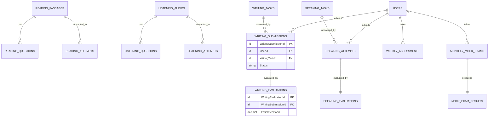
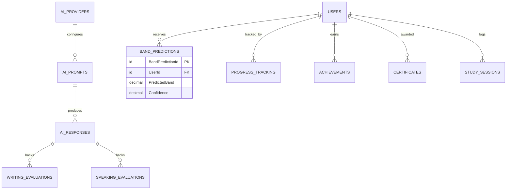
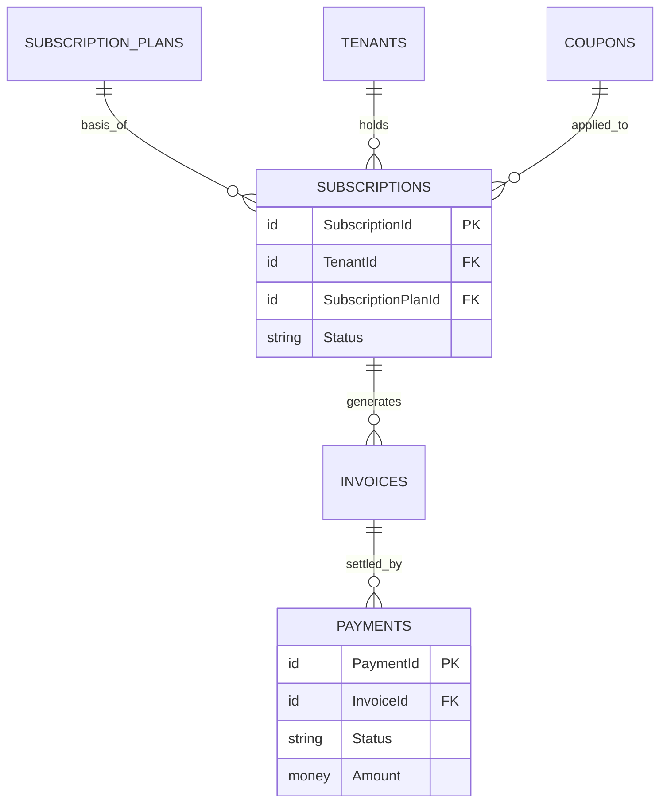
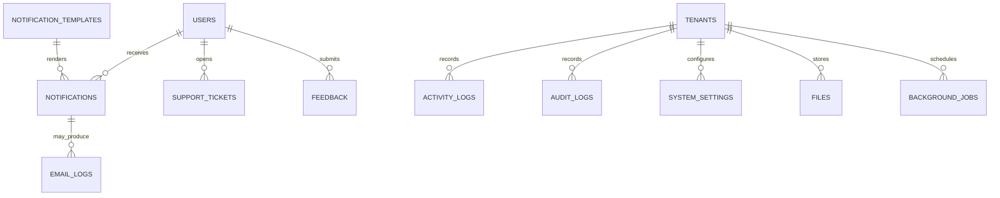
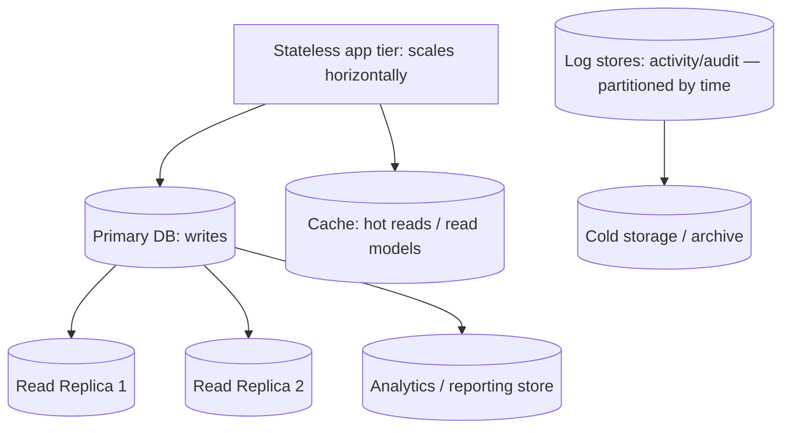
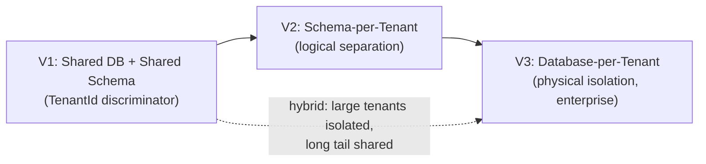

# Database Design & ERD (Logical) — IELTS LMS AI

| Field | Value |
| --- | --- |
| **Product Name** | IELTS LMS AI |
| **Document** | 09 — Logical Database Design & Entity-Relationship Design |
| **Version** | 1.0 |
| **Status** | Architecture & Planning |
| **Document Owner** | Data & Solution Architecture |
| **Last Updated** | 2026-07-18 |
| **Audience** | Architects, Backend Engineers, DBAs, QA, Security |
| **Aligns With** | [01_Product_Vision.md](./01_Product_Vision.md) … [06_Software_Requirements_Specification.md](./06_Software_Requirements_Specification.md), [07_Domain_Driven_Design.md](./07_Domain_Driven_Design.md), [08_Event_Storming.md](./08_Event_Storming.md) |

> **Purpose of this document.** This is the **logical database design** for IELTS LMS AI, **derived from the [Domain Model](./07_Domain_Driven_Design.md)** (the source of truth). It defines entities, attributes, keys, relationships, integrity, tenancy, and data-lifecycle strategy in an **implementation-neutral** way. Per the project constraints, this document contains **no SQL, no ORM/EF Core classes, and no migrations** — only logical design, ER diagrams, and design rationale. Physical schema, indexing DDL, and migrations belong to implementation.

---

## Table of Contents

1. [Introduction](#1-introduction)
2. [Design Principles](#2-design-principles)
3. [Multi-Tenancy Data Strategy](#3-multi-tenancy-data-strategy)
4. [Cross-Cutting Conventions](#4-cross-cutting-conventions)
5. [Data Classification](#5-data-classification)
6. [Entity Catalog](#6-entity-catalog)
7. [ER Diagrams](#7-er-diagrams)
8. [Relationship Types](#8-relationship-types)
9. [Normalization](#9-normalization)
10. [Scalability, Partitioning & Sharding](#10-scalability-partitioning--sharding)
11. [Migration Path to Database-per-Tenant](#11-migration-path-to-database-per-tenant)
12. [Related Documents](#12-related-documents)

---

## 1. Introduction

This design translates the domain aggregates and value objects from the [DDD model](./07_Domain_Driven_Design.md) into **logical entities** and their relationships. It supports the platform's core capabilities — multi-tenant SaaS, RBAC, subscriptions & billing, learning & CB-IELTS assessment, AI features, analytics, notifications, and audit/activity logging — and is engineered for **future enterprise expansion** (read replicas, sharding, database-per-tenant).

**Aggregate → persistence mapping principle:** each aggregate root maps to one primary entity; child entities within an aggregate reference the root; **cross-aggregate references use identifiers only** (no hard foreign keys that violate aggregate boundaries where isolation matters), consistent with [DDD §8](./07_Domain_Driven_Design.md#8-aggregates--aggregate-roots).

---

## 2. Design Principles

| Principle | Application |
| --- | --- |
| **Domain-derived** | Entities mirror aggregates/entities/value objects from the domain model. |
| **Tenant-first** | Every tenant-scoped entity carries `TenantId`; isolation enforced at query layer. |
| **Integrity by design** | Referential integrity within aggregates; identifier references across them. |
| **Soft delete** | Business entities are soft-deleted (`IsDeleted`), preserving history and audit. |
| **Auditable** | Standard audit fields on all business entities; immutable audit/activity logs. |
| **Optimistic concurrency** | `Version` (row version) guards concurrent updates. |
| **Scale-ready** | Designed for read replicas, partitioning, and future sharding. |
| **Reference vs transactional separation** | Master/reference data separated from high-volume transactional data. |
| **No premature physical binding** | Logical types only; physical types chosen at implementation. |

---

## 3. Multi-Tenancy Data Strategy

Version 1 uses a **shared database, shared schema** model with a mandatory `TenantId` discriminator on every tenant-scoped entity, consistent with [Multi-Tenant Architecture](./12_Multi_Tenant_Architecture.md) and [SRS §5](./06_Software_Requirements_Specification.md#5-system-architecture-overview).

- **Isolation:** every query is tenant-scoped by default; a global filter on `TenantId` is mandatory. Cross-tenant access is restricted to audited Super Admin operations.
- **Keys:** primary keys are globally unique (surrogate identifiers), so rows remain unique if later relocated to per-tenant databases.
- **Rationale & trade-offs:** shared schema optimizes cost/operability at launch; the key strategy and `TenantId` discriminator preserve a clean [migration path](#11-migration-path-to-database-per-tenant) to stronger isolation for enterprise tenants.

---

## 4. Cross-Cutting Conventions

### 4.1 Standard Audit & Lifecycle Fields

Every **business entity** includes the following unless explicitly noted (immutable log entities omit soft-delete/update fields):

| Field | Type (logical) | Purpose |
| --- | --- | --- |
| `Id` | Surrogate identifier (globally unique) | Primary key. |
| `TenantId` | Identifier | Tenant scope (where applicable). |
| `CreatedAt` | Timestamp (UTC) | Creation time. |
| `CreatedBy` | User identifier | Actor who created. |
| `UpdatedAt` | Timestamp (UTC) | Last update time. |
| `UpdatedBy` | User identifier | Actor who last updated. |
| `DeletedAt` | Timestamp (UTC), nullable | Soft-delete time. |
| `DeletedBy` | User identifier, nullable | Actor who soft-deleted. |
| `IsDeleted` | Boolean | Soft-delete flag (default false). |
| `Version` | Row version / counter | Optimistic concurrency token. |

> To avoid repetition, the [Entity Catalog](#6-entity-catalog) marks these as **“Standard audit fields: Yes”** rather than relisting them. Entity-specific fields, keys, and constraints are always listed explicitly.

### 4.2 Per-Entity Specification Template

Each entity documents: **Purpose, Description, Data Category, Primary Key, Foreign Keys, Tenant Isolation, Key Attributes, Relationships, Business Rules, Soft Delete, Concurrency, Indexes, Unique Constraints, Check Constraints, Retention, Archiving.**

### 4.3 Conventions

- **Identifiers:** surrogate, globally unique; natural keys expressed as unique constraints.
- **Enumerations:** modeled as constrained value sets (logical), not free text.
- **Money:** stored as amount + currency (value object `Money`).
- **Scores/Bands:** `BandScore` constrained to the IELTS scale (0–9, half-band increments).
- **Timestamps:** UTC; display localization handled in the application layer.

---

### 4.2 Data Categories (Reference / Master / Transactional)

| Category | Definition | Examples |
| --- | --- | --- |
| **Reference Data** | Rarely changing, shared lookup values. | Roles, Permissions, Categories, Tags, NotificationTemplates, SubscriptionPlans, AIProviders. |
| **Master Data** | Core business entities with lifecycle. | Tenants, Organizations, Users, Courses, Lessons, WritingTasks, SpeakingTasks. |
| **Transactional Data** | High-volume, event-driven records. | Submissions, Attempts, Evaluations, Payments, ProgressTracking, ActivityLogs. |
| **Derived/Analytical Data** | Computed projections/read models. | Analytics aggregates, BandPredictions, dashboards. |

### 4.3 Concurrency Strategy

- **Optimistic concurrency** via `Version` on all mutable business entities; a stale `Version` on update is rejected and retried by the application.
- **Idempotency** for event-driven writes (e.g., evaluation results) to prevent duplicate scoring, per [NFR-REL-002](./05_Non_Functional_Requirements.md).

### 4.4 Soft Delete & Retention

- **Soft delete** (`IsDeleted`, `DeletedAt`, `DeletedBy`) is the default; hard delete is reserved for policy-driven purges (e.g., GDPR erasure) and is audited.
- **Retention & archiving** policies are specified per entity in the catalog and align with [NFR privacy/compliance](./05_Non_Functional_Requirements.md).

### 4.5 Indexing & Constraints Conventions

- Every tenant-scoped entity is expected to index `TenantId` (typically as the leading key of composite indexes).
- Uniqueness is expressed **within tenant scope** unless a value is globally unique by definition (e.g., certificate verification code).
- Check constraints express enumerations/ranges logically (e.g., band 0.0–9.0 in 0.5 steps); physical enforcement is an implementation choice.

---

## 5. Data Classification

Sensitivity classification drives encryption, access, and retention (see [Security](./18_Security.md), [NFR §6/§26](./05_Non_Functional_Requirements.md)):

| Class | Description | Examples |
| --- | --- | --- |
| **Restricted** | Credentials & secrets. | Password hashes, RefreshTokens, ApiKeys, AI provider keys. |
| **Confidential (PII)** | Personal data. | User names, emails, profiles, submissions, audio. |
| **Internal** | Business operational data. | Progress, analytics, assignments. |
| **Public** | Publicly shareable. | Certificate verification result, public marketing pages. |

---

## 6. Entity Catalog

Entities are grouped by domain. Each entity defines: **Purpose, Description, Primary Key, Foreign Keys, Tenant Isolation, Relationships, Business Rules, Soft Delete, Audit Fields, Concurrency, Indexes, Unique Constraints, Check Constraints, Retention, Archiving.** Standard audit/lifecycle fields ([§4.1](#41-standard-audit--lifecycle-fields)) are indicated as **“Standard audit fields: Yes.”** Entity IDs use `ENT-<NNN>`.

---

### 6.1 Identity, Tenancy & Access

#### ENT-001 — Tenants
- **Purpose:** Root isolation boundary for a customer.
- **Description:** Represents a tenant and its lifecycle/state; anchor for all tenant-scoped data.
- **Primary Key:** `TenantId` (surrogate, globally unique).
- **Foreign Keys:** `SubscriptionPlanId` (current plan, nullable until activated).
- **Tenant Isolation:** This **is** the isolation root (not itself tenant-scoped).
- **Relationships:** 1..* Organizations, Users, and all tenant-scoped entities; 1..1 current Subscription.
- **Business Rules:** Unique tenant identifier; lifecycle states {Active, Suspended, Closed}; closure follows retention policy.
- **Soft Delete:** Yes (closure = soft delete + retention window).
- **Audit Fields:** Standard audit fields: Yes.
- **Concurrency:** `Version`.
- **Indexes:** Unique identifier/slug; state.
- **Unique Constraints:** Tenant identifier/slug (global).
- **Check Constraints:** State ∈ enumeration.
- **Retention:** Retain per contract; purge after retention window post-closure.
- **Archiving:** Archive closed-tenant data to cold storage before purge.
- **Data Type:** Master Data.

#### ENT-002 — Organizations
- **Purpose:** Commercial entity mapped 1:1 to a tenant; may contain sub-units.
- **Description:** Holds organization profile and hierarchy (institutes/departments).
- **Primary Key:** `OrganizationId`.
- **Foreign Keys:** `TenantId`; self-referencing `ParentOrganizationId` (nullable) for hierarchy.
- **Tenant Isolation:** `TenantId` required.
- **Relationships:** 1..1 Tenant; self-referencing hierarchy; 1..* Users (via membership).
- **Business Rules:** No cyclic hierarchy; unique name within tenant.
- **Soft Delete:** Yes.
- **Audit Fields:** Standard audit fields: Yes.
- **Concurrency:** `Version`.
- **Indexes:** `TenantId`, `ParentOrganizationId`.
- **Unique Constraints:** (`TenantId`, Name).
- **Check Constraints:** No self-parenting; acyclic.
- **Retention:** Follows tenant retention.
- **Archiving:** With tenant.
- **Data Type:** Master Data.

#### ENT-003 — Users
- **Purpose:** A human actor within a tenant.
- **Description:** Authentication identity and account state; links to profile and roles.
- **Primary Key:** `UserId`.
- **Foreign Keys:** `TenantId`; `OrganizationId` (nullable).
- **Tenant Isolation:** `TenantId` required.
- **Relationships:** 1..1 Profile; *..* Roles (via UserRoles); 1..* Enrollments, Submissions, Attempts, etc.
- **Business Rules:** Unique email within tenant; deactivated users cannot authenticate; credentials never stored in plaintext ([FR-USER-001](./04_Functional_Requirements.md), [NFR-SEC-011](./05_Non_Functional_Requirements.md)).
- **Soft Delete:** Yes.
- **Audit Fields:** Standard audit fields: Yes.
- **Concurrency:** `Version`.
- **Indexes:** `TenantId`, (`TenantId`, Email), status.
- **Unique Constraints:** (`TenantId`, Email).
- **Check Constraints:** Status ∈ {Invited, Active, Suspended, Deactivated}.
- **Retention:** Per privacy policy; support erasure.
- **Archiving:** Anonymize on erasure; archive with tenant.
- **Data Type:** Master Data.

#### ENT-004 — Profiles
- **Purpose:** Extended personal/learning profile for a user.
- **Description:** Names, locale, target band/date, track (Academic/General), preferences.
- **Primary Key:** `ProfileId`.
- **Foreign Keys:** `TenantId`, `UserId` (1:1).
- **Tenant Isolation:** `TenantId` required.
- **Relationships:** 1:1 User.
- **Business Rules:** One profile per user; target date must be future when set.
- **Soft Delete:** Yes (with user).
- **Audit Fields:** Standard audit fields: Yes.
- **Concurrency:** `Version`.
- **Indexes:** `UserId`.
- **Unique Constraints:** (`UserId`) unique.
- **Check Constraints:** Track ∈ {Academic, General}; target band ∈ [0.0, 9.0].
- **Retention:** With user.
- **Archiving:** With user.
- **Data Type:** Master Data.

#### ENT-005 — Roles
- **Purpose:** Named set of permissions.
- **Description:** System and custom (plan-permitting) roles.
- **Primary Key:** `RoleId`.
- **Foreign Keys:** `TenantId` (nullable for system/global roles).
- **Tenant Isolation:** Tenant-scoped for custom roles; system roles are global reference data.
- **Relationships:** *..* Permissions (RolePermissions); *..* Users (UserRoles).
- **Business Rules:** System roles immutable; custom roles require entitlement.
- **Soft Delete:** Yes (custom).
- **Audit Fields:** Standard audit fields: Yes.
- **Concurrency:** `Version`.
- **Indexes:** `TenantId`, Name.
- **Unique Constraints:** (`TenantId`, Name).
- **Check Constraints:** —
- **Retention:** With tenant.
- **Archiving:** With tenant.
- **Data Type:** Reference/Master.

#### ENT-006 — Permissions
- **Purpose:** Fine-grained authorization primitive.
- **Description:** Discrete capability (e.g., `course.publish`).
- **Primary Key:** `PermissionId`.
- **Foreign Keys:** — (global reference data).
- **Tenant Isolation:** Global reference data (not tenant-scoped).
- **Relationships:** *..* Roles (RolePermissions).
- **Business Rules:** Stable keys; additive over time.
- **Soft Delete:** No (reference data; deprecate instead).
- **Audit Fields:** CreatedAt/UpdatedAt only.
- **Concurrency:** `Version`.
- **Indexes:** Unique key.
- **Unique Constraints:** Permission key (global).
- **Check Constraints:** —
- **Retention:** Permanent (reference).
- **Archiving:** N/A.
- **Data Type:** Reference Data.

#### ENT-007 — RolePermissions
- **Purpose:** Associative entity linking roles to permissions (many-to-many).
- **Description:** Grants a permission to a role.
- **Primary Key:** (`RoleId`, `PermissionId`) composite.
- **Foreign Keys:** `RoleId`, `PermissionId`; `TenantId` (for custom roles).
- **Tenant Isolation:** Inherits from role scope.
- **Relationships:** Joins Roles and Permissions.
- **Business Rules:** No duplicate pairs.
- **Soft Delete:** No (hard delete on revoke; audited).
- **Audit Fields:** CreatedAt/CreatedBy.
- **Concurrency:** `Version`.
- **Indexes:** (`RoleId`), (`PermissionId`).
- **Unique Constraints:** (`RoleId`, `PermissionId`).
- **Check Constraints:** —
- **Retention:** With role.
- **Archiving:** With tenant.
- **Data Type:** Transactional (association).

#### ENT-008 — UserRoles
- **Purpose:** Associative entity linking users to roles (many-to-many).
- **Description:** Assigns a role to a user.
- **Primary Key:** (`UserId`, `RoleId`) composite.
- **Foreign Keys:** `UserId`, `RoleId`, `TenantId`.
- **Tenant Isolation:** `TenantId` required.
- **Relationships:** Joins Users and Roles.
- **Business Rules:** No duplicate assignments; at least one role per active user.
- **Soft Delete:** No (hard delete on unassign; audited).
- **Audit Fields:** CreatedAt/CreatedBy.
- **Concurrency:** `Version`.
- **Indexes:** (`TenantId`, `UserId`), (`RoleId`).
- **Unique Constraints:** (`UserId`, `RoleId`).
- **Check Constraints:** —
- **Retention:** With user.
- **Archiving:** With tenant.
- **Data Type:** Transactional (association).

#### ENT-009 — RefreshTokens
- **Purpose:** Support secure session renewal.
- **Description:** Issued refresh tokens with expiry/revocation.
- **Primary Key:** `RefreshTokenId`.
- **Foreign Keys:** `TenantId`, `UserId`.
- **Tenant Isolation:** `TenantId` required.
- **Relationships:** *..1 User.
- **Business Rules:** Single-use/rotating; revoked on logout/credential change ([NFR-SESS-003](./05_Non_Functional_Requirements.md)).
- **Soft Delete:** No (hard delete/expiry).
- **Audit Fields:** CreatedAt; RevokedAt.
- **Concurrency:** `Version`.
- **Indexes:** (`TenantId`, `UserId`), token hash.
- **Unique Constraints:** Token hash.
- **Check Constraints:** Expiry in future at issue.
- **Retention:** Purge expired/revoked after short window.
- **Archiving:** N/A (Restricted class).
- **Data Type:** Transactional (Restricted).

#### ENT-010 — ApiKeys (future-ready)
- **Purpose:** Programmatic access for future integrations.
- **Description:** Tenant-scoped API keys with scopes; reserved for future use.
- **Primary Key:** `ApiKeyId`.
- **Foreign Keys:** `TenantId`, `CreatedBy` (User).
- **Tenant Isolation:** `TenantId` required.
- **Relationships:** *..1 Tenant.
- **Business Rules:** Hashed at rest; scoped; revocable; never logged ([NFR-SEC-005](./05_Non_Functional_Requirements.md)).
- **Soft Delete:** No (revoke + expiry).
- **Audit Fields:** CreatedAt/CreatedBy; RevokedAt.
- **Concurrency:** `Version`.
- **Indexes:** (`TenantId`), key hash.
- **Unique Constraints:** Key hash (global).
- **Check Constraints:** Scope non-empty.
- **Retention:** Until revoked + window.
- **Archiving:** N/A (Restricted).
- **Data Type:** Transactional (Restricted, future).

---

### 6.2 Learning & Course Management

#### ENT-011 — Courses
- **Purpose:** Structured, enrollable learning unit.
- **Description:** Track-tagged course with modules/lessons.
- **Primary Key:** `CourseId`.
- **Foreign Keys:** `TenantId`.
- **Tenant Isolation:** `TenantId` required.
- **Relationships:** 1..* Modules → Lessons; *..* Learners via Enrollment.
- **Business Rules:** Publish state gates enrollment; track ∈ {Academic, General, Both}.
- **Soft Delete:** Yes.
- **Audit Fields:** Standard audit fields: Yes.
- **Concurrency:** `Version`.
- **Indexes:** (`TenantId`), status, track.
- **Unique Constraints:** (`TenantId`, Title, Version).
- **Check Constraints:** Status ∈ {Draft, Published, Archived}.
- **Retention:** With tenant.
- **Archiving:** Archive on retire.
- **Data Type:** Master Data.

#### ENT-012 — LearningPaths
- **Purpose:** Ordered, adaptive sequence toward a target band.
- **Description:** Personalized path referencing courses/lessons/milestones.
- **Primary Key:** `LearningPathId`.
- **Foreign Keys:** `TenantId`, `UserId`.
- **Tenant Isolation:** `TenantId` required.
- **Relationships:** *..1 User; references Courses/Lessons.
- **Business Rules:** Reflects track; adapts to progress ([FR-PATH-001](./04_Functional_Requirements.md)).
- **Soft Delete:** Yes.
- **Audit Fields:** Standard audit fields: Yes.
- **Concurrency:** `Version`.
- **Indexes:** (`TenantId`, `UserId`).
- **Unique Constraints:** One active path per user (partial).
- **Check Constraints:** Target date future.
- **Retention:** With user.
- **Archiving:** With user.
- **Data Type:** Master/Transactional.

#### ENT-013 — Modules
- **Purpose:** Grouping of lessons within a course.
- **Description:** Ordered course section.
- **Primary Key:** `ModuleId`.
- **Foreign Keys:** `TenantId`, `CourseId`.
- **Tenant Isolation:** `TenantId` required.
- **Relationships:** *..1 Course; 1..* Lessons.
- **Business Rules:** Ordered within course; unique order index.
- **Soft Delete:** Yes.
- **Audit Fields:** Standard audit fields: Yes.
- **Concurrency:** `Version`.
- **Indexes:** (`CourseId`, Order).
- **Unique Constraints:** (`CourseId`, Order).
- **Check Constraints:** Order ≥ 0.
- **Retention:** With course.
- **Archiving:** With course.
- **Data Type:** Master Data.

#### ENT-014 — Lessons
- **Purpose:** Individual learning unit.
- **Description:** Content (text/audio/interactive) with completion criteria.
- **Primary Key:** `LessonId`.
- **Foreign Keys:** `TenantId`, `ModuleId`.
- **Tenant Isolation:** `TenantId` required.
- **Relationships:** *..1 Module; referenced by progress.
- **Business Rules:** Completion requires meeting criteria ([FR-LESSON-001](./04_Functional_Requirements.md)).
- **Soft Delete:** Yes.
- **Audit Fields:** Standard audit fields: Yes.
- **Concurrency:** `Version`.
- **Indexes:** (`ModuleId`, Order).
- **Unique Constraints:** (`ModuleId`, Order).
- **Check Constraints:** Order ≥ 0.
- **Retention:** With course.
- **Archiving:** With course.
- **Data Type:** Master Data.

#### ENT-015 — Enrollments
- **Purpose:** A learner's registration in a course.
- **Description:** Links user to course with status/progress.
- **Primary Key:** `EnrollmentId`.
- **Foreign Keys:** `TenantId`, `UserId`, `CourseId`.
- **Tenant Isolation:** `TenantId` required.
- **Relationships:** *..1 User; *..1 Course.
- **Business Rules:** Entitlement required; no duplicate active enrollment ([FR-COURSE-001](./04_Functional_Requirements.md)).
- **Soft Delete:** Yes.
- **Audit Fields:** Standard audit fields: Yes.
- **Concurrency:** `Version`.
- **Indexes:** (`TenantId`, `UserId`), (`CourseId`).
- **Unique Constraints:** (`UserId`, `CourseId`) active.
- **Check Constraints:** Status ∈ {Active, Completed, Withdrawn}.
- **Retention:** With user.
- **Archiving:** With user.
- **Data Type:** Transactional.

---

### 6.2 Learning Content: Grammar, Vocabulary, Sentence Builder

#### ENT-016 — GrammarTopics
- **Purpose:** A unit of grammar instruction/practice.
- **Description:** Grammar topic with content and difficulty; basis for drills and weakness mapping.
- **Primary Key:** `GrammarTopicId`.
- **Foreign Keys:** `TenantId` (nullable if global catalog), `CategoryId` (nullable).
- **Tenant Isolation:** `TenantId` where tenant-authored; global catalog rows have null tenant and are read-only to tenants.
- **Relationships:** 1..* drills; referenced by GrammarProgress.
- **Business Rules:** Track-tagged (Academic/General/Both); difficulty ∈ enumeration.
- **Soft Delete:** Yes. **Audit Fields:** Standard audit fields: Yes. **Concurrency:** `Version`.
- **Indexes:** `TenantId`, difficulty, track.
- **Unique Constraints:** (`TenantId`, Title).
- **Check Constraints:** Difficulty/track ∈ enumeration.
- **Retention:** Retain as catalog. **Archiving:** Version older content.
- **Data Type:** Master/Reference Data.

#### ENT-017 — VocabularyWords
- **Purpose:** A vocabulary item for study.
- **Description:** Word/phrase with meaning, examples, and metadata (frequency band, topic).
- **Primary Key:** `VocabularyWordId`.
- **Foreign Keys:** `TenantId` (nullable if global), `CategoryId` (nullable).
- **Tenant Isolation:** As per catalog ownership (global vs tenant-authored).
- **Relationships:** 1..* VocabularyProgress; may relate to Tags.
- **Business Rules:** Unique word within a set/scope; content quality rules.
- **Soft Delete:** Yes. **Audit Fields:** Yes. **Concurrency:** `Version`.
- **Indexes:** `TenantId`, word, topic.
- **Unique Constraints:** (`TenantId`, Word, Sense).
- **Check Constraints:** —
- **Retention:** Catalog. **Archiving:** Versioned.
- **Data Type:** Master/Reference Data.

#### ENT-018 — VocabularyProgress
- **Purpose:** Track a learner's mastery of vocabulary items.
- **Description:** Per-user, per-word spaced-repetition/mastery state.
- **Primary Key:** `VocabularyProgressId`.
- **Foreign Keys:** `TenantId`, `UserId`, `VocabularyWordId`.
- **Tenant Isolation:** `TenantId` required.
- **Relationships:** *..1 User; *..1 VocabularyWord.
- **Business Rules:** Idempotent updates; mastery level ∈ range; feeds recommendations ([FR-VOCAB-001](./04_Functional_Requirements.md)).
- **Soft Delete:** Yes. **Audit Fields:** Yes. **Concurrency:** `Version`.
- **Indexes:** (`TenantId`, `UserId`), (`VocabularyWordId`), next-review time.
- **Unique Constraints:** (`UserId`, `VocabularyWordId`).
- **Check Constraints:** Mastery ∈ range.
- **Retention:** With user. **Archiving:** With user.
- **Data Type:** Transactional.

#### ENT-019 — SentenceExercises
- **Purpose:** A sentence-construction exercise.
- **Description:** Prompt/target patterns for the Sentence Builder.
- **Primary Key:** `SentenceExerciseId`.
- **Foreign Keys:** `TenantId` (nullable if global), `CategoryId` (nullable).
- **Tenant Isolation:** Catalog ownership rules.
- **Relationships:** 1..* SentenceAttempts.
- **Business Rules:** Track-tagged; difficulty enumeration.
- **Soft Delete:** Yes. **Audit Fields:** Yes. **Concurrency:** `Version`.
- **Indexes:** `TenantId`, difficulty.
- **Unique Constraints:** (`TenantId`, Title).
- **Check Constraints:** Difficulty ∈ enumeration.
- **Retention:** Catalog. **Archiving:** Versioned.
- **Data Type:** Master Data.

#### ENT-020 — SentenceAttempts
- **Purpose:** A learner's attempt at a sentence exercise.
- **Description:** Captures submission and correctness/feedback (optionally AI-assisted).
- **Primary Key:** `SentenceAttemptId`.
- **Foreign Keys:** `TenantId`, `UserId`, `SentenceExerciseId`.
- **Tenant Isolation:** `TenantId` required.
- **Relationships:** *..1 User; *..1 SentenceExercise.
- **Business Rules:** Non-empty submission; scoring recorded; feeds progress.
- **Soft Delete:** Yes. **Audit Fields:** Yes. **Concurrency:** `Version`.
- **Indexes:** (`TenantId`, `UserId`), (`SentenceExerciseId`).
- **Unique Constraints:** —
- **Check Constraints:** Score ∈ range.
- **Retention:** With user. **Archiving:** With user.
- **Data Type:** Transactional.

### 6.3 Skills: Reading, Listening, Writing, Speaking

#### ENT-021 — ReadingPassages
- **Purpose:** A reading passage used in practice/tests.
- **Description:** Passage text and metadata (track, difficulty, topic).
- **Primary Key:** `ReadingPassageId`.
- **Foreign Keys:** `TenantId` (nullable if global), `CategoryId` (nullable).
- **Tenant Isolation:** Catalog ownership rules.
- **Relationships:** 1..* ReadingQuestions; referenced by ReadingAttempts.
- **Business Rules:** Track-tagged; passage length/quality rules.
- **Soft Delete:** Yes. **Audit Fields:** Yes. **Concurrency:** `Version`.
- **Indexes:** `TenantId`, track, difficulty.
- **Unique Constraints:** (`TenantId`, Title).
- **Check Constraints:** Track ∈ enumeration.
- **Retention:** Catalog. **Archiving:** Versioned.
- **Data Type:** Master Data.

#### ENT-022 — ReadingQuestions
- **Purpose:** A question item attached to a passage.
- **Description:** Question of a CB-IELTS-style type with answer key.
- **Primary Key:** `ReadingQuestionId`.
- **Foreign Keys:** `TenantId`, `ReadingPassageId`.
- **Tenant Isolation:** `TenantId` inherited from passage scope.
- **Relationships:** *..1 ReadingPassage.
- **Business Rules:** Question type ∈ supported set; answer key required; auto-scorable.
- **Soft Delete:** Yes. **Audit Fields:** Yes. **Concurrency:** `Version`.
- **Indexes:** (`ReadingPassageId`), type.
- **Unique Constraints:** (`ReadingPassageId`, Sequence).
- **Check Constraints:** Type ∈ enumeration.
- **Retention:** Catalog. **Archiving:** Versioned.
- **Data Type:** Master Data.

#### ENT-023 — ReadingAttempts
- **Purpose:** A learner's attempt at a reading set.
- **Description:** Answers, timing, and auto-scored result.
- **Primary Key:** `ReadingAttemptId`.
- **Foreign Keys:** `TenantId`, `UserId`, `ReadingPassageId`, optional `StudySessionId`, `WeeklyAssessmentId`/`MonthlyMockExamId`.
- **Tenant Isolation:** `TenantId` required.
- **Relationships:** *..1 User; *..1 ReadingPassage; contains per-item answers.
- **Business Rules:** Timing enforced in exam mode; idempotent scoring; feeds progress ([FR-READ-001](./04_Functional_Requirements.md)).
- **Soft Delete:** Yes. **Audit Fields:** Yes. **Concurrency:** `Version`.
- **Indexes:** (`TenantId`, `UserId`), (`ReadingPassageId`), created time.
- **Unique Constraints:** —
- **Check Constraints:** Score 0–40 (raw) / band mapping valid.
- **Retention:** With user. **Archiving:** Cold-store old attempts.
- **Data Type:** Transactional.

#### ENT-024 — ListeningAudios
- **Purpose:** Audio asset for a listening section.
- **Description:** Audio reference and metadata; served via media storage.
- **Primary Key:** `ListeningAudioId`.
- **Foreign Keys:** `TenantId` (nullable if global), `FileId` (media), `CategoryId` (nullable).
- **Tenant Isolation:** Catalog ownership rules.
- **Relationships:** 1..* ListeningQuestions; referenced by ListeningAttempts; 1..1 File.
- **Business Rules:** Playback conventions per mode; caption/transcript availability in learning mode ([FR-LISTEN-001](./04_Functional_Requirements.md)).
- **Soft Delete:** Yes. **Audit Fields:** Yes. **Concurrency:** `Version`.
- **Indexes:** `TenantId`, track.
- **Unique Constraints:** (`TenantId`, Title).
- **Check Constraints:** Track ∈ enumeration.
- **Retention:** Catalog. **Archiving:** Versioned; media lifecycle.
- **Data Type:** Master Data.

#### ENT-025 — ListeningQuestions
- **Purpose:** A question item attached to a listening audio.
- **Description:** CB-IELTS-style item with answer key.
- **Primary Key:** `ListeningQuestionId`.
- **Foreign Keys:** `TenantId`, `ListeningAudioId`.
- **Tenant Isolation:** Inherited scope.
- **Relationships:** *..1 ListeningAudio.
- **Business Rules:** Type ∈ supported set; answer key required.
- **Soft Delete:** Yes. **Audit Fields:** Yes. **Concurrency:** `Version`.
- **Indexes:** (`ListeningAudioId`), type.
- **Unique Constraints:** (`ListeningAudioId`, Sequence).
- **Check Constraints:** Type ∈ enumeration.
- **Retention:** Catalog. **Archiving:** Versioned.
- **Data Type:** Master Data.

#### ENT-026 — ListeningAttempts
- **Purpose:** A learner's attempt at a listening section.
- **Description:** Answers, playback events, timing, and auto-scored result.
- **Primary Key:** `ListeningAttemptId`.
- **Foreign Keys:** `TenantId`, `UserId`, `ListeningAudioId`, optional assessment/exam references.
- **Tenant Isolation:** `TenantId` required.
- **Relationships:** *..1 User; *..1 ListeningAudio.
- **Business Rules:** Single-play rules in exam mode; idempotent scoring; feeds progress.
- **Soft Delete:** Yes. **Audit Fields:** Yes. **Concurrency:** `Version`.
- **Indexes:** (`TenantId`, `UserId`), (`ListeningAudioId`).
- **Unique Constraints:** —
- **Check Constraints:** Score raw/band valid.
- **Retention:** With user. **Archiving:** Cold-store old attempts.
- **Data Type:** Transactional.

#### ENT-027 — WritingTasks
- **Purpose:** A writing prompt (Task 1 / Task 2, track-appropriate).
- **Description:** Prompt content, task type, rubric reference.
- **Primary Key:** `WritingTaskId`.
- **Foreign Keys:** `TenantId` (nullable if global), `CategoryId` (nullable).
- **Tenant Isolation:** Catalog ownership rules.
- **Relationships:** 1..* WritingSubmissions.
- **Business Rules:** Task type matches track; word-count guidance.
- **Soft Delete:** Yes. **Audit Fields:** Yes. **Concurrency:** `Version`.
- **Indexes:** `TenantId`, track, taskType.
- **Unique Constraints:** (`TenantId`, Title).
- **Check Constraints:** TaskType ∈ {Task1, Task2}; Track ∈ enumeration.
- **Retention:** Catalog. **Archiving:** Versioned.
- **Data Type:** Master Data.

#### ENT-028 — WritingSubmissions
- **Purpose:** A learner's written response to a task.
- **Description:** Response text, word count, status; routed to evaluation.
- **Primary Key:** `WritingSubmissionId`.
- **Foreign Keys:** `TenantId`, `UserId`, `WritingTaskId`, optional assessment/exam references.
- **Tenant Isolation:** `TenantId` required.
- **Relationships:** *..1 User; *..1 WritingTask; 1..1 WritingEvaluation (when complete).
- **Business Rules:** Length limits; one active evaluation per submission ([FR-WRITE-001](./04_Functional_Requirements.md)).
- **Soft Delete:** Yes. **Audit Fields:** Yes. **Concurrency:** `Version`.
- **Indexes:** (`TenantId`, `UserId`), (`WritingTaskId`), status.
- **Unique Constraints:** —
- **Check Constraints:** Status ∈ {Draft, Submitted, Evaluated, Failed}.
- **Retention:** With user (PII). **Archiving:** Cold-store; support erasure.
- **Data Type:** Transactional.

#### ENT-029 — WritingEvaluations
- **Purpose:** Rubric-aligned evaluation of a writing submission.
- **Description:** Per-criterion scores, estimated band, feedback, confidence, similarity-check score, provider reference.
- **Primary Key:** `WritingEvaluationId`.
- **Foreign Keys:** `TenantId`, `WritingSubmissionId`, `AIResponseId` (nullable), `AIProviderId` (nullable).
- **Tenant Isolation:** `TenantId` required.
- **Relationships:** 1..1 WritingSubmission.
- **Business Rules:** Criteria aligned to official descriptors; AI-labeled; low-confidence **or** high-similarity flagged for human review ([FR-AIWE-001](./04_Functional_Requirements.md); Phase 7 Sprint 6 added `SimilarityScore` and the similarity-threshold check alongside the pre-existing confidence check, mirroring Phase 7 Sprint 5's Speaking criterion-spread addition). Teacher override allowed. Review resolution is itself audited: `ReviewedBy`/`ReviewedAtUtc`/`ReviewDecision` (Phase 7 Sprint 6, distinct from the pre-existing `Overridden*` score-override audit trail — either clears the evaluation from the review queue), same shape as `SpeakingEvaluations` (ENT-032).
- **Soft Delete:** Yes. **Audit Fields:** Yes. **Concurrency:** `Version`.
- **Indexes:** (`WritingSubmissionId`), band, (`TenantId`, `RequiresHumanReview`, `CreatedAtUtc`) — review queue.
- **Unique Constraints:** (`WritingSubmissionId`) latest/active.
- **Check Constraints:** Criterion bands 0–9 (0.5 steps); `SimilarityScore` null or 0–1.
- **Retention:** With submission. **Archiving:** With submission.
- **Data Type:** Transactional/Derived.

#### ENT-030 — SpeakingTasks
- **Purpose:** A speaking prompt (Parts 1–3).
- **Description:** Prompt content and part metadata.
- **Primary Key:** `SpeakingTaskId`.
- **Foreign Keys:** `TenantId` (nullable if global), `CategoryId` (nullable).
- **Tenant Isolation:** Catalog ownership rules.
- **Relationships:** 1..* SpeakingAttempts.
- **Business Rules:** Part ∈ {1,2,3}; structure follows IELTS.
- **Soft Delete:** Yes. **Audit Fields:** Yes. **Concurrency:** `Version`.
- **Indexes:** `TenantId`, part.
- **Unique Constraints:** (`TenantId`, Title).
- **Check Constraints:** Part ∈ {1,2,3}.
- **Retention:** Catalog. **Archiving:** Versioned.
- **Data Type:** Master Data.

#### ENT-031 — SpeakingAttempts
- **Purpose:** A learner's recorded response to a speaking task.
- **Description:** Audio reference, transcript reference, status; routed to evaluation.
- **Primary Key:** `SpeakingAttemptId`.
- **Foreign Keys:** `TenantId`, `UserId`, `SpeakingTaskId`, `FileId` (audio), optional assessment/exam references.
- **Tenant Isolation:** `TenantId` required.
- **Relationships:** *..1 User; *..1 SpeakingTask; 1..1 SpeakingEvaluation (when complete); 1..1 File.
- **Business Rules:** Minimum audio quality/length; audio retained per policy ([FR-SPEAK-001](./04_Functional_Requirements.md)).
- **Soft Delete:** Yes. **Audit Fields:** Yes. **Concurrency:** `Version`.
- **Indexes:** (`TenantId`, `UserId`), (`SpeakingTaskId`), status.
- **Unique Constraints:** —
- **Check Constraints:** Status ∈ {Recorded, Submitted, Evaluated, Failed}.
- **Retention:** With user (PII/audio). **Archiving:** Cold-store; support erasure.
- **Data Type:** Transactional.

#### ENT-032 — SpeakingEvaluations
- **Purpose:** Rubric-aligned evaluation of a speaking attempt.
- **Description:** Per-criterion scores (Fluency & Coherence, Lexical Resource, Grammatical Range & Accuracy, Pronunciation), estimated band, feedback, confidence.
- **Primary Key:** `SpeakingEvaluationId`.
- **Foreign Keys:** `TenantId`, `SpeakingAttemptId`, `AIResponseId` (nullable), `AIProviderId` (nullable).
- **Tenant Isolation:** `TenantId` required.
- **Relationships:** 1..1 SpeakingAttempt.
- **Business Rules:** Criteria aligned to official descriptors; AI-labeled; low-confidence **or** criterion-spread-inconsistency flagged for human review ([FR-AISE-001](./04_Functional_Requirements.md); Phase 7 Sprint 5 added the spread check alongside the pre-existing confidence check). Review resolution is itself audited: `ReviewedBy`/`ReviewedAtUtc`/`ReviewDecision` (Phase 7 Sprint 5, distinct from the pre-existing `Overridden*` score-override audit trail — either clears the evaluation from the review queue).
- **Soft Delete:** Yes. **Audit Fields:** Yes. **Concurrency:** `Version`.
- **Indexes:** (`SpeakingAttemptId`), band, (`TenantId`, `RequiresHumanReview`, `CreatedAtUtc`) — review queue.
- **Unique Constraints:** (`SpeakingAttemptId`) latest/active.
- **Check Constraints:** Criterion bands 0–9 (0.5 steps).
- **Retention:** With attempt. **Archiving:** With attempt.
- **Data Type:** Transactional/Derived.

---

### 6.4 Planning & Assessment

#### ENT-033 — Assignments
- **Purpose:** Teacher-created work assigned to learners.
- **Description:** Assignment definition, targets, due date, and status.
- **Primary Key:** `AssignmentId`.
- **Foreign Keys:** `TenantId`, `CreatedByUserId` (teacher), optional `CourseId`/content refs.
- **Tenant Isolation:** `TenantId` required.
- **Relationships:** *..* Users (recipients via a join projection); references content.
- **Business Rules:** Only authorized roles create; cohort/tenant-scoped; valid recipients & due date ([FR-ASGN-001](./04_Functional_Requirements.md)).
- **Soft Delete:** Yes. **Audit Fields:** Yes. **Concurrency:** `Version`.
- **Indexes:** (`TenantId`, `CreatedByUserId`), due date, status.
- **Unique Constraints:** —
- **Check Constraints:** Status ∈ {Draft, Published, Closed}.
- **Retention:** With tenant/cohort. **Archiving:** Archive closed assignments.
- **Data Type:** Transactional.

#### ENT-034 — DailyPlans
- **Purpose:** Adaptive per-day study agenda for a learner.
- **Description:** Generated daily task list with durations and completion state.
- **Primary Key:** `DailyPlanId`.
- **Foreign Keys:** `TenantId`, `UserId`, `LearningPathId` (nullable).
- **Tenant Isolation:** `TenantId` required.
- **Relationships:** *..1 User; *..1 LearningPath; contains plan items (value objects/child rows).
- **Business Rules:** One active plan per user per day; achievable load; adapts to progress ([FR-DAILY-001](./04_Functional_Requirements.md)).
- **Soft Delete:** Yes. **Audit Fields:** Yes. **Concurrency:** `Version`.
- **Indexes:** (`TenantId`, `UserId`, PlanDate).
- **Unique Constraints:** (`UserId`, PlanDate).
- **Check Constraints:** PlanDate valid.
- **Retention:** Rolling window then archive. **Archiving:** Summarize older plans.
- **Data Type:** Transactional/Derived.

#### ENT-035 — WeeklyAssessments
- **Purpose:** Recurring timed weekly test record.
- **Description:** Composition, timing, section scores, and trend contribution.
- **Primary Key:** `WeeklyAssessmentId`.
- **Foreign Keys:** `TenantId`, `UserId`.
- **Tenant Isolation:** `TenantId` required.
- **Relationships:** *..1 User; references skill attempts/evaluations.
- **Business Rules:** Timing enforced; auto + AI scoring; contributes to analytics ([FR-WEEK-001](./04_Functional_Requirements.md)).
- **Soft Delete:** Yes. **Audit Fields:** Yes. **Concurrency:** `Version`.
- **Indexes:** (`TenantId`, `UserId`, WeekOf).
- **Unique Constraints:** (`UserId`, WeekOf).
- **Check Constraints:** Scores ∈ band range.
- **Retention:** With user. **Archiving:** With user.
- **Data Type:** Transactional.

#### ENT-036 — MonthlyMockExams
- **Purpose:** Full-length, timed, exam-mode mock exam instance.
- **Description:** End-to-end four-skill CB-IELTS simulation session.
- **Primary Key:** `MockExamId`.
- **Foreign Keys:** `TenantId`, `UserId`.
- **Tenant Isolation:** `TenantId` required.
- **Relationships:** 1..1 MockExamResult; references section attempts.
- **Business Rules:** Single active exam session; exam-mode timing/playback; policy-based resume ([FR-MOCK-001](./04_Functional_Requirements.md)).
- **Soft Delete:** Yes. **Audit Fields:** Yes. **Concurrency:** `Version`.
- **Indexes:** (`TenantId`, `UserId`, startedAt), state.
- **Unique Constraints:** One active (non-completed) session per user.
- **Check Constraints:** State ∈ {InProgress, Completed, Abandoned}.
- **Retention:** With user. **Archiving:** With user.
- **Data Type:** Transactional.

#### ENT-037 — MockExamResults
- **Purpose:** Aggregated result of a mock exam.
- **Description:** Per-section and overall band, with breakdown.
- **Primary Key:** `MockExamResultId`.
- **Foreign Keys:** `TenantId`, `MockExamId`, `UserId`.
- **Tenant Isolation:** `TenantId` required.
- **Relationships:** 1..1 MonthlyMockExam.
- **Business Rules:** Finalized only when all sections evaluated; overall band per aggregation rules.
- **Soft Delete:** Yes. **Audit Fields:** Yes. **Concurrency:** `Version`.
- **Indexes:** (`MockExamId`), (`TenantId`, `UserId`), overall band.
- **Unique Constraints:** (`MockExamId`).
- **Check Constraints:** Bands 0–9 (0.5 steps).
- **Retention:** With user. **Archiving:** With user.
- **Data Type:** Transactional/Derived.

#### ENT-038 — Certificates
- **Purpose:** Verifiable achievement certificate.
- **Description:** Issued certificate with unique verification code and status.
- **Primary Key:** `CertificateId`.
- **Foreign Keys:** `TenantId`, `UserId`, source achievement/result ref.
- **Tenant Isolation:** `TenantId` required (verification result is public).
- **Relationships:** *..1 User; derived from qualifying results.
- **Business Rules:** Issued only when criteria met; verifiable; revocable ([FR-CERT-001](./04_Functional_Requirements.md)).
- **Soft Delete:** Yes (revocation is a state, not deletion).
- **Audit Fields:** Yes. **Concurrency:** `Version`.
- **Indexes:** (`TenantId`, `UserId`), verification code.
- **Unique Constraints:** VerificationCode (global).
- **Check Constraints:** Status ∈ {Issued, Revoked}.
- **Retention:** Long-lived; retain for verification. **Archiving:** Retain codes even if archived.
- **Data Type:** Transactional/Master.

### 6.5 Commerce: Subscriptions & Billing

#### ENT-039 — SubscriptionPlans
- **Purpose:** Catalog of purchasable plans and entitlements.
- **Description:** Plan definition: price, interval, features/quotas.
- **Primary Key:** `SubscriptionPlanId`.
- **Foreign Keys:** None (global reference) or `TenantId` for custom enterprise plans (nullable).
- **Tenant Isolation:** Global catalog; enterprise-custom plans tenant-scoped.
- **Relationships:** 1..* Subscriptions.
- **Business Rules:** Entitlement mapping defined; active/inactive lifecycle.
- **Soft Delete:** Yes (retire, not delete). **Audit Fields:** Yes. **Concurrency:** `Version`.
- **Indexes:** code, active.
- **Unique Constraints:** Plan code.
- **Check Constraints:** Price ≥ 0; interval ∈ enumeration.
- **Retention:** Catalog (retain for historical invoices). **Archiving:** Version plans.
- **Data Type:** Reference/Master Data.

#### ENT-040 — Subscriptions
- **Purpose:** A tenant's active subscription state.
- **Description:** Links tenant to plan with lifecycle and entitlements.
- **Primary Key:** `SubscriptionId`.
- **Foreign Keys:** `TenantId`, `SubscriptionPlanId`.
- **Tenant Isolation:** `TenantId` required.
- **Relationships:** *..1 Plan; 1..* Invoices; drives entitlements.
- **Business Rules:** Entitlements active only on successful payment; timing policy for changes ([FR-SUBS-001](./04_Functional_Requirements.md)).
- **Soft Delete:** Yes. **Audit Fields:** Yes. **Concurrency:** `Version`.
- **Indexes:** (`TenantId`), state, renewal date.
- **Unique Constraints:** One active subscription per tenant.
- **Check Constraints:** State ∈ {Trialing, Active, PastDue, Cancelled, Expired}.
- **Retention:** Retain for billing history. **Archiving:** Archive with tenant.
- **Data Type:** Transactional/Master.

#### ENT-041 — Invoices
- **Purpose:** Billing document for a charge period.
- **Description:** Line items, totals, tax, status.
- **Primary Key:** `InvoiceId`.
- **Foreign Keys:** `TenantId`, `SubscriptionId`.
- **Tenant Isolation:** `TenantId` required.
- **Relationships:** *..1 Subscription; 1..* Payments.
- **Business Rules:** Immutable once issued; corrections via credit notes; sequential numbering.
- **Soft Delete:** No (financial record; void via status).
- **Audit Fields:** Yes (no soft delete). **Concurrency:** `Version`.
- **Indexes:** (`TenantId`), number, status.
- **Unique Constraints:** Invoice number (per tenant or global scheme).
- **Check Constraints:** Amounts ≥ 0; status ∈ enumeration.
- **Retention:** Retain per legal/tax requirements. **Archiving:** Cold storage after period.
- **Data Type:** Transactional (financial).

#### ENT-042 — Payments
- **Purpose:** Record of a payment attempt/settlement.
- **Description:** Amount, method reference, provider result, status.
- **Primary Key:** `PaymentId`.
- **Foreign Keys:** `TenantId`, `InvoiceId`.
- **Tenant Isolation:** `TenantId` required.
- **Relationships:** *..1 Invoice.
- **Business Rules:** No raw card data stored (provider tokens only); idempotent webhook handling ([FR-BILL-001](./04_Functional_Requirements.md), [NFR-SEC](./05_Non_Functional_Requirements.md)).
- **Soft Delete:** No (financial record).
- **Audit Fields:** Yes (no soft delete). **Concurrency:** `Version`.
- **Indexes:** (`InvoiceId`), provider reference, status.
- **Unique Constraints:** Provider transaction reference.
- **Check Constraints:** Amount ≥ 0; status ∈ {Pending, Succeeded, Failed, Refunded}.
- **Retention:** Retain per legal/tax. **Archiving:** Cold storage.
- **Data Type:** Transactional (financial).

#### ENT-043 — Coupons
- **Purpose:** Promotional discount definition.
- **Description:** Discount type/value, validity, usage limits.
- **Primary Key:** `CouponId`.
- **Foreign Keys:** `TenantId` (nullable if global promotion).
- **Tenant Isolation:** Global or tenant-scoped.
- **Relationships:** Applied to Subscriptions/Invoices (usage projection).
- **Business Rules:** Validity window; usage caps; stacking rules ([FR-COUP-001](./04_Functional_Requirements.md)).
- **Soft Delete:** Yes. **Audit Fields:** Yes. **Concurrency:** `Version`.
- **Indexes:** code, validity.
- **Unique Constraints:** Coupon code (scope-appropriate).
- **Check Constraints:** Value ≥ 0; type ∈ {Percent, Fixed}; dates valid.
- **Retention:** Retain for reconciliation. **Archiving:** Archive expired.
- **Data Type:** Reference/Transactional.

#### 6.5.1 Stripe-Native Billing Extension (ADR-031)

The entities below extend §6.5 per [ADR-031](./28_ADR_Architecture_Decision_Records.md#adr-031--stripe-native-billing-entity-model):
`SubscriptionPlans` (ENT-039) becomes the catalog root spanning `Product` → `Plan` → `Price` (a
plan's price/interval no longer lives inline on one row); `Subscriptions` (ENT-040) gains a line-item
child (`SubscriptionItem`); `Invoices` (ENT-041) gains a line-item child (`InvoiceLine`). Numbered
ENT-039A.. to avoid renumbering ENT-044+.

#### ENT-039A — Products
- **Purpose:** Sellable catalog item, mirrors a Stripe Product.
- **Primary Key:** `ProductId`. **Foreign Keys:** None (global).
- **Tenant Isolation:** Global catalog.
- **Relationships:** 1..* Plans.
- **Business Rules:** `StripeProductId` synced on create/update; Active/Archived lifecycle.
- **Soft Delete:** Yes (archive). **Audit Fields:** Yes. **Concurrency:** `Version`.
- **Indexes:** internal code, active. **Unique Constraints:** internal product code, `StripeProductId`.
- **Data Type:** Reference/Master Data.

#### ENT-039B — Plans
- **Purpose:** Internal commercial tier (Free/Starter/Premium/Institute/Enterprise).
- **Primary Key:** `PlanId`. **Foreign Keys:** `ProductId`.
- **Tenant Isolation:** Global catalog.
- **Relationships:** *..1 Product; 1..* Prices; 1..* PlanFeatures; 1..* PlanQuotas; 1..* Subscriptions (via ENT-040's `PlanId`).
- **Business Rules:** `DisplayOrder` encodes upgrade (higher order) vs. downgrade (lower order) direction; `TrialEligible`/`TrialDays`; Active/Inactive lifecycle.
- **Soft Delete:** Yes. **Audit Fields:** Yes. **Concurrency:** `Version`.
- **Indexes:** code, `DisplayOrder`, active. **Unique Constraints:** plan code.
- **Check Constraints:** `TrialDays >= 0`.
- **Data Type:** Reference/Master Data.

#### ENT-039C — Prices
- **Purpose:** A specific monetary offer for a Plan, mirrors a Stripe Price.
- **Primary Key:** `PriceId`. **Foreign Keys:** `PlanId`.
- **Tenant Isolation:** Global catalog.
- **Relationships:** *..1 Plan; 1..* SubscriptionItems; 0..* InvoiceLines.
- **Business Rules:** `Interval` ∈ {Monthly, Yearly}; `UnitAmount` in minor units; `StripePriceId` synced.
- **Soft Delete:** Yes (deactivate, Stripe prices are immutable once used). **Audit Fields:** Yes. **Concurrency:** `Version`.
- **Indexes:** (`PlanId`, `Interval`, `Currency`). **Unique Constraints:** `StripePriceId`.
- **Check Constraints:** `UnitAmount >= 0`; `Interval` ∈ enumeration; `Currency` ISO-4217.
- **Data Type:** Reference/Master Data.

#### ENT-039D — FeatureGroups
- **Purpose:** Grouping for related features (display/organization only).
- **Primary Key:** `FeatureGroupId`. **Tenant Isolation:** Global catalog.
- **Relationships:** 1..* Features.
- **Audit Fields:** Yes. **Unique Constraints:** group code.
- **Data Type:** Reference/Master Data.

#### ENT-039E — Features
- **Purpose:** A gateable platform capability (AI Tutor, Writing Evaluation, Mock Exams, ...).
- **Primary Key:** `FeatureId`. **Foreign Keys:** `FeatureGroupId` (nullable).
- **Tenant Isolation:** Global catalog.
- **Relationships:** *..1 FeatureGroup; 1..* PlanFeatures; 1..* TenantFeatures.
- **Audit Fields:** Yes. **Unique Constraints:** feature code.
- **Data Type:** Reference/Master Data.

#### ENT-039F — PlanFeatures
- **Purpose:** Grants a Feature to a Plan (the entitlement matrix).
- **Primary Key:** `PlanFeatureId`. **Foreign Keys:** `PlanId`, `FeatureId`.
- **Tenant Isolation:** Global catalog.
- **Business Rules:** `IsEnabled` flag; a Feature absent from a Plan's PlanFeatures is denied by default.
- **Unique Constraints:** (`PlanId`, `FeatureId`).
- **Data Type:** Reference/Master Data.

#### ENT-039G — TenantFeatures
- **Purpose:** Tenant-specific override/grant of a Feature (beyond or below plan defaults).
- **Primary Key:** `TenantFeatureId`. **Foreign Keys:** `TenantId`, `FeatureId`.
- **Tenant Isolation:** `TenantId` required.
- **Business Rules:** Overrides `PlanFeature` for that tenant; optional `ExpiresAtUtc` for time-boxed grants; entitlement resolution = TenantFeature override ?? PlanFeature ?? deny.
- **Audit Fields:** Yes. **Unique Constraints:** (`TenantId`, `FeatureId`).
- **Data Type:** Transactional/Configuration.

#### ENT-039H — QuotaDefinitions
- **Purpose:** Catalog of meterable resources (AI Requests, Daily Practice, Storage, Students, ...).
- **Primary Key:** `QuotaDefinitionId`. **Tenant Isolation:** Global catalog.
- **Business Rules:** `Unit` (count/bytes/...); `ResetCycle` ∈ {Daily, Monthly, Never}.
- **Unique Constraints:** quota code.
- **Data Type:** Reference/Master Data.

#### ENT-039I — PlanQuotas
- **Purpose:** Default limit for a QuotaDefinition on a Plan.
- **Primary Key:** `PlanQuotaId`. **Foreign Keys:** `PlanId`, `QuotaDefinitionId`.
- **Tenant Isolation:** Global catalog.
- **Business Rules:** `Limit` (`-1` = unlimited).
- **Unique Constraints:** (`PlanId`, `QuotaDefinitionId`).
- **Check Constraints:** `Limit >= -1`.
- **Data Type:** Reference/Master Data.

#### ENT-039J — TenantQuotas
- **Purpose:** Tenant-specific override of a quota limit (beyond plan default).
- **Primary Key:** `TenantQuotaId`. **Foreign Keys:** `TenantId`, `QuotaDefinitionId`.
- **Tenant Isolation:** `TenantId` required.
- **Business Rules:** Resolution = TenantQuota override ?? PlanQuota ?? 0.
- **Audit Fields:** Yes. **Unique Constraints:** (`TenantId`, `QuotaDefinitionId`).
- **Data Type:** Transactional/Configuration.

#### ENT-039K — UsageRecords
- **Purpose:** Metered consumption counter for a tenant/quota/period.
- **Primary Key:** `UsageRecordId`. **Foreign Keys:** `TenantId`, `QuotaDefinitionId`.
- **Tenant Isolation:** `TenantId` required.
- **Business Rules:** One row per (`TenantId`, `QuotaDefinitionId`, `PeriodStart`); `Consumed` incremented atomically; reset by the [Quota reset background job](./15_Backend_Architecture.md#background-jobs) per `ResetCycle`.
- **Audit Fields:** Yes (append/update, no soft delete — historical periods retained).
- **Indexes:** (`TenantId`, `QuotaDefinitionId`, `PeriodStart`).
- **Unique Constraints:** (`TenantId`, `QuotaDefinitionId`, `PeriodStart`).
- **Check Constraints:** `Consumed >= 0`.
- **Retention:** Retain for usage analytics ([13 §15](./13_Subscription_Billing.md#15-revenue-analytics--reporting)).
- **Data Type:** Transactional.

#### ENT-039L — BillingCustomers
- **Purpose:** Tenant's billing identity, mirrors a Stripe Customer. Owns an embedded `BillingAddress` value object (no independent lifecycle, not a separate entity).
- **Primary Key:** `BillingCustomerId`. **Foreign Keys:** `TenantId`.
- **Tenant Isolation:** `TenantId` required.
- **Relationships:** 1..1 Tenant; 1..* PaymentMethods; 1..* Subscriptions.
- **Business Rules:** `StripeCustomerId` synced on first checkout/creation; no raw card data stored.
- **Soft Delete:** Yes. **Audit Fields:** Yes. **Concurrency:** `Version`.
- **Unique Constraints:** `TenantId` (one billing customer per tenant); `StripeCustomerId`.
- **Data Type:** Transactional/Master.

#### ENT-039M — PaymentMethods
- **Purpose:** A reusable tokenized payment method, mirrors a Stripe PaymentMethod.
- **Primary Key:** `PaymentMethodId`. **Foreign Keys:** `TenantId`, `BillingCustomerId`.
- **Tenant Isolation:** `TenantId` required.
- **Business Rules:** Provider token only (`StripePaymentMethodId`); `Brand`/`Last4`/`ExpMonth`/`ExpYear` display-only, never raw PAN ([Security §NFR-SEC](./05_Non_Functional_Requirements.md)); `IsDefault` at most one per customer.
- **Soft Delete:** Yes. **Audit Fields:** Yes. **Concurrency:** `Version`.
- **Indexes:** (`BillingCustomerId`). **Unique Constraints:** `StripePaymentMethodId`.
- **Data Type:** Transactional.

#### ENT-039N — SubscriptionItems
- **Purpose:** Line item of a Subscription (ENT-040), supports seat-based quantity.
- **Primary Key:** `SubscriptionItemId`. **Foreign Keys:** `SubscriptionId`, `PriceId`.
- **Tenant Isolation:** Inherits `TenantId` via Subscription.
- **Business Rules:** `Quantity >= 1`; `StripeSubscriptionItemId` synced.
- **Audit Fields:** Yes. **Unique Constraints:** `StripeSubscriptionItemId`.
- **Check Constraints:** `Quantity >= 1`.
- **Data Type:** Transactional.

#### ENT-039O — InvoiceLines
- **Purpose:** Line item of an Invoice (ENT-041).
- **Primary Key:** `InvoiceLineId`. **Foreign Keys:** `InvoiceId`, `PriceId` (nullable, e.g. proration/adjustment lines).
- **Tenant Isolation:** Inherits `TenantId` via Invoice.
- **Business Rules:** Immutable once the parent Invoice is issued (ENT-041 rule); `Amount = UnitAmount * Quantity`.
- **Audit Fields:** Yes (no soft delete — financial record).
- **Check Constraints:** `Quantity >= 1`; amounts ≥ 0.
- **Data Type:** Transactional (financial).

#### ENT-039P — ProcessedWebhookEvents
- **Purpose:** Idempotency ledger for inbound Stripe webhook events (distinct from the domain-event outbox).
- **Primary Key:** `ProcessedWebhookEventId` (= Stripe event id).
- **Tenant Isolation:** None (provider-level event, may span tenants).
- **Business Rules:** Insert-before-process; a duplicate event id is a no-op ([13 §11](./13_Subscription_Billing.md#11-webhook-architecture--event-model)).
- **Audit Fields:** `ProcessedAtUtc` only (append-only, no soft delete).
- **Unique Constraints:** event id.
- **Retention:** Short rolling window (dedup only, not an audit trail).
- **Data Type:** Transactional (technical).

#### 6.5.2 Billing Operations Extension (ADR-032)

The entities below extend §6.5.1 for Phase 5 Sprint 2 (invoice/payment operations, coupons, refunds,
webhook dead-lettering). `Coupons` (ENT-043) gains a redemption-tracking child; `Subscriptions`
(ENT-040) gains a `Paused` lifecycle state (13 §4 extended per ADR-032).

#### ENT-039Q — CreditNotes
- **Purpose:** Non-cash correction applied against an issued Invoice (ENT-041), per
  [13 §8.1](./13_Subscription_Billing.md#8-invoices-payments--refunds) ("corrections via credit notes").
- **Primary Key:** `CreditNoteId`. **Foreign Keys:** `TenantId`, `InvoiceId`.
- **Tenant Isolation:** `TenantId` required.
- **Business Rules:** `AmountMinorUnits <= Invoice.TotalMinorUnits`; immutable once issued.
- **Soft Delete:** No (financial record; void via status). **Audit Fields:** Yes. **Concurrency:** `Version`.
- **Indexes:** (`TenantId`, `InvoiceId`).
- **Check Constraints:** `AmountMinorUnits >= 0`.
- **Data Type:** Transactional (financial).

#### ENT-039R — CouponRedemptions
- **Purpose:** Records a Coupon (ENT-043) applied to a Subscription (ENT-040) — the "Discount"
  instance ([13 §7](./13_Subscription_Billing.md#7-coupons-discounts--campaigns)).
- **Primary Key:** `CouponRedemptionId`. **Foreign Keys:** `TenantId`, `CouponId`, `SubscriptionId`.
- **Tenant Isolation:** `TenantId` required.
- **Business Rules:** At most one active redemption per subscription (stacking disallowed by default,
  13 §7); enforces the coupon's `MaxRedemptions` cap at command-time.
- **Audit Fields:** Yes. **Unique Constraints:** (`SubscriptionId`) while active.
- **Data Type:** Transactional.

#### ENT-039S — Refunds
- **Purpose:** A full or partial reversal of a Payment (ENT-042), with reason and provider reference.
- **Primary Key:** `RefundId`. **Foreign Keys:** `TenantId`, `PaymentId`.
- **Tenant Isolation:** `TenantId` required.
- **Business Rules:** Sum of a Payment's Refunds `<= Payment.AmountMinorUnits`; `StripeRefundId`
  synced; triggers entitlement re-evaluation per policy, not automatically.
- **Soft Delete:** No (financial record). **Audit Fields:** Yes. **Concurrency:** `Version`.
- **Indexes:** (`TenantId`, `PaymentId`).
- **Check Constraints:** `AmountMinorUnits >= 0`; status ∈ {Pending, Succeeded, Failed}.
- **Data Type:** Transactional (financial).

#### ENT-039T — FailedWebhookEvents
- **Purpose:** Dead-letter ledger for Stripe webhook events whose processing threw, distinct from the
  idempotency ledger (ENT-039P) — lets ops inspect and replay failures
  ([13 §11](./13_Subscription_Billing.md#11-webhook-architecture--event-model): retry/dead-letter).
- **Primary Key:** `FailedWebhookEventId` (= Stripe event id).
- **Tenant Isolation:** None (provider-level event, may span tenants).
- **Business Rules:** Retried up to a capped attempt count by a background sweep; removed once
  successfully reprocessed.
- **Audit Fields:** `FailedAtUtc`, `RetryCount`, `LastError` (append/update, no soft delete).
- **Retention:** Until successfully reprocessed or manually resolved.
- **Data Type:** Transactional (technical).

---

### 6.6 Notifications & Communications

#### ENT-044 — Notifications
- **Purpose:** A notification instance targeted at a user.
- **Description:** In-app/email notification with type, payload, and delivery status.
- **Primary Key:** `NotificationId`.
- **Foreign Keys:** `TenantId`, `UserId`, `NotificationTemplateId` (nullable).
- **Tenant Isolation:** `TenantId` required.
- **Relationships:** *..1 User; *..1 NotificationTemplate.
- **Business Rules:** Preference-aware; essential notices never suppressed ([FR-NOTIF-001](./04_Functional_Requirements.md)).
- **Soft Delete:** Yes. **Audit Fields:** Yes. **Concurrency:** `Version`.
- **Indexes:** (`TenantId`, `UserId`, read state), createdAt.
- **Unique Constraints:** —
- **Check Constraints:** Channel/status ∈ enumeration.
- **Retention:** Rolling window then purge. **Archiving:** Summarize/purge old.
- **Data Type:** Transactional.

#### ENT-045 — NotificationTemplates
- **Purpose:** Reusable templates for notifications.
- **Description:** Localizable content templates per event type/channel.
- **Primary Key:** `NotificationTemplateId`.
- **Foreign Keys:** `TenantId` (nullable if global default).
- **Tenant Isolation:** Global defaults; tenant overrides scoped.
- **Relationships:** 1..* Notifications.
- **Business Rules:** Valid placeholders; localized variants.
- **Soft Delete:** Yes. **Audit Fields:** Yes. **Concurrency:** `Version`.
- **Indexes:** (`TenantId`, key, locale).
- **Unique Constraints:** (`TenantId`, Key, Locale, Channel).
- **Check Constraints:** Channel ∈ enumeration.
- **Retention:** Catalog. **Archiving:** Versioned.
- **Data Type:** Reference Data.

#### ENT-046 — EmailLogs
- **Purpose:** Delivery record for outbound emails.
- **Description:** Immutable log of email send attempts and provider results.
- **Primary Key:** `EmailLogId`.
- **Foreign Keys:** `TenantId`, `UserId` (nullable), `NotificationId` (nullable).
- **Tenant Isolation:** `TenantId` required.
- **Relationships:** Optionally links to Notification.
- **Business Rules:** Append-only; no PII beyond necessary; provider status captured.
- **Soft Delete:** No (immutable log). **Audit Fields:** CreatedAt/CreatedBy only.
- **Concurrency:** Append-only (no concurrent update).
- **Indexes:** (`TenantId`, createdAt), status.
- **Unique Constraints:** Provider message id (where available).
- **Check Constraints:** Status ∈ enumeration.
- **Retention:** Time-boxed per policy. **Archiving:** Move to cold storage; then purge.
- **Data Type:** Transactional (log).

### 6.7 Auditing, Activity & System

#### ENT-047 — ActivityLogs
- **Purpose:** User-facing activity trail (behavioral).
- **Description:** Append-only record of user actions for analytics/history.
- **Primary Key:** `ActivityLogId`.
- **Foreign Keys:** `TenantId`, `UserId`.
- **Tenant Isolation:** `TenantId` required.
- **Relationships:** *..1 User.
- **Business Rules:** Append-only; high volume; used by analytics ([FR-ACTLOG-001](./04_Functional_Requirements.md)).
- **Soft Delete:** No (immutable). **Audit Fields:** CreatedAt/CreatedBy only.
- **Concurrency:** Append-only.
- **Indexes:** (`TenantId`, `UserId`, createdAt), action type.
- **Unique Constraints:** —
- **Check Constraints:** —
- **Retention:** Time-boxed then archive. **Archiving:** Partition by time; roll to cold storage.
- **Data Type:** Transactional (log); partition candidate.

#### ENT-048 — AuditLogs
- **Purpose:** Security/compliance audit trail (who did what).
- **Description:** Immutable, tamper-evident record of sensitive actions.
- **Primary Key:** `AuditLogId`.
- **Foreign Keys:** `TenantId` (nullable for platform-level), `ActorUserId`.
- **Tenant Isolation:** `TenantId` where applicable; platform actions logged globally.
- **Relationships:** References affected entity by type + id (soft reference).
- **Business Rules:** Append-only; immutable; covers auth, permission, billing, admin, cross-tenant actions ([FR-AUDIT-001](./04_Functional_Requirements.md), [NFR-AUD](./05_Non_Functional_Requirements.md)).
- **Soft Delete:** No. **Audit Fields:** CreatedAt/CreatedBy (actor) only.
- **Concurrency:** Append-only.
- **Indexes:** (`TenantId`, createdAt), actor, action, entity type.
- **Unique Constraints:** —
- **Check Constraints:** Action ∈ enumeration.
- **Retention:** Long retention per compliance. **Archiving:** WORM/cold storage; never silently purged.
- **Data Type:** Transactional (log); partition candidate.

#### ENT-049 — SystemSettings
- **Purpose:** Configurable platform/tenant settings.
- **Description:** Key-value (typed) settings at platform and tenant scope.
- **Primary Key:** `SystemSettingId`.
- **Foreign Keys:** `TenantId` (nullable for platform-global).
- **Tenant Isolation:** Tenant overrides scoped; global defaults null-tenant.
- **Relationships:** —
- **Business Rules:** Typed/validated values; tenant override precedence ([FR-SET-001](./04_Functional_Requirements.md)).
- **Soft Delete:** Yes. **Audit Fields:** Yes. **Concurrency:** `Version`.
- **Indexes:** (`TenantId`, Key).
- **Unique Constraints:** (`TenantId`, Key).
- **Check Constraints:** Value matches declared type.
- **Retention:** Retain. **Archiving:** Versioned change history (future temporal).
- **Data Type:** Reference/Master Data.

### 6.8 AI & Intelligence

#### ENT-050 — AIProviders
- **Purpose:** Registered AI/LLM providers and configuration.
- **Description:** Provider metadata, capabilities, and routing config (keys stored in secret store, referenced not embedded).
- **Primary Key:** `AIProviderId`.
- **Foreign Keys:** `TenantId` (nullable; global by default).
- **Tenant Isolation:** Global with optional tenant-specific config.
- **Relationships:** 1..* AIPrompts/AIResponses.
- **Business Rules:** Pluggable providers ([NFR-EXT-001](./05_Non_Functional_Requirements.md)); secrets never stored inline ([NFR-SEC-005](./05_Non_Functional_Requirements.md)).
- **Soft Delete:** Yes. **Audit Fields:** Yes. **Concurrency:** `Version`.
- **Indexes:** provider key, capability.
- **Unique Constraints:** Provider name/key.
- **Check Constraints:** Capability ∈ enumeration.
- **Retention:** Config retained. **Archiving:** Versioned.
- **Data Type:** Reference Data.

#### ENT-051 — AIPrompts
- **Purpose:** Versioned prompt templates for AI features.
- **Description:** Prompt definitions for evaluation/tutoring/prediction, versioned for reproducibility.
- **Primary Key:** `AIPromptId`.
- **Foreign Keys:** `TenantId` (nullable), `AIProviderId` (nullable).
- **Tenant Isolation:** Global defaults; tenant overrides scoped.
- **Relationships:** 1..* AIResponses.
- **Business Rules:** Versioned & immutable once used; feature-tagged.
- **Soft Delete:** Yes (retire). **Audit Fields:** Yes. **Concurrency:** `Version`.
- **Indexes:** feature, version.
- **Unique Constraints:** (Feature, Version, Scope).
- **Check Constraints:** —
- **Retention:** Retain for reproducibility. **Archiving:** Versioned.
- **Data Type:** Reference Data.
- **Phase 7 Sprint 2 reconciliation (Prompt Library & Versioning):** no schema change was needed.
  `Scope` (already part of the unique key) doubles as the A/B-slot discriminator — e.g.
  `Scope = "control"` / `Scope = "variant-b"` for the same `Feature` — each independently active per
  `(TenantId, Feature, Scope)`. `IsActive` (added Phase 6 Sprint 3, not previously documented here)
  is the "which version is active" marker per slot; a newly authored version starts as a draft
  (`IsActive = false`) until an explicit activation promotes it, and activation deactivates whatever
  else was active in the same slot (never across scopes). Rollback/activation history is not a new
  column — it is derived from existing rows (the most recently deactivated version in a slot) and
  audited via the existing `AuditLog` mechanism, not a new logging table.

#### ENT-052 — AIResponses
- **Purpose:** Recorded AI provider responses for traceability/cost.
- **Description:** Response payload/metadata (tokens, latency, cost, provider) linked to a request.
- **Primary Key:** `AIResponseId`.
- **Foreign Keys:** `TenantId`, `AIProviderId`, `AIPromptId` (nullable), requesting entity ref.
- **Tenant Isolation:** `TenantId` required.
- **Relationships:** Referenced by evaluations/predictions/tutor interactions.
- **Business Rules:** Retained per policy; cost/observability captured ([AI Architecture](./16_AI_Architecture.md)).
- **Soft Delete:** Yes. **Audit Fields:** Yes. **Concurrency:** `Version`.
- **Indexes:** (`TenantId`, createdAt), provider, feature.
- **Unique Constraints:** Provider response id (where available).
- **Check Constraints:** —
- **Retention:** Time-boxed per policy. **Archiving:** Cold storage then purge.
- **Data Type:** Transactional (log).

#### ENT-050A — AIOperations
- **Purpose:** The reusable async-operation resource backing `GET /api/v1/operations/{id}` (API Design Standards §14.2) for any AI capability invocation.
- **Description:** Tracks the lifecycle (queued → processing → succeeded/failed) of one asynchronous gateway invocation on behalf of a user; carries the raw learner input and, once resolved, a reference to the recorded `AIResponse`. Built in Phase 6 Sprint 3 alongside the AI Gateway; documented here at Phase 7 Sprint 1 reconciliation.
- **Primary Key:** `AIOperationId`.
- **Foreign Keys:** `TenantId`, `UserId`, `AIResponseId` (nullable, set on success).
- **Tenant Isolation:** `TenantId` required.
- **Relationships:** *..1 User; 0..1 AIResponse.
- **Business Rules:** `Kind` is the capability tag (e.g. `grammar-coach`), matching `AIPrompts.Feature`; terminal states (`Succeeded`/`Failed`) are not reprocessed (idempotency guard against background-job retry).
- **Soft Delete:** Yes. **Audit Fields:** Yes. **Concurrency:** `Version`.
- **Indexes:** (`TenantId`, `UserId`, createdAt).
- **Unique Constraints:** —
- **Check Constraints:** Status ∈ {Queued, Processing, Succeeded, Failed}.
- **Retention:** Time-boxed per policy, mirrors AIResponses. **Archiving:** Cold storage then purge.
- **Data Type:** Transactional (log).

#### ENT-053 — BandPredictions
- **Purpose:** AI-estimated IELTS band prediction for a learner.
- **Description:** Predicted overall/section bands with confidence and inputs snapshot.
- **Primary Key:** `BandPredictionId`.
- **Foreign Keys:** `TenantId`, `UserId`, `AIResponseId` (nullable).
- **Tenant Isolation:** `TenantId` required.
- **Relationships:** *..1 User.
- **Business Rules:** Labeled as estimate; confidence recorded ([FR-BAND-001](./04_Functional_Requirements.md)).
- **Soft Delete:** Yes. **Audit Fields:** Yes. **Concurrency:** `Version`.
- **Indexes:** (`TenantId`, `UserId`, createdAt).
- **Unique Constraints:** —
- **Check Constraints:** Bands 0–9 (0.5 steps); confidence ∈ [0,1].
- **Retention:** With user. **Archiving:** With user.
- **Data Type:** Transactional/Derived.

#### ENT-050B — Conversations
- **Purpose:** A bounded dialog thread between a learner and an AI capability (short-term conversational memory tier).
- **Description:** Phase 7 Sprint 3 (Memory & Conversation History, [AI Architecture §6](./17_AI_Architecture.md#6-context-management--memory), [Agentic AI Architecture §5](./18_Agentic_AI_Architecture.md#5-agent-memory)). One learner may have multiple conversations per `Feature` (e.g. one per lesson topic).
- **Primary Key:** `ConversationId`.
- **Foreign Keys:** `TenantId`, `UserId`.
- **Tenant Isolation:** `TenantId` required.
- **Relationships:** *..1 User; 1..* ConversationMessages; 1..* ConversationSummaries.
- **Business Rules:** `Feature` (e.g. `ai-tutor`, `ai-teacher`, mirrors `AIPrompts.Feature`) is immutable after creation — a conversation cannot switch capabilities mid-thread. No `(UserId, Feature)` uniqueness, index only.
- **Soft Delete:** Yes (archive). **Audit Fields:** Yes. **Concurrency:** `Version`.
- **Indexes:** (`TenantId`, `UserId`, `Feature`), (`TenantId`, `UserId`, `LastMessageAt`).
- **Unique Constraints:** —
- **Check Constraints:** Status ∈ {Active, Archived}.
- **Retention:** Retention policy applies; archive is soft-delete, not a hard purge. **Archiving:** Learner-initiated soft-delete.
- **Data Type:** Transactional.

#### ENT-050C — ConversationMessages
- **Purpose:** One turn (user/assistant/system) in a Conversation.
- **Description:** Append-only/immutable once written — mirrors `ActivityLogs`' (ENT-047) partition-candidate posture; a correction is always a new message, never an edit. `TokenCount` is captured at write time for context-budget accounting.
- **Primary Key:** `ConversationMessageId`.
- **Foreign Keys:** `TenantId`, `ConversationId`, `AIResponseId` (nullable — links an assistant turn back to the gateway call that produced it).
- **Tenant Isolation:** `TenantId` required.
- **Relationships:** *..1 Conversation; 0..1 AIResponse.
- **Business Rules:** `Sequence` is 1-based, monotonically increasing per `ConversationId` — the natural ordering key for both context assembly and pagination.
- **Soft Delete:** Yes. **Audit Fields:** Yes. **Concurrency:** `Version`.
- **Indexes:** (`TenantId`, `ConversationId`, `Sequence`) — leading index, partition candidate (not partitioned yet, per [ERD §10.2](#102-partitioning)).
- **Unique Constraints:** (`TenantId`, `ConversationId`, `Sequence`).
- **Check Constraints:** Role ∈ {User, Assistant, System}.
- **Retention:** Time-boxed per policy, mirrors AIResponses. **Archiving:** Cold storage then purge.
- **Data Type:** Transactional (log).

#### ENT-050D — ConversationSummaries
- **Purpose:** The compaction artifact for long-running conversations.
- **Description:** Replaces raw ConversationMessage rows up to `CoversUpToSequence` in context assembly; context assembly always reads the latest summary + messages after it, never re-summarizes on every call. Produced by one bounded AI Gateway call, not a bespoke text-compression routine.
- **Primary Key:** `ConversationSummaryId`.
- **Foreign Keys:** `TenantId`, `ConversationId`.
- **Tenant Isolation:** `TenantId` required.
- **Relationships:** *..1 Conversation.
- **Business Rules:** Write-once/immutable — a re-summarization persists a new row with a higher `CoversUpToSequence`, never edits a prior one. Summarization never drops the most recent N raw messages (recency floor), even under aggressive compaction.
- **Soft Delete:** Yes. **Audit Fields:** Yes. **Concurrency:** `Version`.
- **Indexes:** (`TenantId`, `ConversationId`, `CoversUpToSequence`).
- **Unique Constraints:** —
- **Check Constraints:** —
- **Retention:** Retained with the conversation. **Archiving:** With conversation.
- **Data Type:** Transactional (log)/Derived.

#### ENT-050E — LessonSessions
- **Purpose:** AI Teacher's step-state machine for one learner/lesson pairing (structured lesson delivery, distinct from the reactive AI Tutor conversation).
- **Description:** Phase 7 Sprint 4 (AI Tutor + AI Teacher, [Agentic AI Architecture §12.1](./18_Agentic_AI_Architecture.md#121-learning--coaching-agents) — new "Teacher Agent" entry, distinct from §12.4's human-teacher-facing "Teacher Assistant Agent"). Backs one `Conversation` (`Feature = "ai-teacher"`) scoped to a single lesson, tracking a fixed step sequence: Explain → CheckUnderstanding → Practice → Recap → Completed.
- **Primary Key:** `LessonSessionId`.
- **Foreign Keys:** `TenantId`, `UserId`, `ConversationId`. `LessonId` is **not** a foreign key — the Course/Module/Lesson content model (ENT-014 `Lessons`) does not exist in the implementation yet; `LessonId` is carried as a bare id, mirroring the documented "column now, FK later" precedent (`CLAUDE.md` Sprint 2 identity tables). Reconcile to a real FK once Lessons ships.
- **Tenant Isolation:** `TenantId` required.
- **Relationships:** *..1 User; 1..1 Conversation.
- **Business Rules:** One active (non-`Completed`) session per (`UserId`, `LessonId`) — mirrors ENT-036 MonthlyMockExams' single-active-session pattern. `CurrentStep` only advances unconditionally for Explain/Practice/Recap; the `CheckUnderstanding` step advances only on a passed check, and repeats (bounded by a retry cap, then force-advances) on a failed one — never loops forever. Raises `LessonSessionCompleted` exactly once, on reaching `Completed`, routed through the existing `ProgressTracking` (ENT-055) write path, not a parallel one.
- **Soft Delete:** Yes. **Audit Fields:** Yes. **Concurrency:** `Version`.
- **Indexes:** (`TenantId`, `UserId`, `LessonId`), `ConversationId`.
- **Unique Constraints:** (`TenantId`, `UserId`, `LessonId`) active (partial, `CurrentStep <> 'Completed'`).
- **Check Constraints:** CurrentStep ∈ {Explain, CheckUnderstanding, Practice, Recap, Completed}.
- **Retention:** With user. **Archiving:** With user.
- **Data Type:** Transactional.

### 6.9 Progress, Engagement & Support

#### ENT-054 — Achievements
- **Purpose:** Gamified achievement/badge definitions and awards.
- **Description:** Achievement catalog and per-user awards (modeled together or split; here the award record).
- **Primary Key:** `AchievementId`.
- **Foreign Keys:** `TenantId`, `UserId` (for awarded instance).
- **Tenant Isolation:** `TenantId` required.
- **Relationships:** *..1 User.
- **Business Rules:** Criteria-driven; idempotent awarding.
- **Soft Delete:** Yes. **Audit Fields:** Yes. **Concurrency:** `Version`.
- **Indexes:** (`TenantId`, `UserId`), type.
- **Unique Constraints:** (`UserId`, AchievementType) where single-award.
- **Check Constraints:** —
- **Retention:** With user. **Archiving:** With user.
- **Data Type:** Transactional.

#### ENT-055 — ProgressTracking
- **Purpose:** Canonical per-learner progress state.
- **Description:** Aggregated per-skill and overall progress, streaks, and derived signals.
- **Primary Key:** `ProgressTrackingId`.
- **Foreign Keys:** `TenantId`, `UserId`.
- **Tenant Isolation:** `TenantId` required.
- **Relationships:** *..1 User; fed by many activity/evaluation events.
- **Business Rules:** Idempotent updates; eventual consistency with clear status ([FR-PROG-001](./04_Functional_Requirements.md)).
- **Soft Delete:** Yes. **Audit Fields:** Yes. **Concurrency:** `Version`.
- **Indexes:** (`TenantId`, `UserId`), skill.
- **Unique Constraints:** (`UserId`, Skill) for per-skill rows.
- **Check Constraints:** Values ∈ valid ranges.
- **Retention:** With user. **Archiving:** With user.
- **Data Type:** Transactional/Derived.

#### ENT-056 — StudySessions
- **Purpose:** A tracked study session (time-on-task).
- **Description:** Start/end, activities covered, duration; feeds analytics and planning.
- **Primary Key:** `StudySessionId`.
- **Foreign Keys:** `TenantId`, `UserId`.
- **Tenant Isolation:** `TenantId` required.
- **Relationships:** *..1 User.
- **Business Rules:** Non-overlapping/bounded; duration derived.
- **Soft Delete:** Yes. **Audit Fields:** Yes. **Concurrency:** `Version`.
- **Indexes:** (`TenantId`, `UserId`, startedAt).
- **Unique Constraints:** —
- **Check Constraints:** End ≥ start.
- **Retention:** Rolling then archive. **Archiving:** Summarize older sessions.
- **Data Type:** Transactional; partition candidate.

#### ENT-057 — Files
- **Purpose:** Metadata for stored media/documents.
- **Description:** Reference to object-storage artifacts (audio, documents, certificate PDFs) with metadata.
- **Primary Key:** `FileId`.
- **Foreign Keys:** `TenantId`, `UserId` (owner, nullable), owning entity ref.
- **Tenant Isolation:** `TenantId` required.
- **Relationships:** Referenced by submissions, attempts, certificates.
- **Business Rules:** Type/size validated; malware-scanned; signed access ([NFR-UPL](./05_Non_Functional_Requirements.md)).
- **Soft Delete:** Yes (with storage lifecycle). **Audit Fields:** Yes. **Concurrency:** `Version`.
- **Indexes:** (`TenantId`, owner), (`owning entity`), content type.
- **Unique Constraints:** Storage key (global).
- **Check Constraints:** Type ∈ allowlist; size ≤ cap.
- **Retention:** Per data policy. **Archiving:** Lifecycle-tier to cold storage.
- **Data Type:** Transactional/Master.

#### ENT-058 — Tags
- **Purpose:** Freeform/controlled labels for content.
- **Description:** Reusable tags for search/organization.
- **Primary Key:** `TagId`.
- **Foreign Keys:** `TenantId` (nullable if global).
- **Tenant Isolation:** Global or tenant-scoped.
- **Relationships:** *..* content entities (via tagging projection).
- **Business Rules:** Unique name within scope.
- **Soft Delete:** Yes. **Audit Fields:** Yes. **Concurrency:** `Version`.
- **Indexes:** (`TenantId`, name).
- **Unique Constraints:** (`TenantId`, Name).
- **Check Constraints:** —
- **Retention:** Catalog. **Archiving:** —
- **Data Type:** Reference Data.

#### ENT-059 — Categories
- **Purpose:** Hierarchical classification for content.
- **Description:** Category taxonomy for courses/content organization.
- **Primary Key:** `CategoryId`.
- **Foreign Keys:** `TenantId` (nullable if global), self-referencing `ParentCategoryId` (nullable).
- **Tenant Isolation:** Global or tenant-scoped.
- **Relationships:** Self-referencing hierarchy; *..* content.
- **Business Rules:** Acyclic hierarchy; unique name within parent scope.
- **Soft Delete:** Yes. **Audit Fields:** Yes. **Concurrency:** `Version`.
- **Indexes:** (`TenantId`, `ParentCategoryId`).
- **Unique Constraints:** (`TenantId`, `ParentCategoryId`, Name).
- **Check Constraints:** Acyclic.
- **Retention:** Catalog. **Archiving:** —
- **Data Type:** Reference Data.

#### ENT-060 — SupportTickets
- **Purpose:** Support request lifecycle.
- **Description:** Ticket with status, priority, and thread references.
- **Primary Key:** `SupportTicketId`.
- **Foreign Keys:** `TenantId`, `RequesterUserId`, `AssigneeUserId` (nullable).
- **Tenant Isolation:** `TenantId` required.
- **Relationships:** *..1 requester; *..1 assignee.
- **Business Rules:** Status workflow; SLA fields optional ([FR-SUP-001](./04_Functional_Requirements.md)).
- **Soft Delete:** Yes. **Audit Fields:** Yes. **Concurrency:** `Version`.
- **Indexes:** (`TenantId`, status), requester, assignee.
- **Unique Constraints:** Ticket number (per tenant).
- **Check Constraints:** Status/priority ∈ enumeration.
- **Retention:** Per policy. **Archiving:** Archive closed tickets.
- **Data Type:** Transactional.

#### ENT-061 — Feedback
- **Purpose:** User-submitted product feedback.
- **Description:** Feedback entries with category and optional rating.
- **Primary Key:** `FeedbackId`.
- **Foreign Keys:** `TenantId`, `UserId`.
- **Tenant Isolation:** `TenantId` required.
- **Relationships:** *..1 User.
- **Business Rules:** Non-empty; category-tagged ([FR-FEED-001](./04_Functional_Requirements.md)).
- **Soft Delete:** Yes. **Audit Fields:** Yes. **Concurrency:** `Version`.
- **Indexes:** (`TenantId`, createdAt), category.
- **Unique Constraints:** —
- **Check Constraints:** Rating ∈ range (if present).
- **Retention:** Retain for product analysis. **Archiving:** Archive old.
- **Data Type:** Transactional.

#### ENT-062 — FeatureFlags
- **Purpose:** Toggle features per platform/tenant.
- **Description:** Named flags with scope and rollout metadata.
- **Primary Key:** `FeatureFlagId`.
- **Foreign Keys:** `TenantId` (nullable for global).
- **Tenant Isolation:** Global defaults; tenant overrides scoped.
- **Relationships:** —
- **Business Rules:** Deterministic evaluation; tenant override precedence.
- **Soft Delete:** Yes. **Audit Fields:** Yes. **Concurrency:** `Version`.
- **Indexes:** (`TenantId`, Key).
- **Unique Constraints:** (`TenantId`, Key).
- **Check Constraints:** —
- **Retention:** Retain. **Archiving:** —
- **Data Type:** Reference Data.

#### ENT-063 — BackgroundJobs
- **Purpose:** Track asynchronous/background job execution.
- **Description:** Job records for evaluation, report generation, notifications, etc.
- **Primary Key:** `BackgroundJobId`.
- **Foreign Keys:** `TenantId` (nullable for platform jobs).
- **Tenant Isolation:** `TenantId` where tenant-scoped.
- **Relationships:** References the entity the job acts upon.
- **Business Rules:** Idempotent; retry/backoff; status lifecycle ([NFR-REL-002](./05_Non_Functional_Requirements.md)).
- **Soft Delete:** Yes. **Audit Fields:** Yes. **Concurrency:** `Version`.
- **Indexes:** (`TenantId`, status), type, scheduledAt.
- **Unique Constraints:** Idempotency key (where applicable).
- **Check Constraints:** Status ∈ {Queued, Running, Succeeded, Failed, DeadLettered}.
- **Retention:** Time-boxed. **Archiving:** Purge succeeded after window; retain failures longer.
- **Data Type:** Transactional (operational).

> **Note:** `RefreshTokens` and `ApiKeys` are defined in [§6.1 Identity, Tenancy & Access](#61-identity-tenancy--access) as [ENT-009](#ent-009--refreshtokens) and [ENT-010](#ent-010--apikeys-future-ready), where they belong to the Identity context. They are listed here in the prompt's enumeration for completeness but are not redefined to avoid duplication.

---

## 7. ER Diagrams

The following Mermaid ER diagrams present the logical model by domain cluster. Cross-aggregate references are shown as relationships for clarity; physically, some are enforced as identifier references (see [DDD §8](./07_Domain_Driven_Design.md#8-aggregates--aggregate-roots)). Standard audit fields are omitted from diagrams for readability.

### 7.1 Identity, Tenancy & Access

### 7.2 Learning & Course Management

### 7.3 Skills, Practice & Assessment

### 7.4 AI & Insights

### 7.5 Commerce

### 7.6 Cross-Cutting: Notifications, Logs, System

---

## 8. Relationship Types

| Type | Definition | Examples in the model |
| --- | --- | --- |
| **One-to-One (1:1)** | Exactly one related row on each side. | User ↔ Profile; WritingSubmission ↔ WritingEvaluation; MockExam ↔ MockExamResult. |
| **One-to-Many (1:N)** | One parent, many children. | Tenant → Users; Course → Modules; Passage → Questions. |
| **Many-to-Many (M:N)** | Resolved via join entities. | Users ↔ Roles (via UserRoles); Roles ↔ Permissions (via RolePermissions); Assignments ↔ Users. |
| **Inheritance** | Shared abstraction specialized by type. | "Attempt" abstraction specialized into Reading/Listening/Writing/Speaking attempts (modeled as distinct entities; conceptual inheritance). |
| **Composition** | Child cannot exist without parent (part-of). | Lessons compose a Module; Questions compose a Passage/Audio; plan items compose a DailyPlan. |
| **Aggregation/Ownership** | Aggregate root owns its members. | WritingSubmission owns its evaluation lifecycle; MockExam owns its result. |
| **Reference (soft)** | Identifier reference across aggregates. | Evaluation → AIResponse; AuditLog → affected entity. |

### 8.1 Master / Reference / Transactional Mapping

- **Reference data:** Roles, Permissions, Categories, Tags, NotificationTemplates, SubscriptionPlans, AIProviders, FeatureFlags.
- **Master data:** Tenants, Organizations, Users, Profiles, Courses, LearningPaths, Modules, Lessons, content catalogs (Grammar/Vocabulary/Passages/Audios/Tasks), Certificates.
- **Transactional data:** Enrollments, all Attempts/Submissions/Evaluations, Assignments, DailyPlans, Assessments, MockExams/Results, Invoices, Payments, Notifications, ProgressTracking, StudySessions, ActivityLogs, AuditLogs, BackgroundJobs.

---

## 9. Normalization

- **Target normal form:** the transactional core is designed to **Third Normal Form (3NF)** / **BCNF** to eliminate update anomalies and guarantee referential and data integrity ([principles §2](#2-design-principles)).
- **Deliberate denormalization** is applied only for **read models / analytics projections** (e.g., dashboard aggregates, `AnalyticsUpdated` projections) where read performance and reporting outweigh write-time normalization. These are derived and rebuildable from source-of-truth events.
- **Value objects** (e.g., `BandScore`, `Money`, `DateRange`) are embedded within owning entities rather than over-normalized into separate tables, preserving aggregate cohesion.
- **Reference data** is normalized into lookup entities (Roles, Permissions, Categories, Tags) to centralize maintenance and enforce integrity.

| Concern | Approach |
| --- | --- |
| Integrity & anomalies | 3NF/BCNF for transactional/master data. |
| Read/reporting performance | Denormalized, rebuildable projections. |
| Cohesion | Embedded value objects within aggregates. |
| Maintainability | Normalized reference/lookup data. |

---

## 10. Scalability, Partitioning & Sharding

Aligned to [NFR Scalability/Performance](./05_Non_Functional_Requirements.md#3-scalability-scal) and [Infrastructure](./17_Infrastructure.md).

### 10.1 Scaling Strategy

- **Read replicas:** read-heavy workloads (dashboards, analytics, catalog reads) served from replicas; writes go to the primary.
- **Caching:** hot reference data and read models cached; cache invalidated on relevant domain events ([Caching NFR](./05_Non_Functional_Requirements.md#22-caching-cache)).
- **Reporting/analytics store:** analytical projections separated from the transactional store to protect OLTP performance.

### 10.2 Partitioning

- **Time-based partitioning** for high-volume append-only logs: `ActivityLogs`, `AuditLogs`, `EmailLogs`, `AIResponses`, and `Notifications`, enabling efficient retention/archival and query pruning.
- **Tenant-aware partitioning** as a natural key candidate: because every transactional row carries `TenantId`, partitioning or clustering by `TenantId` (or `TenantId` + time) localizes large-tenant workloads and avoids hot spots ([NFR-SCAL-004](./05_Non_Functional_Requirements.md)).
- **Catalog/reference data** remains unpartitioned (small, cacheable).

### 10.3 Sharding (Future)

- **Shard key:** `TenantId` is the designated future shard key, keeping each tenant's data co-located.
- Because primary keys are **globally unique surrogates**, rows can move between shards without key collisions — a prerequisite for both sharding and [database-per-tenant](#11-migration-path-to-database-per-tenant).
- Cross-tenant/platform analytics is served from the separate reporting store, so sharding the OLTP store does not break global reporting.

---

## 11. Migration Path to Database-per-Tenant

The V1 shared-schema model is intentionally designed to evolve toward stronger isolation for enterprise tenants without redesign.

### 11.1 Enablers Already in the Design

| Enabler | Why it matters for migration |
| --- | --- |
| **Global surrogate keys** | Rows relocate without key collisions. |
| **Universal `TenantId`** | Every row is attributable to exactly one tenant — clean extraction boundary. |
| **No cross-tenant foreign keys** | A tenant's data forms a self-contained subgraph. |
| **Events/read models rebuildable** | Projections can be rebuilt in the target database. |
| **Repository/tenant-scoping abstraction** | Data-access layer already routes by tenant, so a routing/connection change is localized ([Clean Architecture](./13_Clean_Architecture.md)). |

### 11.2 Migration Approach (Logical)

1. **Select tenant(s)** for isolation (e.g., enterprise SLA tier).
2. **Provision** target schema/database with the same logical model.
3. **Extract** the tenant subgraph by `TenantId`; **load** into the target.
4. **Verify** integrity and counts; rebuild derived projections.
5. **Cut over** tenant routing at the data-access layer; retire source rows per retention policy.
6. **Audit** the migration end-to-end.

This is a **logical** path; concrete tooling and orchestration are implementation concerns and out of scope here.

---

## 12. Related Documents

| # | Document | Relationship |
| --- | --- | --- |
| 04 | [Functional Requirements](./04_Functional_Requirements.md) | Behavior these entities support. |
| 05 | [Non-Functional Requirements](./05_Non_Functional_Requirements.md) | Scalability, security, retention drivers. |
| 06 | [Software Requirements Specification](./06_Software_Requirements_Specification.md) | Consolidated requirements & traceability. |
| 07 | [Domain-Driven Design](./07_Domain_Driven_Design.md) | **Source of truth**; this ERD is derived from it. |
| 08 | [Event Storming](./08_Event_Storming.md) | Events that drive state changes and projections. |
| 12 | [Multi-Tenant Architecture](./12_Multi_Tenant_Architecture.md) | Tenancy strategy realized in the data model. |
| 13 | [Clean Architecture](./13_Clean_Architecture.md) | Where repositories/tenant scoping live. |
| 17 | [Infrastructure](./17_Infrastructure.md) | Physical data stores, replicas, backups. |
| 18 | [Security](./18_Security.md) | Encryption, classification, access control. |

---

*End of Document — 09 Logical Database Design & ERD (v1.0).*