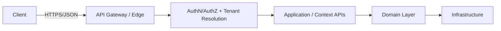
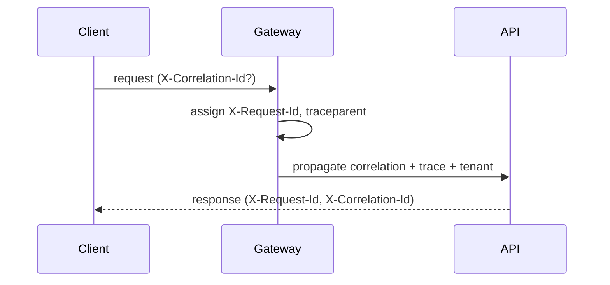
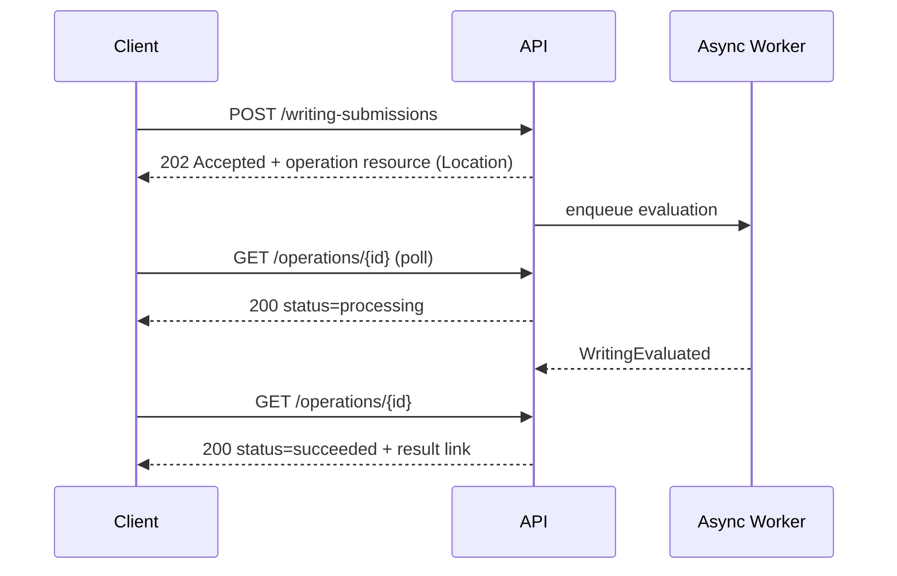

# API Design Standards — IELTS LMS AI

| Field | Value |
| --- | --- |
| **Product Name** | IELTS LMS AI |
| **Document** | 10 — API Design Standards |
| **Version** | 1.0 |
| **Status** | Architecture & Planning |
| **Document Owner** | API & Solution Architecture |
| **Last Updated** | 2026-07-18 |
| **Audience** | Backend Engineers, API Consumers, Architects, QA, Security, Technical Writers |
| **Aligns With** | [01_Product_Vision.md](./01_Product_Vision.md) … [09_Database_Design_ERD.md](./09_Database_Design_ERD.md) |

> **Purpose of this document.** This document defines **how every API in IELTS LMS AI must be designed** — the standards, conventions, and contracts that all endpoints follow. It does **not** enumerate individual endpoints (that is a later specification). It is **implementation-independent**: no controllers, ORM models, SQL, or project scaffolding — only standards and rationale. Where earlier documents referenced an "API Specification (10)", this standards document is that slot; endpoint-level specs will conform to the rules defined here.

---

## Table of Contents

1. [API Philosophy](#1-api-philosophy)
2. [REST Principles](#2-rest-principles)
3. [Versioning Strategy](#3-versioning-strategy)
4. [Naming & URI Design](#4-naming--uri-design)
5. [HTTP Methods & Status Codes](#5-http-methods--status-codes)
6. [Collections: Filtering, Sorting, Searching, Pagination](#6-collections-filtering-sorting-searching-pagination)
7. [Request Standards](#7-request-standards)
8. [Response Standards](#8-response-standards)
9. [Error Handling & Problem Details](#9-error-handling--problem-details)
10. [Headers Catalog](#10-headers-catalog)
11. [Idempotency, Concurrency & Caching](#11-idempotency-concurrency--caching)
12. [Correlation, Tracing & Observability](#12-correlation-tracing--observability)
13. [Content Negotiation, Localization & Time](#13-content-negotiation-localization--time)
14. [File Upload, Streaming & Long-Running Operations](#14-file-upload-streaming--long-running-operations)
15. [Rate Limiting & Retry](#15-rate-limiting--retry)
16. [Security Standards](#16-security-standards)
17. [Documentation Standards (OpenAPI/Swagger)](#17-documentation-standards-openapiswagger)
18. [API Lifecycle, Deprecation & Compatibility](#18-api-lifecycle-deprecation--compatibility)
19. [SDKs & Future Protocols](#19-sdks--future-protocols)
20. [Related Documents](#20-related-documents)

---

## 1. API Philosophy

IELTS LMS AI exposes a **resource-oriented, HTTP/JSON REST API** as its primary contract. The API is the stable boundary between clients (web app, future mobile, integrations) and the platform's [bounded contexts](./07_Domain_Driven_Design.md#5-bounded-contexts).

| Principle | Meaning |
| --- | --- |
| **Consistency over cleverness** | Every endpoint behaves predictably; conventions are uniform across contexts. |
| **Contract-first** | The API contract (OpenAPI) is designed before implementation and is the source of truth for consumers. |
| **Secure by default** | Authentication, tenant scoping, and authorization apply unless an endpoint is explicitly public. |
| **Tenant-aware always** | Every request resolves to a tenant context ([Multi-Tenant Architecture](./12_Multi_Tenant_Architecture.md)). |
| **Backward compatible** | Changes never silently break consumers; breaking changes require a new version. |
| **Implementation-independent** | The contract hides internal structure; internal refactors do not change the contract. |
| **Ubiquitous language** | Resource names use the [domain language](./07_Domain_Driven_Design.md#3-ubiquitous-language). |

---

## 2. REST Principles

- **Resources, not actions:** URIs identify resources (nouns); state changes are expressed via HTTP methods, not verbs in the path.
- **Statelessness:** each request carries all context (auth token, tenant, correlation); no server-side client session state beyond documented session/token mechanisms.
- **Uniform interface:** consistent methods, status codes, media types, and error shapes across all resources.
- **HATEOAS (pragmatic):** responses may include navigational links (e.g., pagination, related resources) but full hypermedia is optional and additive.
- **Layered system:** clients are agnostic to gateways, caches, and internal service boundaries.



---

## 3. Versioning Strategy

| Aspect | Standard |
| --- | --- |
| **Scheme** | URI-based major versioning: `/api/v1/...`. |
| **When to bump** | Only for **breaking** changes (removed/renamed fields, changed semantics, stricter validation). |
| **Additive changes** | New optional fields, new endpoints, new optional params are **non-breaking** and ship within the current version. |
| **Header alternative** | A `Accept` media-type version (e.g., `application/vnd.ielts-lms.v1+json`) MAY be supported later; URI version remains canonical. |
| **Deprecation** | Governed by the [lifecycle policy](#18-api-lifecycle-deprecation--compatibility). |
| **Minimum lifetime** | A deprecated major version is supported for a documented minimum window before sunset. |

> **Rationale.** URI versioning is explicit, cache-friendly, and simple for consumers, matching practice at large SaaS providers. Additive-only evolution within a version keeps most changes non-breaking.

---

## 4. Naming & URI Design

### 4.1 Conventions

| Rule | Example |
| --- | --- |
| Plural, lowercase, kebab-case resource names | `/api/v1/writing-submissions` |
| Resource identifiers as path segments | `/api/v1/courses/{courseId}` |
| Nested resources express ownership | `/api/v1/courses/{courseId}/lessons` |
| No verbs in paths (use methods) | `POST /api/v1/writing-submissions` (not `/createWriting`) |
| Controlled action sub-resources for non-CRUD ops | `POST /api/v1/mock-exams/{id}/submit` |
| Query params for filtering/sorting/paging | `?status=active&sort=-createdAt&page=2` |
| No trailing slash | `/api/v1/courses` |

### 4.2 Nesting Depth

Limit nesting to **one level** of ownership; beyond that, reference by ID and use filters. Deeply nested chains (`/a/{}/b/{}/c/{}/d`) are discouraged for maintainability.

### 4.3 Resource Naming Aligned to Domain

Resource names map to [aggregates/entities](./09_Database_Design_ERD.md#6-entity-catalog): `tenants`, `organizations`, `users`, `roles`, `courses`, `lessons`, `enrollments`, `writing-submissions`, `writing-evaluations`, `speaking-attempts`, `reading-attempts`, `listening-attempts`, `daily-plans`, `weekly-assessments`, `mock-exams`, `certificates`, `subscriptions`, `invoices`, `payments`, `notifications`, `support-tickets`.

---

## 5. HTTP Methods & Status Codes

### 5.1 Methods

| Method | Use | Idempotent | Safe |
| --- | --- | --- | --- |
| `GET` | Read resource/collection | Yes | Yes |
| `POST` | Create; non-idempotent actions | No (use idempotency key) | No |
| `PUT` | Full replace/update | Yes | No |
| `PATCH` | Partial update | No† | No |
| `DELETE` | Soft-delete/remove | Yes | No |

† PATCH is idempotent when using explicit field replacement semantics; document per endpoint.

### 5.2 Status Codes

| Code | Meaning | Typical use |
| --- | --- | --- |
| `200 OK` | Success with body | GET, PATCH/PUT returning entity |
| `201 Created` | Resource created | POST create; include `Location` |
| `202 Accepted` | Async accepted | Long-running ops (AI evaluation) |
| `204 No Content` | Success no body | DELETE, some PUT |
| `400 Bad Request` | Malformed/validation | Validation errors |
| `401 Unauthorized` | Missing/invalid auth | Authentication failure |
| `403 Forbidden` | Authenticated, not allowed | Authorization/tenant violation |
| `404 Not Found` | No such resource (or not in tenant) | Missing/hidden cross-tenant |
| `409 Conflict` | State/concurrency conflict | Optimistic concurrency, duplicates |
| `422 Unprocessable Entity` | Semantic validation failure | Business-rule validation |
| `429 Too Many Requests` | Rate limited | Throttling |
| `500 Internal Server Error` | Unexpected | Unhandled failure |
| `503 Service Unavailable` | Dependency/outage | AI provider outage, maintenance |

> **Cross-tenant rule:** requests for resources outside the caller's tenant return **`404`** (not `403`) to avoid confirming existence, consistent with [tenant isolation](./12_Multi_Tenant_Architecture.md) and [NFR-SEC-001](./05_Non_Functional_Requirements.md).

---

## 6. Collections: Filtering, Sorting, Searching, Pagination

### 6.1 Pagination

Two modes are supported; **cursor pagination is preferred** for large/volatile collections (attempts, logs, notifications).

| Mode | Query params | Use when |
| --- | --- | --- |
| **Offset/limit** | `?page=2&pageSize=20` | Small, stable collections; admin tables. |
| **Cursor** | `?cursor=<opaque>&limit=20` | Large/high-churn collections; timelines/logs. |

- `pageSize`/`limit` has a documented **default (e.g., 20)** and **maximum (e.g., 100)**; exceeding the max clamps to the max.
- Responses include pagination metadata and navigational links (see [§8](#8-response-standards)).

```jsonc
// Cursor page response envelope (illustrative)
{
  "data": [ /* items */ ],
  "pagination": {
    "mode": "cursor",
    "limit": 20,
    "nextCursor": "eyJpZCI6..."   // null when no more
  },
  "links": { "next": "/api/v1/activity-logs?cursor=eyJpZCI6...&limit=20" }
}
```

> **Cursor rule.** Cursors are **opaque, signed tokens** encoding sort key + tie-breaker (e.g., `createdAt` + `id`); clients must treat them as opaque and never construct them.

### 6.2 Filtering

- Field filters as query params: `?status=active&track=academic`.
- Range filters use suffix operators: `?createdAt[gte]=2026-01-01&band[lte]=7.0`.
- Multi-value via repetition or CSV: `?status=active,completed`.
- Unknown filter fields return `400` with a validation error (fail-fast, no silent ignore).

### 6.3 Sorting

- `?sort=fieldName` ascending; `?sort=-fieldName` descending; multi-sort via CSV: `?sort=-createdAt,title`.
- Only whitelisted sortable fields are allowed; others return `400`.

### 6.4 Searching

- Free-text search via `?q=` on documented searchable fields.
- Search is tenant-scoped and permission-filtered; results never leak cross-tenant data.

---

## 7. Request Standards

### 7.1 Request Validation

- **Validate at the edge:** structural validation (types, required, formats) precedes business logic.
- **Fail-fast, aggregate errors:** return all field errors in one response, not the first only.
- **Strict content type:** write requests require `Content-Type: application/json` (or documented multipart for uploads).
- **Unknown fields:** rejected in strict mode for write payloads to avoid silent data loss (`400`).
- **Size limits:** request body and upload size caps enforced ([NFR-UPL-001](./05_Non_Functional_Requirements.md)).

### 7.2 Request Body Conventions

- JSON property names in **camelCase**.
- Enumerations use stable string codes (not integers) for readability/versioning.
- Money as `{ "amount": 1999, "currency": "USD" }` (minor units) — see [ENT Payments](./09_Database_Design_ERD.md).
- Dates/times in **ISO 8601 UTC** (see [§13](#13-content-negotiation-localization--time)).

---

## 8. Response Standards

### 8.1 Standard Response Envelope

All successful responses use a consistent envelope so clients parse uniformly.

```jsonc
{
  "data": { /* resource or array */ },
  "meta": {                         // optional, present when relevant
    "requestId": "req_01H...",
    "correlationId": "corr_01H...",
    "timestamp": "2026-07-18T10:15:30Z"
  },
  "pagination": { /* present for collections */ },
  "links": { /* present when navigational links apply */ }
}
```

### 8.2 Success Responses

| Scenario | Code | Body |
| --- | --- | --- |
| Single resource | `200` | `data` = object |
| Collection | `200` | `data` = array + `pagination` |
| Created | `201` | `data` = object + `Location` header |
| Async accepted | `202` | `data` = operation resource ([§14](#14-file-upload-streaming--long-running-operations)) |
| No content | `204` | empty |

### 8.3 Field Conventions

- Timestamps: `createdAt`, `updatedAt` (ISO 8601 UTC).
- Identifiers: opaque string IDs (see [ERD global surrogate keys](./09_Database_Design_ERD.md#11-migration-path-to-database-per-tenant)).
- Never expose internal-only fields (e.g., password hashes, provider secrets) — enforced by [data classification](./09_Database_Design_ERD.md#5-data-classification).

---

## 9. Error Handling & Problem Details

### 9.1 Problem Details (RFC 7807)

All errors use **`application/problem+json`** (RFC 7807) extended with platform fields.

```jsonc
{
  "type": "https://errors.ielts-lms.ai/validation",
  "title": "Validation failed",
  "status": 422,
  "detail": "One or more fields are invalid.",
  "instance": "/api/v1/writing-submissions",
  "code": "VALIDATION_ERROR",            // stable machine code
  "correlationId": "corr_01H...",
  "errors": [                             // field-level details
    { "field": "essayText", "code": "REQUIRED", "message": "Essay text is required." }
  ]
}
```

### 9.2 Error Categories & Codes

| Category | HTTP | `code` prefix | Example |
| --- | --- | --- | --- |
| **Validation** | 400/422 | `VALIDATION_` | `VALIDATION_ERROR`, `VALIDATION_REQUIRED` |
| **Business rule** | 409/422 | `BUSINESS_` | `BUSINESS_DUPLICATE_ENROLLMENT`, `BUSINESS_QUOTA_EXCEEDED` |
| **Security / auth** | 401 | `AUTH_` | `AUTH_TOKEN_EXPIRED`, `AUTH_TOKEN_INVALID` |
| **Authorization** | 403 | `AUTHZ_` | `AUTHZ_FORBIDDEN`, `AUTHZ_TENANT_MISMATCH` |
| **Not found** | 404 | `NOT_FOUND` | `NOT_FOUND` |
| **Concurrency** | 409 | `CONFLICT_` | `CONFLICT_VERSION_MISMATCH` |
| **Rate limit** | 429 | `RATE_` | `RATE_LIMITED` |
| **Server / dependency** | 500/503 | `SERVER_` / `DEPENDENCY_` | `DEPENDENCY_AI_UNAVAILABLE` |

- **Stable codes:** `code` values are part of the contract and never change meaning; new codes are additive.
- **No sensitive leakage:** error messages never expose stack traces, secrets, or cross-tenant existence ([NFR-SEC](./05_Non_Functional_Requirements.md)).
- **Business errors** map to domain invariants/policies from [DDD](./07_Domain_Driven_Design.md#11-invariants-policies--business-rules) and [Event Storming failure scenarios](./08_Event_Storming.md).

---

## 10. Headers Catalog

### 10.1 Standard Request Headers

| Header | Purpose | Required |
| --- | --- | --- |
| `Authorization: Bearer <token>` | Access token ([Auth doc](./11_Authentication_Authorization.md)) | Yes (except public) |
| `X-Tenant-Id` / host-based | Tenant context ([resolution](./12_Multi_Tenant_Architecture.md#tenant-resolution)) | Context-dependent |
| `X-Correlation-Id` | Client-supplied correlation (echoed) | Optional |
| `Idempotency-Key` | Idempotent writes ([§11](#11-idempotency-concurrency--caching)) | For unsafe retryable POSTs |
| `Accept` | Content negotiation / version | Recommended |
| `Accept-Language` | Localization ([§13](#13-content-negotiation-localization--time)) | Optional |
| `If-Match` / `If-None-Match` | Concurrency / caching (ETags) | Conditional |
| `Content-Type` | Payload media type | For writes |

### 10.2 Standard Response Headers

| Header | Purpose |
| --- | --- |
| `X-Request-Id` | Unique per-request ID (server-generated). |
| `X-Correlation-Id` | Correlation across services (echoed/generated). |
| `ETag` | Entity version for caching/concurrency. |
| `Location` | Created/aync operation resource URL. |
| `Retry-After` | On `429`/`503`, when to retry. |
| `RateLimit-Limit` / `RateLimit-Remaining` / `RateLimit-Reset` | Rate-limit state ([§15](#15-rate-limiting--retry)). |
| `Cache-Control` | Caching policy. |
| `Content-Language` | Localized response language. |

> **Tenant header rule.** Tenant context is resolved from host/subdomain or a signed token claim by default; `X-Tenant-Id` is honored only when consistent with the authenticated principal's tenant — a mismatch yields `403 AUTHZ_TENANT_MISMATCH`. See [Multi-Tenant Architecture](./12_Multi_Tenant_Architecture.md).

---

## 11. Idempotency, Concurrency & Caching

### 11.1 Idempotency

- **Safe methods** (`GET`, `HEAD`) are inherently idempotent.
- **`PUT`/`DELETE`** are idempotent by design.
- **`POST`** that creates resources supports an **`Idempotency-Key`** header: repeated requests with the same key return the original result, preventing duplicate charges/submissions ([Payment/Writing workflows](./08_Event_Storming.md)).
- Idempotency keys are stored per tenant with a documented retention window.

### 11.2 Optimistic Concurrency

- Mutable resources expose a version via **`ETag`**; updates send **`If-Match: <etag>`**.
- A stale `If-Match` yields **`409 CONFLICT_VERSION_MISMATCH`**, aligned to the `Version` token in the [ERD](./09_Database_Design_ERD.md#43-concurrency-strategy).

### 11.3 Caching

- Cacheable `GET`s return `Cache-Control` and `ETag`; conditional requests use `If-None-Match` → `304 Not Modified`.
- Reference/catalog data is cacheable; tenant-private data uses `private` cache scope.
- Cache invalidation is event-driven ([Caching NFR](./05_Non_Functional_Requirements.md#22-caching-cache)).

---

## 12. Correlation, Tracing & Observability

| Concept | Standard |
| --- | --- |
| **Request ID** | Server generates `X-Request-Id` per request; included in logs and error bodies. |
| **Correlation ID** | `X-Correlation-Id` spans a logical operation across services; client-supplied or generated. |
| **Trace ID** | Distributed tracing (W3C `traceparent`) propagated across internal calls ([Observability NFR](./05_Non_Functional_Requirements.md#21-observability-monitoring-logging--auditing-obs--mon--log--aud)). |
| **Tenant tagging** | All logs/traces/metrics tagged with `TenantId` for per-tenant observability. |



---

## 13. Content Negotiation, Localization & Time

- **Media type:** `application/json` default; `application/problem+json` for errors; `multipart/form-data` for uploads.
- **Compression:** responses support `gzip`/`br` via `Accept-Encoding`.
- **Localization:** `Accept-Language` drives localized messages/content where available ([I18N NFR](./05_Non_Functional_Requirements.md#19-localization--internationalization-i18n)); `Content-Language` returned.
- **Time:** all timestamps are **ISO 8601 in UTC** (`2026-07-18T10:15:30Z`); clients localize for display. Server never assumes client timezone; timezone-sensitive operations accept an explicit offset/zone parameter.
- **Dates:** date-only values use `YYYY-MM-DD`.

---

## 14. File Upload, Streaming & Long-Running Operations

### 14.1 File Upload

- Uploads (speaking audio, documents) use `multipart/form-data` or **pre-signed URL** flows to object storage ([ENT Files](./09_Database_Design_ERD.md)).
- Type allowlist + size caps enforced; malware scanning applied before serving ([NFR-UPL](./05_Non_Functional_Requirements.md#14-file-upload-security-upl)).
- Direct execution is never permitted; access via signed, expiring URLs.

### 14.2 Long-Running / Background Operations

AI evaluation and mock-exam scoring are asynchronous.



- Async endpoints return **`202 Accepted`** with an **operation resource** (`/operations/{id}`) exposing `status` ∈ {queued, processing, succeeded, failed}.
- Clients poll the operation resource or subscribe via future push channels ([§19](#19-sdks--future-protocols)).
- Operation results reference the produced resource (e.g., evaluation) when complete.

### 14.3 Streaming

- Streaming responses (e.g., AI tutoring token streams, future) use chunked transfer / SSE; documented per endpoint. WebSocket/SSE considerations in [§19](#19-sdks--future-protocols).

---

## 15. Rate Limiting & Retry

- Limits are applied per principal/tenant and per endpoint class (auth, AI, general), aligned to [entitlements](./09_Database_Design_ERD.md) and [NFR-RATE](./05_Non_Functional_Requirements.md#13-rate-limiting-rate).
- `429 Too Many Requests` includes `Retry-After` and `RateLimit-*` headers.
- **Retry guidance:** clients retry only idempotent/`Idempotency-Key`-guarded requests, using **exponential backoff with jitter**; never retry `4xx` except `429`.

| Endpoint class | Limit basis | Rationale |
| --- | --- | --- |
| Authentication | Per identity + IP | Brute-force protection ([NFR-RATE-001](./05_Non_Functional_Requirements.md)) |
| AI evaluation | Per user/tenant quota | Cost control + entitlements ([NFR-RATE-002](./05_Non_Functional_Requirements.md)) |
| General API | Fair-use per tenant | Stability |

---

## 16. Security Standards

- **Transport:** TLS 1.2+ only; HSTS enforced ([NFR-ENC-001](./05_Non_Functional_Requirements.md)).
- **AuthN/AuthZ:** every non-public endpoint requires a valid token and passes tenant + permission checks ([Auth doc](./11_Authentication_Authorization.md)).
- **Input safety:** validation + output encoding; parameterized data access; no injection sinks ([NFR-SEC OWASP](./05_Non_Functional_Requirements.md#6-security-sec)).
- **Secrets:** never in URLs, logs, or responses; referenced by key name only.
- **CORS:** explicit allowlist per tenant/client origin; credentials handling documented.
- **Public endpoints:** explicitly marked (e.g., certificate verification, health); everything else default-deny.

> **Security note.** Creating an unauthenticated endpoint is a deliberate, documented exception; the default is authenticated + tenant-scoped + authorized.

---

## 17. Documentation Standards (OpenAPI/Swagger)

- **Contract-first OpenAPI 3.x** is the authoritative machine-readable contract; Swagger UI is published for exploration.
- Every endpoint documents: purpose, auth/permissions, params, request/response schemas, error codes, examples, rate-limit class.
- Shared components (error envelope, pagination, common headers) are defined once and referenced (`$ref`).
- Examples are **realistic and tenant-safe** (no real PII).
- The spec is versioned with the API and validated in CI.

---

## 18. API Lifecycle, Deprecation & Compatibility


| Stage | Meaning | Consumer signal |
| --- | --- | --- |
| Released | Stable, supported. | In current version. |
| Deprecated | Still works; scheduled for removal. | `Deprecation` + `Sunset` headers, docs, changelog. |
| Sunset | Removed after minimum window. | Returns `410 Gone` post-sunset. |

- **Backward compatibility rules:** never remove/rename fields, tighten validation, or change semantics within a version; such changes require a new major version.
- **Deprecation policy:** announce via headers + changelog + docs, honor a documented minimum support window, provide a migration guide.

---

## 19. SDKs & Future Protocols

| Area | Direction |
| --- | --- |
| **SDKs** | Generated from OpenAPI for web/mobile; hand-tuned ergonomics layered on top. Consistent error/pagination handling. |
| **GraphQL (future)** | Considered as an **additive** read-optimized layer over the same domain services; not a replacement for REST. |
| **gRPC (future)** | Considered for internal service-to-service and high-throughput paths; not the public contract initially. |
| **WebSocket/SSE (future)** | For real-time (live notifications, AI streaming, exam timers); complements REST, does not replace it. |

All future protocols must preserve **tenant isolation**, **auth/permission semantics**, and the **ubiquitous language**.

---

## 20. Related Documents

| # | Document | Relationship |
| --- | --- | --- |
| 04 | [Functional Requirements](./04_Functional_Requirements.md) | Behaviors exposed via APIs. |
| 05 | [Non-Functional Requirements](./05_Non_Functional_Requirements.md) | Performance, security, rate-limit, i18n drivers. |
| 06 | [SRS](./06_Software_Requirements_Specification.md) | Interface requirements. |
| 07 | [Domain-Driven Design](./07_Domain_Driven_Design.md) | Resource language & context boundaries. |
| 08 | [Event Storming](./08_Event_Storming.md) | Async operations & failure/business errors. |
| 09 | [Database Design / ERD](./09_Database_Design_ERD.md) | Resource fields, IDs, concurrency. |
| 11 | [Authentication & Authorization](./11_Authentication_Authorization.md) | Auth headers, tokens, permissions. |
| 12 | [Multi-Tenant Architecture](./12_Multi_Tenant_Architecture.md) | Tenant resolution & isolation. |

---

*End of Document — 10 API Design Standards (v1.0).*
