# Authentication & Authorization (IAM) — IELTS LMS AI

| Field | Value |
| --- | --- |
| **Product Name** | IELTS LMS AI |
| **Document** | 11 — Authentication & Authorization (Identity & Access Management) |
| **Version** | 1.0 |
| **Status** | Architecture & Planning |
| **Document Owner** | Security & IAM Architecture |
| **Last Updated** | 2026-07-18 |
| **Audience** | Backend Engineers, Security, Architects, QA, Compliance |
| **Aligns With** | [01_Product_Vision.md](./01_Product_Vision.md) … [10_API_Design_Standards.md](./10_API_Design_Standards.md) |

> **Purpose of this document.** This document defines the complete **Identity & Access Management (IAM)** architecture for IELTS LMS AI: authentication, session/token management, password and account security, RBAC and policy-based authorization, tenant isolation, and the readiness roadmap for MFA, passkeys, OAuth 2.1/OIDC, and enterprise SSO. It is **implementation-independent** — no controllers, ORM models, or SQL — and consistent with the [security NFRs](./05_Non_Functional_Requirements.md#6-security-sec) and [domain model](./07_Domain_Driven_Design.md).

---

## Table of Contents

1. [Authentication Overview](#1-authentication-overview)
2. [Identity Architecture](#2-identity-architecture)
3. [JWT & Token Architecture](#3-jwt--token-architecture)
4. [Session Management](#4-session-management)
5. [Password & Credential Security](#5-password--credential-security)
6. [Account Protection](#6-account-protection)
7. [MFA & Passkeys](#7-mfa--passkeys)
8. [Federation Readiness: OAuth 2.1, OIDC, Social & Enterprise SSO](#8-federation-readiness-oauth-21-oidc-social--enterprise-sso)
9. [Claims Design](#9-claims-design)
10. [Authorization Strategy](#10-authorization-strategy)
11. [Roles & Permission Matrix](#11-roles--permission-matrix)
12. [Tenant Isolation in IAM](#12-tenant-isolation-in-iam)
13. [Authentication & Identity Flows](#13-authentication--identity-flows)
14. [Security Considerations & OWASP](#14-security-considerations--owasp)
15. [Related Documents](#15-related-documents)

---

## 1. Authentication Overview

Authentication establishes **who** the caller is; authorization ([§10](#10-authorization-strategy)) decides **what** they may do; tenant isolation ([§12](#12-tenant-isolation-in-iam)) constrains **where** (which tenant) they may do it. Every non-public request passes all three gates.

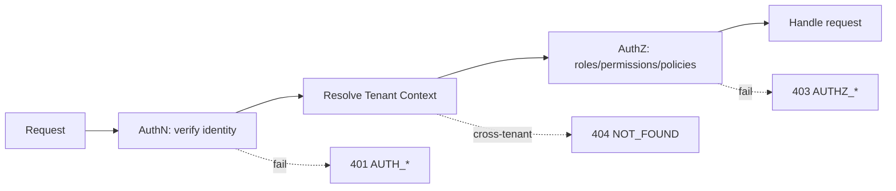

| Concern | Approach (V1) | Future |
| --- | --- | --- |
| Primary auth | Email + password → JWT access/refresh | Passkeys, SSO |
| Token format | Signed JWT access token + opaque/rotating refresh token | — |
| MFA | Architecture-ready (TOTP first) | Passkeys/WebAuthn |
| Federation | OAuth 2.1 / OIDC readiness | Azure AD, Google, Microsoft, Apple |
| Authorization | RBAC + permission-based + policy-based | Custom tenant roles |

---

## 2. Identity Architecture

The Identity bounded context ([DDD](./07_Domain_Driven_Design.md#5-bounded-contexts)) owns users, roles, permissions, and credentials. Identities are **scoped to a tenant**: the same email may exist in different tenants as distinct users ([ERD ENT-003](./09_Database_Design_ERD.md#ent-003--users)).

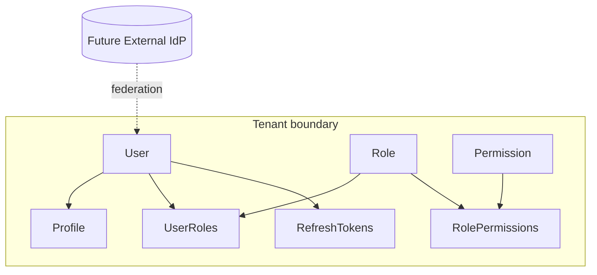

- **User** = authentication principal within a tenant.
- **Role** = named set of permissions (reference data, tenant-scoped or global template).
- **Permission** = fine-grained capability key (e.g., `writing.evaluate`, `tenant.settings.manage`).
- Credentials (password hashes, refresh tokens) are **Restricted** data ([classification](./09_Database_Design_ERD.md#5-data-classification)).

---

## 3. JWT & Token Architecture

### 3.1 Token Types

| Token | Format | Lifetime | Storage (client) | Purpose |
| --- | --- | --- | --- | --- |
| **Access token** | Signed JWT | Short (e.g., 15 min) | In-memory (web) | Authorize API calls. |
| **Refresh token** | Opaque, high-entropy, hashed server-side | Longer (e.g., 7–30 days, sliding) | Secure httpOnly cookie / secure store | Obtain new access tokens. |
| **ID token (future)** | OIDC JWT | Short | — | Federation identity claims. |

### 3.2 Access Token (JWT) Design

- **Signing:** asymmetric (e.g., RS256/ES256) so verifiers need only the public key; keys rotated via [key management](./05_Non_Functional_Requirements.md#12-key-management-key).
- **Claims:** minimal, tenant-scoped ([§9](#9-claims-design)); no sensitive PII in the token.
- **Validation:** signature, `exp`, `nbf`, `iss`, `aud`, and `tenantId` are validated on every request.
- **Stateless authorization:** access tokens are self-contained; revocation is handled via short lifetime + refresh-token revocation ([§4.3](#43-refresh-token-rotation--revocation)).

### 3.3 Token Storage Strategy

| Context | Access token | Refresh token |
| --- | --- | --- |
| Web SPA | In-memory (not localStorage) | httpOnly, Secure, SameSite cookie |
| Future mobile | Secure OS keystore | Secure OS keystore |

> **Rationale.** Keeping access tokens out of persistent storage and refresh tokens in httpOnly cookies mitigates XSS token theft ([OWASP](#14-security-considerations--owasp)).

---

## 4. Session Management

### 4.1 Sliding Sessions

Sessions **slide**: each successful refresh extends the session window up to a **maximum absolute lifetime**, after which re-authentication is required. Idle beyond the sliding window expires the session.

### 4.2 Device Sessions & Trusted Devices

- Each refresh token represents a **device session** (device metadata, IP, last-seen) — see [ERD ENT-009](./09_Database_Design_ERD.md#ent-009--refreshtokens).
- Users can **view and revoke** individual device sessions.
- **Trusted devices** may reduce MFA prompts ([§7](#7-mfa--passkeys)) within policy.

### 4.3 Refresh Token Rotation & Revocation

```mermaid
sequenceDiagram
    participant C as Client
    participant A as Auth Service
    participant S as Token Store
    C->>A: POST /auth/refresh (refresh token)
    A->>S: validate + check not revoked/used
    alt valid & unused
        A->>S: mark old token used; store new (rotated)
        A-->>C: new access + new refresh
    else reuse detected
        A->>S: revoke entire token family
        A-->>C: 401 AUTH_TOKEN_INVALID (breach response)
    end
```

- **Rotation:** every refresh issues a new refresh token and invalidates the prior one.
- **Reuse detection:** presenting an already-used refresh token indicates theft → the **whole token family is revoked** and security notification sent.
- **Revocation triggers:** logout, password reset, admin action, suspicious activity, device revocation.

---

## 5. Password & Credential Security

Aligned to [NFR Password Policies](./05_Non_Functional_Requirements.md#7-password-policies-sec-subset) and [Authentication NFRs](./05_Non_Functional_Requirements.md#8-authentication-auth-nfr).

| Control | Standard |
| --- | --- |
| **Hashing** | Memory-hard algorithm (e.g., Argon2id; bcrypt acceptable) with per-user salt; never plaintext/reversible. |
| **Password policy** | Minimum length, complexity/passphrase support, breached-password check, no forced periodic rotation without cause. |
| **Reset** | Time-boxed, single-use, signed tokens; no account enumeration. |
| **Email verification** | Required before full account activation; verification tokens time-boxed and single-use. |
| **Storage** | Hashes and reset/verification tokens stored as Restricted data; tokens stored hashed. |
| **Credential change** | Password change/reset revokes existing refresh tokens (session invalidation) and notifies the user. |

---

## 6. Account Protection

Aligned to [NFR Account Lockout / Rate Limiting](./05_Non_Functional_Requirements.md#25-rate-limiting-rate).

| Control | Standard |
| --- | --- |
| **Login attempt limits** | Progressive throttling + temporary lockout after N failed attempts per account/IP. |
| **Account lockout** | Time-boxed lockout with auto-unlock; admin unlock path; lockout events audited. |
| **Security notifications** | Email on new-device login, password change, MFA change, and lockout. |
| **Enumeration resistance** | Login, reset, and registration responses do not reveal whether an account exists. |
| **Bot resistance** | CAPTCHA/challenge on suspicious volume (future/optional). |
| **Anomaly signals** | Impossible-travel / new-device flags feed step-up auth (future MFA). |

---

## 7. MFA & Passkeys

### 7.1 MFA Architecture (Ready)

MFA is designed in from the start and enabled progressively:

- **First factor:** password (or federated identity).
- **Second factor (V-next):** TOTP authenticator apps first; SMS/email OTP as fallback (discouraged where avoidable).
- **Step-up authentication:** sensitive operations (billing changes, admin actions, cross-tenant ops) may require re-authentication or MFA even within a valid session.
- **Recovery:** one-time backup codes; admin-assisted recovery is audited.

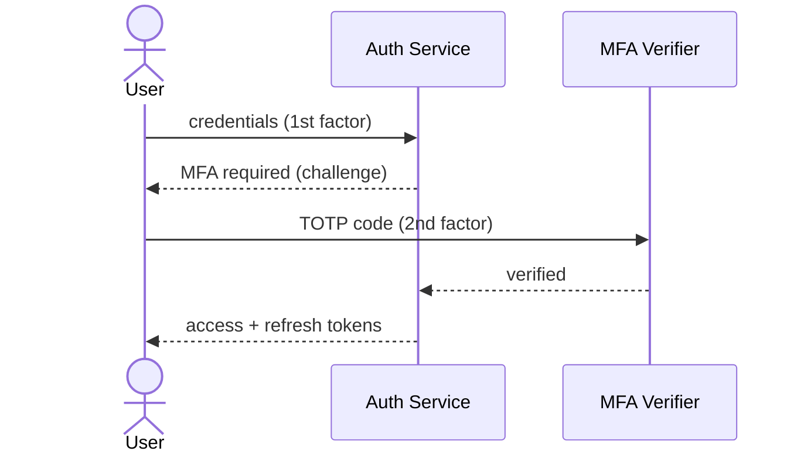

### 7.2 Future Passkeys (WebAuthn/FIDO2)

- Passwordless, phishing-resistant authentication via platform/roaming authenticators.
- Modeled as an alternative first factor; coexists with password and federation.
- Requires credential registration per device; recovery via secondary passkey or backup codes.

---

## 8. Federation Readiness: OAuth 2.1, OIDC, Social & Enterprise SSO

### 8.1 Standards Readiness

- **OAuth 2.1**: authorization-code flow with **PKCE** as the default for all interactive clients; no implicit flow.
- **OpenID Connect**: ID tokens for federated identity; standard discovery/JWKS.
- **Anti-Corruption Layer**: external identity providers are integrated behind an ACL ([DDD context mapping](./07_Domain_Driven_Design.md#6-context-mapping)); external claims are mapped to internal [claims](#9-claims-design).

### 8.2 Enterprise SSO (Future)

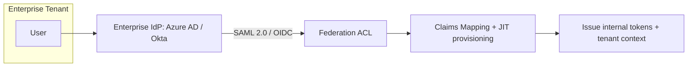

- **Per-tenant IdP configuration**: each enterprise tenant may configure its own IdP (SAML/OIDC).
- **JIT provisioning**: users provisioned/updated on first federated login, mapped to tenant roles.
- **SCIM (future)**: automated user lifecycle provisioning/deprovisioning.

### 8.3 Provider Integration Readiness

| Provider | Protocol | Notes |
| --- | --- | --- |
| **Microsoft / Azure AD (Entra ID)** | OIDC / SAML | Enterprise SSO + directory. |
| **Google** | OIDC | Social + Workspace SSO. |
| **Apple** | OIDC (Sign in with Apple) | Consumer/mobile. |
| **Generic OIDC/SAML** | OIDC / SAML 2.0 | Okta, Auth0, and others. |

> All providers integrate through the same federation ACL and claims-mapping layer; adding a provider is configuration + mapping, not a redesign.

---

## 9. Claims Design

### 9.1 Access Token Claims

| Claim | Purpose |
| --- | --- |
| `sub` | User identifier (stable, opaque). |
| `tenantId` | Tenant scope — validated on every request. |
| `roles` | Assigned role keys (coarse-grained). |
| `perms` (optional) | Selected permission keys, or resolved server-side to keep tokens small. |
| `sid` | Session/device session identifier. |
| `iss`, `aud`, `exp`, `nbf`, `iat` | Standard JWT validity claims. |
| `amr` | Authentication methods (e.g., `pwd`, `mfa`, `passkey`). |

### 9.2 Claims Mapping

- **Internal:** roles/permissions resolved from [UserRoles/RolePermissions](./09_Database_Design_ERD.md#61-identity-tenancy--access).
- **Federated:** external claims (groups, email, name) mapped to internal roles via per-tenant mapping rules.
- **Least privilege:** tokens carry only what is needed; large permission sets are resolved server-side rather than embedded.

---

## 10. Authorization Strategy

IELTS LMS AI combines **RBAC**, **permission-based**, and **policy-based** authorization, always within a **tenant boundary**.

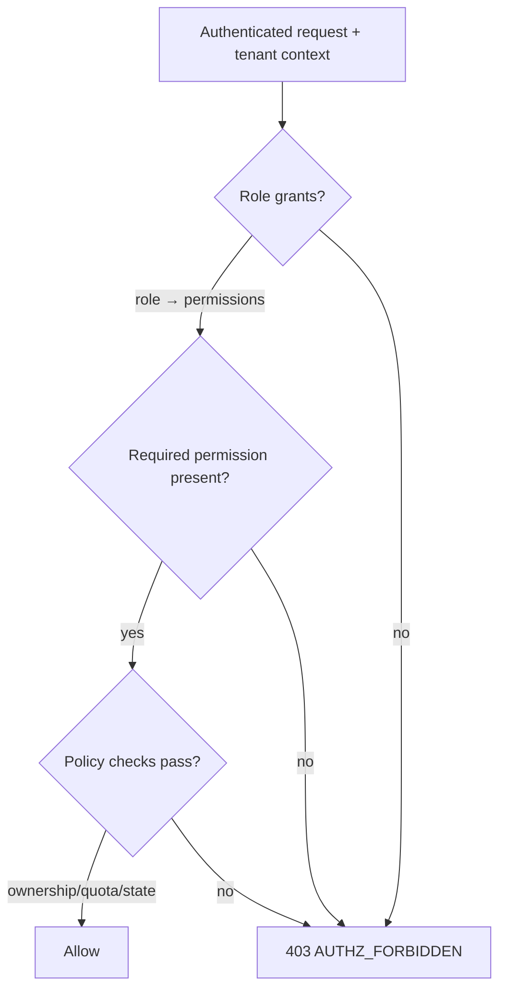

### 10.1 Layers

| Layer | Question | Example |
| --- | --- | --- |
| **RBAC** | Does the user hold a role? | `Teacher`, `TenantAdmin` |
| **Permission-based** | Does the role grant the specific capability? | `writing.evaluate`, `assignment.create` |
| **Policy-based** | Do contextual rules hold? | Owns the resource; within quota; resource in valid state; same tenant. |

### 10.2 Principles

- **Deny by default:** absence of an explicit grant denies access.
- **Least privilege:** roles grant the minimum permissions required.
- **Server-side enforcement:** authorization is enforced on the server; client checks are cosmetic only.
- **Tenant-scoped:** every check is evaluated within the caller's tenant; cross-tenant access is impossible except for audited Super Admin operations ([§12](#12-tenant-isolation-in-iam)).

---

## 11. Roles & Permission Matrix

### 11.1 Role Hierarchy

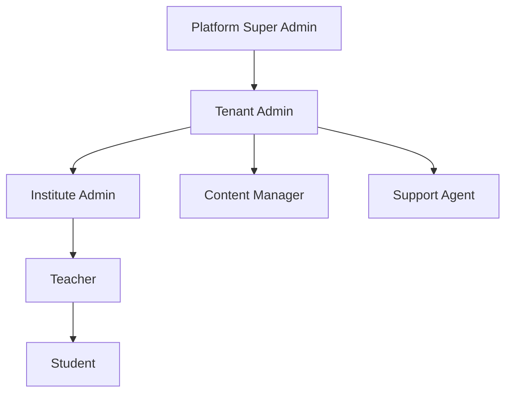

> Hierarchy expresses **administrative scope**, not automatic permission inheritance. Each role has an explicit permission set; higher roles are granted broader sets deliberately, not implicitly, to preserve least privilege. Custom tenant roles (future) compose permissions freely.

### 11.2 Roles

| Role | Scope | Summary |
| --- | --- | --- |
| **Platform Super Admin** | Platform (cross-tenant, audited) | Operate the platform; never routinely accesses tenant learner content. |
| **Tenant Admin** | Tenant | Owns tenant config, users, subscription, governance. |
| **Institute Admin** | Organization unit | Manages an institute/org unit within a tenant. |
| **Content Manager** | Tenant | Authors/manages learning content & catalog. |
| **Teacher** | Cohort | Manages cohorts, assignments, reviews, monitors progress. |
| **Student** | Self | Learns, practices, submits, views own progress. |
| **Support Agent** | Bounded | Limited support actions; no bulk data export. |
| **Custom Roles (future)** | Tenant | Tenant-defined permission compositions. |

### 11.3 Permission Matrix (Representative)

Legend: ✅ full · 🟡 scoped/limited · ➖ none.

| Capability (permission key) | Super | Tenant Admin | Inst. Admin | Content Mgr | Teacher | Student | Support |
| --- | :--: | :--: | :--: | :--: | :--: | :--: | :--: |
| `tenant.provision` | ✅ | ➖ | ➖ | ➖ | ➖ | ➖ | ➖ |
| `tenant.settings.manage` | 🟡 | ✅ | ➖ | ➖ | ➖ | ➖ | ➖ |
| `user.manage` | 🟡 | ✅ | 🟡 | ➖ | ➖ | ➖ | 🟡 |
| `role.assign` | 🟡 | ✅ | 🟡 | ➖ | ➖ | ➖ | ➖ |
| `content.manage` | ➖ | ✅ | 🟡 | ✅ | 🟡 | ➖ | ➖ |
| `course.enroll` | ➖ | ✅ | ✅ | ➖ | ✅ | 🟡 | ➖ |
| `assignment.create` | ➖ | ✅ | ✅ | ➖ | ✅ | ➖ | ➖ |
| `writing.submit` | ➖ | ➖ | ➖ | ➖ | ➖ | ✅ | ➖ |
| `writing.evaluate` | ➖ | 🟡 | 🟡 | ➖ | ✅ | ➖ | ➖ |
| `analytics.view.cohort` | 🟡 | ✅ | ✅ | ➖ | ✅ | ➖ | ➖ |
| `analytics.view.self` | ➖ | ➖ | ➖ | ➖ | ➖ | ✅ | ➖ |
| `ai.grammar-coach.use` | ➖ | ✅ | ✅ | ➖ | ✅ | ✅ | ➖ |
| `ai.usage-summary.view` | ➖ | ✅ | ✅ | ➖ | ➖ | ➖ | ➖ |
| `ai.prompt.manage` | ➖ | ✅ | ➖ | ✅ | ➖ | ➖ | ➖ |
| `billing.manage` | 🟡 | ✅ | ➖ | ➖ | ➖ | ➖ | ➖ |
| `certificate.issue` | ➖ | ✅ | ✅ | ➖ | 🟡 | ➖ | ➖ |
| `support.ticket.manage` | ✅ | ✅ | 🟡 | ➖ | ➖ | 🟡 | ✅ |
| `audit.view` | ✅ | ✅ | 🟡 | ➖ | ➖ | ➖ | 🟡 |

> Super Admin cells are 🟡 for tenant-scoped capabilities because such access is **exceptional and audited** ([§12.2](#122-cross-tenant-protection)), not routine.

> **Phase 7 Sprint 1 reconciliation:** `GET /api/v1/ai/usage-summary` got its own permission key,
> `ai.usage-summary.view`, rather than folding into `analytics.view.cohort` — AI cost/budget visibility
> is narrower (Tenant Admin/Institute Admin only, no Teacher access) than general cohort analytics.
> Enforced today via `RequiredRoles` (the only mechanism `AuthorizationPipelineBehavior` currently wires
> up), same precedent as `ai.grammar-coach.use` — the permission-key column documents intent for the
> full RBAC/ABAC pass, not yet a second enforced code path.
>
> **Phase 7 Sprint 2 reconciliation:** `ai.prompt.manage` gates the Prompt Library &amp; Versioning admin
> endpoints (`/api/v1/ai/prompts*`) — Tenant Admin/Content Manager only, following the existing
> `content.manage` pattern (an authoring/governance tool, not a learner- or Institute-Admin-facing
> capability). Enforced today via `RequiredRoles => ["Tenant Admin", "Content Manager"]`, same
> not-yet-a-second-code-path caveat as every other `ai.*` permission key above.

---

## 12. Tenant Isolation in IAM

### 12.1 Isolation Rules

- Every token carries `tenantId`; every authorization check is evaluated within that tenant.
- A user in Tenant A can never read/write Tenant B data; cross-tenant resource requests return **`404`** ([API standards §5.2](./10_API_Design_Standards.md#5-http-methods--status-codes)).
- Roles/permissions are resolved **within the tenant**; a role in one tenant grants nothing in another.

### 12.2 Cross-Tenant Protection

- Super Admin cross-tenant access is **explicit, time-bounded, and fully audited** ([AuditLogs](./09_Database_Design_ERD.md#ent-048--auditlogs)).
- Impersonation (support) requires elevated permission, is consented/policy-bound, and every impersonated action is audited with both real and effective identity.

---

## 13. Authentication & Identity Flows

All flows are tenant-scoped and emit audit/security events ([Event Storming](./08_Event_Storming.md)).

### 13.1 Registration Flow

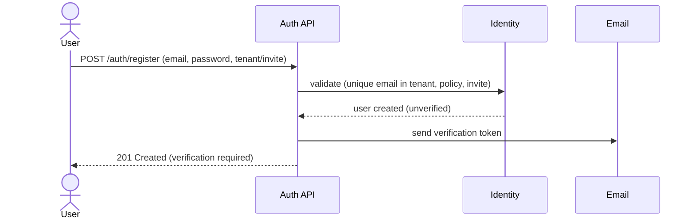

### 13.2 Email Verification Flow

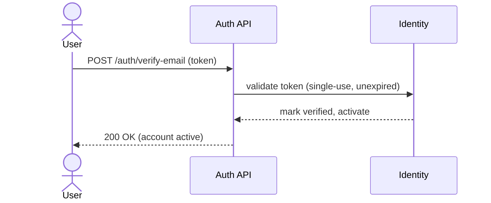

### 13.3 Login Flow

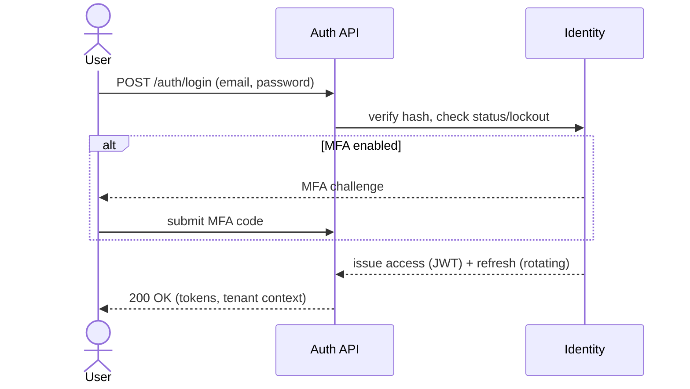

### 13.4 Refresh Flow

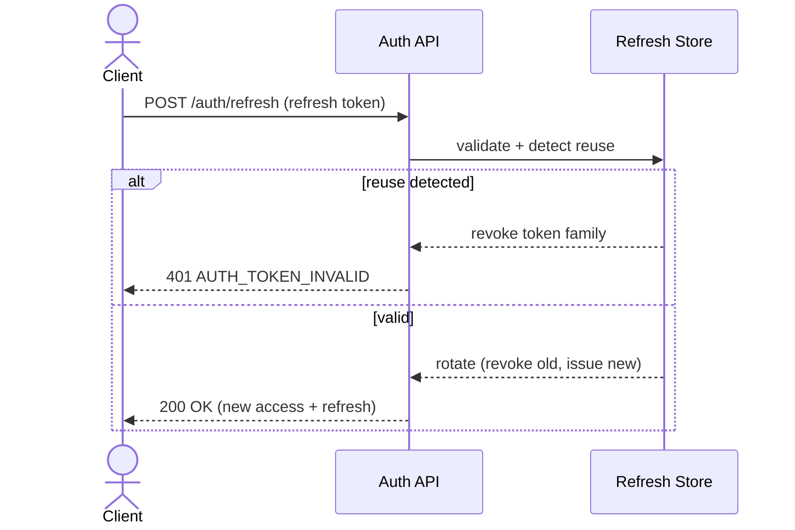

### 13.5 Logout Flow

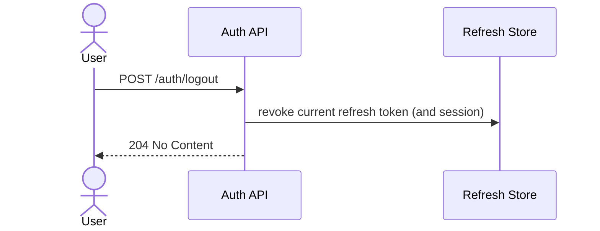

### 13.6 Password Reset Flow

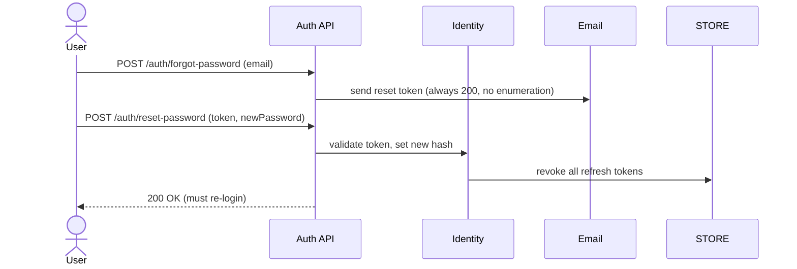

### 13.7 Token Revocation Flow

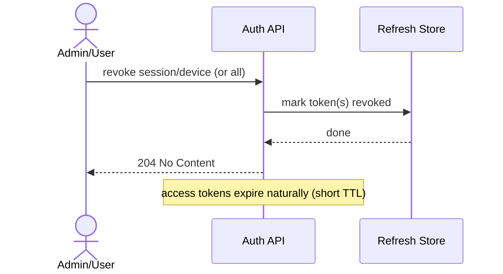

### 13.8 Session Expiration Flow

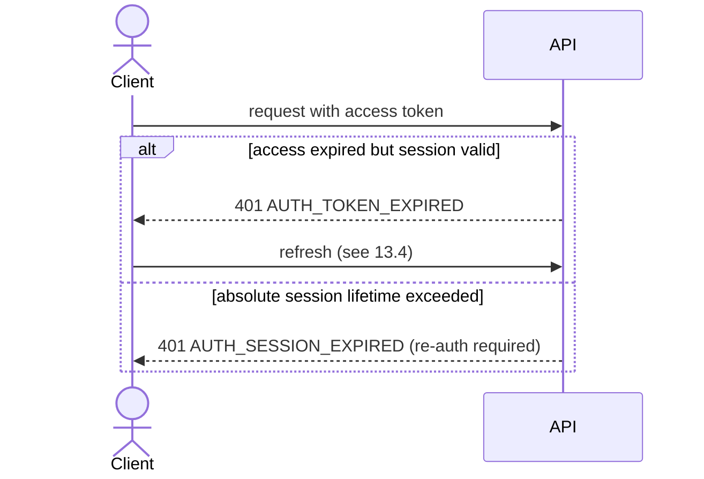

---

## 14. Security Considerations & OWASP

### 14.1 OWASP Top 10 Alignment

| Risk | Mitigation |
| --- | --- |
| **Broken Access Control** | Deny-by-default, server-side RBAC/policy, tenant scoping, 404 on cross-tenant. |
| **Cryptographic Failures** | Argon2id hashing, TLS in transit, encryption at rest, asymmetric JWT signing. |
| **Injection** | Input validation, parameterized data access ([API standards §7](./10_API_Design_Standards.md#7-request-standards)). |
| **Insecure Design** | Threat-modeled flows, least privilege, secure defaults. |
| **Security Misconfiguration** | Hardened defaults, no debug leakage in errors ([Problem Details](./10_API_Design_Standards.md#9-error-handling--problem-details)). |
| **Identification & Auth Failures** | Lockout, MFA-ready, rotating refresh tokens, reuse detection, enumeration resistance. |
| **Software & Data Integrity** | Signed tokens, dependency pinning ([NFR](./05_Non_Functional_Requirements.md)). |
| **Security Logging & Monitoring** | Auth/authz events audited ([AuditLogs](./09_Database_Design_ERD.md#ent-048--auditlogs)). |
| **SSRF** | Egress controls on federation/AI provider calls (ACL). |

### 14.2 Additional Controls

- **Refresh token reuse detection** revokes the entire token family (breach containment).
- **Short access-token TTL** limits the blast radius of a stolen access token.
- **Security notifications** for sensitive changes give users a detection signal.
- **Rate limiting** on auth endpoints ([API standards §15](./10_API_Design_Standards.md#15-rate-limiting--retry)).
- **Audit everything sensitive:** auth, role changes, cross-tenant access, billing.

---

## 15. Related Documents

| # | Document | Relationship |
| --- | --- | --- |
| 04 | [Functional Requirements](./04_Functional_Requirements.md) | Auth/user FRs realized here. |
| 05 | [Non-Functional Requirements](./05_Non_Functional_Requirements.md) | Security/session/password NFRs. |
| 06 | [Software Requirements Specification](./06_Software_Requirements_Specification.md) | Consolidated requirements. |
| 07 | [Domain-Driven Design](./07_Domain_Driven_Design.md) | Identity context & language. |
| 08 | [Event Storming](./08_Event_Storming.md) | Auth/identity events & flows. |
| 09 | [Database Design & ERD](./09_Database_Design_ERD.md) | Users, Roles, Permissions, Tokens. |
| 10 | [API Design Standards](./10_API_Design_Standards.md) | Auth headers, error codes, security. |
| 12 | [Multi-Tenant Architecture](./12_Multi_Tenant_Architecture.md) | Tenant context & isolation. |
| 18 | [Security](./18_Security.md) | Broader security architecture. |

---

*End of Document — 11 Authentication & Authorization (v1.0).*