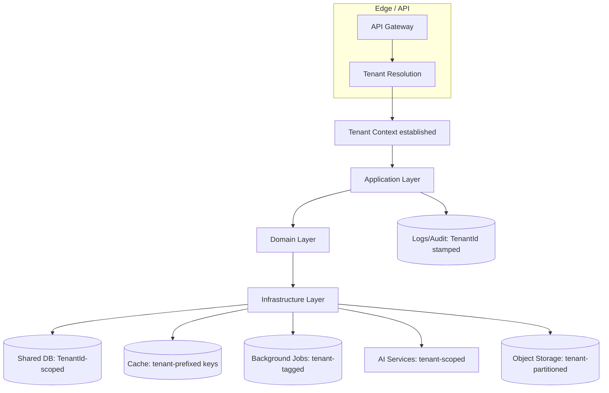
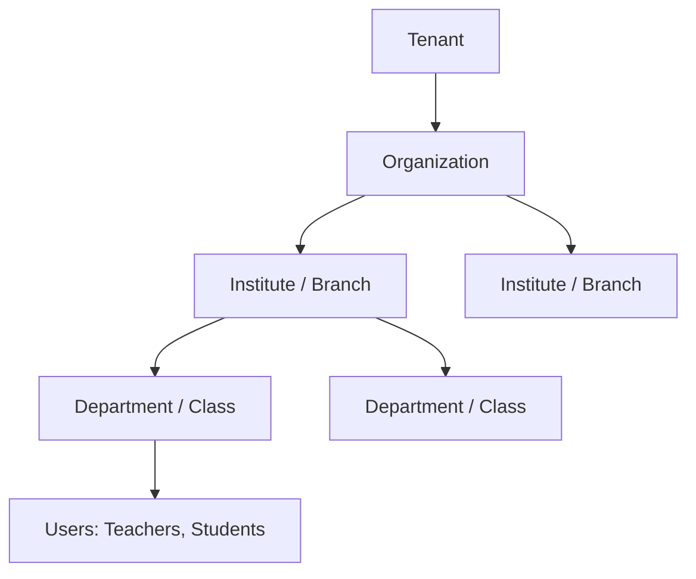
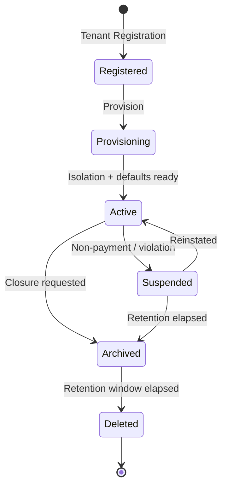
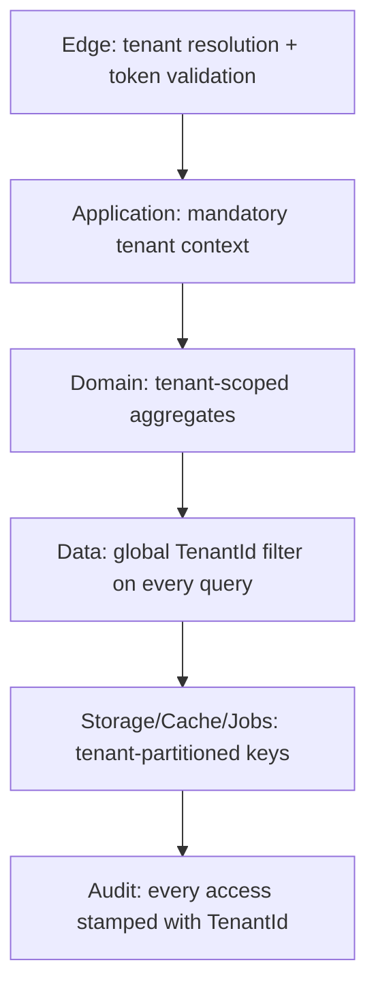
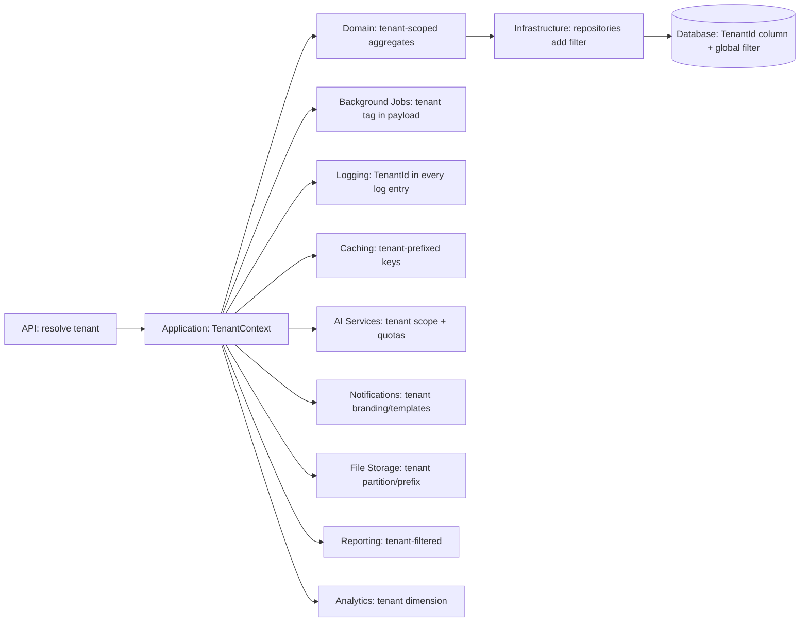
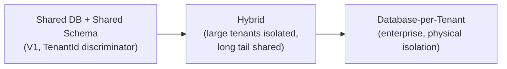
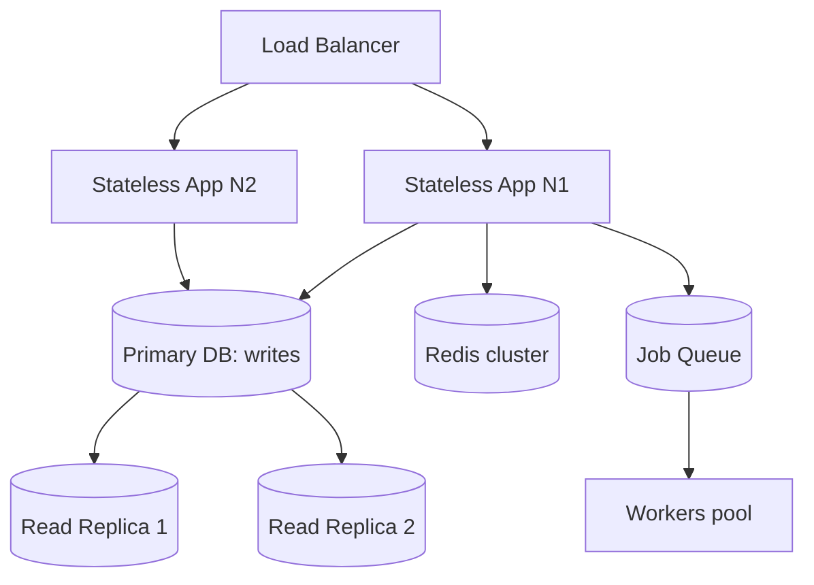

# Multi-Tenant Architecture — IELTS LMS AI

| Field | Value |
| --- | --- |
| **Product Name** | IELTS LMS AI |
| **Document** | 12 — Multi-Tenant Architecture |
| **Version** | 1.0 |
| **Status** | Architecture & Planning |
| **Document Owner** | Solution & Cloud Architecture |
| **Last Updated** | 2026-07-18 |
| **Audience** | Architects, Backend/Platform Engineers, SRE, Security, Product |
| **Aligns With** | [01_Product_Vision.md](./01_Product_Vision.md) … [11_Authentication_Authorization.md](./11_Authentication_Authorization.md) |

> **Purpose of this document.** This document defines the **multi-tenant architecture** for IELTS LMS AI as a commercial SaaS platform designed for **millions of users** and **future enterprise customers**. It covers tenant strategy, lifecycle, isolation, resolution, configuration, scaling, disaster recovery, and — critically — **how `TenantId` flows through every layer** of the system. It is **implementation-independent** and consistent with the [ERD tenancy strategy](./09_Database_Design_ERD.md#3-multi-tenancy-data-strategy) and [IAM tenant isolation](./11_Authentication_Authorization.md#12-tenant-isolation-in-iam).

---

## Table of Contents

1. [Architecture Overview](#1-architecture-overview)
2. [Tenant Strategy](#2-tenant-strategy)
3. [Organization Hierarchy](#3-organization-hierarchy)
4. [Tenant Lifecycle](#4-tenant-lifecycle)
5. [Tenant Resolution & Context](#5-tenant-resolution--context)
6. [Tenant Isolation & Cross-Tenant Protection](#6-tenant-isolation--cross-tenant-protection)
7. [TenantId Flow Through All Layers](#7-tenantid-flow-through-all-layers)
8. [Tenant Configuration, Branding & Domains](#8-tenant-configuration-branding--domains)
9. [Data Strategy: Shared, Hybrid & Database-per-Tenant](#9-data-strategy-shared-hybrid--database-per-tenant)
10. [Shared Services & Infrastructure](#10-shared-services--infrastructure)
11. [Scaling Strategy](#11-scaling-strategy)
12. [Backups, Archiving, Recovery, Export & Migration](#12-backups-archiving-recovery-export--migration)
13. [High Availability & Disaster Recovery](#13-high-availability--disaster-recovery)
14. [Monitoring, Audit & Observability](#14-monitoring-audit--observability)
15. [Future Evolution](#15-future-evolution)
16. [Related Documents](#16-related-documents)

---

## 1. Architecture Overview

IELTS LMS AI is a **shared-infrastructure, shared-database (shared-schema) multi-tenant SaaS** in V1, with a deliberate evolution path to **hybrid** and **database-per-tenant** isolation for enterprise tenants. Tenancy is a **first-class, cross-cutting concern**: every request, record, job, log, cache key, and AI call is bound to exactly one tenant.



| Dimension | V1 Decision | Rationale |
| --- | --- | --- |
| Isolation model | Shared DB + shared schema + `TenantId` discriminator | Cost, operability, fastest path to scale ([ERD §3](./09_Database_Design_ERD.md#3-multi-tenancy-data-strategy)). |
| Identity | Tenant-scoped users | Same email can exist across tenants ([IAM §2](./11_Authentication_Authorization.md#2-identity-architecture)). |
| Evolution | Hybrid → DB-per-tenant for enterprise | Stronger isolation without redesign ([§9](#9-data-strategy-shared-hybrid--database-per-tenant)). |

---

## 2. Tenant Strategy

- **Tenant = isolation boundary** owning all data, users, configuration, and subscription for one customer ([DDD](./07_Domain_Driven_Design.md#3-ubiquitous-language)).
- **Organization ↔ Tenant** mapped 1:1; an organization may contain a hierarchy of sub-units ([§3](#3-organization-hierarchy)).
- **Tenant tiers** drive isolation and scaling decisions:

| Tier | Typical customer | Isolation |
| --- | --- | --- |
| **Standard** | Individuals, small institutes | Shared DB/schema. |
| **Business** | Mid-size institutes | Shared DB/schema + priority resources. |
| **Enterprise** | Large orgs, strict compliance | Hybrid or dedicated DB (future). |

---

## 3. Organization Hierarchy



- Hierarchy is modeled via self-referencing `Organizations` ([ERD ENT-002](./09_Database_Design_ERD.md#ent-002--organizations)); **acyclic**, tenant-scoped.
- Roles/permissions and reporting can be scoped to any node in the hierarchy.
- Hierarchy depth is bounded and validated to protect performance.

---

## 4. Tenant Lifecycle



### 4.1 Registration & Provisioning

- **Registration:** captures organization details, initial admin, and selected plan; may be self-serve or sales-assisted (enterprise). Aligns with [Event Storming §7.2 Tenant Creation](./08_Event_Storming.md#72-tenant-creation).
- **Provisioning:** on `TenantProvisioned`, the platform initializes isolation, seeds tenant defaults (roles, settings, templates), invites the Tenant Admin, and links the subscription. Provisioning is idempotent and rolled back on partial failure.
- **Activation:** the tenant becomes `Active` once isolation and defaults are ready and (for paid tiers) the subscription is confirmed.

### 4.2 Suspension, Archiving & Deletion

| Transition | Trigger | Data handling |
| --- | --- | --- |
| **Suspend** | Non-payment, policy violation, admin action | Data retained, access blocked; billing paused per policy. |
| **Reinstate** | Payment resolved / appeal | Access restored; no data loss. |
| **Archive (closure)** | Customer closes account | Soft-close; export offered; data moved toward cold storage per retention. |
| **Delete** | Retention window elapsed / erasure request | Hard purge per [retention policy](./09_Database_Design_ERD.md#44-soft-delete--retention); audited; irreversible. |

> **Deletion safety.** Tenant deletion is a high-impact, irreversible operation gated by explicit authorization, retention windows, and export offers, and is fully audited ([§14](#14-monitoring-audit--observability)).

---

## 5. Tenant Resolution & Context

### 5.1 Tenant Identification & Resolution

Tenant is resolved at the edge, in priority order, and then fixed for the request lifetime:

```mermaid
graph TD
    REQ[Incoming request] --> T1{Token tenantId claim?}
    T1 -->|yes| USE[Use token tenant]
    T1 -->|no| T2{Subdomain / custom domain?}
    T2 -->|yes| MAPD[Map host → tenant]
    T2 -->|no| T3{X-Tenant-Id header? (server-to-server)}
    T3 -->|yes| VALH[Validate + authorize]
    T3 -->|no| ERR[401/400: tenant unresolved]
    USE --> BIND[Bind Tenant Context]
    MAPD --> BIND
    VALH --> BIND
```

| Strategy | Source | Primary use |
| --- | --- | --- |
| **Token claim** | `tenantId` in JWT ([IAM §9](./11_Authentication_Authorization.md#9-claims-design)) | Authenticated app traffic (authoritative). |
| **Host-based** | Subdomain (`acme.ielts-lms.ai`) or [custom domain](#8-tenant-configuration-branding--domains) | Branding, tenant landing, login routing. |
| **Header** | `X-Tenant-Id` | Trusted server-to-server / admin tooling only. |

> **Authority rule.** When a token is present, its `tenantId` is **authoritative**; a mismatching host/header is rejected. Host/header resolution is only trusted pre-authentication or for explicitly trusted callers.

> **AUTH gap-closure note (2026-08-08):** all three strategies are implemented as
> `ITenantResolutionStrategy` (`IELTSLms.Api.Tenancy`), tried by `TenantResolutionMiddleware` in
> `Order` order (lowest first, first non-null wins, a later disagreeing signal is rejected as
> spoofing — exactly this section's diagram): `JwtClaimTenantResolutionStrategy` (`Order = 0`) →
> `HostTenantResolutionStrategy` (`Order = 100`, new) → `HeaderTenantResolutionStrategy`
> (`Order = 200`). Host resolution strips a configured root domain
> (`Tenancy:RootDomains`, `appsettings.json`) off the request `Host` header and looks the remaining
> single-label subdomain up as a tenant slug (`ITenantRepository.GetBySlugAsync`); a host that
> matches no configured root domain falls back to an exact match against a tenant's custom
> `PrimaryDomain` (`GetByPrimaryDomainAsync`) before giving up. Before this, only the JWT-claim and
> header strategies existed, so the frontend had to send `X-Tenant-Id` unconditionally on every
> pre-auth call (login/register/…) — the only way to reach the one tenant that existed. The frontend
> now sends nothing by default (a real deployment's Host header resolves the tenant on its own); an
> opt-in `VITE_DEV_TENANT_ID` env var remains as the header-based dev/admin-tooling fallback this
> table already scopes the header to, for exercising the system tenant on a bare host (`localhost`)
> that resolves nothing via Host. Development's `appsettings.Development.json` adds `"localhost"` to
> `RootDomains` so `http://acme.localhost:5000` exercises real host-based resolution locally too
> (`*.localhost` resolves to loopback in modern browsers with no hosts-file edit, RFC 6761).

### 5.2 Tenant Context

Once resolved, an immutable **Tenant Context** (tenantId, tier, feature flags, locale defaults) is established and propagated through all layers ([§7](#7-tenantid-flow-through-all-layers)). No business operation runs without it.

### 5.3 Tenant Switching

- Users belonging to multiple tenants (e.g., a consultant, or platform staff) hold **distinct sessions/tokens per tenant**; switching re-authenticates the tenant context and issues a token with the new `tenantId`.
- Switching never carries data or caches across tenant boundaries.

---

## 6. Tenant Isolation & Cross-Tenant Protection

### 6.1 Isolation Layers (Defense in Depth)



| Layer | Control |
| --- | --- |
| **Edge** | Tenant resolved and validated before handling. |
| **Application** | Requests without a valid tenant context are rejected. |
| **Domain** | Aggregates are tenant-scoped; cross-tenant references are impossible by design. |
| **Data** | A **mandatory global filter** on `TenantId` applies to every query; omitting it is a defect, not an option ([ERD §3](./09_Database_Design_ERD.md#3-multi-tenancy-data-strategy)). |
| **Cache/Jobs/Files** | Keys/paths are tenant-prefixed; jobs carry tenant context. |
| **Audit** | Every access and mutation stamped with `TenantId`. |

### 6.2 Cross-Tenant Protection

- **No cross-tenant reads/writes**: absence of tenant scope fails closed.
- **Existence hiding**: cross-tenant resource requests return `404`, never `403` ([API §5.2](./10_API_Design_Standards.md#5-http-methods--status-codes)).
- **Super Admin exception**: platform-level cross-tenant access is explicit, minimal, and **fully audited** ([IAM roles](./11_Authentication_Authorization.md#11-roles--permission-matrix)).
- **Noisy-neighbor protection**: per-tenant rate limits and quotas prevent one tenant degrading others ([§11](#11-scaling-strategy)).

---

## 7. TenantId Flow Through All Layers

`TenantId` is the connective thread of the platform. It is resolved once at the edge and **propagated — never re-derived — through every layer**.



| Layer | How `TenantId` flows | Guarantee |
| --- | --- | --- |
| **API** | Resolved from token/host/header ([§5.1](#51-tenant-identification--resolution)); validated. | Every request has exactly one tenant. |
| **Application** | Carried in an ambient, immutable `TenantContext`. | No use case runs without it. |
| **Domain** | Aggregates carry `TenantId`; invariants assume tenant scope. | Cross-tenant state is unrepresentable. |
| **Infrastructure** | Repositories inject the `TenantId` filter automatically. | No accidental unscoped query. |
| **Database** | `TenantId` column + mandatory global query filter. | Row-level isolation ([ERD §3](./09_Database_Design_ERD.md#3-multi-tenancy-data-strategy)). |
| **Background Jobs** | Tenant tag embedded in job payload; workers restore context. | Async work stays tenant-scoped. |
| **Logging** | `TenantId` + correlation IDs on every entry ([API §12](./10_API_Design_Standards.md#12-correlation-tracing--observability)). | Tenant-attributable telemetry. |
| **Caching** | Keys prefixed with `tenantId` (e.g., `t:{tenantId}:...`). | No cross-tenant cache bleed. |
| **AI Services** | Tenant scope + per-tenant quotas/keys ([AI Architecture](./16_AI_Architecture.md)). | Usage/cost attributable; isolated. |
| **Notifications** | Tenant branding/templates selected by `TenantId`. | Correct branding, no leakage. |
| **File Storage** | Objects under tenant partition/prefix. | Isolated blobs; per-tenant lifecycle. |
| **Reporting** | Queries filtered by `TenantId`; cross-tenant only for platform analytics store. | Tenant-safe reports. |
| **Analytics** | `TenantId` is a mandatory dimension. | Aggregations never mix tenants. |

> **Golden rule.** `TenantId` is resolved **once** at the edge and propagated as immutable context; downstream layers **never** accept a caller-supplied tenant that contradicts the established context.

---

## 8. Tenant Configuration, Branding & Domains

| Capability | Description |
| --- | --- |
| **Tenant Settings** | Typed, validated settings with tenant overrides over global defaults ([ERD ENT-049](./09_Database_Design_ERD.md#ent-049--systemsettings)). |
| **Branding** | Logo, colors, email templates, and locale defaults per tenant ([Notifications templates](./09_Database_Design_ERD.md#ent-045--notificationtemplates)). |
| **Custom Domains** | Enterprise tenants may map custom domains/subdomains; used for host-based resolution ([§5.1](#51-tenant-identification--resolution)). |
| **Feature Flags** | Per-tenant feature enablement ([ERD ENT-062](./09_Database_Design_ERD.md), [§8.1](#81-feature-flags--management)). |
| **Storage** | Per-tenant storage partition and quotas. |
| **Security** | Per-tenant policies (password rules, session limits, IdP config). |

### 8.1 Feature Flags & Management

- Flags are evaluated within tenant context; support gradual rollout, tier-gating, and A/B (future).
- Subscription entitlements ([§8.2](#82-subscription-integration)) can drive flag defaults; explicit tenant overrides take precedence.

### 8.2 Subscription Integration

- Tenant tier and entitlements come from [Subscriptions/Billing](./09_Database_Design_ERD.md#65-commerce-subscriptions--billing); gate features, quotas, and AI usage.
- Suspension/renewal events ([Event Storming §7.19–7.21](./08_Event_Storming.md#719-subscription-renewal)) update tenant access.

---

## 9. Data Strategy: Shared, Hybrid & Database-per-Tenant



| Strategy | Isolation | Cost/Ops | When |
| --- | --- | --- | --- |
| **Shared DB, shared schema** | Logical (row-level) | Lowest | V1 default; standard/business tiers. |
| **Hybrid** | Mixed | Medium | Large/enterprise tenants isolated; rest shared. |
| **Database-per-tenant** | Physical | Highest | Strict compliance/enterprise SLAs. |

- The [ERD migration path](./09_Database_Design_ERD.md#11-migration-path-to-database-per-tenant) enables this evolution: global surrogate keys, universal `TenantId`, no cross-tenant FKs, and tenant-routing at the data-access layer.
- **Global / reference / master / tenant data** separation ([ERD §4.2](./09_Database_Design_ERD.md#42-data-categories-reference--master--transactional)): reference data is shared; tenant data is isolated.

---

## 10. Shared Services & Infrastructure

| Shared capability | Isolation approach |
| --- | --- |
| **Shared infrastructure** | Common compute/network; tenant isolation enforced in software. |
| **Shared identity** | One IAM system; tenant-scoped users/roles ([IAM](./11_Authentication_Authorization.md)). |
| **Shared AI** | Common AI gateway; per-tenant scope, quotas, and cost attribution ([AI Architecture](./16_AI_Architecture.md)). |
| **Caching (Redis)** | Shared cluster; tenant-prefixed keys; optional per-tenant namespaces. |
| **Background jobs** | Shared workers; tenant-tagged jobs; fair scheduling. |
| **Notifications** | Shared delivery; tenant branding/templates. |
| **File storage** | Shared buckets; tenant partitions/prefixes + quotas. |

### 10.1 Redis / Caching Strategy

- Key convention `t:{tenantId}:{context}:{key}` guarantees isolation and easy per-tenant invalidation.
- Cache invalidated on domain events ([Event Storming](./08_Event_Storming.md)); hot reference data cached globally (tenant-agnostic) where truly shared.

### 10.2 Background Jobs

- Every job payload carries `TenantId`; workers restore tenant context before executing.
- Per-tenant fairness/quotas prevent one tenant starving shared workers.

---

## 11. Scaling Strategy

Designed for **millions of users** ([NFR Scalability](./05_Non_Functional_Requirements.md#3-scalability-scal)).



- **Horizontal scale**: stateless app tier scales out behind a load balancer; sessions live in tokens, not server memory.
- **Read replicas & caching**: offload reads; protect the primary ([ERD §10](./09_Database_Design_ERD.md#10-scalability-partitioning--sharding)).
- **Partitioning/sharding**: `TenantId` is the designated shard key for future horizontal data scaling.
- **Per-tenant quotas & rate limits**: protect shared resources and enable fair-use tiers ([API §15](./10_API_Design_Standards.md#15-rate-limiting--retry)).

---

## 12. Backups, Archiving, Recovery, Export & Migration

| Capability | Approach |
| --- | --- |
| **Tenant Backups** | Platform-wide backups with tenant-attributable restore; enterprise per-tenant backup (future/hybrid). |
| **Tenant Archiving** | Cold-storage archival of closed/inactive tenant data per retention policy. |
| **Tenant Recovery** | Point-in-time restore; tenant-scoped recovery for hybrid/dedicated tenants. |
| **Tenant Export** | Self-serve/admin export of a tenant's data in portable formats (data portability/GDPR). |
| **Tenant Deletion** | Irreversible purge after retention; audited ([§4.2](#42-suspension-archiving--deletion)). |
| **Tenant Migration** | Move a tenant to hybrid/dedicated DB via the [ERD migration path](./09_Database_Design_ERD.md#11-migration-path-to-database-per-tenant). |

---

## 13. High Availability & Disaster Recovery

- **High Availability**: redundant, stateless app tier across availability zones; managed DB with failover; health checks and self-healing ([NFR Availability](./05_Non_Functional_Requirements.md#4-availability-avail)).
- **Disaster Recovery**: defined **RPO/RTO** targets, cross-region backups, and tested restore runbooks ([Infrastructure](./17_Infrastructure.md)).
- **Graceful degradation**: dependency outages (e.g., AI provider) degrade features without data loss, surfacing `503`/queued operations ([API §14](./10_API_Design_Standards.md#14-file-upload-streaming--long-running-operations)).
- **Isolation of failure**: per-tenant quotas and bulkheads limit blast radius.

---

## 14. Monitoring, Audit & Observability

| Concern | Approach |
| --- | --- |
| **Monitoring** | Per-tenant metrics (usage, latency, errors, AI spend) alongside platform-wide dashboards. |
| **Audit strategy** | Immutable, tenant-stamped audit logs for security/compliance ([ERD ENT-048](./09_Database_Design_ERD.md#ent-048--auditlogs)); cross-tenant/admin actions always audited. |
| **Activity logging** | High-volume, tenant-scoped behavioral logs feed analytics ([ERD ENT-047](./09_Database_Design_ERD.md#ent-047--activitylogs)). |
| **Tracing** | Correlation/trace IDs carry `TenantId` for end-to-end, tenant-attributable tracing ([API §12](./10_API_Design_Standards.md#12-correlation-tracing--observability)). |
| **Tenant analytics** | Tenant-facing dashboards (engagement, outcomes) with `TenantId` as a mandatory dimension. |

---

## 15. Future Evolution

- **Database-per-tenant / hybrid** for enterprise isolation and compliance ([§9](#9-data-strategy-shared-hybrid--database-per-tenant)).
- **Regional data residency**: pin a tenant's data to a geography for compliance.
- **Enterprise SSO & SCIM**: per-tenant IdP and automated provisioning ([IAM §8](./11_Authentication_Authorization.md#8-federation-readiness-oauth-21-oidc-social--enterprise-sso)).
- **Per-tenant encryption keys** (BYOK) for enterprise tiers.
- **Cell-based architecture**: partition tenants into isolated cells to bound blast radius at extreme scale.

---

## 16. Related Documents

| # | Document | Relationship |
| --- | --- | --- |
| 05 | [Non-Functional Requirements](./05_Non_Functional_Requirements.md) | Scalability, availability, security drivers. |
| 06 | [Software Requirements Specification](./06_Software_Requirements_Specification.md) | System architecture context. |
| 07 | [Domain-Driven Design](./07_Domain_Driven_Design.md) | Tenant/organization domain concepts. |
| 08 | [Event Storming](./08_Event_Storming.md) | Tenant lifecycle events. |
| 09 | [Database Design & ERD](./09_Database_Design_ERD.md) | Data-tier tenancy & migration path. |
| 10 | [API Design Standards](./10_API_Design_Standards.md) | Tenant headers, resolution, cross-tenant rules. |
| 11 | [Authentication & Authorization](./11_Authentication_Authorization.md) | Tenant-scoped identity & isolation. |
| 17 | [Infrastructure](./17_Infrastructure.md) | Physical HA/DR, stores, backups. |

---

*End of Document — 12 Multi-Tenant Architecture (v1.0).*