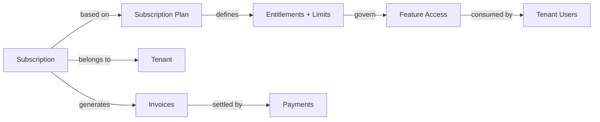
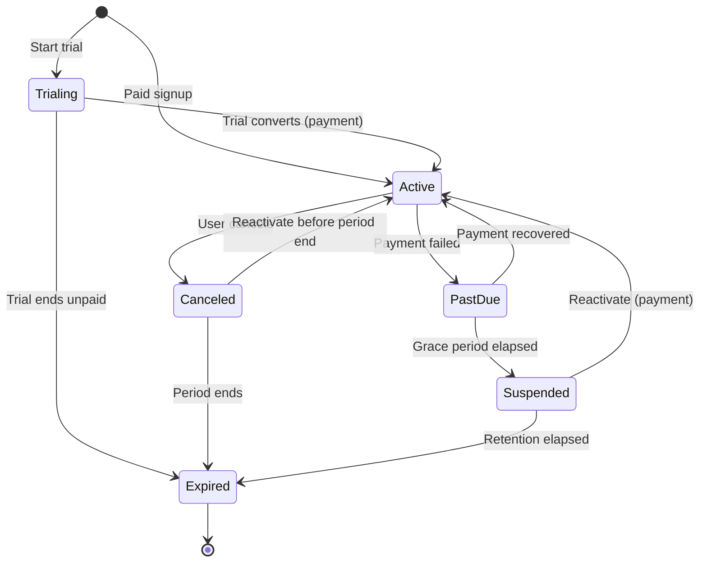
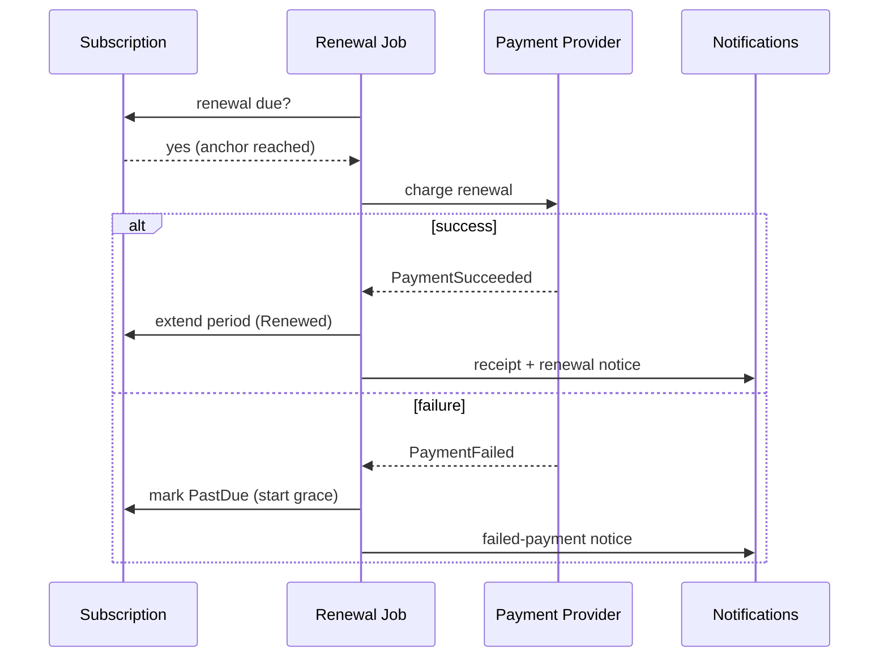
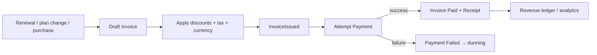
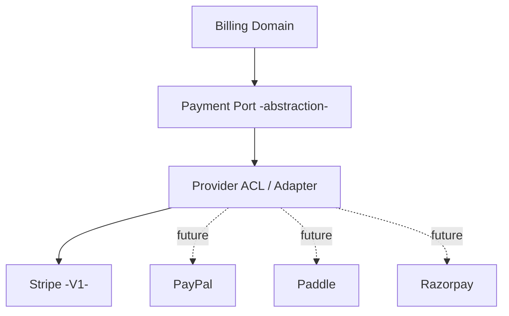
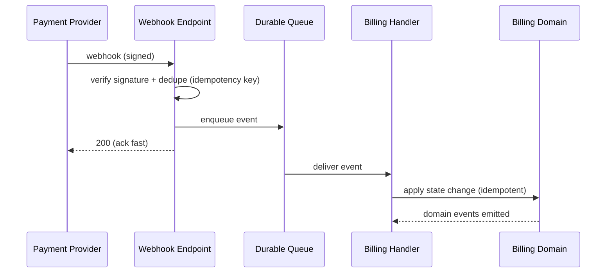
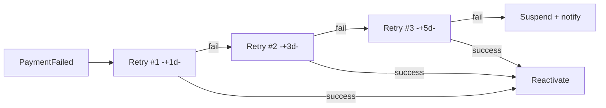
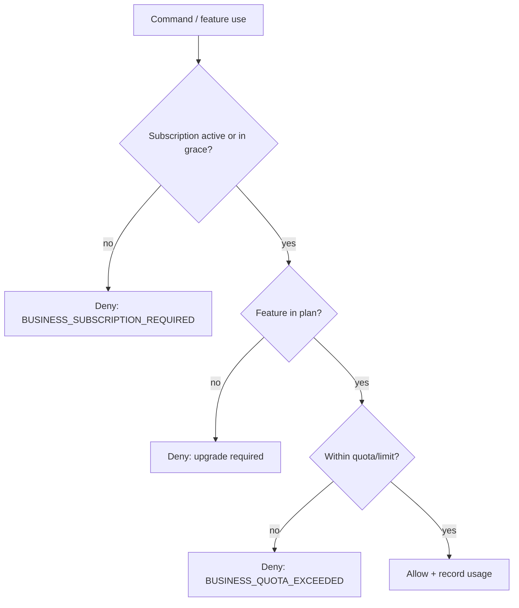

# Subscription & Billing Architecture — IELTS LMS AI

| Field | Value |
| --- | --- |
| **Product Name** | IELTS LMS AI |
| **Document** | 13 — Subscription & Billing Architecture |
| **Version** | 1.0 |
| **Status** | Architecture & Planning |
| **Document Owner** | Billing & Solution Architecture |
| **Last Updated** | 2026-07-18 |
| **Audience** | Architects, Backend Engineers, Finance/RevOps, Product, QA, Security |
| **Aligns With** | [01_Product_Vision.md](./01_Product_Vision.md) … [12_Multi_Tenant_Architecture.md](./12_Multi_Tenant_Architecture.md) |

> **Purpose of this document.** This document defines the **SaaS subscription and billing architecture** for IELTS LMS AI: plans and entitlements, subscription lifecycle, billing cycles, payments/invoices/refunds, tax and multi-currency, coupons, the payment-provider integration and webhook model, billing background jobs, and revenue analytics. It is **implementation-independent** — no code, EF models, SQL, or provider SDK wiring — and consistent with the [Billing/Subscriptions bounded contexts](./07_Domain_Driven_Design.md#5-bounded-contexts), the [billing events](./08_Event_Storming.md#6-event-catalog), and the [commerce entities](./09_Database_Design_ERD.md#65-commerce-subscriptions--billing).

---

## Table of Contents

1. [Business Model](#1-business-model)
2. [Subscription Plans & Feature Matrix](#2-subscription-plans--feature-matrix)
3. [Usage, Seat, Storage & AI Limits](#3-usage-seat-storage--ai-limits)
4. [Subscription Lifecycle](#4-subscription-lifecycle)
5. [Billing Cycles, Trials & Grace Periods](#5-billing-cycles-trials--grace-periods)
6. [Plan Changes & Proration](#6-plan-changes--proration)
7. [Coupons, Discounts & Campaigns](#7-coupons-discounts--campaigns)
8. [Invoices, Payments & Refunds](#8-invoices-payments--refunds)
9. [Tax & Multi-Currency](#9-tax--multi-currency)
10. [Payment Providers & Anti-Corruption Layer](#10-payment-providers--anti-corruption-layer)
11. [Webhook Architecture & Event Model](#11-webhook-architecture--event-model)
12. [Billing Background Jobs & Dunning](#12-billing-background-jobs--dunning)
13. [Feature Flags & Entitlement Enforcement](#13-feature-flags--entitlement-enforcement)
14. [Billing Models: Tenant, Institution & Enterprise](#14-billing-models-tenant-institution--enterprise)
15. [Revenue Analytics & Reporting](#15-revenue-analytics--reporting)
16. [Future Considerations](#16-future-considerations)
17. [Related Documents](#17-related-documents)

---

## 1. Business Model

IELTS LMS AI is a **subscription-first, multi-tenant SaaS**. Revenue is recurring (monthly/yearly), augmented by future usage-based components (AI credits, API billing). Billing is **tenant-scoped**: a subscription belongs to a tenant, and entitlements flow to that tenant's users ([Multi-Tenant §2](./12_Multi_Tenant_Architecture.md#2-tenant-strategy)).

| Aspect | Decision |
| --- | --- |
| Monetization | Recurring subscription + future usage-based add-ons. |
| Billing owner | Tenant (individual account is a single-user tenant). |
| Source of truth | Internal subscription state; provider is the payment processor of record. |
| Entitlement model | Plan → entitlements/limits → feature flags ([§13](#13-feature-flags--entitlement-enforcement)). |

---

## 2. Subscription Plans & Feature Matrix

### 2.1 Plans

| Plan | Audience | Billing | Seats | Notes |
| --- | --- | --- | --- | --- |
| **Free** | Individual learners (trial-of-product) | None | 1 | Limited practice, capped AI evaluations. |
| **Starter** | Serious individual learners | Monthly/Yearly | 1 | Full self-study, moderate AI limits. |
| **Premium** | Power individual learners | Monthly/Yearly | 1 | Full AI features, mock exams, predictions. |
| **Institute** | Schools / coaching centers | Monthly/Yearly | Many (seat-based) | Teacher tools, cohorts, analytics. |
| **Enterprise** | Large orgs / universities | Contract (annual+) | Many / custom | SSO, dedicated isolation options, SLAs. |
| **White Label (future)** | Resellers / partners | Contract | Many | Custom branding/domain, partner billing. |

### 2.2 Feature Matrix (Representative)

| Capability | Free | Starter | Premium | Institute | Enterprise |
| --- | --- | --- | --- | --- | --- |
| Grammar/Vocabulary/Sentence practice | ✅ (limited) | ✅ | ✅ | ✅ | ✅ |
| Reading/Listening auto-scored | ✅ (limited) | ✅ | ✅ | ✅ | ✅ |
| AI Writing evaluation | ⛔ / trial | ✅ (quota) | ✅ | ✅ | ✅ |
| AI Speaking evaluation | ⛔ | ✅ (quota) | ✅ | ✅ | ✅ |
| Monthly mock exams | ⛔ | ✅ (limited) | ✅ | ✅ | ✅ |
| Band prediction | ⛔ | ✅ | ✅ | ✅ | ✅ |
| Teacher/cohort tools | ⛔ | ⛔ | ⛔ | ✅ | ✅ |
| Institute analytics | ⛔ | ⛔ | ⛔ | ✅ | ✅ |
| SSO / enterprise identity | ⛔ | ⛔ | ⛔ | Optional | ✅ |
| Dedicated isolation | ⛔ | ⛔ | ⛔ | ⛔ | ✅ (future DB-per-tenant) |

> Exact numeric limits are configuration ([SubscriptionPlans entitlements](./09_Database_Design_ERD.md#ent-039--subscriptionplans)), not hard-coded; the matrix shows intent, not final values.

---

## 3. Usage, Seat, Storage & AI Limits

Entitlements are enforced as **quotas** on the tenant's subscription:

| Limit type | Scope | Enforcement | Overflow behavior |
| --- | --- | --- | --- |
| **Seat limit** | Tenant users of billable roles | Block new seat beyond limit | Prompt upgrade / add seats. |
| **AI usage limit** | AI evaluations/predictions per cycle | Metered counter per cycle ([§15](#15-revenue-analytics--reporting)) | Soft-warn → block or add-on credits ([future AI credits](#16-future-considerations)). |
| **Storage limit** | Tenant media (audio, files) | Track bytes per tenant | Block new uploads; offer upgrade. |
| **Practice/assessment volume** | Attempts per cycle (plan-dependent) | Metered counter | Soft cap with upgrade prompt. |

- **Metering** is event-driven: consumption events (e.g., `WritingEvaluated`) increment tenant usage counters ([Event Storming](./08_Event_Storming.md#6-event-catalog)).
- **Quota checks** occur at command-time via [entitlement enforcement](#13-feature-flags--entitlement-enforcement); exceeding a hard limit returns `BUSINESS_QUOTA_EXCEEDED` ([API errors](./10_API_Design_Standards.md#9-error-handling--problem-details)).

---

## 4. Subscription Lifecycle

| State | Meaning | Access |
| --- | --- | --- |
| **Trialing** | Free trial active. | Trial entitlements. |
| **Active** | Paid and current. | Full plan entitlements. |
| **PastDue** | Payment failed, retrying. | Full access during [grace](#5-billing-cycles-trials--grace-periods). |
| **Suspended** | Grace elapsed unpaid. | Access blocked; data retained. |
| **Canceled** | Cancellation requested. | Access until period end. |
| **Expired** | Period ended / trial lapsed. | No paid entitlements. |

State transitions emit [subscription events](./08_Event_Storming.md#6-event-catalog) (`SubscriptionActivated`, `SubscriptionRenewed`, `SubscriptionCancelled`) consumed by entitlement, notification, and analytics projections.

---

## 5. Billing Cycles, Trials & Grace Periods

| Concept | Standard |
| --- | --- |
| **Monthly billing** | Charged each period on the anchor date; auto-renews unless canceled. |
| **Yearly billing** | Discounted annual term; auto-renews; proration on mid-term changes. |
| **Free trial** | Time-boxed; no charge; converts to paid or expires; one trial per tenant (anti-abuse). |
| **Grace period** | On failed renewal, access continues while dunning retries run ([§12](#12-billing-background-jobs--dunning)). |
| **Billing anchor** | Fixed per subscription; plan changes may re-anchor with proration. |

---

## 6. Plan Changes & Proration

| Change | Timing | Proration |
| --- | --- | --- |
| **Upgrade** | Immediate | Charge prorated difference now; entitlements apply immediately. |
| **Downgrade** | End of period (default) | Credit or no immediate charge; new limits apply next cycle. |
| **Seat add/remove** | Immediate (add) / period-end (remove) | Prorated for additions. |
| **Cycle switch (monthly↔yearly)** | Immediate | Prorate remaining balance; re-anchor. |

- **Proration strategy:** compute unused time credit vs new-plan cost for the remaining period; net amount charged/credited. Downgrades never cause data loss — content beyond new limits becomes read-only or archived per policy.
- **Guardrails:** a downgrade that would exceed the target plan's seat/storage limits requires the tenant to reduce usage first (surfaced as `BUSINESS_*` guidance).

---

## 7. Coupons, Discounts & Campaigns

| Concept | Behavior |
| --- | --- |
| **Coupon** | Percent or fixed discount, validity window, usage caps ([ENT-043](./09_Database_Design_ERD.md#ent-043--coupons)). |
| **Discount code** | Consumer-facing coupon applied at checkout/renewal. |
| **Promotional campaign** | A set of coupons + rules (audience, dates) for acquisition/retention. |
| **Stacking** | Disallowed by default; one active discount per subscription unless explicitly configured. |

- Coupon application is validated at command-time (validity, caps, eligibility) and recorded for reconciliation.
- Discounts adjust invoice line items; tax is computed on the discounted amount ([§9](#9-tax--multi-currency)).

---

## 8. Invoices, Payments & Refunds

### 8.1 Invoice Flow

- **Invoice** ([ENT-041](./09_Database_Design_ERD.md#65-commerce-subscriptions--billing)) is the billing record: line items, discounts, tax, totals, currency, status.
- **Payment** ([ENT-042](./09_Database_Design_ERD.md#65-commerce-subscriptions--billing)) records a charge attempt and its provider result; idempotent per attempt.
- **Immutable once issued:** issued invoices are not edited; corrections use credit notes/adjustments.

### 8.2 Refunds

| Type | Behavior |
| --- | --- |
| **Full refund** | Reverses a payment; may trigger entitlement downgrade/cancellation. |
| **Partial refund** | Reverses part of a payment (e.g., proration dispute). |
| **Credit note** | Non-cash adjustment applied to future invoices. |

Refunds are authorized, audited ([FR audit](./04_Functional_Requirements.md)), and reconciled against the provider; they emit events for analytics and notifications.

---

## 9. Tax & Multi-Currency

| Concern | Approach |
| --- | --- |
| **Tax** | Tax determined by tenant billing jurisdiction; computed on net (post-discount) amount; captured per invoice line. |
| **Tax integration** | Provider/tax-service via ACL; rates are configuration, not hard-coded. |
| **Multi-currency** | Invoices carry an explicit currency; amounts stored in minor units ([API money format](./10_API_Design_Standards.md#72-request-body-conventions)). |
| **FX** | No implicit conversion within an invoice; currency is fixed at issue time. |
| **Future regional pricing** | Plan price books per region/currency ([§16](#16-future-considerations)). |

---

## 10. Payment Providers & Anti-Corruption Layer

Payment providers are integrated behind an **Anti-Corruption Layer** so the domain never depends on a provider's model ([DDD context mapping](./07_Domain_Driven_Design.md#6-context-mapping)).

| Provider | Status | Notes |
| --- | --- | --- |
| **Stripe** | V1 primary | Subscriptions, invoices, webhooks, refunds. |
| **PayPal** | Future | Alternative checkout. |
| **Paddle** | Future | Merchant-of-record / tax handling. |
| **Razorpay** | Future | Regional (India) coverage. |

- **Provider-agnostic domain:** the domain speaks in `Payment`, `Invoice`, `Subscription`; adapters translate to/from provider APIs.
- **Processor of record:** the provider handles card data (PCI scope stays with the provider); the platform stores only references/tokens, never raw card data ([Security](./18_Security.md)).

---

## 11. Webhook Architecture & Event Model

Provider webhooks are the authoritative signal for asynchronous payment/subscription state.

| Concern | Standard |
| --- | --- |
| **Verification** | Verify provider signature before processing. |
| **Idempotency** | Deduplicate by provider event id; reprocessing is safe ([API idempotency](./10_API_Design_Standards.md#11-idempotency-concurrency--caching)). |
| **Fast ack** | Acknowledge quickly, process asynchronously via queue. |
| **Ordering** | Handle out-of-order events; reconcile against provider state when needed. |
| **Replay** | Support manual replay/reconciliation for missed webhooks. |

**Event families:** Payment events (`PaymentSucceeded`, `PaymentFailed`), Subscription events (`SubscriptionActivated/Renewed/Cancelled`), Invoice events (`InvoiceIssued`, paid/void) — mapped to internal [domain events](./08_Event_Storming.md#6-event-catalog).

---

## 12. Billing Background Jobs & Dunning

Recurring billing relies on scheduled/background jobs ([Backend Hangfire](./15_Backend_Architecture.md#background-jobs)).

| Job | Purpose |
| --- | --- |
| **Renewal charge** | Charge subscriptions at anchor date. |
| **Dunning / retry** | Retry failed payments on a backoff schedule during grace. |
| **Renewal reminders** | Notify before renewal (esp. annual). |
| **Trial-ending reminders** | Prompt conversion before trial expiry. |
| **Suspension sweep** | Suspend subscriptions whose grace elapsed. |
| **Invoice finalization** | Issue and dispatch invoices/receipts. |
| **Reconciliation** | Reconcile internal state with provider (missed webhooks). |

> Retry cadence is configuration; failed-payment and dunning notifications are sent at each step ([Notifications](./08_Event_Storming.md#726-notification-delivery)).

---

## 13. Feature Flags & Entitlement Enforcement

Entitlements (plan limits/features) are enforced through a **feature-access decision** evaluated at command-time.

| Mechanism | Role |
| --- | --- |
| **Entitlements** | Derived from the active plan; the authoritative capability set. |
| **Feature flags** | Toggle features per tenant/plan or for rollout ([Multi-Tenant §8](./12_Multi_Tenant_Architecture.md#8-tenant-configuration-branding--domains)). |
| **Quota counters** | Metered per cycle; drive limit checks and analytics. |
| **Enforcement point** | Application layer, before domain execution ([Clean Architecture pipeline](./14_Clean_Architecture.md)). |

> Feature flags and entitlements are distinct: entitlements are commercial rights; flags are operational toggles. Both gate access; entitlements take precedence.

---

## 14. Billing Models: Tenant, Institution & Enterprise

| Model | Who pays | Characteristics |
| --- | --- | --- |
| **Individual (tenant-of-one)** | The learner | Self-serve card billing; Starter/Premium. |
| **Institution billing** | Institute admin | Seat-based; single invoice for many users; Institute plan. |
| **Enterprise contracts** | Procurement | Custom terms, annual+ invoicing, PO/wire, SLAs, optional dedicated isolation. |
| **Future white-label / partner** | Reseller | Partner-level billing; sub-account rollups. |

- **Seat-based billing** ties billable seats to roles ([IAM roles](./11_Authentication_Authorization.md#11-roles--permission-matrix)); adding a seat beyond the limit triggers proration or is blocked.
- **Enterprise** may bypass automated card charging in favor of invoiced contracts, while still tracking entitlements internally.

---

## 15. Revenue Analytics & Reporting

| Report / metric | Purpose |
| --- | --- |
| **MRR / ARR** | Recurring revenue tracking. |
| **Churn & retention** | Cancellations vs renewals. |
| **Trial conversion** | Trial → paid rate. |
| **ARPA / LTV** | Revenue per account / lifetime value. |
| **Failed-payment / dunning recovery** | Recovered revenue from retries. |
| **Usage vs entitlement** | AI/storage/seat consumption vs limits (upsell signals). |
| **Billing dashboard** | Tenant-facing invoices, payment method, plan, usage. |

- Analytics are built from **billing events** into read models ([Analytics context](./07_Domain_Driven_Design.md#5-bounded-contexts)); the transactional store is not queried directly for heavy reporting ([ERD §10](./09_Database_Design_ERD.md#10-scalability-partitioning--sharding)).
- All monetary reporting respects invoice currency; cross-currency rollups use reporting-time FX (out of scope here).

---

## 16. Future Considerations

| Area | Direction |
| --- | --- |
| **AI credit system** | Prepaid/metered AI credits as an add-on beyond plan quotas. |
| **API billing** | Metered billing for future public API consumption. |
| **Marketplace billing** | Third-party content/partners with revenue share. |
| **Regional pricing** | Per-region price books and currency defaults. |
| **White-label billing** | Partner-level billing hierarchies and sub-account rollups. |
| **Provider diversification** | PayPal, Paddle (merchant-of-record), Razorpay via existing ACL. |
| **Usage-based hybrid** | Combine recurring base + metered overages. |

---

## 17. Related Documents

| # | Document | Relationship |
| --- | --- | --- |
| 03 | [Product Requirements](./03_Product_Requirements_Document.md) | Monetization & plan requirements. |
| 04 | [Functional Requirements](./04_Functional_Requirements.md) | Billing/subscription functional rules. |
| 07 | [Domain-Driven Design](./07_Domain_Driven_Design.md) | Billing/Subscriptions contexts. |
| 08 | [Event Storming](./08_Event_Storming.md) | Billing/subscription/payment events. |
| 09 | [Database Design & ERD](./09_Database_Design_ERD.md) | Commerce entities. |
| 10 | [API Design Standards](./10_API_Design_Standards.md) | Error codes, idempotency, money format. |
| 12 | [Multi-Tenant Architecture](./12_Multi_Tenant_Architecture.md) | Tenant billing & feature flags. |
| 14 | [Clean Architecture](./14_Clean_Architecture.md) | Where entitlement enforcement lives. |
| 15 | [Backend Architecture](./15_Backend_Architecture.md) | Background jobs, integration events. |

---

*End of Document — 13 Subscription & Billing Architecture (v1.0).*
