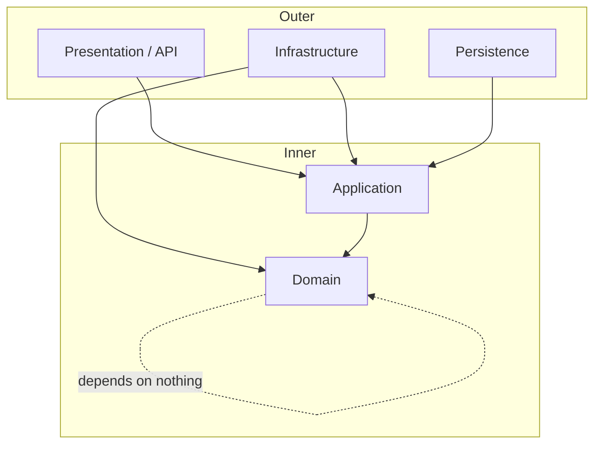
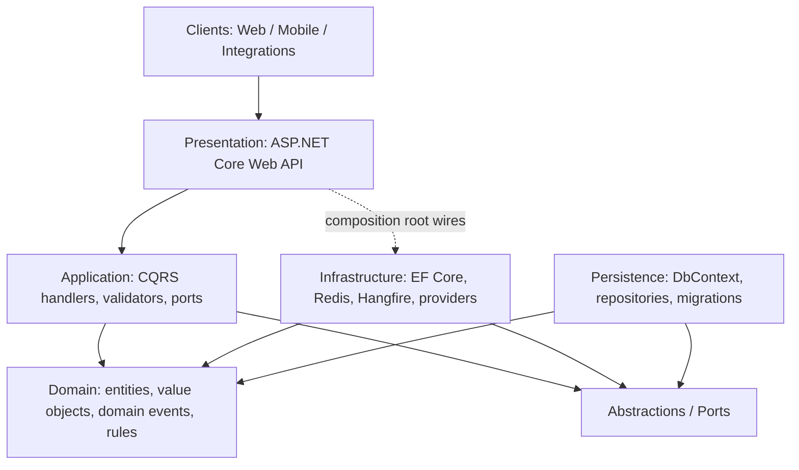
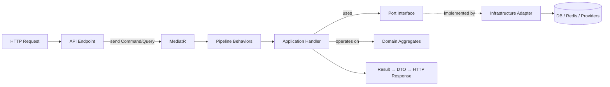
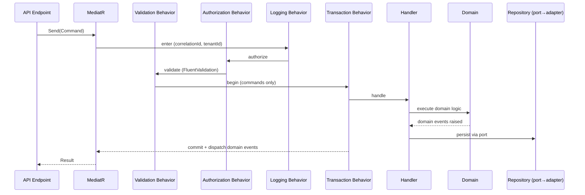
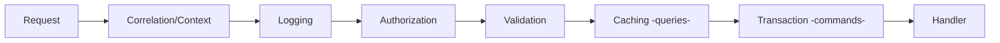
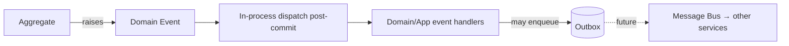
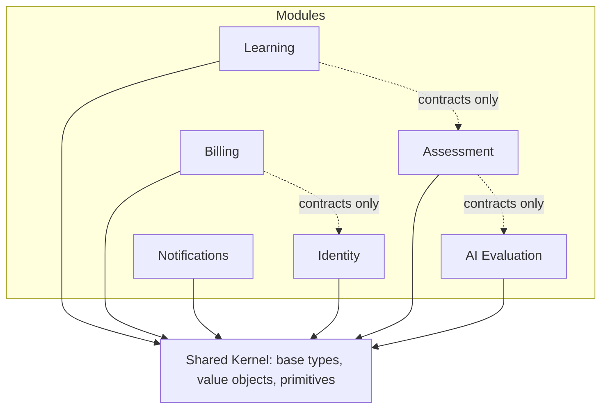
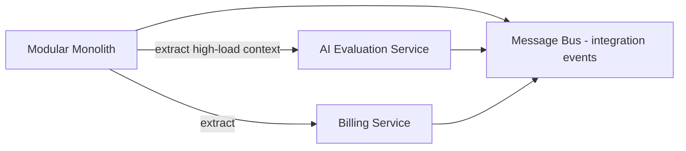

# Clean Architecture — IELTS LMS AI

| Field | Value |
| --- | --- |
| **Product Name** | IELTS LMS AI |
| **Document** | 14 — Clean Architecture |
| **Version** | 1.0 |
| **Status** | Architecture & Planning |
| **Document Owner** | Principal .NET / Solution Architecture |
| **Last Updated** | 2026-07-18 |
| **Audience** | Backend Engineers, Architects, Tech Leads, QA |
| **Aligns With** | [01_Product_Vision.md](./01_Product_Vision.md) … [13_Subscription_Billing.md](./13_Subscription_Billing.md) |

> **Purpose of this document.** This document defines the **official Clean Architecture** for IELTS LMS AI — the layering, dependency rule, project responsibilities, cross-cutting pipelines, and folder/namespace conventions that all backend work follows. It is the architectural counterpart to the [Backend Architecture blueprint (15)](./15_Backend_Architecture.md), which details project-by-project structure. This document is **implementation-independent**: it prescribes structure and rules, not code. The stack it targets is a **modular monolith** on **.NET 10 / ASP.NET Core**, evolvable to microservices.

---

## Table of Contents

1. [Architecture Goals](#1-architecture-goals)
2. [Technology Stack](#2-technology-stack)
3. [The Dependency Rule](#3-the-dependency-rule)
4. [Layered Architecture](#4-layered-architecture)
5. [Layer Responsibilities](#5-layer-responsibilities)
6. [Dependency Flow](#6-dependency-flow)
7. [CQRS & Request Lifecycle](#7-cqrs--request-lifecycle)
8. [Cross-Cutting Pipelines](#8-cross-cutting-pipelines)
9. [Domain, Application & Integration Events](#9-domain-application--integration-events)
10. [Module Isolation & Shared Kernel](#10-module-isolation--shared-kernel)
11. [Infrastructure Services](#11-infrastructure-services)
12. [Dependency Injection](#12-dependency-injection)
13. [Folder & Namespace Structure](#13-folder--namespace-structure)
14. [Future Microservice Readiness](#14-future-microservice-readiness)
15. [Related Documents](#15-related-documents)

---

## 1. Architecture Goals

| Goal | How Clean Architecture delivers it |
| --- | --- |
| **Independence of frameworks** | Domain/Application depend on abstractions, not ASP.NET/EF. |
| **Testability** | Business rules testable without DB, web, or providers. |
| **Independence of UI/DB/providers** | Details (EF, PostgreSQL, Stripe, AI providers) are swappable behind ports. |
| **Screaming architecture** | Structure reflects the [domain](./07_Domain_Driven_Design.md), not the framework. |
| **Maintainability at scale** | Clear boundaries for millions of users and many bounded contexts. |
| **Evolvability** | Modular monolith first; extract to services without rewrite ([§14](#14-future-microservice-readiness)). |

Guided by **SOLID**, **DDD** ([07](./07_Domain_Driven_Design.md)), and **CQRS**.

---

## 2. Technology Stack

| Concern | Technology | Layer |
| --- | --- | --- |
| Runtime / language | **.NET 10**, C# | All |
| API | **ASP.NET Core Web API** | Presentation |
| Mediation / CQRS | **MediatR** | Application |
| Validation | **FluentValidation** | Application (pipeline) |
| ORM / persistence | **Entity Framework Core** → **PostgreSQL** | Persistence/Infrastructure |
| Caching | **Redis** | Infrastructure |
| Background jobs | **Hangfire** | Infrastructure/BackgroundJobs |
| Logging | **Serilog** | Infrastructure (cross-cutting) |
| Telemetry | **OpenTelemetry** | Cross-cutting |
| AuthN/Z | **JWT** ([IAM](./11_Authentication_Authorization.md)) | Presentation/Application |
| Docs | **Swagger / OpenAPI** ([API Standards](./10_API_Design_Standards.md)) | Presentation |
| Packaging | **Docker** | Deployment |

> These are **decisions of record**; alternatives are abstracted behind ports so a change is localized. Rationale for each is captured in [Backend Architecture §2](./15_Backend_Architecture.md#2-technology-decisions).

---

## 3. The Dependency Rule

**Source-code dependencies point inward only.** Inner layers know nothing about outer layers. The domain is the center and depends on nothing.



- **Domain** depends on nothing.
- **Application** depends only on Domain.
- **Infrastructure/Persistence/Presentation** depend inward on Application/Domain — never the reverse.
- Crossing inward-to-outward happens only through **abstractions (ports)** defined in inner layers and **implemented (adapters)** in outer layers — the Dependency Inversion Principle.

---

## 4. Layered Architecture



| Layer | Contains | Depends on |
| --- | --- | --- |
| **Domain** | Entities, aggregates, value objects, domain events, domain services, invariants, specifications | Nothing |
| **Application** | Commands/queries, handlers, validators, DTOs, port interfaces, application services, pipeline behaviors | Domain |
| **Infrastructure** | Adapters: EF Core, Redis, Hangfire, email, storage, AI providers, payment ACL | Application, Domain (via abstractions) |
| **Persistence** | DbContext, EF configurations, repository implementations, migrations, global tenant filter | Application, Domain |
| **Presentation** | ASP.NET Core controllers/endpoints, filters, middleware, Swagger | Application (+ composition root) |

---

## 5. Layer Responsibilities

### 5.1 Domain Layer

- Encapsulates enterprise business rules: **aggregates, entities, value objects, domain events, domain services, specifications, invariants** ([DDD tactical](./07_Domain_Driven_Design.md#7-tactical-design)).
- Pure .NET — no EF attributes, no framework types, no I/O.
- Enforces invariants (e.g., band 0–9 in 0.5 steps; tenant-scoped identity).

### 5.2 Application Layer

- Orchestrates use cases via **CQRS** (commands/queries) and **MediatR** handlers.
- Defines **ports** (interfaces) for persistence, AI, email, storage, payments, clock, current-user/tenant.
- Hosts **pipeline behaviors** ([§8](#8-cross-cutting-pipelines)): validation, logging, authorization, caching, transactions.
- Contains no infrastructure detail; depends only on Domain + abstractions.

### 5.3 Infrastructure Layer

- Implements ports as **adapters**: EF Core repositories, Redis cache, Hangfire jobs, email/notification senders, object storage, AI provider adapters, payment ACL.
- Contains no business rules; translates between the domain and external technology.
- Owns retries, timeouts, circuit breakers, and provider-specific concerns.

### 5.4 Persistence Layer

- Hosts the EF Core `DbContext`, entity configurations, migrations, and repository implementations.
- Enforces the **mandatory global `TenantId` filter** on every query ([Multi-Tenant §6](./12_Multi_Tenant_Architecture.md#6-tenant-isolation--cross-tenant-protection)).
- Implements optimistic concurrency via `Version` ([ERD §4.3](./09_Database_Design_ERD.md#43-concurrency-strategy)).
- May be merged with Infrastructure physically; kept conceptually distinct for data-access clarity.

### 5.5 Presentation Layer

- ASP.NET Core Web API endpoints translate HTTP ↔ Application commands/queries following the [API Design Standards](./10_API_Design_Standards.md).
- Handles auth token validation, tenant resolution, model binding, Problem Details mapping, and Swagger.
- Contains **no business logic**; delegates to Application via MediatR.

---

## 6. Dependency Flow



- Control flows **outward-to-inward** at runtime; **source dependencies** stay inward.
- Handlers depend on **port interfaces** (defined in Application/Domain), resolved to **adapters** (Infrastructure) by DI at the composition root.

---

## 7. CQRS & Request Lifecycle

Commands (writes) and queries (reads) are separated. Both are dispatched via MediatR and pass through the [cross-cutting pipeline](#8-cross-cutting-pipelines).



### 7.1 Commands vs Queries

| Aspect | Command | Query |
| --- | --- | --- |
| Purpose | Change state | Read state |
| Returns | Result / id / void | DTO / read model |
| Side effects | Yes (emits domain events) | None |
| Transaction | Wrapped in a transaction | No write transaction |
| Persistence | Through aggregates + repositories | May bypass aggregates for optimized read models |

> **Read models.** Queries may read denormalized projections ([ERD §9 normalization](./09_Database_Design_ERD.md#9-normalization)) for performance; writes always go through aggregates to protect invariants.

---

## 8. Cross-Cutting Pipelines

Cross-cutting concerns are implemented as **MediatR pipeline behaviors**, applied consistently to every request in order:



| Pipeline | Responsibility | Notes |
| --- | --- | --- |
| **Correlation/Context** | Bind correlationId, requestId, tenantId, user ([API §12](./10_API_Design_Standards.md#12-correlation-tracing--observability)) | Establishes ambient request context. |
| **Logging** | Structured request/response logging (Serilog) | No sensitive data ([Security](./18_Security.md)). |
| **Authorization** | Enforce RBAC/permission/policy ([IAM §10](./11_Authentication_Authorization.md#10-authorization-strategy)) | Deny by default. |
| **Validation** | FluentValidation; aggregate field errors → Problem Details | Fail-fast before handler. |
| **Caching** | Cache query results by key (Redis) | Queries only; tenant-prefixed keys. |
| **Transaction** | Wrap command handlers; commit + dispatch domain events | Commands only; ensures atomicity. |
| **Exception handling** | Map exceptions → RFC 7807 responses | Central middleware at Presentation edge. |

### 8.1 Exception Handling

- A central exception-handling middleware maps domain/validation/authorization/infrastructure exceptions to the [error taxonomy](./10_API_Design_Standards.md#9-error-handling--problem-details).
- Domain rule violations → `409/422 BUSINESS_*`; validation → `400/422 VALIDATION_*`; unexpected → `500 SERVER_*` (no internal detail leaked).

### 8.2 Background Jobs, Configuration & Feature Flags

- **Background jobs** (Hangfire) run outside the request pipeline but **reconstruct tenant context** from the job payload ([Multi-Tenant §7](./12_Multi_Tenant_Architecture.md#7-tenantid-flow-through-all-layers)).
- **Configuration** is layered (env → secrets store → overrides); no secrets in source ([Backend §secrets](./15_Backend_Architecture.md#configuration--secrets-management)).
- **Feature flags** gate features per tenant/plan ([Billing §13](./13_Subscription_Billing.md#13-feature-flags--entitlement-enforcement)).

---

## 9. Domain, Application & Integration Events

| Event type | Scope | Transport | Example |
| --- | --- | --- | --- |
| **Domain events** | Within an aggregate/context, same transaction | In-process (MediatR notifications) | `WritingSubmitted` |
| **Application events** | Orchestration within the app boundary | In-process | `EvaluationRequested` |
| **Integration events** | Across contexts / future services | Outbox → message bus (future) | `SubscriptionActivated` |



- **Transactional consistency:** domain events dispatch **after** the command transaction commits.
- **Outbox pattern** ensures reliable integration-event publishing ([Event Storming](./08_Event_Storming.md)); ready for a future bus without changing producers.
- Aligns with the [Event Storming catalog](./08_Event_Storming.md#6-event-catalog).

---

## 10. Module Isolation & Shared Kernel

The system is a **modular monolith**: bounded contexts ([DDD §5](./07_Domain_Driven_Design.md#5-bounded-contexts)) are modules with explicit boundaries.



| Concept | Rule |
| --- | --- |
| **Module isolation** | Modules interact via published contracts/events, not internal types. |
| **Shared Kernel** | Minimal shared primitives (ids, `Money`, `BandScore`, base entity/event) — deliberately small ([DDD shared kernel](./07_Domain_Driven_Design.md#6-context-mapping)). |
| **No shortcut references** | A module never reaches into another module's internals or database tables directly. |
| **Vertical organization** | Features organized vertically within a module (command/query/handler/validator co-located). |

---

## 11. Infrastructure Services

| Service | Port (inner) | Adapter (Infrastructure) |
| --- | --- | --- |
| **Persistence** | `IRepository<T>`, `IUnitOfWork` | EF Core + PostgreSQL |
| **Caching** | `ICacheService` | Redis |
| **Background jobs** | `IJobScheduler` | Hangfire |
| **Email** | `IEmailSender` | Email provider adapter |
| **Notifications** | `INotificationService` | In-app/email/push adapters |
| **File storage** | `IFileStorage` | Object storage (tenant-partitioned) |
| **AI providers** | `IAiEvaluationProvider` | Pluggable AI provider adapters ([AI-first](./15_Backend_Architecture.md)) |
| **Payments** | `IPaymentGateway` | Stripe adapter via ACL ([Billing §10](./13_Subscription_Billing.md#10-payment-providers--anti-corruption-layer)) |
| **Health checks** | — | ASP.NET health checks per dependency |
| **Observability** | `ILogger`, telemetry | Serilog + OpenTelemetry |

> All external providers sit behind ports; swapping a provider is an adapter change, not a domain change. AI providers are **pluggable by design** ([NFR extensibility](./05_Non_Functional_Requirements.md)).

---

## 12. Dependency Injection

- **Composition root** at the API project wires abstractions → implementations at startup.
- Each layer exposes a registration extension (e.g., `AddApplication`, `AddInfrastructure`, `AddPersistence`) so wiring is modular and testable.
- **Lifetimes:** scoped for request/tenant-context services, singleton for stateless services, transient for lightweight handlers.
- Tests substitute adapters with fakes/mocks by swapping registrations — no domain/application change.

---

## 13. Folder & Namespace Structure

### 13.1 Solution Layout (Recommended)

```text
IELTSLms.sln
├── src/
│   ├── IELTSLms.Domain/            # entities, VOs, domain events, rules
│   ├── IELTSLms.Application/       # CQRS, handlers, validators, ports, DTOs
│   ├── IELTSLms.Infrastructure/    # adapters: providers, cache, jobs, email
│   ├── IELTSLms.Persistence/       # DbContext, EF configs, repos, migrations
│   ├── IELTSLms.Contracts/         # public DTOs / integration event contracts
│   ├── IELTSLms.SharedKernel/      # shared primitives, base types
│   ├── IELTSLms.Common/            # cross-cutting helpers (no domain logic)
│   ├── IELTSLms.BackgroundJobs/    # Hangfire job definitions
│   ├── IELTSLms.Abstractions/      # shared abstractions/interfaces
│   └── IELTSLms.Api/               # ASP.NET Core Web API (composition root)
├── tests/
│   ├── IELTSLms.Domain.Tests/
│   ├── IELTSLms.Application.Tests/
│   ├── IELTSLms.Integration.Tests/
│   └── IELTSLms.Architecture.Tests/  # enforce dependency rules
├── config/                          # appsettings per environment (no secrets)
└── resources/                       # localization, templates, static assets
```

### 13.2 Feature (Vertical) Structure

```text
IELTSLms.Application/
└── Writing/
    ├── Commands/
    │   └── SubmitWriting/
    │       ├── SubmitWritingCommand
    │       ├── SubmitWritingHandler
    │       └── SubmitWritingValidator
    ├── Queries/
    │   └── GetWritingEvaluation/
    │       ├── GetWritingEvaluationQuery
    │       └── GetWritingEvaluationHandler
    ├── Dtos/
    └── Events/
```

### 13.3 Namespace Conventions

| Namespace | Contents |
| --- | --- |
| `IELTSLms.Domain.<Context>` | Aggregates, VOs, domain events per bounded context. |
| `IELTSLms.Application.<Feature>` | Feature commands/queries/handlers/validators. |
| `IELTSLms.Infrastructure.<Concern>` | Adapter implementations by concern. |
| `IELTSLms.Persistence.<Context>` | EF configuration and repositories per context. |
| `IELTSLms.Contracts.<Context>` | Public contracts/integration events. |

> Detailed per-project purpose, allowed/forbidden references, and coding/naming standards are specified in [Backend Architecture (15)](./15_Backend_Architecture.md).

---

## 14. Future Microservice Readiness

The modular monolith is designed to **decompose along bounded-context seams** without rewrite.



| Enabler | Why it helps extraction |
| --- | --- |
| **Context modules** | Each module is a candidate service boundary. |
| **Contracts + integration events** | Cross-module comms already go through contracts/events. |
| **Outbox pattern** | Reliable async messaging ready for a real bus. |
| **Ports & adapters** | Swap in-process calls for remote calls behind the same port. |
| **Per-tenant scaling** | Tenant context already flows end-to-end ([Multi-Tenant §7](./12_Multi_Tenant_Architecture.md#7-tenantid-flow-through-all-layers)). |

Candidate first extractions: **AI Evaluation** (compute-heavy, independent scaling) and **Billing** (distinct lifecycle, external dependencies).

---

## 15. Related Documents

| # | Document | Relationship |
| --- | --- | --- |
| 05 | [Non-Functional Requirements](./05_Non_Functional_Requirements.md) | Quality attributes the architecture satisfies. |
| 07 | [Domain-Driven Design](./07_Domain_Driven_Design.md) | Bounded contexts realized as modules. |
| 08 | [Event Storming](./08_Event_Storming.md) | Events flowing through the pipeline. |
| 09 | [Database Design & ERD](./09_Database_Design_ERD.md) | Persistence model and concurrency. |
| 10 | [API Design Standards](./10_API_Design_Standards.md) | Presentation-layer contract. |
| 11 | [Authentication & Authorization](./11_Authentication_Authorization.md) | Authorization pipeline. |
| 12 | [Multi-Tenant Architecture](./12_Multi_Tenant_Architecture.md) | Tenant context through all layers. |
| 15 | [Backend Architecture](./15_Backend_Architecture.md) | Project-level realization of these rules. |

---

*End of Document — 14 Clean Architecture (v1.0).*