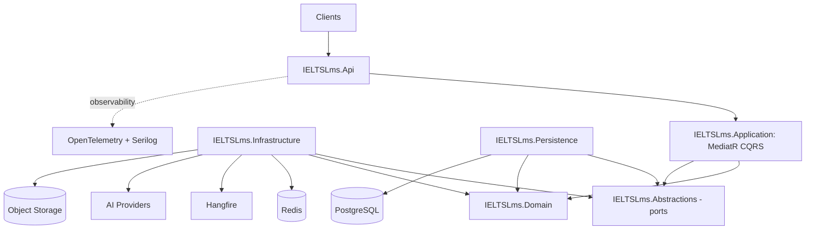
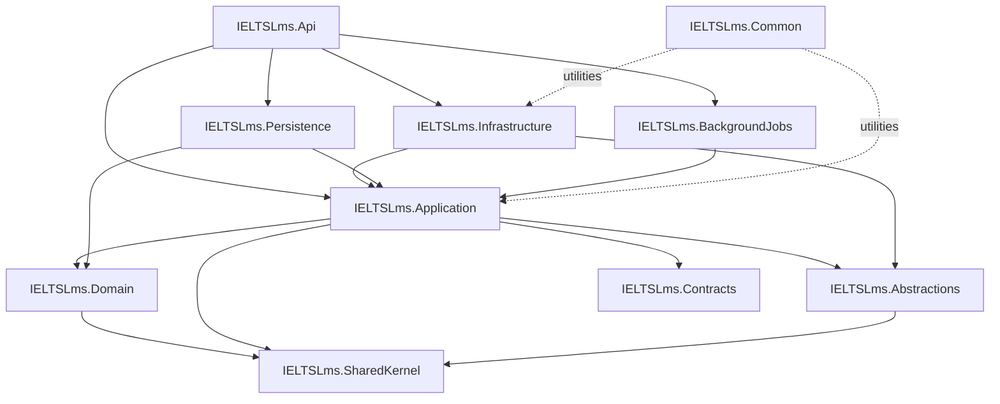
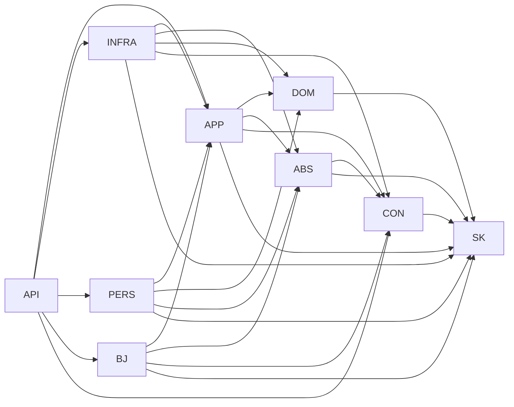
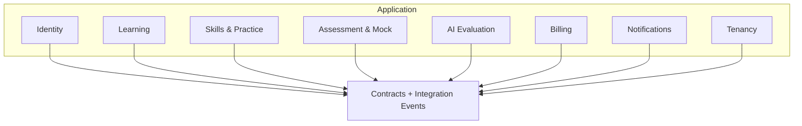
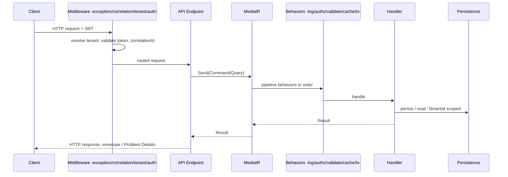
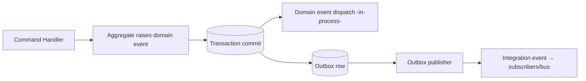
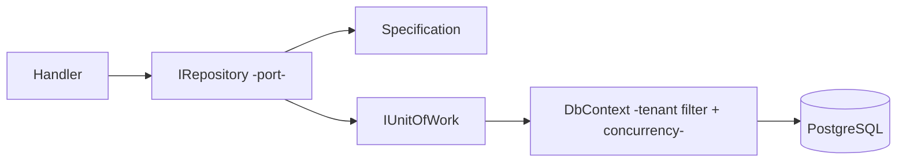
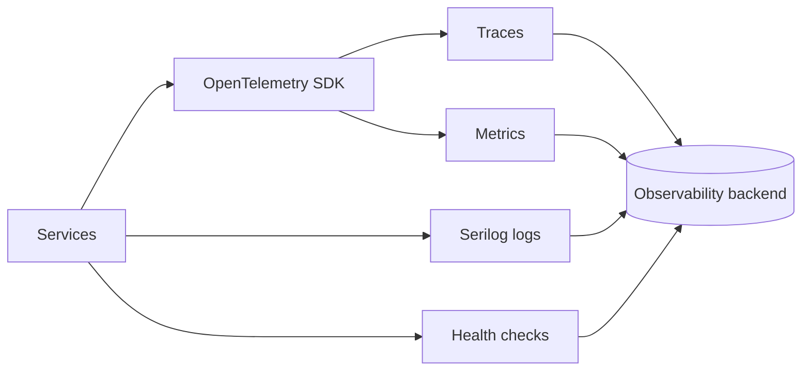
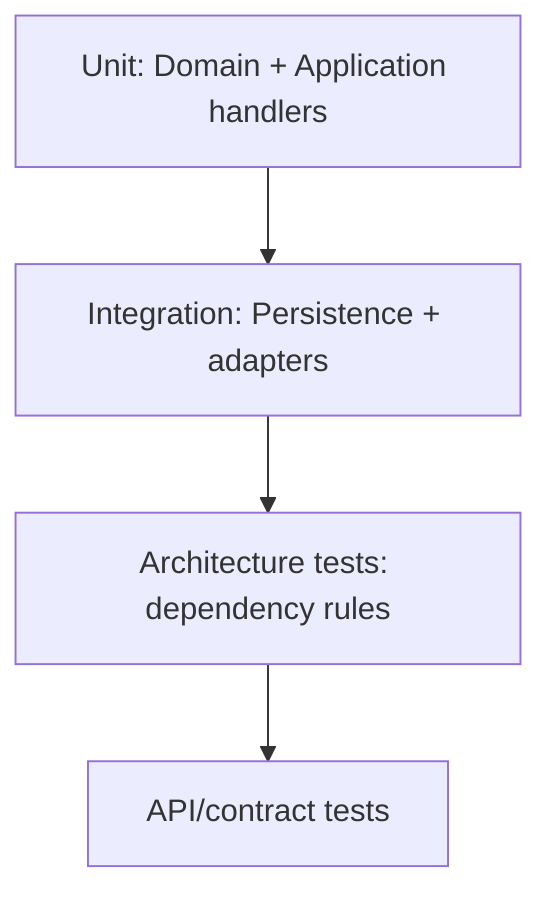
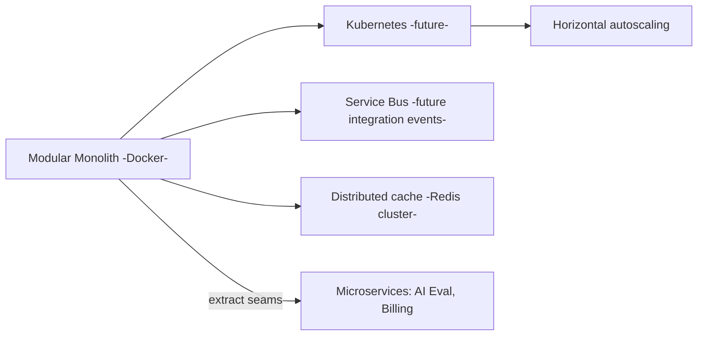

# Backend Architecture Blueprint — IELTS LMS AI

| Field | Value |
| --- | --- |
| **Product Name** | IELTS LMS AI |
| **Document** | 15 — Backend Architecture Blueprint |
| **Version** | 1.0 |
| **Status** | Architecture & Planning |
| **Document Owner** | Principal Backend / Solution Architecture |
| **Last Updated** | 2026-07-18 |
| **Audience** | Backend Engineers, Tech Leads, Architects, DevOps, QA |
| **Aligns With** | [01_Product_Vision.md](./01_Product_Vision.md) … [14_Clean_Architecture.md](./14_Clean_Architecture.md) |

> **Purpose of this document.** This is the **backend architecture blueprint** that guides day-to-day backend development for IELTS LMS AI. It builds on the [Clean Architecture (14)](./14_Clean_Architecture.md) rules and details the **solution/project structure, per-project responsibilities and reference rules, request pipeline, CQRS mechanics, persistence, caching, jobs, observability, and scalability roadmap**. It is **implementation-independent** — no code, EF models, SQL, or scaffolding — but prescriptive enough to build from. Stack: **.NET 10, ASP.NET Core, EF Core, PostgreSQL, MediatR, FluentValidation, Serilog, Redis, Hangfire, OpenTelemetry, JWT, Docker, Swagger**.

---

## Table of Contents

1. [Backend Overview](#1-backend-overview)
2. [Technology Decisions](#2-technology-decisions)
3. [Architecture Principles](#3-architecture-principles)
4. [Solution & Project Structure](#4-solution--project-structure)
5. [Project Responsibilities & Reference Rules](#5-project-responsibilities--reference-rules)
6. [Module Boundaries & Feature Modules](#6-module-boundaries--feature-modules)
7. [Request Processing Pipeline](#7-request-processing-pipeline)
8. [CQRS: Commands, Queries, DTOs & Mapping](#8-cqrs-commands-queries-dtos--mapping)
9. [Domain & Integration Events](#9-domain--integration-events)
10. [Persistence: Repositories, Specifications, UoW & Concurrency](#10-persistence-repositories-specifications-uow--concurrency)
11. [Caching & Redis Strategy](#11-caching--redis-strategy)
12. [Background Jobs (Hangfire)](#12-background-jobs-hangfire)
13. [File Storage](#13-file-storage)
14. [Configuration & Secrets Management](#14-configuration--secrets-management)
15. [Exception Handling, Logging & Auditing](#15-exception-handling-logging--auditing)
16. [Observability: Health, Metrics, Tracing](#16-observability-health-metrics-tracing)
17. [Performance & Data Access](#17-performance--data-access)
18. [Testing Strategy](#18-testing-strategy)
19. [Naming & Coding Standards](#19-naming--coding-standards)
20. [Deployment Readiness & Future Scalability](#20-deployment-readiness--future-scalability)
21. [Related Documents](#21-related-documents)

---

## 1. Backend Overview

The backend is a **modular monolith** implementing [Clean Architecture](./14_Clean_Architecture.md) and [DDD](./07_Domain_Driven_Design.md), exposed via an [ASP.NET Core Web API](./10_API_Design_Standards.md), multi-tenant end-to-end ([12](./12_Multi_Tenant_Architecture.md)), and **AI-first** (AI evaluation is a core capability, not a bolt-on).



| Attribute | Choice |
| --- | --- |
| Style | Modular monolith → microservice-ready ([§20](#20-deployment-readiness--future-scalability)) |
| Pattern | Clean Architecture + CQRS + DDD |
| Tenancy | Shared DB, `TenantId`-scoped, global query filter |
| Scale target | Millions of users; horizontal stateless scaling |
| AI | Pluggable providers behind ports |

---

## 2. Technology Decisions

| Technology | Role | Rationale |
| --- | --- | --- |
| **.NET 10 / ASP.NET Core** | Runtime + API | Performance, long-term support, ecosystem. |
| **EF Core + PostgreSQL** | ORM + RDBMS | Productivity, strong relational + JSON support, cost. |
| **MediatR** | CQRS mediation | Decouples endpoints from handlers; clean pipeline. |
| **FluentValidation** | Validation | Expressive, testable rules in the pipeline. |
| **Serilog** | Structured logging | Rich sinks, correlation, tenant enrichment. |
| **Redis** | Cache + distributed primitives | Hot reads, read models, rate limiting, locks. |
| **Hangfire** | Background jobs | Durable, tenant-aware scheduled/queued work. |
| **OpenTelemetry** | Traces/metrics | Vendor-neutral observability. |
| **JWT** | AuthN | Stateless, tenant-scoped claims ([IAM](./11_Authentication_Authorization.md)). |
| **Docker** | Packaging | Portable, reproducible deploys; K8s-ready. |
| **Swagger/OpenAPI** | API docs | Contract-first, consumer-friendly. |

> Each choice is a **decision of record**, abstracted behind [ports](./14_Clean_Architecture.md#11-infrastructure-services) so replacement is localized.

---

## 3. Architecture Principles

| Principle | Application |
| --- | --- |
| **Dependency rule** | Source dependencies point inward ([Clean Arch §3](./14_Clean_Architecture.md#3-the-dependency-rule)). |
| **Separation of concerns** | Layers and modules have single, clear responsibilities. |
| **Tenant-first** | `TenantId` flows through every layer ([12 §7](./12_Multi_Tenant_Architecture.md#7-tenantid-flow-through-all-layers)). |
| **Explicit contracts** | Modules talk via contracts/events, not internals. |
| **Fail closed** | Missing tenant/auth/validation denies the request. |
| **Idempotency** | Commands and event handlers are safe to retry ([API §11](./10_API_Design_Standards.md#11-idempotency-concurrency--caching)). |
| **Observability by default** | Every request is traced, logged, and measurable. |

---

## 4. Solution & Project Structure



```text
IELTSLms.sln
├── src/
│   ├── IELTSLms.Api/               # Presentation: Web API, composition root
│   ├── IELTSLms.Application/       # CQRS handlers, validators, ports, DTOs
│   ├── IELTSLms.Domain/            # Aggregates, VOs, domain events, rules
│   ├── IELTSLms.Infrastructure/    # Adapters: providers, cache, jobs, email, AI
│   ├── IELTSLms.Persistence/       # DbContext, EF configs, repositories, migrations
│   ├── IELTSLms.Contracts/         # Public DTOs + integration event contracts
│   ├── IELTSLms.SharedKernel/      # Shared primitives, base entity/event, VOs
│   ├── IELTSLms.Common/            # Cross-cutting helpers (no domain logic)
│   ├── IELTSLms.BackgroundJobs/    # Hangfire job definitions + schedules
│   └── IELTSLms.Abstractions/      # Shared port interfaces
└── tests/
    ├── IELTSLms.Domain.Tests/
    ├── IELTSLms.Application.Tests/
    ├── IELTSLms.Integration.Tests/
    └── IELTSLms.Architecture.Tests/   # enforce dependency/reference rules
```

---

## 5. Project Responsibilities & Reference Rules

For each project: **Purpose**, **Responsibilities**, **Allowed references**, **Forbidden references**. This is the enforceable contract (verified by architecture tests, [§18](#18-testing-strategy)).

### 5.1 IELTSLms.Domain

- **Purpose:** The heart — business model and rules.
- **Responsibilities:** Aggregates, entities, value objects, domain events, domain services, invariants, specifications.
- **Allowed:** `IELTSLms.SharedKernel` only.
- **Forbidden:** Application, Infrastructure, Persistence, API, EF Core, ASP.NET, MediatR, any framework/provider SDK.

### 5.2 IELTSLms.Application

- **Purpose:** Use-case orchestration (CQRS).
- **Responsibilities:** Commands/queries + handlers, validators, DTOs, port interfaces, pipeline behaviors, application services, mapping.
- **Allowed:** `Domain`, `Abstractions`, `Contracts`, `SharedKernel`, MediatR, FluentValidation.
- **Forbidden:** Infrastructure, Persistence, API, EF Core, provider SDKs (depends only on abstractions).

### 5.3 IELTSLms.Abstractions

- **Purpose:** Shared **port** interfaces used by Application and implemented by Infrastructure.
- **Responsibilities:** `IRepository<T>`, `IUnitOfWork`, `ICacheService`, `IEmailSender`, `IFileStorage`, `IAiEvaluationProvider`, `IPaymentGateway`, `IJobScheduler`, clock/guid providers.
- **Allowed:** `SharedKernel`, `Contracts`.
- **Forbidden:** Infrastructure, Persistence, API, provider SDKs.

### 5.4 IELTSLms.Infrastructure

- **Purpose:** Adapters for external technology.
- **Responsibilities:** Implement ports — Redis cache, Hangfire scheduler, email/notification senders, object storage, AI provider adapters, payment ACL, telemetry.
- **Allowed:** `Application`, `Abstractions`, `Domain`, `Contracts`, `Common`, `SharedKernel`, provider SDKs.
- **Forbidden:** `API` (no inward-to-presentation dependency); must not contain business rules.

### 5.5 IELTSLms.Persistence

- **Purpose:** Data access with EF Core + PostgreSQL.
- **Responsibilities:** `DbContext`, entity configurations, repository implementations, migrations, **global `TenantId` filter**, optimistic concurrency, outbox table.
- **Allowed:** `Application`, `Domain`, `Abstractions`, `SharedKernel`, EF Core, Npgsql.
- **Forbidden:** `API`, `Infrastructure` provider concerns unrelated to persistence.

### 5.6 IELTSLms.Contracts

- **Purpose:** Stable public contracts.
- **Responsibilities:** External DTOs, integration event schemas, versioned public types.
- **Allowed:** `SharedKernel`.
- **Forbidden:** Domain internals, Application, Infrastructure, Persistence, API.

### 5.7 IELTSLms.SharedKernel

- **Purpose:** Minimal shared building blocks.
- **Responsibilities:** Base entity/aggregate/value-object types, domain-event base, common value objects (`Money`, `BandScore`, ids), result/error primitives.
- **Allowed:** Nothing (leaf).
- **Forbidden:** All other projects; kept deliberately small ([DDD shared kernel](./07_Domain_Driven_Design.md#6-context-mapping)).

### 5.8 IELTSLms.Common

- **Purpose:** Cross-cutting technical helpers (no domain logic).
- **Responsibilities:** Guard clauses, extensions, constants, pagination helpers, serialization utils.
- **Allowed:** `SharedKernel`.
- **Forbidden:** Domain business logic, framework-specific coupling that belongs in Infrastructure.

### 5.9 IELTSLms.BackgroundJobs

- **Purpose:** Job definitions and schedules.
- **Responsibilities:** Hangfire jobs (billing, notifications, AI post-processing, reconciliation), each reconstructing tenant context.
- **Allowed:** `Application`, `Abstractions`, `Contracts`, `Common`, `SharedKernel`, Hangfire.
- **Forbidden:** Direct domain persistence bypassing Application; `API`.

### 5.10 IELTSLms.Api

- **Purpose:** Presentation + composition root.
- **Responsibilities:** Endpoints, middleware (exception, correlation, tenant resolution), auth, Swagger, DI wiring of all layers.
- **Allowed:** `Application`, `Contracts`, `Infrastructure`, `Persistence`, `BackgroundJobs` (composition root only), `Common`, `SharedKernel`.
- **Forbidden:** Business logic; direct domain manipulation outside MediatR.

### 5.11 Reference Rule Summary



> **Golden rule:** nothing references `Api`; only `Api` (composition root) references `Infrastructure`/`Persistence`. `Domain` references only `SharedKernel`.

---

## 6. Module Boundaries & Feature Modules

Bounded contexts ([DDD §5](./07_Domain_Driven_Design.md#5-bounded-contexts)) are **feature modules** organized vertically inside `Application` (and correspondingly in `Domain`/`Persistence`).



- Each module owns its commands, queries, handlers, validators, DTOs, and domain types.
- Cross-module communication uses **contracts + integration events**, never direct internal references ([Clean Arch §10](./14_Clean_Architecture.md#10-module-isolation--shared-kernel)).
- Modules map cleanly to future extractable services ([§20](#20-deployment-readiness--future-scalability)).

---

## 7. Request Processing Pipeline



Middleware order at the edge: **exception handling → correlation/context → tenant resolution → authentication → routing → MediatR pipeline** ([Clean Arch §8](./14_Clean_Architecture.md#8-cross-cutting-pipelines)).

---

## 8. CQRS: Commands, Queries, DTOs & Mapping

| Element | Convention |
| --- | --- |
| **Command** | Imperative name (`SubmitWritingCommand`); returns `Result`/id; changes state. |
| **Query** | `Get*`/`List*` name; returns DTO/read model; no side effects. |
| **Handler** | One handler per command/query; orchestrates domain + ports. |
| **Validator** | FluentValidation per command/query; runs in pipeline. |
| **DTO strategy** | Separate request/response DTOs from domain types; never expose aggregates directly. |
| **Mapping** | Explicit mapping (hand-written or mapper) at Application boundary; no domain leakage. |

> **Read/write split:** writes go through aggregates; reads may use optimized projections/read models ([ERD §9](./09_Database_Design_ERD.md#9-normalization)) to protect OLTP performance.

---

## 9. Domain & Integration Events

| Event | Scope | Delivery | Reliability |
| --- | --- | --- | --- |
| **Domain events** | In-aggregate, same transaction | MediatR notifications | Committed with the transaction. |
| **Integration events** | Cross-module/cross-service | **Outbox** → dispatcher (future bus) | At-least-once; idempotent handlers. |



- **Outbox pattern** guarantees events are not lost on failure and enables future message-bus migration ([§20](#20-deployment-readiness--future-scalability)).
- Integration event contracts live in `IELTSLms.Contracts` and align with [Event Storming](./08_Event_Storming.md).

---

## 10. Persistence: Repositories, Specifications, UoW & Concurrency

| Concern | Approach |
| --- | --- |
| **Repositories** | One per aggregate root; expose intent-revealing methods; return domain types. |
| **Specifications** | Encapsulate query criteria/sorting/includes; composable and testable. |
| **Unit of Work** | `IUnitOfWork` coordinates a transaction per command; commit dispatches events + outbox. |
| **Global tenant filter** | EF global query filter on `TenantId`; applied automatically to every query. |
| **Optimistic concurrency** | `Version` column; stale updates rejected → `409 CONFLICT_VERSION_MISMATCH` ([API](./10_API_Design_Standards.md#11-idempotency-concurrency--caching)). |
| **Soft delete** | Global filter excludes `IsDeleted` rows ([ERD §4.4](./09_Database_Design_ERD.md#44-soft-delete--retention)). |
| **Migrations** | Versioned EF migrations; forward-only in production. |



---

## 11. Caching & Redis Strategy

| Use | Pattern | Notes |
| --- | --- | --- |
| **Hot reference data** | Cache-aside | Roles, plans, templates; invalidate on change events. |
| **Read models** | Cache-aside / projection cache | Dashboards, catalog reads. |
| **Rate limiting** | Redis counters | Per-tenant/user ([API §15](./10_API_Design_Standards.md#15-rate-limiting--retry)). |
| **Distributed locks** | Redis locks | Guard singleton jobs, provisioning. |
| **Idempotency keys** | Redis store | Dedup webhooks/commands ([Billing §11](./13_Subscription_Billing.md#11-webhook-architecture--event-model)). |

- **Tenant-prefixed keys** (`{tenantId}:{entity}:{id}`) enforce isolation ([Multi-Tenant §7](./12_Multi_Tenant_Architecture.md#7-tenantid-flow-through-all-layers)).
- Cache invalidation is **event-driven** (domain events), not TTL-only, for correctness.

---

## 12. Background Jobs (Hangfire)

| Category | Examples |
| --- | --- |
| **Billing** | Renewal charges, dunning/retries, invoice finalization, reconciliation ([Billing §12](./13_Subscription_Billing.md#12-billing-background-jobs--dunning)). |
| **AI post-processing** | Long-running evaluation orchestration, retries on provider failure. |
| **Notifications** | Email dispatch, reminders. |
| **Maintenance** | Archiving, log/retention sweeps, projection rebuilds. |
| **Learning workflows** | `DailyLearningWorkflowJob` (Phase 7 Sprint 9, first genuinely recurring, entitlement-aware AI job) — daily `05:00 UTC` sweep of entitled tenants' active-learner cohorts (activity within 30 days), running Progress Analysis → Learning Recommendation → Study Planner per learner and writing today's `DailyPlan` (Agentic AI Architecture §13.3). Entitlement-filtered per tenant, quota-checked per learner; a learner outside quota/entitlement still gets a default-tasks plan rather than nothing. |

- Jobs are **tenant-aware**: tenant context is serialized into the payload and reconstructed on execution.
- **Idempotent + retriable** with backoff; poison jobs routed to a dead-letter/inspection queue.
- Singleton/scheduled jobs guarded by distributed locks.

---

## 13. File Storage

- Abstracted behind `IFileStorage`; backed by object storage (audio recordings, uploads, generated certificates).
- **Tenant-partitioned** paths/prefixes; access via signed, expiring URLs.
- Size/type validation and virus scanning at ingest ([NFR uploads](./05_Non_Functional_Requirements.md)); metadata tracked in [Files entity](./09_Database_Design_ERD.md).

---

## 14. Configuration & Secrets Management

| Concern | Approach |
| --- | --- |
| **Configuration** | Layered: defaults → environment → secret store → runtime feature flags. |
| **Environments** | Dev / Test / Staging / Production parity via config, not code. |
| **Secrets** | External secret store (e.g., cloud KMS/secret manager); **never in source or images** ([Security](./18_Security.md)). |
| **Provider keys** | AI/payment provider secrets referenced by name, injected at runtime. |
| **Feature flags** | Per-tenant/plan toggles ([Billing §13](./13_Subscription_Billing.md#13-feature-flags--entitlement-enforcement)). |

---

## 15. Exception Handling, Logging & Auditing

| Concern | Approach |
| --- | --- |
| **Exception handling** | Central middleware → RFC 7807 Problem Details ([API §9](./10_API_Design_Standards.md#9-error-handling--problem-details)); no internal leakage. |
| **Logging** | Serilog structured logs enriched with `correlationId`, `tenantId`, `userId`; no secrets/PII beyond policy. |
| **Audit logging** | Security/compliance trail (who did what) — immutable ([ERD AuditLogs](./09_Database_Design_ERD.md#ent-048--auditlogs)). |
| **Activity logging** | Behavioral trail for analytics ([ERD ActivityLogs](./09_Database_Design_ERD.md#ent-047--activitylogs)). |

> Audit vs activity logs are distinct: **audit** = compliance/immutable; **activity** = behavioral/analytics. Both stamp `TenantId`.

---

## 16. Observability: Health, Metrics, Tracing



| Signal | Detail |
| --- | --- |
| **Health checks** | Liveness/readiness per dependency (DB, Redis, providers); used by orchestrator. |
| **Metrics** | Request rates, latencies, error rates, queue depth, AI/billing counters. |
| **Tracing** | Distributed traces with correlation across API → handler → DB → providers. |
| **Logging** | Centralized, queryable, tenant-tagged. |

---

## 17. Performance & Data Access

| Technique | Application |
| --- | --- |
| **Async I/O** | All I/O paths async end-to-end. |
| **Read replicas** | Route heavy reads to replicas ([ERD §10](./09_Database_Design_ERD.md#10-scalability-partitioning--sharding)). |
| **Projections/read models** | Denormalized reads for dashboards/analytics. |
| **Pagination** | Cursor pagination for large sets ([API §6](./10_API_Design_Standards.md#6-collections-filtering-sorting-searching-pagination)). |
| **No N+1** | Specifications define explicit includes; profiled in tests. |
| **Transactions** | Short, per-command; no long-held locks. |
| **Concurrency** | Optimistic (`Version`); ret/reject on conflict. |
| **Bulk/async** | Long-running work offloaded to jobs ([§12](#12-background-jobs-hangfire)). |

---

## 18. Testing Strategy



| Level | Scope | Notes |
| --- | --- | --- |
| **Unit** | Domain rules, handlers with fake ports | Fast, no DB/web. |
| **Integration** | EF Core + PostgreSQL (test container), adapters | Verifies persistence, tenant filter, concurrency. |
| **Architecture** | Reference/dependency rules ([§5](#5-project-responsibilities--reference-rules)) | Fails build on violations. |
| **API/contract** | Endpoint behavior, Problem Details, auth/tenant | Aligns to [API Standards](./10_API_Design_Standards.md). |

> Tenant isolation, authorization, and concurrency are explicitly tested as first-class behaviors.

---

## 19. Naming & Coding Standards

| Area | Convention |
| --- | --- |
| **Namespaces** | `IELTSLms.<Layer>.<Context/Feature>` ([Clean Arch §13.3](./14_Clean_Architecture.md#13-folder--namespace-structure)). |
| **Commands/Queries** | `VerbNounCommand` / `GetNounQuery`. |
| **Handlers** | `<Command/Query>Handler`. |
| **Validators** | `<Command/Query>Validator`. |
| **DTOs** | `<Noun>Request` / `<Noun>Response`. |
| **Interfaces/ports** | `I<Capability>` in `Abstractions`. |
| **Async** | `Async` suffix; `CancellationToken` on all I/O. |
| **Immutability** | Value objects immutable; DTOs preferably immutable. |
| **Style** | Analyzer + formatter enforced in CI; nullable reference types on. |

---

## 20. Deployment Readiness & Future Scalability



| Future capability | Readiness in V1 |
| --- | --- |
| **Modular monolith → microservices** | Modules along context seams; contracts + integration events ([Clean Arch §14](./14_Clean_Architecture.md#14-future-microservice-readiness)). |
| **Event-driven architecture** | Outbox + integration events already modeled ([§9](#9-domain--integration-events)). |
| **Service bus** | Outbox publisher swaps in a real bus without domain change. |
| **Distributed cache** | Redis abstraction supports clustering. |
| **Kubernetes** | Stateless API + Docker packaging; health checks for probes. |
| **Horizontal scaling** | Stateless services; tenant context per request; sticky-free. |
| **Database-per-tenant** | Enabled by tenant-scoped design ([ERD §11](./09_Database_Design_ERD.md#11-migration-path-to-database-per-tenant)). |

### 20.1 Assumptions & Future Considerations

- Single logical PostgreSQL cluster in V1 with read replicas; sharding/DB-per-tenant deferred to enterprise scale.
- AI provider capacity and cost are managed via quotas and async processing; a future **AI credit system** ([Billing §16](./13_Subscription_Billing.md#16-future-considerations)) may meter usage.
- Message bus, service mesh, and multi-region are future concerns; current abstractions are chosen to avoid rework.

---

## 21. Related Documents

| # | Document | Relationship |
| --- | --- | --- |
| 05 | [Non-Functional Requirements](./05_Non_Functional_Requirements.md) | Performance, scalability, security targets. |
| 07 | [Domain-Driven Design](./07_Domain_Driven_Design.md) | Modules and aggregates realized here. |
| 08 | [Event Storming](./08_Event_Storming.md) | Domain/integration events. |
| 09 | [Database Design & ERD](./09_Database_Design_ERD.md) | Persistence, concurrency, scaling. |
| 10 | [API Design Standards](./10_API_Design_Standards.md) | Presentation contract. |
| 11 | [Authentication & Authorization](./11_Authentication_Authorization.md) | Auth pipeline and claims. |
| 12 | [Multi-Tenant Architecture](./12_Multi_Tenant_Architecture.md) | Tenant context through layers. |
| 13 | [Subscription & Billing](./13_Subscription_Billing.md) | Billing jobs, entitlements. |
| 14 | [Clean Architecture](./14_Clean_Architecture.md) | Layering rules this blueprint applies. |

---

*End of Document — 15 Backend Architecture Blueprint (v1.0).*