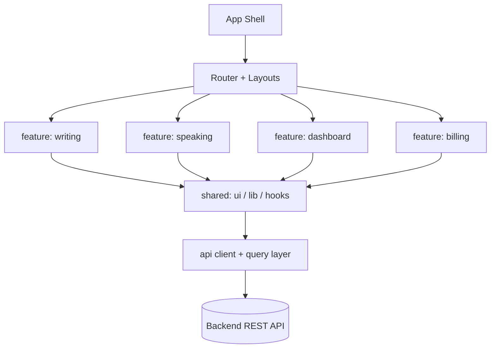
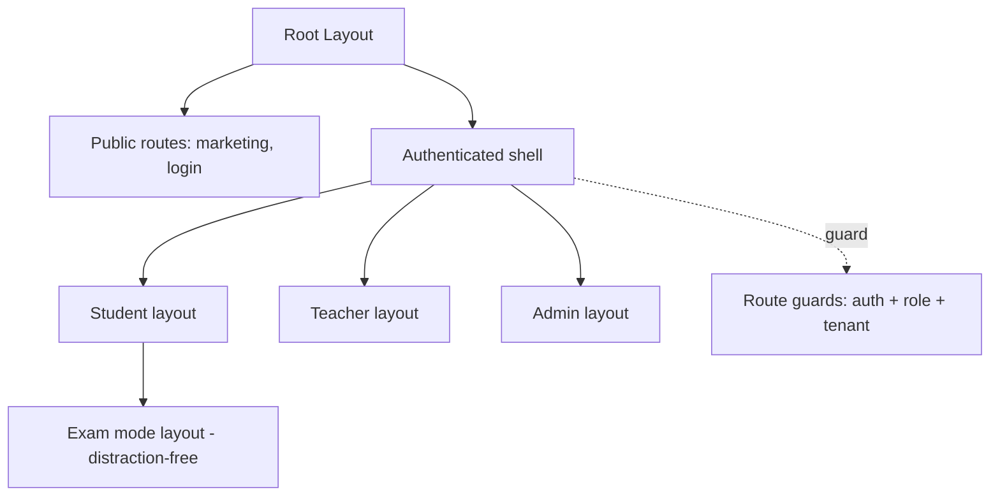
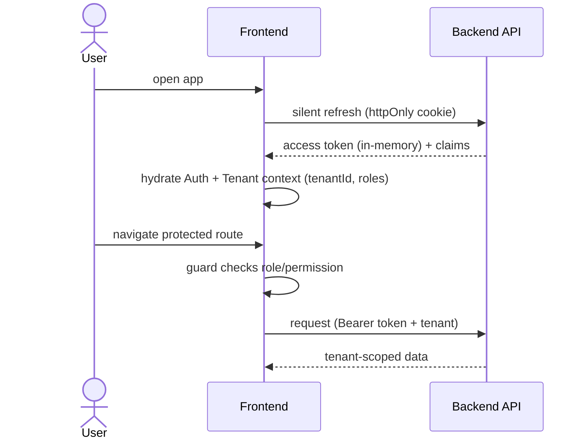
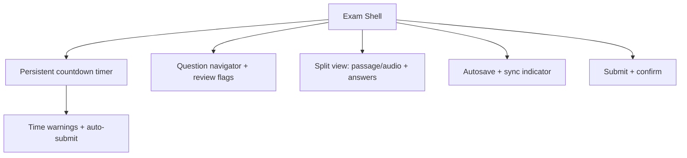

# Frontend Architecture — IELTS LMS AI

| Field | Value |
| --- | --- |
| **Product Name** | IELTS LMS AI |
| **Document** | 16 — Frontend Architecture |
| **Version** | 1.0 |
| **Status** | Architecture & Planning |
| **Document Owner** | Principal Frontend / UX Architecture |
| **Last Updated** | 2026-07-18 |
| **Audience** | Frontend Engineers, UX, Architects, QA, Accessibility, DevOps |
| **Aligns With** | [01_Product_Vision.md](./01_Product_Vision.md) … [15_Backend_Architecture.md](./15_Backend_Architecture.md) |

> **Purpose of this document.** This document defines the **frontend architecture** for IELTS LMS AI: philosophy, feature-based structure, routing, state management, forms, theming, accessibility, the computer-based IELTS exam UI, performance, security, and build/deploy. It is **implementation-independent** — no React components, hooks, or API code — and consistent with the [API Design Standards](./10_API_Design_Standards.md), [IAM](./11_Authentication_Authorization.md), and [Multi-Tenant Architecture](./12_Multi_Tenant_Architecture.md). Stack: **React 19, TypeScript, Vite, Tailwind, TanStack Query/Table, React Router, React Hook Form + Zod, Zustand, TipTap, Chart.js, React Dropzone, Framer Motion (minimal), ESLint/Prettier, Vitest, Playwright**, PWA-ready and future React Native friendly.

---

## Table of Contents

1. [Frontend Philosophy & Principles](#1-frontend-philosophy--principles)
2. [Technology Stack & Rationale](#2-technology-stack--rationale)
3. [Feature-Based Architecture](#3-feature-based-architecture)
4. [Folder & Project Structure](#4-folder--project-structure)
5. [Component Architecture & Design System](#5-component-architecture--design-system)
6. [Routing & Layout Architecture](#6-routing--layout-architecture)
7. [Auth, RBAC & Tenant Context](#7-auth-rbac--tenant-context)
8. [State Management](#8-state-management)
9. [Forms, Validation & Error Handling](#9-forms-validation--error-handling)
10. [Notifications, Toasts & Modals](#10-notifications-toasts--modals)
11. [Theming, Dark Mode & White-Label](#11-theming-dark-mode--white-label)
12. [Accessibility (WCAG)](#12-accessibility-wcag)
13. [Internationalization & Localization](#13-internationalization--localization)
14. [Responsive Design & Computer-Based Exam UI](#14-responsive-design--computer-based-exam-ui)
15. [Autosave, Offline Drafts & Rich Text](#15-autosave-offline-drafts--rich-text)
16. [Charts, Dashboards & Widgets](#16-charts-dashboards--widgets)
17. [Performance Optimization](#17-performance-optimization)
18. [Frontend Security](#18-frontend-security)
19. [Build, Environment & Deployment](#19-build-environment--deployment)
20. [Observability, Telemetry & Feature Flags](#20-observability-telemetry--feature-flags)
21. [Testing Strategy](#21-testing-strategy)
22. [Conventions: Naming, Files & Imports](#22-conventions-naming-files--imports)
23. [Future Evolution](#23-future-evolution)
24. [Related Documents](#24-related-documents)

---

## 1. Frontend Philosophy & Principles

The frontend is an **AI-first, exam-grade SPA/PWA** that must feel fast, accessible, and trustworthy under high-stakes conditions (timed exams, AI feedback). It is a thin, resilient client over the [REST API](./10_API_Design_Standards.md); business rules live in the backend.

| Principle | Meaning |
| --- | --- |
| **Feature-first** | Code is organized by feature/domain, not by technical type. |
| **Server state ≠ client state** | Remote data is cache, not app state ([§8](#8-state-management)). |
| **Accessible by default** | WCAG 2.1 AA is a baseline, not an afterthought ([§12](#12-accessibility-wcag)). |
| **Tenant- & role-aware** | UI reflects tenant branding and the user's [permissions](./11_Authentication_Authorization.md#11-roles--permission-matrix). |
| **Resilient** | Error boundaries, retries, autosave, and graceful AI latency handling. |
| **Contract-driven** | Types generated/derived from the [API contract](./10_API_Design_Standards.md#17-documentation-standards-openapiswagger). |
| **Performance-budgeted** | Code-split, lazy-loaded, measured against budgets ([§17](#17-performance-optimization)). |

---

## 2. Technology Stack & Rationale

| Concern | Technology | Rationale |
| --- | --- | --- |
| UI runtime | **React 19** | Concurrent features, Suspense, Actions; large ecosystem. |
| Language | **TypeScript** | Type safety across a large app; contract alignment. |
| Build/dev | **Vite** | Fast HMR, modern bundling, PWA plugins. |
| Styling | **Tailwind CSS** | Utility-first, themable, consistent design tokens. |
| Server state | **TanStack Query** | Caching, dedupe, background refetch, retries. |
| Tables | **TanStack Table** | Headless, accessible data grids. |
| Routing | **React Router** | Nested routes, loaders, code splitting. |
| Forms | **React Hook Form** | Performant, uncontrolled-first forms. |
| Schema/validation | **Zod** | Shared schemas; mirrors backend validation. |
| Client state | **Zustand** | Minimal global UI state without boilerplate. |
| Rich text | **TipTap** | Structured editor for writing tasks. |
| Charts | **Chart.js** | Analytics/dashboards. |
| Uploads | **React Dropzone** | Audio/file uploads ([§18](#18-frontend-security)). |
| Motion | **Framer Motion (minimal)** | Purposeful animation only. |
| Quality | **ESLint + Prettier** | Consistent style, lint gates. |
| Tests | **Vitest + Playwright** | Unit/component + E2E. |
| Delivery | **PWA-ready** | Installable, offline-capable shell; future React Native reuse of logic. |

> These are decisions of record; UI concerns are abstracted (API client, design system) so libraries can evolve without rewrites.

---

## 3. Feature-Based Architecture

The app is a set of **feature modules** aligned to [bounded contexts](./07_Domain_Driven_Design.md#5-bounded-contexts) (learning, writing, speaking, reading, listening, mock exams, billing, admin). Each feature owns its routes, components, hooks, state, and API bindings.



| Rule | Statement |
| --- | --- |
| **Encapsulation** | A feature exposes a public entry (routes//index); internals are private. |
| **No cross-feature deep imports** | Features share only via `shared/*` or published feature APIs ([§22](#22-conventions-naming-files--imports)). |
| **Colocation** | Components, hooks, tests, and styles live with their feature. |
| **Vertical slices** | A feature contains everything needed for its use cases. |

---

## 4. Folder & Project Structure

```text
src/
├── app/                      # app shell, providers, router, error boundaries
│   ├── providers/            # Query, Theme, Auth, Tenant, Toast providers
│   └── router/               # route tree, guards, lazy routes
├── features/                 # feature-first modules
│   └── writing/
│       ├── components/       # feature-scoped UI
│       ├── hooks/            # feature hooks (useSubmitWriting…)
│       ├── api/              # query/mutation bindings for this feature
│       ├── state/            # local Zustand slices (if needed)
│       ├── schemas/          # Zod schemas
│       ├── routes.tsx        # feature routes
│       └── index.ts          # public surface
├── shared/
│   ├── ui/                   # design-system components (Button, Modal…)
│   ├── hooks/                # cross-cutting hooks
│   ├── lib/                  # api client, formatting, utils
│   ├── config/               # env, feature flags
│   └── types/                # shared/generated API types
├── styles/                   # Tailwind config, tokens, themes
├── assets/                   # static assets
└── test/                     # test setup, factories, msw handlers
```

> **Import rule:** `features/*` may import from `shared/*`; `shared/*` must **not** import from `features/*`. Enforced by lint boundaries ([§22](#22-conventions-naming-files--imports)).

---

## 5. Component Architecture & Design System

| Layer | Role | Examples |
| --- | --- | --- |
| **Primitives (design system)** | Themable, accessible base components | Button, Input, Modal, Toast, Tabs |
| **Composites** | Combine primitives into reusable patterns | DataTable, FormField, Card |
| **Feature components** | Domain-specific UI | WritingEditor, SpeakingRecorder |
| **Pages/Screens** | Route-level composition | DashboardPage, MockExamPage |

- **Design system** is the single source of UI truth: design tokens (color, spacing, typography) drive Tailwind theme; components are documented and accessibility-tested.
- **Headless-first**: prefer headless libraries (TanStack Table) + styled wrappers for control and a11y.
- **Composition over configuration**: small, composable components over monolithic props.

---

## 6. Routing & Layout Architecture



- **Nested layouts** per persona (student/teacher/admin) with a shared authenticated shell.
- **Route guards** enforce authentication, [role/permission](./11_Authentication_Authorization.md#10-authorization-strategy), and tenant context before rendering.
- **Exam mode** uses a dedicated distraction-free layout ([§14](#14-responsive-design--computer-based-exam-ui)).
- **Lazy routes** with Suspense boundaries ([§17](#17-performance-optimization)).

---

## 7. Auth, RBAC & Tenant Context



- **Token handling** per [IAM §3.3](./11_Authentication_Authorization.md#33-token-storage-strategy): access token in memory, refresh via httpOnly cookie; never in localStorage.
- **RBAC integration**: UI gates (menus, actions, routes) derive from claims/permissions; the backend remains the authority (UI hiding is convenience, not security).
- **Tenant context**: resolved from token/subdomain ([Multi-Tenant §5](./12_Multi_Tenant_Architecture.md#5-tenant-resolution--context)); drives branding, feature flags, and API scoping.

---

## 8. State Management

| State type | Tool | Examples |
| --- | --- | --- |
| **Server state** | TanStack Query | Courses, submissions, evaluations, analytics. |
| **Client/UI state** | Zustand | Sidebar, exam timer, modal stack, wizard steps. |
| **Form state** | React Hook Form | Inputs, dirty/validation state. |
| **URL state** | React Router | Filters, pagination, tabs (shareable). |

- **Server state is cache**: query keys are tenant- and param-scoped; mutations invalidate precisely; background refetch keeps data fresh.
- **Client state is minimal**: only ephemeral UI concerns; no duplication of server data.
- **Caching** aligns with [API cache headers/ETags](./10_API_Design_Standards.md#11-idempotency-concurrency--caching); optimistic updates for responsive UX with rollback on error.

---

## 9. Forms, Validation & Error Handling

- **React Hook Form + Zod**: a single Zod schema validates the form and types the payload; mirrors backend [validation rules](./10_API_Design_Standards.md#71-request-validation) (client validation is UX, backend is authority).
- **Server errors**: RFC 7807 [Problem Details](./10_API_Design_Standards.md#9-error-handling--problem-details) mapped to field-level and form-level errors.
- **Error handling tiers**: field → form → route error boundary → global boundary.
- **Idempotency**: mutations that create resources send idempotency keys where the API supports them.

---

## 10. Notifications, Toasts & Modals

| Mechanism | Use |
| --- | --- |
| **Toasts** | Transient feedback (saved, failed, retrying); non-blocking, a11y-announced. |
| **Modals/Dialogs** | Focused tasks/confirmations; focus-trapped, ESC/overlay close, restore focus. |
| **Inline banners** | Persistent state (trial ending, payment failed — [Billing](./13_Subscription_Billing.md#12-billing-background-jobs--dunning)). |
| **In-app notifications** | Backed by [Notifications context](./08_Event_Storming.md#726-notification-delivery); badge + center. |

- Centralized **toast/modal managers** (provider + Zustand slice) prevent stacking chaos and ensure a11y.

---

## 11. Theming, Dark Mode & White-Label

- **Design tokens** (CSS variables) drive Tailwind; light/dark themes switch token sets; respects `prefers-color-scheme` with user override persisted.
- **White-label (future)**: per-tenant theme (logo, colors, domain) loaded from [tenant branding](./12_Multi_Tenant_Architecture.md#8-tenant-configuration-branding--domains); tokens overridden at runtime per tenant.
- Contrast and focus styles are theme-invariant to preserve [accessibility](#12-accessibility-wcag).

---

## 12. Accessibility (WCAG)

Target **WCAG 2.1 AA** across the app; exam UI held to stricter review given high stakes.

| Area | Standard |
| --- | --- |
| Keyboard | Full keyboard operability; visible focus; logical tab order. |
| Screen readers | Semantic HTML, ARIA where needed, live regions for toasts/timers. |
| Contrast | AA contrast for text/controls in all themes. |
| Forms | Labeled inputs, described errors, no color-only signaling. |
| Motion | Respect `prefers-reduced-motion`; motion is minimal/purposeful. |
| Timing | Exam timers announced; warnings before expiry. |

> Full WCAG conformance requires manual testing with assistive technologies and expert review; automated checks (axe) are a gate, not proof.

---

## 13. Internationalization & Localization

- **i18n framework** with message catalogs; no hard-coded user-facing strings.
- **Locale-aware** dates/numbers via Intl; [timezone handling](./10_API_Design_Standards.md#13-content-negotiation-localization--time) uses UTC from API, formatted per user locale.
- **RTL-ready** layout (logical CSS properties) for future RTL languages.
- Content localization coordinates with backend [localization headers](./10_API_Design_Standards.md#13-content-negotiation-localization--time).

---

## 14. Responsive Design & Computer-Based Exam UI

### 14.1 Responsive Strategy

- Mobile-first, breakpoint-driven layouts; touch and pointer parity; installable PWA shell.

### 14.2 Computer-Based IELTS Exam UI

The exam UI mirrors the **official computer-based IELTS experience** — a critical product differentiator.



| Requirement | Approach |
| --- | --- |
| Fidelity | Layout/interaction parity with real CBT (split panes, palette). |
| Timing | Reliable timer, warnings, auto-submit on expiry. |
| Integrity | Guard against accidental navigation/loss; confirm on exit. |
| Resilience | Autosave + recovery ([§15](#15-autosave-offline-drafts--rich-text)). |
| Accessibility | Keyboard nav, screen-reader support even in exam mode. |

---

## 15. Autosave, Offline Drafts & Rich Text

- **Autosave**: debounced periodic save of writing/answers with a visible sync state; conflict-safe via [optimistic concurrency](./10_API_Design_Standards.md#11-idempotency-concurrency--caching).
- **Offline drafts (future)**: PWA + local persistence (IndexedDB) buffers drafts offline, syncing on reconnect; last-write-wins with user prompt on conflict.
- **Rich text (TipTap)**: structured writing editor with word count, paste sanitization ([XSS](#18-frontend-security)), and export to the submission payload.

---

## 16. Charts, Dashboards & Widgets

- **Chart.js** for band trends, skill breakdowns, progress, and institute analytics ([Analytics context](./07_Domain_Driven_Design.md#5-bounded-contexts)).
- **Widget model**: dashboards compose configurable widgets (per role); data via TanStack Query with caching.
- **Accessibility**: charts provide text alternatives/data tables; never color-only.

---

## 17. Performance Optimization

| Technique | Application |
| --- | --- |
| **Code splitting** | Per-route and per-feature lazy chunks. |
| **Lazy loading + Suspense** | Defer non-critical UI, heavy editors/charts. |
| **Error boundaries** | Isolate failures per route/widget. |
| **Caching** | TanStack Query cache + HTTP caching/ETags. |
| **Asset management** | Hashed assets, image optimization, font subsetting. |
| **Virtualization** | Large lists/tables virtualized. |
| **Performance budgets** | Bundle-size and Core Web Vitals budgets in CI. |

---

## 18. Frontend Security

| Threat | Mitigation |
| --- | --- |
| **XSS** | Framework escaping; sanitize rich-text/HTML; strict CSP; no `dangerouslySetInnerHTML` without sanitization. |
| **Token theft** | Access token in memory; refresh in httpOnly cookie ([IAM](./11_Authentication_Authorization.md#33-token-storage-strategy)). |
| **CSRF** | Cookie-based refresh protected with SameSite + anti-CSRF where applicable. |
| **File upload** | Type/size validation, client checks + backend authority, audio constraints ([API upload](./10_API_Design_Standards.md#14-file-upload-streaming--long-running-operations)). |
| **Sensitive data** | No secrets in the bundle; env via build-time public config only. |
| **Dependency risk** | Pinned deps, audit in CI. |

> Frontend security is defense-in-depth; the backend remains the [authorization authority](./11_Authentication_Authorization.md#10-authorization-strategy).

---

## 19. Build, Environment & Deployment

- **Vite build** → static, hashed assets served via CDN; PWA service worker for shell caching.
- **Environments**: dev/staging/prod via env-specific public config (no secrets in client).
- **Deployment**: immutable static deploys behind CDN; atomic releases + instant rollback; cache-busting via content hashes.
- **Config**: only public, non-sensitive values reach the client ([secrets stay server-side](./15_Backend_Architecture.md#14-configuration--secrets-management)).

---

## 20. Observability, Telemetry & Feature Flags

| Concern | Approach |
| --- | --- |
| **Telemetry** | Web Vitals + [OpenTelemetry](./15_Backend_Architecture.md#16-observability-health-metrics-tracing) browser traces correlated via correlationId. |
| **Error monitoring** | Global error/boundary reporting to monitoring sink. |
| **Product analytics** | Privacy-respecting event tracking; consent-aware. |
| **Feature flags** | Client reads flags per tenant/plan ([Billing §13](./13_Subscription_Billing.md#13-feature-flags--entitlement-enforcement)); gate UI and rollouts. |

---

## 21. Testing Strategy

| Level | Tool | Scope |
| --- | --- | --- |
| **Unit** | Vitest | Utilities, hooks, reducers, schemas. |
| **Component** | Vitest + Testing Library | Rendering, interaction, a11y assertions. |
| **E2E** | Playwright | Critical flows: login, exam, submit, billing. |
| **Contract** | Generated types + mocks (MSW) | API alignment. |
| **A11y** | axe in CI | Automated accessibility gate. |

> Exam and payment flows are E2E-critical and gated in CI.

---

## 22. Conventions: Naming, Files & Imports

| Convention | Rule |
| --- | --- |
| **Components** | PascalCase (`WritingEditor.tsx`). |
| **Hooks** | camelCase `use*` (`useSubmitWriting.ts`). |
| **Files** | kebab or PascalCase per type; tests `*.test.tsx`. |
| **Folders** | kebab-case feature folders (`mock-exam/`). |
| **Types** | PascalCase; shared/generated in `shared/types`. |
| **Imports** | `features/*` → `shared/*` allowed; `shared/*` → `features/*` forbidden; no deep cross-feature imports. |
| **Barrels** | Each feature exposes a single `index.ts` public surface. |

---

## 23. Future Evolution

| Direction | Readiness |
| --- | --- |
| **Micro-frontends** | Feature isolation + module boundaries enable extraction. |
| **React Native** | Logic (hooks, schemas, API layer) kept UI-agnostic for reuse. |
| **Plugin architecture** | Feature registry + slots enable third-party/plugin panels. |
| **White-label** | Runtime theming + per-tenant config ([§11](#11-theming-dark-mode--white-label)). |
| **AI-native UI** | Streaming AI responses, agent surfaces ([AI Architecture](./17_AI_Architecture.md), [Agentic AI](./18_Agentic_AI_Architecture.md)). |

---

## 24. Related Documents

| # | Document | Relationship |
| --- | --- | --- |
| 04 | [Functional Requirements](./04_Functional_Requirements.md) | Features the UI realizes. |
| 05 | [Non-Functional Requirements](./05_Non_Functional_Requirements.md) | Performance, a11y, security budgets. |
| 10 | [API Design Standards](./10_API_Design_Standards.md) | The contract the client consumes. |
| 11 | [Authentication & Authorization](./11_Authentication_Authorization.md) | Token handling, RBAC gating. |
| 12 | [Multi-Tenant Architecture](./12_Multi_Tenant_Architecture.md) | Tenant context, branding. |
| 13 | [Subscription & Billing](./13_Subscription_Billing.md) | Feature flags, entitlement UI. |
| 17 | [AI Architecture](./17_AI_Architecture.md) | AI feature surfaces, streaming. |
| 18 | [Agentic AI Architecture](./18_Agentic_AI_Architecture.md) | Agent-driven UX. |

---

*End of Document — 16 Frontend Architecture (v1.0).*
