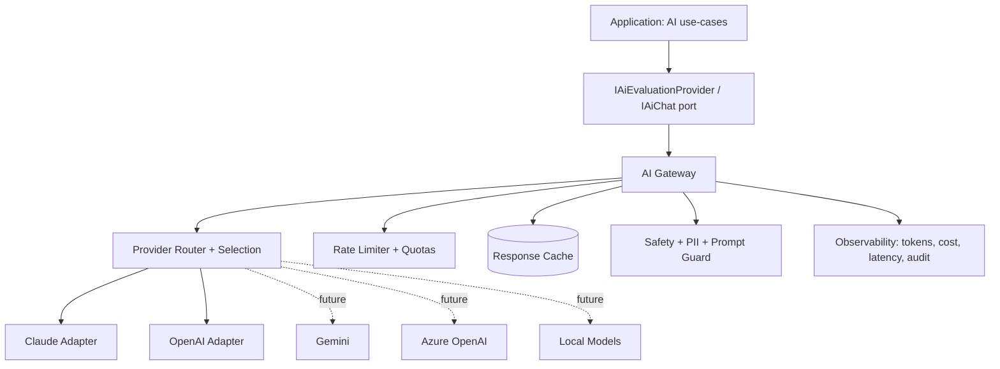
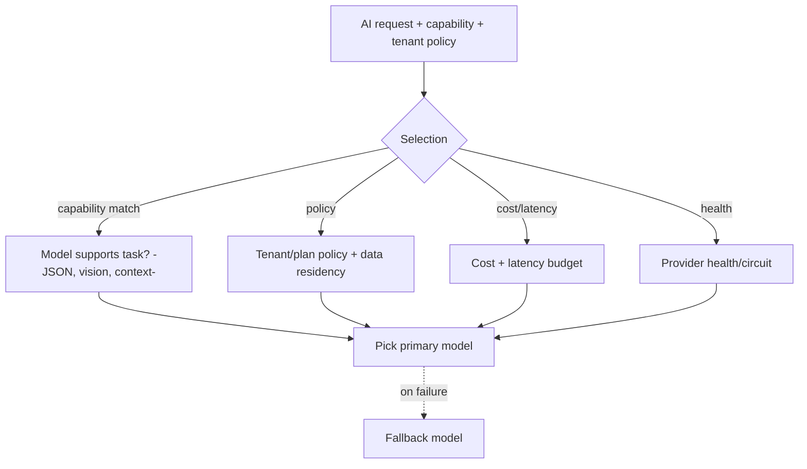
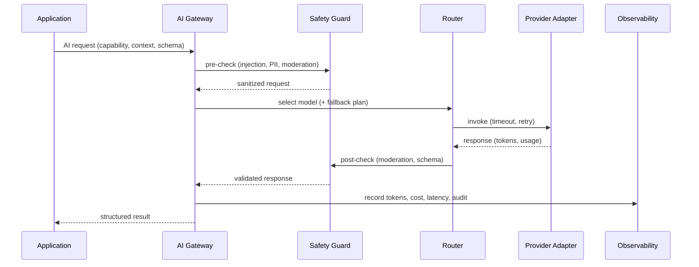
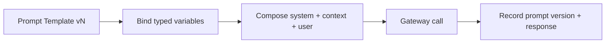
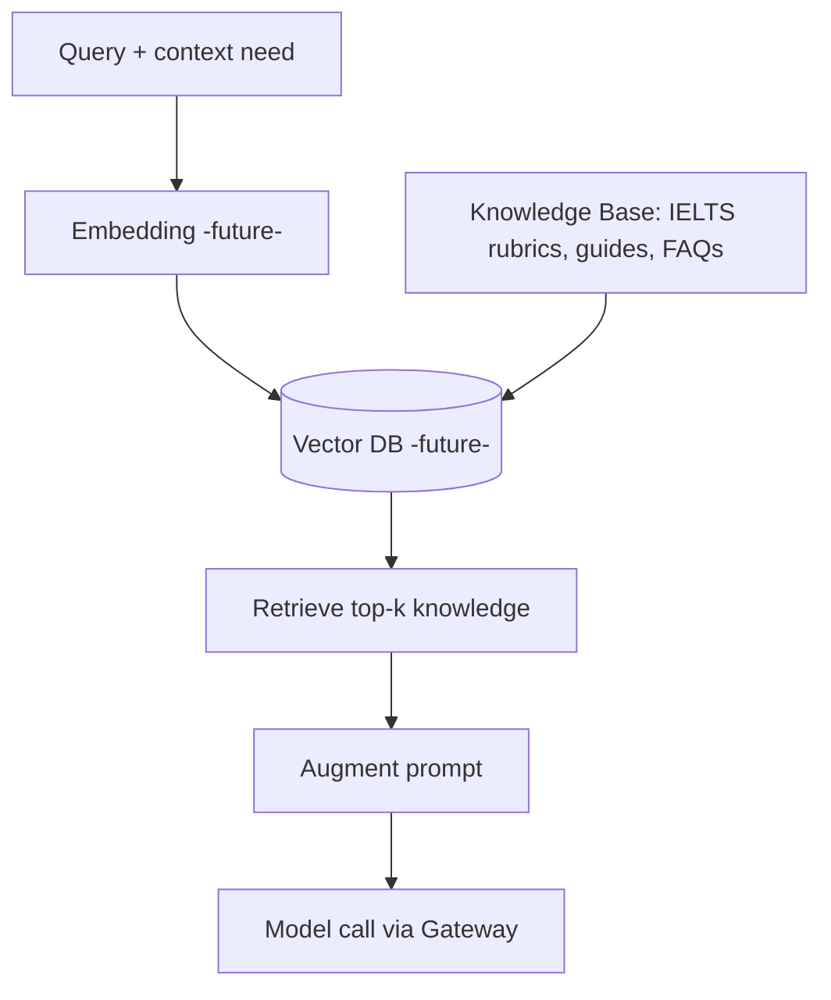
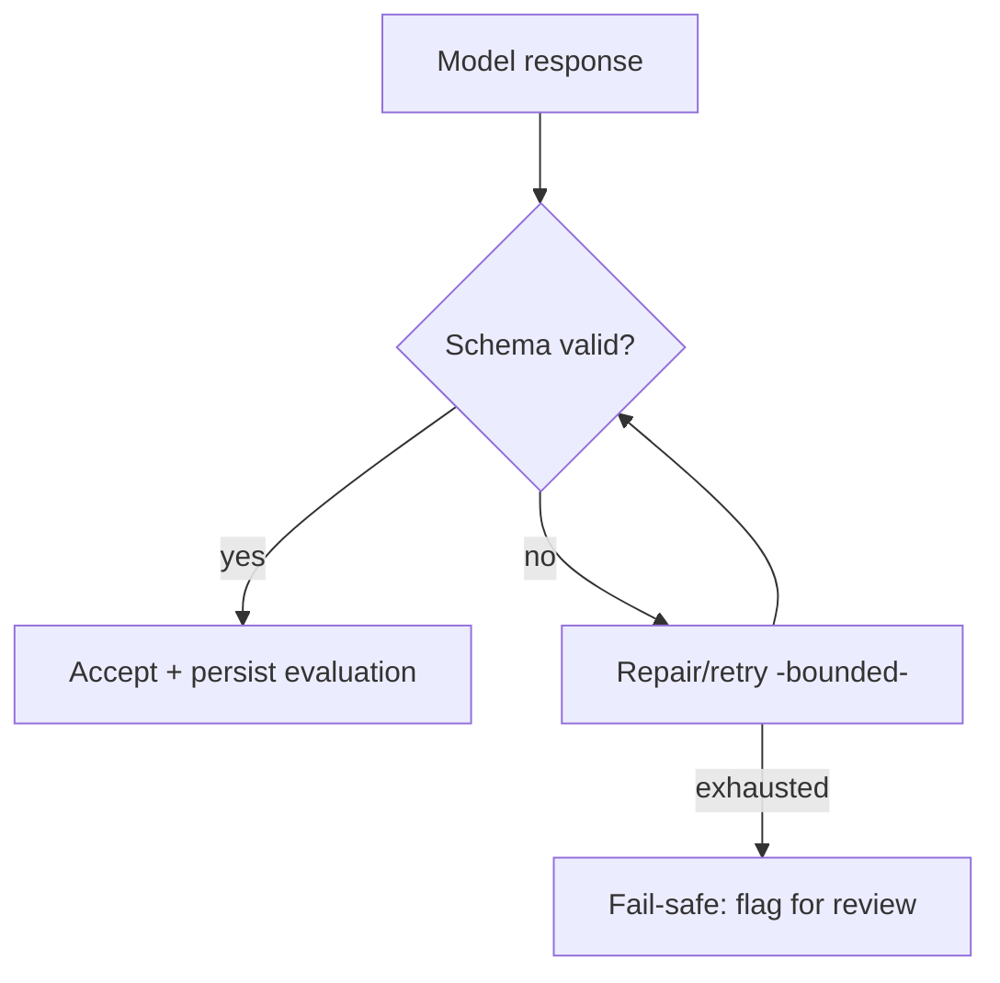

# AI Architecture — IELTS LMS AI

| Field | Value |
| --- | --- |
| **Product Name** | IELTS LMS AI |
| **Document** | 17 — AI Architecture |
| **Version** | 1.0 |
| **Status** | Architecture & Planning |
| **Document Owner** | Principal AI Architecture |
| **Last Updated** | 2026-07-18 |
| **Audience** | AI/ML Engineers, Backend Engineers, Architects, Security/Privacy, Product |
| **Aligns With** | [01_Product_Vision.md](./01_Product_Vision.md) … [16_Frontend_Architecture.md](./16_Frontend_Architecture.md) |

> **Purpose of this document.** IELTS LMS AI is an **AI-first platform**. This document defines the **AI architecture**: the provider-agnostic AI layer, prompt and context management, the AI gateway (routing, rate limiting, fallback, retries, caching), structured output and response validation, safety/privacy/moderation, observability and cost governance, and the catalog of AI capabilities. It is **implementation-independent** — no SDK code or prompt text dumps — and consistent with the [AI providers/evaluation contexts](./07_Domain_Driven_Design.md#5-bounded-contexts), [AI events](./08_Event_Storming.md#6-event-catalog), [AI entities](./09_Database_Design_ERD.md#64-ai--insights), and the [Infrastructure ports](./14_Clean_Architecture.md#11-infrastructure-services). Supported providers: **Claude, OpenAI**, and future **Gemini, Azure OpenAI, and local/self-hosted models**.

---

## Table of Contents

1. [AI Vision & Principles](#1-ai-vision--principles)
2. [The AI Layer](#2-the-ai-layer)
3. [Provider Abstraction & Selection](#3-provider-abstraction--selection)
4. [AI Gateway](#4-ai-gateway)
5. [Prompt Management](#5-prompt-management)
6. [Context Management & Memory](#6-context-management--memory)
7. [RAG & Knowledge Base Readiness](#7-rag--knowledge-base-readiness)
8. [Structured Output & Response Validation](#8-structured-output--response-validation)
9. [Streaming Responses](#9-streaming-responses)
10. [AI Safety, Moderation & Privacy](#10-ai-safety-moderation--privacy)
11. [Token, Cost & Quality Governance](#11-token-cost--quality-governance)
12. [Observability, Logging & Audit](#12-observability-logging--audit)
13. [AI Capability Catalog](#13-ai-capability-catalog)
14. [Future Considerations](#14-future-considerations)
15. [Related Documents](#15-related-documents)

---

## 1. AI Vision & Principles

AI is a **core capability**, not a feature: automated IELTS evaluation, coaching, prediction, and personalization. The architecture is **model-agnostic, safe, observable, and cost-governed**.

| Principle | Meaning |
| --- | --- |
| **Provider-agnostic** | The domain depends on AI **ports**, never a specific vendor SDK ([Clean Arch](./14_Clean_Architecture.md#11-infrastructure-services)). |
| **Structured & verifiable** | AI returns structured, schema-validated output; free text is constrained. |
| **Safe by default** | Moderation, PII protection, and prompt-injection defenses apply to every call. |
| **Deterministic where it matters** | Scoring uses controlled prompts, rubrics, and validation to reduce variance. |
| **Observable & governed** | Every call is traced, costed, and auditable. |
| **Tenant-scoped** | AI usage, quotas, and logs are per tenant ([Multi-Tenant §7](./12_Multi_Tenant_Architecture.md#7-tenantid-flow-through-all-layers)). |
| **Fail-safe** | Fallback providers and graceful degradation on outages. |

---

## 2. The AI Layer

The AI layer sits behind the Application layer as a set of infrastructure adapters fronted by an **AI Gateway**. No feature calls a provider directly.

| Component | Role |
| --- | --- |
| **AI ports** | Stable abstractions the app depends on. |
| **AI Gateway** | Single choke point for routing, limits, caching, safety, observability. |
| **Provider adapters** | Translate canonical requests ↔ provider APIs. |
| **Prompt service** | Versioned templates + variable binding ([§5](#5-prompt-management)). |
| **Context service** | Assembles conversation/domain context ([§6](#6-context-management--memory)). |

---

## 3. Provider Abstraction & Selection

### 3.1 Abstraction

- A **canonical AI request/response** model (messages, system prompt, tools, output schema, limits) is provider-independent.
- Adapters implement the port per provider; adding a provider is an adapter + config, not a domain change ([ACL pattern](./07_Domain_Driven_Design.md#6-context-mapping)).

### 3.2 Selection Strategy

| Factor | Role in selection |
| --- | --- |
| **Capability** | Task needs (structured output, long context, audio, vision). |
| **Policy** | Tenant/plan constraints, data residency, allowed providers. |
| **Cost/latency** | Budget per capability ([§11](#11-token-cost--quality-governance)). |
| **Health** | Circuit-breaker state drives fallback ([§4](#4-ai-gateway)). |

> Model IDs and routing rules are **configuration** ([AIProviders/AIPrompts entities](./09_Database_Design_ERD.md#64-ai--insights)), never hard-coded in the domain.

---

## 4. AI Gateway

The gateway is the single entry point for all model calls.

| Concern | Behavior |
| --- | --- |
| **Routing** | Selects provider/model per [§3.2](#32-selection-strategy). |
| **Rate limiting** | Per-tenant/per-capability limits; protects cost and fairness ([Billing quotas](./13_Subscription_Billing.md#3-usage-seat-storage--ai-limits)). |
| **Fallback** | On error/timeout/circuit-open, retry on an alternate provider. |
| **Retry** | Bounded retries with backoff + jitter; idempotent by request key. |
| **Caching** | Cache deterministic results (e.g., identical grammar checks) keyed by prompt-version + input hash + tenant. |
| **Timeouts** | Per-call deadlines; stream or degrade rather than hang. |
| **Safety** | Pre/post moderation + PII handling ([§10](#10-ai-safety-moderation--privacy)). |

---

## 5. Prompt Management

| Aspect | Standard |
| --- | --- |
| **Templates** | Prompts are versioned templates with named **variables**, stored as [AIPrompts](./09_Database_Design_ERD.md#64-ai--insights). |
| **Versioning** | Every prompt has a version; responses record the prompt version used (reproducibility). |
| **Variables** | Typed variable binding; no unescaped user text concatenated into system instructions. |
| **Separation** | System/rubric instructions separated from user content to resist [injection](#10-ai-safety-moderation--privacy). |
| **Rubric-driven** | Scoring prompts embed IELTS band rubrics for consistent evaluation. |
| **Governance** | Prompt changes are reviewed, versioned, and A/B-testable ([quality §11.3](#113-quality-evaluation)). |

---

## 6. Context Management & Memory

- **Context assembly:** per request, the context service composes system prompt + relevant domain context (learner profile, task, rubric, history) within token budgets.
- **Conversation memory:** short-term memory for coaching dialogs (bounded window); summarization for long threads.
- **Domain grounding:** context is drawn from tenant-scoped domain data ([ERD](./09_Database_Design_ERD.md)), never cross-tenant.
- **Memory tiers:** ephemeral (request) → session (conversation) → durable (learner insights/[ProgressTracking](./09_Database_Design_ERD.md#64-ai--insights)); long-term vector memory is [future](#7-rag--knowledge-base-readiness).

---

## 7. RAG & Knowledge Base Readiness

The platform is **RAG-ready** though V1 relies primarily on structured domain context.

| Element | V1 | Future |
| --- | --- | --- |
| **Knowledge base** | Curated IELTS rubrics/guides as structured content | Expanded, embedded corpus. |
| **Embeddings** | — | Embedding pipeline for content + learner artifacts. |
| **Vector DB** | Abstraction reserved (port) | Managed/self-hosted vector store. |
| **Retrieval** | Structured queries | Semantic + hybrid retrieval feeding prompts. |

> RAG integrates **through the gateway**; retrieval is a context source, not a bypass of safety/observability.

---

## 8. Structured Output & Response Validation

Reliable scoring demands machine-readable, validated output.

| Mechanism | Use |
| --- | --- |
| **JSON mode / structured output** | Evaluations, band scores, feedback returned as schema-bound JSON. |
| **Function/tool calling** | Model invokes defined tools (e.g., fetch rubric, record score) with typed args. |
| **Schema validation** | Every response validated against a schema before acceptance; invalid → repair/retry then fail-safe. |
| **Determinism controls** | Low temperature + rubric anchoring for scoring; bounded output. |
| **Idempotency** | Evaluation writes are idempotent ([Event Storming](./08_Event_Storming.md#6-event-catalog)). |

---

## 9. Streaming Responses

- **Streaming** (token/chunk) for interactive coaching and long feedback improves perceived latency.
- Delivered to the frontend via streaming transport ([API long-running/streaming](./10_API_Design_Standards.md#14-file-upload-streaming--long-running-operations)).
- Streamed content still passes **post-stream moderation and schema checks** before being persisted as authoritative.
- Non-interactive scoring may run **asynchronously** (202 + operation resource) with events on completion.

---

## 10. AI Safety, Moderation & Privacy

Aligned with [NFR security/privacy](./05_Non_Functional_Requirements.md#6-security-sec) and data classification ([ERD §5](./09_Database_Design_ERD.md#5-data-classification)).

| Control | Approach |
| --- | --- |
| **Prompt-injection defense** | Separate system/user content; treat all user/retrieved text as untrusted; never let content override instructions. |
| **Moderation** | Pre/post moderation for harmful content; block/flag per policy. |
| **PII protection** | Minimize PII sent to providers; redact/pseudonymize where feasible; honor data-residency policy. |
| **Data privacy** | No training on tenant data without explicit consent; provider data-retention settings enforced. |
| **Hallucination mitigation** | Rubric grounding, structured output, validation, confidence signals, human-review flags. |
| **Prompt logging** | Prompts/responses logged as [AIResponses](./09_Database_Design_ERD.md#64-ai--insights) with sensitivity controls; secrets never logged. |
| **AI audit logs** | Who/what/when/model/version/cost recorded for every AI action ([§12](#12-observability-logging--audit)). |

---

## 11. Token, Cost & Quality Governance

### 11.1 Token & Cost Management

- Token usage captured per call; cost attributed **per tenant/capability** for [billing quotas](./13_Subscription_Billing.md#3-usage-seat-storage--ai-limits) and analytics.
- Budgets and alerts per tenant/plan; overflow → throttle, degrade, or require [AI credits](./13_Subscription_Billing.md#16-future-considerations).

### 11.2 Usage & Latency Monitoring

- Metrics: request volume, tokens, cost, latency (p50/p95/p99), error/fallback rate — per provider/capability/tenant.

### 11.3 Quality Evaluation

- Offline eval sets and rubric-scored benchmarks track evaluation accuracy and drift.
- Prompt versions are A/B-tested; regressions block rollout.
- Human-in-the-loop review for flagged/low-confidence evaluations.

---

## 12. Observability, Logging & Audit

| Signal | Content |
| --- | --- |
| **Traces** | End-to-end spans (gateway → provider) via [OpenTelemetry](./15_Backend_Architecture.md#16-observability-health-metrics-tracing). |
| **Metrics** | Tokens, cost, latency, cache-hit, fallback, moderation blocks. |
| **AI audit logs** | Tenant, user, capability, model, prompt version, decision, cost. |
| **Prompt/response logs** | Stored with classification + retention; access-controlled. |
| **Correlation** | AI calls carry the request `correlationId` ([API §12](./10_API_Design_Standards.md#12-correlation-tracing--observability)). |

---

## 13. AI Capability Catalog

Each capability is delivered via the gateway with a versioned prompt, structured output, and tenant scoping. (Capabilities map to [Agentic agents](./18_Agentic_AI_Architecture.md) in the multi-agent evolution.)

| Capability | Purpose | Output |
| --- | --- | --- |
| **Grammar Coach** | Detect/explain grammar issues | Structured corrections + explanations |
| **Vocabulary Coach** | Improve lexical range/accuracy | Suggestions, synonyms, usage |
| **Sentence Builder** | Guide sentence construction | Rewrites, scaffolds |
| **Writing Evaluation** | Score writing on IELTS criteria | Band per criterion + feedback |
| **Speaking Evaluation** | Score speaking (fluency, pronunciation, etc.) | Band per criterion + feedback |
| **Band Prediction** | Predict overall band | Predicted band + confidence |
| **Reading Coach** | Strategy + explanations | Guidance, rationale |
| **Listening Coach** | Strategy + explanations | Guidance, rationale |
| **Study Planner** | Generate/adjust study plans | Structured plan |
| **Learning Recommendations** | Suggest next actions | Ranked recommendations |
| **Weakness Detection** | Identify skill gaps | Weakness profile |
| **Question Generation** | Create practice items | Validated question sets |
| **Mock Test Review** | Explain mock results | Item-level review |
| **Feedback Generation** | Rich formative feedback | Narrative + structured tips |
| **Personalized Learning** | Tailor content/path | Personalized sequence |
| **Certificate Insights** | Summarize achievement | Insight summary |
| **Admin AI** | Ops assistance (config, insights) | Actions/summaries (guarded) |
| **Teacher AI** | Grading assist, cohort insights | Suggestions/summaries |
| **Support AI** | Answer support queries | Answers + escalation |
| **Analytics AI** | Natural-language analytics | Charts/summaries |

> Capabilities respect [RBAC/permissions](./11_Authentication_Authorization.md#11-roles--permission-matrix) and [plan entitlements](./13_Subscription_Billing.md#2-subscription-plans--feature-matrix); e.g., Teacher/Admin AI require the corresponding roles.

---

## 14. Future Considerations

| Area | Direction |
| --- | --- |
| **Fine-tuning** | Domain-tuned models for IELTS scoring consistency. |
| **Model routing** | Dynamic, quality/cost-aware routing across many models. |
| **AI marketplace** | Pluggable third-party AI capabilities. |
| **Self-hosted models** | On-prem/local models for cost/residency/privacy. |
| **Multi-model ensembles** | Combine models for scoring robustness. |
| **Expanded RAG** | Full embedding + vector retrieval ([§7](#7-rag--knowledge-base-readiness)). |
| **Agentic evolution** | Capabilities become collaborating agents ([18](./18_Agentic_AI_Architecture.md)). |

---

## 15. Related Documents

| # | Document | Relationship |
| --- | --- | --- |
| 05 | [Non-Functional Requirements](./05_Non_Functional_Requirements.md) | AI performance, cost, privacy NFRs. |
| 07 | [Domain-Driven Design](./07_Domain_Driven_Design.md) | AI evaluation contexts. |
| 08 | [Event Storming](./08_Event_Storming.md) | AI evaluation events. |
| 09 | [Database Design & ERD](./09_Database_Design_ERD.md) | AIProviders/Prompts/Responses entities. |
| 13 | [Subscription & Billing](./13_Subscription_Billing.md) | AI usage limits & credits. |
| 14 | [Clean Architecture](./14_Clean_Architecture.md) | AI ports/adapters. |
| 15 | [Backend Architecture](./15_Backend_Architecture.md) | AI infrastructure & observability. |
| 18 | [Agentic AI Architecture](./18_Agentic_AI_Architecture.md) | Multi-agent evolution of these capabilities. |

---

*End of Document — 17 AI Architecture (v1.0).*
