# Agentic AI Architecture — IELTS LMS AI

| Field | Value |
| --- | --- |
| **Product Name** | IELTS LMS AI |
| **Document** | 18 — Agentic AI Architecture |
| **Version** | 1.0 |
| **Status** | Architecture & Planning |
| **Document Owner** | Principal Agentic AI Architecture |
| **Last Updated** | 2026-07-18 |
| **Audience** | AI/ML Engineers, Backend Engineers, Architects, Security/Governance, Product |
| **Aligns With** | [01_Product_Vision.md](./01_Product_Vision.md) … [17_AI_Architecture.md](./17_AI_Architecture.md) |

> **Purpose of this document.** This document defines a **production-ready, multi-agent Agentic AI architecture** for IELTS LMS AI. It is deliberately **not a single chatbot**: it describes collaborating, specialized agents coordinated by an orchestrator, with shared memory, tool execution, governance, and human-in-the-loop readiness. It builds on the [AI Architecture (17)](./17_AI_Architecture.md) — reusing the AI gateway, provider abstraction, prompt/context services, safety, and observability — and is **implementation-independent** (no agent-framework code). Forward-looking areas (MCP, A2A, RAG, knowledge graphs, governance) are called out as readiness, not V1 commitments.

---

## Table of Contents

1. [Agentic Vision & Principles](#1-agentic-vision--principles)
2. [Agent Framework](#2-agent-framework)
3. [Agent Anatomy & Lifecycle](#3-agent-anatomy--lifecycle)
4. [Agent Registry](#4-agent-registry)
5. [Agent Memory](#5-agent-memory)
6. [Orchestration & Workflow Engine](#6-orchestration--workflow-engine)
7. [Task Planning, Delegation & Reasoning](#7-task-planning-delegation--reasoning)
8. [Agent Communication & Context Sharing](#8-agent-communication--context-sharing)
9. [Tool Execution](#9-tool-execution)
10. [Security, Permissions & Governance](#10-security-permissions--governance)
11. [Observability & Cost Tracking](#11-observability--cost-tracking)
12. [Specialized Agent Catalog](#12-specialized-agent-catalog)
13. [Orchestration Workflows](#13-orchestration-workflows)
14. [Future Readiness](#14-future-readiness)
15. [Related Documents](#15-related-documents)

---

## 1. Agentic Vision & Principles

The platform evolves from discrete [AI capabilities](./17_AI_Architecture.md#13-ai-capability-catalog) into a **team of collaborating agents**. An agent is a bounded, goal-directed unit with a role, tools, memory, and permissions — coordinated to accomplish multi-step learning and assessment tasks.

| Principle | Meaning |
| --- | --- |
| **Specialization** | Each agent has a narrow, well-defined role (single responsibility). |
| **Orchestration over chaos** | A coordinator plans and delegates; agents don't free-form call each other in V1. |
| **Bounded autonomy** | Agents act within explicit permissions, tools, and budgets. |
| **Shared, scoped memory** | Context is shared deliberately, always tenant- and user-scoped. |
| **Governed & observable** | Every agent action is traced, costed, and auditable ([§11](#11-observability--cost-tracking)). |
| **Human-in-the-loop ready** | High-stakes outputs can require human review ([§14](#14-future-readiness)). |
| **Reuse the AI layer** | Agents call models only through the [AI Gateway](./17_AI_Architecture.md#4-ai-gateway). |

---

## 2. Agent Framework

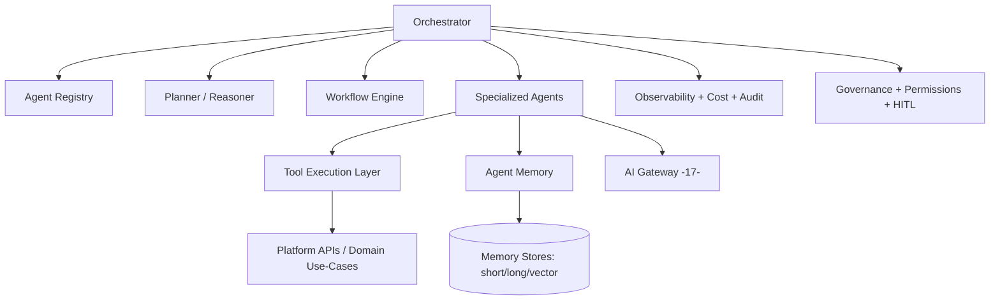

| Component | Responsibility |
| --- | --- |
| **Orchestrator** | Owns a task's plan, delegation, and aggregation of agent results. |
| **Planner/Reasoner** | Decomposes a goal into steps; selects agents/tools. |
| **Workflow Engine** | Executes deterministic/declarative workflows with retries and compensation. |
| **Agent Registry** | Discoverable catalog of agents and capabilities ([§4](#4-agent-registry)). |
| **Agents** | Specialized workers ([§12](#12-specialized-agent-catalog)). |
| **Tool Execution Layer** | Safe, permissioned invocation of platform tools ([§9](#9-tool-execution)). |
| **Memory** | Short-term, long-term, and vector memory ([§5](#5-agent-memory)). |
| **AI Gateway** | All model calls route here ([17 §4](./17_AI_Architecture.md#4-ai-gateway)). |
| **Governance/Observability** | Permissions, HITL, tracing, cost. |

> **Framework stance.** The design is framework-agnostic (compatible with orchestration libraries or a custom engine). V1 favors **orchestrator-led** coordination over open-ended agent autonomy for safety and predictability.

---

## 3. Agent Anatomy & Lifecycle

### 3.1 Anatomy

Every agent is defined by a consistent contract: **role/goal, system prompt (versioned), allowed tools, memory scope, permissions, input/output schema, budget, and escalation policy**.

### 3.2 Lifecycle

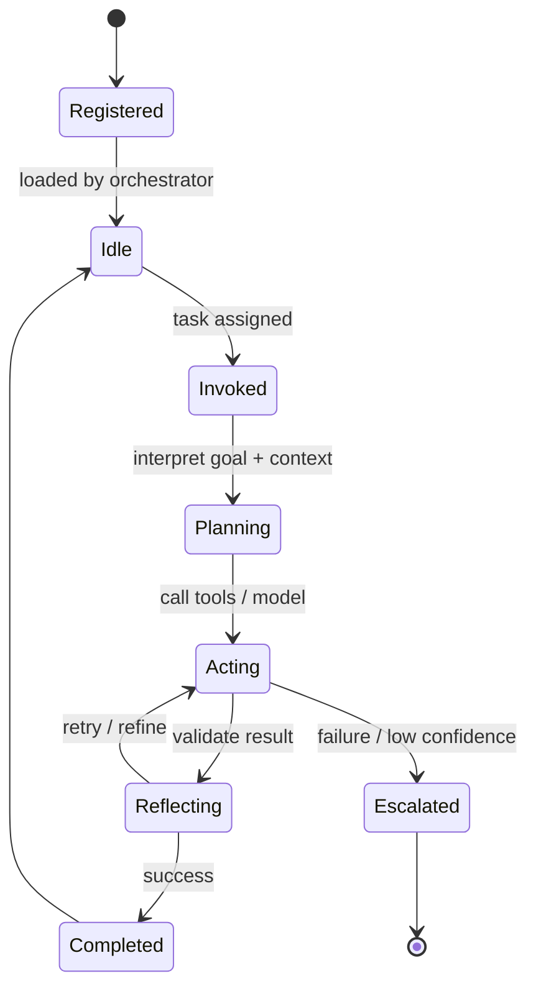

| Phase | Description |
| --- | --- |
| **Registered** | Declared in the registry with capabilities/permissions. |
| **Idle** | Available, not currently assigned. |
| **Invoked** | Assigned a task with scoped context. |
| **Planning** | Interprets goal, retrieves memory/context. |
| **Acting** | Calls tools/model via the gateway. |
| **Reflecting** | Validates output (schema, confidence, safety). |
| **Completed** | Returns structured result to orchestrator. |
| **Escalated** | Fails/low-confidence → fallback or human-in-the-loop ([§10](#10-security-permissions--governance)). |

---

## 4. Agent Registry

The registry is the **source of truth** for available agents and their capabilities, enabling discovery, versioning, and governance.

| Registry field | Purpose |
| --- | --- |
| **Agent id / name** | Stable identifier. |
| **Capabilities** | Declared tasks the agent can perform. |
| **Version** | Prompt/behavior version ([prompt versioning](./17_AI_Architecture.md#5-prompt-management)). |
| **Tools** | Whitelisted tools the agent may call. |
| **Permissions** | Roles/scopes required to invoke; data access. |
| **Budget** | Token/cost/latency ceilings. |
| **Status** | Enabled/deprecated; rollout flags. |

> The registry lets the orchestrator select agents by capability, and lets governance enable/disable agents per tenant/plan ([feature flags](./13_Subscription_Billing.md#13-feature-flags--entitlement-enforcement)).

---

## 5. Agent Memory

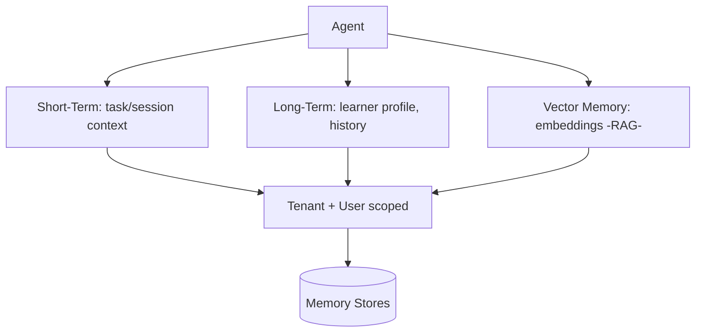

| Memory type | Scope | Contents | Retention |
| --- | --- | --- | --- |
| **Short-term** | Task/session | Current goal, recent turns, intermediate results | Ephemeral. |
| **Long-term** | User/tenant | Learner profile, weaknesses, progress, preferences | Durable, governed. |
| **Vector/semantic** | Tenant | Embeddings for retrieval ([RAG](./17_AI_Architecture.md#7-rag--knowledge-base-readiness)) | Durable, re-indexable. |
| **Shared workspace** | Workflow | Context passed between agents in a workflow ([§8](#8-agent-communication--context-sharing)) | Workflow-lifetime. |

> **Isolation.** All memory is **tenant- and user-scoped**; no agent reads memory outside its assigned scope ([Multi-Tenant §6](./12_Multi_Tenant_Architecture.md#6-tenant-isolation--cross-tenant-protection)). Long-term memory respects data privacy/retention ([17 §10](./17_AI_Architecture.md#10-ai-safety-moderation--privacy)).

---

## 6. Orchestration & Workflow Engine

The orchestrator coordinates agents via a **workflow engine** supporting sequential, parallel, and conditional steps with retries and compensation.

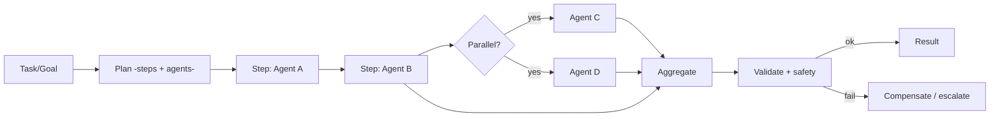

| Capability | Description |
| --- | --- |
| **Deterministic workflows** | Declarative step graphs for known processes ([§13](#13-orchestration-workflows)). |
| **Dynamic planning** | Planner composes steps for open-ended goals ([§7](#7-task-planning-delegation--reasoning)). |
| **Parallelism** | Independent agents run concurrently. |
| **Retries/backoff** | Per-step retry with limits ([AI gateway retries](./17_AI_Architecture.md#4-ai-gateway)). |
| **Compensation** | Roll back/adjust on partial failure (saga-style, [Event Storming §8](./08_Event_Storming.md)). |
| **Idempotency** | Steps are safe to re-run. |

---

## 7. Task Planning, Delegation & Reasoning

- **Planning:** decompose a goal into an ordered/looping set of steps mapped to agent capabilities.
- **Delegation:** assign each step to the best-fit agent from the registry, passing only the scoped context it needs (least privilege).
- **Reasoning:** agents may use structured reasoning (plan → act → reflect) with **bounded iterations** to prevent runaway loops.
- **Aggregation:** the orchestrator composes agent outputs into a validated final result.

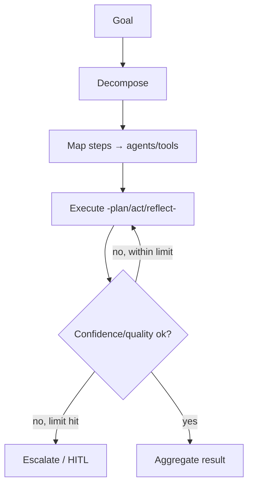

> **Loop safety.** Reasoning iterations, tool calls, and token spend are capped per task; exceeding a cap escalates rather than continues ([§10](#10-security-permissions--governance)).

---

## 8. Agent Communication & Context Sharing

- **V1: orchestrator-mediated.** Agents communicate through the orchestrator and a **shared workflow workspace**, not by arbitrary direct calls — this keeps flows auditable and safe.
- **Structured messages:** inter-step data uses typed, schema-validated envelopes ([structured output](./17_AI_Architecture.md#8-structured-output--response-validation)).
- **Context minimization:** each agent receives only the context needed for its step (privacy + cost).
- **Future A2A:** direct, protocol-based agent-to-agent messaging is a [future readiness](#14-future-readiness) item.

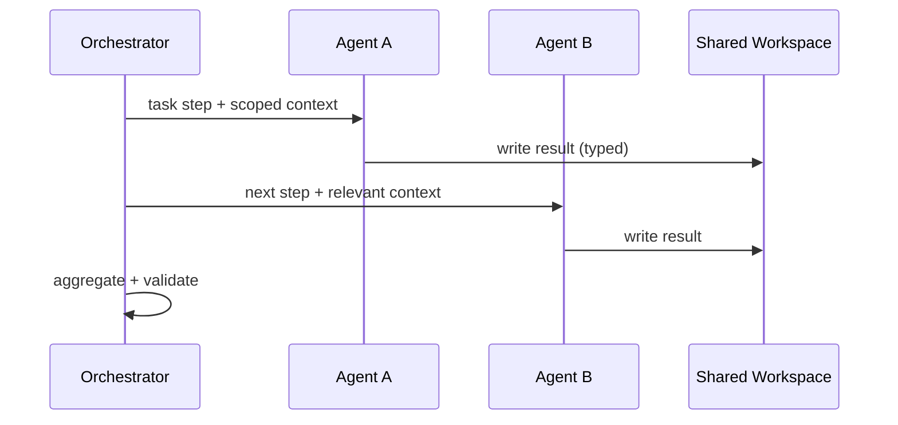

---

## 9. Tool Execution

Tools are the **only way agents affect the platform** (read data, create submissions, fetch analytics). Tool calls are permissioned and audited.

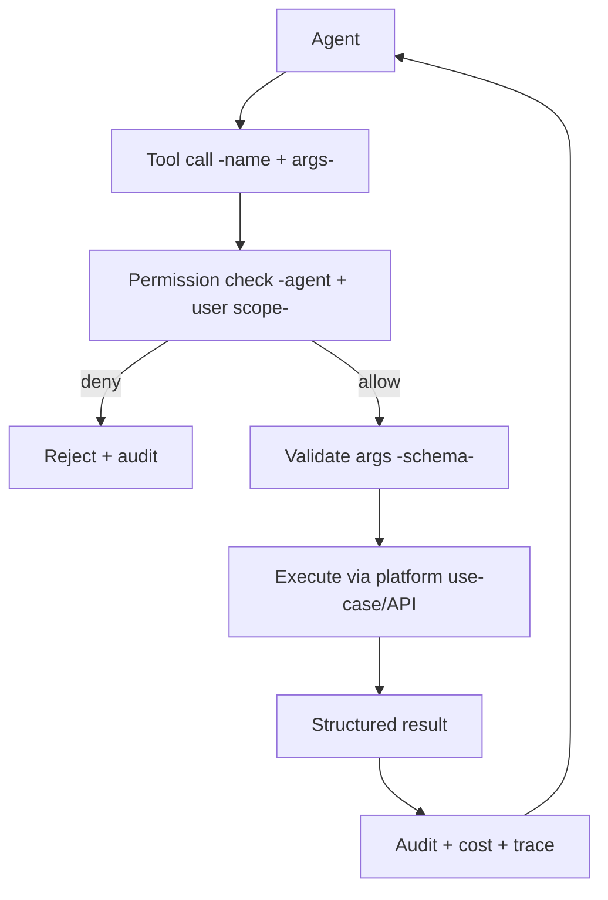

| Control | Standard |
| --- | --- |
| **Whitelisting** | Agents may call only registry-declared tools. |
| **Permission check** | Tool executes only within the invoking user's [permissions](./11_Authentication_Authorization.md#10-authorization-strategy) and tenant scope. |
| **Schema validation** | Tool args/results are schema-validated. |
| **Side-effect safety** | Mutating tools are idempotent and audited ([Backend audit](./15_Backend_Architecture.md#15-exception-handling-logging--auditing)). |
| **Sandboxing** | Tools run through platform use-cases, never raw system access. |

### 9.1 AI Request Lifecycle

How a single agent turn reaches a model (reusing the [AI Gateway](./17_AI_Architecture.md#4-ai-gateway)):

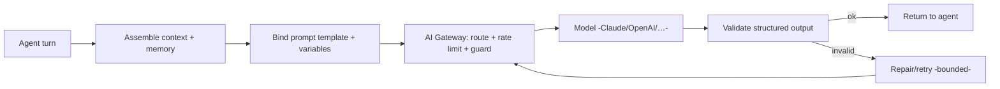

### 9.2 Prompt Lifecycle

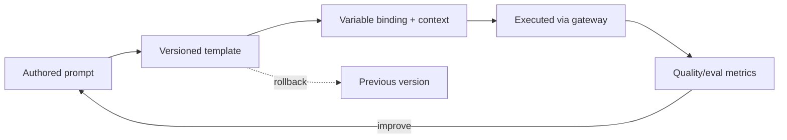

> Prompts are **versioned, evaluated, and rollback-capable** ([17 §5](./17_AI_Architecture.md#5-prompt-management)); agent behavior changes are governed changes, not ad-hoc edits.

---

## 10. Security, Permissions & Governance

| Concern | Approach |
| --- | --- |
| **Least privilege** | Agents/tools run within the invoking user's roles and tenant; no ambient elevation. |
| **Tenant isolation** | Memory, tools, and data strictly tenant-scoped ([12 §6](./12_Multi_Tenant_Architecture.md#6-tenant-isolation--cross-tenant-protection)). |
| **Prompt-injection defense** | Untrusted content is treated as data; system prompts/tools are protected ([17 §10](./17_AI_Architecture.md#10-ai-safety-moderation--privacy)). |
| **Budgets & rate limits** | Per-task/agent token, cost, iteration, and tool-call caps. |
| **Human-in-the-loop** | High-stakes outputs (final scores, account/billing actions) can require human approval. |
| **Escalation** | Low confidence/failure escalates to a fallback agent or human ([§3.2](#32-lifecycle)). |
| **Auditability** | Every plan, delegation, tool call, and model call is logged with correlation + tenant ids. |
| **Responsible AI** | Explainability, bias checks, and content safety governed centrally ([§14](#14-future-readiness)). |

---

## 11. Observability & Cost Tracking

| Signal | What is captured |
| --- | --- |
| **Tracing** | End-to-end trace per task across orchestrator → agents → tools → models ([OpenTelemetry](./15_Backend_Architecture.md#16-observability-health-metrics-tracing)). |
| **Cost** | Tokens/cost per agent, per task, per tenant ([17 §11](./17_AI_Architecture.md#11-token-cost--quality-governance)). |
| **Latency** | Per-step and end-to-end latency. |
| **Quality** | Confidence, validation pass/fail, escalation rate. |
| **Audit** | Immutable record of decisions and tool effects. |

---

## 12. Specialized Agent Catalog

Each agent below is defined by **Purpose, Responsibilities, Inputs, Outputs, Tools, Memory, Permissions, Failure Handling, Escalation, Dependencies, Observability**. All call models via the [AI Gateway](./17_AI_Architecture.md#4-ai-gateway) and respect [RBAC](./11_Authentication_Authorization.md#11-roles--permission-matrix) + [entitlements](./13_Subscription_Billing.md#2-subscription-plans--feature-matrix).

> **Common defaults (apply to all agents unless overridden):** Memory = short-term task context + user long-term profile (tenant-scoped); Permissions = invoking user's role/tenant; Failure Handling = validate → retry (bounded) → fallback; Escalation = orchestrator → human-in-the-loop for high-stakes; Observability = trace + cost + quality per invocation.

### 12.1 Learning & Coaching Agents

| Agent | Purpose | Inputs | Outputs | Key Tools | Escalation |
| --- | --- | --- | --- | --- | --- |
| **Grammar Agent** | Detect/explain grammar errors | Learner text | Structured corrections + rules | Grammar analysis, content fetch | Low confidence → Writing Examiner |
| **Vocabulary Agent** | Improve lexical range | Text, target level | Suggestions, collocations | Lexicon lookup, content fetch | — |
| **Sentence Builder Agent** | Scaffold better sentences | Sentence/prompt | Rewrites, patterns | Grammar/lexicon tools | — |
| **Reading Coach Agent** | Reading strategy + explanations | Passage, answers | Guidance, rationale | Content fetch, question analysis | — |
| **Listening Coach Agent** | Listening strategy + explanations | Audio transcript, answers | Guidance, rationale | Transcript fetch, analysis | — |
| **Tutor Agent** | Reactive Q&A scoped to IELTS prep (Phase 7 Sprint 4) | Learner question, conversation history | Grounded answer, or a redirect if out of scope | Conversation memory, code-level scope guard | Out-of-scope question → redirected without a model call |
| **Teacher Agent** | Deliver a structured, sequenced lesson — student-facing; the AI *is* the teacher, no human in the loop (Phase 7 Sprint 4) | Lesson id/topic, learner response per step | Step content (explain/check/practice/recap) + completion signal | Conversation memory, lesson step-state machine | Repeated failed comprehension check → bounded retry cap, then forced advance |

> **Disambiguation:** **Teacher Agent** (above, §12.1) is not **Teacher Assistant Agent** (§12.4) — the
> former delivers lessons to a *student* with no human teacher present; the latter assists a *human
> Teacher role user* with grading/cohort insights. They were easy to conflate before this row existed;
> don't merge them.

### 12.2 Assessment & Prediction Agents

| Agent | Purpose | Inputs | Outputs | Key Tools | Escalation |
| --- | --- | --- | --- | --- | --- |
| **Writing Examiner Agent** | Score writing on IELTS criteria | Essay, task type | Band per criterion + feedback | Rubric, plagiarism/similarity check | Low confidence/dispute → human review (HITL) |
| **Speaking Examiner Agent** | Score speaking | Audio/transcript | Band per criterion + feedback | Transcription, rubric | Low confidence → human review |
| **Band Predictor Agent** | Predict overall band | History, recent scores | Predicted band + confidence | Analytics, profile fetch | Wide interval → recommend more practice |
| **Mock Exam Agent** | Run/review full mock exams | Exam config, responses | Section scores + review | Exam orchestration, scoring tools | Section failure → retry section |
| **Progress Analysis Agent** | Analyze trends/weaknesses | Historical performance | Weakness profile, trends | Analytics, profile | — |

### 12.3 Planning & Personalization Agents

| Agent | Purpose | Inputs | Outputs | Key Tools | Escalation |
| --- | --- | --- | --- | --- | --- |
| **Study Planner Agent** | Build/adjust study plans | Goals, availability, level | Structured plan | Plan store, calendar | Conflicts → Recommendation Agent |
| **Learning Recommendation Agent** | Recommend next actions | Weakness profile, progress | Ranked recommendations | Analytics, content catalog | — |
| **Content Generation Agent** | Generate practice items | Topic, difficulty, type | Validated question sets | Question templates, validators | Validation fail → regenerate |

### 12.4 Role & Operations Agents

| Agent | Purpose | Inputs | Outputs | Key Tools | Permissions / Escalation |
| --- | --- | --- | --- | --- | --- |
| **Teacher Assistant Agent** | Grading assist, cohort insights | Class data, submissions | Suggestions, summaries | Cohort analytics, grading assist | Teacher role; final grade = teacher/HITL |
| **Institute Assistant Agent** | Institute-level insights/ops | Org data | Summaries, actions | Org analytics, reporting | TenantAdmin role |
| **Support Agent** | Resolve support queries | User query, context | Answers + next steps | Knowledge base, ticket tools | Unresolved → human support |
| **Admin Agent** | Ops/config assistance | Admin request | Guarded actions/summaries | Config/read tools | SuperAdmin/TenantAdmin; sensitive = HITL |
| **Subscription Assistant Agent** | Billing/plan guidance | Account/plan context | Guidance, safe actions | Billing read, plan info | Billing actions = HITL/confirm ([13](./13_Subscription_Billing.md)) |
| **Reporting Agent** | Generate reports | Report request, scope | Structured reports | Reporting, export tools | Scoped to tenant/role |
| **Analytics Agent** | Natural-language analytics | Question, dataset scope | Charts + summaries | Analytics query tools | Scoped to tenant/role |

> **Cross-cutting dependencies:** all agents depend on the [AI Gateway](./17_AI_Architecture.md#4-ai-gateway), [Agent Memory](#5-agent-memory), [Tool Execution](#9-tool-execution), and [Governance](#10-security-permissions--governance). High-stakes agents (Writing/Speaking Examiner, Band Predictor, Admin, Subscription) default to **human-in-the-loop** for final, irreversible, or account-affecting outputs.

---

## 13. Orchestration Workflows

Each workflow is a declarative composition of agents coordinated by the orchestrator. Failure handling and compensation follow [§6](#6-orchestration--workflow-engine).

### 13.1 Writing Evaluation Workflow

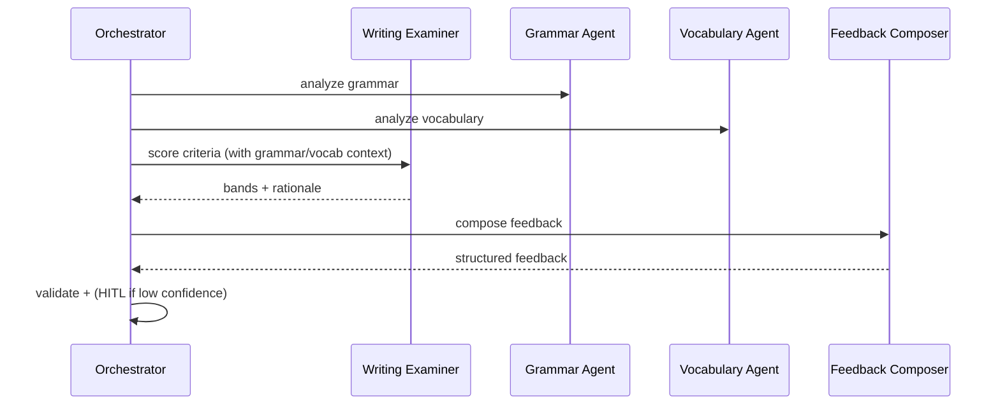

### 13.2 Speaking Evaluation Workflow

Transcribe → Speaking Examiner scores (fluency, lexical, grammar, pronunciation) → Feedback composition → validate → HITL if low confidence.

### 13.3 Daily Learning Workflow

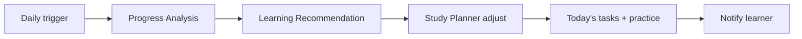

### 13.4 Weekly Assessment Workflow

Progress Analysis (week) → Weakness update → Band Predictor (interim) → Recommendation → report to learner/teacher.

### 13.5 Monthly Mock Exam Workflow

Mock Exam Agent runs full exam → section scoring (Reading/Listening auto; Writing/Speaking examiner agents) → aggregate → Band Predictor → review + recommendations.

### 13.6 Band Prediction Workflow

Gather history → Progress Analysis → Band Predictor → confidence check → (recommend practice if interval wide) → present prediction.

### 13.7 Learning Recommendation Workflow

Weakness profile + progress → Recommendation Agent ranks actions → Study Planner integrates → surface to learner.

### 13.8 Student Dashboard Workflow

On load: Progress Analysis + Recommendation + upcoming plan + Band prediction snapshot → Analytics Agent composes widgets ([Frontend dashboards](./16_Frontend_Architecture.md#16-charts-dashboards--widgets)).

### 13.9 Teacher Dashboard Workflow

Teacher Assistant aggregates cohort performance → flags at-risk students → suggests interventions → Reporting Agent prepares summaries.

### 13.10 Subscription Assistance Workflow

Subscription Assistant interprets request → billing read tools → proposes plan/action → **HITL/confirmation** for changes → executes via [billing](./13_Subscription_Billing.md#4-subscription-lifecycle).

### 13.11 Support Requests Workflow

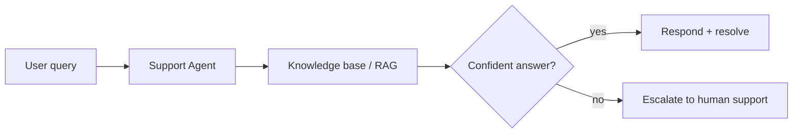

---

## 14. Future Readiness

| Area | Direction |
| --- | --- |
| **Model Context Protocol (MCP)** | Standardized tool/context exposure to agents via MCP servers. |
| **Agent-to-Agent (A2A)** | Direct, protocol-based agent messaging beyond orchestrator mediation. |
| **RAG** | Full retrieval-augmented generation over the knowledge base ([17 §7](./17_AI_Architecture.md#7-rag--knowledge-base-readiness)). |
| **Long-term memory** | Rich, durable learner memory with governance and forgetting policies. |
| **Knowledge graphs** | Structured domain knowledge for reasoning and explainability. |
| **Vector search** | Semantic retrieval across content and history. |
| **Workflow automation** | User/tenant-authored agent workflows. |
| **Enterprise AI governance** | Central policy, approval, and audit for agent behavior. |
| **AI evaluation & testing** | Automated eval suites, regression tests for agents/prompts. |
| **Responsible AI & explainability** | Bias monitoring, rationale surfacing, appeal paths. |
| **AI compliance** | Data residency, retention, and regulatory alignment ([NFR](./05_Non_Functional_Requirements.md)). |

---

## 15. Related Documents

| # | Document | Relationship |
| --- | --- | --- |
| 05 | [Non-Functional Requirements](./05_Non_Functional_Requirements.md) | AI performance, safety, compliance NFRs. |
| 07 | [Domain-Driven Design](./07_Domain_Driven_Design.md) | Contexts agents operate within. |
| 08 | [Event Storming](./08_Event_Storming.md) | Workflows, sagas, compensation. |
| 11 | [Authentication & Authorization](./11_Authentication_Authorization.md) | Agent/tool permissions. |
| 12 | [Multi-Tenant Architecture](./12_Multi_Tenant_Architecture.md) | Tenant scoping of agents/memory. |
| 13 | [Subscription & Billing](./13_Subscription_Billing.md) | Entitlements, subscription agent. |
| 15 | [Backend Architecture](./15_Backend_Architecture.md) | Jobs, observability, audit. |
| 16 | [Frontend Architecture](./16_Frontend_Architecture.md) | Agent-driven dashboards/UX. |
| 17 | [AI Architecture](./17_AI_Architecture.md) | AI gateway, prompts, safety reused by agents. |

---

*End of Document — 18 Agentic AI Architecture (v1.0).*