# Infrastructure & Deployment Architecture — IELTS LMS AI

| Field | Value |
| --- | --- |
| **Product Name** | IELTS LMS AI |
| **Document** | 19 — Infrastructure & Deployment Architecture |
| **Version** | 1.0 |
| **Status** | Architecture & Planning |
| **Document Owner** | Principal Cloud / DevOps / SRE Architecture |
| **Last Updated** | 2026-07-18 |
| **Audience** | DevOps, SRE, Platform Engineers, Backend Engineers, Security, Architecture, Cost/FinOps |
| **Aligns With** | [01_Product_Vision.md](./01_Product_Vision.md) … [18_Agentic_AI_Architecture.md](./18_Agentic_AI_Architecture.md) |

> **Purpose of this document.** This document defines the complete **cloud infrastructure and deployment architecture** for IELTS LMS AI. It describes how the platform runs today (**Docker Compose**) and how it evolves to **Kubernetes** and managed **Azure / AWS / Google Cloud** services at enterprise SaaS scale. It is **implementation-independent** — no Dockerfiles, Compose files, Kubernetes manifests, or Terraform — but prescriptive enough to build an operational blueprint from. It realizes the [Non-Functional Requirements (05)](./05_Non_Functional_Requirements.md) (availability, scalability, DR, backup, observability), packages the [Backend (15)](./15_Backend_Architecture.md) and [Frontend (16)](./16_Frontend_Architecture.md), and hosts the [AI (17)](./17_AI_Architecture.md) and [Agentic AI (18)](./18_Agentic_AI_Architecture.md) layers. Security controls are cross-referenced to [Security Standards (20)](./20_Security_Standards.md).

---

## Table of Contents

1. [Infrastructure Overview](#1-infrastructure-overview)
2. [Deployment Strategy & Environments](#2-deployment-strategy--environments)
3. [Development Environment](#3-development-environment)
4. [Cloud Readiness Principles](#4-cloud-readiness-principles)
5. [Containerization Strategy](#5-containerization-strategy)
6. [Docker Compose Strategy (Current)](#6-docker-compose-strategy-current)
7. [Future Kubernetes Architecture](#7-future-kubernetes-architecture)
8. [Reverse Proxy, SSL/TLS & DNS](#8-reverse-proxy-ssltls--dns)
9. [Configuration, Environment Variables & Secrets](#9-configuration-environment-variables--secrets)
10. [Data Services: PostgreSQL, Redis, Object Storage](#10-data-services-postgresql-redis--object-storage)
11. [File Storage & CDN Strategy](#11-file-storage--cdn-strategy)
12. [Background Jobs, Caching, Messaging & Event Bus](#12-background-jobs-caching-messaging--event-bus)
13. [Observability: Monitoring, Logging, Health, Metrics, Tracing](#13-observability-monitoring-logging-health-metrics-tracing)
14. [Backup, Restore & Disaster Recovery](#14-backup-restore--disaster-recovery)
15. [High Availability, Auto-Scaling & Load Balancing](#15-high-availability-auto-scaling--load-balancing)
16. [Cost Optimization](#16-cost-optimization)
17. [Infrastructure Security](#17-infrastructure-security)
18. [Deployment Workflow & Progressive Delivery](#18-deployment-workflow--progressive-delivery)
19. [Infrastructure Evolution Roadmap](#19-infrastructure-evolution-roadmap)
20. [Assumptions, Constraints & Risks](#20-assumptions-constraints--risks)
21. [Related Documents](#21-related-documents)

---

## 1. Infrastructure Overview

IELTS LMS AI is a **multi-tenant, AI-first SaaS** built as a [modular monolith (14)](./14_Clean_Architecture.md) with a stateless API, a static SPA/PWA client, and stateful backing services (PostgreSQL, Redis, object storage). Infrastructure is designed to run identically from a laptop to a multi-region cloud, changing only *where* services run — not *how* the application is built.

| Attribute | Position |
| --- | --- |
| **Current target** | Docker Compose (single host, dev/staging parity) |
| **Near-term target** | Kubernetes (managed: AKS / EKS / GKE) |
| **Cloud strategy** | Cloud-agnostic core; managed services per provider ([§4](#4-cloud-readiness-principles)) |
| **Scale target** | Millions of users; horizontal stateless scaling ([NFR-SCAL](./05_Non_Functional_Requirements.md#3-scalability-scal)) |
| **Statefulness** | API/workers stateless; state externalized to DB/cache/storage |
| **Tenancy** | Shared DB, `TenantId`-scoped ([12](./12_Multi_Tenant_Architecture.md)) |
| **AI** | Provider-agnostic behind the [AI Gateway (17)](./17_AI_Architecture.md#4-ai-gateway) |

### 1.1 Logical System Context

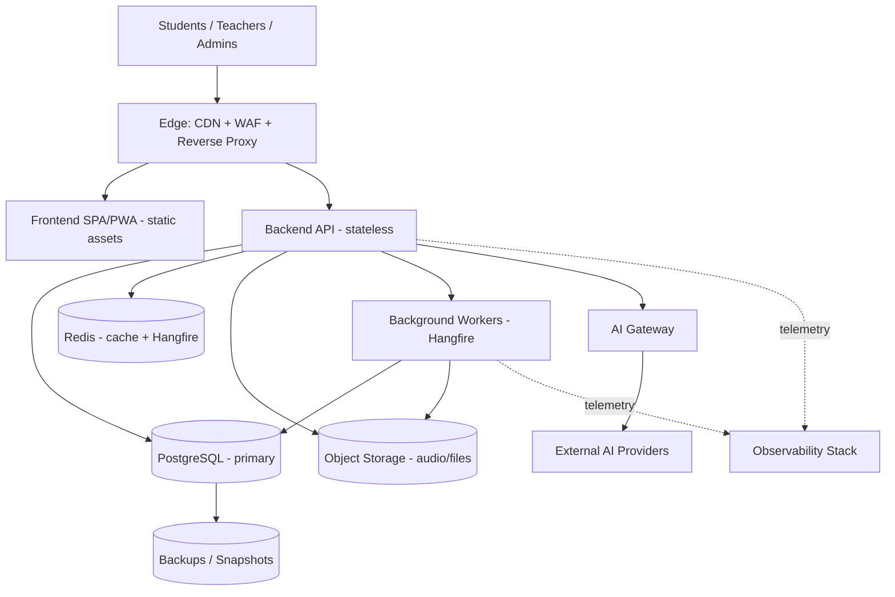

### 1.2 Core Principles

| Principle | Meaning | Reference |
| --- | --- | --- |
| **Parity** | Dev, test, staging, prod differ only in scale/config, not architecture. | [§2](#2-deployment-strategy--environments) |
| **Immutable artifacts** | One image promoted across environments; config injected at runtime. | [§5](#5-containerization-strategy) |
| **Stateless compute** | No local session/state; enables horizontal scale + rolling deploys. | [NFR-SCAL-001](./05_Non_Functional_Requirements.md#3-scalability-scal) |
| **Externalized state** | DB, cache, storage, jobs are managed/clustered services. | [§10](#10-data-services-postgresql-redis--object-storage) |
| **Everything observable** | Health, metrics, logs, traces are first-class. | [§13](#13-observability-monitoring-logging-health-metrics-tracing) |
| **Secure by default** | TLS everywhere; secrets never in images; least privilege. | [Security (20)](./20_Security_Standards.md) |
| **Cloud-agnostic core** | Portable containers; provider services chosen per deployment. | [§4](#4-cloud-readiness-principles) |

---

## 2. Deployment Strategy & Environments

The platform uses **four canonical environments** with strict configuration parity and progressively stronger controls.

| Environment | Purpose | Topology | Data | Access |
| --- | --- | --- | --- | --- |
| **Local Development** | Feature dev, debugging | Docker Compose on developer machine | Seeded/synthetic | Developer only |
| **Testing / CI** | Automated tests, integration, contract | Ephemeral containers per pipeline run | Ephemeral, disposable | CI system |
| **Staging** | Pre-prod validation, UAT, perf/security tests | Compose or K8s mirror of prod | Anonymized prod-like | Internal teams |
| **Production** | Live tenant traffic | Kubernetes (target) / Compose (interim) | Real tenant data (Restricted) | SRE + audited |

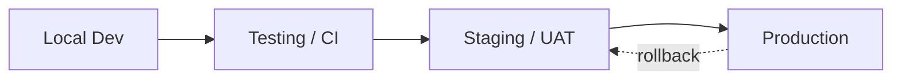

| Rule | Rationale |
| --- | --- |
| Same container image flows Dev → CI → Staging → Prod | Eliminates "works on my machine"; config-only differences. |
| No manual changes in Staging/Prod | All changes via pipeline + IaC (future) for auditability. |
| Production data never flows downward un-anonymized | Privacy/GDPR ([Security §GDPR](./20_Security_Standards.md#22-gdpr-readiness--data-subject-rights)). |
| Each environment has isolated secrets & credentials | Blast-radius containment ([§9](#9-configuration-environment-variables--secrets)). |

---

## 3. Development Environment

### 3.1 Local Development

Local development runs the full stack via **Docker Compose** so every engineer has a production-shaped environment.

| Concern | Local approach |
| --- | --- |
| Compute | API + workers as containers (or run API on host against containerized deps) |
| Database | PostgreSQL container with seeded tenants/users |
| Cache/Jobs | Redis container (cache + Hangfire storage) |
| Object storage | S3-compatible container (e.g., MinIO) emulating cloud storage |
| Reverse proxy | NGINX container terminating a local TLS cert |
| AI | Mock/stub provider or dev API key with tight quotas ([17 §Providers](./17_AI_Architecture.md#4-ai-gateway)) |
| Frontend | Vite dev server ([16 §19](./16_Frontend_Architecture.md)) proxied through NGINX |

### 3.2 Testing Environment

| Test type | Environment shape | Notes |
| --- | --- | --- |
| Unit | No infra | Runs in CI runner directly. |
| Integration | Ephemeral containers (Testcontainers-style) | Real Postgres/Redis per run, torn down after. |
| Contract | Stub AI providers | Validates API/AI-gateway contracts. |
| E2E | Compose-based full stack | Playwright against a booted stack ([16 §21](./16_Frontend_Architecture.md)). |
| Load/perf | Staging-scale | Validates [NFR-PERF/SCAL](./05_Non_Functional_Requirements.md#2-performance-perf). |

### 3.3 Staging Environment

Staging mirrors production topology at reduced scale: same images, same proxy/TLS model, anonymized data, real (sandbox) integrations for [Stripe billing (13)](./13_Subscription_Billing.md) and AI providers. It is the gate for UAT, performance, and security validation before release.

### 3.4 Production Environment

Production runs the highly available topology in [§15](#15-high-availability-auto-scaling--load-balancing): multiple stateless API replicas behind a load balancer, clustered Redis, managed PostgreSQL with replicas, redundant object storage, and full observability. See [§14](#14-backup-restore--disaster-recovery) for DR posture.

---

## 4. Cloud Readiness Principles

The platform is **cloud-agnostic at the core** and **cloud-native at the edges**: portable containers run anywhere, while each cloud contributes its best managed service for stateful concerns.

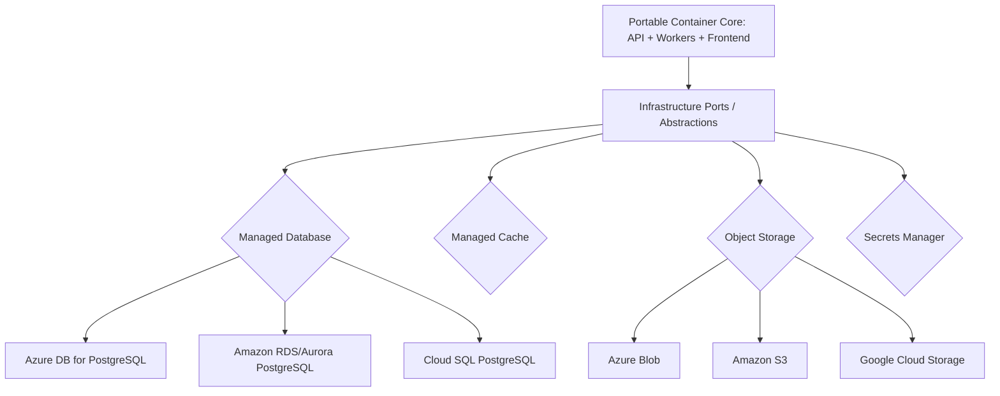

| Concern | Abstraction (V1) | Azure | AWS | Google Cloud |
| --- | --- | --- | --- | --- |
| Compute | Containers | AKS / Container Apps | EKS / ECS Fargate | GKE / Cloud Run |
| Database | PostgreSQL port | Azure DB for PostgreSQL Flexible | RDS / Aurora PostgreSQL | Cloud SQL PostgreSQL |
| Cache | Redis abstraction | Azure Cache for Redis | ElastiCache for Redis | Memorystore for Redis |
| Object storage | S3-compatible port | Azure Blob Storage | Amazon S3 | Cloud Storage |
| Secrets | Secrets provider | Key Vault | Secrets Manager / KMS | Secret Manager |
| CDN | CDN port | Azure Front Door / CDN | CloudFront | Cloud CDN |
| Queue/Bus (future) | Bus abstraction | Service Bus | SQS / SNS / EventBridge | Pub/Sub |
| Observability | OTel exporters | Azure Monitor | CloudWatch / X-Ray | Cloud Operations |

> **Rationale.** By programming to ports (per [Clean Architecture (14)](./14_Clean_Architecture.md)) and OpenTelemetry, the application binds to a cloud at *deploy* time, not *build* time — enabling the [multi-cloud roadmap (§19)](#19-infrastructure-evolution-roadmap) without rewrites.

---

## 5. Containerization Strategy

### 5.1 Image Principles

| Principle | Description |
| --- | --- |
| **Minimal base** | Slim, official runtime bases; no build tooling in runtime image. |
| **Multi-stage builds** | Build/test in one stage; ship only runtime artifacts. |
| **Non-root** | Containers run as an unprivileged user ([Security §Container](./20_Security_Standards.md#28-container-security)). |
| **Immutable + tagged** | Semver + git SHA tags; never rebuild for promotion. |
| **Read-only FS** | Root filesystem read-only where feasible; writable volumes explicit. |
| **Small attack surface** | Only required packages; scanned in CI ([Security §Dependency](./20_Security_Standards.md#26-vulnerability-management)). |
| **12-factor config** | Config/secrets injected via environment, not baked in. |

### 5.2 Container Inventory

| Container | Role | State | Scaling |
| --- | --- | --- | --- |
| `api` | ASP.NET Core Web API | Stateless | Horizontal (N replicas) |
| `worker` | Hangfire background jobs | Stateless (jobs in Redis/DB) | Horizontal by queue depth |
| `frontend` | Static SPA/PWA assets (served by NGINX/CDN) | Stateless | CDN-fronted |
| `proxy` | NGINX reverse proxy / TLS termination | Stateless | Behind LB in prod |
| `postgres` | PostgreSQL (dev/staging) | **Stateful** | Managed service in prod |
| `redis` | Cache + Hangfire store | **Stateful** | Clustered in prod |
| `objectstore` | S3-compatible storage (dev/staging) | **Stateful** | Managed service in prod |

> **Note.** In production, stateful containers are replaced by managed cloud services ([§4](#4-cloud-readiness-principles)); only stateless containers are scheduled by the orchestrator.

---

## 6. Docker Compose Strategy (Current)

Docker Compose is the **current deployment and development target**, chosen for fast onboarding, prod-shaped parity, and low operational overhead before Kubernetes.

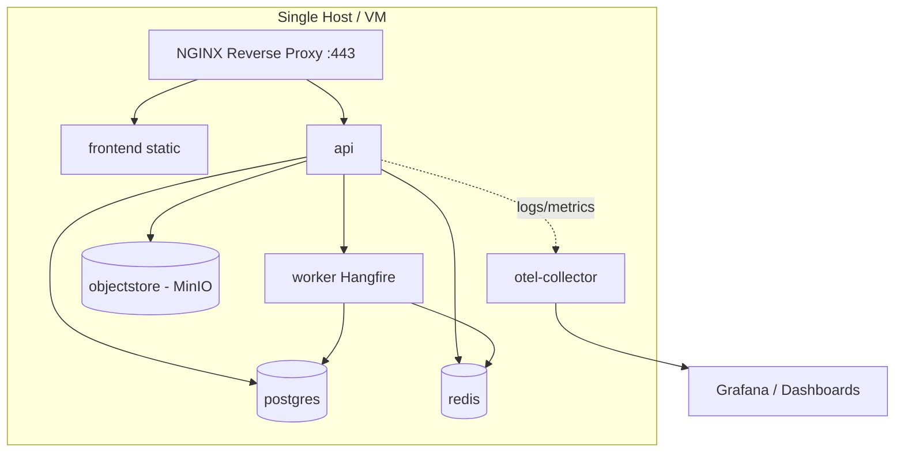

| Aspect | Strategy |
| --- | --- |
| **Composition** | Layered override files: base + `dev` / `test` / `staging` overrides. |
| **Networking** | Private bridge network; only the proxy exposes ports externally. |
| **Volumes** | Named volumes for Postgres/Redis/object data; backups target these. |
| **Health** | Compose healthchecks gate startup ordering (deps before app). |
| **Secrets** | Injected via env files / Docker/Compose secrets, never committed. |
| **Limits** | CPU/memory limits per service to model resource contention. |
| **Scaling** | `api`/`worker` can be scaled to multiple replicas behind the proxy. |

| Strength | Constraint (motivates K8s) |
| --- | --- |
| Simple, fast, reproducible | Single-host = no true HA / node redundancy |
| Great dev/staging parity | Limited auto-scaling and self-healing |
| Low cost | Manual orchestration of rollouts at scale |

---

## 7. Future Kubernetes Architecture

Kubernetes is the **near-term production target** for self-healing, horizontal scaling, and progressive delivery. The same images from Compose are deployed unchanged.

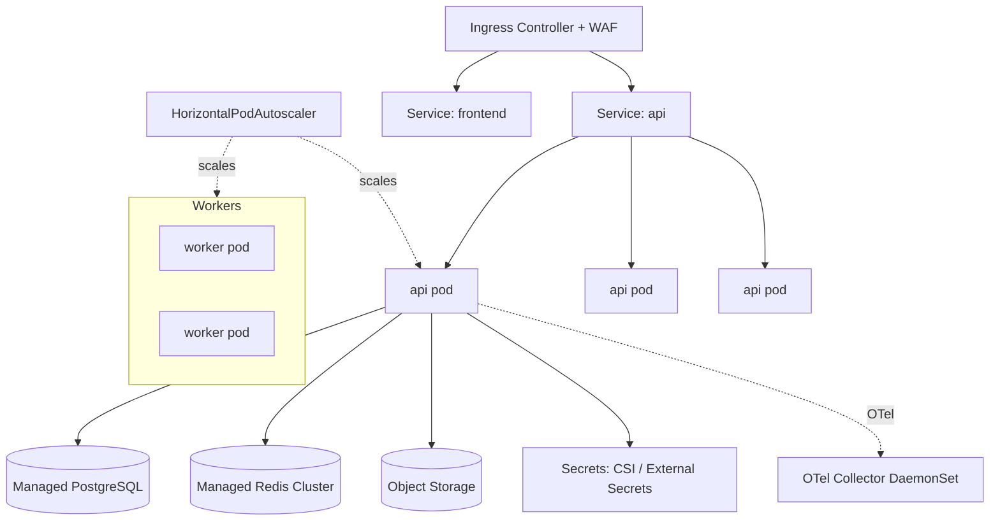

| Concern | Kubernetes approach |
| --- | --- |
| Workloads | API/worker/frontend as `Deployment`s; stateless, replicated. |
| Networking | `Service` + `Ingress`; internal service mesh optional (future). |
| Scaling | HPA on CPU/RAM + custom metrics (queue depth, RPS). |
| Config | `ConfigMap` for non-secret config; `Secret` via CSI/External Secrets. |
| Health | Liveness/readiness/startup probes bound to [health endpoints (§13)](#13-observability-monitoring-logging-health-metrics-tracing). |
| Rollouts | Rolling updates; Blue/Green & Canary via progressive delivery ([§18](#18-deployment-workflow--progressive-delivery)). |
| Storage | Stateful backing services are **managed cloud services**, not in-cluster. |
| Isolation | Namespaces per environment; NetworkPolicies default-deny. |
| Nodes | Multi-AZ node pools for HA ([§15](#15-high-availability-auto-scaling--load-balancing)). |

> **Decision.** Stateful data services stay **outside** the cluster (managed) even after K8s adoption, to simplify backup/DR and avoid running databases on Kubernetes at enterprise scale.

---

## 8. Reverse Proxy, SSL/TLS & DNS

### 8.1 Reverse Proxy (NGINX)

NGINX is the edge for the application: TLS termination, routing, compression, and static asset delivery. In Kubernetes this role is served by the **Ingress controller**; the responsibilities are identical.

| Responsibility | Detail |
| --- | --- |
| TLS termination | Terminates HTTPS; forwards to internal HTTP over private network. |
| Routing | `/api/*` → API service; everything else → SPA assets. |
| Compression | gzip/brotli for text assets. |
| Rate limiting (edge) | Coarse limits; fine-grained limits in API ([Security §Rate](./20_Security_Standards.md#211-rate-limiting-bot--brute-force-protection)). |
| Security headers | HSTS, CSP, etc. injected/enforced ([Security §Headers](./20_Security_Standards.md#210-security-headers)). |
| Upstream health | Removes unhealthy upstreams from rotation. |

### 8.2 SSL/TLS

| Aspect | Position |
| --- | --- |
| Protocol | TLS 1.2+ (prefer 1.3); weak ciphers disabled. |
| Certificates | Automated issuance/renewal (ACME/Let's Encrypt dev; managed certs / cert-manager prod). |
| HSTS | Enabled with long max-age + preload in prod. |
| Internal traffic | Private network in Compose; mTLS-ready via mesh in K8s (future). |
| Encryption in transit | Mandatory end-to-end ([NFR-ENC](./05_Non_Functional_Requirements.md), [Security §In Transit](./20_Security_Standards.md#182-encryption-in-transit)). |

### 8.3 DNS Strategy

| Aspect | Position |
| --- | --- |
| Model | Managed DNS (cloud provider or dedicated DNS). |
| Tenancy | Path/subdomain-based tenant routing ([12 §Routing](./12_Multi_Tenant_Architecture.md)); wildcard for future custom domains. |
| Failover | Health-checked records; latency/geo routing for [multi-region (§19)](#19-infrastructure-evolution-roadmap). |
| TTLs | Low TTLs on records subject to failover; higher on static records. |
| Custom domains (future) | Per-tenant vanity domains with automated cert provisioning. |

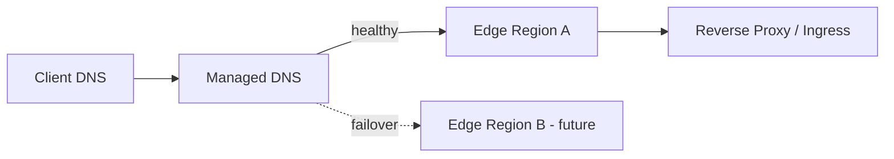

---

## 9. Configuration, Environment Variables & Secrets

### 9.1 Configuration Management

Configuration follows **12-factor**: config lives in the environment, layered by precedence, and never in the image.

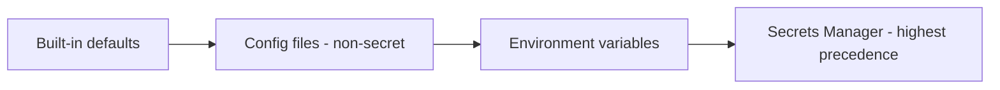

| Layer | Contents | Example |
| --- | --- | --- |
| Defaults | Safe non-secret defaults | Feature flags off, timeouts |
| Config files | Environment-shaped, non-secret | Log level, provider names |
| Env variables | Per-deployment overrides | DB host, replica counts |
| Secrets manager | Sensitive values | Connection strings, API keys, signing keys |

### 9.2 Secrets Management

| Rule | Detail | Reference |
| --- | --- | --- |
| Never in source/images | Secrets injected at runtime only. | [Security §Secrets](./20_Security_Standards.md#183-secrets-management) |
| Central store | Cloud secrets manager (Key Vault / Secrets Manager / Secret Manager). | [§4](#4-cloud-readiness-principles) |
| Least privilege | Each service reads only its own secrets. | [Security §Least Privilege](./20_Security_Standards.md#1-security-philosophy) |
| Rotation | JWT signing keys, DB creds, provider keys rotated on schedule. | [Security §Key Rotation](./20_Security_Standards.md#184-key-rotation) |
| Auditing | Secret access logged. | [Security §Audit](./20_Security_Standards.md#213-audit-logging) |
| K8s delivery | External Secrets / CSI driver mounts, not plain `Secret` in git. | [§7](#7-future-kubernetes-architecture) |

---

## 10. Data Services: PostgreSQL, Redis & Object Storage

### 10.1 PostgreSQL

| Aspect | Position | Reference |
| --- | --- | --- |
| Role | Primary relational store; multi-tenant shared DB. | [ERD (09)](./09_Database_Design_ERD.md) |
| Dev/staging | Containerized Postgres. | [§6](#6-docker-compose-strategy-current) |
| Production | Managed HA PostgreSQL with automated failover. | [§4](#4-cloud-readiness-principles) |
| Read scaling | Read replicas for reporting/analytics reads. | [§19](#19-infrastructure-evolution-roadmap) |
| Migrations | Versioned, forward-only, applied via pipeline gate. | [Backend §Persistence](./15_Backend_Architecture.md) |
| Connection mgmt | Pooling (app + external pooler at scale). | [NFR-DBP](./05_Non_Functional_Requirements.md) |
| Backups | Automated snapshots + PITR ([§14](#14-backup-restore--disaster-recovery)). | — |

### 10.2 Redis

| Use | Detail | Reference |
| --- | --- | --- |
| Distributed cache | Hot reads, session-less caching. | [Backend §Caching](./15_Backend_Architecture.md#11-caching--redis-strategy) |
| Hangfire storage | Background job queues/state. | [§12](#12-background-jobs-caching-messaging--event-bus) |
| Rate-limit counters | Distributed limiter state. | [Security §Rate](./20_Security_Standards.md#211-rate-limiting-bot--brute-force-protection) |
| Ephemeral coordination | Locks, short-lived tokens. | — |
| Production | Clustered/replicated managed Redis with failover. | [§15](#15-high-availability-auto-scaling--load-balancing) |

> **Rule.** Redis holds **derived/ephemeral** data only; loss must never lose durable business state.

### 10.3 Object Storage

| Aspect | Position |
| --- | --- |
| Contents | Speaking audio, uploads, generated reports/certificates, exports. |
| Interface | S3-compatible port; MinIO in dev, cloud storage in prod. |
| Access | Time-limited signed URLs; no public buckets ([Security §Storage](./20_Security_Standards.md#28-container-security)). |
| Lifecycle | Tiering + expiry per [data retention](./20_Security_Standards.md#23-data-retention). |
| Durability | Provider-managed replication/versioning. |

---

## 11. File Storage & CDN Strategy

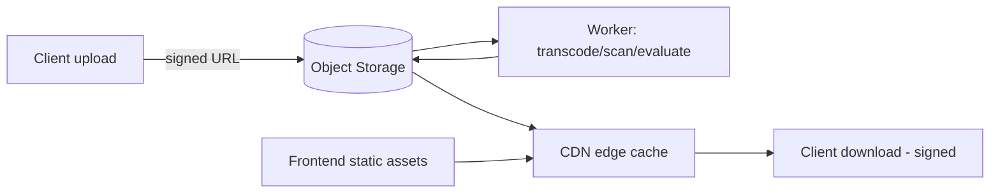

| Concern | Strategy |
| --- | --- |
| Uploads | Direct-to-storage via signed URLs to offload the API. |
| Virus/malware scan | Async scan on upload before processing ([Security §Upload](./20_Security_Standards.md#26-vulnerability-management)). |
| Frontend delivery | SPA/PWA static assets served from CDN with long-cache + hashed filenames. |
| Media delivery | Audio/report downloads via signed, expiring CDN URLs. |
| Cache invalidation | Content-hash filenames make deploys cache-safe. |
| Future global CDN | Multi-PoP edge for low-latency global delivery ([§19](#19-infrastructure-evolution-roadmap)). |

---

## 12. Background Jobs, Caching, Messaging & Event Bus

### 12.1 Background Jobs (Hangfire)

| Aspect | Position | Reference |
| --- | --- | --- |
| Engine | Hangfire, storage in Redis/PostgreSQL. | [Backend §12](./15_Backend_Architecture.md#12-background-jobs-hangfire) |
| Workloads | AI evaluation, notifications, billing sync, report/certificate generation, exports, cleanup. | [17](./17_AI_Architecture.md), [13](./13_Subscription_Billing.md) |
| Scaling | Dedicated `worker` deployment scaled by queue depth. | [§15](#15-high-availability-auto-scaling--load-balancing) |
| Reliability | Retries with backoff, idempotency, dead-letter handling. | [NFR-REL](./05_Non_Functional_Requirements.md) |
| Isolation | Separate queues per workload class (AI vs. transactional). | — |

### 12.2 Caching Tiers

| Tier | Location | Use |
| --- | --- | --- |
| Client | Browser / CDN | Static assets, cacheable GETs. |
| Edge | CDN / proxy | Public content, media. |
| Application | In-process | Very hot, short-lived lookups. |
| Distributed | Redis | Shared cache across replicas. |

### 12.3 Message Broker & Event Bus (Future)

The [outbox + integration events (Backend §9)](./15_Backend_Architecture.md#9-domain--integration-events) are already modeled, so a real broker slots in without domain change.

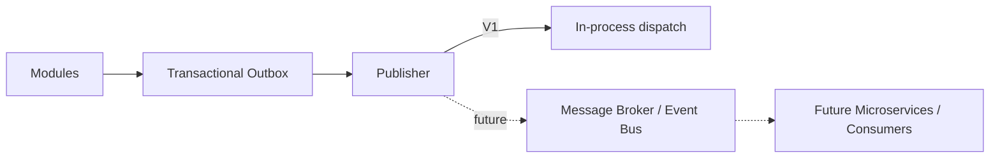

| Stage | Mechanism |
| --- | --- |
| V1 | In-process event dispatch backed by outbox. |
| Future | Managed bus (Service Bus / SNS-SQS-EventBridge / Pub/Sub) for cross-service events and microservice extraction. |

---

## 13. Observability: Monitoring, Logging, Health, Metrics, Tracing

Observability is standardized on **OpenTelemetry + Serilog** ([Backend §16](./15_Backend_Architecture.md#16-observability-health-metrics-tracing)) with pluggable backends per cloud.

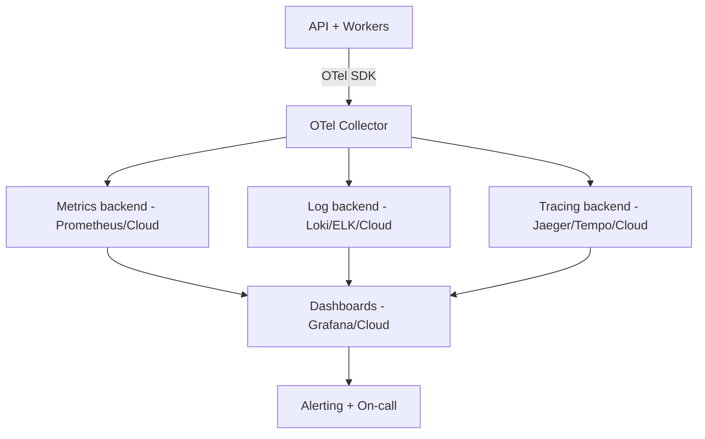

| Pillar | Approach | Reference |
| --- | --- | --- |
| **Health checks** | Liveness/readiness/startup endpoints; dependency probes (DB/Redis/storage/AI). | [§7](#7-future-kubernetes-architecture) |
| **Metrics** | RED/USE metrics, business KPIs (evaluations, exams), AI cost/latency. | [NFR-OBS/MON](./05_Non_Functional_Requirements.md) |
| **Logging** | Structured JSON logs, correlation IDs, tenant/user context (no PII/secrets). | [Security §Logging](./20_Security_Standards.md#212-logging-security) |
| **Tracing** | Distributed traces across API → jobs → AI gateway. | [17](./17_AI_Architecture.md) |
| **Alerting** | SLO-based alerts (availability, latency, error budget, queue depth). | [§15](#15-high-availability-auto-scaling--load-balancing) |
| **Dashboards** | Per-environment operational + AI-cost dashboards. | [18 §11](./18_Agentic_AI_Architecture.md#11-observability--cost-tracking) |

---

## 14. Backup, Restore & Disaster Recovery

### 14.1 Backup Strategy

| Data | Method | Frequency | Retention |
| --- | --- | --- | --- |
| PostgreSQL | Automated snapshots + continuous WAL (PITR) | Continuous + daily full | Per [retention policy](./20_Security_Standards.md#23-data-retention) |
| Object storage | Versioning + cross-region replication (prod) | Continuous | Policy-based lifecycle |
| Redis | Treated as ephemeral (rebuildable) | N/A | N/A |
| Secrets/config | Versioned in secrets manager | On change | Provider-managed |

### 14.2 Restore & DR Objectives

| Metric | Target (initial) | Reference |
| --- | --- | --- |
| **RPO** | ≤ 15 min (PITR) | [NFR-DR](./05_Non_Functional_Requirements.md) |
| **RTO** | ≤ 1–4 h (tiered by scenario) | [NFR-DR](./05_Non_Functional_Requirements.md) |
| Backup verification | Regular automated restore tests | [§18](#18-deployment-workflow--progressive-delivery) |
| DR drills | Periodic game-days | [NFR-BCP](./05_Non_Functional_Requirements.md) |

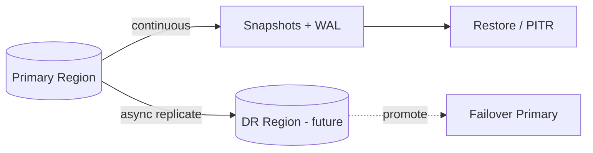

> **DR posture.** V1 relies on in-region managed redundancy + tested restores; a **dedicated DR region** with async replication is the enterprise target ([§19](#19-infrastructure-evolution-roadmap)).

---

## 15. High Availability, Auto-Scaling & Load Balancing

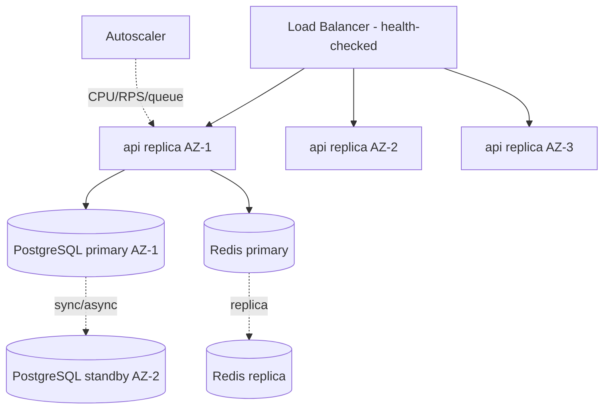

| Concern | Strategy | Reference |
| --- | --- | --- |
| **HA compute** | ≥ 2 API replicas across ≥ 2 AZs; no single point of failure. | [NFR-AVAIL](./05_Non_Functional_Requirements.md#4-availability-avail) |
| **HA data** | Managed Postgres with standby + automatic failover; Redis replication. | [§10](#10-data-services-postgresql-redis--object-storage) |
| **Load balancing** | L7 LB with health checks, TLS, sticky-free routing. | [§8](#8-reverse-proxy-ssltls--dns) |
| **Auto-scaling** | HPA on CPU/memory + custom metrics (RPS, queue depth); scale-out ≤ 2 min. | [NFR-SCAL-005](./05_Non_Functional_Requirements.md#3-scalability-scal) |
| **Graceful degradation** | AI/async work queues absorb bursts; core learning stays available. | [17](./17_AI_Architecture.md) |
| **Zero-downtime deploys** | Rolling updates with readiness gating. | [§18](#18-deployment-workflow--progressive-delivery) |

---

## 16. Cost Optimization

| Lever | Approach |
| --- | --- |
| Right-sizing | Resource requests/limits tuned from observed usage. |
| Elastic scaling | Scale in during off-peak (e.g., between mock windows). |
| Spot/preemptible | Non-critical workers on discounted capacity (future). |
| Storage tiering | Lifecycle old media/reports to cheaper tiers. |
| AI cost control | Model routing, caching, quotas, budgets ([17](./17_AI_Architecture.md), [18 §11](./18_Agentic_AI_Architecture.md#11-observability--cost-tracking)). |
| CDN offload | Serve static/media from edge, not origin. |
| Reserved capacity | Commit discounts for steady baseline (prod DB/compute). |
| FinOps visibility | Cost dashboards + tag/label allocation per environment/tenant tier. |

> **Principle.** Cost is a **design constraint**, especially for AI: async processing, caching, and quotas keep unit economics viable at millions of users.

---

## 17. Infrastructure Security

Infrastructure security is summarized here and defined fully in [Security Standards (20)](./20_Security_Standards.md).

| Layer | Control | Reference |
| --- | --- | --- |
| Network | Private networks, default-deny, segmented tiers, WAF at edge. | [Security §Cloud](./20_Security_Standards.md#29-infrastructure--cloud-security) |
| Transport | TLS everywhere; mTLS-ready internally. | [§8](#8-reverse-proxy-ssltls--dns) |
| Compute | Non-root, read-only FS, minimal images, scanned. | [Security §Container](./20_Security_Standards.md#28-container-security) |
| Identity | Workload identities; least-privilege IAM to cloud resources. | [Security §Least Privilege](./20_Security_Standards.md#1-security-philosophy) |
| Secrets | Central manager, rotation, no secrets in images. | [§9](#9-configuration-environment-variables--secrets) |
| Data | Encryption at rest + in transit; signed URLs; no public buckets. | [Security §Data](./20_Security_Standards.md#18-data-protection) |
| Supply chain | Image/dependency scanning, signed artifacts (future). | [Security §Vuln](./20_Security_Standards.md#26-vulnerability-management) |

---

## 18. Deployment Workflow & Progressive Delivery

### 18.1 CI/CD Pipeline

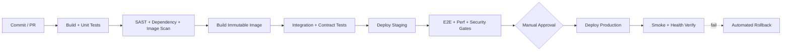

| Stage | Gate |
| --- | --- |
| Build | Compile + unit tests green. |
| Security | SAST, dependency, container scans pass ([Security §26](./20_Security_Standards.md#26-vulnerability-management)). |
| Integration | Contract + integration tests pass. |
| Staging | E2E, performance, and security checks pass. |
| Production | Approval + automated smoke verification; auto-rollback on failure. |

### 18.2 Deployment Strategies

| Strategy | Status | Use |
| --- | --- | --- |
| **Rolling** | V1 default | Zero-downtime replacement of replicas. |
| **Blue/Green** | Future | Instant switch + instant rollback for high-risk releases. |
| **Canary** | Future | Route small % of traffic to new version; auto-promote on healthy metrics. |

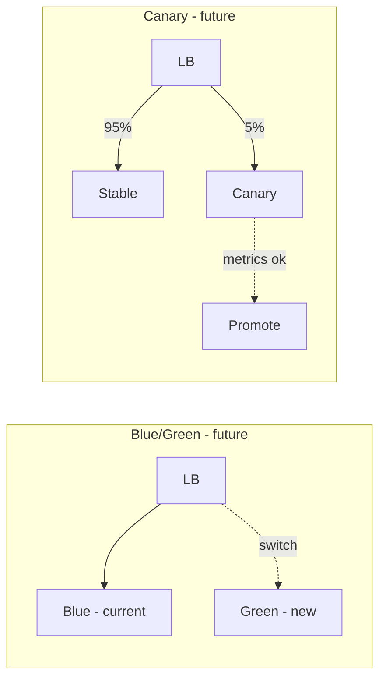

---

## 19. Infrastructure Evolution Roadmap

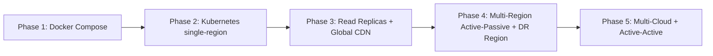

| Phase | Capability | Trigger | Reference |
| --- | --- | --- | --- |
| 1 | Docker Compose (current) | Launch / early tenants | [§6](#6-docker-compose-strategy-current) |
| 2 | Managed Kubernetes, single region | Scale/HA needs | [§7](#7-future-kubernetes-architecture) |
| 3 | Read replicas + global CDN | Read-heavy growth, global users | [§10](#10-data-services-postgresql-redis--object-storage), [§11](#11-file-storage--cdn-strategy) |
| 4 | Multi-region active-passive + DR region | RTO/RPO + resiliency | [§14](#14-backup-restore--disaster-recovery) |
| 5 | Multi-cloud / active-active | Enterprise/regulatory | [§4](#4-cloud-readiness-principles) |

| Future capability | Readiness today |
| --- | --- |
| **Multi-region** | Stateless compute, externalized state, DNS failover, region-agnostic config. |
| **Multi-cloud** | Cloud-agnostic containers + port abstractions + OTel. |
| **Global CDN** | Static/media already CDN-fronted with hashed assets. |
| **Read replicas** | Read/write separation anticipated in [ERD (09)](./09_Database_Design_ERD.md). |
| **DR region** | Backups + async replication design in [§14](#14-backup-restore--disaster-recovery). |

---

## 20. Assumptions, Constraints & Risks

### 20.1 Assumptions

| # | Assumption |
| --- | --- |
| A1 | The application remains stateless; all durable state is externalized. |
| A2 | A single logical PostgreSQL cluster (with replicas) suffices before enterprise sharding ([Backend §20.1](./15_Backend_Architecture.md#201-assumptions--future-considerations)). |
| A3 | Managed cloud services are available for DB/cache/storage/secrets in prod. |
| A4 | AI providers are external and metered; async processing absorbs latency/cost. |

### 20.2 Constraints

| # | Constraint |
| --- | --- |
| C1 | No application code, Dockerfiles, K8s manifests, or Terraform in this document set. |
| C2 | TLS and encryption at rest/in transit are mandatory in all shared environments. |
| C3 | Production changes flow only through the pipeline; no manual drift. |

### 20.3 Risks

| # | Risk | Impact | Mitigation |
| --- | --- | --- | --- |
| R1 | Single-host Compose lacks HA | Outage on host failure | Move prod to K8s ([§7](#7-future-kubernetes-architecture)) |
| R2 | AI provider outage/cost spikes | Degraded feedback, cost overrun | Multi-provider gateway, quotas, async ([17](./17_AI_Architecture.md)) |
| R3 | Database as scaling bottleneck | Latency at scale | Replicas, pooling, future sharding ([§10](#10-data-services-postgresql-redis--object-storage)) |
| R4 | Secret sprawl/leakage | Breach | Central secrets, rotation, scanning ([§9](#9-configuration-environment-variables--secrets)) |
| R5 | DR untested | Long RTO in disaster | Regular restore tests + drills ([§14](#14-backup-restore--disaster-recovery)) |

---

## 21. Related Documents

| # | Document | Relationship |
| --- | --- | --- |
| 05 | [Non-Functional Requirements](./05_Non_Functional_Requirements.md) | Availability, scalability, DR, backup, observability targets realized here. |
| 09 | [Database Design & ERD](./09_Database_Design_ERD.md) | Persistence, replicas, scaling path. |
| 13 | [Subscription & Billing](./13_Subscription_Billing.md) | Billing integration (Stripe) hosting/config. |
| 14 | [Clean Architecture](./14_Clean_Architecture.md) | Port abstractions enabling cloud-agnostic infra. |
| 15 | [Backend Architecture](./15_Backend_Architecture.md) | Services, jobs, caching, observability packaged here. |
| 16 | [Frontend Architecture](./16_Frontend_Architecture.md) | Static asset build/delivery via CDN. |
| 17 | [AI Architecture](./17_AI_Architecture.md) | AI gateway hosting, cost, async processing. |
| 18 | [Agentic AI Architecture](./18_Agentic_AI_Architecture.md) | Observability & cost tracking for agents. |
| 20 | [Security Standards](./20_Security_Standards.md) | Infrastructure, container, and cloud security controls. |
| 21 | [Development Roadmap](./21_Development_Roadmap.md) | Sequencing of infrastructure evolution. |

---

*End of Document — 19 Infrastructure & Deployment Architecture (v1.0).*
