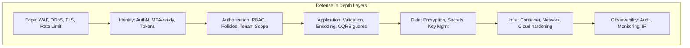
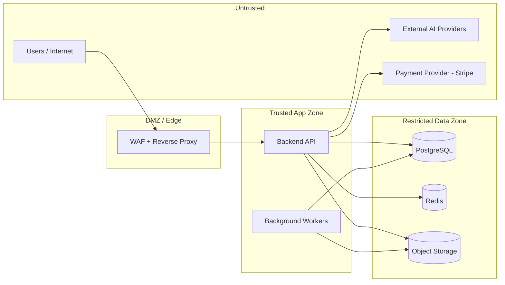
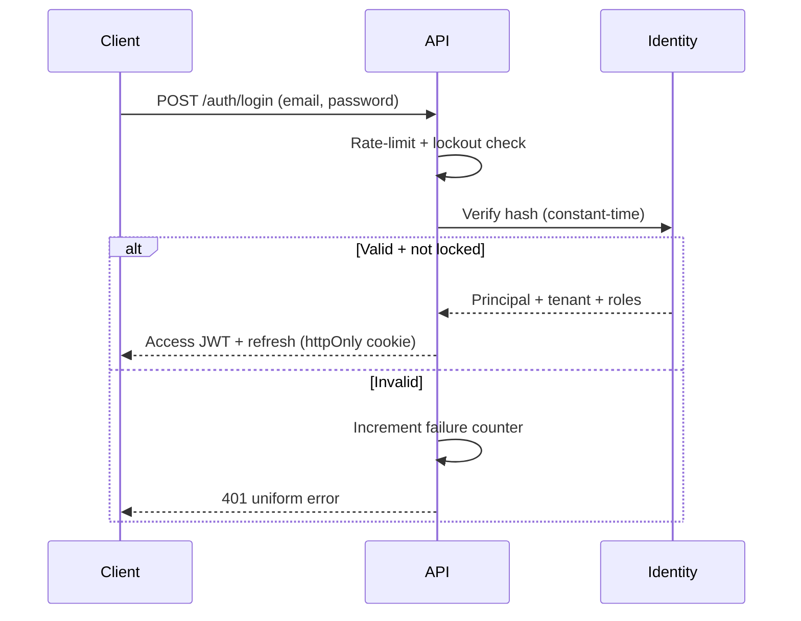
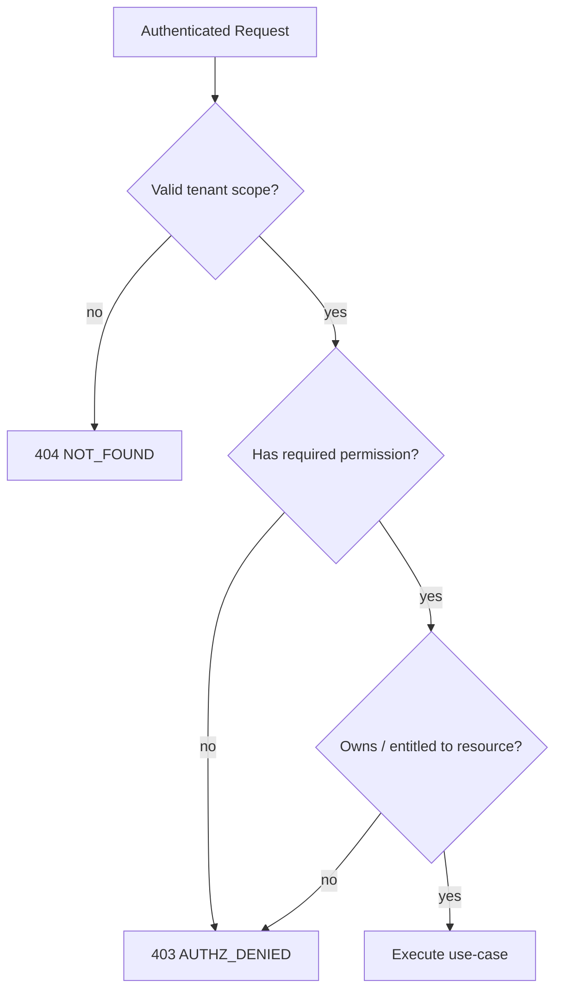
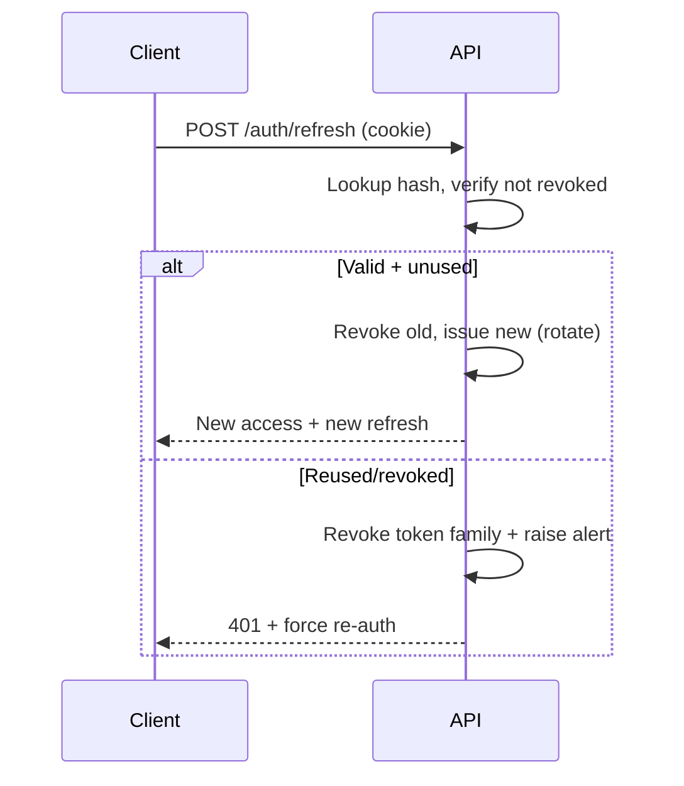
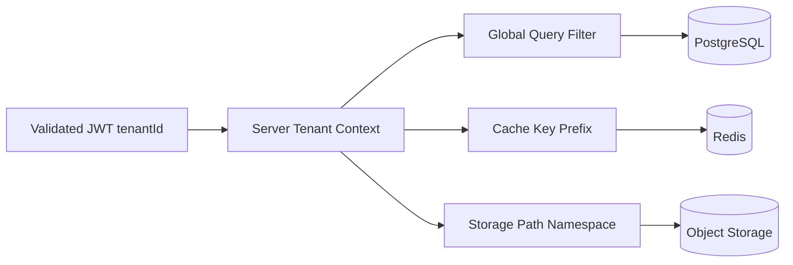
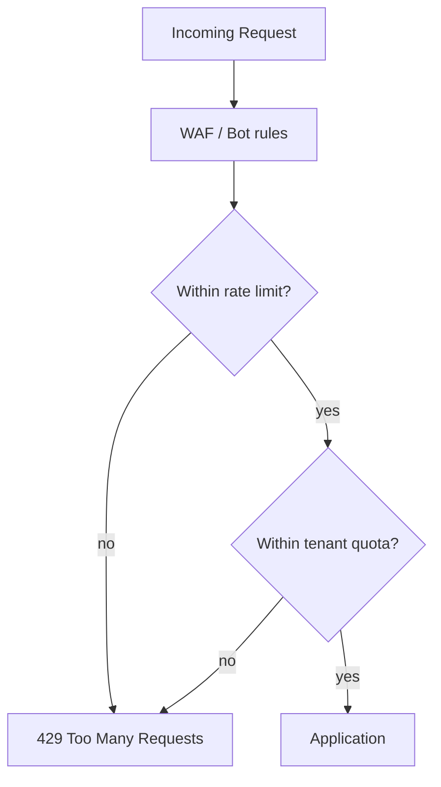
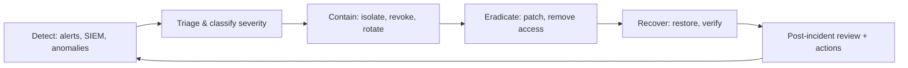
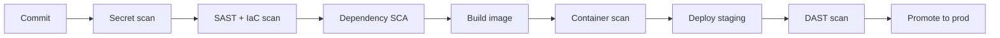
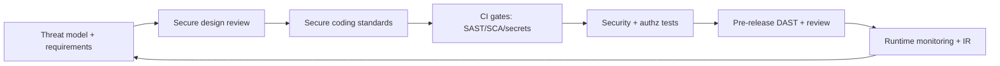

# Security Standards & Architecture — IELTS LMS AI

| Field | Value |
| --- | --- |
| **Product Name** | IELTS LMS AI |
| **Document** | 20 — Security Standards & Architecture |
| **Version** | 1.0 |
| **Status** | Architecture & Planning |
| **Document Owner** | Principal Security Architecture / CISO Office |
| **Last Updated** | 2026-07-18 |
| **Audience** | Security, Backend/Frontend Engineers, DevOps/SRE, Compliance, Architecture, Leadership |
| **Aligns With** | [01_Product_Vision.md](./01_Product_Vision.md) … [19_Infrastructure_Deployment.md](./19_Infrastructure_Deployment.md) |

> **Purpose of this document.** This document defines the complete **enterprise security architecture** for IELTS LMS AI, aligned to **OWASP Top 10**, **OWASP ASVS**, **OWASP API Security Top 10**, **CIS Benchmarks**, and the principles of **Zero Trust**, **Defense in Depth**, **Secure by Default**, and **Least Privilege**. It is **implementation-independent** — no code, policies-as-config, or scaffolding — and consolidates and extends the security posture set by the [IAM (11)](./11_Authentication_Authorization.md), [Multi-Tenant (12)](./12_Multi_Tenant_Architecture.md), [Security NFRs (05)](./05_Non_Functional_Requirements.md#6-security-sec), and [Infrastructure (19)](./19_Infrastructure_Deployment.md) documents. It is the authoritative security reference for the platform.

---

## Table of Contents

1. [Security Philosophy & Principles](#1-security-philosophy--principles)
2. [Threat Model](#2-threat-model)
3. [Authentication Security](#3-authentication-security)
4. [Authorization, RBAC & Permission Security](#4-authorization-rbac--permission-security)
5. [Token Security: JWT, Refresh, Session](#5-token-security-jwt-refresh-session)
6. [Password & Credential Security](#6-password--credential-security)
7. [API Security](#7-api-security)
8. [Tenant Isolation Security](#8-tenant-isolation-security)
9. [Data Protection: Encryption, Secrets, Key Rotation](#9-data-protection-encryption-secrets-key-rotation)
10. [Input Validation & Output Encoding](#10-input-validation--output-encoding)
11. [Web Attack Prevention: Injection, XSS, CSRF, Clickjacking](#11-web-attack-prevention-injection-xss-csrf-clickjacking)
12. [Security Headers](#12-security-headers)
13. [Rate Limiting, Bot, Brute-Force & Replay Protection](#13-rate-limiting-bot-brute-force--replay-protection)
14. [Logging, Audit & Monitoring Security](#14-logging-audit--monitoring-security)
15. [Incident Response & Security Alerts](#15-incident-response--security-alerts)
16. [Vulnerability Management: SCA, SAST, DAST](#16-vulnerability-management-sca-sast-dast)
17. [Container, Infrastructure & Cloud Security](#17-container-infrastructure--cloud-security)
18. [Backup Security](#18-backup-security)
19. [Compliance, Privacy & PII Handling](#19-compliance-privacy--pii-handling)
20. [Secure Development Lifecycle](#20-secure-development-lifecycle)
21. [Responsible Disclosure](#21-responsible-disclosure)
22. [Future Readiness: SOC 2, ISO 27001, Pen Testing](#22-future-readiness-soc-2-iso-27001-pen-testing)
23. [Assumptions, Constraints & Risks](#23-assumptions-constraints--risks)
24. [Related Documents](#24-related-documents)

---

## 1. Security Philosophy & Principles

Security at IELTS LMS AI is a **property of the architecture**, not a layer added at the end. Because the platform handles **student PII, exam integrity, payments, and AI-generated assessment**, trust is the product. Every request is treated as potentially hostile until proven otherwise.

| Principle | Meaning | Applied Where |
| --- | --- | --- |
| **Zero Trust** | Never trust, always verify; no implicit trust from network location. | [§3](#3-authentication-security), [§7](#7-api-security), [§17](#17-container-infrastructure--cloud-security) |
| **Defense in Depth** | Multiple independent controls; no single point of failure. | All sections |
| **Secure by Default** | Safe defaults; opt-in to risk, never opt-out of safety. | [§9](#9-data-protection-encryption-secrets-key-rotation), [§12](#12-security-headers) |
| **Least Privilege** | Every identity/service gets the minimum access needed. | [§4](#4-authorization-rbac--permission-security), [§8](#8-tenant-isolation-security) |
| **Fail Secure** | On error, deny rather than allow; degrade safely. | [§4](#4-authorization-rbac--permission-security), [§7](#7-api-security) |
| **Minimize attack surface** | Expose only what is required; disable the rest. | [§7](#7-api-security), [§17](#17-container-infrastructure--cloud-security) |
| **Data minimization** | Collect/retain/transmit only necessary data, especially to AI. | [§19](#19-compliance-privacy--pii-handling) |
| **Auditability** | Security-relevant actions are traceable and tamper-evident. | [§14](#14-logging-audit--monitoring-security) |

Standards mapping: this document maps each control area to **OWASP Top 10 (2021)**, **OWASP API Security Top 10 (2023)**, **OWASP ASVS L2** as the baseline verification target, and **CIS Benchmarks** for host/container/cloud hardening.

---

## 2. Threat Model

We use **STRIDE** to categorize threats and map them to controls. The threat model is a living artifact reviewed each release ([§20](#20-secure-development-lifecycle)).

### 2.1 Trust Boundaries

### 2.2 STRIDE Threat Register

| Threat (STRIDE) | Example Scenario | Primary Controls | Reference |
| --- | --- | --- | --- |
| **Spoofing** | Stolen token, credential stuffing, tenant impersonation | JWT validation, MFA-ready, refresh rotation, tenant claim binding | [§3](#3-authentication-security), [§5](#5-token-security-jwt-refresh-session) |
| **Tampering** | Modified request payloads, price tampering, exam answer injection | Server-side validation, integrity checks, immutable audit, signed webhooks | [§10](#10-input-validation--output-encoding), [§14](#14-logging-audit--monitoring-security) |
| **Repudiation** | User denies an action (grade change, deletion) | Tamper-evident audit log, correlation IDs, actor attribution | [§14](#14-logging-audit--monitoring-security) |
| **Information Disclosure** | Cross-tenant data leak, PII exposure, verbose errors | Tenant filters, encryption, least privilege, safe error contracts | [§8](#8-tenant-isolation-security), [§9](#9-data-protection-encryption-secrets-key-rotation) |
| **Denial of Service** | Volumetric attack, AI-cost exhaustion, expensive queries | Rate limiting, quotas, async queues, autoscaling, WAF | [§13](#13-rate-limiting-bot-brute-force--replay-protection), [Infra §15](./19_Infrastructure_Deployment.md#15-high-availability-auto-scaling--load-balancing) |
| **Elevation of Privilege** | Horizontal/vertical priv-esc, IDOR, role escalation | RBAC + policy checks, ownership checks, deny-by-default | [§4](#4-authorization-rbac--permission-security), [§7](#7-api-security) |

### 2.3 Key Assets & Abuse Cases

| Asset | Sensitivity | Abuse Case | Mitigation |
| --- | --- | --- | --- |
| Student PII & results | Restricted | Exfiltration, cross-tenant read | Encryption, tenant isolation, audit ([§8](#8-tenant-isolation-security)) |
| Credentials / tokens | Restricted | Theft, replay | Hashing, httpOnly cookies, rotation ([§5](#5-token-security-jwt-refresh-session), [§6](#6-password--credential-security)) |
| Exam content & keys | Confidential | Leakage before exam, cheating | Access control, time-gating, audit |
| AI budget / quota | Business-critical | Cost-exhaustion abuse | Per-tenant quotas, rate limits ([§13](#13-rate-limiting-bot-brute-force--replay-protection)) |
| Payment data | Restricted (PCI) | Fraud, tampering | Delegate to Stripe; never store PANs ([§19](#19-compliance-privacy--pii-handling)) |

---

## 3. Authentication Security

Authentication is defined in depth in [IAM (11)](./11_Authentication_Authorization.md); this section states the **security controls and their rationale**. Addresses **OWASP A07: Identification & Authentication Failures**.

| Control | Requirement | Rationale |
| --- | --- | --- |
| Primary auth | Email + password → JWT access + rotating refresh ([IAM §3](./11_Authentication_Authorization.md#3-jwt--token-architecture)) | Stateless, scalable, revocable via refresh. |
| MFA readiness | TOTP-first architecture; step-up for sensitive actions | Mitigates credential theft ([IAM §7](./11_Authentication_Authorization.md#7-mfa--passkeys)). |
| Federation readiness | OAuth 2.1 / OIDC, enterprise SSO | Enterprise tenants; reduces password sprawl. |
| Anti-automation | Rate limit + lockout + CAPTCHA-ready on auth endpoints | Blocks brute force / credential stuffing ([§13](#13-rate-limiting-bot-brute-force--replay-protection)). |
| Account enumeration | Uniform responses/timing on login, reset, register | Prevents user discovery. |
| Secure flows | Email verification, password reset via single-use, expiring, hashed tokens | Prevents account takeover. |

---

## 4. Authorization, RBAC & Permission Security

Authorization decides **what** an authenticated principal may do. Addresses **OWASP A01: Broken Access Control** and **API1/API5: BOLA / BFLA**.

| Layer | Control | Reference |
| --- | --- | --- |
| **RBAC** | Role → permission sets; roles tenant-scoped ([IAM §11](./11_Authentication_Authorization.md#11-roles--permission-matrix)) | Coarse capability gating. |
| **Permission-based** | Fine-grained keys (e.g., `writing.evaluate`) checked per use-case | Least privilege at the action level. |
| **Policy-based** | Contextual policies (ownership, tenant, subscription entitlement) | Business-rule authorization. |
| **Object-level (BOLA)** | Every resource access re-checks tenant + ownership, never trusts client IDs | Prevents IDOR / horizontal priv-esc. |
| **Function-level (BFLA)** | Admin/teacher endpoints require explicit permission, deny-by-default | Prevents vertical priv-esc. |

**Deny-by-default:** absence of an explicit grant is a denial. Authorization is enforced **server-side in the [Application layer (14)](./14_Clean_Architecture.md)**; the frontend only *reflects* permissions and is never the enforcement point.

---

## 5. Token Security: JWT, Refresh, Session

Extends [IAM §3–4](./11_Authentication_Authorization.md#3-jwt--token-architecture). Addresses **OWASP A02/A07** and **API2: Broken Authentication**.

### 5.1 JWT Security

| Control | Requirement |
| --- | --- |
| Signing | Asymmetric (RS256/ES256); private key in secrets vault, public key for verify only. |
| Validation | `exp`, `nbf`, `iss`, `aud`, signature, and `tenantId` validated **every** request. |
| Claims hygiene | Minimal claims; **no PII/secrets** in payload; short lifetime (~15 min). |
| Algorithm pinning | Reject `alg: none` and unexpected algorithms; no client-selectable alg. |
| Key rotation | Rotating signing keys with `kid`; overlapping validity ([§9.4](#94-key-rotation)). |

### 5.2 Refresh Token Security

| Control | Requirement |
| --- | --- |
| Storage | Opaque, high-entropy; **hashed at rest**; delivered via httpOnly, Secure, SameSite cookie. |
| Rotation | One-time use; rotate on every refresh; detect reuse. |
| Reuse detection | Reused (revoked) token → revoke entire token family + alert ([§15](#15-incident-response--security-alerts)). |
| Revocation | Logout, password change, and admin action revoke tokens immediately. |
| Binding | Bound to user + tenant; optionally device/context fingerprint. |

### 5.3 Session Security

Sliding sessions with absolute max lifetime ([IAM §4](./11_Authentication_Authorization.md#4-session-management)); concurrent-session visibility and remote revocation; session fixation prevented by issuing fresh tokens on privilege change.

---

## 6. Password & Credential Security

Addresses **OWASP A07** and aligns with [IAM §5](./11_Authentication_Authorization.md#5-password--credential-security).

| Control | Requirement |
| --- | --- |
| Hashing | Memory-hard KDF (Argon2id preferred; bcrypt acceptable) with per-user salt; tuned work factor. |
| Policy | Length-first (min 12), screen against breached-password lists; no forced periodic rotation. |
| Comparison | Constant-time verification to prevent timing attacks. |
| Reset | Single-use, expiring, hashed reset tokens; invalidate sessions on reset. |
| Storage | Credentials classified **Restricted** ([ERD §5](./09_Database_Design_ERD.md#5-data-classification)); never logged. |
| Secrets in code | No hardcoded credentials; detected by secret scanning ([§16](#16-vulnerability-management-sca-sast-dast)). |

---

## 7. API Security

Addresses the **OWASP API Security Top 10**. The API contract is defined in [API Design Standards (10)](./10_API_Design_Standards.md).

| API Risk | Control |
| --- | --- |
| **API1 BOLA** | Object-level tenant + ownership checks on every access ([§4](#4-authorization-rbac--permission-security)). |
| **API2 Broken Auth** | Strong token handling ([§5](#5-token-security-jwt-refresh-session)); anti-automation ([§13](#13-rate-limiting-bot-brute-force--replay-protection)). |
| **API3 Property-level authz** | Explicit DTOs; whitelist bindable fields; block mass assignment. |
| **API4 Resource consumption** | Rate limits, payload size caps, pagination, query timeouts, AI quotas. |
| **API5 BFLA** | Function-level permission checks; deny-by-default on admin routes. |
| **API6 Business flows** | Abuse detection on high-value flows (exam submit, billing). |
| **API7 SSRF** | Egress allow-lists; no user-controlled URLs to internal resources. |
| **API8 Misconfiguration** | Hardened defaults, security headers ([§12](#12-security-headers)), no debug in prod. |
| **API9 Inventory** | Versioned, documented endpoints ([API §](./10_API_Design_Standards.md)); no shadow/undocumented APIs. |
| **API10 Unsafe consumption** | Validate + sandbox responses from AI/payment providers; treat as untrusted. |

**Standards:** All endpoints return the standard error contract ([API §](./10_API_Design_Standards.md)) — no stack traces, no internal identifiers. TLS required; HTTP redirected to HTTPS.

---

## 8. Tenant Isolation Security

Isolation is the **highest-priority security invariant** — a cross-tenant leak is a critical incident. Extends [Multi-Tenant (12)](./12_Multi_Tenant_Architecture.md).

| Control | Requirement |
| --- | --- |
| Tenant context | Derived from validated token claim server-side; **never** from client body/header. |
| Global query filter | Every tenant-scoped query is auto-filtered by `TenantId` ([12](./12_Multi_Tenant_Architecture.md)). |
| Defense in depth | Filter + explicit checks + tests; no reliance on a single mechanism. |
| Cross-tenant response | Return **404**, not 403, to avoid confirming existence. |
| Storage keys | Object storage paths namespaced by tenant; signed, scoped URLs. |
| Cache keys | Redis keys prefixed with `TenantId`; no shared unscoped keys. |
| Testing | Automated cross-tenant access tests in CI ([§20](#20-secure-development-lifecycle)). |

---

## 9. Data Protection: Encryption, Secrets, Key Rotation

Addresses **OWASP A02: Cryptographic Failures**. Aligns with [NFR ENC/KEY (05)](./05_Non_Functional_Requirements.md).

### 9.1 Encryption in Transit

| Scope | Control |
| --- | --- |
| Client ↔ Edge | TLS 1.2+ (prefer 1.3); HSTS; modern cipher suites; TLS termination at reverse proxy ([Infra §8](./19_Infrastructure_Deployment.md#8-reverse-proxy-ssltls--dns)). |
| Service ↔ Service | TLS internally where crossing trust zones; mTLS-ready for future mesh. |
| Service ↔ Data | TLS to PostgreSQL/Redis/object storage. |

### 9.2 Encryption at Rest

| Data | Control |
| --- | --- |
| Database | Full-volume/TDE at rest; column/field-level encryption for **Restricted** fields. |
| Object storage | Server-side encryption; per-tenant path isolation. |
| Backups | Encrypted snapshots ([§18](#18-backup-security)). |
| Secrets | Encrypted in a dedicated secrets manager, never in images/repos. |

### 9.3 Secrets Management

| Rule | Requirement |
| --- | --- |
| Source | Secrets from vault/manager (Azure Key Vault / AWS Secrets Manager / GCP Secret Manager); env-injected at runtime ([Infra §9](./19_Infrastructure_Deployment.md#9-configuration-environment-variables--secrets)). |
| No secrets in | Source control, container images, logs, error messages, client bundles. |
| Detection | Pre-commit + CI secret scanning ([§16](#16-vulnerability-management-sca-sast-dast)). |
| Access | Least privilege; scoped per service identity; audited. |

### 9.4 Key Rotation

| Key | Rotation Policy |
| --- | --- |
| JWT signing keys | Regular rotation via `kid`; overlapping validity for zero-downtime. |
| Data encryption keys | Envelope encryption; rotate KEK on schedule/compromise. |
| Service credentials/API keys | Rotate on schedule and on personnel/compromise events. |
| TLS certificates | Automated issuance/renewal (ACME); alert before expiry. |

---

## 10. Input Validation & Output Encoding

Addresses **OWASP A03: Injection**. Aligns with [Backend §7 pipeline](./15_Backend_Architecture.md#7-request-processing-pipeline).

| Control | Requirement |
| --- | --- |
| Validate everywhere | Server-side validation is authoritative (FluentValidation); client validation is UX only. |
| Positive validation | Allow-list schemas (type, range, format, length); reject unknown fields. |
| Canonicalization | Normalize/decode before validation to prevent bypass. |
| Output encoding | Context-aware encoding (HTML/attr/JS/URL) at render ([Frontend §18](./16_Frontend_Architecture.md#18-frontend-security)). |
| File uploads | Type/size/content sniffing, AV scanning, store outside webroot, scoped URLs ([NFR UPL](./05_Non_Functional_Requirements.md)). |
| AI inputs/outputs | Treat model I/O as untrusted; prompt-injection defenses ([AI §](./17_AI_Architecture.md), [Agentic §10](./18_Agentic_AI_Architecture.md#10-security-permissions--governance)). |

---

## 11. Web Attack Prevention: Injection, XSS, CSRF, Clickjacking

| Attack | Prevention |
| --- | --- |
| **SQL Injection** | Parameterized queries / ORM (EF Core) exclusively; no string-built SQL; least-privilege DB roles. |
| **NoSQL/Command/LDAP injection** | Parameterized APIs; no shell interpolation; validate + allow-list. |
| **XSS** | Framework auto-escaping (React), output encoding, sanitize rich text (TipTap), strict CSP ([§12](#12-security-headers)). |
| **CSRF** | SameSite cookies + anti-CSRF tokens for cookie-based state-changing requests; prefer Authorization header for APIs. |
| **Clickjacking** | `X-Frame-Options: DENY` / CSP `frame-ancestors 'none'`. |
| **Open redirect** | Allow-list redirect targets; no user-controlled redirects. |
| **SSRF** | Egress allow-lists; block internal metadata endpoints ([§7](#7-api-security)). |

---

## 12. Security Headers

Enforced at the reverse proxy and/or application ([Infra §8](./19_Infrastructure_Deployment.md#8-reverse-proxy-ssltls--dns)).

| Header | Value / Intent |
| --- | --- |
| `Strict-Transport-Security` | Long max-age, `includeSubDomains`, `preload`. |
| `Content-Security-Policy` | Strict default-src; nonce/hash-based scripts; `frame-ancestors 'none'`. |
| `X-Content-Type-Options` | `nosniff`. |
| `X-Frame-Options` | `DENY` (with CSP `frame-ancestors`). |
| `Referrer-Policy` | `strict-origin-when-cross-origin`. |
| `Permissions-Policy` | Disable unused browser features (camera, geolocation, etc.). |
| `Cache-Control` | `no-store` for sensitive/authenticated responses. |
| CORS | Strict origin allow-list per environment; credentials only where required. |

---

## 13. Rate Limiting, Bot, Brute-Force & Replay Protection

Addresses **OWASP A04/A05** and **API4/API6**. Aligns with [NFR RATE (05)](./05_Non_Functional_Requirements.md).

| Control | Approach |
| --- | --- |
| Rate limiting | Per-IP, per-user, per-tenant, per-endpoint limits; stricter on auth/AI/billing. |
| Quotas | AI usage quotas per tenant/plan; async queue back-pressure ([AI §](./17_AI_Architecture.md)). |
| Brute-force | Progressive delays + account lockout + alerting on auth endpoints. |
| Bot protection | WAF bot rules; CAPTCHA-ready on abuse-prone flows. |
| Replay prevention | Idempotency keys on mutating/payment operations; nonce + timestamp on webhooks; short token TTLs. |
| Webhook security | Verify provider signatures (e.g., Stripe); reject stale/duplicate events. |

---

## 14. Logging, Audit & Monitoring Security

Addresses **OWASP A09: Security Logging & Monitoring Failures**. Aligns with [Backend §15–16](./15_Backend_Architecture.md#15-exception-handling-logging--auditing) and [Infra §13](./19_Infrastructure_Deployment.md#13-observability-monitoring-logging-health-metrics-tracing).

| Concern | Requirement |
| --- | --- |
| Audit log | Immutable, append-only, tamper-evident record of security-relevant events (auth, authz changes, data export, admin actions, billing). |
| Attribution | Actor, tenant, resource, action, outcome, timestamp, correlation ID on every entry. |
| PII in logs | **No secrets/PII/tokens** in logs; structured logging with redaction ([Serilog](./15_Backend_Architecture.md#15-exception-handling-logging--auditing)). |
| Integrity | Centralized, access-controlled log store; WORM/retention for audit. |
| Coverage | Log failures (401/403/429), anomalies, and privilege changes — not just successes. |
| Time sync | NTP-synced timestamps for correlation and forensics. |

---

## 15. Incident Response & Security Alerts

| Element | Definition |
| --- | --- |
| Severity model | SEV1 (breach/data loss) → SEV4 (minor); each with response SLA + on-call escalation. |
| Alert sources | Auth anomalies, refresh-reuse, rate-limit spikes, WAF blocks, dependency CVEs, infra alerts. |
| Playbooks | Account takeover, cross-tenant leak, secret leak, DDoS, provider outage. |
| Communication | Internal escalation + regulatory/customer notification path ([§19](#19-compliance-privacy--pii-handling)). |
| Evidence | Preserve logs/snapshots; maintain chain of custody. |
| Blameless review | Root-cause + tracked remediation feeds back into [SDLC (§20)](#20-secure-development-lifecycle). |

---

## 16. Vulnerability Management: SCA, SAST, DAST

Addresses **OWASP A06: Vulnerable & Outdated Components**. CI/CD gates defined in [Infra §18](./19_Infrastructure_Deployment.md#18-deployment-workflow--progressive-delivery).

| Practice | Tooling Category | Gate |
| --- | --- | --- |
| **SCA / dependency scanning** | Software composition analysis + lockfile audit | Block on high/critical CVEs; pinned versions ([Infra §](./19_Infrastructure_Deployment.md)). |
| **SAST / static analysis** | Static code + IaC scanning | Block on high-severity findings. |
| **DAST / dynamic analysis** | Automated scanning of staging | Pre-release scan; triage findings. |
| **Secret scanning** | Repo + pre-commit scanning | Block on detected secrets. |
| **Container scanning** | Image CVE + config scanning | Block vulnerable base/layers ([§17](#17-container-infrastructure--cloud-security)). |
| **Patch management** | Tracked SLAs by severity | Critical patched fastest; documented cadence. |

---

## 17. Container, Infrastructure & Cloud Security

Aligns with **CIS Benchmarks** and [Infra §17](./19_Infrastructure_Deployment.md#17-infrastructure-security).

| Domain | Controls |
| --- | --- |
| **Container** | Minimal/distroless base, non-root user, read-only FS, no secrets baked in, pinned digests, scanned images. |
| **Kubernetes (future)** | Pod security standards, network policies, RBAC, secrets via CSI/manager, no privileged pods ([Infra §7](./19_Infrastructure_Deployment.md#7-future-kubernetes-architecture)). |
| **Network** | Private subnets for data tier, security groups/network policies, deny-by-default egress, no public DB. |
| **Cloud IAM** | Workload identities, least-privilege roles, no long-lived root keys, MFA on consoles. |
| **Host hardening** | CIS-benchmarked images, patched OS, minimal packages, audit logging. |
| **WAF/DDoS** | Managed WAF + DDoS protection at edge ([Infra §8](./19_Infrastructure_Deployment.md#8-reverse-proxy-ssltls--dns)). |
| **Config** | No debug endpoints in prod; secure defaults; drift detection. |

---

## 18. Backup Security

Aligns with [Infra §14](./19_Infrastructure_Deployment.md#14-backup-restore--disaster-recovery) and [NFR BAK/DR (05)](./05_Non_Functional_Requirements.md).

| Control | Requirement |
| --- | --- |
| Encryption | Backups encrypted at rest and in transit. |
| Access | Least-privilege, separate credentials from production; audited access. |
| Isolation | Immutable / air-gapped or separate-account copies to resist ransomware. |
| Integrity | Checksums + periodic **restore drills** to prove recoverability. |
| Retention | Aligned to legal/compliance retention ([§19](#19-compliance-privacy--pii-handling)). |
| Tenant scope | Restores preserve tenant isolation; selective per-tenant restore path. |

---

## 19. Compliance, Privacy & PII Handling

Aligns with [NFR COMP/PRIV (05)](./05_Non_Functional_Requirements.md) and [Multi-Tenant (12)](./12_Multi_Tenant_Architecture.md).

### 19.1 GDPR Readiness

| Right / Duty | Support |
| --- | --- |
| Access & portability | Export a data subject's data on request. |
| Erasure | Right-to-be-forgotten workflow with tenant scoping + audit. |
| Rectification | Self-service/admin correction of personal data. |
| Consent & purpose | Documented purposes; consent capture; purpose limitation. |
| Lawful processing | Data processing records; DPA with sub-processors (AI, payment). |
| Breach notification | Defined notification path + timelines ([§15](#15-incident-response--security-alerts)). |

### 19.2 PII & Data Classification

| Class | Examples | Handling |
| --- | --- | --- |
| **Restricted** | Credentials, tokens, payment refs, exam results | Encrypt, least access, audit, never log ([ERD §5](./09_Database_Design_ERD.md#5-data-classification)). |
| **Confidential** | Profile PII, tenant config | Encrypt in transit/at rest; RBAC. |
| **Internal** | Operational metadata | Standard controls. |
| **Public** | Marketing content | No special handling. |

### 19.3 Data Minimization to AI & Third Parties

| Rule | Requirement |
| --- | --- |
| AI data flows | Minimize PII sent to providers; document flows ([NFR-PRIV-003](./05_Non_Functional_Requirements.md)); redact where possible. |
| Payment | Delegate card handling to Stripe; **never store PANs** (PCI scope reduction) ([Billing §](./13_Subscription_Billing.md)). |
| Sub-processors | Maintained register; DPAs; regional/residency options (future). |
| Retention | Documented per-data-type retention + automated purge. |

---

## 20. Secure Development Lifecycle

Security integrated across the [Development Roadmap (21)](./21_Development_Roadmap.md).

| Phase | Security Activity |
| --- | --- |
| Requirements | Abuse cases + threat model per feature. |
| Design | Security design review for auth, tenant, payment, AI changes. |
| Implementation | Secure coding standards; peer review with security checklist. |
| Build | Automated SAST/SCA/secret/container scanning gates ([§16](#16-vulnerability-management-sca-sast-dast)). |
| Test | Authz/tenant-isolation tests, negative tests, DAST on staging. |
| Release | Change approval; rollback plan; security sign-off for high-risk changes. |
| Operate | Monitoring, audit review, patch SLAs, periodic reviews ([§22](#22-future-readiness-soc-2-iso-27001-pen-testing)). |

---

## 21. Responsible Disclosure

| Element | Definition |
| --- | --- |
| Policy | Published `security.txt` + disclosure policy with contact + scope. |
| Safe harbor | Good-faith research protected within stated scope. |
| Intake | Dedicated security contact; triage SLA; severity scoring (CVSS). |
| Coordination | Fix + coordinated disclosure timeline; credit researchers. |
| Future | Formal bug bounty once program maturity is reached ([§22](#22-future-readiness-soc-2-iso-27001-pen-testing)). |

---

## 22. Future Readiness: SOC 2, ISO 27001, Pen Testing

| Initiative | Readiness Posture (V1) | Future |
| --- | --- | --- |
| **SOC 2 Type II** | Controls mapped (access, change mgmt, monitoring, IR); evidence-generating logging. | Formal audit + continuous compliance tooling. |
| **ISO 27001** | ISMS-aligned control set; asset/risk register foundations. | Certification + statement of applicability. |
| **Penetration testing** | Internal security testing + DAST. | Annual + per-major-release third-party pen tests. |
| **Security reviews** | Per-release design/code reviews. | Cadenced architecture red-team + tabletop exercises. |
| **Bug bounty** | Responsible disclosure ([§21](#21-responsible-disclosure)). | Public/managed bounty program. |

---

## 23. Assumptions, Constraints & Risks

### 23.1 Assumptions

- Payment card data is fully delegated to **Stripe**; the platform stays out of PCI-DSS cardholder scope.
- AI providers are contractually bound (DPAs) and treated as untrusted external processors.
- Cloud provider supplies baseline platform security (physical, hypervisor) under shared responsibility.

### 23.2 Constraints

- V1 tenancy is **shared-DB** ([12](./12_Multi_Tenant_Architecture.md)); isolation is logical, so isolation testing is mandatory.
- Full SOC 2 / ISO certification is post-V1; V1 targets readiness, not certification.
- MFA/SSO are architecture-ready but may not all ship in V1 ([IAM §7–8](./11_Authentication_Authorization.md#7-mfa--passkeys)).

### 23.3 Risk Register (Security)

| ID | Risk | Impact | Likelihood | Mitigation |
| --- | --- | --- | --- | --- |
| SR-1 | Cross-tenant data leak | Critical | Low | Defense-in-depth isolation + CI tests ([§8](#8-tenant-isolation-security)) |
| SR-2 | Credential stuffing / ATO | High | Medium | MFA-ready, rate limits, breach-list checks ([§3](#3-authentication-security)) |
| SR-3 | AI cost-exhaustion abuse | High | Medium | Quotas, rate limits, async back-pressure ([§13](#13-rate-limiting-bot-brute-force--replay-protection)) |
| SR-4 | Secret leakage in repo/image | High | Low | Secret scanning + vault-only secrets ([§9](#9-data-protection-encryption-secrets-key-rotation)) |
| SR-5 | Vulnerable dependency (supply chain) | High | Medium | SCA gates, pinned versions, patch SLAs ([§16](#16-vulnerability-management-sca-sast-dast)) |
| SR-6 | Prompt injection via AI I/O | Medium | Medium | Treat AI I/O as untrusted; guardrails ([§10](#10-input-validation--output-encoding), [Agentic §10](./18_Agentic_AI_Architecture.md#10-security-permissions--governance)) |
| SR-7 | Insufficient logging delays IR | Medium | Low | Mandatory audit coverage + monitoring ([§14](#14-logging-audit--monitoring-security)) |

---

## 24. Related Documents

| # | Document | Relationship |
| --- | --- | --- |
| 05 | [Non-Functional Requirements](./05_Non_Functional_Requirements.md) | Security, privacy, encryption, rate-limit targets. |
| 09 | [Database Design & ERD](./09_Database_Design_ERD.md) | Data classification realized in controls. |
| 10 | [API Design Standards](./10_API_Design_Standards.md) | API error contract and versioning. |
| 11 | [Authentication & Authorization](./11_Authentication_Authorization.md) | IAM foundation extended here. |
| 12 | [Multi-Tenant Architecture](./12_Multi_Tenant_Architecture.md) | Tenant isolation invariant. |
| 13 | [Subscription & Billing](./13_Subscription_Billing.md) | Payment/PCI delegation, webhook security. |
| 14 | [Clean Architecture](./14_Clean_Architecture.md) | Where authorization/validation are enforced. |
| 15 | [Backend Architecture](./15_Backend_Architecture.md) | Logging, auditing, pipeline controls. |
| 16 | [Frontend Architecture](./16_Frontend_Architecture.md) | Client-side security (XSS, CSP, tokens). |
| 17 | [AI Architecture](./17_AI_Architecture.md) | AI data minimization, untrusted I/O. |
| 18 | [Agentic AI Architecture](./18_Agentic_AI_Architecture.md) | Agent permissions & governance. |
| 19 | [Infrastructure & Deployment](./19_Infrastructure_Deployment.md) | Infra, container, cloud, backup security. |
| 21 | [Development Roadmap](./21_Development_Roadmap.md) | Security milestones and reviews. |

---

*End of Document — 20 Security Standards & Architecture (v1.0).*
