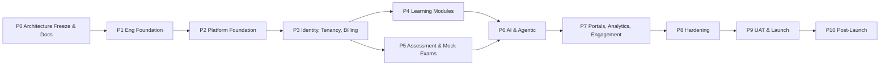
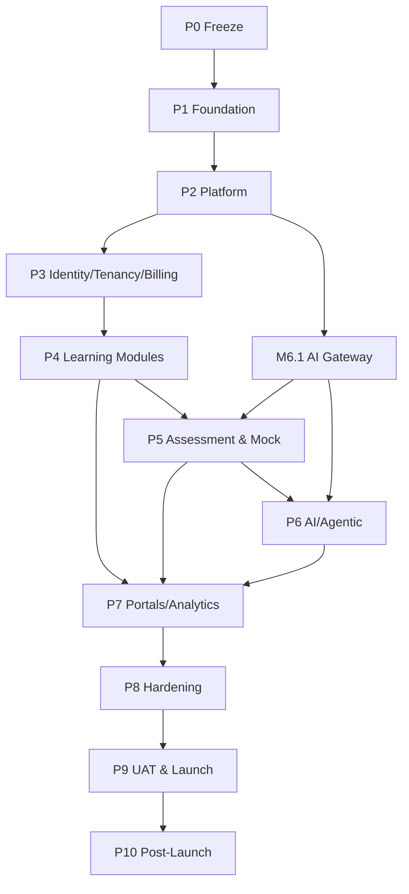
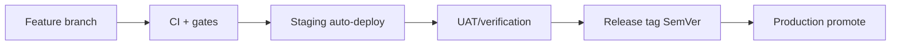
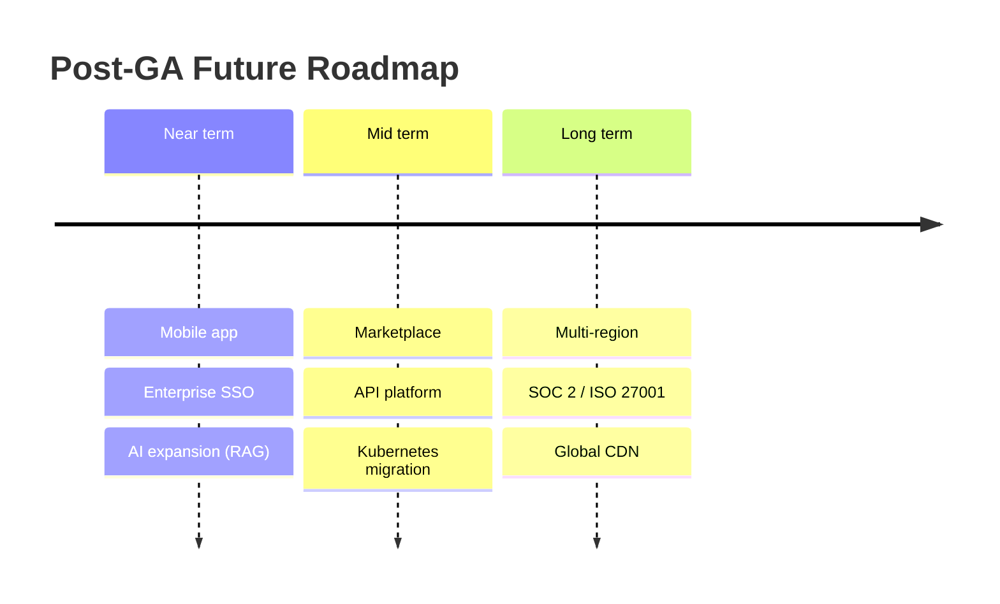

# Development Roadmap — IELTS LMS AI

| Field | Value |
| --- | --- |
| **Product Name** | IELTS LMS AI |
| **Document** | 21 — Development Roadmap |
| **Version** | 1.0 |
| **Status** | Architecture & Planning |
| **Document Owner** | Technical Program Management / Engineering Leadership |
| **Last Updated** | 2026-07-18 |
| **Audience** | Engineering, Architecture, Product, QA, DevOps/SRE, Security, Leadership, Stakeholders |
| **Aligns With** | [01_Product_Vision.md](./01_Product_Vision.md) … [20_Security_Standards.md](./20_Security_Standards.md) |

> **Purpose of this document.** This document is the **enterprise development roadmap** for IELTS LMS AI — the plan that carries the platform from architecture freeze through documentation, foundation, feature delivery, hardening, and production launch, into a post-launch and future roadmap. It provides **milestone tables, dependency and roadmap diagrams, Gantt charts, phase estimates, risks, assumptions, and success criteria**. It is **implementation-independent** and consolidates the sequencing implied across the full documentation set ([Backend (15)](./15_Backend_Architecture.md), [Frontend (16)](./16_Frontend_Architecture.md), [AI (17)](./17_AI_Architecture.md), [Infrastructure (19)](./19_Infrastructure_Deployment.md), [Security (20)](./20_Security_Standards.md)). Timelines are **relative** (weeks from project start, `W0`) so they remain valid regardless of the calendar start date.

---

## Table of Contents

1. [Project Vision & Objectives](#1-project-vision--objectives)
2. [Development Principles](#2-development-principles)
3. [Roadmap at a Glance](#3-roadmap-at-a-glance)
4. [Phase Overview & Estimates](#4-phase-overview--estimates)
5. [Phase 0 — Architecture Freeze & Documentation](#5-phase-0--architecture-freeze--documentation)
6. [Phase 1 — Repository & Engineering Foundation](#6-phase-1--repository--engineering-foundation)
7. [Phase 2 — Platform Foundation (Backend & Frontend)](#7-phase-2--platform-foundation-backend--frontend)
8. [Phase 3 — Identity, Tenancy & Subscription](#8-phase-3--identity-tenancy--subscription)
9. [Phase 4 — Learning Modules](#9-phase-4--learning-modules)
10. [Phase 5 — Assessment Skills & Mock Exams](#10-phase-5--assessment-skills--mock-exams)
11. [Phase 6 — AI & Agentic Integration](#11-phase-6--ai--agentic-integration)
12. [Phase 7 — Portals, Analytics & Engagement](#12-phase-7--portals-analytics--engagement)
13. [Phase 8 — Hardening: Testing, Performance & Security](#13-phase-8--hardening-testing-performance--security)
14. [Phase 9 — UAT, Production Readiness & Launch](#14-phase-9--uat-production-readiness--launch)
15. [Phase 10 — Post-Launch & Operations](#15-phase-10--post-launch--operations)
16. [Dependency Map](#16-dependency-map)
17. [Gantt Charts](#17-gantt-charts)
18. [Versioning Strategy](#18-versioning-strategy)
19. [Technical Debt Management](#19-technical-debt-management)
20. [Future Roadmap](#20-future-roadmap)
21. [Risks](#21-risks)
22. [Assumptions & Constraints](#22-assumptions--constraints)
23. [Project Success Criteria](#23-project-success-criteria)
24. [Related Documents](#24-related-documents)

---

## 1. Project Vision & Objectives

IELTS LMS AI delivers an **AI-first, multi-tenant learning and assessment platform** that prepares candidates for the IELTS exam with automated, band-aligned feedback across the four skills, backed by structured learning modules and analytics. The roadmap's job is to sequence that delivery so that **architecture, quality, and security are built in from the first commit** — not retrofitted.

| Objective | Description | Source |
| --- | --- | --- |
| **Exam-grade quality** | Reliable, band-aligned AI evaluation and a faithful computer-based exam UI. | [Vision (01)](./01_Product_Vision.md), [AI (17)](./17_AI_Architecture.md) |
| **Enterprise multi-tenancy** | Isolated tenants from individuals to institutions without rearchitecture. | [Multi-Tenant (12)](./12_Multi_Tenant_Architecture.md) |
| **Scale to millions** | Horizontal, stateless scaling across all compute. | [NFR (05)](./05_Non_Functional_Requirements.md) |
| **Secure & compliant** | OWASP/ASVS-aligned, GDPR-ready, audit-rich. | [Security (20)](./20_Security_Standards.md) |
| **Operable** | Observable, recoverable, cost-efficient from day one. | [Infrastructure (19)](./19_Infrastructure_Deployment.md) |

---

## 2. Development Principles

| Principle | Meaning |
| --- | --- |
| **Architecture-first** | Freeze the architecture (docs 01–20) before large-scale coding. |
| **Vertical slices** | Deliver end-to-end features (API → UI → tests), not horizontal layers in isolation. |
| **Definition of Done** | Code + tests + docs + security review + observability, or it is not done. |
| **Shift-left quality & security** | Testing, SAST/SCA, and threat review happen inside each phase ([Security §20](./20_Security_Standards.md#20-secure-development-lifecycle)). |
| **Trunk-based, small PRs** | Short-lived branches, continuous integration, feature flags for incomplete work. |
| **Contract-driven** | OpenAPI and shared schemas are the source of truth between backend and frontend. |
| **Incremental hardening** | Performance and security budgets tracked continuously, not deferred to the end. |
| **Reversible steps** | Migrations, deploys, and releases are designed to roll back. |

---

## 3. Roadmap at a Glance

---

## 4. Phase Overview & Estimates

Estimates assume a **cross-functional team** (see [§22](#22-assumptions--constraints)) and are expressed as **relative weeks** from project start (`W0`). Ranges reflect uncertainty; they are planning objectives, not commitments.

| Phase | Name | Est. Duration | Relative Window | Primary Outcome |
| --- | --- | --- | --- | --- |
| **P0** | Architecture Freeze & Documentation | 3–4 wks | W0–W4 | Approved, frozen architecture baseline |
| **P1** | Repository & Engineering Foundation | 2–3 wks | W3–W6 | CI/CD, standards, skeleton solution |
| **P2** | Platform Foundation | 4–5 wks | W6–W11 | Running API + SPA shell, cross-cutting concerns |
| **P3** | Identity, Tenancy & Subscription | 5–6 wks | W11–W17 | AuthN/Z, multi-tenant, billing |
| **P4** | Learning Modules | 6–8 wks | W17–W25 | Grammar, Vocabulary, Sentence Builder, Reading, Listening |
| **P5** | Assessment Skills & Mock Exams | 6–8 wks | W20–W28 | Writing, Speaking, full mock exams |
| **P6** | AI & Agentic Integration | 6–8 wks | W22–W30 | AI evaluation + agentic orchestration |
| **P7** | Portals, Analytics & Engagement | 5–6 wks | W28–W34 | Admin/Teacher/Student portals, analytics, notifications, certificates |
| **P8** | Hardening | 4–5 wks | W34–W39 | Perf, security review, test coverage |
| **P9** | UAT, Production Readiness & Launch | 3–4 wks | W39–W43 | GA release |
| **P10** | Post-Launch & Operations | Ongoing | W43+ | Stability, iteration, future roadmap |

> **Note on overlap.** P4/P5/P6 deliberately overlap: assessment skills and AI evaluation are developed in tandem behind feature flags. Total critical-path duration is ~**43 weeks (~10 months)** to GA, with parallelization.

---

## 5. Phase 0 — Architecture Freeze & Documentation

**Goal:** Ratify the architecture so construction proceeds against a stable baseline. This phase consumes the existing documentation set (01–20) and produces sign-off.

| Milestone | Deliverable | Exit Criteria | Depends On |
| --- | --- | --- | --- |
| M0.1 Documentation complete | Docs 01–21 authored | All documents reviewed | — |
| M0.2 Design review | Architecture walkthrough | Architecture approved by leads | M0.1 |
| M0.3 Technical review | Tech stack & NFR validation | [NFRs (05)](./05_Non_Functional_Requirements.md) accepted as testable | M0.2 |
| M0.4 Architecture freeze | Baselined ADRs | Change control in effect ([§18](#18-versioning-strategy)) | M0.3 |
| M0.5 Threat model baseline | STRIDE model | [Security §2](./20_Security_Standards.md#2-threat-model) accepted | M0.2 |

**Design Review** covers domain model ([07](./07_Domain_Driven_Design.md)), data ([09](./09_Database_Design_ERD.md)), and API ([10](./10_API_Design_Standards.md)). **Technical Review** validates the [Backend (15)](./15_Backend_Architecture.md), [Frontend (16)](./16_Frontend_Architecture.md), and [Infrastructure (19)](./19_Infrastructure_Deployment.md) choices against the NFRs.

---

## 6. Phase 1 — Repository & Engineering Foundation

**Goal:** Establish the engineering platform so every subsequent feature inherits quality gates.

| Milestone | Deliverable | Exit Criteria | Depends On |
| --- | --- | --- | --- |
| M1.1 Repository setup | Monorepo/polyrepo structure, branch policy | Trunk-based flow enforced | M0.4 |
| M1.2 Coding standards | Linting, formatting, analyzers, conventions | Gates block non-compliant PRs | M1.1 |
| M1.3 CI pipeline | Build, test, SAST, SCA, container scan | Green pipeline required to merge ([Security §16](./20_Security_Standards.md#16-vulnerability-management-sca-sast-dast)) | M1.1 |
| M1.4 CD pipeline | Automated deploy to dev/staging ([Infra §18](./19_Infrastructure_Deployment.md#18-deployment-workflow--progressive-delivery)) | One-click promotion | M1.3 |
| M1.5 Local dev environment | Docker Compose stack ([Infra §6](./19_Infrastructure_Deployment.md#6-docker-compose-strategy-current)) | New engineer productive < 1 day | M1.1 |
| M1.6 Observability baseline | Health, metrics, logs, traces wired ([Infra §13](./19_Infrastructure_Deployment.md#13-observability-monitoring-logging-health-metrics-tracing)) | Telemetry visible in dashboards | M1.4 |

---

## 7. Phase 2 — Platform Foundation (Backend & Frontend)

**Goal:** A running, empty-but-correct platform — the [Clean Architecture (14)](./14_Clean_Architecture.md) skeleton with all cross-cutting concerns in place.

| Milestone | Deliverable | Exit Criteria | Depends On |
| --- | --- | --- | --- |
| M2.1 Backend skeleton | Solution/projects, DI, MediatR pipeline ([Backend §4](./15_Backend_Architecture.md#4-solution--project-structure)) | Sample vertical slice passes | M1.6 |
| M2.2 Persistence foundation | EF Core, migrations, UoW, tenant filter ([Backend §10](./15_Backend_Architecture.md#10-persistence-repositories-specifications-uow--concurrency)) | Migrations run in CI | M2.1 |
| M2.3 Cross-cutting concerns | Validation, error handling, logging, auditing | Global filters active | M2.1 |
| M2.4 Caching & jobs | Redis + Hangfire wired ([Backend §11–12](./15_Backend_Architecture.md#11-caching--redis-strategy)) | Sample cached read + job run | M2.2 |
| M2.5 Frontend shell | SPA/PWA scaffold, routing, design system ([Frontend §4–6](./16_Frontend_Architecture.md#4-folder--project-structure)) | Themed shell renders | M1.5 |
| M2.6 API contract tooling | OpenAPI generation + typed client ([API §17](./10_API_Design_Standards.md)) | Types generated in CI | M2.3, M2.5 |

---

## 8. Phase 3 — Identity, Tenancy & Subscription

**Goal:** The security and commercial backbone. Nothing tenant-specific ships before this is solid.

| Milestone | Deliverable | Exit Criteria | Depends On |
| --- | --- | --- | --- |
| M3.1 Authentication | Email/password → JWT + refresh ([IAM §3](./11_Authentication_Authorization.md#3-jwt--token-architecture)) | Login/refresh/logout flows pass | M2.3 |
| M3.2 Authorization | RBAC + permission + policy ([IAM §10](./11_Authentication_Authorization.md#10-authorization-strategy)) | Permission checks enforced | M3.1 |
| M3.3 Multi-tenant | Tenant resolution + isolation ([12](./12_Multi_Tenant_Architecture.md)) | Cross-tenant access denied in tests ([Security §8](./20_Security_Standards.md#8-tenant-isolation-security)) | M3.2 |
| M3.4 Account protection | Lockout, brute-force, MFA-ready ([Security §13](./20_Security_Standards.md#13-rate-limiting-bot-brute-force--replay-protection)) | Abuse tests pass | M3.1 |
| M3.5 Subscription & billing | Plans, entitlements, Stripe integration ([13](./13_Subscription_Billing.md)) | Subscribe/upgrade/webhook flows pass | M3.3 |

---

## 9. Phase 4 — Learning Modules

**Goal:** The structured-learning surface. These modules are lower-risk and validate the content and progress-tracking patterns reused by assessment.

| Milestone | Module | Exit Criteria | Depends On |
| --- | --- | --- | --- |
| M4.1 | Grammar | Lessons, exercises, progress tracked | M3.3 |
| M4.2 | Vocabulary | Sets, spaced practice, progress | M3.3 |
| M4.3 | Sentence Builder | Interactive construction + feedback | M4.1 |
| M4.4 | Reading | Passages, item types, auto-scoring | M3.3 |
| M4.5 | Listening | Audio delivery, item types, auto-scoring ([Infra §11](./19_Infrastructure_Deployment.md#11-file-storage--cdn-strategy)) | M4.4 |

Reading and Listening establish the **objective auto-scoring** engine; Writing and Speaking ([§10](#10-phase-5--assessment-skills--mock-exams)) add **AI subjective scoring**.

---

## 10. Phase 5 — Assessment Skills & Mock Exams

**Goal:** The high-stakes assessment core with the computer-based exam experience.

| Milestone | Deliverable | Exit Criteria | Depends On |
| --- | --- | --- | --- |
| M5.1 Exam engine | Timed delivery, navigation, autosave ([Frontend §14–15](./16_Frontend_Architecture.md#14-responsive-design--computer-based-exam-ui)) | Exam session resilient to reload | M4.4 |
| M5.2 Writing | Rich-text tasks, submission, AI evaluation hook | Band feedback returned async | M5.1, M6.1 |
| M5.3 Speaking | Audio capture/upload, AI evaluation hook | Band feedback returned async | M5.1, M6.1 |
| M5.4 Mock exams | Full 4-skill assessment, aggregate scoring | End-to-end mock completes | M5.2, M5.3 |

---

## 11. Phase 6 — AI & Agentic Integration

**Goal:** Turn AI evaluation from a hook into the production capability, then layer agentic orchestration.

| Milestone | Deliverable | Exit Criteria | Depends On |
| --- | --- | --- | --- |
| M6.1 AI gateway | Provider abstraction, prompt/context services ([AI §4](./17_AI_Architecture.md#4-ai-gateway)) | Evaluation returns band-aligned output | M2.4 |
| M6.2 AI safety & cost | Data minimization, quotas, cost tracking ([Security §19](./20_Security_Standards.md#19-compliance-privacy--pii-handling)) | Budgets and PII controls enforced | M6.1 |
| M6.3 Async evaluation | Queue-backed evaluation with status ([NFR-PERF](./05_Non_Functional_Requirements.md#2-performance-perf)) | No blocking synchronous AI calls | M6.1, M2.4 |
| M6.4 Agentic orchestration | Orchestrator + specialized agents ([18](./18_Agentic_AI_Architecture.md)) | Multi-step tutoring/eval flow runs governed | M6.3 |

> **Note:** `Implementation-prompts/Phase 6/Sprint-3-Shared-AI-Grammar-Service.md` pulled **M6.1** (provider
> abstraction, AI Gateway routing/caching/safety) and the quota/entitlement half of **M6.2** forward early,
> delivered alongside the Grammar Coach capability and a reusable async operation-resource endpoint (a
> de facto first slice of M6.3, scoped to one capability). This was intentional — Grammar (Sprint 1) needed
> AI coaching hooks before Writing/Speaking (M5.2/M5.3) reach this phase — so M6.1/M6.2 should be treated as
> largely satisfied ahead of schedule rather than still pending; remaining M6.2 work is broader cost/PII
> governance beyond the single Grammar Coach capability, and M6.3 remains open for capabilities beyond it.

---

## 12. Phase 7 — Portals, Analytics & Engagement

**Goal:** Role-specific experiences and the surrounding engagement/commercial features.

| Milestone | Deliverable | Exit Criteria | Depends On |
| --- | --- | --- | --- |
| M7.1 Student portal | Dashboard, learning, results | Student journey complete | M5.4, M6.3 |
| M7.2 Teacher portal | Cohorts, assignments, review, HITL ([Agentic §14](./18_Agentic_AI_Architecture.md#14-future-readiness)) | Teacher journey complete | M7.1 |
| M7.3 Admin portal | Tenant, user, content, plan admin | Admin journey complete | M3.5 |
| M7.4 Analytics | Progress, performance, cohort dashboards | Charts render on real data | M7.1 |
| M7.5 Notifications | Email/in-app events | Key events notify reliably | M2.4 |
| M7.6 Certificates | Generation + verification | Certificate issued on completion | M5.4 |

---

## 13. Phase 8 — Hardening: Testing, Performance & Security

**Goal:** Bring the platform to enterprise quality bars before launch.

| Milestone | Deliverable | Exit Criteria | Depends On |
| --- | --- | --- | --- |
| M8.1 Test coverage | Unit/integration/E2E per [Backend §18](./15_Backend_Architecture.md#18-testing-strategy) / [Frontend §21](./16_Frontend_Architecture.md#21-testing-strategy) | Coverage & E2E gates met | P4–P7 |
| M8.2 Performance | Load/soak tests vs [NFR-PERF/SCAL](./05_Non_Functional_Requirements.md#2-performance-perf) | Targets met at target load | M8.1 |
| M8.3 Security review | ASVS L2 review, DAST, threat re-check ([Security §16](./20_Security_Standards.md#16-vulnerability-management-sca-sast-dast)) | No high/critical findings open | M8.1 |
| M8.4 Accessibility | WCAG 2.1 AA audit ([Frontend §12](./16_Frontend_Architecture.md#12-accessibility-wcag)) | AA conformance for core flows | M8.1 |
| M8.5 DR drill | Backup/restore + failover rehearsal ([Infra §14](./19_Infrastructure_Deployment.md#14-backup-restore--disaster-recovery)) | RTO/RPO targets met | M8.2 |

---

## 14. Phase 9 — UAT, Production Readiness & Launch

**Goal:** Validate with real users and cross the production go/no-go gate.

| Milestone | Deliverable | Exit Criteria | Depends On |
| --- | --- | --- | --- |
| M9.1 UAT | Pilot tenant acceptance | Sign-off from pilot users | M8.* |
| M9.2 Production readiness | Runbooks, on-call, alerts ([Security §15](./20_Security_Standards.md#15-incident-response--security-alerts)) | Readiness checklist complete | M9.1 |
| M9.3 Production environment | Hardened prod per [Infra §2](./19_Infrastructure_Deployment.md#2-deployment-strategy--environments) | Smoke tests pass in prod | M8.5 |
| M9.4 Launch | GA release ([Infra §18](./19_Infrastructure_Deployment.md#18-deployment-workflow--progressive-delivery)) | v1.0.0 live, monitored | M9.2, M9.3 |

**Go/No-Go gate** requires: green quality gates, zero open critical security findings, met performance & DR targets, completed runbooks, and business sign-off.

---

## 15. Phase 10 — Post-Launch & Operations

**Goal:** Operate reliably and feed learning back into the roadmap.

| Milestone | Deliverable | Focus |
| --- | --- | --- |
| M10.1 Stabilization | Hypercare period, rapid fixes | Incident response, SLO tracking |
| M10.2 Feedback loop | Usage analytics → backlog | Product iteration |
| M10.3 Cost review | FinOps baseline ([Infra §16](./19_Infrastructure_Deployment.md#16-cost-optimization)) | Efficiency |
| M10.4 Continuous security | Ongoing scans, pen test ([Security §22](./20_Security_Standards.md#22-future-readiness-soc-2-iso-27001-pen-testing)) | Assurance |
| M10.5 Scale evolution | Kubernetes/cloud migration ([Infra §19](./19_Infrastructure_Deployment.md#19-infrastructure-evolution-roadmap)) | Growth readiness |

---

## 16. Dependency Map

**Critical path:** P0 → P1 → P2 → P3 → P4 → P5 → P6 → P7 → P8 → P9. The AI gateway (M6.1) is an **early dependency** of assessment skills and must be started during P2/P3 even though the full AI phase completes later.

---

## 17. Gantt Charts

### 17.1 Program-Level Gantt

```mermaid
gantt
    title IELTS LMS AI — Program Roadmap (relative weeks)
    dateFormat X
    axisFormat W%s
    section Foundation
    P0 Architecture Freeze     :p0, 0, 4w
    P1 Eng Foundation          :p1, 3, 3w
    P2 Platform Foundation     :p2, 6, 5w
    section Core
    P3 Identity/Tenancy/Billing:p3, 11, 6w
    P4 Learning Modules        :p4, 17, 8w
    P5 Assessment & Mock       :p5, 20, 8w
    P6 AI & Agentic            :p6, 22, 8w
    section Experience
    P7 Portals & Analytics     :p7, 28, 6w
    section Release
    P8 Hardening               :p8, 34, 5w
    P9 UAT & Launch            :p9, 39, 4w
    P10 Post-Launch            :p10, 43, 6w
```

### 17.2 Assessment & AI Detail Gantt

```mermaid
gantt
    title Assessment + AI Interlock (relative weeks)
    dateFormat X
    axisFormat W%s
    section AI
    M6.1 AI Gateway            :a1, 11, 4w
    M6.2 Safety & Cost         :a2, 15, 3w
    M6.3 Async Evaluation      :a3, 18, 3w
    M6.4 Agentic Orchestration :a4, 24, 6w
    section Assessment
    M5.1 Exam Engine           :b1, 20, 3w
    M5.2 Writing               :b2, 23, 3w
    M5.3 Speaking              :b3, 23, 4w
    M5.4 Mock Exams            :b4, 27, 2w
```

---

## 18. Versioning Strategy

| Aspect | Approach |
| --- | --- |
| **Product versioning** | Semantic Versioning `MAJOR.MINOR.PATCH`; V1.0.0 at GA. |
| **API versioning** | URI/header versioning per [API Design Standards (10)](./10_API_Design_Standards.md); breaking changes = new version. |
| **Database** | Forward-only, reversible migrations; expand/contract for zero-downtime ([Infra §18](./19_Infrastructure_Deployment.md#18-deployment-workflow--progressive-delivery)). |
| **Release cadence** | Continuous to staging; scheduled promotions to production post-GA. |
| **Change control** | Post-freeze changes go through ADRs ([docs/adr](./adr)). |
| **Deprecation** | Announce → dual-run → sunset with a documented window. |

---

## 19. Technical Debt Management

| Practice | Description |
| --- | --- |
| **Debt register** | Tracked, categorized (design, code, test, infra, security), and prioritized. |
| **Budget allocation** | A fixed share of each phase's capacity (~15–20%) reserved for debt/quality. |
| **Boy-scout rule** | Leave touched code cleaner than found. |
| **Guardrails** | Analyzers, coverage gates, and architecture tests prevent debt accrual ([Backend §18–19](./15_Backend_Architecture.md#18-testing-strategy)). |
| **Debt review** | Reviewed at each phase boundary; high-risk items become milestones. |
| **No silent shortcuts** | Deviations from architecture require an ADR, not a TODO. |

---

## 20. Future Roadmap

Post-GA evolution, prioritized against usage and demand. These are **readiness targets**, not V1 commitments.

| Theme | Description | Enabled By |
| --- | --- | --- |
| **Mobile app** | Native/React Native client reusing web logic ([Frontend §23](./16_Frontend_Architecture.md#23-future-evolution)). | PWA-ready shell, contract-driven client |
| **Enterprise features** | SSO (SAML/OIDC), custom roles, data residency ([IAM §8](./11_Authentication_Authorization.md#8-federation-readiness-oauth-21-oidc-social--enterprise-sso)). | Federation-ready IAM |
| **AI expansion** | RAG, knowledge graphs, richer agents ([Agentic §14](./18_Agentic_AI_Architecture.md#14-future-readiness)). | AI gateway + agentic core |
| **Marketplace** | Third-party/institution content marketplace. | Multi-tenant + entitlements |
| **API platform** | Public API + partner integrations. | Versioned API + rate limiting |
| **Scale-out infra** | Kubernetes, multi-region, read replicas, global CDN ([Infra §19](./19_Infrastructure_Deployment.md#19-infrastructure-evolution-roadmap)). | Stateless, cloud-agnostic core |
| **Compliance** | SOC 2 / ISO 27001 certification ([Security §22](./20_Security_Standards.md#22-future-readiness-soc-2-iso-27001-pen-testing)). | Audit-rich, controlled baseline |

---

## 21. Risks

| ID | Risk | Likelihood | Impact | Mitigation |
| --- | --- | --- | --- | --- |
| R-01 | AI evaluation quality/consistency below band-alignment expectations | Medium | High | Calibration datasets, human-in-the-loop review, provider-agnostic gateway ([AI §17](./17_AI_Architecture.md)) |
| R-02 | AI provider cost/latency volatility | Medium | High | Quotas, async processing, caching, multi-provider fallback ([Security §19](./20_Security_Standards.md#19-compliance-privacy--pii-handling)) |
| R-03 | Multi-tenant data leakage | Low | Critical | Global tenant filter, automated cross-tenant tests ([Security §8](./20_Security_Standards.md#8-tenant-isolation-security)) |
| R-04 | Scope creep across modules | High | Medium | Phase gates, feature flags, architecture freeze ([§18](#18-versioning-strategy)) |
| R-05 | Exam UI reliability under load (autosave, timing) | Medium | High | Resilient client, load/soak tests ([§13](#13-phase-8--hardening-testing-performance--security)) |
| R-06 | Security vulnerability at launch | Low | Critical | Shift-left SAST/SCA/DAST, ASVS review, pen test ([Security §16](./20_Security_Standards.md#16-vulnerability-management-sca-sast-dast)) |
| R-07 | Third-party dependency (Stripe/AI/email) outage | Medium | Medium | Circuit breakers, retries, graceful degradation |
| R-08 | Team capacity/velocity below plan | Medium | Medium | Realistic ranges, buffer, prioritized MVP scope |
| R-09 | Migration to Kubernetes/cloud disrupts operations | Low | Medium | Stateless design, parity environments, staged migration ([Infra §19](./19_Infrastructure_Deployment.md#19-infrastructure-evolution-roadmap)) |
| R-10 | Compliance/GDPR gaps discovered late | Low | High | GDPR-ready design from P3, legal review pre-launch ([Security §19](./20_Security_Standards.md#19-compliance-privacy--pii-handling)) |

---

## 22. Assumptions & Constraints

### 22.1 Assumptions

| # | Assumption |
| --- | --- |
| A-01 | A cross-functional team is available: backend, frontend, AI/ML, DevOps/SRE, QA, security, product, TPM. |
| A-02 | The architecture documentation set (01–20) is accurate and approved at freeze. |
| A-03 | External providers (AI, Stripe, email) are available with acceptable SLAs. |
| A-04 | Content (IELTS-aligned items, rubrics) is sourced in parallel with engineering. |
| A-05 | Relative timelines assume no major mid-project pivot in scope or stack. |

### 22.2 Constraints

| # | Constraint |
| --- | --- |
| C-01 | Stack is fixed per architecture: .NET 10/ASP.NET Core, PostgreSQL, Redis, Hangfire; React 19/Vite/TypeScript ([Backend §2](./15_Backend_Architecture.md#2-technology-decisions), [Frontend §2](./16_Frontend_Architecture.md#2-technology-stack--rationale)). |
| C-02 | Current deployment target is Docker Compose; Kubernetes/cloud is post-GA ([Infra §19](./19_Infrastructure_Deployment.md#19-infrastructure-evolution-roadmap)). |
| C-03 | Security and NFR targets are non-negotiable launch gates. |
| C-04 | Modular monolith first; microservice extraction deferred to demonstrated need ([Backend §20](./15_Backend_Architecture.md#20-deployment-readiness--future-scalability)). |

---

## 23. Project Success Criteria

| Category | Success Criterion |
| --- | --- |
| **Functional** | All V1 modules (learning + 4-skill assessment + mock exams) delivered per [FRS (04)](./04_Functional_Requirements.md). |
| **Quality** | Test coverage and E2E gates met; zero open critical/high defects at GA. |
| **Performance** | [NFR-PERF/SCAL](./05_Non_Functional_Requirements.md#2-performance-perf) targets met under target load. |
| **Security** | ASVS L2 review passed; zero open critical/high findings; pen test scheduled ([Security (20)](./20_Security_Standards.md)). |
| **Reliability** | Availability, RTO/RPO targets met in DR drill ([NFR-AVAIL/DR](./05_Non_Functional_Requirements.md#4-availability-avail)). |
| **AI** | Band-aligned evaluation validated against calibration data; async, cost-bounded. |
| **Operability** | Runbooks, alerting, dashboards, on-call in place ([Infra §13](./19_Infrastructure_Deployment.md#13-observability-monitoring-logging-health-metrics-tracing)). |
| **Compliance** | GDPR-ready workflows (access/export/erasure) operational ([Security §19](./20_Security_Standards.md#19-compliance-privacy--pii-handling)). |
| **Business** | Pilot tenant UAT sign-off; subscription/billing flows live ([13](./13_Subscription_Billing.md)). |

---

## 24. Related Documents

| # | Document | Relationship |
| --- | --- | --- |
| 01 | [Product Vision](./01_Product_Vision.md) | Vision and objectives this roadmap delivers. |
| 04 | [Functional Requirements](./04_Functional_Requirements.md) | Scope delivered across phases. |
| 05 | [Non-Functional Requirements](./05_Non_Functional_Requirements.md) | Quality gates and success criteria. |
| 11 | [Authentication & Authorization](./11_Authentication_Authorization.md) | Phase 3 identity milestones. |
| 12 | [Multi-Tenant Architecture](./12_Multi_Tenant_Architecture.md) | Phase 3 tenancy milestones. |
| 13 | [Subscription & Billing](./13_Subscription_Billing.md) | Phase 3 billing milestones. |
| 14 | [Clean Architecture](./14_Clean_Architecture.md) | Foundation phase structure. |
| 15 | [Backend Architecture](./15_Backend_Architecture.md) | Backend milestones and standards. |
| 16 | [Frontend Architecture](./16_Frontend_Architecture.md) | Frontend milestones and standards. |
| 17 | [AI Architecture](./17_AI_Architecture.md) | Phase 6 AI milestones. |
| 18 | [Agentic AI Architecture](./18_Agentic_AI_Architecture.md) | Phase 6 agentic milestones. |
| 19 | [Infrastructure & Deployment](./19_Infrastructure_Deployment.md) | Environment, deployment, evolution sequencing. |
| 20 | [Security Standards](./20_Security_Standards.md) | Security milestones, reviews, launch gates. |

---

*End of Document — 21 Development Roadmap (v1.0).*
