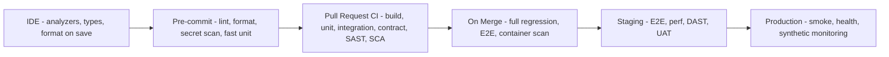
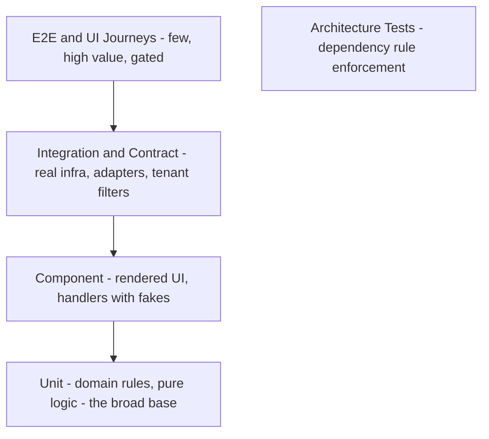
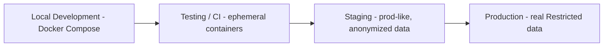
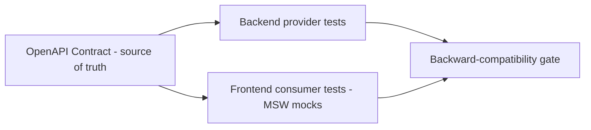
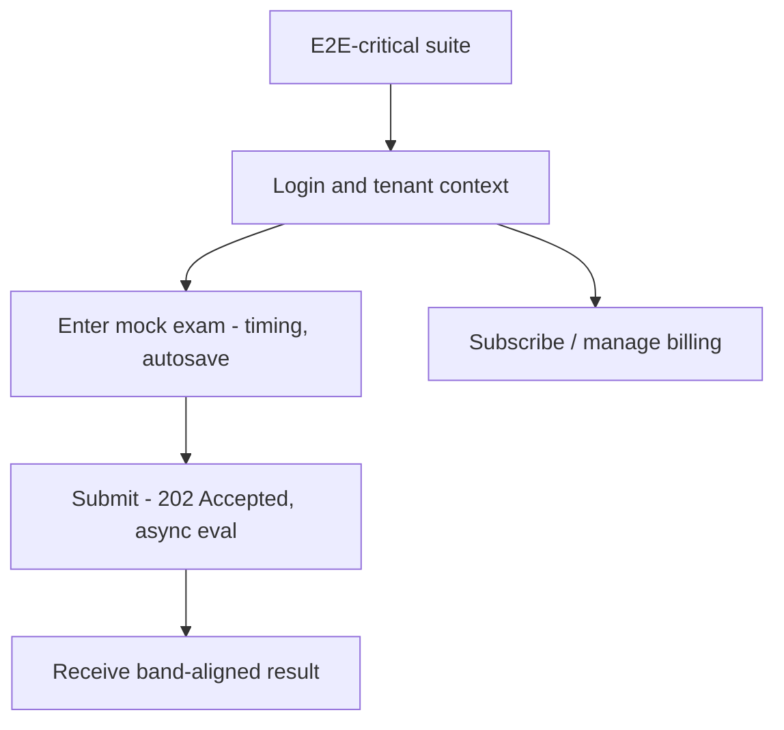
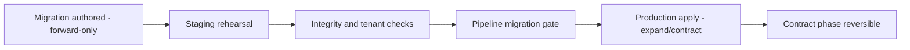
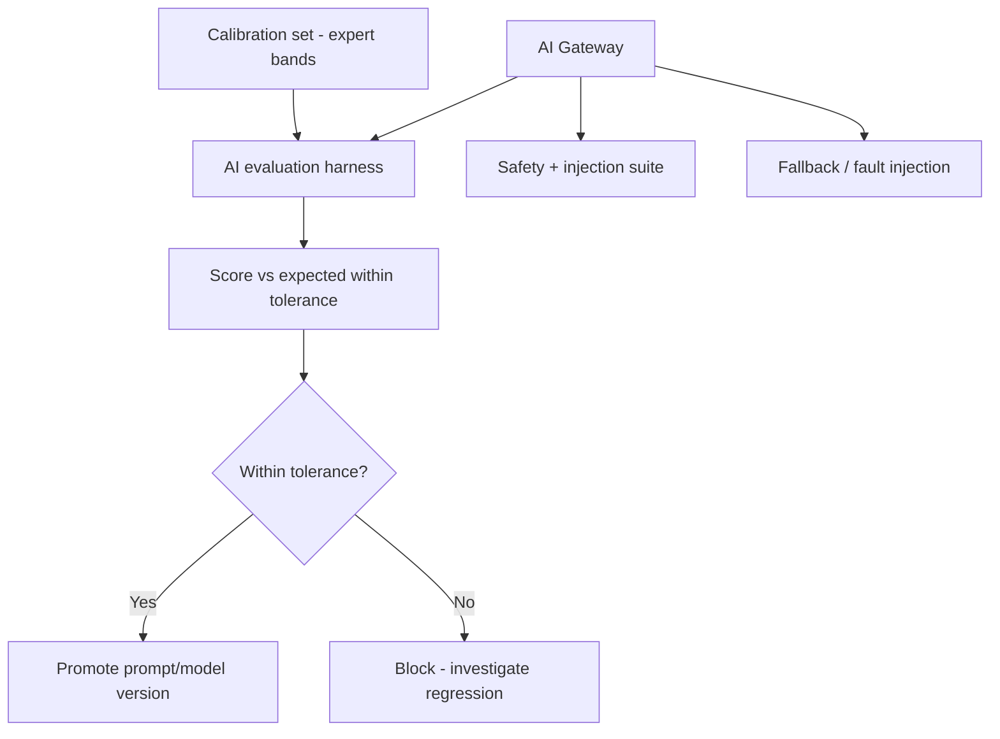
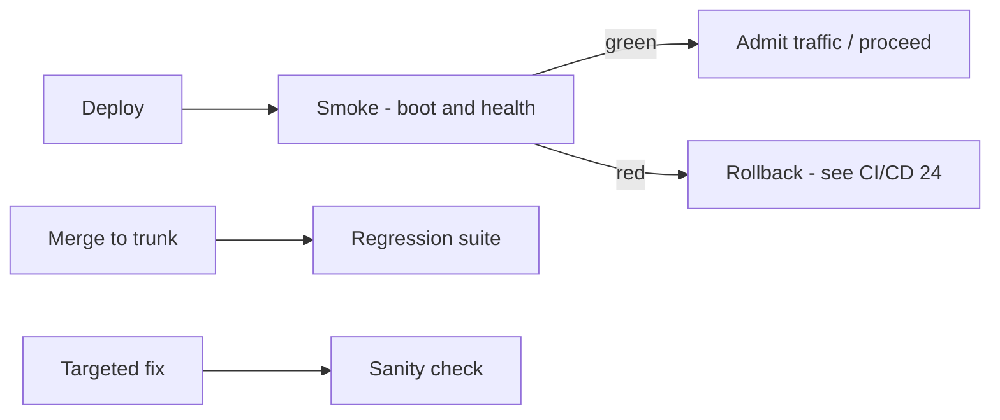
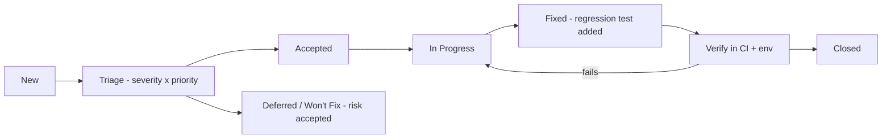
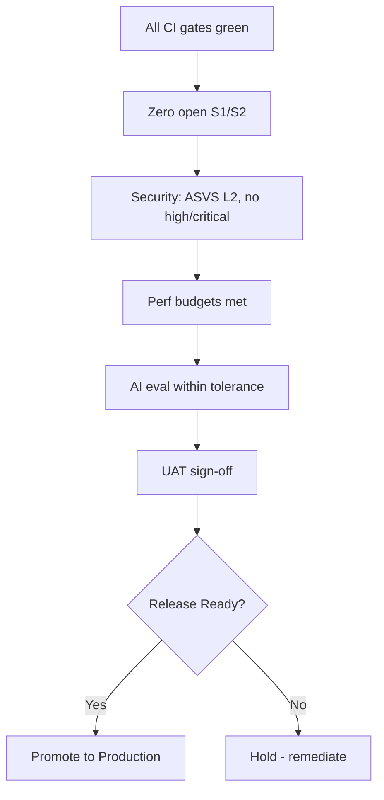

# Testing Strategy — IELTS LMS AI

| Field | Value |
| --- | --- |
| **Product Name** | IELTS LMS AI |
| **Document** | 22 — Testing Strategy |
| **Version** | 1.0 |
| **Status** | Architecture & Planning |
| **Document Owner** | Principal QA Architecture / Quality Engineering |
| **Last Updated** | 2026-07-18 |
| **Audience** | QA Engineers, SDETs, Backend & Frontend Engineers, AI/ML Engineers, DevOps/SRE, Security, Product, Release Management, Engineering Leadership |
| **Aligns With** | [01_Product_Vision.md](./01_Product_Vision.md) … [21_Development_Roadmap.md](./21_Development_Roadmap.md) |

> **Purpose of this document.** This document defines the complete **enterprise testing strategy** for IELTS LMS AI — the philosophy, principles, quality gates, test levels, environments, data strategy, and metrics that govern how quality is engineered into the platform from the first commit. It is **implementation-independent** — no test code, framework configuration, or scaffolding — but prescriptive enough to build a quality program from. It consolidates and extends the test strategies already established in [Backend §18](./15_Backend_Architecture.md#18-testing-strategy), [Frontend §21](./16_Frontend_Architecture.md), the test environment shapes in [Infrastructure §3](./19_Infrastructure_Deployment.md#3-development-environment), the security testing program in [Security §16 & §20](./20_Security_Standards.md#16-vulnerability-management-sca-sast-dast), and the quality gates and Definition of Done in the [Development Roadmap (21)](./21_Development_Roadmap.md). It is the authoritative quality reference for the platform and is realized operationally by the [CI/CD Pipeline (24)](./24_CI_CD_Pipeline.md) against the standards defined in [Development Standards (23)](./23_Development_Standards.md).

---

## Table of Contents

1. [Testing Philosophy](#1-testing-philosophy)
2. [Testing Principles](#2-testing-principles)
3. [Shift-Left Testing](#3-shift-left-testing)
4. [The Testing Pyramid](#4-the-testing-pyramid)
5. [Quality Gates, DoR, DoD & Acceptance Criteria](#5-quality-gates-dor-dod--acceptance-criteria)
6. [Test Planning & Risk-Based Testing](#6-test-planning--risk-based-testing)
7. [Test Environment Strategy](#7-test-environment-strategy)
8. [Test Data Strategy](#8-test-data-strategy)
9. [Functional Test Levels](#9-functional-test-levels)
10. [API & Contract Testing](#10-api--contract-testing)
11. [End-to-End, UI, Accessibility & Cross-Browser Testing](#11-end-to-end-ui-accessibility--cross-browser-testing)
12. [Performance, Load, Stress & Scalability Testing](#12-performance-load-stress--scalability-testing)
13. [Security Testing](#13-security-testing)
14. [Data, Migration, Backup & Recovery Testing](#14-data-migration-backup--recovery-testing)
15. [AI & Agentic Testing](#15-ai--agentic-testing)
16. [Localization, Usability & User Acceptance Testing](#16-localization-usability--user-acceptance-testing)
17. [Smoke, Sanity & Regression Testing](#17-smoke-sanity--regression-testing)
18. [Release Validation & Production Verification](#18-release-validation--production-verification)
19. [Bug Lifecycle & Defect Prioritization](#19-bug-lifecycle--defect-prioritization)
20. [Automation vs Manual Strategy](#20-automation-vs-manual-strategy)
21. [Coverage Targets & Metrics](#21-coverage-targets--metrics)
22. [Testing Matrix & Responsibility Matrix](#22-testing-matrix--responsibility-matrix)
23. [Exit Criteria & Release Readiness](#23-exit-criteria--release-readiness)
24. [Assumptions, Risks & Future Recommendations](#24-assumptions-risks--future-recommendations)
25. [Related Documents](#25-related-documents)

---

## 1. Testing Philosophy

Testing at IELTS LMS AI is a **design activity, not a phase**. Quality is engineered into every vertical slice ([Roadmap §2](./21_Development_Roadmap.md#2-development-principles)) — a feature is not "done" until it ships with the tests that prove it works and keep it working. The platform is **AI-first, multi-tenant, and exam-grade**, which imposes three non-negotiable quality obligations that shape everything in this document.

| Obligation | Why it is existential | Primary controls |
| --- | --- | --- |
| **Tenant isolation is never breached** | A single cross-tenant leak is a catastrophic breach of trust and compliance ([Security SR-1](./20_Security_Standards.md), [Multi-Tenant (12)](./12_Multi_Tenant_Architecture.md)). | Automated cross-tenant access tests at unit, integration, and E2E levels; deny-by-default authorization tests. |
| **AI evaluation is band-aligned and safe** | Learners make decisions based on IELTS band feedback; wrong or unsafe output erodes the product's core value ([AI (17)](./17_AI_Architecture.md)). | AI evaluation harness, hallucination and safety testing, calibration against reference data. |
| **The exam experience is faithful and reliable** | The computer-based IELTS simulation must behave predictably under timing, autosave, and load ([Frontend §](./16_Frontend_Architecture.md), [NFR-PERF](./05_Non_Functional_Requirements.md)). | E2E exam journeys, performance budgets, resilience testing. |

> **Principle.** We test to **build confidence to release**, not to prove absence of bugs. Every test must map to a risk worth mitigating; tests that do not reduce risk are waste and are removed.

---

## 2. Testing Principles

| Principle | Meaning |
| --- | --- |
| **Shift left** | Defects are found closest to the moment they are introduced — in the IDE, pre-commit, and PR, not in staging ([§3](#3-shift-left-testing)). |
| **Test the risk, not the code** | Effort is allocated by risk and blast radius ([§6](#6-test-planning--risk-based-testing)), not uniformly across all code. |
| **Fast feedback** | The inner loop (unit + component) runs in seconds; the PR loop in minutes; slow suites run on merge/nightly. |
| **Deterministic & isolated** | Tests own their data, control time and randomness, and never depend on execution order or shared mutable state. |
| **Tenant-aware always** | Every functional test asserts behavior within a tenant boundary; isolation is a first-class test target, not an afterthought. |
| **Contract-driven** | The [OpenAPI contract (10)](./10_API_Design_Standards.md) is the source of truth; backend and frontend test against it, not against each other's internals. |
| **Production-like fidelity** | Integration and higher tests run against real backing services (PostgreSQL, Redis) via ephemeral containers, not mocks of infrastructure ([§7](#7-test-environment-strategy)). |
| **Automate the repeatable** | Anything run more than a few times is automated and gated in CI ([§20](#20-automation-vs-manual-strategy)). |
| **Quality is everyone's job** | Engineers own the tests for the code they write; QA/SDET raises the bar and owns cross-cutting suites ([§22](#22-testing-matrix--responsibility-matrix)). |
| **Tests are production code** | Test code follows the same [Development Standards (23)](./23_Development_Standards.md): reviewed, refactored, and free of duplication. |

---

## 3. Shift-Left Testing

Shift-left means quality activities move as early as possible in the flow of work. IELTS LMS AI implements a layered feedback model where each layer is cheaper and faster than the next.

| Feedback layer | When | What runs | Owner |
| --- | --- | --- | --- |
| **Inner loop** | Continuously while coding | Static analysis, type checks, format-on-save, fast unit tests | Engineer |
| **Pre-commit** | Before commit | Lint, format, secret scan, changed-file unit tests ([Security §16](./20_Security_Standards.md#16-vulnerability-management-sca-sast-dast)) | Engineer |
| **Pull request** | On PR open/update | Build, unit, integration, contract, architecture tests, SAST, SCA | CI ([24](./24_CI_CD_Pipeline.md)) |
| **Merge / main** | On merge to trunk | Full regression, E2E-critical, image build + scan | CI |
| **Staging** | On staging deploy | Full E2E, performance, DAST, security, UAT | QA/SRE/Security |
| **Production** | On production deploy | Smoke, health verification, synthetic + real-user monitoring | SRE ([Infra §13](./19_Infrastructure_Deployment.md#13-observability-monitoring-logging-health-metrics-tracing)) |

> **Rationale.** The cost of a defect rises by roughly an order of magnitude at each layer. Investing in the inner and PR loops keeps the expensive later layers green.

---

## 4. The Testing Pyramid

IELTS LMS AI follows a **pyramid, not an ice-cream cone**: a broad base of fast, cheap, deterministic tests and a deliberately thin top of slow, high-fidelity journeys. A dedicated **architecture-test tier** enforces the [Clean Architecture (14)](./14_Clean_Architecture.md) dependency rules and fails the build on violations.

| Tier | Proportion (guideline) | Speed | Fidelity | Primary target |
| --- | --- | --- | --- | --- |
| **Unit** | ~70% | ms | Low (isolated) | Domain invariants, value objects, handlers with fake ports, pure functions/hooks |
| **Component** | ~15% | ms–s | Medium | Rendered React components + interaction + a11y ([Frontend §21](./16_Frontend_Architecture.md)) |
| **Integration / Contract** | ~10% | s | High | EF Core + PostgreSQL, adapters, tenant filter, concurrency, API contract |
| **E2E / UI** | ~5% | s–min | Highest | Critical user journeys through the full stack |
| **Architecture** | Cross-cutting | ms | N/A | Layer dependency rules, naming, forbidden references |

> **Note.** Proportions are guidelines for effort allocation, not hard quotas. Risk-based testing ([§6](#6-test-planning--risk-based-testing)) may justify more integration or E2E coverage for high-risk contexts such as Assessment, Billing, and AI Evaluation.

---

## 5. Quality Gates, DoR, DoD & Acceptance Criteria

### 5.1 Definition of Ready (DoR)

A work item is **Ready** to be pulled into development only when:

| Criterion | Description |
| --- | --- |
| **Clear value & scope** | Bounded to a single vertical slice; the bounded context ([DDD (07)](./07_Domain_Driven_Design.md)) is identified. |
| **Acceptance criteria defined** | Testable, unambiguous, expressed in ubiquitous language (see §5.3). |
| **NFRs identified** | Relevant performance, security, accessibility, and tenancy requirements referenced by ID ([NFR (05)](./05_Non_Functional_Requirements.md)). |
| **Contract impact known** | API/schema changes identified against the [OpenAPI contract (10)](./10_API_Design_Standards.md). |
| **Test approach agreed** | Test levels and data needs sketched; risk tier assigned ([§6](#6-test-planning--risk-based-testing)). |
| **Dependencies resolved** | Upstream contexts, feature flags, and design decisions are settled. |

### 5.2 Definition of Done (DoD)

Consistent with [Roadmap §2](./21_Development_Roadmap.md#2-development-principles) — **Code + tests + docs + security review + observability, or it is not done**:

| Criterion | Verified by |
| --- | --- |
| Code merged, meets [Development Standards (23)](./23_Development_Standards.md) | Code review + analyzers in CI |
| Unit, integration, contract tests written and green | CI PR gate ([24](./24_CI_CD_Pipeline.md)) |
| Coverage targets met on changed code ([§21](#21-coverage-targets--metrics)) | Coverage gate |
| Tenant isolation & authorization tested (deny-by-default) | Security tests ([§13](#13-security-testing)) |
| Accessibility checks pass (WCAG 2.1 AA baseline) | axe in CI ([§11](#11-end-to-end-ui-accessibility--cross-browser-testing)) |
| Security gates pass (SAST/SCA/secret) | CI security stage ([Security §16](./20_Security_Standards.md#16-vulnerability-management-sca-sast-dast)) |
| Observability added (logs, metrics, traces with `correlationId`/`tenantId`) | Review + dashboards ([Infra §13](./19_Infrastructure_Deployment.md#13-observability-monitoring-logging-health-metrics-tracing)) |
| Docs / ADR updated where architecture changed | Review ([Roadmap §18](./21_Development_Roadmap.md)) |

### 5.3 Acceptance Criteria

Acceptance criteria are expressed in a **Given/When/Then** structure using [ubiquitous language](./07_Domain_Driven_Design.md#3-ubiquitous-language) and always include a tenancy dimension.

> **Example (pseudo, illustrative only).**
> *Given* a learner in Tenant A with an active subscription entitlement,
> *When* they submit a Writing task,
> *Then* the submission is accepted with `202 Accepted`, an async evaluation is queued, and the submission is visible only within Tenant A.

### 5.4 Quality Gate Summary

| Gate | Stage | Blocks on |
| --- | --- | --- |
| **Build & analyze** | PR | Compile errors, analyzer/lint violations, format drift |
| **Unit & component** | PR | Any failing test; coverage below target on changed code |
| **Integration & contract** | PR | Failing integration/contract tests; broken API contract |
| **Architecture** | PR | Dependency-rule violations ([Clean Arch (14)](./14_Clean_Architecture.md)) |
| **Security (static)** | PR | High/critical SAST, SCA, or detected secrets |
| **E2E-critical** | Merge/Staging | Failing critical journeys |
| **Performance** | Staging | NFR budget breaches ([§12](#12-performance-load-stress--scalability-testing)) |
| **DAST & security review** | Staging | High/critical dynamic findings ([Security §16](./20_Security_Standards.md#16-vulnerability-management-sca-sast-dast)) |
| **Release readiness** | Pre-prod | Open critical/high defects; unmet exit criteria ([§23](#23-exit-criteria--release-readiness)) |

---

## 6. Test Planning & Risk-Based Testing

Test effort is allocated by **risk = likelihood × impact**. Each bounded context and feature is assigned a risk tier that drives test depth, coverage targets, and required test levels.

| Risk tier | Contexts / features (examples) | Test depth |
| --- | --- | --- |
| **Tier 1 — Critical** | Identity/Access, Tenant isolation, Billing/Subscriptions, AI Evaluation, Assessment/Mock Exam, Exam timing & autosave | All levels; highest coverage; mandatory E2E, security, and performance; manual exploratory each release |
| **Tier 2 — High** | Learning delivery skill contexts, Course/Content, Analytics, Notifications, Certificates | Unit + integration + contract; targeted E2E; regression suite membership |
| **Tier 3 — Standard** | Admin utilities, back-office reporting, non-critical settings | Unit + integration; smoke coverage |

> **Rationale.** Tenancy, money, identity, exam integrity, and AI correctness carry the highest blast radius, so they earn the deepest testing. This mirrors the [Security risk register (SR-1…SR-7)](./20_Security_Standards.md) and the [roadmap's critical paths](./21_Development_Roadmap.md).

A **Test Plan** per epic captures: scope and risk tier, test levels in play, environments and data, entry/exit criteria, automation vs manual split, and residual-risk acceptance.

---

## 7. Test Environment Strategy

Environments are the four canonical environments defined in [Infrastructure §2–3](./19_Infrastructure_Deployment.md#2-deployment-strategy--environments). The **same container image flows Dev → CI → Staging → Production**; only *where* it runs and *what data* it sees changes.

| Environment | Purpose | Backing services | Data | Tests executed |
| --- | --- | --- | --- | --- |
| **Local Development** | Inner-loop & pre-commit | Compose: PostgreSQL, Redis, MinIO, NGINX+TLS, mock AI provider, Vite ([Infra §3](./19_Infrastructure_Deployment.md#3-development-environment)) | Seeded synthetic | Unit, component, local integration, targeted E2E |
| **Testing / CI** | Automated gates per pipeline run | Ephemeral Testcontainers-style PostgreSQL/Redis; stubbed AI providers | Disposable, generated per run | Unit, integration, contract, architecture, SAST/SCA |
| **Staging** | Pre-production validation & UAT | Compose or K8s mirror of prod | Anonymized, prod-like ([§8](#8-test-data-strategy)) | Full E2E, performance, DAST, security, UAT, migration rehearsal |
| **Production** | Live | Managed cloud services | Real (Restricted) | Smoke, health verification, synthetic monitoring |

> **Note.** Production data **never** flows downward un-anonymized; secrets are isolated per environment ([Infra §9](./19_Infrastructure_Deployment.md#9-configuration-environment-variables--secrets), [Security §9](./20_Security_Standards.md#9-data-protection-encryption-secrets-key-rotation)). Staging must match production topology closely enough that performance and DR results are meaningful.

---

## 8. Test Data Strategy

| Aspect | Standard |
| --- | --- |
| **Synthetic first** | Prefer generated, deterministic synthetic data (fixtures, factories/builders) over copied data. |
| **Tenant-scoped fixtures** | Every fixture belongs to an explicit tenant; multi-tenant tests seed ≥ 2 tenants to prove isolation. |
| **No production PII downstream** | Real PII never enters non-production environments; staging uses **anonymized/masked** data ([Security §19](./20_Security_Standards.md#19-compliance-privacy--pii-handling)). |
| **Deterministic** | Time, randomness, and IDs are controllable; tests seed and freeze them to avoid flakiness. |
| **IELTS reference data** | A curated, versioned **calibration set** of prompts, sample responses, and expert-assigned bands underpins AI evaluation testing ([§15](#15-ai--agentic-testing)). |
| **Isolation & cleanup** | Integration tests run in transactions or disposable databases; each test leaves no residue. |
| **Data classification aware** | Test data respects the [ERD data classification (09)](./09_Database_Design_ERD.md#5-data-classification); Restricted-class data is never fabricated with real values. |

> **Rationale.** Deterministic, tenant-scoped synthetic data eliminates the two largest sources of test unreliability — shared mutable state and non-determinism — while keeping the platform's privacy posture intact.

---

## 9. Functional Test Levels

These levels align exactly with [Backend §18](./15_Backend_Architecture.md#18-testing-strategy) and [Frontend §21](./16_Frontend_Architecture.md).

### 9.1 Unit Testing

| Attribute | Standard |
| --- | --- |
| **Scope** | Domain rules, aggregates, value objects, policies; application handlers with **fake ports**; pure frontend utilities, hooks, reducers, Zod schemas. |
| **Isolation** | No database, no web host, no network. Ports (`I<Capability>`) are faked/stubbed. |
| **Backend tooling** | `IELTSLms.Domain.Tests`, `IELTSLms.Application.Tests` ([Clean Arch (14)](./14_Clean_Architecture.md)). |
| **Frontend tooling** | Vitest. |
| **Focus** | Invariants, branch logic, edge cases, error paths, band-scoring rules. |

### 9.2 Component Testing

| Attribute | Standard |
| --- | --- |
| **Backend** | A feature slice (command/handler/validator + in-memory adapters) exercised end-to-end without external infrastructure. |
| **Frontend** | Rendered React components via Vitest + Testing Library — rendering, user interaction, and inline accessibility assertions ([Frontend §21](./16_Frontend_Architecture.md)). |
| **Focus** | Behavior of a cohesive unit; forms, validation, exam widgets, error/empty/loading states. |

### 9.3 Integration Testing

| Attribute | Standard |
| --- | --- |
| **Scope** | Real infrastructure adapters: EF Core against **PostgreSQL**, Redis cache, outbox, jobs, file/object storage. |
| **Environment** | Ephemeral **Testcontainers-style** PostgreSQL/Redis per run ([Infra §3](./19_Infrastructure_Deployment.md#3-development-environment)). |
| **Must verify** | **Tenant global query filter**, optimistic concurrency (`Version`), soft-delete filter, cache-aside + invalidation, transactional behavior (`IUnitOfWork`). |
| **Project** | `IELTSLms.Integration.Tests`. |

### 9.4 Architecture Testing

| Attribute | Standard |
| --- | --- |
| **Scope** | Automated enforcement of [Clean Architecture (14)](./14_Clean_Architecture.md) dependency rules and naming conventions. |
| **Blocks build on** | Inward-only dependency violations, forbidden references (e.g., Domain referencing Infrastructure), namespace/naming drift. |
| **Project** | `IELTSLms.Architecture.Tests`. |

> **Principle.** Architecture tests turn design intent into an executable, non-negotiable gate — the fastest, cheapest way to prevent architectural erosion.

---

## 10. API & Contract Testing

The [OpenAPI contract (10)](./10_API_Design_Standards.md) is the source of truth between backend and frontend.

| Test type | What it verifies | Notes |
| --- | --- | --- |
| **API behavior tests** | Endpoints honor HTTP methods, status codes, and the **RFC 7807 Problem Details** error contract; auth and tenant scoping enforced. | Includes `202 Accepted` for async AI operations, `409` concurrency, `422` business rules, `429` rate limits ([API §5,§9](./10_API_Design_Standards.md#5-http-methods--status-codes)). |
| **Provider contract** | The API's actual responses conform to the published OpenAPI schema; no undocumented/shadow endpoints ([API §17,§18](./10_API_Design_Standards.md#17-documentation-standards-openapiswagger)). | Guards backward compatibility; breaking changes require a new URI version. |
| **Consumer contract (frontend)** | The SPA tests against generated types + **MSW** mocks derived from the contract ([Frontend §21](./16_Frontend_Architecture.md)). | Decouples frontend delivery from backend availability. |
| **Cross-tenant contract** | Requests for out-of-tenant resources return **`404`** (not `403`), per [API cross-tenant rule](./10_API_Design_Standards.md). | Tier-1 security assertion. |

> **Rationale.** Contract testing catches integration breaks in the fast PR loop instead of the expensive E2E or production loop, and lets backend/frontend teams progress independently.

---

## 11. End-to-End, UI, Accessibility & Cross-Browser Testing

| Dimension | Standard | Tooling / reference |
| --- | --- | --- |
| **E2E journeys** | A small, curated set of **E2E-critical** flows gated in CI: login, take & submit a mock exam, receive evaluation, subscribe/billing ([Frontend §21](./16_Frontend_Architecture.md)). | Playwright |
| **UI testing** | Interaction, navigation, exam timing/autosave, error/empty/loading states. | Playwright + component tests |
| **Accessibility** | **WCAG 2.1 AA** baseline enforced by automated **axe** checks in CI; manual assistive-technology testing for Tier-1 flows. | axe-in-CI ([Frontend §](./16_Frontend_Architecture.md)) |
| **Cross-browser** | Latest evergreen Chromium, Firefox, WebKit; the exam UI is validated on all three. | Playwright browser matrix |
| **Responsive** | Breakpoints validated for the exam UI and portals across desktop/tablet/mobile viewports. | Playwright viewports |

> **Note on accessibility compliance.** Automated axe checks cover a subset of WCAG success criteria. Full WCAG 2.1 AA conformance requires **manual testing with assistive technologies and expert accessibility review**; automated gates are necessary but not sufficient.

---

## 12. Performance, Load, Stress & Scalability Testing

Performance tests validate the measurable targets in [NFR (05)](./05_Non_Functional_Requirements.md) against **staging-scale** infrastructure ([Infra §3](./19_Infrastructure_Deployment.md#3-development-environment)).

| Test type | Objective | Reference targets |
| --- | --- | --- |
| **Load testing** | Verify latency & throughput at expected concurrency | Non-AI cached reads p95 ≤ 300 ms, p99 ≤ 800 ms; writes p95 ≤ 600 ms ([NFR-PERF-001/002](./05_Non_Functional_Requirements.md)) |
| **API performance** | Endpoint latency budgets | Reads p95 ≤ 300 ms; writes p95 ≤ 600 ms ([NFR-APIP](./05_Non_Functional_Requirements.md)) |
| **Database performance** | Indexed query latency | p95 ≤ 50 ms for PK/indexed reads ([NFR-DBP-001](./05_Non_Functional_Requirements.md)) |
| **AI performance** | Async evaluation turnaround | Writing p95 ≤ 30 s; Speaking p95 ≤ 60 s; AI Tutor first response p95 ≤ 5 s ([NFR-AIP](./05_Non_Functional_Requirements.md)) |
| **Stress testing** | Behavior beyond capacity; graceful degradation, no data loss | Rate limiting, queue back-pressure ([API §15](./10_API_Design_Standards.md#15-rate-limiting--retry)) |
| **Scalability testing** | Horizontal stateless scale-out; auto-scale reaction | Scale-out ≤ 2 min under sustained load ([NFR-SCAL](./05_Non_Functional_Requirements.md), [Infra §15](./19_Infrastructure_Deployment.md#15-high-availability-auto-scaling--load-balancing)) |
| **Soak / endurance** | Detect leaks, drift over sustained load | Stable memory/latency over extended runs |
| **Frontend performance** | Page load & interaction | First meaningful content ≤ 2.5 s; exam item navigation ≤ 200 ms perceived; bundle-size + Core Web Vitals budgets in CI ([Frontend §](./16_Frontend_Architecture.md)) |

> **Rationale.** Long-running AI operations are **async with status** ([NFR](./05_Non_Functional_Requirements.md), [API §14](./10_API_Design_Standards.md#14-file-upload-streaming--long-running-operations)); performance tests assert queue turnaround and status semantics, not synchronous wait times.

---

## 13. Security Testing

Security testing implements the program in [Security §16 & §20](./20_Security_Standards.md#16-vulnerability-management-sca-sast-dast) and validates alignment to **OWASP Top 10 (2021)**, **OWASP API Security Top 10 (2023)**, and **OWASP ASVS L2** as the baseline verification target.

| Test type | Scope | Gate |
| --- | --- | --- |
| **Secret scanning** | Repo + pre-commit + CI | Block on any detected secret |
| **SAST + IaC scan** | Static code & config analysis | Block on high-severity |
| **SCA / dependency scan** | Third-party CVEs; pinned versions | Block on high/critical CVEs |
| **Container scanning** | Image CVEs + config; non-root, distroless, pinned digests | Block on high/critical |
| **DAST** | Running app on staging pre-release | Block on high/critical |
| **Authorization tests** | RBAC + policy checks; ownership/IDOR; deny-by-default (OWASP A01, API1/API5) | Part of PR & regression |
| **Tenant isolation tests** | Automated cross-tenant access attempts return `404`; no data bleed | Tier-1 mandatory |
| **Injection & input** | Parameterized access, validation, output encoding (OWASP A03) | PR & DAST |
| **AuthN & session** | Token validation (`exp/nbf/iss/aud/tenantId`), refresh rotation, CSRF (OWASP A07) | Integration + DAST |
| **Penetration testing** | Annual + per-major-release third-party pen test ([Security §](./20_Security_Standards.md)) | Release readiness for majors |

**Security CI order** (per [Security §16](./20_Security_Standards.md#16-vulnerability-management-sca-sast-dast)): Secret scan → SAST + IaC → Dependency SCA → Build image → Container scan → Deploy staging → DAST → Promote to prod.

> **Principle.** Security tests are **negative tests first** — we prove the system refuses what it must refuse (cross-tenant access, privilege escalation, tampering) before proving what it allows.

---

## 14. Data, Migration, Backup & Recovery Testing

| Test type | What it verifies | Reference |
| --- | --- | --- |
| **Database testing** | Constraints, indexes, global query filters (tenant, soft-delete), concurrency (`Version`) | [Backend §10](./15_Backend_Architecture.md#10-persistence-repositories-specifications-uow--concurrency) |
| **Migration testing** | **Forward-only, reversible** migrations apply cleanly; **expand/contract** enables zero-downtime; rehearsed on staging before production | [Roadmap §18](./21_Development_Roadmap.md), [Infra §](./19_Infrastructure_Deployment.md) |
| **Data integrity** | No orphaned/cross-tenant rows post-migration; referential integrity preserved | [ERD (09)](./09_Database_Design_ERD.md) |
| **Backup & recovery** | Restore from backup within targets; DR drills | RPO ≤ 15 min; RTO ≤ 4 h ([NFR-DR-001/002](./05_Non_Functional_Requirements.md)) |
| **Backup validation** | Backups are restorable, not merely present | [Infra §14](./19_Infrastructure_Deployment.md#14-backup-restore--disaster-recovery) |

> **Rationale.** Migrations are the highest-risk, hardest-to-reverse operation in the platform. Rehearsing every migration on anonymized staging data before the production gate is mandatory.

---

## 15. AI & Agentic Testing

AI is a **core capability**, not a feature ([AI (17)](./17_AI_Architecture.md)), so it receives a dedicated, first-class test discipline. All model calls route through the **AI Gateway** ([AI §4](./17_AI_Architecture.md#4-ai-gateway)), which is the natural seam for deterministic testing.

| Test type | Objective | Approach |
| --- | --- | --- |
| **Prompt testing** | Versioned prompt templates produce correct, schema-valid output | Golden-set inputs → expected structured output; version-pinned |
| **AI evaluation (quality)** | Band-aligned scoring is accurate & consistent | Score the **calibration set** ([§8](#8-test-data-strategy)); compare against expert bands within tolerance |
| **Structured output validation** | Responses conform to schema; malformed output is rejected/repaired | Contract-style schema assertions ([AI §8](./17_AI_Architecture.md#8-structured-output--response-validation)) |
| **Hallucination testing** | Model does not fabricate scores, feedback, or citations | Adversarial prompts; grounding & consistency checks |
| **AI safety testing** | Moderation, PII redaction, prompt-injection resistance | Safety suite through the Gateway ([AI §10](./17_AI_Architecture.md#10-ai-safety-moderation--privacy), [Security §](./20_Security_Standards.md)) |
| **Determinism & regression** | Prompt/model changes do not silently regress quality | Automated **eval/regression suites** run on prompt/model change ([Agentic §](./18_Agentic_AI_Architecture.md)) |
| **Cost & latency governance** | Token/cost/latency stay within budgets | Assert Gateway metrics ([AI §11](./17_AI_Architecture.md#11-token-cost--quality-governance)) |
| **Fallback & resilience** | Provider outage triggers fallback/retry without user-facing failure | Fault injection at the Gateway; `503` handling ([AI §](./17_AI_Architecture.md), [API §](./10_API_Design_Standards.md)) |
| **Agent testing** | Orchestrator, planner, tools, and memory behave within bounded autonomy | Scenario tests of workflows, retries, and **saga compensation** ([Agentic §](./18_Agentic_AI_Architecture.md)) |
| **Tool execution** | Agents call only permitted tools within budget/permission limits | Permission & budget-boundary tests |

> **Principle.** AI tests are **statistical, not binary**. Evaluation quality is asserted against tolerances and trend lines on the calibration set; a single response is never treated as a pass/fail oracle. Prompts and models are **versioned artifacts** promoted only after passing the eval gate.

---

## 16. Localization, Usability & User Acceptance Testing

| Test type | Objective | Notes |
| --- | --- | --- |
| **Localization (L10n) / i18n** | UI strings externalized; locale-aware dates/times/numbers; layout tolerant of text expansion & RTL readiness | Aligns with [API content negotiation/localization §13](./10_API_Design_Standards.md#13-content-negotiation-localization--time) |
| **Usability testing** | Exam UI and portals are intuitive; task success and time-on-task measured | Moderated sessions on Tier-1 journeys |
| **User Acceptance Testing (UAT)** | Pilot tenant validates real workflows on staging before GA | Sign-off gate ([Roadmap P9](./21_Development_Roadmap.md)) |

> **Note.** UAT runs on **staging with anonymized, prod-like data** and is a formal exit gate for [Phase 9 (UAT & Launch)](./21_Development_Roadmap.md).

---

## 17. Smoke, Sanity & Regression Testing

| Test type | When | Scope | Purpose |
| --- | --- | --- | --- |
| **Smoke** | After every deploy (all envs) | Shallow, broad — app boots, health checks green, critical paths reachable | Confirm the deploy is viable before deeper testing/traffic |
| **Sanity** | After targeted fixes | Narrow, deep — the changed area works | Fast confirmation without a full regression |
| **Regression** | On merge to trunk & pre-release | Broad automated suite across Tier-1/Tier-2 | Ensure new changes did not break existing behavior |

The **regression suite** is curated continuously: every confirmed defect adds a regression test ([§19](#19-bug-lifecycle--defect-prioritization)); flaky or redundant tests are quarantined and fixed or removed.

---

## 18. Release Validation & Production Verification

Release validation is orchestrated by the [CI/CD Pipeline (24)](./24_CI_CD_Pipeline.md).

| Stage | Activity | Reference |
| --- | --- | --- |
| **Pre-release (staging)** | Full regression, E2E-critical, performance, DAST, UAT sign-off | [§11–16](#11-end-to-end-ui-accessibility--cross-browser-testing) |
| **Deployment** | Rolling deploy (V1 default), zero-downtime | [Infra §18](./19_Infrastructure_Deployment.md#18-deployment-workflow--progressive-delivery) |
| **Production verification** | Smoke + health verification + synthetic monitoring immediately post-deploy | [Infra §13](./19_Infrastructure_Deployment.md#13-observability-monitoring-logging-health-metrics-tracing) |
| **Post-deploy watch** | Error rate, p95 latency, saturation vs SLOs; auto-rollback on breach | [NFR-MON-002](./05_Non_Functional_Requirements.md) |

> **Rationale.** Production verification treats every deploy as a hypothesis to be confirmed by health signals; if smoke or health checks fail, the pipeline triggers **automated rollback** ([24](./24_CI_CD_Pipeline.md)) rather than waiting for user reports.

---

## 19. Bug Lifecycle & Defect Prioritization

### Severity vs Priority

| Severity | Definition | Example |
| --- | --- | --- |
| **S1 Critical** | Data loss, security/tenant breach, exam integrity failure, platform down | Cross-tenant leak; exam submissions lost |
| **S2 High** | Major function broken, no reasonable workaround | AI evaluation returns wrong band |
| **S3 Medium** | Function impaired, workaround exists | Analytics chart mislabeled |
| **S4 Low** | Cosmetic / minor | Copy typo |

| Priority | Meaning |
| --- | --- |
| **P0** | Fix now; may block release / trigger incident ([Infra DR](./19_Infrastructure_Deployment.md#14-backup-restore--disaster-recovery)) |
| **P1** | Fix before next release |
| **P2** | Scheduled in an upcoming iteration |
| **P3** | Backlog |

> **Rule.** Every **confirmed defect gets a failing test first**, then the fix. This proves the bug, prevents regression, and grows the regression suite. Any **S1 security/tenant defect** follows the security incident path in [Security §](./20_Security_Standards.md).

---

## 20. Automation vs Manual Strategy

| Automate | Keep manual |
| --- | --- |
| Unit, component, integration, contract, architecture | Exploratory testing of new/complex features |
| Regression, smoke, E2E-critical | Usability & UX evaluation |
| Performance, load, scalability | Ad-hoc AI output quality spot-checks |
| Security static gates (SAST/SCA/secret/container) & DAST | Assistive-technology accessibility review |
| Accessibility (axe) automated checks | Complex localization/visual judgment |
| AI eval/regression suites | UAT with pilot tenant |

> **Principle.** Automation is the default for anything repeatable and deterministic. Manual effort is reserved for **human judgment** — exploration, usability, and the qualitative dimensions of AI and accessibility that tools cannot fully assert.

**Manual testing discipline:** exploratory sessions are **charter-based and time-boxed**, findings feed the automated regression suite, and Tier-1 journeys get a manual exploratory pass each release.

---

## 21. Coverage Targets & Metrics

### 21.1 Coverage Targets

| Scope | Target | Basis |
| --- | --- | --- |
| **Core domains (Tier 1/2)** | **≥ 80%** meaningful coverage on critical paths | [NFR-MAINT-003](./05_Non_Functional_Requirements.md) |
| **Changed code (PR)** | No net decrease; new code meets the domain target | PR coverage gate |
| **Tenant isolation & authorization paths** | Explicitly covered (not measured by % alone) | Tier-1 requirement |
| **AI evaluation** | Calibration-set pass rate within tolerance | [§15](#15-ai--agentic-testing) |

> **Note.** Coverage is a **guardrail, not a goal**. High line coverage of trivial code is not quality; we measure **meaningful coverage on critical paths** and pair it with mutation testing (future) to test the tests.

### 21.2 Testing & Quality Metrics

| Metric | What it tells us | Healthy direction |
| --- | --- | --- |
| Critical-path coverage | Risk exposure on Tier-1/2 code | ≥ target, stable/up |
| Escaped defect rate | Defects found in prod vs pre-prod | Down |
| Defect density by context | Where risk concentrates | Down / stable |
| Flaky-test rate | Suite reliability | Near zero |
| Mean time to detect / resolve (MTTD/MTTR) | Feedback & recovery speed | Down |
| Pipeline pass rate & duration | Inner/PR loop health | High pass, low duration |
| E2E-critical stability | Journey reliability | Near 100% |
| AI eval pass rate & drift | AI quality trend | Within tolerance |
| Accessibility violations (axe) | A11y regressions | Zero new |

---

## 22. Testing Matrix & Responsibility Matrix

### 22.1 Testing Matrix — Level × Environment × Trigger

| Test level | Environment | Trigger | Tooling / project |
| --- | --- | --- | --- |
| Unit | CI runner / Local | Pre-commit, PR | `*.Domain.Tests`, `*.Application.Tests`, Vitest |
| Component | CI runner / Local | PR | Feature-slice tests, Vitest + Testing Library |
| Integration | Testing/CI (ephemeral PG/Redis) | PR | `*.Integration.Tests` |
| Contract | Testing/CI | PR | Provider tests + MSW consumer tests |
| Architecture | CI runner | PR | `*.Architecture.Tests` |
| Security (static) | CI runner | Pre-commit, PR | SAST/SCA/secret/container |
| E2E / UI | Staging (+ Local targeted) | Merge, pre-release | Playwright |
| Accessibility | CI / Staging | PR, pre-release | axe + manual review |
| Performance/Load | Staging (prod-scale) | Pre-release, scheduled | Load harness |
| DAST | Staging | Pre-release | Dynamic scanner |
| Migration/DR | Staging | Pre-release, scheduled | Rehearsal + restore drills |
| AI eval / regression | Testing/CI (stubbed) + Staging | Prompt/model change, pre-release | AI eval harness |
| Smoke / Health | All | Every deploy | Smoke suite + health checks |
| UAT | Staging | Pre-GA | Pilot tenant |

### 22.2 Responsibility Matrix (RACI)

| Activity | Engineer (BE/FE) | SDET/QA | AI/ML Eng | SRE/DevOps | Security | Product |
| --- | --- | --- | --- | --- | --- | --- |
| Unit / component tests | **R/A** | C | R (AI logic) | I | I | I |
| Integration / contract | **R/A** | C | C | I | I | I |
| Architecture tests | **R/A** | I | I | I | I | I |
| E2E / regression suite | C | **R/A** | I | C | I | C |
| Performance / load | C | R | C | **R/A** | I | I |
| Security testing & gates | C | C | I | C | **R/A** | I |
| AI eval / safety / hallucination | C | C | **R/A** | I | C | C |
| Migration / DR testing | C | C | I | **R/A** | I | I |
| Accessibility | R (impl) | **R/A** (verify) | I | I | I | C |
| UAT coordination | I | C | I | I | I | **R/A** |
| Release readiness sign-off | C | **R** | C | C | **R** | **A** |

*R = Responsible, A = Accountable, C = Consulted, I = Informed.*

---

## 23. Exit Criteria & Release Readiness

A release proceeds to production only when **all** of the following hold (consistent with [Roadmap §23](./21_Development_Roadmap.md#23-project-success-criteria)):

| Exit criterion | Threshold |
| --- | --- |
| All quality gates green | Build, unit, component, integration, contract, architecture ([§5.4](#54-quality-gate-summary)) |
| Coverage targets met | ≥ 80% on core domains; no net decrease ([§21](#21-coverage-targets--metrics)) |
| E2E-critical journeys pass | 100% of curated critical flows |
| Open defects | **Zero open S1/S2 (critical/high)** |
| Security | ASVS L2 review passed; zero open high/critical SAST/SCA/DAST/container findings; pen test scheduled for majors |
| Performance | NFR latency/throughput budgets met on staging ([§12](#12-performance-load-stress--scalability-testing)) |
| Accessibility | No new axe violations; Tier-1 manual review passed |
| AI quality | Calibration-set pass rate within tolerance; no eval regression ([§15](#15-ai--agentic-testing)) |
| Reliability/DR | RPO/RTO validated in drill; rollback plan verified |
| UAT | Pilot tenant sign-off ([§16](#16-localization-usability--user-acceptance-testing)) |
| Operability | Runbooks, dashboards, alerts in place ([Infra §13](./19_Infrastructure_Deployment.md#13-observability-monitoring-logging-health-metrics-tracing)) |

---

## 24. Assumptions, Risks & Future Recommendations

### 24.1 Assumptions

| # | Assumption |
| --- | --- |
| A1 | The stack matches [Backend (15)](./15_Backend_Architecture.md) / [Frontend (16)](./16_Frontend_Architecture.md): .NET 10 test projects; Vitest/Playwright/MSW/axe on the frontend. |
| A2 | Ephemeral Testcontainers-style PostgreSQL/Redis are available to CI runners ([Infra §3](./19_Infrastructure_Deployment.md#3-development-environment)). |
| A3 | A curated IELTS calibration set with expert bands exists and is versioned ([§8](#8-test-data-strategy)). |
| A4 | Staging closely mirrors production topology for meaningful performance/DR results. |
| A5 | The team is cross-functional with QA/SDET capacity per the [roadmap](./21_Development_Roadmap.md#22-assumptions--constraints). |

### 24.2 Risks

| # | Risk | Mitigation |
| --- | --- | --- |
| TR-1 | **Flaky E2E/AI tests** erode trust in gates | Determinism discipline, quarantine process, stable selectors, tolerance-based AI asserts |
| TR-2 | **AI quality drift** across provider/model updates | Versioned prompts/models + eval regression gate ([§15](#15-ai--agentic-testing)) |
| TR-3 | **Tenant-isolation gaps** slip past reviews | Mandatory cross-tenant tests at unit/integration/E2E ([§13](#13-security-testing)) |
| TR-4 | **Slow pipelines** discourage shift-left | Parallelization, test tiering, changed-scope selection ([24](./24_CI_CD_Pipeline.md)) |
| TR-5 | **Coverage gaming** (trivial tests) | Meaningful-coverage review + mutation testing (future) |
| TR-6 | **Staging/prod drift** invalidates perf/DR results | Same-image promotion + IaC parity ([Infra §](./19_Infrastructure_Deployment.md)) |

### 24.3 Future Recommendations

| Area | Recommendation |
| --- | --- |
| **Mutation testing** | Introduce mutation testing on core domains to measure test effectiveness beyond coverage %. |
| **Chaos testing** | Adopt fault-injection/chaos experiments once on Kubernetes ([Infra §7](./19_Infrastructure_Deployment.md#7-future-kubernetes-architecture)) to validate resilience and auto-scaling. |
| **Contract testing maturity** | Formal consumer-driven contract verification as integrations/SDKs grow ([API §19](./10_API_Design_Standards.md#19-sdks--future-protocols)). |
| **Visual regression** | Add visual regression for the exam UI and design system once stable. |
| **Continuous AI evaluation** | Always-on evaluation dashboards for band accuracy, drift, and safety in production (shadow mode). |
| **Progressive-delivery testing** | Automated canary analysis once blue/green & canary land ([Infra §18](./19_Infrastructure_Deployment.md#18-deployment-workflow--progressive-delivery)). |

---

## 25. Related Documents

| # | Document | Relationship |
| --- | --- | --- |
| 04 | [Functional Requirements](./04_Functional_Requirements.md) | Behavior that acceptance tests validate. |
| 05 | [Non-Functional Requirements](./05_Non_Functional_Requirements.md) | Measurable targets for performance, availability, DR, coverage. |
| 07 | [Domain-Driven Design](./07_Domain_Driven_Design.md) | Bounded contexts and ubiquitous language used in tests. |
| 09 | [Database Design & ERD](./09_Database_Design_ERD.md) | Data model & classification for data/migration testing. |
| 10 | [API Design Standards](./10_API_Design_Standards.md) | Contract, error, and status-code standards for API/contract tests. |
| 12 | [Multi-Tenant Architecture](./12_Multi_Tenant_Architecture.md) | Tenant isolation as a first-class test target. |
| 14 | [Clean Architecture](./14_Clean_Architecture.md) | Dependency rules enforced by architecture tests. |
| 15 | [Backend Architecture](./15_Backend_Architecture.md) | Backend test levels, projects, and tooling. |
| 16 | [Frontend Architecture](./16_Frontend_Architecture.md) | Frontend test levels, Vitest/Playwright/MSW/axe. |
| 17 | [AI Architecture](./17_AI_Architecture.md) | AI Gateway seam for AI/prompt/safety testing. |
| 18 | [Agentic AI Architecture](./18_Agentic_AI_Architecture.md) | Agent, workflow, and saga testing. |
| 19 | [Infrastructure & Deployment](./19_Infrastructure_Deployment.md) | Test environments and CI/CD test stages. |
| 20 | [Security Standards](./20_Security_Standards.md) | Security testing program and gates. |
| 21 | [Development Roadmap](./21_Development_Roadmap.md) | DoR/DoD, phases, and quality success criteria. |
| 23 | [Development Standards](./23_Development_Standards.md) | Standards that test code and coverage gates enforce. |
| 24 | [CI/CD Pipeline](./24_CI_CD_Pipeline.md) | Where these tests execute as automated gates. |

---

*End of Document — 22 Testing Strategy (v1.0).*
