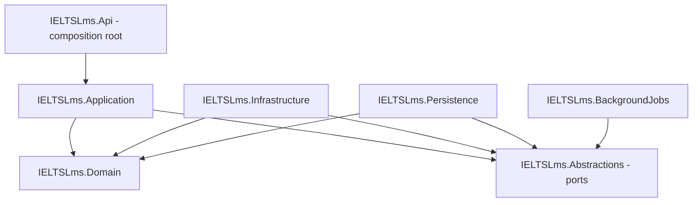
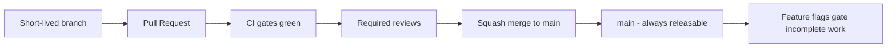

# Development Standards — IELTS LMS AI

| Field | Value |
| --- | --- |
| **Product Name** | IELTS LMS AI |
| **Document** | 23 — Development Standards |
| **Version** | 1.0 |
| **Status** | Architecture & Planning |
| **Document Owner** | Principal Software Architecture / Engineering Standards |
| **Last Updated** | 2026-07-18 |
| **Audience** | Backend & Frontend Engineers, AI/ML Engineers, Tech Leads, Architects, QA, DevOps/SRE, Security, Technical Writers, New Hires |
| **Aligns With** | [01_Product_Vision.md](./01_Product_Vision.md) … [22_Testing_Strategy.md](./22_Testing_Strategy.md) |

> **Purpose of this document.** This document defines the **official development standards** for IELTS LMS AI — the engineering philosophy, design principles, naming conventions, coding standards, and review disciplines that every contributor follows. It is **implementation-independent**: all examples are **pseudocode or naming illustrations**, never runnable source. It operationalizes the [Clean Architecture (14)](./14_Clean_Architecture.md), [Backend Architecture (15)](./15_Backend_Architecture.md), and [Frontend Architecture (16)](./16_Frontend_Architecture.md) rules; enforces the [API Design Standards (10)](./10_API_Design_Standards.md); applies the secure-coding requirements of [Security Standards (20)](./20_Security_Standards.md); and is verified continuously by the [Testing Strategy (22)](./22_Testing_Strategy.md) and [CI/CD Pipeline (24)](./24_CI_CD_Pipeline.md). These are the standards that CI gates enforce ([Roadmap M1.2](./21_Development_Roadmap.md)).

---

## Table of Contents

1. [Engineering Philosophy](#1-engineering-philosophy)
2. [Clean Code Principles](#2-clean-code-principles)
3. [SOLID, DRY, KISS, YAGNI & Boy Scout Rule](#3-solid-dry-kiss-yagni--boy-scout-rule)
4. [Domain-Driven Design Standards](#4-domain-driven-design-standards)
5. [Clean Architecture Standards](#5-clean-architecture-standards)
6. [CQRS Standards](#6-cqrs-standards)
7. [Naming Conventions](#7-naming-conventions)
8. [Database & API Naming](#8-database--api-naming)
9. [Logging Standards](#9-logging-standards)
10. [Error Handling Standards](#10-error-handling-standards)
11. [Validation Standards](#11-validation-standards)
12. [Dependency Injection & Configuration Standards](#12-dependency-injection--configuration-standards)
13. [Caching Standards](#13-caching-standards)
14. [Async, Cancellation & Performance Standards](#14-async-cancellation--performance-standards)
15. [Domain Building-Block Standards](#15-domain-building-block-standards)
16. [Security Coding & Secrets Standards](#16-security-coding--secrets-standards)
17. [Dependency Management Standards](#17-dependency-management-standards)
18. [Frontend, React & TypeScript Standards](#18-frontend-react--typescript-standards)
19. [Accessibility Standards](#19-accessibility-standards)
20. [Testing Standards](#20-testing-standards)
21. [Static Analysis & Formatting Standards](#21-static-analysis--formatting-standards)
22. [Documentation & Commenting Standards](#22-documentation--commenting-standards)
23. [Branch, Commit & Versioning Standards](#23-branch-commit--versioning-standards)
24. [Code Review & Pull Request Standards](#24-code-review--pull-request-standards)
25. [Code Smells & Refactoring Guidelines](#25-code-smells--refactoring-guidelines)
26. [Checklists](#26-checklists)
27. [Future Architecture Evolution](#27-future-architecture-evolution)
28. [Assumptions, Risks & Future Recommendations](#28-assumptions-risks--future-recommendations)
29. [Related Documents](#29-related-documents)

---

## 1. Engineering Philosophy

We write code for the **next engineer to read**, for the **system to run safely at scale**, and for the **architecture to survive change**. Code is a liability; behavior is the asset. The standards below exist to keep that liability low and that behavior trustworthy across a multi-tenant, AI-first platform aimed at millions of users ([NFR (05)](./05_Non_Functional_Requirements.md), [Multi-Tenant (12)](./12_Multi_Tenant_Architecture.md)).

| Value | What it means in practice |
| --- | --- |
| **Clarity over cleverness** | Obvious code beats clever code. Optimize for reading, not for typing. |
| **Consistency over preference** | A uniform codebase lowers cognitive load; house style wins over personal style. |
| **Boring where it counts** | Auth, tenancy, money, and AI evaluation use proven, predictable patterns — never experiments. |
| **Small, reversible steps** | Trunk-based, small PRs, feature-flagged incomplete work ([Roadmap §2](./21_Development_Roadmap.md#2-development-principles)). |
| **Secure & tenant-aware by default** | Every code path assumes a tenant context and denies by default ([Security (20)](./20_Security_Standards.md)). |
| **Done means done** | Code + tests + docs + security review + observability, or it is not done ([Roadmap DoD](./21_Development_Roadmap.md)). |

---

## 2. Clean Code Principles

| Principle | Standard |
| --- | --- |
| **Intention-revealing names** | Names state purpose; no abbreviations except well-known domain terms (IELTS, band, CEFR). |
| **Small functions** | A function does one thing at one level of abstraction; prefer early returns over deep nesting. |
| **No side effects in queries** | Reads never mutate state ([CQRS §6](#6-cqrs-standards)). |
| **Fail fast** | Validate at boundaries; guard clauses at the top of methods; never let invalid state propagate inward. |
| **No magic values** | Constants and enums replace literals; units are explicit in names (`timeoutSeconds`). |
| **Command-query separation** | A method either changes state or returns data, never both. |
| **Composition over inheritance** | Prefer small collaborating types over deep hierarchies. |

> **Boy Scout Rule.** Leave the code cleaner than you found it — but scope cleanup to what you touch. Opportunistic refactors ride in the same PR only when small and safe; larger refactors are separate PRs ([§25](#25-code-smells--refactoring-guidelines)).

---

## 3. SOLID, DRY, KISS, YAGNI & Boy Scout Rule

The platform is built on **SOLID + DDD + CQRS** ([Clean Architecture §](./14_Clean_Architecture.md)). These principles are mandatory design defaults, not aspirations.

| Principle | Applied standard |
| --- | --- |
| **S — Single Responsibility** | One reason to change per class; a command handler orchestrates one use case, nothing more. |
| **O — Open/Closed** | Extend via new handlers, strategies, or providers (e.g., a new AI provider adapter) — not by editing stable code. |
| **L — Liskov Substitution** | Any `IAiEvaluationProvider` ([AI (17)](./17_AI_Architecture.md)) is fully substitutable; no provider leaks special-case behavior to callers. |
| **I — Interface Segregation** | Ports are narrow (`IClock`, `ITenantContext`, `IAiChat`); no fat "service" interfaces. |
| **D — Dependency Inversion** | Application depends on abstractions in `IELTSLms.Abstractions`; infrastructure implements them ([§5](#5-clean-architecture-standards)). |
| **DRY** | Knowledge lives in one place. Duplication of *intent* is a smell; incidental similarity is not — do not over-abstract. |
| **KISS** | The simplest design that satisfies the requirement and the NFRs wins. |
| **YAGNI** | Build for today's requirements plus known near-term needs; speculative generality is deleted in review. |

> **Rationale.** DRY and YAGNI are in tension: premature abstraction to avoid duplication violates YAGNI. The rule of thumb is **rule of three** — abstract on the third real occurrence, not the first anticipated one.

---

## 4. Domain-Driven Design Standards

The domain model is the source of truth ([DDD (07)](./07_Domain_Driven_Design.md)). Code structure mirrors the **bounded contexts** and **ubiquitous language**.

| Standard | Rule |
| --- | --- |
| **Ubiquitous language** | Types, methods, and events use domain terms exactly (`Band`, `Attempt`, `Submission`, `Evaluation`, `Enrollment`, `Entitlement`). No synonyms across a context. |
| **Bounded-context boundaries** | Code for a context lives under `IELTSLms.<Layer>.<Context>`; contexts never share tables or entities ([DDD §6](./07_Domain_Driven_Design.md#6-context-mapping)). |
| **Cross-context references** | By identifier only (e.g., `TenantId`, `CourseId`) — never by shared entity reference. |
| **Aggregates enforce invariants** | State changes go through the aggregate root; no setting fields from outside. |
| **Tenant is intrinsic** | Every aggregate and message carries `TenantId`; no domain operation runs without a tenant context ([Multi-Tenant §7](./12_Multi_Tenant_Architecture.md)). |
| **Domain events** | Named past-tense (`WritingSubmitted`, `EvaluationCompleted`); raised by aggregates, dispatched in-transaction ([Backend §9](./15_Backend_Architecture.md#9-domain--integration-events)). |
| **AI anti-corruption** | The AI context translates provider models to domain models; provider shapes never leak into the domain ([AI (17)](./17_AI_Architecture.md)). |

---

## 5. Clean Architecture Standards

The dependency rule is absolute: **source dependencies point inward only** ([Clean Architecture (14)](./14_Clean_Architecture.md)). This is enforced by architecture tests that fail the build on violation ([§20](#20-testing-standards), [Testing §9](./22_Testing_Strategy.md#9-functional-test-levels)).



| Layer | May depend on | Must never depend on |
| --- | --- | --- |
| **Domain** | SharedKernel only | Application, Infrastructure, Persistence, frameworks |
| **Application** | Domain, Abstractions, Contracts | Infrastructure, Persistence, EF Core, ASP.NET |
| **Abstractions** | Domain, Contracts | Any concrete infrastructure |
| **Infrastructure / Persistence** | Abstractions, Domain | Application internals, Api |
| **Api** | Application, wiring of concretes at the composition root | Domain internals bypassing Application |

| Standard | Rule |
| --- | --- |
| **Ports & adapters** | External concerns (DB, cache, AI, storage, email) are accessed through ports (`I<Capability>`) defined in `IELTSLms.Abstractions`. |
| **No leakage** | EF Core types, `HttpContext`, and provider SDK types never appear in Application or Domain. |
| **Composition root** | All wiring happens in `IELTSLms.Api`; no service locator anywhere. |
| **Vertical slices** | Features are organized by use case (`Commands/SubmitWriting/...`), not by technical layer within a context. |

---

## 6. CQRS Standards

Commands and queries are separated end-to-end via **MediatR** ([Backend §8](./15_Backend_Architecture.md#8-cqrs-commands-queries-dtos--mapping)).

| Element | Naming & rule |
| --- | --- |
| **Command** | `VerbNounCommand` (`SubmitWritingCommand`); mutates state; returns only identifiers or a minimal result. |
| **Query** | `GetNounQuery` / `ListNounsQuery`; read-only; may bypass the domain for optimized read models. |
| **Handler** | `<Command/Query>Handler`; one use case; orchestrates domain + ports; no business rules of its own. |
| **Validator** | `<Command/Query>Validator` (FluentValidation); structural + input validation before the handler runs ([§11](#11-validation-standards)). |
| **Pipeline behaviors** | Cross-cutting concerns (validation, logging, tenant scoping, transactions) live in ordered pipeline behaviors, not in handlers ([Backend §7](./15_Backend_Architecture.md#7-request-processing-pipeline)). |
| **DTOs** | `<Noun>Request` / `<Noun>Response`; immutable; explicit — no exposing domain entities over the wire. |

```text
Application/Writing/
  Commands/SubmitWriting/
    SubmitWritingCommand
    SubmitWritingHandler
    SubmitWritingValidator
  Queries/GetWritingResult/
    GetWritingResultQuery
    GetWritingResultHandler
  Dtos/
    WritingSubmissionRequest
    WritingResultResponse
  Events/
    WritingSubmitted
```

---

## 7. Naming Conventions

Naming is uniform across the codebase; CI analyzers enforce casing ([§21](#21-static-analysis--formatting-standards)).

| Element | Convention | Example |
| --- | --- | --- |
| **Solution / Project** | `IELTSLms.<Layer>` | `IELTSLms.Application` |
| **Namespace** | `IELTSLms.<Layer>.<Context/Feature>` | `IELTSLms.Domain.Assessment` |
| **Folder (backend)** | PascalCase by concept | `Commands/SubmitWriting` |
| **Class** | PascalCase noun | `WritingSubmission` |
| **Interface (port)** | `I` + capability | `IAiEvaluationProvider` |
| **Method** | PascalCase verb phrase; `Async` suffix on async | `EvaluateAsync` |
| **Property** | PascalCase noun | `BandScore` |
| **Enum** | PascalCase singular; members PascalCase | `SkillType.Writing` |
| **DTO** | `<Noun>Request` / `<Noun>Response` | `MockExamRequest` |
| **Command / Query** | `VerbNounCommand` / `GetNounQuery` | `StartMockExamCommand` |
| **Exception** | `<Reason>Exception` | `TenantMismatchException` |
| **Domain event** | Past-tense noun-verb | `EvaluationCompleted` |
| **Integration event** | Past-tense + `IntegrationEvent` | `SubscriptionActivatedIntegrationEvent` |

> **Note.** Domain events are named past-tense because they record something that **already happened**; commands are imperative because they **request** something that may be rejected.

---

## 8. Database & API Naming

Persistence and contract naming are stable, external-facing surfaces and are governed by their own documents; this section restates the binding rules.

| Surface | Convention | Source |
| --- | --- | --- |
| **Table** | Plural, snake_case | `writing_submissions` | [ERD (09)](./09_Database_Design_ERD.md) |
| **Column** | snake_case | `band_score`, `tenant_id` | [ERD (09)](./09_Database_Design_ERD.md) |
| **Tenant discriminator** | `tenant_id` on every tenant-owned table | [Multi-Tenant §7](./12_Multi_Tenant_Architecture.md) |
| **Migration** | Versioned, forward-only in production, timestamp-ordered | [Backend §10](./15_Backend_Architecture.md#10-persistence-repositories-specifications-uow--concurrency) |
| **API resource** | Plural, lowercase, kebab-case | `/api/v1/writing-submissions` | [API §4](./10_API_Design_Standards.md#4-naming--uri-design) |
| **API version** | URI-based major version `/api/v1/` | [API §3](./10_API_Design_Standards.md#3-versioning-strategy) |
| **JSON property** | camelCase | `bandScore` | [API §8](./10_API_Design_Standards.md#8-response-standards) |
| **Action sub-resource** | `POST /resource/{id}/verb` | `POST /mock-exams/{id}/submit` | [API §4](./10_API_Design_Standards.md#4-naming--uri-design) |

> **Rationale.** There are **three casing worlds** on purpose: C# uses PascalCase, the database uses snake_case, and JSON uses camelCase. Mapping happens explicitly at layer boundaries (EF configuration; DTO mapping), never by leaking one world into another.

---

## 9. Logging Standards

Logging uses **Serilog** structured logs ([Backend §15](./15_Backend_Architecture.md#15-exception-handling-logging--auditing)).

| Standard | Rule |
| --- | --- |
| **Structured, not string** | Log with named properties, not interpolated strings: `log("Evaluation completed", submissionId, band)`. |
| **Mandatory enrichment** | Every log carries `correlationId`, `tenantId`, and (where applicable) `userId`. |
| **Levels** | `Trace/Debug` local only; `Information` for state transitions; `Warning` for recoverable anomalies; `Error` for failed operations; `Critical` for outages. |
| **No sensitive data** | Never log credentials, tokens, payment refs, PII, prompt content, or exam answers ([Security §9](./20_Security_Standards.md#9-data-protection-encryption-secrets-key-rotation)). |
| **Audit vs activity** | Immutable **audit logs** (compliance/security) are distinct from **activity logs** (behavioral/analytics); both are `TenantId`-stamped ([Multi-Tenant §](./12_Multi_Tenant_Architecture.md)). |
| **Correlation** | `correlationId` flows from the API edge through jobs and AI calls to enable end-to-end tracing ([API §12](./10_API_Design_Standards.md#12-correlation-tracing--observability)). |

---

## 10. Error Handling Standards

| Standard | Rule |
| --- | --- |
| **Exceptions are exceptional** | Use them for truly unexpected conditions, not control flow. Expected outcomes use result types or validation. |
| **Typed domain exceptions** | `<Reason>Exception` mapped centrally to HTTP responses; no ad-hoc `throw new Exception(...)`. |
| **Central mapping** | A single exception-handling middleware maps exceptions to **RFC 7807 Problem Details** ([API §9](./10_API_Design_Standards.md#9-error-handling--problem-details)). |
| **Safe error contracts** | Responses never expose stack traces, internal identifiers, SQL, or provider details ([Security §7](./20_Security_Standards.md#7-api-security)). |
| **Never swallow** | No empty catch blocks; catch only to translate, enrich, or recover — then log with context. |
| **Correct status codes** | `409` concurrency, `422` business-rule, `429` rate limit, `202` async accepted, `404` for cross-tenant misses ([API §5](./10_API_Design_Standards.md#5-http-methods--status-codes)). |

```text
pseudo:
try
    result = handler.Handle(command, cancellationToken)
catch DomainRuleViolation as ex
    return ProblemDetails(422, ex.Code, ex.SafeMessage)   // no internals
catch ConcurrencyConflict
    return ProblemDetails(409, "CONFLICT_VERSION_MISMATCH")
// unexpected exceptions bubble to global middleware -> 500 + correlationId only
```

---

## 11. Validation Standards

Validation is layered — each layer validates what only it can know.

| Layer | Responsibility | Mechanism |
| --- | --- | --- |
| **Client (frontend)** | Fast UX feedback; never the security boundary | Zod schemas ([Frontend §9](./16_Frontend_Architecture.md#9-forms-validation--error-handling)) |
| **Contract / input** | Structure, types, ranges, required fields | FluentValidation validators in the MediatR pipeline |
| **Domain / business** | Invariants and business rules | Enforced inside aggregates; violations raise typed domain exceptions |
| **Persistence** | Concurrency, uniqueness, referential integrity | Optimistic concurrency (`Version`), DB constraints |

> **Principle.** The server **never trusts the client**. Client validation improves UX; server validation is the enforcement boundary ([Security §10](./20_Security_Standards.md#10-input-validation--output-encoding)). Mass-assignment is blocked by explicit DTOs with whitelisted fields.

---

## 12. Dependency Injection & Configuration Standards

| Standard | Rule |
| --- | --- |
| **Constructor injection** | Dependencies are declared in constructors; no service locator, no static access to services. |
| **Lifetimes** | Stateless services scoped or transient; singletons only for genuinely stateless/thread-safe components; never capture a scoped dependency in a singleton. |
| **Register at composition root** | All registrations live in `IELTSLms.Api`; modules expose registration extension points. |
| **Layered configuration** | Precedence: built-in defaults → `appsettings.<Environment>` → environment variables → secret store → feature flags ([Backend §14](./15_Backend_Architecture.md#14-configuration--secrets-management)). |
| **Strongly-typed options** | Configuration binds to typed options objects, validated on startup; fail fast on missing/invalid config. |
| **No secrets in config files** | `config/` holds non-secret settings only; secrets come from the secret manager ([§16](#16-security-coding--secrets-standards)). |
| **Environment parity** | Environments differ by **configuration, not code** ([Infra §2](./19_Infrastructure_Deployment.md#2-deployment-strategy--environments)). |

---

## 13. Caching Standards

Caching uses **Redis** cache-aside ([Backend §11](./15_Backend_Architecture.md#11-caching--redis-strategy)).

| Standard | Rule |
| --- | --- |
| **Tenant-prefixed keys** | Keys are `{tenantId}:{entity}:{id}` — no cache entry is ever tenant-ambiguous ([Multi-Tenant §7](./12_Multi_Tenant_Architecture.md)). |
| **Cache-aside** | Read cache → miss → load → populate; writes invalidate, never blindly overwrite. |
| **Event-driven invalidation** | Domain events invalidate affected keys; no stale-forever entries. |
| **Explicit TTLs** | Every entry has a TTL; reference data longer, volatile data shorter. |
| **Never cache sensitive data unencrypted** | No caching of credentials, tokens, or Restricted data in plaintext. |
| **Cache is an optimization, not a source of truth** | The system is correct with a cold cache. |

---

## 14. Async, Cancellation & Performance Standards

| Standard | Rule |
| --- | --- |
| **Async all I/O** | Every I/O-bound method is async with the `Async` suffix; no sync-over-async (`.Result`, `.Wait()`). |
| **CancellationToken everywhere** | All async methods accept and honor a `CancellationToken`, propagated from the request ([Backend §19](./15_Backend_Architecture.md#19-naming--coding-standards)). |
| **Long-running work is offloaded** | Operations exceeding the sync ceiling (~2 s) run as background jobs (Hangfire) with status endpoints ([NFR-PERF](./05_Non_Functional_Requirements.md), [API §14](./10_API_Design_Standards.md#14-file-upload-streaming--long-running-operations)). AI evaluation is always async. |
| **No N+1** | Queries are explicit and shaped; use specifications and projections; verified in review and integration tests ([Backend §17](./15_Backend_Architecture.md#17-performance--data-access)). |
| **Bounded resource use** | Pagination is mandatory on collections; no unbounded `SELECT *` or in-memory materialization of large sets. |
| **Statelessness** | Services hold no per-request state in fields; horizontal scale-out must be safe ([NFR-SCAL](./05_Non_Functional_Requirements.md)). |
| **Performance budgets** | Code changes respect the API/DB/frontend budgets in [§21 Testing](./22_Testing_Strategy.md#12-performance-load-stress--scalability-testing). |

---

## 15. Domain Building-Block Standards

| Block | Standard |
| --- | --- |
| **Entity** | Identity-based equality; state changed only through methods that protect invariants. |
| **Aggregate root** | The only entry point for modifying its cluster; enforces consistency boundaries; loaded/saved as a unit. |
| **Value object** | Immutable; equality by value; self-validating (e.g., `Band` accepts 0–9 in 0.5 steps). |
| **Repository** | One per aggregate root; exposes intention-revealing methods; queries via Specifications ([Backend §10](./15_Backend_Architecture.md#10-persistence-repositories-specifications-uow--concurrency)). |
| **Specification** | Encapsulates query criteria as reusable, testable objects. |
| **Unit of Work** | One transaction per command; `IUnitOfWork` commits the aggregate + outbox atomically. |
| **Domain service** | Holds domain logic that does not naturally belong to a single aggregate. |
| **Policy** | Encapsulates a business rule/decision (e.g., entitlement checks) as a first-class type. |

> **Rationale.** Value objects like `Band` centralize validation of a core domain concept, so an invalid IELTS band can never exist in memory — the type system carries the invariant.

---

## 16. Security Coding & Secrets Standards

Secure coding is mandatory and enforced by CI gates ([Security §16, §20](./20_Security_Standards.md#16-vulnerability-management-sca-sast-dast)).

| Standard | Rule |
| --- | --- |
| **Deny by default** | Authorization is explicit; every endpoint is authenticated and tenant-scoped unless deliberately public ([Security §4](./20_Security_Standards.md#4-authorization-rbac--permission-security)). |
| **Ownership checks** | Every resource access verifies tenant + ownership to prevent IDOR/BOLA ([Security §7](./20_Security_Standards.md#7-api-security)). |
| **Parameterized data access** | EF Core parameterization only; never string-concatenated queries ([Security §](./20_Security_Standards.md#10-input-validation--output-encoding)). |
| **Output encoding** | Encode on output to prevent injection/XSS; sanitize rich text (TipTap content) server-side. |
| **No secrets in code** | No hardcoded credentials, keys, or connection strings; detected by pre-commit + CI secret scanning ([Security §9.3](./20_Security_Standards.md#94-key-rotation)). |
| **Secrets from vault** | Secrets come from Azure Key Vault / AWS Secrets Manager / GCP Secret Manager, injected at runtime by name ([Infra §9](./19_Infrastructure_Deployment.md#9-configuration-environment-variables--secrets)). |
| **No secrets in** | Source control, images, logs, error messages, or client bundles. |
| **Webhook verification** | Verify provider signatures (e.g., Stripe); reject stale/duplicate events ([Billing §](./13_Subscription_Billing.md)). |
| **Least-privilege claims** | JWTs carry minimal claims; no PII/secrets in payload; short lifetime ([Security §](./20_Security_Standards.md)). |

---

## 17. Dependency Management Standards

| Ecosystem | Standard |
| --- | --- |
| **NuGet (.NET)** | Pinned exact versions; centralized version management; no floating ranges; no prerelease in production branches. |
| **NPM (frontend)** | Pinned versions with a committed lockfile; `npm ci` in CI for reproducible installs. |
| **Vetting** | New dependencies are justified in the PR; prefer well-maintained, widely-used packages; watch for typosquatting. |
| **License compliance** | Only approved licenses; copyleft/unknown licenses require sign-off. |
| **Vulnerability scanning** | SCA runs in CI and blocks on high/critical CVEs ([Security §16](./20_Security_Standards.md#16-vulnerability-management-sca-sast-dast)). |
| **Update cadence** | Regular, automated dependency-update PRs; security patches applied within severity SLAs. |
| **Minimize surface** | Fewer, deliberate dependencies over many convenience ones; remove unused packages. |

---

## 18. Frontend, React & TypeScript Standards

Stack: **React 19, TypeScript, Vite, Tailwind, TanStack Query/Table, React Router, React Hook Form + Zod, Zustand, TipTap, Chart.js** ([Frontend (16)](./16_Frontend_Architecture.md)).

| Standard | Rule |
| --- | --- |
| **TypeScript strict** | `strict` mode on; no implicit `any`; shared types in `shared/types`; avoid unsafe casts. |
| **Feature-based structure** | Code organized by feature; `features/* → shared/*` allowed; `shared/* → features/*` forbidden; no deep cross-feature imports ([Frontend §3–4](./16_Frontend_Architecture.md#3-feature-based-architecture)). |
| **Barrels** | Each feature exposes a single `index.ts` barrel as its public surface. |
| **Server state vs client state** | Server state via TanStack Query (caching, ETags); ephemeral UI state via Zustand; do not duplicate server state in stores. |
| **Forms** | React Hook Form + Zod; the Zod schema is the single validation source shared with types. |
| **Components** | Function components + hooks only; small, composable; presentational/container separation where it aids testing. |
| **No secrets/logic-leak** | No secrets in the client bundle; entitlement checks are advisory in UI and enforced on the server. |
| **Performance** | Code splitting, lazy loading + Suspense, virtualization for large tables; respect bundle-size + Core Web Vitals budgets in CI ([Frontend §](./16_Frontend_Architecture.md)). |
| **Naming** | Components PascalCase (`WritingEditor.tsx`); hooks `use*` camelCase (`useSubmitWriting.ts`); folders kebab-case (`mock-exam/`); tests `*.test.tsx`. |

---

## 19. Accessibility Standards

Accessibility is a first-class requirement — the exam UI must be usable by all candidates ([Frontend §](./16_Frontend_Architecture.md), [NFR-USAB](./05_Non_Functional_Requirements.md)).

| Standard | Rule |
| --- | --- |
| **Baseline** | **WCAG 2.1 AA** is the compliance target for all user-facing UI. |
| **Semantic HTML** | Use native elements and landmarks before ARIA; ARIA only to fill genuine gaps. |
| **Keyboard operable** | Every interaction works by keyboard; visible focus states; logical focus order; no keyboard traps. |
| **Names, roles, values** | All controls have accessible names; state changes announced to assistive tech. |
| **Contrast & motion** | Meet AA contrast ratios; honor reduced-motion preferences (Framer Motion kept minimal). |
| **Automated gate** | `axe` runs in CI on components and E2E flows and blocks on violations ([Testing §11](./22_Testing_Strategy.md#11-end-to-end-ui-accessibility--cross-browser-testing)). |
| **Manual verification** | Automated checks are necessary, not sufficient; keyboard + screen-reader spot checks on critical flows before release. |

> **Note.** Full WCAG conformance cannot be certified by automated tooling alone; it requires manual testing with assistive technologies and expert review. The `axe` gate catches regressions on machine-detectable criteria only.

---

## 20. Testing Standards

These coding-side standards complement the full program in the [Testing Strategy (22)](./22_Testing_Strategy.md).

| Standard | Rule |
| --- | --- |
| **Tests ship with code** | A feature PR includes its tests; DoD is not met without them ([Roadmap DoD](./21_Development_Roadmap.md)). |
| **Backend levels** | Unit (domain rules, handlers with fake ports, no DB/web) → Integration (EF Core + PostgreSQL Testcontainers) → Architecture (dependency-rule tests, fail build on violation) → API/contract ([Backend §18](./15_Backend_Architecture.md#18-testing-strategy)). |
| **Frontend levels** | Unit (Vitest) → Component (Vitest + Testing Library, with a11y assertions) → E2E (Playwright) → Contract (generated types + MSW mocks). |
| **First-class concerns** | Tenant isolation, authorization, and optimistic concurrency are tested explicitly, including negative cases. |
| **Deterministic** | Control time (`IClock`), randomness, and external calls; tests are order-independent and self-contained. |
| **Naming** | Tests state behavior: `Should_<expected>_When_<condition>`; frontend tests `*.test.tsx`. |
| **AAA structure** | Arrange–Act–Assert; one logical assertion focus per test. |
| **Coverage** | Meaningful coverage on critical paths (target ≥ 80% on core domains) — coverage is a floor, not a goal ([NFR-MAINT-003](./05_Non_Functional_Requirements.md), [Testing §21](./22_Testing_Strategy.md#21-coverage-targets--metrics)). |

---

## 21. Static Analysis & Formatting Standards

Formatting is automated and enforced; style is never debated in review ([Roadmap M1.2](./21_Development_Roadmap.md)).

| Tool | Scope | Rule |
| --- | --- | --- |
| **EditorConfig** | Repo-wide | Baseline whitespace, indentation, line endings; committed at repo root. |
| **.NET analyzers** | Backend | Roslyn analyzers + style rules run in build; **nullable reference types on**; warnings-as-errors on style/quality categories. |
| **ESLint** | Frontend | Lint rules enforced; no disabling rules inline without justification. |
| **Prettier** | Frontend | Formatting owned by Prettier; not overridden manually. |
| **CI enforcement** | All | Format + analyzer + lint checks run in CI and **block merge** on violation ([CI/CD §](./24_CI_CD_Pipeline.md)). |

> **Rationale.** Formatting is deterministic and machine-owned so that human review focuses entirely on correctness, design, and risk — not on braces and spacing.

---

## 22. Documentation & Commenting Standards

| Standard | Rule |
| --- | --- |
| **Comment the why, not the what** | Code shows *what*; comments explain *why* — intent, trade-offs, non-obvious constraints. |
| **XML documentation** | Public APIs, ports, and shared contracts carry XML doc comments (backend). |
| **Self-documenting names** | Prefer clear names over explanatory comments; delete comments that restate the code. |
| **No commented-out code** | Deleted code lives in version control, not in comments. |
| **Markdown docs** | Architecture and standards docs follow this doc set's conventions; changes to architecture require an **ADR** in [`docs/adr`](./adr) ([Roadmap §18](./21_Development_Roadmap.md#18-versioning-strategy)). |
| **API docs** | OpenAPI/Swagger is generated and kept accurate; the contract is the source of truth ([API §17](./10_API_Design_Standards.md#17-documentation-standards-openapiswagger)). |
| **Keep docs adjacent** | READMEs and module docs live next to the code they describe and are updated in the same PR. |

---

## 23. Branch, Commit & Versioning Standards

The platform uses **trunk-based development** with short-lived branches and feature flags ([Roadmap §2](./21_Development_Roadmap.md#2-development-principles)).

| Standard | Rule |
| --- | --- |
| **Branch model** | Trunk-based: short-lived branches off `main`; incomplete work hidden behind feature flags, not long-lived branches. |
| **Branch naming** | `<type>/<short-description>` (`feat/writing-autosave`, `fix/tenant-filter-leak`). |
| **Commit convention** | **Conventional Commits**: `type(scope): summary` (`feat`, `fix`, `docs`, `refactor`, `test`, `chore`, `perf`, `build`, `ci`). |
| **Small, atomic commits** | Each commit is a coherent change; history is readable. |
| **Product versioning** | **Semantic Versioning `MAJOR.MINOR.PATCH`**; `v1.0.0` at GA ([Roadmap §18](./21_Development_Roadmap.md#18-versioning-strategy)). |
| **API versioning** | URI major versioning `/api/v1/`; breaking changes bump the major version ([API §3](./10_API_Design_Standards.md#3-versioning-strategy)). |
| **DB versioning** | Forward-only, reversible migrations; expand/contract for zero-downtime ([Backend §10](./15_Backend_Architecture.md#10-persistence-repositories-specifications-uow--concurrency)). |

> **GitFlow vs Trunk-Based — decision.** We use **trunk-based**, not GitFlow. GitFlow's long-lived develop/release branches conflict with continuous integration and small reversible steps; trunk-based with feature flags keeps integration continuous and rollback simple, matching the CD strategy in [CI/CD (24)](./24_CI_CD_Pipeline.md).



---

## 24. Code Review & Pull Request Standards

| Standard | Rule |
| --- | --- |
| **Small PRs** | Prefer PRs reviewable in under ~400 lines of change; split large work. |
| **Green before review** | All CI gates (build, lint, format, tests, security scans) pass before human review ([CI/CD §](./24_CI_CD_Pipeline.md)). |
| **Required reviews** | At least one approving review; changes to auth, tenancy, billing, or AI require a domain owner + security review ([Security §20](./20_Security_Standards.md#20-secure-development-lifecycle)). |
| **Author responsibilities** | Clear description, linked work item, screenshots for UI, notes on risk/rollback, self-review first. |
| **Reviewer focus** | Correctness, design, tenant safety, security, tests, and readability — not formatting (automated). |
| **Merge strategy** | **Squash merge** to keep `main` history linear and each merge atomic and revertible. |
| **No self-merge of unreviewed code** | Branch protection enforces reviews and green checks ([CI/CD §](./24_CI_CD_Pipeline.md)). |

---

## 25. Code Smells & Refactoring Guidelines

| Smell | Signal | Remedy |
| --- | --- | --- |
| **God class / long method** | One type/method doing many things | Extract responsibilities; apply SRP. |
| **Feature envy** | A method reaching into another object's data | Move behavior to the data's owner. |
| **Primitive obsession** | Raw strings/ints for domain concepts | Introduce value objects (`Band`, `Email`). |
| **Shotgun surgery** | One change touching many files | Consolidate the concept; check for missing abstraction. |
| **Leaky abstraction** | EF/HTTP/provider types in inner layers | Restore the port boundary ([§5](#5-clean-architecture-standards)). |
| **Tenant ambiguity** | A query/cache key without `TenantId` | Add tenant scoping; add a test ([Multi-Tenant §7](./12_Multi_Tenant_Architecture.md)). |

**Refactoring rules:** refactor under green tests; keep behavior-preserving refactors separate from behavior changes; large refactors are their own PRs with their own risk notes. Technical debt is tracked explicitly — ~15–20% of each phase's capacity is reserved for it ([Roadmap §19](./21_Development_Roadmap.md#19-technical-debt-management)).

---

## 26. Checklists

### 26.1 Code Review Checklist

- [ ] Solves the stated problem; scope is not broader than needed (YAGNI).
- [ ] Respects the dependency rule; no layer leakage ([§5](#5-clean-architecture-standards)).
- [ ] Tenant-scoped: queries, cache keys, jobs, logs, and AI calls carry `TenantId`.
- [ ] Authorization is explicit and deny-by-default; ownership checks present.
- [ ] Input validated at the correct layer; no mass assignment.
- [ ] Errors mapped to safe Problem Details; no internals leaked.
- [ ] Async + `CancellationToken` on all I/O; no sync-over-async; no N+1.
- [ ] No secrets, PII, or exam answers in code or logs.
- [ ] Tests included and meaningful; critical paths covered.
- [ ] Names follow conventions; no dead/commented-out code.

### 26.2 Pull Request Checklist

- [ ] Small and focused; linked to a work item.
- [ ] Conventional Commit title; clear description with risk + rollback notes.
- [ ] All CI gates green (build, lint, format, tests, SAST/SCA/secret scan).
- [ ] UI changes include screenshots and pass the `axe` gate.
- [ ] Docs/ADR updated if architecture or contracts changed.
- [ ] Feature flag added if the work is incomplete or risky.
- [ ] Required reviewers assigned (domain + security for sensitive areas).

### 26.3 Architecture Checklist

- [ ] Change fits within existing bounded contexts; new contexts added rather than overloaded ([DDD §](./07_Domain_Driven_Design.md)).
- [ ] Integration via events/contracts, not shared tables.
- [ ] Ports defined in `IELTSLms.Abstractions`; concretes wired at the composition root.
- [ ] Tenant isolation invariant preserved end-to-end.
- [ ] NFR budgets (performance, scalability) considered ([NFR (05)](./05_Non_Functional_Requirements.md)).
- [ ] Migration is forward-only and reversible (expand/contract).
- [ ] Significant decisions captured in an ADR.

### 26.4 Developer Onboarding Checklist

- [ ] Read docs 14 (Clean Architecture), 15 (Backend), 16 (Frontend), 20 (Security), 22 (Testing), and this document.
- [ ] Local Docker Compose environment running (API, SPA, PostgreSQL, Redis, MinIO, NGINX) ([Infra §3](./19_Infrastructure_Deployment.md#3-development-environment)).
- [ ] EditorConfig, analyzers, ESLint, and Prettier active in the IDE.
- [ ] Pre-commit hooks (secret scan, format) installed.
- [ ] Able to run the full backend and frontend test suites locally.
- [ ] Understands trunk-based flow, Conventional Commits, and the PR process.
- [ ] Reviewed the ubiquitous language glossary ([DDD §3](./07_Domain_Driven_Design.md)).

---

## 27. Future Architecture Evolution

These standards are written to survive the platform's known evolution ([Roadmap §20](./21_Development_Roadmap.md#20-future-roadmap), [Infra §19](./19_Infrastructure_Deployment.md#19-infrastructure-evolution-roadmap)).

| Direction | How the standards support it |
| --- | --- |
| **Modular monolith → microservices** | Bounded-context boundaries and ports make **AI Evaluation** and **Billing** the first clean extractions ([Clean Architecture §](./14_Clean_Architecture.md)). |
| **Shared-DB → hybrid/DB-per-tenant** | Universal `TenantId` scoping and tenant-prefixed keys keep the isolation model portable ([Multi-Tenant §](./12_Multi_Tenant_Architecture.md)). |
| **New AI providers & agentic growth** | Narrow provider ports and anti-corruption boundaries absorb Gemini, Azure OpenAI, local models, MCP, and A2A ([AI (17)](./17_AI_Architecture.md), [Agentic (18)](./18_Agentic_AI_Architecture.md)). |
| **GraphQL / gRPC / streaming** | Contract-first discipline lets additive protocols coexist with REST ([API §19](./10_API_Design_Standards.md#19-sdks--future-protocols)). |
| **Mutation testing & stricter gates** | Coverage floors evolve toward mutation testing as the suite matures ([Testing §21](./22_Testing_Strategy.md#21-coverage-targets--metrics)). |

---

## 28. Assumptions, Risks & Future Recommendations

### 28.1 Assumptions

| ID | Assumption |
| --- | --- |
| A-1 | The backend stack is .NET 10 / ASP.NET Core with the libraries fixed in [Backend §2](./15_Backend_Architecture.md#2-technology-decisions); the frontend is React 19 / TypeScript / Vite per [Frontend §2](./16_Frontend_Architecture.md). |
| A-2 | CI/CD enforces these standards as gates from Phase 1 ([Roadmap M1.2–M1.3](./21_Development_Roadmap.md)). |
| A-3 | All engineers have consistent IDE tooling (EditorConfig, analyzers, ESLint, Prettier) active locally. |

### 28.2 Risks

| ID | Risk | Mitigation |
| --- | --- | --- |
| R-1 | Standards drift as the team grows | Automated enforcement (analyzers, lint, format, architecture tests) over manual policing. |
| R-2 | Over-abstraction violating YAGNI | Rule-of-three, review scrutiny, and explicit "delete speculative generality" guidance. |
| R-3 | Tenant scoping missed in new code | Architecture + integration tests for tenant isolation; review checklist item. |
| R-4 | Inconsistent AI/provider integration | Enforced ports + anti-corruption layers; provider changes reviewed against [AI (17)](./17_AI_Architecture.md). |

### 28.3 Future Recommendations

- Introduce **mutation testing** on core domains once line/branch coverage stabilizes.
- Add **architecture fitness functions** beyond dependency rules (e.g., naming, tenant-scoping heuristics) to CI.
- Publish an internal **golden-path template** repository once patterns settle post-GA.
- Formalize an **ADR review cadence** to keep decisions and standards synchronized.

---

## 29. Related Documents

| # | Document | Relationship |
| --- | --- | --- |
| 05 | [Non-Functional Requirements](./05_Non_Functional_Requirements.md) | Performance, scalability, and maintainability targets these standards uphold. |
| 07 | [Domain-Driven Design](./07_Domain_Driven_Design.md) | Ubiquitous language and bounded contexts the code mirrors. |
| 09 | [Database Design & ERD](./09_Database_Design_ERD.md) | Database naming and data classification. |
| 10 | [API Design Standards](./10_API_Design_Standards.md) | API naming, versioning, and error contracts. |
| 12 | [Multi-Tenant Architecture](./12_Multi_Tenant_Architecture.md) | Tenant-scoping rules enforced in code. |
| 14 | [Clean Architecture](./14_Clean_Architecture.md) | Dependency rule and layering these standards enforce. |
| 15 | [Backend Architecture](./15_Backend_Architecture.md) | CQRS, persistence, and coding standards source. |
| 16 | [Frontend Architecture](./16_Frontend_Architecture.md) | React/TypeScript structure and conventions. |
| 17 | [AI Architecture](./17_AI_Architecture.md) | Provider ports and anti-corruption standards. |
| 18 | [Agentic AI Architecture](./18_Agentic_AI_Architecture.md) | Agent design constraints. |
| 19 | [Infrastructure & Deployment](./19_Infrastructure_Deployment.md) | Configuration, secrets, and environment parity. |
| 20 | [Security Standards](./20_Security_Standards.md) | Secure-coding and secrets requirements. |
| 21 | [Development Roadmap](./21_Development_Roadmap.md) | Definition of Done, versioning, and standards enforcement milestones. |
| 22 | [Testing Strategy](./22_Testing_Strategy.md) | Testing standards and quality gates. |
| 24 | [CI/CD Pipeline](./24_CI_CD_Pipeline.md) | Where these standards are enforced as automated gates. |

---

*End of Document — 23 Development Standards (v1.0).*
