# CI/CD Pipeline — IELTS LMS AI

| Field | Value |
| --- | --- |
| **Product Name** | IELTS LMS AI |
| **Document** | 24 — CI/CD Pipeline |
| **Version** | 1.0 |
| **Status** | Architecture & Planning |
| **Document Owner** | Principal DevOps / SRE / Release Engineering |
| **Last Updated** | 2026-07-18 |
| **Audience** | DevOps, SRE, Release Engineers, Backend & Frontend Engineers, QA, Security, Platform Engineers, Engineering Leadership |
| **Aligns With** | [01_Product_Vision.md](./01_Product_Vision.md) … [23_Development_Standards.md](./23_Development_Standards.md) |

> **Purpose of this document.** This document defines the complete **continuous integration and continuous delivery (CI/CD) strategy** for IELTS LMS AI — the philosophy, git strategy, pipeline stages, deployment model, rollback and progressive-delivery approach, and the roadmap to Kubernetes and GitOps. It is **implementation-independent** — it contains **no YAML, no GitHub Actions workflows, no Azure DevOps pipelines, and no Dockerfiles** — only the architecture, stage design, and engineering decisions from which those artifacts are later built. It realizes the deployment model in [Infrastructure §18](./19_Infrastructure_Deployment.md#18-deployment-workflow--progressive-delivery), executes the [Testing Strategy (22)](./22_Testing_Strategy.md) as automated gates, enforces the [Development Standards (23)](./23_Development_Standards.md), applies the security scan gates from [Security §16 & §20](./20_Security_Standards.md#16-vulnerability-management-sca-sast-dast), and delivers the pipeline milestones in [Roadmap P1 (M1.3/M1.4)](./21_Development_Roadmap.md).

---

## Table of Contents

1. [CI/CD Philosophy](#1-cicd-philosophy)
2. [Repository & Git Strategy](#2-repository--git-strategy)
3. [Branch Protection, Reviews & Merge Strategy](#3-branch-protection-reviews--merge-strategy)
4. [Pipeline Topology Overview](#4-pipeline-topology-overview)
5. [Continuous Integration — Build Stage](#5-continuous-integration--build-stage)
6. [Continuous Integration — Test & Quality Gates](#6-continuous-integration--test--quality-gates)
7. [Security Scanning Gates](#7-security-scanning-gates)
8. [Artifact Generation & Publishing](#8-artifact-generation--publishing)
9. [Continuous Delivery — Deployment Pipeline](#9-continuous-delivery--deployment-pipeline)
10. [Environment Promotion & Protection](#10-environment-promotion--protection)
11. [Approval Gates](#11-approval-gates)
12. [Deployment Strategies: Rolling, Blue/Green & Canary](#12-deployment-strategies-rolling-bluegreen--canary)
13. [Feature Flags](#13-feature-flags)
14. [Database Migration Strategy](#14-database-migration-strategy)
15. [Configuration & Secrets Management](#15-configuration--secrets-management)
16. [Versioning, Release Tags & Release Notes](#16-versioning-release-tags--release-notes)
17. [Post-Deployment Verification](#17-post-deployment-verification)
18. [Rollback Strategy](#18-rollback-strategy)
19. [Pipeline Notifications & Failure Recovery](#19-pipeline-notifications--failure-recovery)
20. [Disaster Recovery Integration](#20-disaster-recovery-integration)
21. [Future: Kubernetes, IaC, GitOps & Progressive Delivery](#21-future-kubernetes-iac-gitops--progressive-delivery)
22. [Assumptions, Risks & Future Recommendations](#22-assumptions-risks--future-recommendations)
23. [Related Documents](#23-related-documents)

---

## 1. CI/CD Philosophy

The pipeline is the **single, automated, auditable path to production**. No change reaches a shared environment except through it; no human copies files onto a server. This is what makes a multi-tenant, exam-grade platform safe to change many times a day.

| Principle | Meaning |
| --- | --- |
| **The pipeline is the only road to prod** | All promotion is pipeline + IaC driven; no manual changes in Staging/Production ([Infra §2](./19_Infrastructure_Deployment.md#2-deployment-strategy--environments)). |
| **Build once, promote the same artifact** | One immutable image is built in CI and flows Dev → CI → Staging → Prod unchanged ([Infra §5](./19_Infrastructure_Deployment.md#5-containerization-strategy)). |
| **Shift left, fail fast** | The cheapest gates (lint, unit, secret scan) run first; expensive gates (E2E, DAST) run later ([Testing §3](./22_Testing_Strategy.md#3-shift-left-testing)). |
| **Green pipeline is merge-blocking** | A red pipeline cannot merge or promote ([Roadmap M1.3](./21_Development_Roadmap.md)). |
| **Every deploy is reversible** | Rollback is a first-class, rehearsed path, not an emergency improvisation ([§18](#18-rollback-strategy)). |
| **Everything is observable & audited** | Every build, scan, approval, and deploy emits a traceable, immutable record ([Security §14](./20_Security_Standards.md)). |
| **Secure by default** | Secret, SAST, SCA, and container scans are gates, not advisories ([§7](#7-security-scanning-gates)). |

> **Rationale.** "Build once, promote the same artifact" eliminates the most common class of release defects — environment drift. If Staging passed, Production runs *the identical bytes*, differing only by injected configuration and secrets ([§15](#15-configuration--secrets-management)).

---

## 2. Repository & Git Strategy

The platform is developed in a **single GitHub repository (monorepo)** containing the backend solution, frontend application, infrastructure definitions, and this documentation set. This matches the [modular-monolith architecture (14)](./14_Clean_Architecture.md) and keeps backend/frontend contract changes atomic in one commit.

| Aspect | Standard |
| --- | --- |
| **Host** | GitHub (current repository of record). |
| **Layout** | Monorepo: `backend/`, `frontend/`, `infrastructure/`, `docs/`, `scripts/`, `tests/`. |
| **Branching model** | **Trunk-based development** — `main` is always releasable; short-lived branches ([Roadmap §2](./21_Development_Roadmap.md#2-development-principles)). |
| **Branch lifetime** | Hours to a few days; long-lived feature branches are prohibited — use [feature flags §13](#13-feature-flags) instead. |
| **Incomplete work** | Merged to `main` behind a disabled feature flag rather than held on a branch. |

### 2.1 Trunk-Based vs GitFlow — Decision

> **Decision.** We use **trunk-based development, not GitFlow.** GitFlow's long-lived `develop`/`release` branches cause painful merges and delay integration, which contradicts the roadmap's small-PR, continuous-integration principle. Trunk-based + feature flags + a green merge-blocking pipeline gives us continuous integration with release control decoupled from merge.

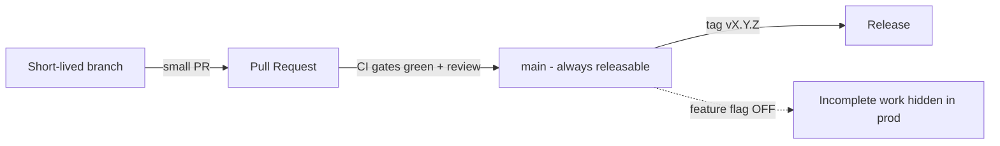

### 2.2 Branch Naming

| Type | Pattern | Example |
| --- | --- | --- |
| Feature | `feat/<context>-<short-desc>` | `feat/writing-autosave` |
| Fix | `fix/<context>-<short-desc>` | `fix/billing-webhook-retry` |
| Chore/infra | `chore/<short-desc>` | `chore/bump-otel` |
| Hotfix | `hotfix/<short-desc>` | `hotfix/exam-timer-drift` |

Branch prefixes align with the [Conventional Commit](./23_Development_Standards.md#23-branch-commit--versioning-standards) types defined in Development Standards.

---

## 3. Branch Protection, Reviews & Merge Strategy

`main` is a **protected branch**. The rules below are the enforcement point for the [Development Standards (23)](./23_Development_Standards.md) and [Testing quality gates (22)](./22_Testing_Strategy.md#5-quality-gates-dor-dod--acceptance-criteria).

| Protection | Rule |
| --- | --- |
| **Direct pushes** | Forbidden to `main`; all changes via PR. |
| **Required reviews** | ≥ 1 approving review; ≥ 2 for high-risk areas (auth, tenancy, billing, AI evaluation, migrations). |
| **Code owners** | `CODEOWNERS` routes reviews to the owning context/team; owner approval required for their paths. |
| **Required status checks** | All CI gates ([§5](#5-continuous-integration--build-stage)–[§7](#7-security-scanning-gates)) must pass before merge. |
| **Up-to-date branch** | Branch must be current with `main` before merge (avoids semantic merge breaks). |
| **Linear history** | Enforced via squash merge. |
| **Signed commits** | Required; unsigned commits rejected. |
| **Conversation resolution** | All PR threads resolved before merge. |
| **Stale approval dismissal** | New commits dismiss prior approvals on high-risk paths. |

> **Decision — Merge strategy: squash-and-merge.** Each PR becomes **one atomic, revertable commit** on `main` with a [Conventional Commit](./23_Development_Standards.md#23-branch-commit--versioning-standards) message. This keeps history linear and readable, makes `git revert` a clean rollback unit, and feeds automated release-note generation ([§16](#16-versioning-release-tags--release-notes)).

---

## 4. Pipeline Topology Overview

The pipeline has two macro-phases: **CI** (triggered on every PR and on merge to `main`) proves a change is safe and produces an immutable artifact; **CD** (triggered on merge/tag) promotes that artifact through environments with gates and approvals.

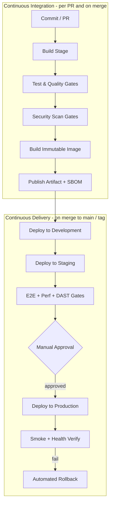

This topology is the CI/CD realization of [Infrastructure §18.1](./19_Infrastructure_Deployment.md#18-deployment-workflow--progressive-delivery) and executes the test levels of [Testing §9–§13](./22_Testing_Strategy.md#9-functional-test-levels).

| Trigger | Runs | Deploys to |
| --- | --- | --- |
| **Pull request** | Build + Test + Security gates (no publish/deploy) | Nothing (ephemeral CI env only) |
| **Merge to `main`** | Full CI + publish artifact | Development → Staging (auto) |
| **Tag `vX.Y.Z`** | Promotion pipeline | Production (after approval) |
| **Nightly** | Full regression, long-running perf, dependency audit | Staging |

---

## 5. Continuous Integration — Build Stage

The build stage turns source into a verified, compiled, statically-checked artifact. Stages run in the cheapest-fails-first order so feedback is fast.

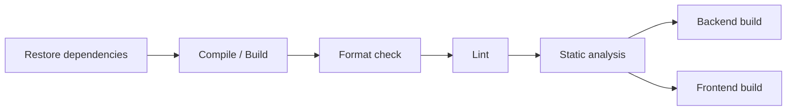

| Step | Backend | Frontend | Gate behavior |
| --- | --- | --- | --- |
| **Restore** | NuGet restore with lockfile ([Std §17](./23_Development_Standards.md#17-dependency-management-standards)) | npm ci from lockfile | Fail on lockfile mismatch |
| **Compile** | `IELTSLms.*` solution build, warnings-as-errors | TypeScript type-check + Vite build | Fail on any error/warning |
| **Format** | Formatter verify (EditorConfig) | Prettier check | Fail on drift |
| **Lint** | Analyzer rules | ESLint | Fail on violations |
| **Static analysis** | Analyzers + architecture-rule review | ESLint + type strictness | Fail on new violations |
| **Nullable/strict** | Nullable reference types enforced ([Backend §19](./15_Backend_Architecture.md#19-naming--coding-standards)) | `strict` TS mode | Fail on violation |

> **Note.** The **architecture tests** (`IELTSLms.Architecture.Tests`) that enforce the [Clean Architecture dependency rule](./14_Clean_Architecture.md) run in the test stage ([§6](#6-continuous-integration--test--quality-gates)) but conceptually gate the build: a layering violation fails the pipeline exactly like a compile error.

---

## 6. Continuous Integration — Test & Quality Gates

Test execution follows the [Testing Pyramid (22 §4)](./22_Testing_Strategy.md#4-the-testing-pyramid): fast, numerous unit tests first; fewer, slower integration and contract tests next.

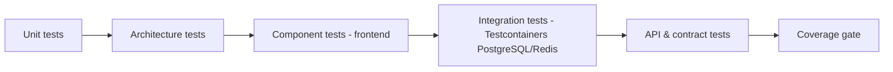

| Gate | Scope | Source of truth | Blocking |
| --- | --- | --- | --- |
| **Unit tests** | Domain rules, handlers with fake ports; FE utils/hooks/schemas | [Testing §9.1](./22_Testing_Strategy.md#9-functional-test-levels) | Yes |
| **Architecture tests** | Dependency-rule enforcement | [Clean Arch (14)](./14_Clean_Architecture.md) | Yes |
| **Component tests** | React rendering/interaction + a11y assertions (Vitest + Testing Library) | [Frontend §21](./16_Frontend_Architecture.md) | Yes |
| **Integration tests** | EF Core + ephemeral PostgreSQL/Redis; tenant filter + concurrency | [Testing §9.3](./22_Testing_Strategy.md#9-functional-test-levels) | Yes |
| **Contract tests** | OpenAPI conformance; generated FE types + MSW mocks | [Testing §10](./22_Testing_Strategy.md#10-api--contract-testing) | Yes |
| **Coverage gate** | ≥ 80% on core domains ([NFR-MAINT-003](./05_Non_Functional_Requirements.md)) | [Testing §21](./22_Testing_Strategy.md#21-coverage-targets--metrics) | Yes (core), warn (non-core) |
| **Cross-tenant isolation tests** | Deny-by-default access across tenants | [Security §8](./20_Security_Standards.md), [Testing §13](./22_Testing_Strategy.md#13-security-testing) | Yes |

> **Rationale.** Cross-tenant isolation tests are **merge-blocking at the CI level**, not deferred to staging, because SR-1 (cross-tenant leak) is the platform's highest-impact risk ([Security](./20_Security_Standards.md)).

---

## 7. Security Scanning Gates

Security scanning is woven into CI as **blocking gates**, executing the program defined in [Security §16](./20_Security_Standards.md#16-vulnerability-management-sca-sast-dast) in the mandated order.

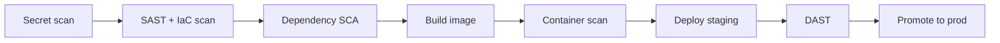

| Gate | What it checks | Block condition |
| --- | --- | --- |
| **Secret scanning** | Hardcoded credentials/tokens (repo + pre-commit) | Any detected secret |
| **SAST + IaC** | Static code + infra definition vulnerabilities | High-severity finding |
| **Dependency SCA** | Known CVEs in NuGet/npm dependencies | High/critical CVE; unpinned versions |
| **Container scan** | Base image CVEs, misconfig, non-root, no baked secrets | High/critical CVE or policy violation |
| **DAST** | Running-app scan against Staging | High-severity finding pre-prod |

| Principle | Standard |
| --- | --- |
| **Pinned & pre-commit** | Secret scanning also runs pre-commit; dependencies pinned/digest-pinned ([Security §16](./20_Security_Standards.md#16-vulnerability-management-sca-sast-dast)). |
| **SBOM generated** | A Software Bill of Materials is produced per build ([§8](#8-artifact-generation--publishing)). |
| **Patch SLAs** | Findings tracked to remediation within severity-based SLAs ([NFR-SEC-006](./05_Non_Functional_Requirements.md)). |
| **Supply-chain integrity** | Signed commits, signed artifacts, pinned image digests ([Security](./20_Security_Standards.md)). |

---

## 8. Artifact Generation & Publishing

CI produces a small set of **immutable, versioned, signed artifacts**. This is the "build once" boundary — everything downstream consumes these bytes unchanged.

| Artifact | Description | Registry / store |
| --- | --- | --- |
| **Backend container image** | `IELTSLms.Api` + runtime, tagged with SemVer + git SHA | Container registry (GitHub Container Registry now; future ACR/ECR/GCR) |
| **Frontend static bundle** | Vite-built hashed static assets | Object storage + CDN ([Infra §11](./19_Infrastructure_Deployment.md#11-file-storage--cdn-strategy)) |
| **Migration bundle** | Versioned, forward-only EF migrations ([§14](#14-database-migration-strategy)) | Attached to release |
| **SBOM** | Dependency inventory per build | Attached to release + scanned |
| **Release manifest** | Image digests, versions, migration set, config schema | Immutable release record |

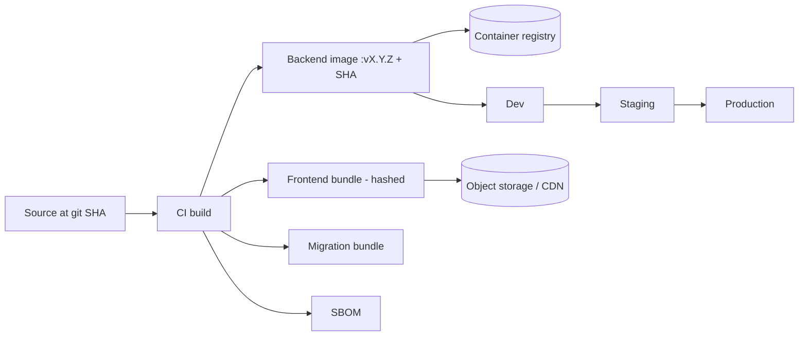

| Rule | Standard |
| --- | --- |
| **Immutable tags** | An image tag is never overwritten; a rebuild gets a new tag. |
| **Digest promotion** | Environments reference images by **digest**, not mutable tag, for provenance. |
| **Retention** | Release artifacts retained per compliance policy; PR/ephemeral artifacts pruned. |

---

## 9. Continuous Delivery — Deployment Pipeline

CD promotes a published artifact through the **four canonical environments** ([Infra §2](./19_Infrastructure_Deployment.md#2-deployment-strategy--environments)): Local Development, Testing/CI, Staging, Production. Local Development and Testing/CI are developer/pipeline concerns; CD orchestrates **Development → Staging → Production**.

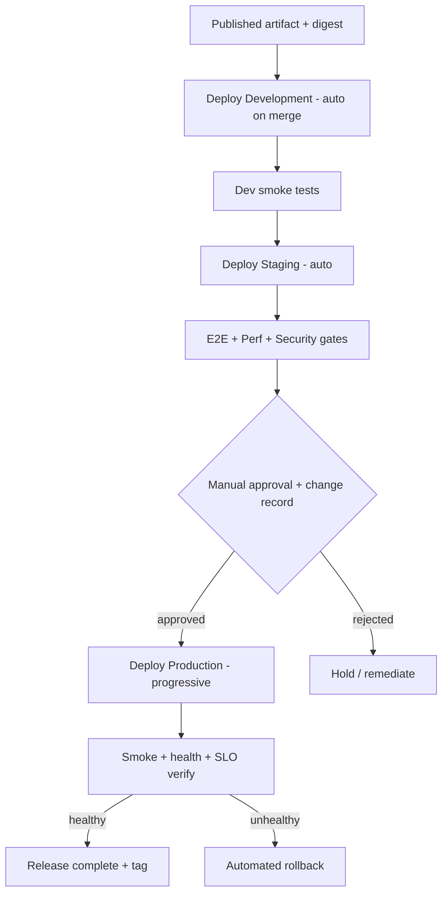

| Environment | Trigger | Data | Deploy mode |
| --- | --- | --- | --- |
| **Development** | Auto on merge to `main` | Seeded/synthetic ([Testing §8](./22_Testing_Strategy.md#8-test-data-strategy)) | Rolling |
| **Staging** | Auto after Dev smoke passes | Anonymized prod-like | Rolling (mirrors prod strategy) |
| **Production** | Tag + manual approval | Real Restricted data | Rolling (V1) → Blue/Green/Canary (future) |

> **Note.** Staging **mirrors the production deployment strategy** so that promotion validates the mechanism, not just the artifact. A deploy method that works in Staging must be the one used in Production ([Infra §2](./19_Infrastructure_Deployment.md#2-deployment-strategy--environments)).

---

## 10. Environment Promotion & Protection

Promotion is **gated and unidirectional**: artifacts move up; data never moves down un-anonymized ([Infra §2](./19_Infrastructure_Deployment.md#2-deployment-strategy--environments)).

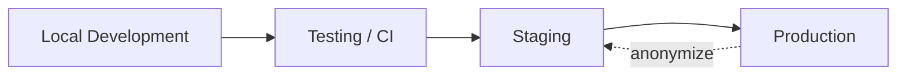

| Environment | Protection controls |
| --- | --- |
| **Local Development** | No shared secrets; mock/stub AI provider ([Infra §3](./19_Infrastructure_Deployment.md#3-development-environment)). |
| **Testing / CI** | Ephemeral containers per run; disposable data; no prod credentials. |
| **Staging** | Isolated secrets; anonymized data; UAT/perf/security run here; restricted access. |
| **Production** | Isolated secrets; SRE-operated; audited; least-privilege deploy identity; change record required. |

| Rule | Standard |
| --- | --- |
| **Isolated secrets per env** | No secret is shared across environments ([§15](#15-configuration--secrets-management)). |
| **No downward prod data** | Production data flows to lower environments only after anonymization. |
| **Config not code** | Environments differ by injected configuration only; the artifact is identical. |

---

## 11. Approval Gates

Approvals balance velocity with control. Lower environments are fully automated; Production requires an explicit human decision with an audit trail.

| Gate | Location | Approver | Required for |
| --- | --- | --- | --- |
| **Automated quality gate** | Dev, Staging | Pipeline (no human) | All promotions to Dev/Staging |
| **Production approval** | Pre-prod | Release manager + owning tech lead | Every production deploy |
| **Security sign-off** | Pre-prod | Security | High-risk changes: auth, tenancy, payment, AI evaluation, migrations ([Security §20](./20_Security_Standards.md)) |
| **Change record** | Pre-prod | Release manager | Every production deploy (links PRs, tests, rollback plan) |

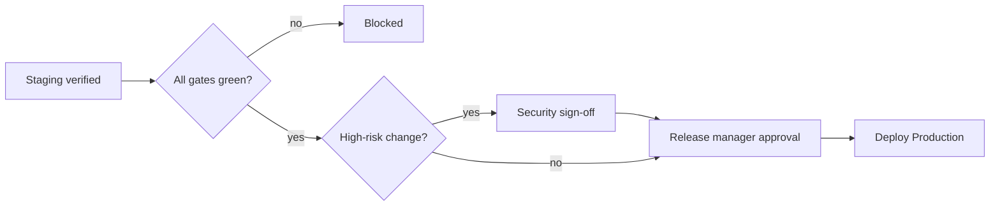

> **Decision.** Production approval is **required for every deploy** at V1 (post-GA). As confidence and automated verification mature, low-risk changes may become **auto-promote with post-deploy monitoring** — see [§21](#21-future-kubernetes-iac-gitops--progressive-delivery). This mirrors [Roadmap M1.4](./21_Development_Roadmap.md) (one-click promotion) evolving toward progressive delivery.

---

## 12. Deployment Strategies: Rolling, Blue/Green & Canary

The platform's stateless API ([Backend §](./15_Backend_Architecture.md)) and immutable frontend bundle make zero-downtime deploys achievable across all three strategies.

| Strategy | Status | How it works | When used |
| --- | --- | --- | --- |
| **Rolling** | **V1 default** | Instances replaced incrementally behind the load balancer; health checks gate each batch. | All environments at V1 ([Infra §18](./19_Infrastructure_Deployment.md#18-deployment-workflow--progressive-delivery)). |
| **Blue/Green** | Future | Full parallel environment; traffic switched atomically; instant rollback by switching back. | High-risk releases once K8s is adopted. |
| **Canary** | Future | Small traffic percentage to the new version; automated metric analysis before full rollout. | Gradual, metric-driven rollout at scale. |

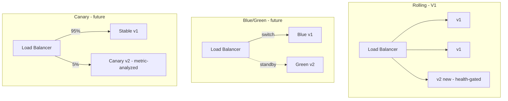

> **Rationale.** Rolling is chosen for V1 because it is native to Docker Compose/Kubernetes, needs no duplicate infrastructure, and satisfies zero-downtime with health-gated batches. Blue/Green and Canary are deferred until Kubernetes ([§21](#21-future-kubernetes-iac-gitops--progressive-delivery)) makes traffic-shifting and duplicate environments economical.

---

## 13. Feature Flags

Feature flags **decouple deploy from release**, enabling trunk-based development: incomplete work merges to `main` disabled, and features activate independently of deployment ([Frontend §](./16_Frontend_Architecture.md), [Roadmap §2](./21_Development_Roadmap.md#2-development-principles)).

| Aspect | Standard |
| --- | --- |
| **Scope** | Flags evaluated per **tenant / plan / user** ([Multi-Tenant (12)](./12_Multi_Tenant_Architecture.md), [Billing entitlements (13)](./13_Subscription_Billing.md)). |
| **Purpose** | Release control, gradual rollout, kill-switch, plan entitlement, A/B (future). |
| **Kill-switch** | High-risk capabilities (AI evaluation, billing) carry a runtime kill-switch independent of deploy. |
| **Lifecycle** | Flags are temporary by default; stale flags are tracked as tech debt and removed ([Std §25](./23_Development_Standards.md#25-code-smells--refactoring-guidelines)). |
| **Config-driven** | Flag state is configuration, not code; changing it requires no deploy. |

> **Note.** Feature flags are the sanctioned alternative to long-lived branches. A capability that is not ready ships **dark** (flag off) rather than being held out of `main`.

---

## 14. Database Migration Strategy

Migrations are **versioned, forward-only in production, and applied by the pipeline** — never by hand ([Backend §10](./15_Backend_Architecture.md#10-persistence-repositories-specifications-uow--concurrency), [Roadmap §18](./21_Development_Roadmap.md)).

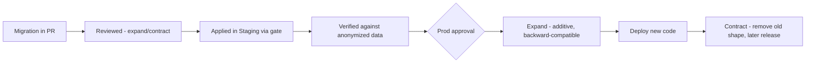

| Rule | Standard |
| --- | --- |
| **Forward-only in prod** | No destructive down-migrations in production; roll forward with a new migration. |
| **Expand/contract** | Schema changes are backward-compatible in two phases for **zero-downtime** deploys ([Roadmap §18](./21_Development_Roadmap.md)). |
| **Pipeline-applied** | Migrations run as a gated pipeline step before the code that depends on them. |
| **Tenant-safe** | Migrations respect the shared-schema `TenantId` model ([Multi-Tenant (12)](./12_Multi_Tenant_Architecture.md)); no tenant-specific DDL at V1. |
| **Reversibility** | Every migration ships with a documented rollback path (a compensating migration, not a data-losing down script). |

> **Rationale.** Expand/contract lets the old and new code versions run simultaneously during a rolling deploy — the schema tolerates both — which is what makes zero-downtime and safe rollback possible.

---

## 15. Configuration & Secrets Management

Configuration is **layered and environment-injected**; secrets never live in source, images, or logs ([Backend §14](./15_Backend_Architecture.md#14-configuration--secrets-management), [Security §9.3](./20_Security_Standards.md#9-data-protection-encryption-secrets-key-rotation), [Infra §9](./19_Infrastructure_Deployment.md#9-configuration-environment-variables--secrets)).

| Layer | Source | Example |
| --- | --- | --- |
| **Defaults** | Committed non-secret config (`config/`) | Timeouts, feature-flag defaults |
| **Environment** | Env variables per environment | Log level, provider endpoints |
| **Secret store** | External secret manager (Azure Key Vault / AWS Secrets Manager / GCP Secret Manager) | DB credentials, AI provider keys, JWT signing keys |
| **Feature flags** | Runtime flag config | Capability toggles ([§13](#13-feature-flags)) |

| Rule | Standard |
| --- | --- |
| **No secrets in repo/image/logs/client** | Enforced by secret scanning ([§7](#7-security-scanning-gates)) and [Security §9.3](./20_Security_Standards.md#9-data-protection-encryption-secrets-key-rotation). |
| **Injected at runtime by name** | The pipeline references secret **names**; values are injected by the platform, never stored in the artifact. |
| **Rotatable** | JWT signing keys rotate via `kid` with overlapping validity ([Security §9.4](./20_Security_Standards.md#9-data-protection-encryption-secrets-key-rotation)). |
| **Isolated per environment** | Distinct secret sets per environment ([§10](#10-environment-promotion--protection)). |

---

## 16. Versioning, Release Tags & Release Notes

| Artifact | Versioning scheme | Reference |
| --- | --- | --- |
| **Product** | **Semantic Versioning** `MAJOR.MINOR.PATCH`; `v1.0.0` at GA | [Roadmap §18](./21_Development_Roadmap.md) |
| **API** | URI major version `/api/v1/...`; breaking = new major | [API §3](./10_API_Design_Standards.md#3-versioning-strategy) |
| **Database** | Sequential, forward-only migration versions | [§14](#14-database-migration-strategy) |
| **Container image** | SemVer tag + git SHA + digest | [§8](#8-artifact-generation--publishing) |

| Aspect | Standard |
| --- | --- |
| **Release tags** | Annotated, signed git tag `vX.Y.Z` on `main` triggers the production promotion pipeline. |
| **Release notes** | Auto-generated from squashed [Conventional Commit](./23_Development_Standards.md#23-branch-commit--versioning-standards) messages, grouped by `feat`/`fix`/`perf`/`security`. |
| **Changelog** | Maintained (`CHANGELOG.md`) and cross-linked to the release manifest ([§8](#8-artifact-generation--publishing)). |
| **Traceability** | Every release links its tag → commits → PRs → test results → SBOM → approval record. |

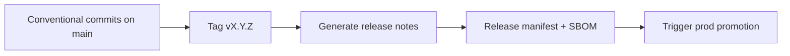

---

## 17. Post-Deployment Verification

A deploy is not "successful" until it is **verified in the target environment**. Verification runs automatically after every promotion ([Testing §18](./22_Testing_Strategy.md#18-release-validation--production-verification), [Infra §18.1](./19_Infrastructure_Deployment.md#18-deployment-workflow--progressive-delivery)).

| Check | What it confirms | Failure action |
| --- | --- | --- |
| **Health verification** | Liveness/readiness endpoints healthy; dependencies (DB, Redis, storage, AI gateway) reachable ([Backend §16](./15_Backend_Architecture.md#16-observability-health-metrics-tracing)) | Auto-rollback |
| **Smoke tests** | Critical journeys work: login, load exam, submit, billing status ([Testing §17](./22_Testing_Strategy.md#17-smoke-sanity--regression-testing)) | Auto-rollback |
| **SLO verification** | p95 latency and error rate within [NFR targets](./05_Non_Functional_Requirements.md) over an observation window | Alert → rollback if breached |
| **Performance validation** | No regression vs baseline budgets ([Testing §12](./22_Testing_Strategy.md#12-performance-load-stress--scalability-testing)) | Investigate / rollback |
| **Security validation** | Security headers, TLS, auth enforced ([Security §7, §12](./20_Security_Standards.md)) | Rollback |

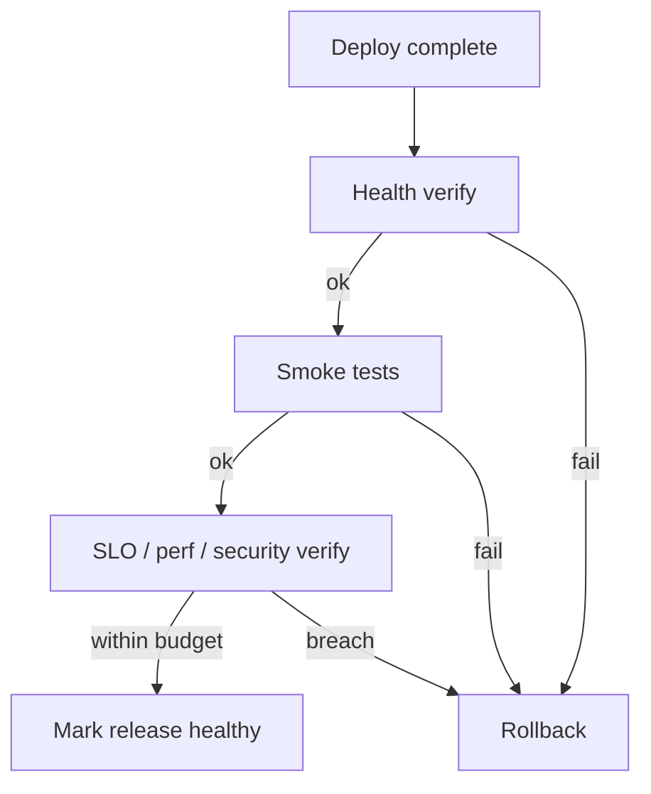

---

## 18. Rollback Strategy

Rollback is a **first-class, rehearsed capability** — the counterpart to "every deploy is reversible" ([§1](#1-cicd-philosophy)).

| Mechanism | How | Recovery characteristic |
| --- | --- | --- |
| **Redeploy previous image digest** | Promote the last-known-good digest ([§8](#8-artifact-generation--publishing)) | Fast; the primary V1 rollback |
| **Traffic switch (future)** | Blue/Green: switch back to Blue; Canary: halt and drain | Near-instant once on K8s ([§12](#12-deployment-strategies-rolling-bluegreen--canary)) |
| **Feature-flag kill-switch** | Disable the offending capability without redeploy ([§13](#13-feature-flags)) | Immediate; no deploy needed |
| **Git revert** | Revert the squashed PR commit, re-run pipeline | Clean because history is linear ([§3](#3-branch-protection-reviews--merge-strategy)) |
| **Forward-fix migration** | Never down-migrate in prod; ship a compensating migration ([§14](#14-database-migration-strategy)) | Schema-safe |

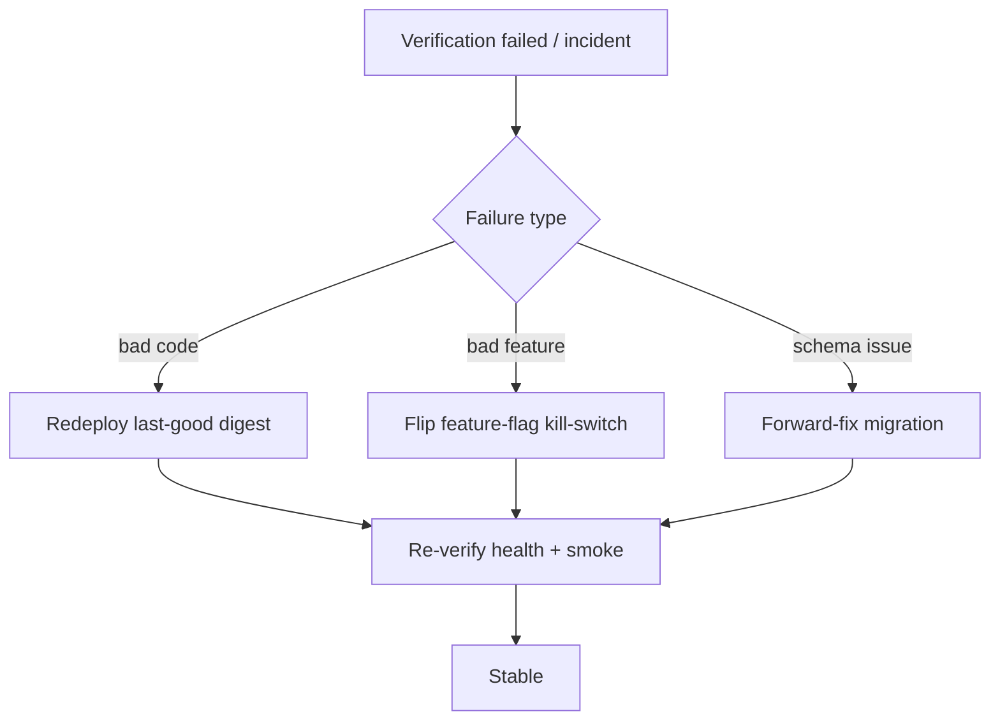

> **Decision.** Because migrations are **expand/contract** ([§14](#14-database-migration-strategy)), the previous image is always schema-compatible with the current database during a rollout — so redeploying the prior digest is a safe rollback without a schema change. This is the single most important property enabling fast, safe rollback.

---

## 19. Pipeline Notifications & Failure Recovery

| Event | Notification | Audience |
| --- | --- | --- |
| **Pipeline failure** | Chat + PR annotation | PR author, owning team |
| **Merge blocked by gate** | PR status check detail | Author |
| **Deploy started/succeeded** | Chat channel + release record | Release manager, team |
| **Deploy failed / rolled back** | High-priority alert + incident hook | On-call SRE, release manager ([Infra §13](./19_Infrastructure_Deployment.md#13-observability-monitoring-logging-health-metrics-tracing)) |
| **Security gate failure** | Chat + security channel | Security, author |
| **Flaky test detected** | Quarantine ticket | Owning team ([Testing §20](./22_Testing_Strategy.md#20-automation-vs-manual-strategy)) |

| Failure-recovery principle | Standard |
| --- | --- |
| **Fail fast, fail loud** | A red pipeline blocks and notifies immediately; no silent failures. |
| **Retriable vs fatal** | Infra flakiness (registry timeout) is auto-retried once; test/gate failures are not retried — they are fixed. |
| **No green-by-retry** | Re-running to get a pass on a flaky test is prohibited; flaky tests are quarantined and fixed ([Testing §20](./22_Testing_Strategy.md#20-automation-vs-manual-strategy)). |
| **Auditability** | Every failure, retry, and recovery is recorded ([Security §14](./20_Security_Standards.md)). |

---

## 20. Disaster Recovery Integration

The pipeline supports the DR posture defined in [Infrastructure §14](./19_Infrastructure_Deployment.md#14-backup-restore--disaster-recovery) and the [NFR DR targets](./05_Non_Functional_Requirements.md) (RPO ≤ 15 min, RTO ≤ 4 h).

| DR capability | Pipeline role |
| --- | --- |
| **Reproducible environments** | Infrastructure-as-code + immutable artifacts let a region/environment be rebuilt from the release manifest ([§8](#8-artifact-generation--publishing)). |
| **Rebuild from source** | Any release is reproducible from its tag + pinned dependencies + digests. |
| **Restore validation** | Backup/restore and DR drills are exercised as scheduled pipelines ([Testing §14](./22_Testing_Strategy.md#14-data-migration-backup--recovery-testing)). |
| **Config/secret recovery** | Secrets recovered from the external manager, not the pipeline ([§15](#15-configuration--secrets-management)). |

> **Note.** Because deploys are artifact-digest-based and infrastructure is codified, recovery is a **redeploy of known-good artifacts into rebuilt infrastructure** rather than a manual reconstruction — which is what keeps RTO within target.

---

## 21. Future: Kubernetes, IaC, GitOps & Progressive Delivery

The pipeline is designed to evolve without re-architecture, tracking the [Infrastructure Evolution Roadmap (19 §19)](./19_Infrastructure_Deployment.md#19-infrastructure-evolution-roadmap).

| Future capability | Description | Enables |
| --- | --- | --- |
| **GitHub Actions (near-term)** | First CI/CD engine for the stages in this document ([Roadmap P1](./21_Development_Roadmap.md)) | Automated build/test/scan/deploy |
| **Azure DevOps (optional)** | Alternative/complementary pipeline engine for enterprise integration | Multi-engine flexibility |
| **Kubernetes (AKS/EKS/GKE)** | Orchestrated deploys, HPA autoscaling ([Infra §15](./19_Infrastructure_Deployment.md#15-high-availability-auto-scaling--load-balancing)) | Blue/Green + Canary |
| **Infrastructure as Code** | Declarative, versioned, reviewable infrastructure | Reproducibility + DR |
| **GitOps** | Git as the single source of desired state; reconcilers converge clusters | Auditable, drift-free deploys |
| **Progressive delivery** | Automated canary analysis; auto-promote/auto-rollback on metrics | Reduced manual approvals |
| **Release automation** | Fully automated, low-risk release trains with post-deploy monitoring | Higher deploy frequency |

> **Decision.** The current stage design (build once, scan, gate, promote, verify, rollback) is engine-agnostic **by intent** — the same stages map onto GitHub Actions today and Azure DevOps / GitOps reconcilers later, so adopting Kubernetes and GitOps changes *how* stages run, not *what* they do.

---

## 22. Assumptions, Risks & Future Recommendations

### 22.1 Assumptions

| # | Assumption |
| --- | --- |
| A1 | The monorepo on GitHub is the sole repository of record; all environments deploy from it. |
| A2 | A single immutable image is promoted unchanged across environments ([§1](#1-cicd-philosophy)). |
| A3 | An external secret manager is available in every non-local environment ([§15](#15-configuration--secrets-management)). |
| A4 | Migrations follow expand/contract and are forward-only in production ([§14](#14-database-migration-strategy)). |
| A5 | Team follows trunk-based development with feature flags ([§2](#2-repository--git-strategy)). |

### 22.2 Risks

| ID | Risk | Impact | Mitigation |
| --- | --- | --- | --- |
| CD-1 | Slow pipeline erodes shift-left discipline | Batching, big PRs | Parallelize gates; keep inner loop fast ([§5](#5-continuous-integration--build-stage)) |
| CD-2 | Flaky E2E/integration tests cause green-by-retry | False confidence | Quarantine + fix; no retry-to-green ([§19](#19-pipeline-notifications--failure-recovery)) |
| CD-3 | Migration incompatible with previous image | Rollback blocked | Enforce expand/contract review ([§14](#14-database-migration-strategy)) |
| CD-4 | Secret leakage into image/logs | Breach | Secret scanning gate + runtime injection ([§7](#7-security-scanning-gates), [§15](#15-configuration--secrets-management)) |
| CD-5 | Manual prod approval becomes a bottleneck | Slow releases | Evolve to progressive delivery ([§21](#21-future-kubernetes-iac-gitops--progressive-delivery)) |

### 22.3 Future Recommendations

- Adopt **automated canary analysis** to replace manual approval for low-risk changes once on Kubernetes ([§21](#21-future-kubernetes-iac-gitops--progressive-delivery)).
- Introduce **deployment DORA metrics** (lead time, deploy frequency, change-fail rate, MTTR) as first-class pipeline dashboards.
- Add **artifact attestation / provenance** (SLSA-style) once signing infrastructure matures ([§8](#8-artifact-generation--publishing)).
- Formalize **release trains** post-GA to batch low-risk changes on a predictable cadence ([Roadmap §18](./21_Development_Roadmap.md)).

---

## 23. Related Documents

| # | Document | Relationship |
| --- | --- | --- |
| 05 | [Non-Functional Requirements](./05_Non_Functional_Requirements.md) | Performance, availability, DR targets verified after deploy. |
| 10 | [API Design Standards](./10_API_Design_Standards.md) | API versioning and contract gates. |
| 12 | [Multi-Tenant Architecture](./12_Multi_Tenant_Architecture.md) | Tenant-scoped flags, config, and isolation. |
| 13 | [Subscription & Billing](./13_Subscription_Billing.md) | Plan-entitlement feature flags; webhook safety. |
| 14 | [Clean Architecture](./14_Clean_Architecture.md) | Architecture tests as a build gate. |
| 15 | [Backend Architecture](./15_Backend_Architecture.md) | Build/test/config/secrets/migration mechanics. |
| 16 | [Frontend Architecture](./16_Frontend_Architecture.md) | Frontend build, static CDN deploy, feature flags. |
| 17 | [AI Architecture](./17_AI_Architecture.md) | AI evaluation kill-switch; provider config. |
| 19 | [Infrastructure & Deployment](./19_Infrastructure_Deployment.md) | Environments, deploy strategies, evolution roadmap. |
| 20 | [Security Standards](./20_Security_Standards.md) | Security scan gates, secrets, SDLC, sign-off. |
| 21 | [Development Roadmap](./21_Development_Roadmap.md) | Pipeline milestones (M1.3/M1.4), SemVer, versioning. |
| 22 | [Testing Strategy](./22_Testing_Strategy.md) | Test levels executed as pipeline gates. |
| 23 | [Development Standards](./23_Development_Standards.md) | Standards enforced by CI gates. |

---

*End of Document — 24 CI/CD Pipeline (v1.0).*
