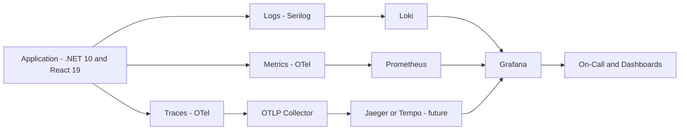
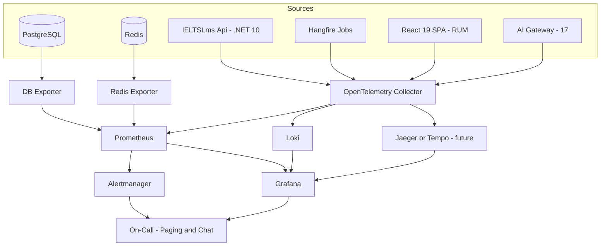
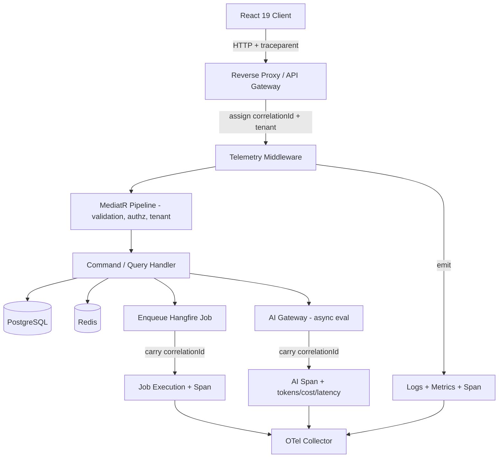
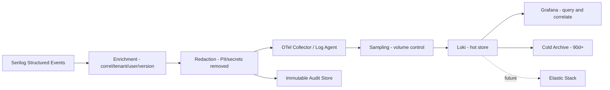
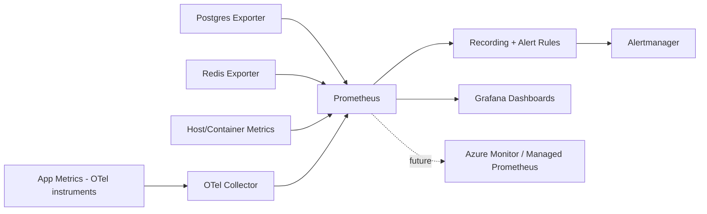
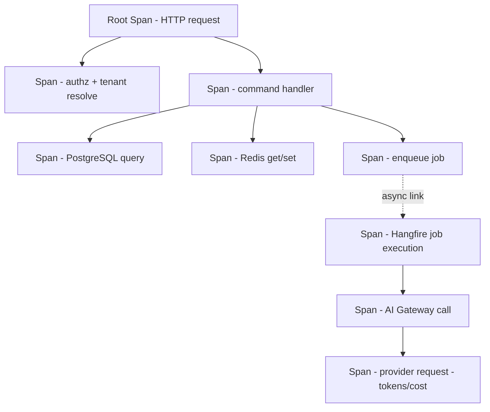
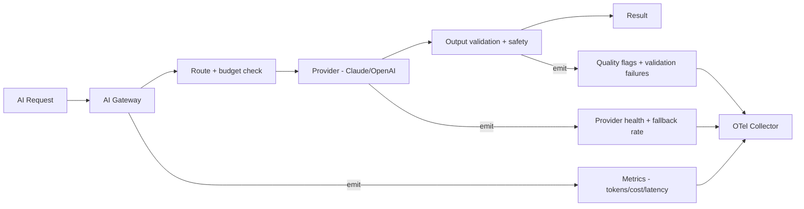
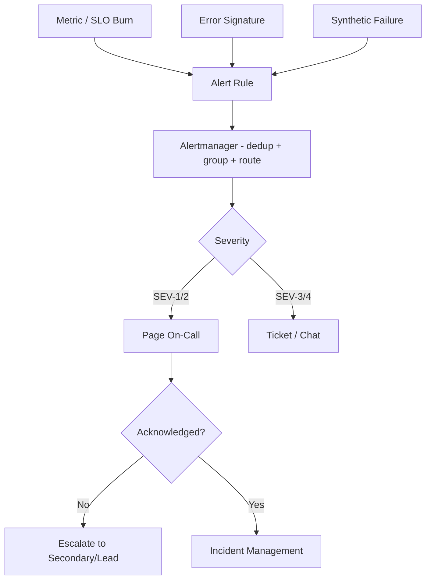
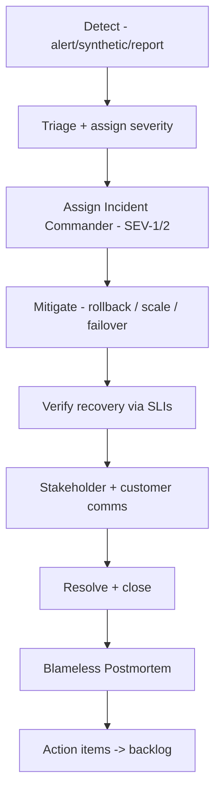

# Monitoring & Observability — IELTS LMS AI

| Field | Value |
| --- | --- |
| **Product Name** | IELTS LMS AI |
| **Document** | 25 — Monitoring & Observability |
| **Version** | 1.0 |
| **Status** | Architecture & Planning |
| **Document Owner** | Principal SRE / Observability Engineering |
| **Last Updated** | 2026-07-18 |
| **Audience** | SRE, DevOps, Backend & Frontend Engineers, AI/ML Engineers, Security, QA, Product, On-Call, Engineering Leadership |
| **Aligns With** | [01_Product_Vision.md](./01_Product_Vision.md) … [24_CI_CD_Pipeline.md](./24_CI_CD_Pipeline.md) |

> **Purpose of this document.** This document defines the complete **enterprise monitoring and observability strategy** for IELTS LMS AI — the philosophy, the three pillars (logs, metrics, traces), health and synthetic monitoring, the full metric taxonomy, correlation and tracing model, alerting and on-call, incident management, SLA/SLO/SLI, capacity planning, and deployment/AI monitoring. It is **implementation-independent** — it contains **no dashboard definitions, no YAML, no exporters, no Dockerfiles** — only the architecture and engineering decisions from which those artifacts are built. It realizes the observability requirements in [NFR §OBS/MON/LOG/AUD (05)](./05_Non_Functional_Requirements.md), extends the observability foundations in [Backend §16](./15_Backend_Architecture.md#16-observability-health-metrics-tracing) and [Infrastructure §13](./19_Infrastructure_Deployment.md#13-observability-monitoring-logging-health-metrics-tracing), consumes the AI telemetry model in [AI §12](./17_AI_Architecture.md#12-observability-logging--audit), supports the security monitoring in [Security §14](./20_Security_Standards.md#14-logging-audit--monitoring-security), and provides the signals that gate the [CI/CD Pipeline (24)](./24_CI_CD_Pipeline.md) and [Release Management (26)](./26_Release_Management.md).

> **Technology baseline.** Current: **OpenTelemetry** (traces + metrics SDK), **Serilog** (structured logs), **Prometheus** (metrics store), **Grafana** (visualization), **Loki** (log aggregation), across **.NET 10**, **React 19**, **PostgreSQL**, **Redis**, **Hangfire**, on **Docker**. Future: **Kubernetes**, **Jaeger**/**Tempo** (trace backends), **Azure Monitor** / **Application Insights**, and the **Elastic Stack**. The application emits **vendor-neutral OpenTelemetry** signals so backends can change without touching application code.

---

## Table of Contents

1. [Observability Philosophy](#1-observability-philosophy)
2. [The Three Pillars](#2-the-three-pillars)
3. [Monitoring Architecture](#3-monitoring-architecture)
4. [Request Lifecycle & Telemetry Flow](#4-request-lifecycle--telemetry-flow)
5. [Correlation, Request, Trace & Span IDs](#5-correlation-request-trace--span-ids)
6. [Structured Logging](#6-structured-logging)
7. [Log Levels, Retention & Sensitive Data](#7-log-levels-retention--sensitive-data)
8. [The Log Pipeline](#8-the-log-pipeline)
9. [Metrics Strategy & the Metric Pipeline](#9-metrics-strategy--the-metric-pipeline)
10. [Metric Taxonomy](#10-metric-taxonomy)
11. [Distributed Tracing](#11-distributed-tracing)
12. [Health Checks](#12-health-checks)
13. [Synthetic & Real User Monitoring](#13-synthetic--real-user-monitoring)
14. [Error & Exception Monitoring](#14-error--exception-monitoring)
15. [AI, Prompt & Agent Monitoring](#15-ai-prompt--agent-monitoring)
16. [SLA, SLO & SLI](#16-sla-slo--sli)
17. [Dashboard Strategy](#17-dashboard-strategy)
18. [Alerting Strategy & Severity](#18-alerting-strategy--severity)
19. [On-Call Readiness & Incident Management](#19-on-call-readiness--incident-management)
20. [Root Cause Analysis & Runbooks](#20-root-cause-analysis--runbooks)
21. [Capacity Planning & Scaling Indicators](#21-capacity-planning--scaling-indicators)
22. [Deployment & Release Monitoring](#22-deployment--release-monitoring)
23. [Future: AIOps & Predictive Monitoring](#23-future-aiops--predictive-monitoring)
24. [Assumptions, Risks & Future Recommendations](#24-assumptions-risks--future-recommendations)
25. [Related Documents](#25-related-documents)

---

## 1. Observability Philosophy

Monitoring answers *"is it broken?"*; observability answers *"why is it broken?"* — for failure modes we did not anticipate. For a multi-tenant, AI-first, exam-grade platform, we must be able to reason about any single tenant's experience, any single exam attempt, and any single AI evaluation, in production, without shipping new code.

| Principle | Meaning |
| --- | --- |
| **Instrument by default** | Every request, job, and AI call is traced, measured, and logged as part of Definition of Done ([Roadmap DoD](./21_Development_Roadmap.md)). |
| **Vendor-neutral signals** | The app emits OpenTelemetry; backends (Prometheus/Loki/Jaeger/Tempo/Azure Monitor/Elastic) are swappable without code change. |
| **Tenant-aware everywhere** | Every log, metric dimension, and span carries `tenantId`; we can always isolate one tenant ([Multi-Tenant §7](./12_Multi_Tenant_Architecture.md#7-tenant-context-propagation)). |
| **Correlate across pillars** | Logs, metrics, and traces share `correlationId`/`traceId` so one click moves between them ([§5](#5-correlation-request-trace--span-ids)). |
| **SLO-driven** | We alert on symptoms users feel (SLO burn), not on every internal fluctuation ([§16](#16-sla-slo--sli)). |
| **Cost-governed** | Telemetry is sampled and tiered; observability spend is itself monitored ([§9](#9-metrics-strategy--the-metric-pipeline)). |
| **Secure & private** | No PII, secrets, or exam content in telemetry; audit logs immutable ([§7](#7-log-levels-retention--sensitive-data), [Security §14](./20_Security_Standards.md#14-logging-audit--monitoring-security)). |

> **Rationale.** Emitting vendor-neutral OpenTelemetry is the single decision that keeps the future migration to Kubernetes, Jaeger/Tempo, or Azure Monitor a *configuration* change rather than a code rewrite — consistent with the cloud-agnostic stance in [Infrastructure §4](./19_Infrastructure_Deployment.md#4-cloud-readiness-principles).

---

## 2. The Three Pillars

| Pillar | Question it answers | Signal | Store (current → future) | Cardinality discipline |
| --- | --- | --- | --- | --- |
| **Logs** | What happened, in detail, for this event? | Structured events (Serilog) | Loki → Elastic | High-detail, sampled at high volume |
| **Metrics** | How much / how fast / how many, over time? | Numeric time-series (OTel → Prometheus) | Prometheus → Azure Monitor | Low-cardinality labels only |
| **Traces** | Where did the time go across services? | Spans (OTel) | OTLP → Jaeger/Tempo | Tail-sampled by interest |

The pillars are **complementary, not redundant**: an alert fires on a **metric** (SLO burn), the on-call pivots to the **trace** for the slow request, then drops into the **logs** for that `traceId` to see the exact error. This pivot is only possible because all three share correlation identifiers ([§5](#5-correlation-request-trace--span-ids)).

---

## 3. Monitoring Architecture

All signals converge through an **OpenTelemetry Collector** that decouples the application from storage backends. This is the central seam that makes the observability stack portable.

| Component | Responsibility | Current → Future |
| --- | --- | --- |
| **OTel Collector** | Receive, batch, sample, and route all signals | Self-hosted → managed/agent per node |
| **Prometheus** | Scrape and store metrics; evaluate alert rules | Prometheus → Azure Monitor / Managed Prometheus |
| **Loki** | Aggregate and index structured logs | Loki → Elastic Stack |
| **Jaeger/Tempo** | Store and query distributed traces | Introduced with Kubernetes phase |
| **Grafana** | Unified dashboards across all pillars | Grafana → Grafana + Azure Monitor workbooks |
| **Alertmanager** | Deduplicate, group, route, and silence alerts | Alertmanager → cloud-native alerting |

> **Note.** Exporters for PostgreSQL and Redis expose infrastructure metrics without application changes; application metrics flow through the Collector. Both land in Prometheus for a single query surface.

---

## 4. Request Lifecycle & Telemetry Flow

Every inbound request is observable end to end. A `correlationId` is assigned at the edge and propagated through the [request pipeline (Backend §7)](./15_Backend_Architecture.md#7-request-processing-pipeline), into jobs and AI calls, and back to the client.

**Telemetry flow summary:** edge assigns identifiers → middleware opens the root span and starts request metrics → pipeline stages and handlers add child spans and structured logs → asynchronous work (jobs, AI) inherits the correlation context → all signals flow to the Collector and fan out to their stores.

---

## 5. Correlation, Request, Trace & Span IDs

A single vocabulary of identifiers ties the pillars together. This is the backbone of the platform's debuggability.

| Identifier | Scope | Source | Propagated via | Appears in |
| --- | --- | --- | --- | --- |
| **`traceId`** | One end-to-end operation across services/jobs | W3C `traceparent` | OpenTelemetry context | Traces, logs, RUM |
| **`spanId`** | One unit of work within a trace | OTel per operation | Parent/child span links | Traces, logs |
| **`correlationId`** | Business-level request thread (human-readable) | Edge middleware | HTTP header, job payload, AI call | Logs, API responses, audit |
| **`requestId`** | One HTTP request instance | Edge middleware | Response header | Logs, error contract |
| **`tenantId`** | Owning tenant | Tenant resolution ([12](./12_Multi_Tenant_Architecture.md)) | Ambient tenant context | Logs, metric labels, spans, audit |
| **`userId`** | Acting principal (never PII) | Auth context ([11](./11_Authentication_Authorization.md)) | Ambient context | Logs, audit |

| Rule | Standard |
| --- | --- |
| **Always present** | Every log line and span carries `correlationId` + `tenantId`; every trace carries `traceId`. |
| **Returned to clients** | API responses include `correlationId`/`requestId` so support can trace a user report ([API §12](./10_API_Design_Standards.md#12-correlation-tracing--observability)). |
| **W3C standard** | Trace context uses `traceparent`/`tracestate` for cross-service and browser→API propagation. |
| **No PII in IDs** | Identifiers are opaque; `userId` is a surrogate key, never an email or name. |

> **Rationale.** A support ticket quoting a `correlationId` lets an engineer retrieve the full trace, every related log line, and the exact tenant in seconds — turning "cannot reproduce" into a deterministic lookup.

---

## 6. Structured Logging

Logging uses **Serilog** emitting **structured (JSON) events**, never free-text strings. Every log is a queryable event with typed properties.

| Standard | Rule |
| --- | --- |
| **Structured only** | Message templates with named properties (`{TenantId}`, `{CorrelationId}`), never string concatenation. |
| **Enriched by default** | Every event auto-enriched with `correlationId`, `traceId`, `tenantId`, `userId`, `environment`, `serviceVersion`. |
| **Semantic events** | Log business events (`WritingSubmissionAccepted`), not narration of control flow. |
| **No sensitive data** | Enforced by destructuring policies and redaction ([§7](#7-log-levels-retention--sensitive-data)). |
| **Two log streams** | **Activity logs** (behavioral/analytics) vs **audit logs** (immutable, compliance) — both stamp `tenantId` ([Backend §15](./15_Backend_Architecture.md#15-exception-handling-logging--auditing)). |
| **Sampling** | High-volume debug/info sampled under load; errors and audit never sampled. |

---

## 7. Log Levels, Retention & Sensitive Data

| Level | When used | Alerting |
| --- | --- | --- |
| **Trace** | Deep diagnostic detail; disabled in production by default | None |
| **Debug** | Developer diagnostics; enabled temporarily via config | None |
| **Information** | Normal business events, request completion | None |
| **Warning** | Recoverable anomalies, degraded paths, retries | Trend alerts |
| **Error** | Failed operation affecting one request/tenant | Rate-based alert |
| **Critical/Fatal** | System-wide failure, data risk, security event | Immediate page |

| Log class | Retention (indicative) | Store | Notes |
| --- | --- | --- | --- |
| **Application logs** | 30 days hot, 90 days cold | Loki → Elastic | Sampled at high volume |
| **Audit logs** | ≥ 1 year (compliance-driven) | Immutable store | Never sampled/deleted early ([Security §14](./20_Security_Standards.md#14-logging-audit--monitoring-security)) |
| **Access/security logs** | Per security policy | Immutable store | Feeds security metrics ([§10](#10-metric-taxonomy)) |
| **Trace data** | 7–14 days | Jaeger/Tempo | Tail-sampled |
| **Metrics** | 15 months (downsampled) | Prometheus → long-term | Aggregated over time |

**Sensitive data handling.** Never logged: passwords, tokens, refresh cookies, API keys, full payment data (PANs — delegated to Stripe, [Billing §](./13_Subscription_Billing.md)), raw exam answers/audio, and PII beyond surrogate IDs. Redaction is enforced at the logging layer via allow-lists and destructuring policies; secret scanning in CI ([Security §16](./20_Security_Standards.md#16-vulnerability-management-sca-sast-dast)) catches accidental secret logging. Data classification follows [ERD §5](./09_Database_Design_ERD.md#5-data-classification) — **Restricted** data is never emitted to telemetry.

---

## 8. The Log Pipeline

The pipeline guarantees enrichment and **redaction happen before egress** — sensitive data never leaves the process. Audit events branch to an immutable store independent of the sampled application-log path.

---

## 9. Metrics Strategy & the Metric Pipeline

Metrics follow the **RED** method for request-driven work (Rate, Errors, Duration) and the **USE** method for resources (Utilization, Saturation, Errors). Instruments are OpenTelemetry counters, gauges, and histograms scraped by Prometheus.

| Discipline | Standard |
| --- | --- |
| **Low cardinality** | Labels are bounded sets (`tenantTier`, `endpointGroup`, `status`) — **never** raw `tenantId`/`userId` as labels (that goes in logs/traces). |
| **RED + USE** | Request metrics = Rate/Errors/Duration; resource metrics = Utilization/Saturation/Errors. |
| **Histograms for latency** | Latency captured as histograms to compute p50/p95/p99 ([NFR §PERF](./05_Non_Functional_Requirements.md)). |
| **Recording rules** | Pre-aggregate expensive queries for dashboards and SLOs. |
| **Cost-tiered** | Retention downsampled over time; observability cost tracked as a FinOps line ([Infra §16](./19_Infrastructure_Deployment.md#16-cost-optimization)). |

> **Cardinality rule of thumb.** Per-tenant *analysis* is done in logs/traces (high cardinality, on demand); per-tenant *aggregates* use `tenantTier` labels on metrics. This keeps Prometheus healthy at millions-of-users scale.

---

## 10. Metric Taxonomy

The following categories are all first-class. Each has an owning team and target dashboard ([§17](#17-dashboard-strategy)).

| Category | Representative signals | Primary SLI/target | Owner |
| --- | --- | --- | --- |
| **API metrics** | Request rate, error rate, p50/p95/p99 latency by endpoint group | p95 ≤ 300 ms reads / ≤ 600 ms writes ([NFR-APIP](./05_Non_Functional_Requirements.md)) | Backend/SRE |
| **Application metrics** | Command/query throughput, pipeline latency, validation failures | Error rate < 2% | Backend |
| **Database metrics** | Connection pool, query latency, deadlocks, replication lag, slow queries | Indexed read p95 ≤ 50 ms ([NFR-DBP](./05_Non_Functional_Requirements.md)) | Backend/DBA |
| **Redis metrics** | Hit ratio, evictions, memory, latency, connected clients | Cache hit ratio healthy | Backend/SRE |
| **Background job metrics** | Queue depth, job latency, retries, failures, dead-letter count | Queue depth stable; failures < threshold | Backend |
| **Frontend metrics (RUM)** | Core Web Vitals (LCP/INP/CLS), JS errors, route load | Page load ≤ 2.5s ([NFR-FEP](./05_Non_Functional_Requirements.md)) | Frontend |
| **AI metrics** | Tokens, cost, latency, fallback rate, validation failures, hallucination flags | Writing eval p95 ≤ 30s; Tutor first response ≤ 5s ([NFR-AIP](./05_Non_Functional_Requirements.md)) | AI/ML |
| **Subscription/billing metrics** | Active subscriptions, plan mix, webhook success, entitlement checks | Webhook success ≥ target | Billing |
| **Business metrics (KPI)** | Active learners, attempts, evaluations, conversions, retention | Product KPIs | Product |
| **Security metrics** | Auth failures, lockouts, rate-limit hits, cross-tenant denials, WAF blocks | Anomaly-based ([Security §14](./20_Security_Standards.md#14-logging-audit--monitoring-security)) | Security |
| **Audit metrics** | Audit event volume, privileged-action count, export/erasure requests | Completeness | Security/Compliance |
| **Infrastructure metrics** | CPU, memory, disk, network, container restarts, saturation | USE method | SRE |
| **Performance metrics** | Latency percentiles, throughput, error budgets | SLO burn ([§16](#16-sla-slo--sli)) | SRE |
| **Deployment metrics** | Deploy frequency, lead time, change-fail rate, MTTR (DORA) | Continuous improvement ([§22](#22-deployment--release-monitoring)) | DevOps/SRE |

---

## 11. Distributed Tracing

Tracing stitches a single operation across the API, database, cache, jobs, and AI calls into one causal timeline.

| Standard | Rule |
| --- | --- |
| **Auto + manual spans** | Framework auto-instrumentation for HTTP/DB/Redis; manual spans for domain-significant steps (AI eval, exam scoring). |
| **Async continuity** | Enqueued jobs and AI calls link to the originating trace via propagated context ([§4](#4-request-lifecycle--telemetry-flow)). |
| **Span attributes** | `tenantId`, `correlationId`, operation name, result status — never PII/secrets. |
| **Tail sampling** | Keep all error/slow traces; sample the rest to control cost. |
| **Exemplars** | Link metric spikes to representative traces for one-click drill-down. |

---

## 12. Health Checks

Health endpoints back both orchestration probes and synthetic monitoring, following [Backend §16](./15_Backend_Architecture.md#16-observability-health-metrics-tracing) and [Infrastructure §13](./19_Infrastructure_Deployment.md#13-observability-monitoring-logging-health-metrics-tracing).

| Probe | Question | Consumers | Behavior |
| --- | --- | --- | --- |
| **Liveness** | Is the process alive? | Orchestrator (Docker/K8s) | Restart on failure |
| **Readiness** | Can it serve traffic now? | Load balancer, rolling deploy | Remove from rotation until ready |
| **Startup** | Has slow init completed? | Orchestrator | Delays liveness during warm-up |
| **Dependency health** | Are PostgreSQL, Redis, storage, AI gateway reachable? | Dashboards, alerts | Degraded vs unhealthy classification |

> **Note.** Readiness is **dependency-aware**: an instance that cannot reach PostgreSQL reports *not ready* and is pulled from rotation, preventing failed requests during a partial outage. Deep dependency checks are exposed on a separate, non-public endpoint.

---

## 13. Synthetic & Real User Monitoring

| Type | What it does | Coverage |
| --- | --- | --- |
| **Synthetic monitoring** | Scripted probes run continuously from outside, exercising critical journeys (login, start exam, submit writing, view result, checkout) | Availability + latency SLIs, catches outages before users |
| **Real User Monitoring (RUM)** | Browser telemetry from real sessions — Core Web Vitals, JS errors, route timings, correlated to backend via `traceparent` | Actual user experience by tenant/plan/geography |
| **API uptime probes** | External health/synthetic checks on public endpoints | Third-party-verified availability for SLA |

Synthetic checks assert **availability targets** (≥ 99.9% core, ≥ 99.95% enterprise — [NFR-AVAIL](./05_Non_Functional_Requirements.md)); RUM feeds the **frontend performance budgets** enforced in CI ([Frontend §](./16_Frontend_Architecture.md), [CI/CD §6](./24_CI_CD_Pipeline.md#6-continuous-integration--test--quality-gates)).

---

## 14. Error & Exception Monitoring

| Standard | Rule |
| --- | --- |
| **Every unhandled exception is captured** | Global handler emits a structured error log + error metric + span status, tied to `correlationId` ([Backend §15](./15_Backend_Architecture.md#15-exception-handling-logging--auditing)). |
| **Safe error contract** | Clients receive RFC 7807 Problem Details with `correlationId` — never stack traces or internal identifiers ([API §9](./10_API_Design_Standards.md#9-error-handling--problem-details)). |
| **Grouped & deduplicated** | Errors fingerprinted and grouped so one incident is one signal, not thousands. |
| **Rate + novelty alerts** | Alert on error-rate spikes and on new error signatures after a deploy ([§22](#22-deployment--release-monitoring)). |
| **Tenant attribution** | Every error carries `tenantId` to detect tenant-specific failures. |

---

## 15. AI, Prompt & Agent Monitoring

AI is a core capability, so it is monitored as a first-class subsystem via the [AI Gateway (17)](./17_AI_Architecture.md#4-ai-gateway) and [Agentic layer (18)](./18_Agentic_AI_Architecture.md).

| Signal | What we watch | Target / rationale |
| --- | --- | --- |
| **AI latency** | p95 per capability (writing, speaking, tutor) | Writing ≤ 30s, Speaking ≤ 60s, Tutor first response ≤ 5s ([NFR-AIP](./05_Non_Functional_Requirements.md)) |
| **AI cost** | Tokens and spend per tenant/plan/capability | Budget guardrails; cost-exhaustion defense ([Security SR](./20_Security_Standards.md)) |
| **Provider health** | Error/timeout/fallback rate per provider (Claude, OpenAI) | Fail-safe routing to fallback ([AI §3](./17_AI_Architecture.md#3-provider-abstraction--selection)) |
| **Prompt monitoring** | Prompt template version, output validation failures, schema violations | Detect regressions after prompt changes |
| **Quality / hallucination** | Rubric-alignment flags, out-of-range bands, safety/moderation triggers | Feeds AI evaluation harness ([Testing §15](./22_Testing_Strategy.md#15-ai--agentic-testing)) |
| **Agent monitoring** | Steps per workflow, tool-call success, retries/compensation, budget consumption | Bounded autonomy visibility ([Agentic §](./18_Agentic_AI_Architecture.md)) |

> **Rationale.** Because all model calls route through the single AI Gateway ([AI §4](./17_AI_Architecture.md#4-ai-gateway)), AI observability is centralized — cost, latency, and quality are measured at one choke point rather than scattered across call sites.

---

## 16. SLA, SLO & SLI

| Term | Definition | Audience |
| --- | --- | --- |
| **SLI** | A measured signal (e.g., % of read requests < 300 ms) | Engineering/SRE |
| **SLO** | Internal target for an SLI (e.g., 99.9% availability/month) | Engineering/SRE |
| **SLA** | Externally committed target with consequences (e.g., ≥ 99.95% enterprise) | Customers/Legal |

| SLI | Definition | SLO | Source |
| --- | --- | --- | --- |
| **Availability** | Successful / total requests over window | ≥ 99.9% core; ≥ 99.95% enterprise | [NFR-AVAIL-001/002](./05_Non_Functional_Requirements.md) |
| **Read latency** | % reads under threshold | p95 ≤ 300 ms | [NFR-PERF-001](./05_Non_Functional_Requirements.md) |
| **Write latency** | % writes under threshold | p95 ≤ 600 ms | [NFR-PERF-002](./05_Non_Functional_Requirements.md) |
| **AI turnaround** | % evaluations within target | Writing p95 ≤ 30s | [NFR-AIP-001](./05_Non_Functional_Requirements.md) |
| **Error rate** | % failed requests | < 2% over 5 min | [NFR-MON-002](./05_Non_Functional_Requirements.md) |
| **Recovery** | RTO/RPO in drills | RTO ≤ 4h, RPO ≤ 15m | [NFR-DR-001/002](./05_Non_Functional_Requirements.md) |

**Error budgets.** Each SLO implies an error budget (e.g., 99.9% = ~43 min/month of allowed downtime). Budget policy: when burn is fast, freeze risky releases and prioritize reliability ([Release §](./26_Release_Management.md)); when healthy, invest in feature velocity. Alerts use **multi-window burn-rate** rules, not single-threshold spikes.

---

## 17. Dashboard Strategy

Dashboards are layered by audience so each viewer sees the right altitude of signal.

| Tier | Dashboard | Audience | Content |
| --- | --- | --- | --- |
| **Executive** | Platform health & KPIs | Leadership/Product | Availability, active users, conversions, cost |
| **Service** | Per-context health (Assessment, AI, Billing…) | Engineering teams | RED metrics, SLO burn, top errors |
| **Infrastructure** | Hosts, containers, DB, Redis, queues | SRE/DevOps | USE metrics, saturation, scaling indicators |
| **AI** | AI cost/latency/quality | AI/ML | Tokens, cost, provider health, quality flags |
| **Security** | Auth, rate-limit, cross-tenant, audit | Security | Anomalies, denials, audit volume |
| **Release** | Deploy health & DORA | DevOps/Release | Deploy markers, error/latency deltas, MTTR |

| Principle | Rule |
| --- | --- |
| **Every dashboard maps to SLOs or a decision** | No vanity panels; each panel answers a question or drives an action. |
| **Deploy annotations** | Release markers overlay time-series so regressions are visually tied to deploys ([§22](#22-deployment--release-monitoring)). |
| **Drill-down path** | Metric → trace exemplar → logs by `correlationId`, one click apart. |
| **As-code, versioned** | Dashboards are defined declaratively and version-controlled (implementation deferred). |

---

## 18. Alerting Strategy & Severity

Alerts are **symptom-based** (what users feel) and **actionable** (every alert links to a runbook). We alert on SLO burn, not on every metric wiggle — this is the primary defense against alert fatigue.

| Severity | Meaning | Response | Channel |
| --- | --- | --- | --- |
| **SEV-1 Critical** | Platform down / data at risk / security breach | Immediate page, incident opened | Page + war room |
| **SEV-2 High** | Major feature down or SLO fast-burn for many tenants | Page during hours, on-call off-hours | Page + chat |
| **SEV-3 Medium** | Degraded/partial, single-tenant, slow SLO burn | Next-business-day triage | Chat/ticket |
| **SEV-4 Low** | Minor anomaly, cosmetic, informational | Backlog | Ticket |

| Standard | Rule |
| --- | --- |
| **Actionable only** | Every alert names an owner, an impact, and a runbook link ([§20](#20-root-cause-analysis--runbooks)). |
| **Burn-rate alerts** | SLO alerts use multi-window/multi-burn-rate to balance speed vs noise. |
| **Deduplicate & group** | Alertmanager groups related alerts into one notification. |
| **No alert without a signal owner** | Unowned alerts are removed; noisy alerts are tuned, not muted silently. |
| **Escalation** | Unacknowledged SEV-1/2 escalate automatically to secondary/lead. |

---

## 19. On-Call Readiness & Incident Management

| Aspect | Standard |
| --- | --- |
| **On-call rotation** | Primary + secondary; humane rotation; every alert paged is runbook-backed. |
| **Readiness** | On-call has access, dashboards, runbooks, and rollback authority ([CI/CD §18](./24_CI_CD_Pipeline.md#18-rollback-strategy)) before shift. |
| **Incident commander** | For SEV-1/2, a single commander coordinates; roles (comms, ops, scribe) assigned. |
| **Severity-driven** | Response matches severity ([§18](#18-alerting-strategy--severity)); tenant impact and SLA tier factored in. |
| **Communication** | Status updates on cadence to stakeholders; customer comms per [Release §](./26_Release_Management.md). |

---

## 20. Root Cause Analysis & Runbooks

| Practice | Standard |
| --- | --- |
| **Blameless postmortems** | Required for SEV-1/2; focus on systems and contributing factors, not individuals. |
| **RCA technique** | Structured analysis (e.g., 5 Whys / causal timeline) with contributing-factor mapping. |
| **Action items tracked** | Every postmortem produces owned, dated action items in the backlog ([Release §](./26_Release_Management.md#postmortem-process)). |
| **Runbooks** | Each alert links to a runbook: symptoms, dashboards, diagnostics, mitigation steps, rollback trigger, escalation. |
| **Living documents** | Runbooks are versioned with the code and reviewed after each incident that used them. |

> **Rationale.** A blameless culture surfaces the real systemic causes; a punitive one hides them. Reliability improves only when engineers report freely.

---

## 21. Capacity Planning & Scaling Indicators

| Practice | Standard |
| --- | --- |
| **Performance baselines** | Establish per-endpoint and per-job baselines from load tests ([Testing §12](./22_Testing_Strategy.md#12-performance-load-stress--scalability-testing)); track drift over time. |
| **Scaling indicators** | Autoscale on CPU/memory **and** custom signals (RPS, queue depth, AI concurrency); react ≤ 2 min ([Infra §15](./19_Infrastructure_Deployment.md#15-high-availability-auto-scaling--load-balancing)). |
| **Saturation watch** | Monitor connection pools, thread pools, queue depth, cache memory as leading indicators before user-visible impact. |
| **Headroom targets** | Maintain planned headroom above peak; forecast growth against tenant onboarding. |
| **Cost-aware** | Scaling decisions weigh FinOps signals ([Infra §16](./19_Infrastructure_Deployment.md#16-cost-optimization)). |

| Resource | Leading indicator | Scaling action |
| --- | --- | --- |
| **API compute** | RPS, p95 latency, CPU | Scale out API replicas |
| **Background jobs** | Queue depth, job age | Scale out workers |
| **AI evaluation** | Concurrency, queue wait | Scale workers + provider quota |
| **Database** | Connections, CPU, replication lag | Read replicas, pool tuning, vertical scale |
| **Redis** | Memory, evictions | Scale memory / cluster |

---

## 22. Deployment & Release Monitoring

Observability closes the CI/CD loop: a deploy is not "successful" until telemetry confirms it.

| Practice | Standard |
| --- | --- |
| **Deploy markers** | Every deploy annotates dashboards so metric changes tie to the release ([CI/CD §17](./24_CI_CD_Pipeline.md#17-post-deployment-verification)). |
| **Post-deploy verification** | Smoke tests + health + error/latency deltas gate the release; regression triggers rollback ([CI/CD §18](./24_CI_CD_Pipeline.md#18-rollback-strategy)). |
| **Release health window** | Heightened watch for a defined window post-deploy; new error signatures escalate. |
| **DORA metrics** | Deploy frequency, lead time, change-fail rate, MTTR tracked as reliability KPIs. |
| **Progressive delivery signals** | Future canary/blue-green decisions driven by comparative SLIs ([CI/CD §12](./24_CI_CD_Pipeline.md#12-deployment-strategies-rolling-bluegreen--canary)). |

---

## 23. Future: AIOps & Predictive Monitoring

| Future capability | Value | Precondition |
| --- | --- | --- |
| **AIOps correlation** | Auto-correlate alerts across pillars to a probable root cause | Mature signal history |
| **Predictive monitoring** | Forecast saturation/outages from trend + seasonality | Baselines + capacity models |
| **Intelligent alerting** | Dynamic thresholds and anomaly detection to cut noise | Stable metric taxonomy |
| **Automated remediation** | Self-healing runbooks for known, safe scenarios | Proven runbooks + guardrails |
| **Trace-based SLOs** | SLOs computed from tail-sampled traces | Jaeger/Tempo adoption |
| **Backend evolution** | Jaeger/Tempo, Azure Monitor/App Insights, Elastic Stack | Kubernetes phase ([Infra §19](./19_Infrastructure_Deployment.md#19-infrastructure-evolution-roadmap)) |

> **Principle.** AIOps augments humans; it never removes the human from SEV-1 decisions. Automation acts only within pre-approved, reversible guardrails.

---

## 24. Assumptions, Risks & Future Recommendations

**Assumptions**

- The application emits vendor-neutral OpenTelemetry from day one ([Backend §16](./15_Backend_Architecture.md#16-observability-health-metrics-tracing)).
- Every request/job/AI call carries correlation and tenant context ([§5](#5-correlation-request-trace--span-ids)).
- Current stack is Prometheus/Grafana/Loki on Docker; trace backend (Jaeger/Tempo) arrives with Kubernetes.

**Risks**

| ID | Risk | Impact | Mitigation |
| --- | --- | --- | --- |
| **OB-1** | Metric cardinality explosion (per-tenant labels) | Prometheus instability | Label discipline; per-tenant detail in logs/traces ([§9](#9-metrics-strategy--the-metric-pipeline)) |
| **OB-2** | Sensitive data leaking into telemetry | Compliance breach | Redaction before egress; secret scanning ([§7](#7-log-levels-retention--sensitive-data)) |
| **OB-3** | Alert fatigue from noisy thresholds | Missed real incidents | Symptom/SLO-based, burn-rate alerts ([§18](#18-alerting-strategy--severity)) |
| **OB-4** | Observability cost growth | Budget overrun | Sampling, tiered retention, cost dashboards ([§9](#9-metrics-strategy--the-metric-pipeline)) |
| **OB-5** | Telemetry gaps for async/AI paths | Blind spots | Context propagation to jobs and AI ([§4](#4-request-lifecycle--telemetry-flow)) |

**Future recommendations**

- Adopt Jaeger/Tempo and trace-based SLOs with the Kubernetes migration.
- Introduce error-budget policy automation into release gating ([Release §](./26_Release_Management.md)).
- Pilot anomaly detection on high-value SLIs before broad AIOps rollout.
- Evaluate Azure Monitor/Application Insights and Elastic Stack as managed backends at enterprise scale.

---

## 25. Related Documents

| # | Document | Relationship |
| --- | --- | --- |
| 05 | [Non-Functional Requirements](./05_Non_Functional_Requirements.md) | Source of SLO targets, retention, and DR metrics. |
| 10 | [API Design Standards](./10_API_Design_Standards.md) | Correlation headers and error contract. |
| 11 | [Authentication & Authorization](./11_Authentication_Authorization.md) | Principal identity in telemetry. |
| 12 | [Multi-Tenant Architecture](./12_Multi_Tenant_Architecture.md) | Tenant context propagation across signals. |
| 13 | [Subscription & Billing](./13_Subscription_Billing.md) | Subscription/billing metrics and webhooks. |
| 15 | [Backend Architecture](./15_Backend_Architecture.md) | Logging, health, and telemetry foundations. |
| 16 | [Frontend Architecture](./16_Frontend_Architecture.md) | RUM and Core Web Vitals budgets. |
| 17 | [AI Architecture](./17_AI_Architecture.md) | AI Gateway telemetry, cost, and quality. |
| 18 | [Agentic AI Architecture](./18_Agentic_AI_Architecture.md) | Agent and workflow monitoring. |
| 19 | [Infrastructure & Deployment](./19_Infrastructure_Deployment.md) | Observability stack, scaling, and DR. |
| 20 | [Security Standards](./20_Security_Standards.md) | Security/audit monitoring and sensitive-data rules. |
| 21 | [Development Roadmap](./21_Development_Roadmap.md) | Observability baseline milestones and DoD. |
| 22 | [Testing Strategy](./22_Testing_Strategy.md) | Performance baselines and AI evaluation harness. |
| 24 | [CI/CD Pipeline](./24_CI_CD_Pipeline.md) | Deploy verification and rollback signals. |
| 26 | [Release Management](./26_Release_Management.md) | Release monitoring and error-budget policy. |

---

*End of Document — 25 Monitoring & Observability (v1.0).*
