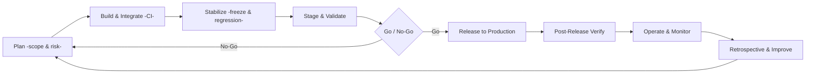
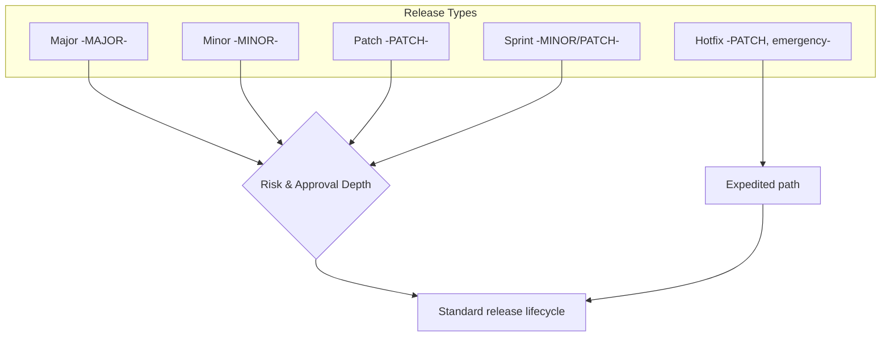
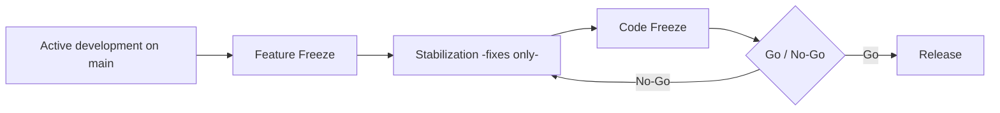
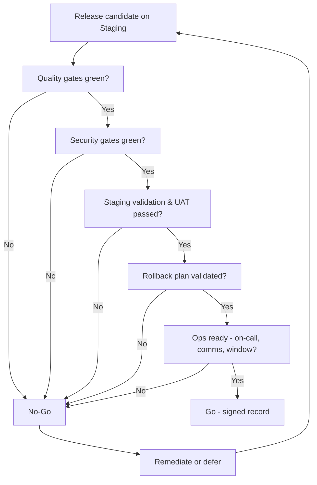
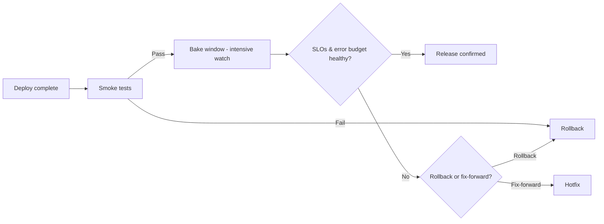
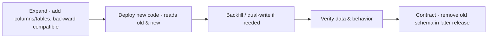
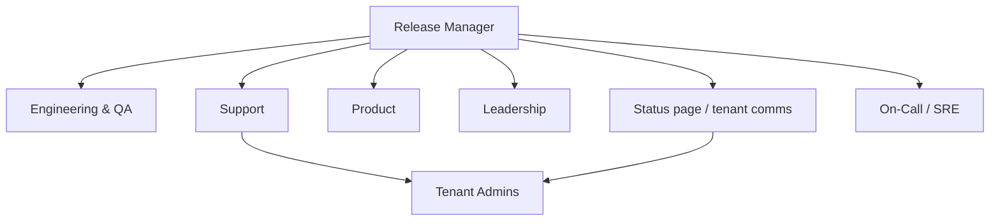
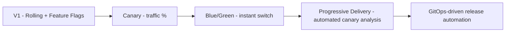

# Release Management — IELTS LMS AI

| Field | Value |
| --- | --- |
| **Product Name** | IELTS LMS AI |
| **Document** | 26 — Release Management |
| **Version** | 1.0 |
| **Status** | Architecture & Planning |
| **Document Owner** | Release Management / Principal SRE / Engineering Leadership |
| **Last Updated** | 2026-07-18 |
| **Audience** | Release Managers, SRE, DevOps, Engineering Leads, Backend & Frontend Engineers, QA, Product, Support, Security, Leadership |
| **Aligns With** | [01_Product_Vision.md](./01_Product_Vision.md) … [25_Monitoring_Observability.md](./25_Monitoring_Observability.md) |

> **Purpose of this document.** This document defines the complete **enterprise release management strategy** for IELTS LMS AI — release philosophy, lifecycle, versioning, release types and cadence, planning and freezes, the go/no-go and approval process, rollback, deployment validation, change management, communications, incident and emergency-release handling, and the postmortem/continuous-improvement loop. It is **implementation-independent** — no YAML, pipelines, or scripts — only the process, roles, and decisions. It sits on top of the [CI/CD Pipeline (24)](./24_CI_CD_Pipeline.md) (the *mechanism*), consumes the quality gates of the [Testing Strategy (22)](./22_Testing_Strategy.md), depends on the signals defined in [Monitoring & Observability (25)](./25_Monitoring_Observability.md), applies the versioning and DoD from the [Development Roadmap §18 (21)](./21_Development_Roadmap.md#18-versioning-strategy), and honors the security release gates in [Security §20](./20_Security_Standards.md#20-secure-development-lifecycle). Where the CI/CD document describes *how a deploy executes*, this document describes *how a release is decided, governed, and communicated*.

---

## Table of Contents

1. [Release Philosophy](#1-release-philosophy)
2. [Release Lifecycle](#2-release-lifecycle)
3. [Version Strategy & Semantic Versioning](#3-version-strategy--semantic-versioning)
4. [Release Types](#4-release-types)
5. [Release Cadence](#5-release-cadence)
6. [Release Planning](#6-release-planning)
7. [Feature Freeze & Code Freeze](#7-feature-freeze--code-freeze)
8. [Release Branches](#8-release-branches)
9. [Release Checklist](#9-release-checklist)
10. [Go/No-Go Process](#10-gono-go-process)
11. [Release Approval Matrix](#11-release-approval-matrix)
12. [Deployment Validation & Smoke Testing](#12-deployment-validation--smoke-testing)
13. [Post-Release Verification & Monitoring](#13-post-release-verification--monitoring)
14. [Rollback Strategy & Checklist](#14-rollback-strategy--checklist)
15. [Change Management](#15-change-management)
16. [Database Migration Coordination](#16-database-migration-coordination)
17. [Release Notes & Documentation Updates](#17-release-notes--documentation-updates)
18. [Communication Plan](#18-communication-plan)
19. [Emergency & Hotfix Releases](#19-emergency--hotfix-releases)
20. [Incident Response & Production Support](#20-incident-response--production-support)
21. [Postmortem & Continuous Improvement](#21-postmortem--continuous-improvement)
22. [Future: Progressive Delivery, Canary, Blue/Green, Feature Flags & Dark Launches](#22-future-progressive-delivery-canary-bluegreen-feature-flags--dark-launches)
23. [Assumptions, Risks & Future Recommendations](#23-assumptions-risks--future-recommendations)
24. [Related Documents](#24-related-documents)

---

## 1. Release Philosophy

A release is a **business decision backed by engineering evidence**, not merely a technical deploy. The [CI/CD Pipeline (24)](./24_CI_CD_Pipeline.md) can technically ship any green commit; release management decides *whether we should*, *when*, and *how we communicate and recover*. The philosophy is to make releases **small, frequent, boring, and reversible**.

| Principle | Meaning |
| --- | --- |
| **Small & frequent** | Small batches reduce risk and simplify rollback; large releases concentrate risk ([§5](#5-release-cadence)). |
| **Always releasable `main`** | Trunk-based development keeps `main` shippable at all times ([Roadmap §2](./21_Development_Roadmap.md#2-development-principles)). |
| **Decoupled deploy & release** | Deploying code and releasing a feature are separate events, bridged by feature flags ([§22](#22-future-progressive-delivery-canary-bluegreen-feature-flags--dark-launches)). |
| **Evidence-based go/no-go** | Every promotion clears explicit quality, security, and readiness gates ([§10](#10-gono-go-process)). |
| **Reversible by design** | Every release has a rehearsed rollback path before it ships ([§14](#14-rollback-strategy--checklist)). |
| **Observable releases** | Every release is watched against SLOs and error budgets ([Monitoring §22](./25_Monitoring_Observability.md#22-deployment--release-monitoring)). |
| **Transparent** | Stakeholders, support, and tenants are informed on a predictable schedule ([§18](#18-communication-plan)). |

> **Rationale.** Decoupling deploy from release (via feature flags) is the keystone decision: it lets engineering integrate continuously and lets the business control exposure, so a risky feature can ship "dark" and be enabled per-tenant when ready — without another deploy ([Frontend feature flags](./16_Frontend_Architecture.md), [AI capability gating](./17_AI_Architecture.md)).

---

## 2. Release Lifecycle

Every release, regardless of size, moves through the same lifecycle. The depth of each stage scales with release type ([§4](#4-release-types)) — a patch compresses planning; a major release expands it.

| Stage | Purpose | Primary owner | Key artifacts |
| --- | --- | --- | --- |
| **Plan** | Define scope, risk, target version, and date. | Release Manager + Product | Release plan, scope list, risk assessment |
| **Build & Integrate** | Merge features to `main`; CI green on every commit. | Engineering | Immutable build artifact ([CI/CD §8](./24_CI_CD_Pipeline.md#8-artifact-generation--publishing)) |
| **Stabilize** | Freeze scope; run full regression; fix release blockers only. | Engineering + QA | Regression report, blocker list |
| **Stage & Validate** | Deploy candidate to Staging; run E2E, perf, security, UAT. | QA + SRE | Staging validation report |
| **Go/No-Go** | Decide release readiness against gates. | Release board | Signed go/no-go record ([§10](#10-gono-go-process)) |
| **Release** | Promote the validated artifact to Production. | SRE / Release Engineer | Deployment record, release tag |
| **Post-Release Verify** | Smoke tests, health, SLO watch during the bake window. | SRE + on-call | Verification checklist ([§13](#13-post-release-verification--monitoring)) |
| **Operate & Monitor** | Steady-state monitoring; error-budget tracking. | SRE | Dashboards, alerts ([Monitoring (25)](./25_Monitoring_Observability.md)) |
| **Improve** | Retrospective / postmortem; feed actions back. | Release Manager | Retro notes, action items ([§21](#21-postmortem--continuous-improvement)) |

---

## 3. Version Strategy & Semantic Versioning

The product follows **Semantic Versioning `MAJOR.MINOR.PATCH`**, reaching **`1.0.0` at GA** ([Roadmap §18](./21_Development_Roadmap.md#18-versioning-strategy)). Versioning is layered: the **product** version, the **API** version, and the **database schema** version evolve on related but distinct tracks.

| Version track | Scheme | Increment trigger | Reference |
| --- | --- | --- | --- |
| **Product (release)** | SemVer `MAJOR.MINOR.PATCH` | Breaking change / new features / fixes | This document |
| **API contract** | URI major `/api/v1`, additive within version | Breaking contract change → new major | [API §3](./10_API_Design_Standards.md#3-versioning-strategy) |
| **Database schema** | Sequential, forward-only migration versions | Any schema change; expand/contract pairs | [§16](#16-database-migration-coordination), [Backend §10](./15_Backend_Architecture.md#10-persistence-repositories-specifications-uow--concurrency) |
| **AI prompt templates** | Versioned template IDs | Any prompt/rubric change | [AI §5](./17_AI_Architecture.md#5-prompt-management) |

| SemVer part | Meaning for IELTS LMS AI | Example |
| --- | --- | --- |
| **MAJOR** | Backward-incompatible change: API break, removed capability, data model requiring coordinated migration. | `1.4.2 → 2.0.0` |
| **MINOR** | Backward-compatible new functionality (new skill module, new AI capability behind a flag). | `1.4.2 → 1.5.0` |
| **PATCH** | Backward-compatible bug/security fix, no contract change. | `1.4.2 → 1.4.3` |

> **Pre-release & build metadata.** Pre-GA and candidate builds use SemVer pre-release tags (`1.5.0-rc.1`, `2.0.0-beta.2`). Build provenance is carried as metadata on the artifact ([CI/CD §8](./24_CI_CD_Pipeline.md#8-artifact-generation--publishing)), not in the user-facing version.

> **Rule.** The version number is derived from the change, not chosen arbitrarily. A breaking API change **forces** a MAJOR bump even if the feature seems minor — this protects the [API backward-compatibility guarantee](./10_API_Design_Standards.md#18-api-lifecycle-deprecation--compatibility).

---

## 4. Release Types

| Type | Version impact | Scope | Cadence | Approval depth ([§11](#11-release-approval-matrix)) |
| --- | --- | --- | --- | --- |
| **Major** | `MAJOR` | Breaking changes, large features, migrations requiring coordination. | Infrequent, planned | Full board + stakeholder sign-off |
| **Minor** | `MINOR` | New backward-compatible features, typically flag-gated. | Regular (sprint/biweekly post-GA) | Standard board |
| **Patch** | `PATCH` | Bug fixes, small improvements, dependency/security patches. | As needed | Lightweight |
| **Hotfix** | `PATCH` | Urgent production fix bypassing normal cadence. | Emergency ([§19](#19-emergency--hotfix-releases)) | Expedited (2-person) |
| **Sprint release** | `MINOR`/`PATCH` | Accumulated sprint increment; the default rhythm post-GA. | Per sprint | Standard board |

---

## 5. Release Cadence

Cadence differs before and after GA, consistent with the [Roadmap §18](./21_Development_Roadmap.md#18-versioning-strategy) ("continuous to staging, scheduled prod promotions post-GA").

| Environment | Pre-GA cadence | Post-GA cadence |
| --- | --- | --- |
| **Staging** | Continuous — every merged, green change auto-deploys ([CI/CD §9](./24_CI_CD_Pipeline.md#9-continuous-delivery--deployment-pipeline)). | Continuous. |
| **Production** | Manual promotion per milestone. | Scheduled — a regular sprint/biweekly release window, plus patch/hotfix out-of-band. |

| Aspect | Standard |
| --- | --- |
| **Standard release window** | A predictable low-traffic window (documented in the runbook), avoiding peak exam/study hours across primary tenant regions. |
| **Freeze windows** | No non-emergency releases during declared freeze periods (e.g., large exam-cohort dates); hotfixes still permitted. |
| **Batch size** | Prefer many small releases over few large ones ([§1](#1-release-philosophy)). |

> **Note.** Cadence is a *maximum allowable* rhythm; feature flags decouple *deploy* frequency (high) from *feature exposure* (business-controlled), so frequent deploys never force premature feature launches.

---

## 6. Release Planning

Release planning turns roadmap intent ([21](./21_Development_Roadmap.md)) into a scoped, risk-assessed, dated release.

| Planning artifact | Contents | Owner |
| --- | --- | --- |
| **Release plan** | Target version, theme, included work items, target date, environments. | Release Manager |
| **Scope list** | Explicit in/out list of features, fixes, migrations, flag changes. | Product + Eng Leads |
| **Risk assessment** | Blast radius, tenant impact, migration risk, AI/cost risk, rollback plan. | Release Manager + SRE + Security |
| **Dependency map** | Cross-context and external (Stripe, AI provider) dependencies ([DDD §6](./07_Domain_Driven_Design.md#6-context-mapping)). | Eng Leads |
| **Comms plan** | Who is told what, when ([§18](#18-communication-plan)). | Release Manager + Support |

**Risk tiering** drives approval depth and validation rigor:

| Risk tier | Characteristics | Consequence |
| --- | --- | --- |
| **High** | Auth, tenancy, billing, payment, data migration, AI evaluation changes. | Full validation + security sign-off + rollback rehearsal. |
| **Medium** | New feature behind flag, non-critical schema expand, dependency upgrades. | Standard validation. |
| **Low** | Copy/UI tweaks, isolated bug fixes, config-only changes. | Lightweight validation. |

---

## 7. Feature Freeze & Code Freeze

Freezes stabilize a release candidate. They apply to the **release scope**, not to `main` (trunk keeps flowing behind flags).

| Freeze | What it stops | What it allows | Timing |
| --- | --- | --- | --- |
| **Feature freeze** | No new features enter the release scope. | Bug fixes, stabilization, docs, tests. | Start of Stabilize stage |
| **Code freeze** | No code changes except approved release-blockers. | Only critical fixes with release-manager approval. | Shortly before Go/No-Go |
| **Full freeze (blackout)** | No production releases at all (except emergency hotfix). | Nothing but declared emergencies. | High-stakes calendar windows |

> **Rationale.** Because incomplete work lives behind feature flags on trunk, freezes govern *what is exposed and hardened for this release*, avoiding long-lived release branches and the merge debt they create.

---

## 8. Release Branches

The branching model is **trunk-based** ([CI/CD §2](./24_CI_CD_Pipeline.md#2-repository--git-strategy)); release branches are the exception, created only when needed.

| Strategy | When used | Notes |
| --- | --- | --- |
| **Release from `main`** | Default. Tag a commit on `main` as the release. | Preferred; keeps history linear. |
| **Short-lived release branch** | When trunk must move ahead of a stabilizing release, or to isolate a hardening period. | Cut `release/x.y`, cherry-pick blockers, tag, then delete. |
| **Hotfix branch** | Emergency fix to a released version. | Branch from the release tag, fix, tag patch, forward-merge to `main` ([§19](#19-emergency--hotfix-releases)). |

> **Rule.** Fixes made on a release or hotfix branch **must** be merged back to `main` (forward-port) before the branch is deleted, so the fix is never lost in the next release.

---

## 9. Release Checklist

The checklist is the release contract. Every item is verifiable; unchecked items are release blockers unless explicitly waived and recorded at go/no-go ([§10](#10-gono-go-process)).

**Pre-release (before staging validation):**

- [ ] Scope frozen; only blockers merged since feature freeze ([§7](#7-feature-freeze--code-freeze)).
- [ ] CI green on the release commit — build, lint, unit, integration, contract ([Testing (22)](./22_Testing_Strategy.md)).
- [ ] Security gates passed — SAST, SCA, secret scan, container scan, no open critical/high ([Security §16](./20_Security_Standards.md#16-vulnerability-management-sca-sast-dast)).
- [ ] Test coverage and E2E gates met ([Testing §21](./22_Testing_Strategy.md#21-coverage-targets--metrics)).
- [ ] Database migrations reviewed, expand/contract-safe, forward-only, rehearsed on staging ([§16](#16-database-migration-coordination)).
- [ ] Feature flags configured (default off for unfinished/exposed-by-decision features).
- [ ] Release notes drafted ([§17](#17-release-notes--documentation-updates)).
- [ ] Rollback plan documented and validated ([§14](#14-rollback-strategy--checklist)).
- [ ] Observability in place — dashboards, alerts, SLOs for changed areas ([Monitoring (25)](./25_Monitoring_Observability.md)).

**Release (at promotion):**

- [ ] Go/No-Go signed ([§10](#10-gono-go-process)).
- [ ] Version tagged (annotated, signed) and artifact provenance confirmed ([§3](#3-version-strategy--semantic-versioning)).
- [ ] Comms sent per plan ([§18](#18-communication-plan)); on-call aware and staffed.
- [ ] Freeze window respected ([§5](#5-release-cadence)).

**Post-release (bake window):**

- [ ] Smoke tests passed in production ([§12](#12-deployment-validation--smoke-testing)).
- [ ] Health and SLOs green through the bake window ([§13](#13-post-release-verification--monitoring)).
- [ ] Release notes published; docs updated ([§17](#17-release-notes--documentation-updates)).
- [ ] Release recorded in the release log / change record ([§15](#15-change-management)).

---

## 10. Go/No-Go Process

The go/no-go is a **timeboxed decision meeting** (or async equivalent for low-risk releases) where the release board reviews evidence against explicit gates and records a signed decision.

| Go/No-Go criterion | Source of evidence | Owner |
| --- | --- | --- |
| Quality gates green | CI + coverage + E2E reports ([Testing (22)](./22_Testing_Strategy.md)) | QA |
| Security gates green | Scan results, no open critical/high, security sign-off for high-risk ([Security §20](./20_Security_Standards.md#20-secure-development-lifecycle)) | Security |
| Staging validation passed | Staging validation report, UAT sign-off | QA + Product |
| Migration safety | Migration rehearsal result, rollback compatibility ([§16](#16-database-migration-coordination)) | Backend + SRE |
| Rollback readiness | Documented, rehearsed rollback plan ([§14](#14-rollback-strategy--checklist)) | SRE |
| Operational readiness | On-call staffed, comms ready, window valid, error budget available | SRE + Release Manager |

> **Rule.** A "Go" with waived items is permitted **only** if each waiver is explicitly recorded with an owner and follow-up. Silent waivers are prohibited.

---

## 11. Release Approval Matrix

Approval depth scales with release type and risk tier ([§4](#4-release-types), [§6](#6-release-planning)).

| Release / risk | Engineering Lead | QA | Security | SRE / Release Eng | Product | Leadership |
| --- | --- | --- | --- | --- | --- | --- |
| **Patch (low risk)** | Approve | Approve | Notify | Execute | Notify | — |
| **Minor (medium risk)** | Approve | Approve | Approve | Approve | Approve | Notify |
| **Major (high risk)** | Approve | Approve | Approve (sign-off) | Approve | Approve | Approve |
| **Hotfix (emergency)** | Approve (or delegate) | Verify fix | Approve if security-related | Execute | Notify | Notify (post-hoc) |
| **High-risk domains** (auth, tenancy, billing, AI eval) | Approve | Approve | **Mandatory sign-off** | Approve | Approve | Approve |

> **Separation of duties.** The person who authors a change does not solely approve its production release; at least one independent approver is required, consistent with [Security §20 change approval](./20_Security_Standards.md#20-secure-development-lifecycle).

---

## 12. Deployment Validation & Smoke Testing

Deployment executes via the pipeline's rolling deploy ([CI/CD §12](./24_CI_CD_Pipeline.md#12-deployment-strategies-rolling-bluegreen--canary)). Validation confirms the *release*, not just the *deploy*.

| Validation layer | What it checks | Gate |
| --- | --- | --- |
| **Health verification** | Liveness/readiness probes healthy on all instances ([Monitoring §12](./25_Monitoring_Observability.md#12-health-checks)). | Automatic — deploy aborts if unhealthy. |
| **Smoke tests** | Critical journeys work in production: login, tenant resolution, start exam, submit answer, trigger AI evaluation, billing status ([Testing §17](./22_Testing_Strategy.md#17-smoke-sanity--regression-testing)). | Automatic — failure triggers rollback ([§14](#14-rollback-strategy--checklist)). |
| **Sanity checks** | Targeted checks on the specific changed feature. | Manual/automated per release. |
| **SLO watch** | Latency, error rate, saturation within budget during bake ([§13](#13-post-release-verification--monitoring)). | Automatic alerting. |

> **Rule.** Smoke tests run against production with **synthetic, tenant-scoped test accounts** — never real learner data — consistent with [Test Data Strategy (22 §8)](./22_Testing_Strategy.md#8-test-data-strategy).

---

## 13. Post-Release Verification & Monitoring

After promotion, the release enters a **bake window** during which it is watched intensively before being declared successful.

| Signal watched | Source | Action if breached |
| --- | --- | --- |
| Error rate / 5xx | [Monitoring §14](./25_Monitoring_Observability.md#14-error--exception-monitoring) | Rollback if beyond threshold. |
| Latency p95/p99 | [NFR-PERF](./05_Non_Functional_Requirements.md), [Monitoring §16](./25_Monitoring_Observability.md#16-sla-slo--sli) | Investigate; rollback if sustained. |
| AI evaluation success/latency/cost | [AI §11–12](./17_AI_Architecture.md#11-token-cost--quality-governance) | Throttle/fallback; rollback if degraded. |
| Tenant-scoped anomalies | Per-tenant dashboards ([Monitoring §17](./25_Monitoring_Observability.md#17-dashboard-strategy)) | Isolate tenant; investigate. |
| Business KPIs (signups, submissions) | Business metrics ([Monitoring §10](./25_Monitoring_Observability.md#10-metric-taxonomy)) | Product review; rollback if feature-caused. |

> **Bake window length** scales with risk: minutes for a low-risk patch, hours to a full business cycle for a high-risk major release.

---

## 14. Rollback Strategy & Checklist

Rollback is the **default response to a failed release** and is decided fast. The mechanics are defined in [CI/CD §18](./24_CI_CD_Pipeline.md#18-rollback-strategy); this section governs the *decision and coordination*.

| Rollback method | When used | Notes |
| --- | --- | --- |
| **Feature-flag disable** | Feature-gated change misbehaving. | Fastest; no redeploy ([§22](#22-future-progressive-delivery-canary-bluegreen-feature-flags--dark-launches)). |
| **Redeploy previous image** | Code-level regression. | Same immutable artifact promotion in reverse ([CI/CD §8](./24_CI_CD_Pipeline.md#8-artifact-generation--publishing)). |
| **Git revert + pipeline** | Clean linear history revert. | Re-runs full pipeline. |
| **Migration compensation** | Schema change involved. | Only expand/contract-safe migrations are reversible without data loss ([§16](#16-database-migration-coordination)). |

**Rollback checklist:**

- [ ] Declare rollback decision and owner (incident commander if incident-driven, [§20](#20-incident-response--production-support)).
- [ ] Choose method (flag → redeploy → revert) — prefer the least invasive.
- [ ] Confirm database compatibility (previous version must run against current schema).
- [ ] Execute via pipeline; do not hand-patch production.
- [ ] Re-run smoke tests and verify health/SLOs.
- [ ] Notify stakeholders and support ([§18](#18-communication-plan)).
- [ ] Open a follow-up (postmortem for incident-driven rollbacks, [§21](#21-postmortem--continuous-improvement)).

> **Design rule.** Because migrations are **forward-only and expand/contract-based** ([Backend §10](./15_Backend_Architecture.md#10-persistence-repositories-specifications-uow--concurrency)), the previous application version is always compatible with the new schema for at least one release — this is what makes fast rollback safe.

---

## 15. Change Management

Every production change is recorded, classified, and auditable, aligning with [Security §14 audit](./20_Security_Standards.md#14-logging-audit--monitoring-security) and [Infrastructure §2](./19_Infrastructure_Deployment.md#2-deployment-strategy--environments).

| Change class | Definition | Approval | Lead time |
| --- | --- | --- | --- |
| **Standard** | Pre-approved, low-risk, well-understood (routine sprint release). | Standard board ([§11](#11-release-approval-matrix)). | Planned. |
| **Normal** | New feature/medium risk; full lifecycle. | Standard/full board. | Planned. |
| **Emergency** | Urgent fix to restore service or patch a critical vulnerability. | Expedited ([§19](#19-emergency--hotfix-releases)). | Immediate, documented post-hoc. |

Each change record captures: version/tag, scope, risk tier, approvals, migration steps, rollback plan, deployment timestamps, and outcome. The record is immutable and links to CI/CD run, release notes, and (if applicable) the incident.

---

## 16. Database Migration Coordination

Migrations are the highest-risk part of most releases and are coordinated explicitly. The platform uses **versioned, forward-only, expand/contract migrations** applied via a pipeline gate ([CI/CD §14](./24_CI_CD_Pipeline.md#14-database-migration-strategy), [Backend §10](./15_Backend_Architecture.md#10-persistence-repositories-specifications-uow--concurrency)).

| Rule | Rationale |
| --- | --- |
| **Expand before contract, across releases** | New code runs on old schema; enables zero-downtime and rollback. |
| **Forward-only** | No destructive down-migrations in production; reversal is a new migration. |
| **Migrations gated in pipeline** | Applied automatically, never by hand ([CI/CD §14](./24_CI_CD_Pipeline.md#14-database-migration-strategy)). |
| **Rehearse on staging** | Every migration runs against prod-like anonymized data first ([Infra §2](./19_Infrastructure_Deployment.md#2-deployment-strategy--environments)). |
| **Tenant-aware** | Migrations respect the shared-schema `TenantId` model ([Multi-Tenant (12)](./12_Multi_Tenant_Architecture.md)). |
| **Large backfills are async** | Long data operations run as background jobs ([Backend §12](./15_Backend_Architecture.md#12-background-jobs-hangfire)), not blocking deploy. |

---

## 17. Release Notes & Documentation Updates

Release notes are generated primarily from **Conventional Commits** and PR metadata ([Development Standards §23](./23_Development_Standards.md#23-branch-commit--versioning-standards)) and curated for the audience.

| Note type | Audience | Contents |
| --- | --- | --- |
| **Internal release notes** | Engineering, QA, Support | Full change list, migrations, flags, known issues, rollback notes. |
| **Customer/tenant release notes** | Tenant admins, end users | User-facing features, improvements, fixes; no internal detail. |
| **Security advisory** (as needed) | Security, affected tenants | CVE/fix summary without exploit detail ([Security](./20_Security_Standards.md)). |

Documentation that **must** be updated as part of the release (Definition of Done, [Roadmap](./21_Development_Roadmap.md)):

- API docs / OpenAPI for any contract change ([API §17](./10_API_Design_Standards.md#17-documentation-standards-openapiswagger)).
- Affected architecture docs and the [Architecture Index (27)](./27_Architecture_Index.md) version history.
- Runbooks for new operational procedures ([Monitoring §20](./25_Monitoring_Observability.md#20-root-cause-analysis--runbooks)).
- ADRs for any significant decision made during the release ([`docs/adr`](./adr/README.md)).

---

## 18. Communication Plan

| Phase | Audience | Channel | Timing |
| --- | --- | --- | --- |
| **Planned** | Internal + tenant admins (if user-facing) | Release calendar, changelog | Ahead of release |
| **Pre-release** | On-call, support, stakeholders | Team channel | At code freeze |
| **During release** | On-call, release board | Live channel | Real time |
| **Post-release** | All + tenants | Release notes, status page | After bake window |
| **Incident** | Affected tenants, leadership | Status page, direct comms | Per incident SLA ([§20](#20-incident-response--production-support)) |

> **Rule.** Tenant-facing communication respects the multi-tenant boundary — a tenant only sees information about their own environment and impact ([Multi-Tenant (12)](./12_Multi_Tenant_Architecture.md)).

---

## 19. Emergency & Hotfix Releases

An emergency release restores service or patches a critical vulnerability outside the normal cadence. It compresses — never skips — the safety gates.

```mermaid
graph LR
    DETECT[Critical issue detected] --> TRIAGE[Triage & severity]
    TRIAGE --> BRANCH[Branch from release tag]
    BRANCH --> FIX[Minimal targeted fix]
    FIX --> CI[CI + security + smoke on candidate]
    CI --> APPROVE[Expedited 2-person approval]
    APPROVE --> DEPLOY[Deploy patch]
    DEPLOY --> VERIFY[Smoke & SLO watch]
    VERIFY --> FWD[Forward-port fix to main]
    FWD --> PM[Postmortem]
```

| Rule | Rationale |
| --- | --- |
| **Minimal scope** | Only the fix — no opportunistic changes. |
| **Gates compressed, not skipped** | CI, security scan, and smoke still run ([Testing (22)](./22_Testing_Strategy.md), [Security §16](./20_Security_Standards.md#16-vulnerability-management-sca-sast-dast)). |
| **Expedited approval** | Two authorized approvers (incl. security if security-related) ([§11](#11-release-approval-matrix)). |
| **Forward-port mandatory** | The fix merges back to `main` so the next release keeps it ([§8](#8-release-branches)). |
| **Always followed by a postmortem** | Emergencies indicate a gap to close ([§21](#21-postmortem--continuous-improvement)). |

---

## 20. Incident Response & Production Support

Release-related incidents follow the incident management process defined in [Monitoring §19](./25_Monitoring_Observability.md#19-on-call-readiness--incident-management). Release management contributes the release context and the rollback decision.

| Aspect | Standard |
| --- | --- |
| **Incident commander** | Owns the incident; decides rollback vs fix-forward ([§14](#14-rollback-strategy--checklist)). |
| **Severity** | Aligned with [Monitoring §18 severity](./25_Monitoring_Observability.md#18-alerting-strategy--severity). |
| **Production support tiers** | L1 (support) → L2 (on-call eng) → L3 (owning team) → SRE/architecture for systemic issues. |
| **Tenant impact assessment** | Every incident is assessed for cross-tenant vs single-tenant scope ([Multi-Tenant (12)](./12_Multi_Tenant_Architecture.md)). |
| **Error budget** | Incidents consume the error budget that governs release pace ([§16 SLO](./25_Monitoring_Observability.md#16-sla-slo--sli)). |

> **Rule.** If a release triggers a Sev-1/Sev-2 incident, rollback is the default; fix-forward is chosen only when rollback is riskier (e.g., an already-applied non-reversible migration).

---

## 21. Postmortem & Continuous Improvement

Every incident-driven rollback, emergency release, and Sev-1/Sev-2 gets a **blameless postmortem**; every release feeds a retrospective.

| Element | Standard |
| --- | --- |
| **Blameless** | Focus on systems and process, not individuals. |
| **Timely** | Draft within a defined window after resolution. |
| **Structured** | Timeline, impact (tenant/user scope), root cause ([Monitoring §20 RCA](./25_Monitoring_Observability.md#20-root-cause-analysis--runbooks)), contributing factors, action items with owners. |
| **Tracked** | Action items are work items with owners and due dates; reviewed until closed. |
| **Shared** | Learnings circulated; systemic fixes become standards/ADRs. |

**Continuous improvement metrics** (DORA-aligned, [Monitoring §22](./25_Monitoring_Observability.md#22-deployment--release-monitoring)):

| Metric | Meaning | Direction |
| --- | --- | --- |
| **Deployment frequency** | How often we release to production. | Higher |
| **Lead time for change** | Commit → production. | Lower |
| **Change failure rate** | % of releases causing incident/rollback. | Lower |
| **MTTR** | Time to restore after a failed release. | Lower |
| **Rollback rate** | % of releases rolled back. | Lower |

---

## 22. Future: Progressive Delivery, Canary, Blue/Green, Feature Flags & Dark Launches

The V1 default is a **rolling deploy with feature flags** ([CI/CD §12–13](./24_CI_CD_Pipeline.md#12-deployment-strategies-rolling-bluegreen--canary)). As the platform moves to Kubernetes ([Infra §7](./19_Infrastructure_Deployment.md#7-future-kubernetes-architecture)), release control becomes progressively finer-grained.

| Capability | Description | Maturity |
| --- | --- | --- |
| **Feature flags** | Decouple deploy from release; per-tenant/plan exposure. | V1 (foundational) |
| **Dark launches** | Ship code disabled; enable internally/for pilot tenants first. | V1 via flags |
| **Canary releases** | Route a small % of traffic to the new version; auto-promote/rollback on SLOs. | Future (K8s) |
| **Blue/Green** | Two environments; instant switch and instant rollback. | Future (K8s) |
| **Progressive delivery** | Automated, metric-driven gradual rollout (canary analysis). | Future (K8s + GitOps, [CI/CD §21](./24_CI_CD_Pipeline.md#21-future-kubernetes-iac-gitops--progressive-delivery)) |

> **Rationale.** Feature flags in V1 are the bridge: they deliver most of the risk-reduction benefit of canary/blue-green (controlled exposure, instant disable) without requiring Kubernetes, and they remain valuable after the platform gains traffic-level progressive delivery.

---

## 23. Assumptions, Risks & Future Recommendations

**Assumptions**

| # | Assumption |
| --- | --- |
| A1 | Trunk-based development with an always-releasable `main` ([Roadmap §2](./21_Development_Roadmap.md#2-development-principles)). |
| A2 | CI/CD pipeline ([24](./24_CI_CD_Pipeline.md)) and observability ([25](./25_Monitoring_Observability.md)) are in place before production releases begin ([Roadmap P1](./21_Development_Roadmap.md)). |
| A3 | Migrations are forward-only and expand/contract-safe ([Backend §10](./15_Backend_Architecture.md#10-persistence-repositories-specifications-uow--concurrency)). |
| A4 | Feature-flag infrastructure exists per tenant/plan ([Frontend](./16_Frontend_Architecture.md), [AI](./17_AI_Architecture.md)). |

**Risks**

| # | Risk | Severity | Mitigation |
| --- | --- | --- | --- |
| RM-1 | Failed release causes tenant-wide outage. | High | Small batches, smoke tests, fast rollback, bake window ([§13–14](#13-post-release-verification--monitoring)). |
| RM-2 | Non-reversible migration blocks rollback. | High | Expand/contract discipline; migration rehearsal ([§16](#16-database-migration-coordination)). |
| RM-3 | Emergency release bypasses quality/security. | High | Compressed-not-skipped gates; mandatory postmortem ([§19](#19-emergency--hotfix-releases)). |
| RM-4 | Flag misconfiguration exposes unfinished feature. | Medium | Default-off, flag review in checklist ([§9](#9-release-checklist)). |
| RM-5 | Release fatigue / large batches from infrequent releases. | Medium | Maintain cadence; keep batches small ([§5](#5-release-cadence)). |

**Future recommendations**

- Adopt automated **canary analysis** and **blue/green** on Kubernetes ([§22](#22-future-progressive-delivery-canary-bluegreen-feature-flags--dark-launches)).
- Move to **GitOps-driven release automation** with declarative promotion ([CI/CD §21](./24_CI_CD_Pipeline.md#21-future-kubernetes-iac-gitops--progressive-delivery)).
- Introduce **release trains** with automated release-note generation and changelog publishing.
- Add **SLO-gated auto-rollback** driven directly by observability signals ([Monitoring §23 AIOps](./25_Monitoring_Observability.md#23-future-aiops--predictive-monitoring)).

---

## 24. Related Documents

| # | Document | Relationship |
| --- | --- | --- |
| 05 | [Non-Functional Requirements](./05_Non_Functional_Requirements.md) | SLA/SLO targets that gate releases. |
| 10 | [API Design Standards](./10_API_Design_Standards.md) | API versioning and backward-compatibility rules. |
| 12 | [Multi-Tenant Architecture](./12_Multi_Tenant_Architecture.md) | Tenant-scoped release impact and communication. |
| 13 | [Subscription & Billing](./13_Subscription_Billing.md) | High-risk billing releases. |
| 15 | [Backend Architecture](./15_Backend_Architecture.md) | Migration and persistence rules. |
| 16 | [Frontend Architecture](./16_Frontend_Architecture.md) | Static, atomic, rollback-friendly frontend releases; feature flags. |
| 17 | [AI Architecture](./17_AI_Architecture.md) | AI capability gating and prompt versioning. |
| 20 | [Security Standards](./20_Security_Standards.md) | Change approval, security sign-off, advisories. |
| 21 | [Development Roadmap](./21_Development_Roadmap.md) | Versioning strategy and Definition of Done. |
| 22 | [Testing Strategy](./22_Testing_Strategy.md) | Quality gates feeding go/no-go. |
| 24 | [CI/CD Pipeline](./24_CI_CD_Pipeline.md) | The deployment mechanism this process governs. |
| 25 | [Monitoring & Observability](./25_Monitoring_Observability.md) | Signals for verification, rollback, and incidents. |
| 27 | [Architecture Index](./27_Architecture_Index.md) | Master navigation and document catalog. |

---

*End of Document — 26 Release Management (v1.0).*
