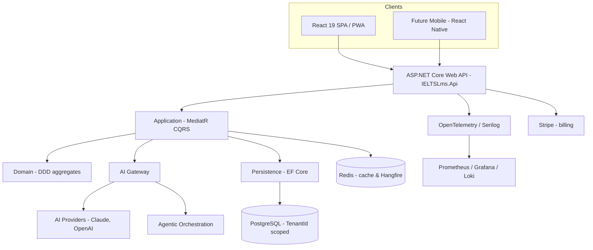
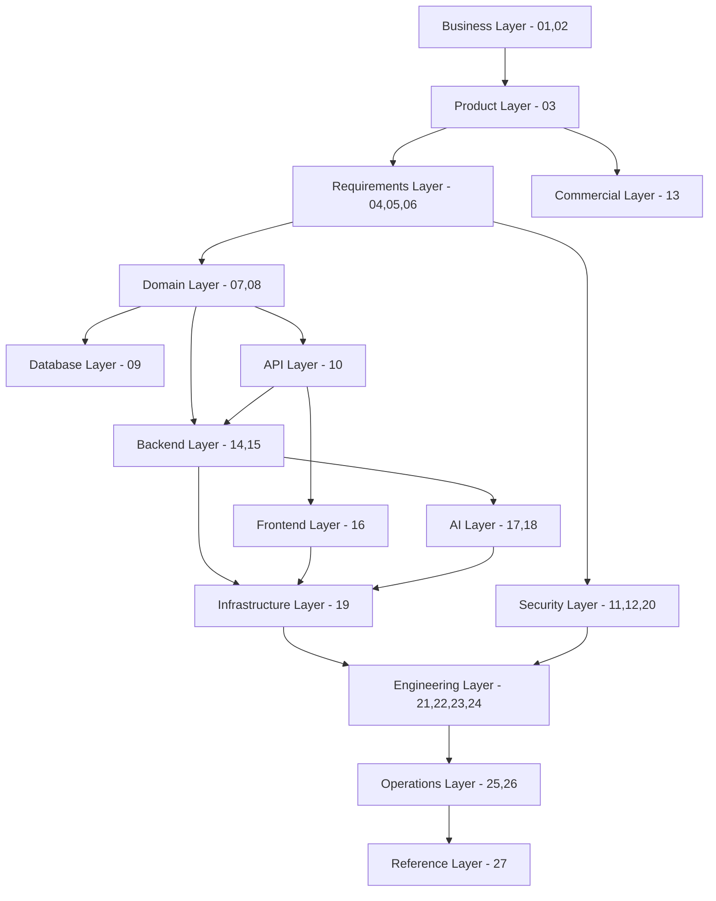
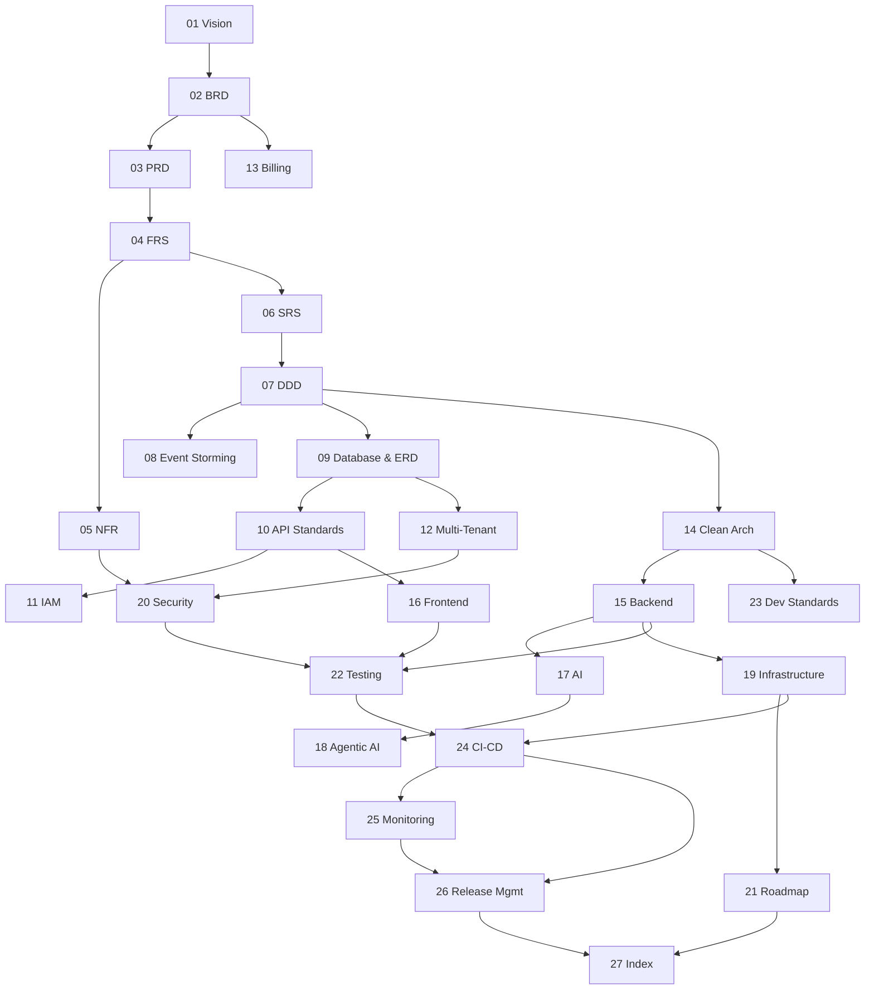
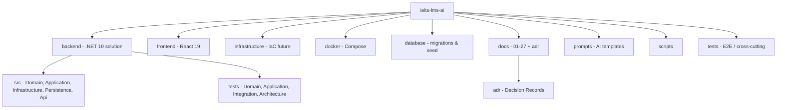
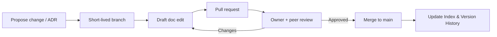

# Architecture Index — IELTS LMS AI

| Field | Value |
| --- | --- |
| **Product Name** | IELTS LMS AI |
| **Document** | 27 — Architecture Index (Master Landing Page) |
| **Version** | 1.0 |
| **Status** | Architecture & Planning |
| **Document Owner** | Principal Enterprise Architecture / Documentation Architecture |
| **Last Updated** | 2026-07-18 |
| **Audience** | Everyone — Engineering, Architecture, Product, QA, DevOps/SRE, Security, AI/ML, Leadership, Stakeholders, New Hires |
| **Aligns With** | [01_Product_Vision.md](./01_Product_Vision.md) … [26_Release_Management.md](./26_Release_Management.md) |

> **Purpose of this document.** This is the **master landing page** for the entire IELTS LMS AI architecture documentation set (documents 01–27). It provides the project and architecture overview, the documentation structure and navigation, a complete catalog of every document, dependency and layer diagrams, recommended reading orders by role, the glossary and acronyms, the standards and principles summary, the decision-record and future-documentation roadmap, and the maintenance, contribution, review, and approval processes. It is **implementation-independent** and is the **final operational blueprint index** before implementation begins. Every architectural decision referenced here is defined in detail in its owning document; this index never contradicts them — it navigates and summarizes them.

---

## Table of Contents

1. [Project Overview](#1-project-overview)
2. [Architecture Overview](#2-architecture-overview)
3. [System Overview Diagram](#3-system-overview-diagram)
4. [Documentation Structure & Architecture Layers](#4-documentation-structure--architecture-layers)
5. [Architecture Layer Diagram](#5-architecture-layer-diagram)
6. [Complete Document Catalog](#6-complete-document-catalog)
7. [Documentation Dependency Graph](#7-documentation-dependency-graph)
8. [Recommended Reading Order](#8-recommended-reading-order)
9. [Project Structure](#9-project-structure)
10. [Roadmap Summary](#10-roadmap-summary)
11. [Architecture Principles Summary](#11-architecture-principles-summary)
12. [Standards Summary](#12-standards-summary)
13. [Decision Records Summary](#13-decision-records-summary)
14. [Glossary](#14-glossary)
15. [Acronyms](#15-acronyms)
16. [Future Documentation Roadmap](#16-future-documentation-roadmap)
17. [Documentation Maintenance Guidelines](#17-documentation-maintenance-guidelines)
18. [Contribution, Review & Approval Process](#18-contribution-review--approval-process)
19. [Version History](#19-version-history)
20. [Related Documents](#20-related-documents)

---

## 1. Project Overview

**IELTS LMS AI** is an **AI-first, multi-tenant learning and assessment platform** that prepares candidates for the IELTS exam with automated, band-aligned feedback across the four skills (Listening, Reading, Writing, Speaking), backed by structured learning modules, a faithful computer-based exam experience, and analytics.

| Attribute | Position | Source |
| --- | --- | --- |
| **Product type** | Enterprise SaaS, multi-tenant. | [Vision (01)](./01_Product_Vision.md), [Multi-Tenant (12)](./12_Multi_Tenant_Architecture.md) |
| **Core value** | Band-aligned AI evaluation + exam-grade simulation. | [AI (17)](./17_AI_Architecture.md), [Frontend (16)](./16_Frontend_Architecture.md) |
| **Architecture style** | Modular monolith, microservice-ready. | [Clean Architecture (14)](./14_Clean_Architecture.md), [Backend (15)](./15_Backend_Architecture.md) |
| **Scale target** | Horizontal, stateless, millions of users. | [NFR (05)](./05_Non_Functional_Requirements.md), [Infrastructure (19)](./19_Infrastructure_Deployment.md) |
| **Tenancy model** | Shared-database, `TenantId`-scoped; evolvable to hybrid/dedicated. | [Multi-Tenant (12)](./12_Multi_Tenant_Architecture.md) |
| **Security posture** | OWASP/ASVS L2, Zero Trust, GDPR-ready. | [Security (20)](./20_Security_Standards.md) |
| **Delivery model** | Trunk-based, CI/CD, feature-flagged, observable. | [CI/CD (24)](./24_CI_CD_Pipeline.md), [Release Mgmt (26)](./26_Release_Management.md) |

---

## 2. Architecture Overview

The platform is a **modular monolith** built on **Clean Architecture** and **Domain-Driven Design**, exposed via a versioned **ASP.NET Core Web API**, rendered by a **React 19 SPA/PWA**, made intelligent by a **provider-agnostic AI layer** and an **agentic orchestration layer**, and operated as **containerized services** evolving toward Kubernetes.

| Layer | Technology | Owning document |
| --- | --- | --- |
| **Backend** | .NET 10, ASP.NET Core, EF Core, MediatR, FluentValidation, Serilog, Hangfire | [15](./15_Backend_Architecture.md) |
| **Frontend** | React 19, TypeScript, Vite, Tailwind, TanStack Query/Table, Zustand | [16](./16_Frontend_Architecture.md) |
| **Data** | PostgreSQL (shared schema, `TenantId`), Redis (cache + jobs) | [09](./09_Database_Design_ERD.md), [12](./12_Multi_Tenant_Architecture.md) |
| **AI** | Provider-agnostic gateway — Claude, OpenAI (future Gemini, Azure OpenAI, local) | [17](./17_AI_Architecture.md) |
| **Agentic** | Orchestrator + specialized agents over the AI gateway | [18](./18_Agentic_AI_Architecture.md) |
| **Infrastructure** | Docker Compose now; Kubernetes (AKS/EKS/GKE) future | [19](./19_Infrastructure_Deployment.md) |
| **Observability** | OpenTelemetry, Serilog, Prometheus, Grafana, Loki | [25](./25_Monitoring_Observability.md) |

> **Consistency note.** Where the prompt's historical list referred to `10_API_Specification`, the canonical document in this repository is **[10 — API Design Standards](./10_API_Design_Standards.md)** (the standards occupy that slot; endpoint-level specs conform to it). This index uses the canonical filenames throughout.

---

## 3. System Overview Diagram



The API is stateless and horizontally scalable; PostgreSQL and Redis are the stateful backing services; AI is a first-class capability behind a governed gateway; every request, record, job, cache key, and AI call is bound to exactly one tenant ([Multi-Tenant §7](./12_Multi_Tenant_Architecture.md#7-tenant-context-propagation)).

---

## 4. Documentation Structure & Architecture Layers

The 27 documents are organized into **conceptual layers**, from business intent down to operations and reference. Each layer answers a different question and has a distinct primary audience.

| Layer | Question it answers | Documents |
| --- | --- | --- |
| **Business Layer** | Why does this product exist? | [01 Vision](./01_Product_Vision.md), [02 BRD](./02_Business_Requirements_Document.md) |
| **Product Layer** | What are we building for whom? | [03 PRD](./03_Product_Requirements_Document.md) |
| **Requirements Layer** | What exactly must it do and how well? | [04 FRS](./04_Functional_Requirements.md), [05 NFR](./05_Non_Functional_Requirements.md), [06 SRS](./06_Software_Requirements_Specification.md) |
| **Domain Layer** | What is the business model and language? | [07 DDD](./07_Domain_Driven_Design.md), [08 Event Storming](./08_Event_Storming.md) |
| **Database Layer** | How is data modeled and stored? | [09 Database & ERD](./09_Database_Design_ERD.md) |
| **API Layer** | How do clients talk to the system? | [10 API Design Standards](./10_API_Design_Standards.md) |
| **Security Layer** | How is it secured and access-controlled? | [11 IAM](./11_Authentication_Authorization.md), [12 Multi-Tenant](./12_Multi_Tenant_Architecture.md), [20 Security](./20_Security_Standards.md) |
| **Commercial Layer** | How does it monetize? | [13 Subscription & Billing](./13_Subscription_Billing.md) |
| **Backend Layer** | How is server-side structured? | [14 Clean Architecture](./14_Clean_Architecture.md), [15 Backend](./15_Backend_Architecture.md) |
| **Frontend Layer** | How is the client structured? | [16 Frontend](./16_Frontend_Architecture.md) |
| **AI Layer** | How does intelligence work? | [17 AI](./17_AI_Architecture.md), [18 Agentic AI](./18_Agentic_AI_Architecture.md) |
| **Infrastructure Layer** | Where and how does it run? | [19 Infrastructure & Deployment](./19_Infrastructure_Deployment.md) |
| **Engineering Layer** | How do we build and ship it? | [21 Roadmap](./21_Development_Roadmap.md), [22 Testing](./22_Testing_Strategy.md), [23 Dev Standards](./23_Development_Standards.md), [24 CI/CD](./24_CI_CD_Pipeline.md) |
| **Operations Layer** | How do we run and release it? | [25 Monitoring](./25_Monitoring_Observability.md), [26 Release Management](./26_Release_Management.md) |
| **Reference Layer** | Where do I find everything? | [27 Architecture Index](./27_Architecture_Index.md) (this document) |

---

## 5. Architecture Layer Diagram



---

## 6. Complete Document Catalog

Every architecture document, with number, name, purpose, status, dependencies, related documents, audience, owner, priority, and anticipated future updates. All documents are **Version 1.0**, **Status: Architecture & Planning**, **Last Updated 2026-07-18**.

### 6.1 Documents 01–09

| # | Name | Purpose | Dependencies | Related | Audience | Owner | Priority | Future Updates |
| --- | --- | --- | --- | --- | --- | --- | --- | --- |
| **01** | [Product Vision](./01_Product_Vision.md) | Vision, objectives, glossary, north-star. | — | 02, 03 | Product, Eng, Design, Leadership | Product & Architecture | Foundational | Refresh per major strategy shift. |
| **02** | [Business Requirements (BRD)](./02_Business_Requirements_Document.md) | Business goals, market, monetization drivers. | 01 | 03, 13 | Founders, Stakeholders, Architects | Business Analysis & Product | Foundational | Update with business model changes. |
| **03** | [Product Requirements (PRD)](./03_Product_Requirements_Document.md) | Product scope, features, personas. | 01, 02 | 04, 16 | Eng, UX, QA, Product | Product Management | Foundational | Per feature epic. |
| **04** | [Functional Requirements (FRS)](./04_Functional_Requirements.md) | What the system must do. | 03 | 05, 06, 07 | Eng, QA, UX, Architecture | Systems Analysis & Product | High | Per feature addition. |
| **05** | [Non-Functional Requirements (NFR)](./05_Non_Functional_Requirements.md) | Quality attributes, measurable targets. | 04 | 19, 20, 22, 25 | Eng, Architecture, SRE, Security, QA | Architecture & Quality | High | Per SLO/target revision. |
| **06** | [Software Requirements Spec (SRS)](./06_Software_Requirements_Specification.md) | Consolidated requirements baseline. | 04, 05 | 07, 09 | Eng, Architecture, QA, Security | Requirements Eng & Architecture | High | With requirement changes. |
| **07** | [Domain-Driven Design (DDD)](./07_Domain_Driven_Design.md) | Bounded contexts, ubiquitous language, tactical model. | 04, 06 | 08, 09, 15 | Architects, Leads, Senior Eng | Domain & Solution Architecture | Foundational | As new contexts emerge. |
| **08** | [Event Storming](./08_Event_Storming.md) | Event-driven domain model, event catalog. | 07 | 09, 15, 17 | Architects, Leads, Senior Eng | Domain & Solution Architecture | Medium | With new domain events. |
| **09** | [Database Design & ERD](./09_Database_Design_ERD.md) | Logical data model, classification. | 07, 08 | 12, 15, 20 | Architects, Backend, DBAs, Security | Data & Solution Architecture | High | Per schema evolution (via migrations). |

### 6.2 Documents 10–18

| # | Name | Purpose | Dependencies | Related | Audience | Owner | Priority | Future Updates |
| --- | --- | --- | --- | --- | --- | --- | --- | --- |
| **10** | [API Design Standards](./10_API_Design_Standards.md) | REST/JSON contract standards, versioning. | 07, 09 | 11, 15, 16 | Backend, Consumers, Architects, QA, Security | API & Solution Architecture | High | Per API version / new protocol. |
| **11** | [Authentication & Authorization (IAM)](./11_Authentication_Authorization.md) | Identity, JWT, RBAC, credential security. | 10, 12 | 12, 20 | Backend, Security, Architects, Compliance | Security & IAM Architecture | High | Per auth capability (SSO/SCIM). |
| **12** | [Multi-Tenant Architecture](./12_Multi_Tenant_Architecture.md) | Tenancy model, isolation, context propagation. | 09, 11 | 15, 19, 20 | Architects, Backend/Platform, SRE, Security | Solution & Cloud Architecture | Foundational | On tenancy model evolution. |
| **13** | [Subscription & Billing](./13_Subscription_Billing.md) | Plans, entitlements, Stripe, invoicing. | 02, 12 | 20, 26 | Architects, Backend, Finance, Product | Billing & Solution Architecture | High | Per pricing/provider change. |
| **14** | [Clean Architecture](./14_Clean_Architecture.md) | Layering, dependency rule, project structure. | 07 | 15, 23 | Backend, Architects, Leads, QA | Principal .NET / Solution Architecture | Foundational | On structural evolution. |
| **15** | [Backend Architecture](./15_Backend_Architecture.md) | Solution structure, CQRS, persistence, jobs. | 14 | 10, 12, 17, 25 | Backend, Leads, Architects, DevOps, QA | Principal Backend / Solution Architecture | High | Per backend capability. |
| **16** | [Frontend Architecture](./16_Frontend_Architecture.md) | Feature structure, state, exam UI, a11y. | 10, 11 | 22, 24 | Frontend, UX, Architects, QA, A11y | Principal Frontend / UX Architecture | High | Per frontend capability. |
| **17** | [AI Architecture](./17_AI_Architecture.md) | Provider-agnostic AI layer, gateway, safety. | 07, 15 | 18, 25 | AI/ML, Backend, Architects, Security | Principal AI Architecture | Foundational | Per provider/capability. |
| **18** | [Agentic AI Architecture](./18_Agentic_AI_Architecture.md) | Multi-agent orchestration over the AI gateway. | 17 | 25 | AI/ML, Backend, Architects, Governance | Principal Agentic AI Architecture | Medium | As agents/MCP/A2A mature. |

### 6.3 Documents 19–27

| # | Name | Purpose | Dependencies | Related | Audience | Owner | Priority | Future Updates |
| --- | --- | --- | --- | --- | --- | --- | --- | --- |
| **19** | [Infrastructure & Deployment](./19_Infrastructure_Deployment.md) | Compose now, Kubernetes future; environments, data services. | 05, 12, 15, 16 | 20, 24, 25 | DevOps, SRE, Platform, Backend, Security | Principal Cloud / DevOps / SRE Architecture | High | On K8s/cloud adoption. |
| **20** | [Security Standards](./20_Security_Standards.md) | Enterprise security architecture, OWASP/ASVS, STRIDE. | 05, 11, 12, 19 | 22, 24, 26 | Security, Eng, DevOps, Compliance, Leadership | Principal Security Architecture / CISO Office | Foundational | Per threat/compliance change. |
| **21** | [Development Roadmap](./21_Development_Roadmap.md) | Phases P0–P10, milestones, DoD, versioning. | 01–20 | 22, 23, 24, 26 | Eng, Architecture, Product, QA, DevOps, Leadership | Technical Program Mgmt / Eng Leadership | High | Per phase/milestone update. |
| **22** | [Testing Strategy](./22_Testing_Strategy.md) | Test pyramid, quality gates, all test levels, AI testing. | 05, 15, 16, 19, 20 | 23, 24 | QA, SDETs, Eng, AI/ML, DevOps, Security, Product | Principal QA Architecture | High | Per test capability. |
| **23** | [Development Standards](./23_Development_Standards.md) | Clean code, SOLID, naming, conventions, PR discipline. | 10, 14, 15, 16, 20 | 22, 24 | Eng, AI/ML, Leads, Architects, QA, DevOps, New Hires | Principal Software Architecture | High | Per standards revision. |
| **24** | [CI/CD Pipeline](./24_CI_CD_Pipeline.md) | Git strategy, pipeline stages, deploy, rollback. | 19, 20, 22, 23 | 25, 26 | DevOps, SRE, Release Eng, Eng, QA, Security | Principal DevOps / SRE / Release Eng | High | On K8s/GitOps adoption. |
| **25** | [Monitoring & Observability](./25_Monitoring_Observability.md) | Logs, metrics, traces, alerting, SLO, incident mgmt. | 05, 15, 19 | 24, 26 | SRE, DevOps, Eng, AI/ML, Security, QA, On-Call | Principal SRE / Observability Eng | High | On backend/AIOps evolution. |
| **26** | [Release Management](./26_Release_Management.md) | Release lifecycle, versioning, go/no-go, rollback. | 21, 22, 24, 25 | 20, 27 | Release Mgrs, SRE, DevOps, Leads, QA, Product, Support | Release Mgmt / Principal SRE | High | On progressive-delivery adoption. |
| **27** | [Architecture Index](./27_Architecture_Index.md) | Master landing page, catalog, navigation. | 01–26 | All | Everyone | Principal Enterprise / Documentation Architecture | Foundational | Every document add/version bump. |

---

## 7. Documentation Dependency Graph

The graph shows how documents build on one another. Arrows point from a prerequisite to the document that depends on it. It is acyclic — later documents refine, never contradict, earlier ones.



---

## 8. Recommended Reading Order

Reading order depends on role. Everyone starts with the [Vision (01)](./01_Product_Vision.md).

| Role | Recommended path |
| --- | --- |
| **New engineer (onboarding)** | 27 → 01 → 07 → 14 → 15 (or 16) → 10 → 23 → 22 → 24. |
| **Backend engineer** | 07 → 09 → 14 → 15 → 10 → 12 → 11 → 17 → 20 → 23. |
| **Frontend engineer** | 03 → 16 → 10 → 11 → 22 → 23 → 24. |
| **AI/ML engineer** | 07 → 17 → 18 → 15 → 20 → 25. |
| **DevOps / SRE** | 19 → 24 → 25 → 26 → 05 → 20 → 12. |
| **Security engineer** | 20 → 11 → 12 → 09 → 05 → 24 → 22. |
| **QA / SDET** | 04 → 05 → 22 → 10 → 16 → 24. |
| **Product / stakeholder** | 01 → 02 → 03 → 04 → 13 → 21. |
| **Architect (full review)** | 01 → 02 → 03 → 04 → 05 → 06 → 07 → 08 → 09 → 10 → … → 26 → 27 (sequential). |

---

## 9. Project Structure

The monorepo groups the solution, client, infrastructure, and docs. Detailed layouts live in [Clean Architecture §](./14_Clean_Architecture.md) (backend) and [Frontend §](./16_Frontend_Architecture.md) (client).

```text
ielts-lms-ai/
├── backend/            # .NET 10 solution (IELTSLms.*)
│   ├── src/            # Domain, Application, Infrastructure, Persistence,
│   │                   # Contracts, SharedKernel, Common, BackgroundJobs,
│   │                   # Abstractions, Api (composition root)
│   └── tests/          # Domain, Application, Integration, Architecture tests
├── frontend/           # React 19 + TypeScript + Vite SPA/PWA
├── infrastructure/     # IaC & environment definitions (future)
├── docker/             # Container & Compose definitions
├── database/           # Migrations, seed data
├── docs/               # Architecture documentation 01–27 + adr/
│   └── adr/            # Architecture Decision Records
├── prompts/            # Versioned AI prompt templates
├── scripts/            # Automation helpers
└── tests/              # Cross-cutting / E2E suites
```



> **Reference.** Namespaces and project names follow `IELTSLms.<Layer>.<Context/Feature>` ([Backend §](./15_Backend_Architecture.md), [Dev Standards §7](./23_Development_Standards.md#7-naming-conventions)).

---

## 10. Roadmap Summary

Delivery follows phases **P0–P10** over ~43 weeks (relative to `W0`), reaching **GA at `1.0.0`** ([Roadmap (21)](./21_Development_Roadmap.md)).

```mermaid
graph LR
    P0[P0 Arch Freeze -W0-4-] --> P1[P1 Eng Foundation -W3-6-]
    P1 --> P2[P2 Platform -W6-11-]
    P2 --> P3[P3 Identity/Tenancy/Billing -W11-17-]
    P3 --> P4[P4 Learning -W17-25-]
    P4 --> P5[P5 Assessment -W20-28-]
    P5 --> P6[P6 AI & Agentic -W22-30-]
    P6 --> P7[P7 Portals/Analytics -W28-34-]
    P7 --> P8[P8 Hardening -W34-39-]
    P8 --> P9[P9 UAT/Launch -W39-43-]
    P9 --> P10[P10 Post-Launch -W43+-]
```



| Phase | Focus | This index's operational docs applied |
| --- | --- | --- |
| **P1** | Repo & engineering foundation — CI/CD, standards, observability baseline. | 22, 23, 24, 25 |
| **P8** | Hardening — security, performance, DR. | 20, 22, 25 |
| **P9** | UAT & launch — go/no-go, release. | 26 |

---

## 11. Architecture Principles Summary

The principles that recur across the document set and govern every decision.

| Principle | Meaning | Primary documents |
| --- | --- | --- |
| **Tenant-aware always** | Every request, record, job, cache key, log, and AI call is bound to one tenant. | [12](./12_Multi_Tenant_Architecture.md), [15](./15_Backend_Architecture.md) |
| **Secure by default** | Deny-by-default, least privilege, Zero Trust, ASVS L2. | [20](./20_Security_Standards.md), [11](./11_Authentication_Authorization.md) |
| **Clean Architecture** | Dependencies point inward; domain has no infrastructure knowledge. | [14](./14_Clean_Architecture.md) |
| **Domain-Driven** | Bounded contexts own their model; integrate via events/contracts. | [07](./07_Domain_Driven_Design.md), [08](./08_Event_Storming.md) |
| **Contract-first API** | OpenAPI is the source of truth; backward compatible. | [10](./10_API_Design_Standards.md) |
| **Provider-agnostic AI** | AI behind a governed gateway; providers are swappable. | [17](./17_AI_Architecture.md), [18](./18_Agentic_AI_Architecture.md) |
| **Modular monolith, microservice-ready** | One deployable now; extraction seams preserved. | [14](./14_Clean_Architecture.md), [15](./15_Backend_Architecture.md) |
| **Horizontal, stateless scale** | Scale out to millions without code change. | [05](./05_Non_Functional_Requirements.md), [19](./19_Infrastructure_Deployment.md) |
| **Build once, promote same artifact** | Immutable image flows Dev → CI → Staging → Prod. | [19](./19_Infrastructure_Deployment.md), [24](./24_CI_CD_Pipeline.md) |
| **Observable & reversible** | Everything instrumented; every deploy rollback-ready. | [25](./25_Monitoring_Observability.md), [26](./26_Release_Management.md) |
| **Shift-left quality & security** | Quality and security gates run early and block. | [22](./22_Testing_Strategy.md), [20](./20_Security_Standards.md) |
| **Implementation-independent docs** | Docs describe standards and decisions, not code. | All |

---

## 12. Standards Summary

| Standard area | Choice | Owning document |
| --- | --- | --- |
| **Product versioning** | Semantic Versioning `MAJOR.MINOR.PATCH`, GA at 1.0.0. | [21](./21_Development_Roadmap.md), [26](./26_Release_Management.md) |
| **API versioning** | URI major `/api/v1`; additive within version. | [10](./10_API_Design_Standards.md) |
| **API naming** | Plural, lowercase, kebab-case resources; camelCase JSON. | [10](./10_API_Design_Standards.md) |
| **Errors** | RFC 7807 Problem Details. | [10](./10_API_Design_Standards.md) |
| **Branching** | Trunk-based, short-lived branches, small PRs. | [24](./24_CI_CD_Pipeline.md), [23](./23_Development_Standards.md) |
| **Commits** | Conventional Commits. | [23](./23_Development_Standards.md) |
| **Migrations** | Versioned, forward-only, expand/contract. | [15](./15_Backend_Architecture.md), [26](./26_Release_Management.md) |
| **Security baseline** | OWASP Top 10, API Top 10, ASVS L2, CIS, STRIDE. | [20](./20_Security_Standards.md) |
| **Accessibility** | WCAG 2.1 AA. | [16](./16_Frontend_Architecture.md) |
| **Telemetry** | OpenTelemetry (vendor-neutral) + Serilog. | [25](./25_Monitoring_Observability.md) |
| **Decisions** | Architecture Decision Records (ADRs). | [§13](#13-decision-records-summary) |

---

## 13. Decision Records Summary

Significant architectural decisions are captured as **Architecture Decision Records (ADRs)** in [`docs/adr`](./adr/README.md). ADRs are immutable once accepted; a decision is changed by adding a superseding ADR.

| Aspect | Standard |
| --- | --- |
| **Location & template** | [`docs/adr/`](./adr/README.md), copy [`0000-template.md`](./adr/0000-template.md). |
| **Structure** | Status, Date, Deciders, Context, Decision, Consequences, Alternatives. |
| **Numbering** | Sequential `NNNN-short-slug.md`. |
| **When required** | Any decision that constrains future work or reverses an existing choice ([Roadmap §18](./21_Development_Roadmap.md#18-versioning-strategy)). |
| **Current state** | No ADRs recorded yet — the 01–27 set is the accepted baseline; post-freeze changes are captured as ADRs. |

> **Candidate first ADRs.** Multi-tenancy model (shared-schema), AI provider-agnostic gateway, modular-monolith-over-microservices, PostgreSQL as primary store, trunk-based delivery — each is currently documented in its owning document and should be back-filled as an ADR when first revisited.

---

## 14. Glossary

Full domain glossary lives in [Vision §14](./01_Product_Vision.md#14-glossary) and [DDD §3](./07_Domain_Driven_Design.md#3-ubiquitous-language). Key terms:

| Term | Meaning |
| --- | --- |
| **Tenant** | An isolated customer organization; the unit of data isolation. |
| **Band** | IELTS score 0–9 in 0.5 steps; the target of AI evaluation. |
| **Attempt** | A recorded try at a practice item, test, or exam section (meaning varies by context). |
| **Submission** | A learner's response (writing/speaking) sent for evaluation. |
| **Evaluation** | AI-produced, band-aligned assessment of a submission. |
| **Mock Exam** | A full, timed, computer-based IELTS simulation. |
| **Entitlement** | A capability granted by a subscription plan. |
| **Bounded Context** | A boundary within which a domain model and language are consistent. |
| **AI Gateway** | The single governed choke point for all model calls. |
| **Error Budget** | Allowable unreliability derived from an SLO; governs release pace. |
| **Feature Flag** | A runtime toggle decoupling deploy from feature exposure. |

---

## 15. Acronyms

| Acronym | Expansion |
| --- | --- |
| **LMS** | Learning Management System |
| **DDD** | Domain-Driven Design |
| **CQRS** | Command Query Responsibility Segregation |
| **ERD** | Entity-Relationship Design |
| **IAM** | Identity & Access Management |
| **RBAC** | Role-Based Access Control |
| **NFR / FRS / SRS / BRD / PRD** | Non-Functional Requirements / Functional Requirements Spec / Software Requirements Spec / Business Requirements Doc / Product Requirements Doc |
| **SLA / SLO / SLI** | Service Level Agreement / Objective / Indicator |
| **CI/CD** | Continuous Integration / Continuous Delivery |
| **SAST / DAST / SCA** | Static / Dynamic Application Security Testing / Software Composition Analysis |
| **ASVS** | Application Security Verification Standard |
| **RTO / RPO** | Recovery Time / Point Objective |
| **RUM** | Real User Monitoring |
| **ADR** | Architecture Decision Record |
| **PWA** | Progressive Web App |
| **MCP / A2A** | Model Context Protocol / Agent-to-Agent |
| **DORA** | DevOps Research & Assessment (delivery metrics) |

---

## 16. Future Documentation Roadmap

Documents anticipated after the 01–27 baseline, as the platform matures.

| Future doc | Trigger | Related |
| --- | --- | --- |
| **28 — Data & Analytics Architecture** | Dedicated analytics/reporting/warehouse buildout. | [09](./09_Database_Design_ERD.md), [25](./25_Monitoring_Observability.md) |
| **29 — Disaster Recovery & BCP Runbook** | Formal DR/BCP operationalization. | [19](./19_Infrastructure_Deployment.md), [25](./25_Monitoring_Observability.md) |
| **30 — Kubernetes & GitOps Architecture** | K8s migration from Compose. | [19](./19_Infrastructure_Deployment.md), [24](./24_CI_CD_Pipeline.md) |
| **31 — Compliance & Certification (SOC 2 / ISO 27001)** | Enterprise compliance readiness. | [20](./20_Security_Standards.md) |
| **32 — Microservices Extraction Playbook** | First service extraction (AI/Billing). | [14](./14_Clean_Architecture.md), [15](./15_Backend_Architecture.md) |
| **33 — Mobile Architecture** | React Native client. | [16](./16_Frontend_Architecture.md), [10](./10_API_Design_Standards.md) |
| **ADRs** | Ongoing — every significant decision. | [§13](#13-decision-records-summary) |

---

## 17. Documentation Maintenance Guidelines

The documentation set is a **living operational blueprint**. Keeping it accurate is part of the Definition of Done ([Roadmap](./21_Development_Roadmap.md)).

| Guideline | Standard |
| --- | --- |
| **One topic per document** | Each document owns its subject; the index navigates, never duplicates. |
| **Single source of truth** | A decision is defined in exactly one owning document; others link to it. |
| **Update with the change** | Docs are updated in the same PR as the change they describe ([§18](#18-contribution-review--approval-process)). |
| **Canonical numbering** | Two-digit zero-padded `NN_Title.md`; new docs take the next free number. |
| **House style** | Metadata table, purpose blockquote, TOC, `## N.` sections, `---` rules, tables, Mermaid, Related Documents, italic footer. |
| **Mermaid hygiene** | No parentheses/colons in node labels; use dashes. |
| **Cross-references** | Link related docs inline and in the Related Documents table; keep numbers current. |
| **Version bumps** | Any material change bumps the document version and this index's [Version History (§19)](#19-version-history). |
| **Deprecation** | Superseded content is marked and linked to its replacement, never silently deleted. |

> **Consistency reconciliation.** Some early documents (07, 08) and a stale footer in 05 reference older cross-reference numbers predating the current 14–27 numbering. The **current canonical numbering in this index is authoritative**; those references should be reconciled during their next revision.

---

## 18. Contribution, Review & Approval Process

Documentation follows the same trunk-based, reviewed workflow as code ([Dev Standards §24](./23_Development_Standards.md#24-code-review--pull-request-standards), [CI/CD §3](./24_CI_CD_Pipeline.md#3-branch-protection-reviews--merge-strategy)).



| Step | Owner | Standard |
| --- | --- | --- |
| **Contribution** | Any contributor | Branch, edit in house style, open a PR. |
| **Review** | Document owner + one peer | Verify accuracy, consistency, cross-references, no contradiction with existing decisions. |
| **Approval** | Document owner (architecture sign-off for foundational docs) | Foundational docs (01, 07, 12, 14, 17, 20, 27) require architecture approval. |
| **Merge & index** | Contributor | Update [§19 Version History](#19-version-history) and any changed cross-references. |
| **Significant decisions** | Deciders | Captured as an [ADR](./adr/README.md). |

**Review checklist:** accurate • consistent with all other docs • no contradiction of prior decisions • cross-references valid • house style followed • diagrams render • version bumped.

---

## 19. Version History

| Version | Date | Change | Author |
| --- | --- | --- | --- |
| **1.0** | 2026-07-18 | Initial Architecture Index covering documents 01–27; full catalog, dependency graph, layer model, reading orders, glossary, standards, maintenance and contribution processes. | Principal Enterprise / Documentation Architecture |

> The 01–27 document set constitutes the **v1.0 architecture baseline** — the final operational blueprint before implementation begins. Subsequent changes flow through [§18](#18-contribution-review--approval-process) and are recorded here and in each document's own metadata.

---

## 20. Related Documents

This index references **all** documents in the set.

| # | Document | Relationship |
| --- | --- | --- |
| 01 | [Product Vision](./01_Product_Vision.md) | Business intent this architecture serves. |
| 02 | [Business Requirements (BRD)](./02_Business_Requirements_Document.md) | Business drivers. |
| 03 | [Product Requirements (PRD)](./03_Product_Requirements_Document.md) | Product scope. |
| 04 | [Functional Requirements (FRS)](./04_Functional_Requirements.md) | Functional behavior. |
| 05 | [Non-Functional Requirements (NFR)](./05_Non_Functional_Requirements.md) | Quality targets. |
| 06 | [Software Requirements Spec (SRS)](./06_Software_Requirements_Specification.md) | Requirements baseline. |
| 07 | [Domain-Driven Design](./07_Domain_Driven_Design.md) | Domain model & language. |
| 08 | [Event Storming](./08_Event_Storming.md) | Event-driven model. |
| 09 | [Database Design & ERD](./09_Database_Design_ERD.md) | Data model. |
| 10 | [API Design Standards](./10_API_Design_Standards.md) | API contract standards. |
| 11 | [Authentication & Authorization](./11_Authentication_Authorization.md) | Identity & access. |
| 12 | [Multi-Tenant Architecture](./12_Multi_Tenant_Architecture.md) | Tenancy & isolation. |
| 13 | [Subscription & Billing](./13_Subscription_Billing.md) | Monetization. |
| 14 | [Clean Architecture](./14_Clean_Architecture.md) | Layering & structure. |
| 15 | [Backend Architecture](./15_Backend_Architecture.md) | Server-side blueprint. |
| 16 | [Frontend Architecture](./16_Frontend_Architecture.md) | Client blueprint. |
| 17 | [AI Architecture](./17_AI_Architecture.md) | AI capability layer. |
| 18 | [Agentic AI Architecture](./18_Agentic_AI_Architecture.md) | Agent orchestration. |
| 19 | [Infrastructure & Deployment](./19_Infrastructure_Deployment.md) | Runtime environments. |
| 20 | [Security Standards](./20_Security_Standards.md) | Security architecture. |
| 21 | [Development Roadmap](./21_Development_Roadmap.md) | Delivery phases. |
| 22 | [Testing Strategy](./22_Testing_Strategy.md) | Quality strategy. |
| 23 | [Development Standards](./23_Development_Standards.md) | Engineering standards. |
| 24 | [CI/CD Pipeline](./24_CI_CD_Pipeline.md) | Delivery mechanism. |
| 25 | [Monitoring & Observability](./25_Monitoring_Observability.md) | Operational visibility. |
| 26 | [Release Management](./26_Release_Management.md) | Release governance. |

---

*End of Document — 27 Architecture Index (v1.0).*
