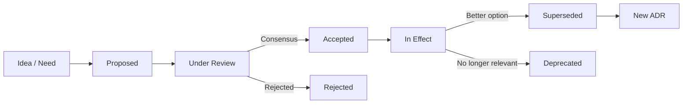
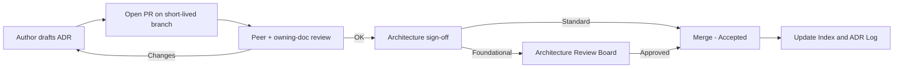
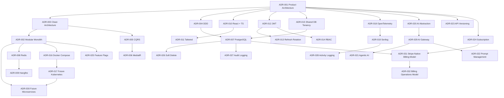

# Architecture Decision Records (ADR) — IELTS LMS AI

| Field | Value |
| --- | --- |
| **Product Name** | IELTS LMS AI |
| **Document** | 28 — Architecture Decision Records |
| **Version** | 1.0 |
| **Status** | Architecture & Planning |
| **Document Owner** | Chief Enterprise Architect / Principal Solution Architect / Enterprise Governance Architect |
| **Last Updated** | 2026-07-18 |
| **Audience** | Architecture, Engineering Leadership, Backend & Frontend Engineers, DevOps/SRE, Security, AI/ML, QA, Product, Compliance, Leadership, New Hires |
| **Aligns With** | [01_Product_Vision.md](./01_Product_Vision.md) … [27_Architecture_Index.md](./27_Architecture_Index.md) |

> **Purpose of this document.** This document is the **canonical Architecture Decision Record (ADR) log** for IELTS LMS AI. It formalizes the significant architectural decisions that shaped the 01–27 baseline into immutable, individually addressable records, each with its context, problem, decision, alternatives, consequences, risks, and future-review triggers. It is the **governance layer** over the architecture: where the owning documents describe *what the architecture is*, the ADRs record *why each decision was made, what was rejected, and under what conditions it should be revisited*. It is **implementation-independent** — no application code, SQL, or project scaffolding — only decisions and their rationale. It complements the lightweight per-file ADRs in [`docs/adr/`](./adr/README.md); this document is the consolidated, cross-referenced register that the [Architecture Index §13](./27_Architecture_Index.md#13-decision-records-summary) points to, and it is a primary input to the [Risk Register (29)](./29_Risk_Register.md).

---

## Table of Contents

1. [Introduction](#1-introduction)
2. [How ADRs Are Used](#2-how-adrs-are-used)
3. [Decision Lifecycle](#3-decision-lifecycle)
4. [Decision Status Model](#4-decision-status-model)
5. [Approval Workflow](#5-approval-workflow)
6. [Review Process](#6-review-process)
7. [Deprecation & Supersession Process](#7-deprecation--supersession-process)
8. [ADR Index](#8-adr-index)
9. [Decision Dependency Diagram](#9-decision-dependency-diagram)
10. [Architecture Decision Records](#10-architecture-decision-records)
11. [Decision-to-Document Traceability](#11-decision-to-document-traceability)
12. [Version History](#12-version-history)
13. [Related Documents](#13-related-documents)

---

## 1. Introduction

### 1.1 Purpose

An **Architecture Decision Record (ADR)** captures a single significant architectural decision together with its context and consequences. The purpose of this document is to:

- Preserve the **rationale** behind the architecture so future contributors understand *why*, not only *what*.
- Make decisions **immutable and auditable** — a decision is never silently rewritten; it is superseded by a new record.
- Provide a **single, cross-referenced register** linking each decision to its owning document(s) and to the risks it introduces.
- Support **long-term maintenance, onboarding, and governance** across the platform's evolution from modular monolith to a microservice-ready system.

### 1.2 Scope

This document covers the **major, baseline-defining decisions** (ADR-001 through ADR-030) established during the 01–27 architecture phase. It does **not** attempt to record every micro-decision; day-to-day decisions that constrain future work are added as new sequential ADRs over time. Decisions that are purely implementation detail (variable naming, local refactors) are out of scope.

### 1.3 Relationship to the Documentation Set

| Layer | Artifact | Role |
| --- | --- | --- |
| **Governance** | This document (28), [Risk Register (29)](./29_Risk_Register.md), [Glossary (30)](./30_Glossary.md) | Why, risk, and language. |
| **Navigation** | [Architecture Index (27)](./27_Architecture_Index.md) | Catalog and reading orders. |
| **Definition** | Documents 01–26 | The architecture itself. |
| **Lightweight log** | [`docs/adr/`](./adr/README.md) | Per-decision files using [`0000-template.md`](./adr/0000-template.md). |

> **Numbering reconciliation.** The [Architecture Index §16](./27_Architecture_Index.md#16-future-documentation-roadmap) tentatively earmarked numbers 28–30 for other future topics (Data & Analytics, DR/BCP, Kubernetes). Per the governance directive establishing this set, **28 = ADR, 29 = Risk Register, 30 = Glossary** are now the canonical assignments; the previously anticipated topics move to the next free numbers when authored. This document is authoritative for the 28 slot.

---

## 2. How ADRs Are Used

| Activity | Practice |
| --- | --- |
| **Creating** | Copy [`docs/adr/0000-template.md`](./adr/0000-template.md), assign the next sequential number, draft in the [ADR structure](#10-architecture-decision-records). |
| **Referencing** | Cite decisions as `ADR-0NN` in PRs, code comments, other docs, and the [Risk Register (29)](./29_Risk_Register.md). |
| **Changing a decision** | Never edit an *Accepted* ADR's decision. Create a new ADR that **supersedes** it (see [§7](#7-deprecation--supersession-process)). |
| **Onboarding** | New engineers read the [ADR Index (§8)](#8-adr-index) to absorb the "why" of the platform quickly. |
| **Governance & audit** | Auditors trace a control or design to its ADR, and from the ADR to the owning document and residual risk. |

**When an ADR is required:** any decision that (a) constrains future work, (b) is expensive to reverse, (c) crosses bounded-context or layer boundaries, (d) selects a vendor or protocol, or (e) affects security, tenancy, data, cost, or compliance posture.

---

## 3. Decision Lifecycle

| Stage | Meaning | Exit condition |
| --- | --- | --- |
| **Proposed** | Drafted, circulated for input. | Enters review. |
| **Under Review** | Actively evaluated by deciders. | Consensus reached or rejected. |
| **Accepted** | Ratified; the decision is binding. | Remains until superseded/deprecated. |
| **In Effect** | Implemented and governing the system. | — |
| **Superseded** | Replaced by a newer ADR. | Links forward to the successor. |
| **Deprecated** | No longer applicable, not replaced. | Marked with rationale. |
| **Rejected** | Considered but not adopted. | Retained for the record. |

---

## 4. Decision Status Model

| Status | Definition | Editable? |
| --- | --- | --- |
| **Proposed** | Under consideration, not binding. | Yes |
| **Accepted** | Ratified and binding. | No — supersede instead |
| **Superseded by ADR-XXXX** | Replaced by a later decision. | No |
| **Deprecated** | Retired without replacement. | No |
| **Rejected** | Evaluated and declined. | No |

All ADRs in this baseline are **Accepted** as of 2026-07-18 unless noted, reflecting the ratified 01–27 architecture.

---

## 5. Approval Workflow

| Decision class | Approver | Examples |
| --- | --- | --- |
| **Foundational** | Architecture Review Board (Chief/Principal Architects) | Architecture style, tenancy model, security posture, data platform. |
| **Significant** | Owning-document architect + one peer | Library selection, cross-context contracts. |
| **Local** | Team lead | Reversible, single-context choices (often not ADR-worthy). |

This mirrors the documentation approval flow in [Architecture Index §18](./27_Architecture_Index.md#18-contribution-review--approval-process) and the PR standards in [Development Standards §24](./23_Development_Standards.md).

---

## 6. Review Process

| Trigger | Action |
| --- | --- |
| **Scheduled** | Foundational ADRs reviewed at each major phase gate ([Roadmap (21)](./21_Development_Roadmap.md)) and at least annually. |
| **Event-driven** | A "Future Review" trigger inside an ADR fires (e.g., scale threshold crossed, vendor change, incident). |
| **Risk-linked** | A linked risk in the [Risk Register (29)](./29_Risk_Register.md) escalates to High/Critical. |

**Review checklist:** decision still valid • assumptions still hold • alternatives unchanged • risks acceptable • no contradiction with other ADRs or docs. A review either **reaffirms** the ADR (note the date) or **initiates a superseding ADR**.

---

## 7. Deprecation & Supersession Process

1. A new ADR is authored describing the replacement decision.
2. The new ADR's header lists **"Supersedes ADR-XXXX"**; the old ADR's status becomes **"Superseded by ADR-YYYY"** with a forward link.
3. The decision content of the old ADR is **never deleted** — it remains for historical and audit traceability.
4. Affected owning documents and the [Architecture Index](./27_Architecture_Index.md) are updated in the same change.
5. Deprecation without replacement is used only when the concern disappears entirely; rationale is recorded.

---

## 8. ADR Index

| ID | Title | Status | Primary Owning Doc(s) |
| --- | --- | --- | --- |
| **ADR-001** | Product Architecture | Accepted | [01](./01_Product_Vision.md), [14](./14_Clean_Architecture.md) |
| **ADR-002** | Modular Monolith Strategy | Accepted | [14](./14_Clean_Architecture.md), [15](./15_Backend_Architecture.md) |
| **ADR-003** | Clean Architecture | Accepted | [14](./14_Clean_Architecture.md) |
| **ADR-004** | Domain-Driven Design | Accepted | [07](./07_Domain_Driven_Design.md), [08](./08_Event_Storming.md) |
| **ADR-005** | CQRS | Accepted | [15](./15_Backend_Architecture.md) |
| **ADR-006** | MediatR | Accepted | [15](./15_Backend_Architecture.md) |
| **ADR-007** | PostgreSQL | Accepted | [09](./09_Database_Design_ERD.md) |
| **ADR-008** | Redis | Accepted | [15](./15_Backend_Architecture.md), [19](./19_Infrastructure_Deployment.md) |
| **ADR-009** | Hangfire | Accepted | [15](./15_Backend_Architecture.md) |
| **ADR-010** | React + TypeScript | Accepted | [16](./16_Frontend_Architecture.md) |
| **ADR-011** | Tailwind CSS | Accepted | [16](./16_Frontend_Architecture.md) |
| **ADR-012** | JWT Authentication | Accepted | [11](./11_Authentication_Authorization.md) |
| **ADR-013** | Refresh Token Rotation | Accepted | [11](./11_Authentication_Authorization.md) |
| **ADR-014** | RBAC | Accepted | [11](./11_Authentication_Authorization.md) |
| **ADR-015** | Multi-Tenant Shared Database | Accepted | [12](./12_Multi_Tenant_Architecture.md) |
| **ADR-016** | Docker Compose Development | Accepted | [19](./19_Infrastructure_Deployment.md) |
| **ADR-017** | Future Kubernetes | Accepted | [19](./19_Infrastructure_Deployment.md) |
| **ADR-018** | OpenTelemetry | Accepted | [25](./25_Monitoring_Observability.md) |
| **ADR-019** | Serilog | Accepted | [25](./25_Monitoring_Observability.md) |
| **ADR-020** | AI Provider Abstraction Layer | Accepted | [17](./17_AI_Architecture.md) |
| **ADR-021** | Agentic AI Architecture | Accepted | [18](./18_Agentic_AI_Architecture.md) |
| **ADR-022** | Prompt Management | Accepted | [17](./17_AI_Architecture.md), [18](./18_Agentic_AI_Architecture.md) |
| **ADR-023** | API Versioning | Accepted | [10](./10_API_Design_Standards.md) |
| **ADR-024** | Subscription Architecture | Accepted | [13](./13_Subscription_Billing.md) |
| **ADR-025** | Feature Flags | Accepted | [26](./26_Release_Management.md), [24](./24_CI_CD_Pipeline.md) |
| **ADR-026** | Soft Delete Strategy | Accepted | [09](./09_Database_Design_ERD.md) |
| **ADR-027** | Audit Logging | Accepted | [20](./20_Security_Standards.md), [09](./09_Database_Design_ERD.md) |
| **ADR-028** | Activity Logging | Accepted | [25](./25_Monitoring_Observability.md) |
| **ADR-029** | AI Gateway | Accepted | [17](./17_AI_Architecture.md) |
| **ADR-030** | Future Microservices | Accepted | [14](./14_Clean_Architecture.md), [15](./15_Backend_Architecture.md) |
| **ADR-031** | Stripe-Native Billing Entity Model | Accepted | [09](./09_Database_Design_ERD.md), [13](./13_Subscription_Billing.md) |
| **ADR-032** | Billing Operations Model & Stripe-Portal-First UX | Accepted | [09](./09_Database_Design_ERD.md), [13](./13_Subscription_Billing.md) |

---

## 9. Decision Dependency Diagram

Decisions are not independent; foundational choices constrain the ones below them.

---

## 10. Architecture Decision Records

Each record uses a consistent structure: **Decision ID, Title, Status, Date, Context, Problem Statement, Decision, Alternatives Considered, Pros, Cons, Consequences, Risks, Future Review, Related Documents, Future Evolution.**

---

### ADR-001 — Product Architecture

| Field | Value |
| --- | --- |
| **Status** | Accepted |
| **Date** | 2026-07-18 |

**Context.** IELTS LMS AI is an AI-first, multi-tenant SaaS serving learning, assessment, and band-aligned AI evaluation across four skills, targeting horizontal scale to millions of users ([01](./01_Product_Vision.md), [05](./05_Non_Functional_Requirements.md)).

**Problem Statement.** A single coherent architectural shape is needed that balances early delivery speed, domain clarity, tenant isolation, and the option to scale out and later extract services — without over-engineering a distributed system on day one.

**Decision.** Adopt an **AI-first, multi-tenant, modular-monolith architecture** built on Clean Architecture and DDD, exposed via a versioned ASP.NET Core Web API, a React SPA/PWA client, a provider-agnostic AI layer, and containerized deployment evolving toward Kubernetes.

**Alternatives Considered.** (a) Microservices from day one; (b) traditional layered monolith without DDD; (c) serverless-first.

**Pros.** Fast to build, clear domain boundaries, single deployable, cheap to operate early, microservice-ready.
**Cons.** Requires discipline to keep boundaries clean; shared runtime couples failure domains initially.
**Consequences.** Establishes the frame for ADR-002/003/004 and all downstream decisions.
**Risks.** Boundary erosion over time (see [Risk Register (29)](./29_Risk_Register.md) RISK-ARC-01).
**Future Review.** At each major phase gate and before any service extraction.
**Related Documents.** [01](./01_Product_Vision.md), [14](./14_Clean_Architecture.md), [15](./15_Backend_Architecture.md).
**Future Evolution.** Selective extraction to microservices (ADR-030).

---

### ADR-002 — Modular Monolith Strategy

| Field | Value |
| --- | --- |
| **Status** | Accepted |
| **Date** | 2026-07-18 |

**Context.** The team must ship a broad feature set quickly while preserving the ability to scale specific hotspots (AI, billing) later.

**Problem Statement.** How to structure one deployable so that bounded contexts remain independently evolvable and extractable.

**Decision.** Build a **modular monolith**: one deployable process, internally partitioned into bounded-context modules with explicit contracts and no cross-module database reach-through. Extraction seams are preserved from the start.

**Alternatives Considered.** Microservices; distributed monolith; single undifferentiated codebase.

**Pros.** Simple ops, transactional integrity, low latency between modules, easy refactoring.
**Cons.** Shared deployment/failure domain; requires enforced module boundaries.
**Consequences.** Enables ADR-030; drives module-per-context layout in [15](./15_Backend_Architecture.md).
**Risks.** Modules coupling into a "big ball of mud" (RISK-ARC-01).
**Future Review.** When a module's scale, team ownership, or failure isolation justifies extraction.
**Related Documents.** [14](./14_Clean_Architecture.md), [15](./15_Backend_Architecture.md).
**Future Evolution.** Strangler-fig extraction of the highest-value contexts first (ADR-030).

---

### ADR-003 — Clean Architecture

| Field | Value |
| --- | --- |
| **Status** | Accepted |
| **Date** | 2026-07-18 |

**Context.** Domain logic must remain testable and independent of frameworks, databases, and providers that change over time.

**Problem Statement.** How to keep business rules insulated from infrastructure and delivery mechanisms.

**Decision.** Apply **Clean Architecture**: dependencies point inward (Domain ← Application ← Infrastructure/Presentation); the domain has no infrastructure knowledge.

**Alternatives Considered.** Classic N-tier; transaction script; hexagonal (a close cousin, effectively subsumed).

**Pros.** High testability, swappable infrastructure, clear layering.
**Cons.** More indirection and boilerplate; learning curve.
**Consequences.** Underpins CQRS (ADR-005), provider abstraction (ADR-020), and repository patterns.
**Risks.** Over-abstraction slowing simple changes (RISK-ARC-02).
**Future Review.** If layering overhead measurably harms delivery velocity.
**Related Documents.** [14](./14_Clean_Architecture.md).
**Future Evolution.** Layers become service internals when contexts are extracted.

---

### ADR-004 — Domain-Driven Design

| Field | Value |
| --- | --- |
| **Status** | Accepted |
| **Date** | 2026-07-18 |

**Context.** The IELTS domain (skills, bands, attempts, evaluations) is rich and must be modeled with a shared, precise language.

**Problem Statement.** How to align code, docs, and conversation on one consistent model.

**Decision.** Adopt **DDD** — bounded contexts, aggregates, entities, value objects, domain events, and a ubiquitous language captured in the [Glossary (30)](./30_Glossary.md) and [DDD (07)](./07_Domain_Driven_Design.md).

**Alternatives Considered.** Anemic domain model; data-centric design.

**Pros.** Shared language, clear boundaries, event-driven integration.
**Cons.** Requires domain expertise and modeling investment.
**Consequences.** Defines context boundaries used by ADR-002 and event flows in [08](./08_Event_Storming.md).
**Risks.** Incorrect boundaries forcing rework (RISK-ARC-03).
**Future Review.** When new subdomains emerge or boundaries prove wrong.
**Related Documents.** [07](./07_Domain_Driven_Design.md), [08](./08_Event_Storming.md), [30](./30_Glossary.md).
**Future Evolution.** Bounded contexts map 1:1 to future services.

---

### ADR-005 — CQRS

| Field | Value |
| --- | --- |
| **Status** | Accepted |
| **Date** | 2026-07-18 |

**Context.** Read and write workloads differ in shape and scale, especially for analytics-heavy reads.

**Problem Statement.** How to model operations so reads and writes can evolve and scale independently.

**Decision.** Apply **CQRS** at the application layer — separate command and query models dispatched through a mediator, without mandating separate data stores initially.

**Alternatives Considered.** Single CRUD service model; full event sourcing.

**Pros.** Clear intent, independent optimization, testable handlers.
**Cons.** More types/handlers; potential read/write model duplication.
**Consequences.** Pairs with MediatR (ADR-006); enables future read replicas.
**Risks.** Overuse for trivial CRUD (RISK-ARC-02).
**Future Review.** If eventual consistency or separate read stores become necessary.
**Related Documents.** [15](./15_Backend_Architecture.md).
**Future Evolution.** Optional read-model projections / separate read stores.

---

### ADR-006 — MediatR

| Field | Value |
| --- | --- |
| **Status** | Accepted |
| **Date** | 2026-07-18 |

**Context.** CQRS needs a dispatch mechanism and a place for cross-cutting behavior (validation, logging, tenancy).

**Problem Statement.** How to decouple request senders from handlers and centralize pipeline concerns.

**Decision.** Use **MediatR** for in-process request/handler dispatch with pipeline behaviors for validation, logging, and tenant enforcement.

**Alternatives Considered.** Direct service injection; custom mediator; a message bus in-process.

**Pros.** Decoupling, uniform pipeline, testable handlers.
**Cons.** Vendor/library dependency; indirection in stack traces.
**Consequences.** Cross-cutting concerns implemented once as behaviors.
**Risks.** Library abandonment or licensing change (RISK-VEN-02).
**Future Review.** If licensing/maintenance changes materially.
**Related Documents.** [15](./15_Backend_Architecture.md).
**Future Evolution.** Replaceable behind the application layer contract.

---

### ADR-007 — PostgreSQL

| Field | Value |
| --- | --- |
| **Status** | Accepted |
| **Date** | 2026-07-18 |

**Context.** The platform needs a reliable, ACID, feature-rich relational store supporting multi-tenant `TenantId` scoping and JSON.

**Problem Statement.** Which primary datastore best balances integrity, cost, ecosystem, and scale.

**Decision.** Use **PostgreSQL** as the primary relational database (shared schema, `TenantId`-scoped), accessed via EF Core.

**Alternatives Considered.** SQL Server; MySQL; a NoSQL-first store.

**Pros.** ACID, JSONB, extensions, strong ecosystem, no license cost, cloud-managed options.
**Cons.** Requires tuning at scale; team familiarity varies.
**Consequences.** Foundation for tenancy (ADR-015), soft delete (ADR-026), audit (ADR-027).
**Risks.** Noisy-neighbor and hot-partition effects in shared DB (RISK-DB-01).
**Future Review.** At scale thresholds requiring sharding or dedicated DBs per tenant.
**Related Documents.** [09](./09_Database_Design_ERD.md), [12](./12_Multi_Tenant_Architecture.md).
**Future Evolution.** Read replicas, partitioning, and hybrid/dedicated tenant DBs.

---

### ADR-008 — Redis

| Field | Value |
| --- | --- |
| **Status** | Accepted |
| **Date** | 2026-07-18 |

**Context.** The system needs low-latency caching, distributed locks, rate-limit counters, and a backing store for background jobs.

**Problem Statement.** How to reduce database load and support ephemeral, high-throughput state.

**Decision.** Adopt **Redis** for caching, distributed coordination, rate limiting, and as the Hangfire/job backing store where applicable.

**Alternatives Considered.** In-memory-only cache; Memcached; database-backed caching.

**Pros.** Very low latency, versatile data structures, mature tooling.
**Cons.** Another stateful component to operate; cache-invalidation complexity.
**Consequences.** Enables Hangfire (ADR-009) and performance NFRs.
**Risks.** Cache stampede / staleness / tenant key leakage (RISK-PERF-02, RISK-SEC-03).
**Future Review.** If managed cache scale or cost changes materially.
**Related Documents.** [15](./15_Backend_Architecture.md), [19](./19_Infrastructure_Deployment.md).
**Future Evolution.** Clustered/managed Redis; per-tenant key namespaces.

---

### ADR-009 — Hangfire

| Field | Value |
| --- | --- |
| **Status** | Accepted |
| **Date** | 2026-07-18 |

**Context.** Long-running and deferred work (AI evaluation, emails, report generation) must run reliably outside the request path.

**Problem Statement.** How to schedule, retry, and monitor background jobs within a modular monolith.

**Decision.** Use **Hangfire** for background job scheduling, execution, retries, and dashboards.

**Alternatives Considered.** Quartz.NET; hosted `BackgroundService`; external queue + workers.

**Pros.** Built-in persistence, retries, dashboard, quick to adopt.
**Cons.** Coupled to the monolith runtime initially; storage overhead.
**Consequences.** AI evaluations run asynchronously; supports SLOs.
**Risks.** Job backlog / poison jobs under load (RISK-OPS-02).
**Future Review.** When jobs need independent scaling or a dedicated worker tier.
**Related Documents.** [15](./15_Backend_Architecture.md).
**Future Evolution.** Extract to a dedicated worker service / message-broker pipeline.

---

### ADR-010 — React + TypeScript

| Field | Value |
| --- | --- |
| **Status** | Accepted |
| **Date** | 2026-07-18 |

**Context.** The client must deliver a rich, accessible, exam-grade experience with strong developer velocity and type safety.

**Problem Statement.** Which frontend framework and language best fit the SPA/PWA requirements.

**Decision.** Build the client with **React (19) + TypeScript** on Vite, with TanStack Query/Table and Zustand.

**Alternatives Considered.** Angular; Vue; Blazor; plain JavaScript.

**Pros.** Huge ecosystem, type safety, hiring pool, PWA support.
**Cons.** Framework churn; requires state-management discipline.
**Consequences.** Sets styling (ADR-011) and API consumption patterns.
**Risks.** Ecosystem churn / breaking upgrades (RISK-TECH-02).
**Future Review.** On major React/tooling releases.
**Related Documents.** [16](./16_Frontend_Architecture.md).
**Future Evolution.** Shared component library; React Native mobile client.

---

### ADR-011 — Tailwind CSS

| Field | Value |
| --- | --- |
| **Status** | Accepted |
| **Date** | 2026-07-18 |

**Context.** The UI needs consistent, maintainable, accessible styling at speed.

**Problem Statement.** How to style a large UI consistently without CSS sprawl.

**Decision.** Use **Tailwind CSS** utility-first styling with a shared design-token configuration.

**Alternatives Considered.** CSS Modules; styled-components; a component-kit CSS (e.g., MUI).

**Pros.** Consistency, small production CSS, rapid iteration.
**Cons.** Verbose markup; utility-class learning curve.
**Consequences.** Design tokens centralize theming; supports WCAG 2.1 AA.
**Risks.** Inconsistent usage without a component layer (RISK-DOC-01 adjacent).
**Future Review.** On major Tailwind releases.
**Related Documents.** [16](./16_Frontend_Architecture.md).
**Future Evolution.** Codified design system / component library.

---

### ADR-012 — JWT Authentication

| Field | Value |
| --- | --- |
| **Status** | Accepted |
| **Date** | 2026-07-18 |

**Context.** A stateless, horizontally scalable API needs a portable authentication token carrying tenant and identity claims.

**Problem Statement.** How to authenticate API requests without server-side session affinity.

**Decision.** Use **JWT access tokens** (short-lived) carrying user, tenant, and role/permission claims, validated on every request.

**Alternatives Considered.** Server-side sessions; opaque tokens with introspection.

**Pros.** Stateless, scalable, self-contained claims.
**Cons.** Revocation is harder; token bloat; must protect signing keys.
**Consequences.** Pairs with refresh rotation (ADR-013) and RBAC (ADR-014).
**Risks.** Token theft / weak key management (RISK-SEC-01).
**Future Review.** If token revocation or size becomes problematic.
**Related Documents.** [11](./11_Authentication_Authorization.md), [20](./20_Security_Standards.md).
**Future Evolution.** DPoP/sender-constrained tokens; external IdP / OIDC.

---

### ADR-013 — Refresh Token Rotation

| Field | Value |
| --- | --- |
| **Status** | Accepted |
| **Date** | 2026-07-18 |

**Context.** Short-lived access tokens require a secure renewal mechanism resistant to replay.

**Problem Statement.** How to renew sessions safely and detect token theft.

**Decision.** Use **rotating refresh tokens** — each use issues a new refresh token and invalidates the prior; reuse detection revokes the token family.

**Alternatives Considered.** Long-lived non-rotating refresh tokens; no refresh (re-login).

**Pros.** Theft detection, limited replay window, good UX.
**Cons.** Requires server-side token-family tracking.
**Consequences.** Adds a small stateful store for refresh families.
**Risks.** Reuse-detection false positives logging users out (RISK-SEC-01).
**Future Review.** With IdP adoption or session-model changes.
**Related Documents.** [11](./11_Authentication_Authorization.md), [20](./20_Security_Standards.md).
**Future Evolution.** Delegated to an external IdP.

---

### ADR-014 — RBAC

| Field | Value |
| --- | --- |
| **Status** | Accepted |
| **Date** | 2026-07-18 |

**Context.** Multiple roles (learner, teacher, tenant admin, platform admin) require differentiated, tenant-scoped access.

**Problem Statement.** How to authorize actions consistently and least-privilege by default.

**Decision.** Implement **Role-Based Access Control** with permission claims, enforced at the API and application pipeline, always tenant-scoped.

**Alternatives Considered.** ABAC; ACLs per resource; hard-coded role checks.

**Pros.** Simple mental model, auditable, aligns with claims in JWT.
**Cons.** Coarser than ABAC for fine-grained cases.
**Consequences.** Authorization policies map to permissions; supports audit (ADR-027).
**Risks.** Privilege creep / misconfigured roles (RISK-SEC-02).
**Future Review.** If fine-grained/attribute-based needs emerge.
**Related Documents.** [11](./11_Authentication_Authorization.md), [20](./20_Security_Standards.md).
**Future Evolution.** Hybrid RBAC + ABAC / policy engine.

---

### ADR-015 — Multi-Tenant Shared Database

| Field | Value |
| --- | --- |
| **Status** | Accepted |
| **Date** | 2026-07-18 |

**Context.** The SaaS must isolate many tenants cost-effectively while remaining operationally simple early.

**Problem Statement.** Which tenancy model balances isolation, cost, and operability at launch.

**Decision.** Use a **shared-database, shared-schema** model with mandatory `TenantId` scoping on every row, query, cache key, job, and log, enforced centrally.

**Alternatives Considered.** Database-per-tenant; schema-per-tenant; fully separate deployments.

**Pros.** Lowest cost, simplest ops, easy cross-tenant analytics.
**Cons.** Strongest isolation discipline required; noisy-neighbor risk.
**Consequences.** Central tenant filter is a critical control (see ADR-007, ADR-027).
**Risks.** Cross-tenant data leakage (RISK-SEC-03) and noisy neighbor (RISK-DB-01).
**Future Review.** When enterprise customers demand physical isolation or at scale limits.
**Related Documents.** [12](./12_Multi_Tenant_Architecture.md), [09](./09_Database_Design_ERD.md).
**Future Evolution.** Hybrid model — dedicated DBs for premium/enterprise tenants.

---

### ADR-016 — Docker Compose Development

| Field | Value |
| --- | --- |
| **Status** | Accepted |
| **Date** | 2026-07-18 |

**Context.** Developers need a reproducible local environment matching production dependencies (Postgres, Redis).

**Problem Statement.** How to standardize the local/dev environment cheaply.

**Decision.** Use **Docker Compose** for local development and lower environments; the same images promote toward production.

**Alternatives Considered.** Local native installs; a local Kubernetes (kind/minikube); dev containers only.

**Pros.** Reproducible, simple, fast onboarding.
**Cons.** Diverges from production orchestration (K8s) semantics.
**Consequences.** Bridges toward ADR-017; supports "build once, promote" ([19](./19_Infrastructure_Deployment.md)).
**Risks.** Dev/prod parity gaps (RISK-INF-02).
**Future Review.** When Kubernetes becomes the runtime target.
**Related Documents.** [19](./19_Infrastructure_Deployment.md), [24](./24_CI_CD_Pipeline.md).
**Future Evolution.** Superseded for runtime by ADR-017 (dev Compose may remain).

---

### ADR-017 — Future Kubernetes

| Field | Value |
| --- | --- |
| **Status** | Accepted |
| **Date** | 2026-07-18 |

**Context.** Production scale, resilience, and rollout control will eventually exceed what Compose provides.

**Problem Statement.** What is the target production orchestration platform.

**Decision.** Target **Kubernetes** (AKS/EKS/GKE) as the future production runtime; design containers and config to be K8s-ready now.

**Alternatives Considered.** Managed container services (ECS/Container Apps); VMs; staying on Compose.

**Pros.** Autoscaling, self-healing, standard rollout/rollback, portability.
**Cons.** Operational complexity and cost; steep learning curve.
**Consequences.** Informs stateless design and "build once, promote"; enables ADR-030.
**Risks.** Migration complexity and cost overruns (RISK-INF-01, RISK-CLD-01).
**Future Review.** At the scale/reliability threshold triggering migration.
**Related Documents.** [19](./19_Infrastructure_Deployment.md), [24](./24_CI_CD_Pipeline.md).
**Future Evolution.** GitOps-based deployment; multi-region.

---

### ADR-018 — OpenTelemetry

| Field | Value |
| --- | --- |
| **Status** | Accepted |
| **Date** | 2026-07-18 |

**Context.** Observability must be vendor-neutral across traces, metrics, and logs.

**Problem Statement.** How to instrument the system without locking into one observability vendor.

**Decision.** Standardize on **OpenTelemetry** for distributed tracing, metrics, and log correlation, exported to the chosen backend (Prometheus/Grafana/Loki).

**Alternatives Considered.** Vendor-specific agents (Datadog/New Relic); ad-hoc logging only.

**Pros.** Vendor-neutral, standardized, portable, rich correlation.
**Cons.** Instrumentation effort; evolving spec surface.
**Consequences.** Foundation for SLOs, tracing, and activity logging (ADR-028).
**Risks.** Incomplete instrumentation reducing MTTR (RISK-OPS-01).
**Future Review.** On major OTel/spec changes or backend changes.
**Related Documents.** [25](./25_Monitoring_Observability.md).
**Future Evolution.** Full trace-based SLOs; exemplars; profiling.

---

### ADR-019 — Serilog

| Field | Value |
| --- | --- |
| **Status** | Accepted |
| **Date** | 2026-07-18 |

**Context.** Backend logging must be structured, queryable, and correlation-aware.

**Problem Statement.** How to produce consistent structured logs across the backend.

**Decision.** Use **Serilog** for structured logging with enrichers (tenant, correlation/trace IDs), integrated with OpenTelemetry.

**Alternatives Considered.** Built-in `ILogger` only; NLog; log4net.

**Pros.** Structured events, rich sinks, enrichment, ecosystem.
**Cons.** Configuration surface; must avoid logging secrets/PII.
**Consequences.** Enables activity logging (ADR-028) and audit correlation (ADR-027).
**Risks.** PII/secret leakage in logs (RISK-SEC-04).
**Future Review.** If the logging backend or standard changes.
**Related Documents.** [25](./25_Monitoring_Observability.md), [20](./20_Security_Standards.md).
**Future Evolution.** Centralized log governance and redaction pipelines.

---

### ADR-020 — AI Provider Abstraction Layer

| Field | Value |
| --- | --- |
| **Status** | Accepted |
| **Date** | 2026-07-18 |

**Context.** AI providers, models, and pricing change rapidly; the platform must not couple to one vendor.

**Problem Statement.** How to keep AI capabilities portable across providers and models.

**Decision.** Introduce a **provider-agnostic AI abstraction** — a stable internal interface with pluggable adapters (Claude, OpenAI; future Gemini, Azure OpenAI, local).

**Alternatives Considered.** Direct SDK calls to one provider; per-feature bespoke integrations.

**Pros.** Vendor portability, testability, cost/quality routing.
**Cons.** Abstraction must track evolving provider capabilities.
**Consequences.** Foundation for the AI Gateway (ADR-029) and prompt management (ADR-022).
**Risks.** Leaky abstraction / capability drift (RISK-AI-03, RISK-VEN-01).
**Future Review.** As provider capabilities materially diverge.
**Related Documents.** [17](./17_AI_Architecture.md).
**Future Evolution.** Dynamic multi-provider routing and fallback.

---

### ADR-021 — Agentic AI Architecture

| Field | Value |
| --- | --- |
| **Status** | Accepted |
| **Date** | 2026-07-18 |

**Context.** Complex tasks (multi-step evaluation, tutoring) benefit from orchestrated, specialized agents rather than single prompts.

**Problem Statement.** How to structure multi-step AI workflows safely and observably.

**Decision.** Adopt an **agentic architecture** — an orchestrator coordinating specialized agents over the AI gateway, with tool use, guardrails, and full observability.

**Alternatives Considered.** Single-shot prompting; hard-coded pipelines; third-party agent platform.

**Pros.** Modular capabilities, reusable agents, better complex-task quality.
**Cons.** Higher complexity, cost, and non-determinism.
**Consequences.** Requires strict guardrails, budgets, and tracing.
**Risks.** Runaway cost, loops, unsafe tool use (RISK-AI-01, RISK-AI-04, RISK-FIN-02).
**Future Review.** As agent frameworks and standards (MCP/A2A) mature.
**Related Documents.** [18](./18_Agentic_AI_Architecture.md), [17](./17_AI_Architecture.md).
**Future Evolution.** MCP/A2A interoperability; richer tool ecosystems.

---

### ADR-022 — Prompt Management

| Field | Value |
| --- | --- |
| **Status** | Accepted |
| **Date** | 2026-07-18 |

**Context.** Prompts are critical assets affecting quality, cost, and safety, and must be versioned and governed.

**Problem Statement.** How to manage prompts as controlled, testable, versioned artifacts.

**Decision.** Establish **centralized prompt management** — versioned, reviewed, environment-scoped prompt templates with evaluation and rollback, decoupled from code deploys.

**Alternatives Considered.** Inline hard-coded prompts; scattered per-feature prompts.

**Pros.** Auditability, safe iteration, A/B testing, rollback.
**Cons.** Extra tooling and governance process.
**Consequences.** Prompts follow a lifecycle like code; supports AI evaluations.
**Risks.** Prompt regression / injection (RISK-AI-02, RISK-AI-05).
**Future Review.** As prompt-ops tooling matures.
**Related Documents.** [17](./17_AI_Architecture.md), [18](./18_Agentic_AI_Architecture.md).
**Future Evolution.** Prompt registry with automated evaluation gates.

---

### ADR-023 — API Versioning

| Field | Value |
| --- | --- |
| **Status** | Accepted |
| **Date** | 2026-07-18 |

**Context.** Clients (web, future mobile, integrations) require stable contracts while the API evolves.

**Problem Statement.** How to evolve the API without breaking existing clients.

**Decision.** Use **URI major versioning** (`/api/v1`) with additive, backward-compatible changes within a version; breaking changes bump the major version.

**Alternatives Considered.** Header/media-type versioning; query-param versioning; no versioning.

**Pros.** Explicit, cache-friendly, easy to route and document.
**Cons.** Version proliferation if misused; some duplication across majors.
**Consequences.** OpenAPI is the contract source of truth ([10](./10_API_Design_Standards.md)).
**Risks.** Breaking changes leaking within a major (RISK-REL-01).
**Future Review.** Before introducing `v2`.
**Related Documents.** [10](./10_API_Design_Standards.md).
**Future Evolution.** Deprecation policy and sunset headers per version.

---

### ADR-024 — Subscription Architecture

| Field | Value |
| --- | --- |
| **Status** | Accepted |
| **Date** | 2026-07-18 |

**Context.** Monetization depends on plans, entitlements, quotas, and billing integration per tenant.

**Problem Statement.** How to model subscriptions and gate features/quotas reliably.

**Decision.** Model **plan → entitlement → quota** with tenant-scoped subscriptions; features and AI usage are gated by entitlements and metered against quotas, integrated with a payment provider.

**Alternatives Considered.** Hard-coded tiers; per-feature flags only; fully external billing logic.

**Pros.** Flexible packaging, clear gating, meterable usage.
**Cons.** Billing edge cases (proration, dunning) are complex.
**Consequences.** Ties entitlements to RBAC and feature flags (ADR-014, ADR-025).
**Risks.** Billing errors / revenue leakage (RISK-FIN-01, RISK-SUB-01).
**Future Review.** On new pricing models or provider change.
**Related Documents.** [13](./13_Subscription_Billing.md).
**Future Evolution.** Usage-based/hybrid billing; multi-currency; marketplace.

---

### ADR-025 — Feature Flags

| Field | Value |
| --- | --- |
| **Status** | Accepted |
| **Date** | 2026-07-18 |

**Context.** Deploying code must be decoupled from exposing features to enable safe, gradual rollout.

**Problem Statement.** How to release progressively and roll back exposure without redeploying.

**Decision.** Use **feature flags** to gate feature exposure per tenant/segment, enabling canary/gradual rollout and instant kill-switches.

**Alternatives Considered.** Branch-based releases; environment-only gating; big-bang deploys.

**Pros.** Safe rollout, fast rollback, experimentation.
**Cons.** Flag debt; combinatorial testing surface.
**Consequences.** Central to release management (ADR-025 ↔ [26](./26_Release_Management.md)).
**Risks.** Stale flags / flag misconfiguration (RISK-REL-02).
**Future Review.** With flag-management tooling adoption.
**Related Documents.** [26](./26_Release_Management.md), [24](./24_CI_CD_Pipeline.md).
**Future Evolution.** Managed flag service; automated flag cleanup.

---

### ADR-026 — Soft Delete Strategy

| Field | Value |
| --- | --- |
| **Status** | Accepted |
| **Date** | 2026-07-18 |

**Context.** Data must be recoverable, auditable, and often retained for compliance rather than physically deleted.

**Problem Statement.** How to remove data from active use while preserving recoverability and audit history.

**Decision.** Use **soft delete** (`IsDeleted`/timestamp) with global query filters excluding deleted rows; hard deletion is a governed, exceptional operation (e.g., GDPR erasure).

**Alternatives Considered.** Hard delete only; archive tables; event-sourced deletes.

**Pros.** Recoverability, audit continuity, safer operations.
**Cons.** Data growth; must remember filters; uniqueness/PII handling nuance.
**Consequences.** Interacts with audit (ADR-027) and GDPR erasure.
**Risks.** Forgotten filter exposing deleted data; unbounded growth (RISK-DB-02).
**Future Review.** With retention/erasure policy changes.
**Related Documents.** [09](./09_Database_Design_ERD.md), [20](./20_Security_Standards.md).
**Future Evolution.** Tiered archival + purge jobs aligned to retention policy.

---

### ADR-027 — Audit Logging

| Field | Value |
| --- | --- |
| **Status** | Accepted |
| **Date** | 2026-07-18 |

**Context.** Security, compliance, and dispute resolution require a tamper-evident record of significant changes.

**Problem Statement.** How to record who changed what, when, and in which tenant.

**Decision.** Implement **audit logging** for significant domain and security events — actor, tenant, action, entity, before/after, timestamp — stored durably and protected from tampering.

**Alternatives Considered.** Rely on app logs only; database triggers only; no audit.

**Pros.** Compliance, forensics, accountability.
**Cons.** Storage cost; must avoid capturing secrets/PII improperly.
**Consequences.** Complements activity logging (ADR-028) and soft delete (ADR-026).
**Risks.** Gaps or tampering undermining compliance (RISK-COM-01, RISK-SEC-04).
**Future Review.** With compliance certification (SOC 2 / ISO 27001).
**Related Documents.** [20](./20_Security_Standards.md), [09](./09_Database_Design_ERD.md).
**Future Evolution.** Immutable/append-only audit store; SIEM integration.

---

### ADR-028 — Activity Logging

| Field | Value |
| --- | --- |
| **Status** | Accepted |
| **Date** | 2026-07-18 |

**Context.** Product analytics, support, and UX improvement need a record of user activity distinct from security audit.

**Problem Statement.** How to capture user activity for analytics/support without conflating it with the security audit trail.

**Decision.** Implement **activity logging** — user-facing events (logins, submissions, navigation milestones) captured via structured logs/telemetry, tenant-scoped and privacy-aware.

**Alternatives Considered.** Merge with audit log; third-party analytics only; no activity capture.

**Pros.** Product insight, support context, engagement analytics.
**Cons.** Volume/cost; privacy considerations.
**Consequences.** Feeds analytics and monitoring ([25](./25_Monitoring_Observability.md)).
**Risks.** PII over-collection / consent gaps (RISK-COM-02, RISK-SEC-04).
**Future Review.** With analytics platform and privacy policy changes.
**Related Documents.** [25](./25_Monitoring_Observability.md).
**Future Evolution.** Dedicated analytics/event pipeline and warehouse.

---

### ADR-029 — AI Gateway

| Field | Value |
| --- | --- |
| **Status** | Accepted |
| **Date** | 2026-07-18 |

**Context.** All model calls need a single governed choke point for security, cost control, rate limiting, caching, and observability.

**Problem Statement.** How to centrally govern every AI interaction regardless of provider or feature.

**Decision.** Route **all** AI calls through an **AI Gateway** built on the provider abstraction (ADR-020) — enforcing auth, tenancy, quotas/budgets, rate limits, prompt governance, caching, safety filtering, and full tracing.

**Alternatives Considered.** Direct per-feature provider calls; a thin SDK wrapper without governance.

**Pros.** Central control, cost governance, safety, observability, provider swap in one place.
**Cons.** Potential bottleneck/single point of failure if not scaled.
**Consequences.** Enforces ADR-020/021/022; central to AI risk controls.
**Risks.** Gateway outage blocking AI features; cost overruns if budgets misconfigured (RISK-AI-01, RISK-FIN-02, RISK-OPS-03).
**Future Review.** As AI traffic scales or requires regional routing.
**Related Documents.** [17](./17_AI_Architecture.md), [18](./18_Agentic_AI_Architecture.md).
**Future Evolution.** Extract as a standalone service (ADR-030); multi-region gateways.

---

### ADR-030 — Future Microservices

| Field | Value |
| --- | --- |
| **Status** | Accepted |
| **Date** | 2026-07-18 |

**Context.** Certain contexts (AI Gateway, Billing) may eventually need independent scaling, deployment, and ownership.

**Problem Statement.** How to evolve from the modular monolith to services without a risky big-bang rewrite.

**Decision.** Preserve **extraction seams** now and, when justified by scale/ownership/isolation needs, extract services incrementally via the **strangler-fig** pattern — highest-value contexts first.

**Alternatives Considered.** Stay monolith indefinitely; rewrite as microservices upfront (rejected by ADR-001/002).

**Pros.** Independent scale/deploy, fault isolation, team autonomy.
**Cons.** Distributed-system complexity, network cost, data consistency challenges.
**Consequences.** Depends on ADR-002 boundaries, ADR-017 K8s, and clear contracts.
**Risks.** Premature or poorly-bounded extraction (RISK-ARC-04, RISK-FUT-01).
**Future Review.** When a context repeatedly hits scale/ownership friction.
**Related Documents.** [14](./14_Clean_Architecture.md), [15](./15_Backend_Architecture.md), [19](./19_Infrastructure_Deployment.md).
**Future Evolution.** A documented Microservices Extraction Playbook (future doc).

---

### ADR-031 — Stripe-Native Billing Entity Model

| Field | Value |
| --- | --- |
| **Status** | Accepted |
| **Date** | 2026-07-28 |
| **Supersedes** | Extends (does not replace) the commerce entities in [09 §6.5](./09_Database_Design_ERD.md#65-commerce-subscriptions--billing) |

**Context.** Phase 5 Sprint 1 implements the commercial foundation described by ADR-024: plan
catalog, Stripe checkout/subscription sync, feature entitlements, and usage quotas. The existing
[09 §6.5](./09_Database_Design_ERD.md#65-commerce-subscriptions--billing) ERD models this coarsely —
a single `SubscriptionPlans` catalog entity carrying price/interval/entitlements inline, plus
`Subscriptions`, `Invoices`, `Payments`, `Coupons`. [13](./13_Subscription_Billing.md) is deliberately
implementation-independent and does not resolve the entity shape either.

**Problem Statement.** A coarse `SubscriptionPlans` entity cannot represent Stripe's own object model
(Products own many Prices; Customers and PaymentMethods are reusable and independent of any one
Subscription; Subscriptions and Invoices are line-itemized) without lossy overloading of one table.
Sprint 1 also needs first-class, queryable feature entitlements and metered quotas per tenant — not
buried as opaque JSON on a plan row — so other bounded contexts can cheaply answer "does this tenant
have feature X" / "how much quota does this tenant have left" without parsing configuration blobs.

**Decision.** Extend [09 §6.5](./09_Database_Design_ERD.md#65-commerce-subscriptions--billing) with a
Stripe-native, normalized entity set, additive to the existing ENT-039..043 entities:
- **Catalog (global):** `Product` → `Plan` (Free/Starter/Premium/Institute/Enterprise;
  `DisplayOrder` encodes the upgrade/downgrade path) → `Price` (currency, interval, minor-unit
  amount).
- **Entitlements:** `FeatureGroup`, `Feature`, `PlanFeature` (plan grants), `TenantFeature`
  (tenant-scoped override).
- **Quotas:** `QuotaDefinition`, `PlanQuota`, `TenantQuota` (override), `UsageRecord` (metered
  counter per tenant per period).
- **Commerce (tenant-scoped):** `BillingCustomer` (Stripe customer mirror; billing address is an
  **owned value object** on `BillingCustomer`, not an independent aggregate — it has no lifecycle of
  its own), `PaymentMethod`, `Subscription` (state machine), `SubscriptionItem`, `Invoice`,
  `InvoiceLine`, `Payment`.
- **Webhook idempotency:** `ProcessedWebhookEvent` — deduplicates inbound Stripe events; distinct
  from the domain-event outbox.

`Coupons` (ENT-043) is **not** implemented in Sprint 1 — the sprint's explicit scope (product
catalog, plans, pricing, Stripe integration, checkout, subscription lifecycle, entitlements, quotas)
never mentions coupons/discounts. It remains ERD-defined and accepted for a future sprint.

Domain events raised by the new `Subscription` aggregate continue to dispatch via the existing
**direct in-process MediatR publish** from `ApplicationDbContext.SaveChangesAsync`
(`MediatorDomainEventDispatcher`), the same mechanism `Tenancy` already uses — **not** the
`outbox_messages` table. The outbox table exists in Persistence but no module publishes through it
yet; wiring a real outbox poller is a cross-cutting change to every module's save pipeline, not a
Billing-specific one, and is deliberately deferred rather than bolted on for one context.

**Alternatives Considered.** (a) Keep the single coarse `SubscriptionPlans` entity and store
Stripe product/price data and entitlements as JSON columns; (b) model entitlements/quotas as
free-form tenant configuration instead of dedicated tables; (c) wire the outbox table for Billing
only, ahead of the rest of the platform.

**Pros.** Matches Stripe's actual object graph (simplifies sync logic and avoids translation
lossiness), makes entitlements/quotas queryable and indexable for other bounded contexts, keeps
`BillingAddress` unburdened by unneeded aggregate ceremony (owned type, not a root).
**Cons.** More tables and EF configurations than the original 5-entity sketch; two parallel
"catalog" and "override" tables per concern (Plan→PlanFeature vs. TenantFeature) to reason about.
**Consequences.** [09 §6.5](./09_Database_Design_ERD.md#65-commerce-subscriptions--billing) is
appended (not renumbered) with the new entities; [commercial/billing.md](./commercial/billing.md) now
points to this ADR instead of being a placeholder. Other modules that need feature/quota checks
depend on the new `IEntitlementService`/`IQuotaService` ports, not on Billing's persistence directly.
**Risks.** Schema growth if every future billing nuance gets its own table (RISK-FIN-01 adjacent);
outbox deferral means Billing's domain events are only visible in-process until a platform-wide
outbox processor exists — acceptable for Sprint 1 since nothing outside the process currently
consumes these events.
**Future Review.** When Coupons are scheduled, when a second payment provider is added (the
`IPaymentGateway` port is the extraction seam), or when an outbox processor is built platform-wide.
**Related Documents.** [09](./09_Database_Design_ERD.md), [13](./13_Subscription_Billing.md),
[commercial/billing.md](./commercial/billing.md).
**Future Evolution.** Coupons entity implementation; multi-provider `IPaymentGateway` adapters
(PayPal/Paddle/Razorpay per [13 §10](./13_Subscription_Billing.md#10-payment-providers--anti-corruption-layer)); outbox-backed event delivery.

---

### ADR-032 — Billing Operations Model & Stripe-Portal-First UX

| Field | Value |
| --- | --- |
| **Status** | Accepted |
| **Date** | 2026-07-29 |
| **Supersedes** | Extends ADR-031 |

**Context.** Phase 5 Sprint 2 operationalizes the ADR-031 subscription foundation: invoice/payment
self-service, coupons, refunds, tax, dunning notifications, subscription upgrade/downgrade/pause, a
production-hardened webhook pipeline, and financial reporting. As with ADR-031, several asks aren't
representable in the current docs.

**Problem Statement.** `CreditNote` is referenced only in prose
([13 §8.1](./13_Subscription_Billing.md#8-invoices-payments--refunds), "corrections via credit
notes"), never as an ERD entity. `Coupon` exists (ENT-043) but has no redemption-tracking entity for
"one active discount per subscription" ([13 §7](./13_Subscription_Billing.md#7-coupons-discounts--campaigns)).
Refunds were modeled in ADR-031 as `Payment.Status = Refunded`, which cannot represent partial
refunds or refund history. The subscription lifecycle diagram
([13 §4](./13_Subscription_Billing.md#4-subscription-lifecycle)) has no `Paused` state, but the
sprint asks for pause/resume as a distinct operation from cancel/resume. Sprint 2 also names
`UsageSummary`/`BillingUsage` entities that would duplicate ADR-031's `UsageRecord`, which is already
a monthly, tenant/quota-scoped rollup.

**Decision.**
- **New entities**, additive to [09 §6.5.1](./09_Database_Design_ERD.md#651-stripe-native-billing-extension-adr-031):
  `CreditNote`, `Coupon` (global catalog, mirrors a Stripe Coupon), `CouponRedemption` (tenant-scoped;
  the "Discount" instance — a coupon applied to a subscription), `Refund` (tenant-scoped, supports
  partial refunds and history), `FailedWebhookEvent` (dead-letter ledger, parallel to ADR-031's
  `ProcessedWebhookEvent`).
- **`Subscription` gains a `Paused` state** with `Pause`/`Unpause` transitions (legal only to/from
  `Active`), extending — not replacing — the ADR-031 state machine.
- **No `UsageSummary`/`BillingUsage` entities** — `UsageRecord` already is that rollup; Sprint 2's
  usage-billing asks are served by query handlers over it.
- **Billing Portal is the primary self-service surface.** Stripe's hosted portal covers plan changes,
  payment-method management, invoice download, and cancel/resume — exactly Sprint 2 §4. The
  programmatic `ChangePlanCommand` this sprint adds is an immediate-apply-with-Stripe-proration
  operation for both upgrade and downgrade, not a scheduled-at-period-end queue: [13 §6](./13_Subscription_Billing.md#6-plan-changes--proration)'s
  default (downgrade takes effect at period end) is fully available to tenants through the Portal;
  building a first-party scheduling engine (Stripe Subscription Schedules) is deferred as a separate
  effort, not silently dropped.
- **No new "usage aggregation" / "revenue aggregation" / "analytics refresh" background jobs.**
  Financial reports are computed on demand by query handlers over existing Subscription/Invoice/
  Payment/UsageRecord data; a caching or materialized-view job is deferred until real load justifies
  it (same reasoning ADR-031 applied to the quota-reset job).
- **Billing notifications are direct `IEmailSender` calls at each trigger point**, not a domain-event-
  driven notification layer. `DomainEventNotification<T>` (the MediatR envelope for domain events)
  lives in `IELTSLms.Infrastructure.Events`, which `Application` handlers cannot reference
  (Architecture.Tests enforces this). Building the event-driven path implied by "notify on every
  lifecycle event" would mean relocating that shared type — a platform-wide change outside Billing's
  scope — so this sprint keeps notifications as direct calls, matching ADR-031's `RenewalReminderJob`
  precedent.
- **Invoice "download" reuses Stripe's own hosted invoice URL/PDF**, captured onto `Invoice` from the
  webhook payload, rather than a first-party PDF generator.

**Alternatives Considered.** (a) A first-party PDF invoice generator; (b) a Stripe Subscription
Schedules–backed scheduled-downgrade engine; (c) relocating `DomainEventNotification<T>` to
`Abstractions` now to unblock event-driven notifications platform-wide.

**Pros.** Reuses Stripe's compliant hosted surfaces (portal, invoice PDFs) instead of rebuilding them;
keeps the change scoped to Billing; `Refund`/`CreditNote`/`Coupon` as first-class entities give real
audit/history instead of overloading `Payment.Status`.
**Cons.** Scheduled (as opposed to immediate) downgrade isn't available through the first-party API,
only through the Portal, until a schedules engine is built; notification logic is scattered across
handlers rather than centralized.
**Consequences.** [09 §6.5.1](./09_Database_Design_ERD.md#651-stripe-native-billing-extension-adr-031)
gains ENT-039Q..U. Other bounded contexts wanting event-driven side effects on billing state changes
still have no supported pattern — tracked as a future platform concern, not a Billing one.
**Risks.** Scattered notification call sites could drift out of sync with actual lifecycle coverage
over time (RISK-FIN-01 adjacent — same class as ADR-031's).
**Future Review.** When `DomainEventNotification<T>` is relocated platform-wide, or when a real
scheduled-downgrade requirement emerges.
**Related Documents.** [09](./09_Database_Design_ERD.md), [13](./13_Subscription_Billing.md),
[ADR-031](#adr-031--stripe-native-billing-entity-model).
**Future Evolution.** Scheduled downgrade via Stripe Subscription Schedules; platform-wide
domain-event-driven notification dispatch; cached/materialized financial reports.

---

## 11. Decision-to-Document Traceability

| ADR | Enables / Constrains | Introduces Risk(s) |
| --- | --- | --- |
| ADR-001 | ADR-002, 003, 004, all downstream | RISK-ARC-01 |
| ADR-002 | ADR-030 | RISK-ARC-01 |
| ADR-003 | ADR-005, 020 | RISK-ARC-02 |
| ADR-004 | ADR-002, 007 | RISK-ARC-03 |
| ADR-005 | ADR-006 | RISK-ARC-02 |
| ADR-007 | ADR-015, 026, 027 | RISK-DB-01 |
| ADR-008 | ADR-009 | RISK-PERF-02, RISK-SEC-03 |
| ADR-012 | ADR-013, 014 | RISK-SEC-01 |
| ADR-015 | ADR-007, 027 | RISK-SEC-03, RISK-DB-01 |
| ADR-017 | ADR-030 | RISK-INF-01, RISK-CLD-01 |
| ADR-020 | ADR-029, 021, 022 | RISK-AI-03, RISK-VEN-01 |
| ADR-021 | — | RISK-AI-01, RISK-AI-04, RISK-FIN-02 |
| ADR-024 | ADR-014, 025 | RISK-FIN-01, RISK-SUB-01 |
| ADR-029 | ADR-030 | RISK-AI-01, RISK-OPS-03, RISK-FIN-02 |
| ADR-030 | — | RISK-ARC-04, RISK-FUT-01 |
| ADR-031 | Extends ADR-024 | RISK-FIN-01 |
| ADR-032 | Extends ADR-031 | RISK-FIN-01 |

> Full risk definitions live in the [Risk Register (29)](./29_Risk_Register.md); the [Related ADR](./29_Risk_Register.md) column there links back to these records.

---

## 12. Version History

| Version | Date | Change | Author |
| --- | --- | --- | --- |
| **1.0** | 2026-07-18 | Initial ADR log capturing ADR-001…ADR-030 as the accepted 01–27 baseline; lifecycle, statuses, workflows, dependency diagram, and traceability. | Chief Enterprise Architect / Enterprise Governance Architect |
| **1.1** | 2026-07-28 | Added ADR-031 (Stripe-Native Billing Entity Model) for Phase 5 Sprint 1; extends [09 §6.5](./09_Database_Design_ERD.md#65-commerce-subscriptions--billing) with the normalized commerce/entitlement/quota entity set. | Backend Engineering |
| **1.2** | 2026-07-29 | Added ADR-032 (Billing Operations Model & Stripe-Portal-First UX) for Phase 5 Sprint 2; extends [09 §6.5.1](./09_Database_Design_ERD.md#651-stripe-native-billing-extension-adr-031) with CreditNote/Coupon/CouponRedemption/Refund/FailedWebhookEvent and a Paused subscription state. | Backend Engineering |

---

## 13. Related Documents

| # | Document | Relationship |
| --- | --- | --- |
| 01 | [Product Vision](./01_Product_Vision.md) | Business intent behind ADR-001. |
| 07 | [Domain-Driven Design](./07_Domain_Driven_Design.md) | ADR-004 model. |
| 08 | [Event Storming](./08_Event_Storming.md) | ADR-004 event model. |
| 09 | [Database Design & ERD](./09_Database_Design_ERD.md) | ADR-007, 026, 027. |
| 10 | [API Design Standards](./10_API_Design_Standards.md) | ADR-023. |
| 11 | [Authentication & Authorization](./11_Authentication_Authorization.md) | ADR-012, 013, 014. |
| 12 | [Multi-Tenant Architecture](./12_Multi_Tenant_Architecture.md) | ADR-015. |
| 13 | [Subscription & Billing](./13_Subscription_Billing.md) | ADR-024. |
| 14 | [Clean Architecture](./14_Clean_Architecture.md) | ADR-002, 003, 030. |
| 15 | [Backend Architecture](./15_Backend_Architecture.md) | ADR-005, 006, 008, 009. |
| 16 | [Frontend Architecture](./16_Frontend_Architecture.md) | ADR-010, 011. |
| 17 | [AI Architecture](./17_AI_Architecture.md) | ADR-020, 022, 029. |
| 18 | [Agentic AI Architecture](./18_Agentic_AI_Architecture.md) | ADR-021. |
| 19 | [Infrastructure & Deployment](./19_Infrastructure_Deployment.md) | ADR-016, 017. |
| 20 | [Security Standards](./20_Security_Standards.md) | ADR-012–014, 027. |
| 21 | [Development Roadmap](./21_Development_Roadmap.md) | Review cadence / phase gates. |
| 24 | [CI/CD Pipeline](./24_CI_CD_Pipeline.md) | ADR-016, 025. |
| 25 | [Monitoring & Observability](./25_Monitoring_Observability.md) | ADR-018, 019, 028. |
| 26 | [Release Management](./26_Release_Management.md) | ADR-025. |
| 27 | [Architecture Index](./27_Architecture_Index.md) | Master navigation; §13 points here. |
| 29 | [Risk Register](./29_Risk_Register.md) | Risks introduced by these decisions. |
| 30 | [Glossary](./30_Glossary.md) | Terminology used throughout. |

---

*End of Document — 28 Architecture Decision Records (v1.0).*
