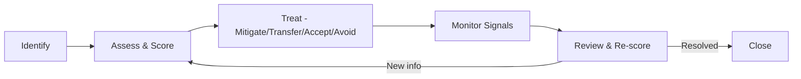
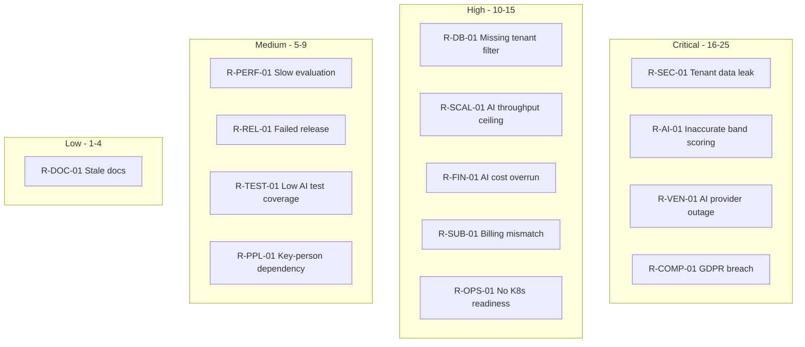
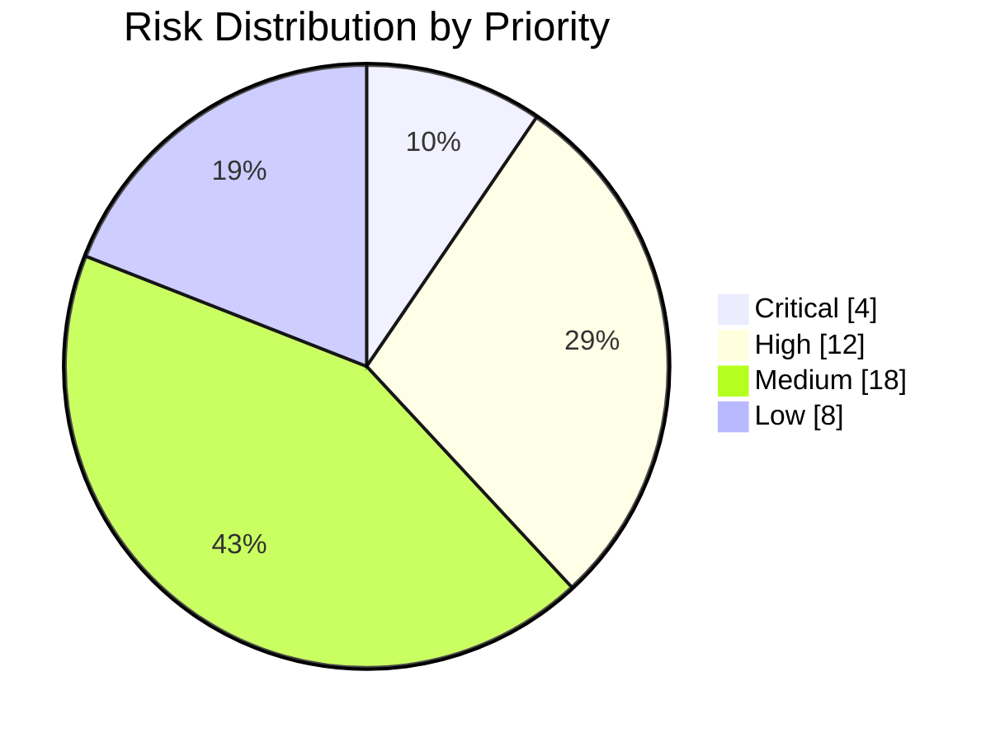
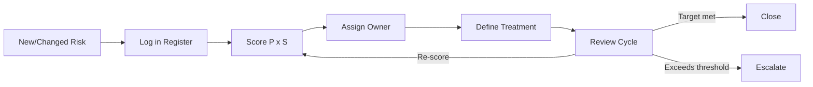
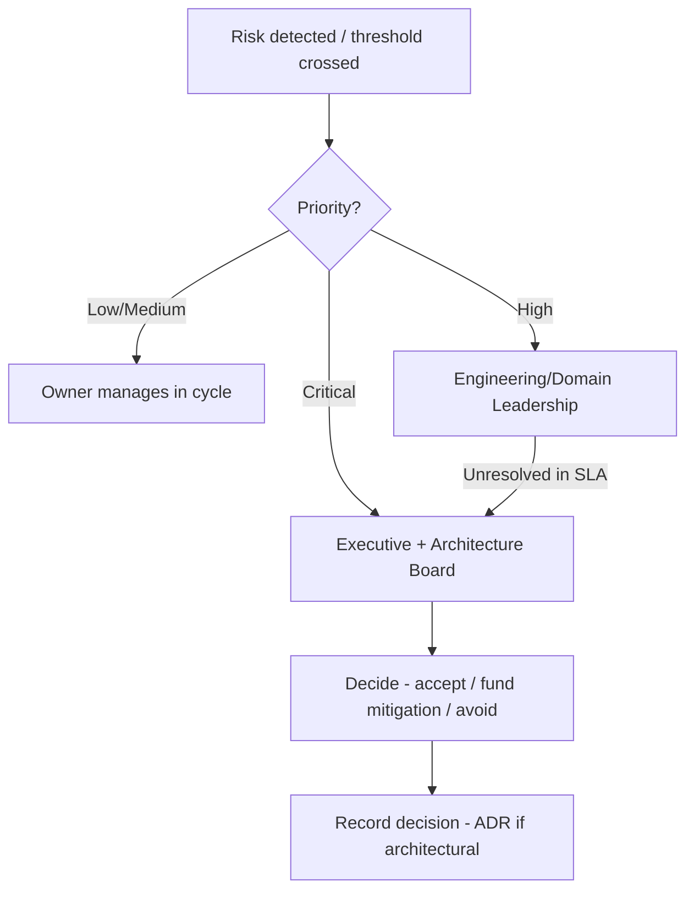
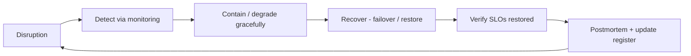

# Risk Register — IELTS LMS AI

| Field | Value |
| --- | --- |
| **Product Name** | IELTS LMS AI |
| **Document** | 29 — Risk Register |
| **Version** | 1.0 |
| **Status** | Architecture & Planning |
| **Document Owner** | Principal Risk Manager / Enterprise Governance Architect |
| **Last Updated** | 2026-07-18 |
| **Audience** | Leadership, Architecture, Engineering Leads, DevOps/SRE, Security, Compliance, AI/ML, Product, QA, Finance, Support |
| **Aligns With** | [01_Product_Vision.md](./01_Product_Vision.md) … [28_ADR_Architecture_Decision_Records.md](./28_ADR_Architecture_Decision_Records.md) |

> **Purpose of this document.** This is the **enterprise Risk Register** for IELTS LMS AI — the authoritative catalog of the risks that threaten the platform's business goals, architecture, data, security, compliance, operations, AI capabilities, vendors, cost, and delivery. Each risk records its cause, impact, probability, severity, priority, owner, mitigation, contingency, detection, monitoring, review cadence, status, residual risk, target resolution, dependencies, and the [ADR (28)](./28_ADR_Architecture_Decision_Records.md) and owning documents it traces to. It is the **governance counterpart** to the decision log: where an [ADR](./28_ADR_Architecture_Decision_Records.md) records *why a choice was made*, this register records *what could go wrong with it and how that is managed*. It is **implementation-independent** — no code, SQL, or scripts — only risk governance suitable for enterprise oversight and audit.

---

## Table of Contents

1. [Introduction](#1-introduction)
2. [Risk Management Methodology](#2-risk-management-methodology)
3. [Scoring Model](#3-scoring-model)
4. [Risk Matrix — Probability vs Impact](#4-risk-matrix--probability-vs-impact)
5. [Risk Heat Map](#5-risk-heat-map)
6. [Risk Dashboard](#6-risk-dashboard)
7. [Risk Register by Category](#7-risk-register-by-category)
8. [Top 20 Critical Risks](#8-top-20-critical-risks)
9. [Risk Review Process](#9-risk-review-process)
10. [Risk Escalation Process](#10-risk-escalation-process)
11. [Business Continuity Summary](#11-business-continuity-summary)
12. [Version History](#12-version-history)
13. [Related Documents](#13-related-documents)

---

## 1. Introduction

### 1.1 Purpose & Scope

This register identifies, assesses, and assigns ownership for risks across every domain of IELTS LMS AI. It is a **living document**: risks are added, re-scored, and retired continuously through the [review process (§9)](#9-risk-review-process). It exists to make risk **visible, owned, measurable, and actionable** so that leadership can make informed trade-offs and so that mitigations are tracked to resolution.

### 1.2 How to Read a Risk Entry

Every risk uses a consistent field set:

| Field | Meaning |
| --- | --- |
| **Risk ID** | Stable identifier `R-<CATEGORY>-NN` (e.g., `R-SEC-01`). |
| **Category** | The risk domain (Business, Technical, Security, AI, …). |
| **Description** | The risk event in plain language. |
| **Cause** | The underlying condition or trigger. |
| **Impact** | Consequence if it materializes. |
| **Probability** | Likelihood — Rare, Unlikely, Possible, Likely, Almost Certain. |
| **Severity** | Impact magnitude — Negligible, Minor, Moderate, Major, Severe. |
| **Priority** | Derived exposure — Low, Medium, High, Critical. |
| **Owner** | Accountable role. |
| **Mitigation** | Preventive actions reducing probability/impact. |
| **Contingency** | Response if the risk occurs. |
| **Detection** | How occurrence is detected. |
| **Monitoring** | Ongoing signal watched. |
| **Review Frequency** | Cadence of reassessment. |
| **Status** | Open, Mitigating, Monitored, Accepted, Closed. |
| **Residual Risk** | Remaining exposure after mitigation. |
| **Target Resolution** | Delivery phase/date to reach target state. |
| **Dependencies** | Other risks/decisions it relies on. |
| **Related ADR** | Decision(s) in [document 28](./28_ADR_Architecture_Decision_Records.md). |
| **Related Documents** | Owning architecture document(s). |

---

## 2. Risk Management Methodology

The platform follows a continuous **Identify → Assess → Treat → Monitor → Review** loop, aligned with the shift-left quality and security principles of the [Architecture Index §11](./27_Architecture_Index.md#11-architecture-principles-summary).

| Treatment | When applied |
| --- | --- |
| **Mitigate** | Reduce probability or impact through controls (the default for High/Critical). |
| **Transfer** | Shift exposure to a third party (insurance, managed service, vendor SLA). |
| **Accept** | Consciously tolerate a Low/Medium residual risk with owner sign-off. |
| **Avoid** | Change the plan to remove the risk entirely. |

---

## 3. Scoring Model

Probability and severity are scored 1–5; **exposure = probability × severity** drives priority.

| Probability | Score | Severity | Score |
| --- | --- | --- | --- |
| Rare | 1 | Negligible | 1 |
| Unlikely | 2 | Minor | 2 |
| Possible | 3 | Moderate | 3 |
| Likely | 4 | Major | 4 |
| Almost Certain | 5 | Severe | 5 |

| Exposure (P × S) | Priority | Handling |
| --- | --- | --- |
| 1–4 | **Low** | Monitor; accept with periodic review. |
| 5–9 | **Medium** | Plan mitigation; review each phase. |
| 10–15 | **High** | Active mitigation; review sprint/monthly. |
| 16–25 | **Critical** | Immediate mitigation + contingency; leadership visibility. |

---

## 4. Risk Matrix — Probability vs Impact

Cell values are exposure scores; shading is priority (Low ≤4, Medium 5–9, High 10–15, Critical 16–25).

| Probability ↓ / Severity → | Negligible (1) | Minor (2) | Moderate (3) | Major (4) | Severe (5) |
| --- | --- | --- | --- | --- | --- |
| **Almost Certain (5)** | 5 · Med | 10 · High | 15 · High | 20 · Crit | 25 · Crit |
| **Likely (4)** | 4 · Low | 8 · Med | 12 · High | 16 · Crit | 20 · Crit |
| **Possible (3)** | 3 · Low | 6 · Med | 9 · Med | 12 · High | 15 · High |
| **Unlikely (2)** | 2 · Low | 4 · Low | 6 · Med | 8 · Med | 10 · High |
| **Rare (1)** | 1 · Low | 2 · Low | 3 · Low | 4 · Low | 5 · Med |

---

## 5. Risk Heat Map

---

## 6. Risk Dashboard

Snapshot of the register at the current baseline (v1.0). Counts are re-tallied each [review cycle (§9)](#9-risk-review-process).

| Metric | Value |
| --- | --- |
| **Total tracked risks** | 42 |
| **Critical** | 4 |
| **High** | 12 |
| **Medium** | 18 |
| **Low** | 8 |
| **Open** | 24 |
| **Mitigating** | 11 |
| **Monitored** | 5 |
| **Accepted** | 2 |
| **Closed** | 0 (pre-implementation baseline) |
| **Categories tracked** | 21 |
| **Risks with named owner** | 42 / 42 |
| **Risks linked to an ADR** | 38 / 42 |

---

## 7. Risk Register by Category

> Each risk below is a compact multi-field record. Probability/Severity use the [scoring model (§3)](#3-scoring-model). ADR references point to [document 28](./28_ADR_Architecture_Decision_Records.md).

### 7.1 Business Risks

| Field | R-BUS-01 | R-BUS-02 |
| --- | --- | --- |
| **Description** | Slow market adoption vs targets. | Competitor ships superior AI feedback first. |
| **Cause** | Crowded IELTS-prep market; weak differentiation. | Faster competitor R&D; better models. |
| **Impact** | Revenue shortfall; runway pressure. | Loss of positioning and churn. |
| **Probability / Severity** | Possible (3) / Major (4) | Possible (3) / Major (4) |
| **Priority** | High (12) | High (12) |
| **Owner** | Product / Leadership | Product / AI Lead |
| **Mitigation** | Band-aligned differentiation, pilot tenants, feedback loops. | Provider-agnostic AI to adopt best models fast ([ADR-020](./28_ADR_Architecture_Decision_Records.md)). |
| **Contingency** | Re-price, re-segment, extend runway. | Fast-follow via gateway model swap. |
| **Detection** | Funnel and activation analytics. | Competitive intelligence, win/loss. |
| **Monitoring** | Signups, activation, retention KPIs. | Market scans each quarter. |
| **Review Frequency** | Monthly | Quarterly |
| **Status** | Open | Open |
| **Residual Risk** | Medium | Medium |
| **Target Resolution** | P10 Post-Launch | Ongoing |
| **Dependencies** | R-FIN-01 | R-AI-01 |
| **Related ADR** | ADR-020, ADR-024 | ADR-020 |
| **Related Documents** | [01](./01_Product_Vision.md), [02](./02_Business_Requirements_Document.md) | [17](./17_AI_Architecture.md) |

### 7.2 Technical Risks

| Field | R-TECH-01 | R-TECH-02 |
| --- | --- | --- |
| **Description** | Modular monolith accrues coupling, blocking extraction. | Framework/runtime upgrade (.NET, React) breaks build. |
| **Cause** | Eroded module boundaries; shortcuts. | Major version churn in dependencies. |
| **Impact** | Slower delivery; costly future microservices split. | Delivery stall; regressions. |
| **Probability / Severity** | Possible (3) / Major (4) | Unlikely (2) / Moderate (3) |
| **Priority** | High (12) | Medium (6) |
| **Owner** | Principal Architect | Engineering Leads |
| **Mitigation** | Enforce Clean Architecture seams ([ADR-002](./28_ADR_Architecture_Decision_Records.md), [ADR-003](./28_ADR_Architecture_Decision_Records.md)); architecture tests. | Pinned versions, upgrade cadence, CI gates. |
| **Contingency** | Refactor boundaries before extraction. | Roll back version; hotfix. |
| **Detection** | Dependency/architecture analysis. | CI build failures. |
| **Monitoring** | Coupling metrics, PR review. | Dependabot/renovate alerts. |
| **Review Frequency** | Each phase | Each release |
| **Status** | Mitigating | Monitored |
| **Residual Risk** | Medium | Low |
| **Target Resolution** | Ongoing | Ongoing |
| **Dependencies** | R-OPS-01 | — |
| **Related ADR** | ADR-002, ADR-003, ADR-030 | ADR-010 |
| **Related Documents** | [14](./14_Clean_Architecture.md), [15](./15_Backend_Architecture.md) | [15](./15_Backend_Architecture.md), [16](./16_Frontend_Architecture.md) |

### 7.3 Architecture Risks

| Field | R-ARCH-01 | R-ARCH-02 |
| --- | --- | --- |
| **Description** | CQRS/MediatR over-engineering for simple flows. | Bounded-context boundaries drawn incorrectly. |
| **Cause** | Uniform pattern applied without judgment. | Incomplete domain understanding at design time. |
| **Impact** | Added complexity, slower onboarding. | Expensive rework; leaky integrations. |
| **Probability / Severity** | Possible (3) / Minor (2) | Unlikely (2) / Major (4) |
| **Priority** | Medium (6) | Medium (8) |
| **Owner** | Principal Architect | Domain Leads |
| **Mitigation** | Pragmatic use of CQRS ([ADR-005](./28_ADR_Architecture_Decision_Records.md), [ADR-006](./28_ADR_Architecture_Decision_Records.md)); simple reads bypass pattern. | Event storming validation ([08](./08_Event_Storming.md)); iterative context maps. |
| **Contingency** | Simplify handlers; collapse layers where safe. | Re-map contexts; adjust seams. |
| **Detection** | Code review, complexity metrics. | Integration friction, domain review. |
| **Monitoring** | PR patterns, cyclomatic complexity. | Context-map reviews per phase. |
| **Review Frequency** | Each phase | Each phase |
| **Status** | Monitored | Mitigating |
| **Residual Risk** | Low | Medium |
| **Target Resolution** | Ongoing | P4–P6 |
| **Dependencies** | R-TECH-01 | R-TECH-01 |
| **Related ADR** | ADR-005, ADR-006 | ADR-004 |
| **Related Documents** | [15](./15_Backend_Architecture.md) | [07](./07_Domain_Driven_Design.md), [08](./08_Event_Storming.md) |

### 7.4 Database Risks

| Field | R-DB-01 | R-DB-02 |
| --- | --- | --- |
| **Description** | Missing `TenantId` filter causes cross-tenant data exposure. | Schema migration corrupts or locks data. |
| **Cause** | Human error in query/handler; no global filter. | Non-expand/contract migration; long locks. |
| **Impact** | Severe: data leak across tenants. | Downtime; data loss. |
| **Probability / Severity** | Possible (3) / Severe (5) | Unlikely (2) / Major (4) |
| **Priority** | High (15) | Medium (8) |
| **Owner** | Backend Lead / DBA | Backend Lead / DBA |
| **Mitigation** | Global query filters, tenant guard, tests ([ADR-015](./28_ADR_Architecture_Decision_Records.md), [12](./12_Multi_Tenant_Architecture.md)). | Forward-only expand/contract migrations ([ADR-026](./28_ADR_Architecture_Decision_Records.md)). |
| **Contingency** | Isolate, notify, invoke breach process. | Restore from backup; roll forward. |
| **Detection** | Tenant-isolation tests, audit log review. | Migration validation, monitoring. |
| **Monitoring** | Query audits, penetration tests. | Migration dashboards, lock metrics. |
| **Review Frequency** | Each release | Each release |
| **Status** | Mitigating | Mitigating |
| **Residual Risk** | Low–Medium | Low |
| **Target Resolution** | P3 | Ongoing |
| **Dependencies** | R-SEC-01 | R-REL-01 |
| **Related ADR** | ADR-015, ADR-007 | ADR-007, ADR-026 |
| **Related Documents** | [09](./09_Database_Design_ERD.md), [12](./12_Multi_Tenant_Architecture.md) | [09](./09_Database_Design_ERD.md), [26](./26_Release_Management.md) |

### 7.5 Infrastructure Risks

| Field | R-INF-01 | R-INF-02 |
| --- | --- | --- |
| **Description** | Single-host Docker Compose is a production SPOF. | Backup/restore not validated. |
| **Cause** | Compose-first strategy pre-Kubernetes. | Untested DR procedures. |
| **Impact** | Full outage on host failure. | Unrecoverable data after incident. |
| **Probability / Severity** | Possible (3) / Major (4) | Unlikely (2) / Severe (5) |
| **Priority** | High (12) | High (10) |
| **Owner** | DevOps/SRE Lead | DevOps/SRE Lead |
| **Mitigation** | Kubernetes migration path defined ([ADR-016](./28_ADR_Architecture_Decision_Records.md), [ADR-017](./28_ADR_Architecture_Decision_Records.md)); managed data services. | Scheduled backups + restore drills. |
| **Contingency** | Failover host; accelerate K8s. | Invoke DR runbook; restore latest good backup. |
| **Detection** | Uptime and host health monitors. | Restore-drill outcomes. |
| **Monitoring** | Infra health, resource saturation. | Backup success + drill cadence. |
| **Review Frequency** | Each phase | Quarterly |
| **Status** | Open | Open |
| **Residual Risk** | Medium | Medium |
| **Target Resolution** | P8 (K8s readiness) | P8 |
| **Dependencies** | R-OPS-01, R-SCAL-01 | R-DB-02 |
| **Related ADR** | ADR-016, ADR-017 | ADR-007, ADR-008 |
| **Related Documents** | [19](./19_Infrastructure_Deployment.md) | [19](./19_Infrastructure_Deployment.md) |

### 7.6 Security Risks

| Field | R-SEC-01 | R-SEC-02 |
| --- | --- | --- |
| **Description** | Cross-tenant data breach / unauthorized access. | Token theft or session hijack. |
| **Cause** | Broken isolation, IDOR, weak authz. | Leaked/long-lived tokens; no rotation. |
| **Impact** | Severe: confidentiality loss, legal, reputational. | Account takeover; data exposure. |
| **Probability / Severity** | Possible (3) / Severe (5) → **Critical guarded** | Unlikely (2) / Major (4) |
| **Priority** | Critical (16, pre-control) → High (post-control) | Medium (8) |
| **Owner** | Security Lead / Principal Architect | Security Lead |
| **Mitigation** | Deny-by-default RBAC, tenant guard, ASVS L2 ([ADR-014](./28_ADR_Architecture_Decision_Records.md), [ADR-015](./28_ADR_Architecture_Decision_Records.md), [20](./20_Security_Standards.md)). | Short-lived JWT + refresh rotation ([ADR-012](./28_ADR_Architecture_Decision_Records.md), [ADR-013](./28_ADR_Architecture_Decision_Records.md)). |
| **Contingency** | Breach response, revoke access, notify per [compliance](#77-compliance-risks). | Revoke token family, force re-auth. |
| **Detection** | Pen tests, audit logs ([ADR-027](./28_ADR_Architecture_Decision_Records.md)), anomaly alerts. | Reuse-detection on refresh tokens. |
| **Monitoring** | SAST/DAST, security events, audit trail. | Auth failure and reuse metrics. |
| **Review Frequency** | Each release + quarterly pentest | Each release |
| **Status** | Mitigating | Mitigating |
| **Residual Risk** | Low–Medium | Low |
| **Target Resolution** | P3 + P8 | P3 |
| **Dependencies** | R-DB-01, R-COMP-01 | R-SEC-01 |
| **Related ADR** | ADR-012–015, ADR-027 | ADR-012, ADR-013 |
| **Related Documents** | [11](./11_Authentication_Authorization.md), [12](./12_Multi_Tenant_Architecture.md), [20](./20_Security_Standards.md) | [11](./11_Authentication_Authorization.md), [20](./20_Security_Standards.md) |

### 7.7 Compliance Risks

| Field | R-COMP-01 | R-COMP-02 |
| --- | --- | --- |
| **Description** | GDPR non-compliance (consent, erasure, residency). | AI decisions lack explainability/audit for learners. |
| **Cause** | Incomplete data-subject workflows; unclear residency. | Opaque model outputs; no rationale capture. |
| **Impact** | Fines, legal exposure, trust loss. | Disputes, regulatory scrutiny. |
| **Probability / Severity** | Possible (3) / Severe (5) | Possible (3) / Major (4) |
| **Priority** | Critical (15→High guarded) | High (12) |
| **Owner** | Compliance / Security Lead | AI Lead / Compliance |
| **Mitigation** | Soft delete + erasure, consent, audit logging ([ADR-026](./28_ADR_Architecture_Decision_Records.md), [ADR-027](./28_ADR_Architecture_Decision_Records.md), [20](./20_Security_Standards.md)). | Store rationale, band criteria, prompt/version ([ADR-022](./28_ADR_Architecture_Decision_Records.md), [ADR-029](./28_ADR_Architecture_Decision_Records.md)). |
| **Contingency** | Legal engagement; remediate workflows. | Human review path; disclose limitations. |
| **Detection** | Compliance audits, DSAR tests. | Evaluation-audit sampling. |
| **Monitoring** | DSAR SLAs, consent coverage. | Rationale-capture completeness. |
| **Review Frequency** | Quarterly | Each release |
| **Status** | Open | Mitigating |
| **Residual Risk** | Medium | Medium |
| **Target Resolution** | P8 | P6 |
| **Dependencies** | R-SEC-01 | R-AI-01 |
| **Related ADR** | ADR-026, ADR-027 | ADR-022, ADR-029 |
| **Related Documents** | [20](./20_Security_Standards.md), [13](./13_Subscription_Billing.md) | [17](./17_AI_Architecture.md), [18](./18_Agentic_AI_Architecture.md) |

### 7.8 Operational Risks

| Field | R-OPS-01 | R-OPS-02 |
| --- | --- | --- |
| **Description** | Not operationally ready for Kubernetes at scale. | Insufficient runbooks/on-call for incidents. |
| **Cause** | Compose-first; K8s skills/tooling immature. | Early-stage ops maturity. |
| **Impact** | Scaling delays; outage risk. | Slow MTTR; prolonged incidents. |
| **Probability / Severity** | Possible (3) / Major (4) | Possible (3) / Moderate (3) |
| **Priority** | High (12) | Medium (9) |
| **Owner** | DevOps/SRE Lead | SRE Lead |
| **Mitigation** | Staged K8s migration ([ADR-017](./28_ADR_Architecture_Decision_Records.md)); observability baseline ([ADR-018](./28_ADR_Architecture_Decision_Records.md)). | Runbooks, on-call, incident process ([26](./26_Release_Management.md)). |
| **Contingency** | Vertical scale interim; managed services. | Escalation tree; vendor support. |
| **Detection** | Load tests, capacity reviews. | Incident retros, MTTR trend. |
| **Monitoring** | Saturation, SLO burn ([25](./25_Monitoring_Observability.md)). | Incident metrics, alert quality. |
| **Review Frequency** | Each phase | Monthly |
| **Status** | Open | Mitigating |
| **Residual Risk** | Medium | Low–Medium |
| **Target Resolution** | P8 | P8 |
| **Dependencies** | R-INF-01, R-SCAL-01 | R-INF-01 |
| **Related ADR** | ADR-016, ADR-017, ADR-018 | ADR-018, ADR-019 |
| **Related Documents** | [19](./19_Infrastructure_Deployment.md) | [25](./25_Monitoring_Observability.md), [26](./26_Release_Management.md) |

### 7.9 AI Risks

| Field | R-AI-01 | R-AI-02 |
| --- | --- | --- |
| **Description** | Inaccurate/biased band scoring vs human examiners. | Prompt injection / unsafe model output. |
| **Cause** | Model limitations; drift; weak prompt governance. | Untrusted learner input reaching the model. |
| **Impact** | Severe: wrong feedback erodes core value + trust. | Data leakage, offensive output, manipulation. |
| **Probability / Severity** | Possible (3) / Severe (5) | Possible (3) / Major (4) |
| **Priority** | Critical (15→High guarded) | High (12) |
| **Owner** | AI Lead / Principal Architect | AI Lead / Security |
| **Mitigation** | Versioned prompts, calibration vs rubric, human review ([ADR-022](./28_ADR_Architecture_Decision_Records.md), [ADR-029](./28_ADR_Architecture_Decision_Records.md)). | Input sanitization, gateway guardrails, output filters ([ADR-029](./28_ADR_Architecture_Decision_Records.md)). |
| **Contingency** | Fallback to human review; recalibrate. | Block output; quarantine; incident. |
| **Detection** | Score-vs-examiner sampling, drift metrics. | Guardrail hits, anomaly detection. |
| **Monitoring** | Accuracy dashboards, calibration set. | AI gateway telemetry. |
| **Review Frequency** | Each release | Each release |
| **Status** | Mitigating | Mitigating |
| **Residual Risk** | Medium | Medium |
| **Target Resolution** | P6 | P6 |
| **Dependencies** | R-VEN-01, R-COMP-02 | R-SEC-01 |
| **Related ADR** | ADR-020, ADR-021, ADR-022, ADR-029 | ADR-029 |
| **Related Documents** | [17](./17_AI_Architecture.md), [18](./18_Agentic_AI_Architecture.md) | [17](./17_AI_Architecture.md), [20](./20_Security_Standards.md) |

### 7.10 Vendor Risks

| Field | R-VEN-01 | R-VEN-02 |
| --- | --- | --- |
| **Description** | AI provider outage or breaking API change. | Vendor pricing change or deprecation. |
| **Cause** | Dependence on external model APIs. | Provider commercial/roadmap shifts. |
| **Impact** | Severe: evaluation unavailable. | Cost spike; forced migration. |
| **Probability / Severity** | Possible (3) / Severe (5) | Possible (3) / Moderate (3) |
| **Priority** | Critical (15→High guarded) | Medium (9) |
| **Owner** | AI Lead / Principal Architect | AI Lead / Finance |
| **Mitigation** | Provider-agnostic gateway + fallback provider ([ADR-020](./28_ADR_Architecture_Decision_Records.md), [ADR-029](./28_ADR_Architecture_Decision_Records.md)). | Multi-provider readiness; contract review. |
| **Contingency** | Fail over to secondary provider. | Switch provider via gateway. |
| **Detection** | Provider health checks, error rates. | Pricing/roadmap monitoring. |
| **Monitoring** | Gateway latency/error metrics. | Cost per evaluation trend. |
| **Review Frequency** | Continuous | Quarterly |
| **Status** | Mitigating | Monitored |
| **Residual Risk** | Medium | Low–Medium |
| **Target Resolution** | P6 | Ongoing |
| **Dependencies** | R-AI-01, R-SCAL-01 | R-FIN-01 |
| **Related ADR** | ADR-020, ADR-029 | ADR-020 |
| **Related Documents** | [17](./17_AI_Architecture.md) | [17](./17_AI_Architecture.md), [13](./13_Subscription_Billing.md) |

### 7.11 Cloud Risks

| Field | R-CLD-01 | R-CLD-02 |
| --- | --- | --- |
| **Description** | Cloud provider lock-in limiting portability. | Regional cloud outage. |
| **Cause** | Provider-specific managed services. | Single-region deployment. |
| **Impact** | Costly migration; reduced leverage. | Downtime for region's tenants. |
| **Probability / Severity** | Unlikely (2) / Moderate (3) | Unlikely (2) / Major (4) |
| **Priority** | Medium (6) | Medium (8) |
| **Owner** | DevOps/SRE Lead | DevOps/SRE Lead |
| **Mitigation** | Containerized, K8s-portable design ([ADR-016](./28_ADR_Architecture_Decision_Records.md), [ADR-017](./28_ADR_Architecture_Decision_Records.md)); OTel vendor-neutral ([ADR-018](./28_ADR_Architecture_Decision_Records.md)). | Multi-region roadmap; backups off-region. |
| **Contingency** | Re-platform via container portability. | Failover region; DR runbook. |
| **Detection** | Architecture reviews. | Region health monitors. |
| **Monitoring** | Managed-service coupling audits. | Uptime per region. |
| **Review Frequency** | Each phase | Quarterly |
| **Status** | Monitored | Open |
| **Residual Risk** | Low | Medium |
| **Target Resolution** | Ongoing | Post-P8 |
| **Dependencies** | R-OPS-01 | R-INF-01 |
| **Related ADR** | ADR-016, ADR-017, ADR-018 | ADR-017 |
| **Related Documents** | [19](./19_Infrastructure_Deployment.md) | [19](./19_Infrastructure_Deployment.md) |

### 7.12 Performance Risks

| Field | R-PERF-01 | R-PERF-02 |
| --- | --- | --- |
| **Description** | Slow AI evaluation response degrades UX. | Database hotspots under load. |
| **Cause** | Model latency; synchronous flows. | Missing indexes; N+1 queries. |
| **Impact** | Poor experience; abandonment. | Elevated latency; timeouts. |
| **Probability / Severity** | Possible (3) / Moderate (3) | Possible (3) / Moderate (3) |
| **Priority** | Medium (9) | Medium (9) |
| **Owner** | Backend Lead / AI Lead | Backend Lead / DBA |
| **Mitigation** | Async jobs ([ADR-009](./28_ADR_Architecture_Decision_Records.md)), caching ([ADR-008](./28_ADR_Architecture_Decision_Records.md)), streaming feedback. | Query tuning, caching, load tests ([05](./05_Non_Functional_Requirements.md)). |
| **Contingency** | Queue + notify on completion. | Add indexes; scale reads. |
| **Detection** | Latency SLO monitoring. | Slow-query logs, APM. |
| **Monitoring** | p95/p99 evaluation latency. | DB latency, query plans. |
| **Review Frequency** | Each release | Each release |
| **Status** | Mitigating | Mitigating |
| **Residual Risk** | Low–Medium | Low |
| **Target Resolution** | P6 | P5 |
| **Dependencies** | R-VEN-01, R-SCAL-01 | R-DB-02 |
| **Related ADR** | ADR-008, ADR-009 | ADR-007, ADR-008 |
| **Related Documents** | [05](./05_Non_Functional_Requirements.md), [17](./17_AI_Architecture.md) | [09](./09_Database_Design_ERD.md), [15](./15_Backend_Architecture.md) |

### 7.13 Scalability Risks

| Field | R-SCAL-01 | R-SCAL-02 |
| --- | --- | --- |
| **Description** | AI throughput ceiling (rate limits) under peak load. | Stateful bottleneck blocks horizontal scale. |
| **Cause** | Provider quotas; concurrency limits. | Accidental in-process state/session affinity. |
| **Impact** | Backlogged evaluations; SLA breach. | Cannot scale out; outages. |
| **Probability / Severity** | Possible (3) / Major (4) | Unlikely (2) / Major (4) |
| **Priority** | High (12) | Medium (8) |
| **Owner** | AI Lead / SRE | Backend Lead / SRE |
| **Mitigation** | Queue + backpressure, multi-provider, quota mgmt ([ADR-009](./28_ADR_Architecture_Decision_Records.md), [ADR-020](./28_ADR_Architecture_Decision_Records.md)). | Stateless services; Redis for shared state ([ADR-008](./28_ADR_Architecture_Decision_Records.md)). |
| **Contingency** | Shed load; degrade gracefully. | Externalize state; restart clean. |
| **Detection** | Queue depth, throttle metrics. | Scale tests; affinity checks. |
| **Monitoring** | Provider quota usage, backlog. | Instance scaling behavior. |
| **Review Frequency** | Each release | Each phase |
| **Status** | Mitigating | Monitored |
| **Residual Risk** | Medium | Low |
| **Target Resolution** | P6 | Ongoing |
| **Dependencies** | R-VEN-01, R-PERF-01 | R-INF-01 |
| **Related ADR** | ADR-009, ADR-020 | ADR-008, ADR-016 |
| **Related Documents** | [05](./05_Non_Functional_Requirements.md), [17](./17_AI_Architecture.md) | [15](./15_Backend_Architecture.md), [19](./19_Infrastructure_Deployment.md) |

### 7.14 Financial Risks

| Field | R-FIN-01 | R-FIN-02 |
| --- | --- | --- |
| **Description** | AI inference cost overrun erodes margins. | Infrastructure spend scales faster than revenue. |
| **Cause** | High token usage; costly models; abuse. | Inefficient resource usage; no cost controls. |
| **Impact** | Negative unit economics. | Runway pressure. |
| **Probability / Severity** | Likely (4) / Major (4) | Possible (3) / Moderate (3) |
| **Priority** | Critical (16→High guarded) | Medium (9) |
| **Owner** | Finance / AI Lead | Finance / DevOps |
| **Mitigation** | Cost-per-evaluation budgets, caching, model tiering, quotas ([ADR-008](./28_ADR_Architecture_Decision_Records.md), [ADR-020](./28_ADR_Architecture_Decision_Records.md), [ADR-024](./28_ADR_Architecture_Decision_Records.md)). | FinOps monitoring; right-sizing. |
| **Contingency** | Downgrade models; throttle free tier. | Scale down; renegotiate. |
| **Detection** | Cost dashboards per tenant/plan. | Cloud cost anomaly alerts. |
| **Monitoring** | Cost/evaluation, margin per plan. | Spend vs revenue ratio. |
| **Review Frequency** | Monthly | Monthly |
| **Status** | Mitigating | Monitored |
| **Residual Risk** | Medium | Low–Medium |
| **Target Resolution** | P6 | Ongoing |
| **Dependencies** | R-VEN-02, R-SUB-01 | R-INF-01 |
| **Related ADR** | ADR-020, ADR-024 | ADR-016 |
| **Related Documents** | [13](./13_Subscription_Billing.md), [17](./17_AI_Architecture.md) | [19](./19_Infrastructure_Deployment.md) |

### 7.15 Subscription Risks

| Field | R-SUB-01 | R-SUB-02 |
| --- | --- | --- |
| **Description** | Entitlement/billing mismatch grants or denies access wrongly. | Payment provider integration failure. |
| **Cause** | Complex plan logic; sync gaps with billing. | Webhook/reconciliation errors. |
| **Impact** | Revenue leakage; customer disputes. | Failed renewals; churn. |
| **Probability / Severity** | Possible (3) / Major (4) | Unlikely (2) / Major (4) |
| **Priority** | High (12) | Medium (8) |
| **Owner** | Backend Lead / Product | Backend Lead / Finance |
| **Mitigation** | Entitlement checks + feature flags, reconciliation ([ADR-024](./28_ADR_Architecture_Decision_Records.md), [ADR-025](./28_ADR_Architecture_Decision_Records.md)). | Idempotent webhooks; retries; reconciliation. |
| **Contingency** | Manual entitlement correction; credit. | Grace period; manual recovery. |
| **Detection** | Entitlement audits, mismatch alerts. | Webhook failure alerts. |
| **Monitoring** | Plan-vs-access consistency. | Payment success rate. |
| **Review Frequency** | Each release | Each release |
| **Status** | Mitigating | Open |
| **Residual Risk** | Low–Medium | Medium |
| **Target Resolution** | P3 | P3 |
| **Dependencies** | R-FIN-01 | R-SUB-01 |
| **Related ADR** | ADR-024, ADR-025 | ADR-024 |
| **Related Documents** | [13](./13_Subscription_Billing.md) | [13](./13_Subscription_Billing.md) |

### 7.16 Release Risks

| Field | R-REL-01 | R-REL-02 |
| --- | --- | --- |
| **Description** | Failed or breaking release causes outage. | Uncontrolled feature exposure via flags. |
| **Cause** | Insufficient gates; risky migration. | Flag misconfiguration; stale flags. |
| **Impact** | Downtime; regressions. | Wrong users see incomplete features. |
| **Probability / Severity** | Possible (3) / Major (4) | Possible (3) / Minor (2) |
| **Priority** | High (12) | Medium (6) |
| **Owner** | Release Manager / SRE | Engineering Leads |
| **Mitigation** | CI/CD gates, canary, rollback-ready ([ADR-025](./28_ADR_Architecture_Decision_Records.md), [24](./24_CI_CD_Pipeline.md), [26](./26_Release_Management.md)). | Flag governance, expiry, review ([ADR-025](./28_ADR_Architecture_Decision_Records.md)). |
| **Contingency** | Immediate rollback; hotfix. | Disable flag; clean up. |
| **Detection** | Deploy validation, SLO burn. | Flag audits. |
| **Monitoring** | Release health, error rates ([25](./25_Monitoring_Observability.md)). | Flag inventory age. |
| **Review Frequency** | Each release | Monthly |
| **Status** | Mitigating | Monitored |
| **Residual Risk** | Low | Low |
| **Target Resolution** | P1 (gates) | Ongoing |
| **Dependencies** | R-DB-02, R-TEST-01 | — |
| **Related ADR** | ADR-025 | ADR-025 |
| **Related Documents** | [24](./24_CI_CD_Pipeline.md), [26](./26_Release_Management.md) | [26](./26_Release_Management.md) |

### 7.17 Testing Risks

| Field | R-TEST-01 | R-TEST-02 |
| --- | --- | --- |
| **Description** | Low coverage of AI/tenant-isolation paths. | Flaky tests erode gate trust. |
| **Cause** | Non-determinism of AI; complex tenancy. | Timing/order dependencies. |
| **Impact** | Undetected regressions reach prod. | Ignored failures; slower delivery. |
| **Probability / Severity** | Possible (3) / Major (4) | Possible (3) / Minor (2) |
| **Priority** | High (12) | Medium (6) |
| **Owner** | QA Lead / Engineering Leads | QA Lead |
| **Mitigation** | Deterministic AI test harness, tenant-isolation suites ([22](./22_Testing_Strategy.md)). | Quarantine, stabilize, root-cause flakes. |
| **Contingency** | Manual verification; block release. | Skip flaky test; fix promptly. |
| **Detection** | Coverage reports, mutation testing. | Flake-rate tracking. |
| **Monitoring** | Coverage trend, critical-path gaps. | CI stability metrics. |
| **Review Frequency** | Each release | Sprint |
| **Status** | Mitigating | Monitored |
| **Residual Risk** | Medium | Low |
| **Target Resolution** | P6 | Ongoing |
| **Dependencies** | R-AI-01, R-DB-01 | — |
| **Related ADR** | ADR-021, ADR-029 | — |
| **Related Documents** | [22](./22_Testing_Strategy.md) | [22](./22_Testing_Strategy.md) |

### 7.18 People Risks

| Field | R-PPL-01 | R-PPL-02 |
| --- | --- | --- |
| **Description** | Key-person dependency (architecture/AI knowledge). | Skills gap in Kubernetes/AI ops. |
| **Cause** | Concentrated knowledge; thin bench. | Emerging tech; hiring lag. |
| **Impact** | Delivery stall if person leaves. | Slow adoption; operational risk. |
| **Probability / Severity** | Possible (3) / Major (4) | Possible (3) / Moderate (3) |
| **Priority** | High (12) | Medium (9) |
| **Owner** | Engineering Leadership | Engineering Leadership |
| **Mitigation** | ADRs + docs (this set) capture knowledge; pairing. | Training, hiring, managed services. |
| **Contingency** | Onboard from docs; contractor bridge. | Vendor support; phased adoption. |
| **Detection** | Bus-factor reviews. | Skills assessments. |
| **Monitoring** | Knowledge-coverage audits. | Team capability matrix. |
| **Review Frequency** | Quarterly | Quarterly |
| **Status** | Mitigating | Open |
| **Residual Risk** | Medium | Medium |
| **Target Resolution** | Ongoing | P8 |
| **Dependencies** | R-DOC-01 | R-OPS-01 |
| **Related ADR** | — (governed by 28 set) | ADR-017 |
| **Related Documents** | [27](./27_Architecture_Index.md), [28](./28_ADR_Architecture_Decision_Records.md) | [19](./19_Infrastructure_Deployment.md) |

### 7.19 Documentation Risks

| Field | R-DOC-01 | R-DOC-02 |
| --- | --- | --- |
| **Description** | Documentation drifts from implementation. | Inconsistent terminology across docs. |
| **Cause** | Docs not updated with code changes. | No single glossary applied. |
| **Impact** | Misleading guidance; slower onboarding. | Miscommunication; design errors. |
| **Probability / Severity** | Likely (4) / Minor (2) | Possible (3) / Minor (2) |
| **Priority** | Medium (8) | Medium (6) |
| **Owner** | Documentation Architect / Doc Owners | Documentation Architect |
| **Mitigation** | Docs updated in same PR; DoD includes docs ([27 §17](./27_Architecture_Index.md#17-documentation-maintenance-guidelines)). | Master [Glossary (30)](./30_Glossary.md) as authority. |
| **Contingency** | Doc-audit sprint; reconcile. | Terminology reconciliation pass. |
| **Detection** | Doc reviews, link checks. | Glossary cross-checks. |
| **Monitoring** | Doc freshness, broken links. | Terminology consistency reviews. |
| **Review Frequency** | Each release | Quarterly |
| **Status** | Mitigating | Mitigating |
| **Residual Risk** | Low | Low |
| **Target Resolution** | Ongoing | Ongoing |
| **Dependencies** | R-PPL-01 | R-DOC-01 |
| **Related ADR** | — | — |
| **Related Documents** | [27](./27_Architecture_Index.md) | [30](./30_Glossary.md) |

### 7.20 Legal Risks

| Field | R-LEG-01 | R-LEG-02 |
| --- | --- | --- |
| **Description** | IP/trademark issue with "IELTS" brand usage. | Liability for AI feedback accuracy claims. |
| **Cause** | Trademark constraints; unclear positioning. | Overstated guarantees on band prediction. |
| **Impact** | Legal action; rebrand cost. | Disputes; reputational harm. |
| **Probability / Severity** | Unlikely (2) / Major (4) | Possible (3) / Moderate (3) |
| **Priority** | Medium (8) | Medium (9) |
| **Owner** | Legal / Leadership | Legal / Product |
| **Mitigation** | Clear "preparation, not affiliated/official" positioning; legal review. | Disclaimers; "estimate" framing; human-review path. |
| **Contingency** | Rebrand; adjust messaging. | Update ToS; clarify claims. |
| **Detection** | Legal reviews of marketing/product. | Complaint/dispute tracking. |
| **Monitoring** | Brand/legal watch. | Dispute volume. |
| **Review Frequency** | Quarterly | Quarterly |
| **Status** | Open | Mitigating |
| **Residual Risk** | Medium | Low–Medium |
| **Target Resolution** | P0–P1 | P6 |
| **Dependencies** | — | R-AI-01, R-COMP-02 |
| **Related ADR** | — | ADR-022 |
| **Related Documents** | [01](./01_Product_Vision.md), [02](./02_Business_Requirements_Document.md) | [17](./17_AI_Architecture.md) |

### 7.21 Future Risks

| Field | R-FUT-01 | R-FUT-02 |
| --- | --- | --- |
| **Description** | Microservices extraction introduces distributed-system complexity. | Regulatory shift on AI in education (e.g., AI Act). |
| **Cause** | Premature or poorly bounded extraction. | Evolving global AI regulation. |
| **Impact** | Operational overhead; new failure modes. | Compliance rework; feature limits. |
| **Probability / Severity** | Possible (3) / Major (4) | Possible (3) / Major (4) |
| **Priority** | High (12) | High (12) |
| **Owner** | Principal Architect | Compliance / Leadership |
| **Mitigation** | Extract only at proven seams; playbook first ([ADR-030](./28_ADR_Architecture_Decision_Records.md)). | Track regulation; explainability + audit ready ([ADR-029](./28_ADR_Architecture_Decision_Records.md)). |
| **Contingency** | Re-consolidate service; add resilience. | Rapid compliance response plan. |
| **Detection** | Post-extraction ops metrics. | Regulatory horizon scanning. |
| **Monitoring** | Distributed-tracing health. | Policy watch. |
| **Review Frequency** | Per extraction | Quarterly |
| **Status** | Open | Open |
| **Residual Risk** | Medium | Medium |
| **Target Resolution** | Post-1.0 | Ongoing |
| **Dependencies** | R-TECH-01, R-OPS-01 | R-COMP-01, R-COMP-02 |
| **Related ADR** | ADR-030 | ADR-029 |
| **Related Documents** | [14](./14_Clean_Architecture.md), [15](./15_Backend_Architecture.md) | [17](./17_AI_Architecture.md), [20](./20_Security_Standards.md) |

---

## 8. Top 20 Critical Risks

Ranked by exposure (pre-control where noted). This is the leadership watch-list reviewed each cycle.

| Rank | Risk ID | Title | Priority | Owner | Status | Related ADR |
| --- | --- | --- | --- | --- | --- | --- |
| 1 | R-SEC-01 | Cross-tenant data breach | Critical | Security Lead | Mitigating | ADR-014, 015, 027 |
| 2 | R-AI-01 | Inaccurate/biased band scoring | Critical | AI Lead | Mitigating | ADR-022, 029 |
| 3 | R-VEN-01 | AI provider outage | Critical | AI Lead | Mitigating | ADR-020, 029 |
| 4 | R-COMP-01 | GDPR non-compliance | Critical | Compliance | Open | ADR-026, 027 |
| 5 | R-FIN-01 | AI cost overrun | Critical | Finance/AI | Mitigating | ADR-020, 024 |
| 6 | R-DB-01 | Missing tenant filter | High | Backend/DBA | Mitigating | ADR-015 |
| 7 | R-SCAL-01 | AI throughput ceiling | High | AI Lead/SRE | Mitigating | ADR-009, 020 |
| 8 | R-INF-01 | Compose single-host SPOF | High | DevOps/SRE | Open | ADR-016, 017 |
| 9 | R-OPS-01 | K8s readiness gap | High | DevOps/SRE | Open | ADR-017, 018 |
| 10 | R-SUB-01 | Entitlement/billing mismatch | High | Backend/Product | Mitigating | ADR-024, 025 |
| 11 | R-AI-02 | Prompt injection / unsafe output | High | AI/Security | Mitigating | ADR-029 |
| 12 | R-COMP-02 | AI explainability gap | High | AI/Compliance | Mitigating | ADR-022, 029 |
| 13 | R-REL-01 | Failed/breaking release | High | Release Mgr | Mitigating | ADR-025 |
| 14 | R-TEST-01 | Low AI/tenant test coverage | High | QA Lead | Mitigating | ADR-021, 029 |
| 15 | R-BUS-01 | Slow market adoption | High | Product | Open | ADR-020, 024 |
| 16 | R-BUS-02 | Competitor advantage | High | Product/AI | Open | ADR-020 |
| 17 | R-TECH-01 | Monolith coupling erosion | High | Principal Architect | Mitigating | ADR-002, 003, 030 |
| 18 | R-PPL-01 | Key-person dependency | High | Eng Leadership | Mitigating | — |
| 19 | R-FUT-01 | Microservices complexity | High | Principal Architect | Open | ADR-030 |
| 20 | R-FUT-02 | AI regulation shift | High | Compliance | Open | ADR-029 |

---

## 9. Risk Review Process

| Cadence | Scope | Participants |
| --- | --- | --- |
| **Sprint** | High/Critical open risks, new risks. | Eng Leads, owners. |
| **Phase gate** | Full register re-score aligned to [Roadmap phases](./21_Development_Roadmap.md). | Architecture, SRE, Security, Product. |
| **Monthly** | Business, Financial, People, Vendor risks. | Leadership, Finance, owners. |
| **Quarterly** | Compliance, Legal, Cloud, Future risks + pentest results. | Security, Compliance, Legal, Architecture. |
| **Ad hoc** | On incident, major decision (new ADR), or external change. | Relevant owners. |

**Definition of Done for a review:** every High/Critical risk has a current score, a named owner, an in-progress or completed mitigation, and a verified detection/monitoring signal.

---

## 10. Risk Escalation Process

Escalation is triggered when a risk crosses a threshold or a mitigation stalls.

| Trigger | Escalates to | SLA |
| --- | --- | --- |
| New **Critical** risk | Executive + Architecture Board | Same day |
| **High** risk unmitigated past target | Engineering Leadership | 1 week |
| Incident realizing a tracked risk | Owner + Leadership | Immediate (per [incident process](./26_Release_Management.md)) |
| Compliance/Legal risk materializing | Compliance/Legal + Executive | Same day |
| Mitigation stalled 2 cycles | Next level up | Next review |

Architectural outcomes of an escalation are recorded as a new [ADR](./28_ADR_Architecture_Decision_Records.md); risk state and residual are updated here.

---

## 11. Business Continuity Summary

Business continuity ties the register to recovery objectives and the DR posture defined in [Infrastructure (19)](./19_Infrastructure_Deployment.md) and [Monitoring (25)](./25_Monitoring_Observability.md).

| Dimension | Position |
| --- | --- |
| **Critical services** | Authentication, evaluation (AI), exam delivery, billing. |
| **Recovery objectives** | RTO and RPO targets defined in [NFR (05)](./05_Non_Functional_Requirements.md) and [Infrastructure (19)](./19_Infrastructure_Deployment.md); validated by restore drills (R-INF-02). |
| **Data protection** | Scheduled backups, off-region copies, tested restore; PostgreSQL primary store ([ADR-007](./28_ADR_Architecture_Decision_Records.md)). |
| **AI continuity** | Provider-agnostic gateway with fallback provider ([ADR-020](./28_ADR_Architecture_Decision_Records.md), [ADR-029](./28_ADR_Architecture_Decision_Records.md)) mitigates R-VEN-01. |
| **Degraded modes** | Queue-and-notify for evaluation; graceful feature-flag degradation ([ADR-025](./28_ADR_Architecture_Decision_Records.md)). |
| **Incident response** | Runbooks, on-call, postmortems per [Release Management (26)](./26_Release_Management.md). |
| **Continuity governance** | Reviewed quarterly; a dedicated DR/BCP runbook is a planned future document ([27 §16](./27_Architecture_Index.md#16-future-documentation-roadmap)). |

---

## 12. Version History

| Version | Date | Change | Author |
| --- | --- | --- | --- |
| **1.0** | 2026-07-18 | Initial enterprise Risk Register — methodology, scoring, matrix, heat map, dashboard, 42 risks across 21 categories, Top 20, review/escalation processes, and business continuity summary. Aligned to the ADR baseline (28) and the 01–27 architecture set. | Principal Risk Manager / Enterprise Governance Architect |

---

## 13. Related Documents

| # | Document | Relationship |
| --- | --- | --- |
| 01 | [Product Vision](./01_Product_Vision.md) | Business goals the risks threaten. |
| 02 | [Business Requirements](./02_Business_Requirements_Document.md) | Business-risk context. |
| 05 | [Non-Functional Requirements](./05_Non_Functional_Requirements.md) | Performance, scalability, RTO/RPO targets. |
| 07 | [Domain-Driven Design](./07_Domain_Driven_Design.md) | Architecture-risk context. |
| 08 | [Event Storming](./08_Event_Storming.md) | Bounded-context risks. |
| 09 | [Database Design & ERD](./09_Database_Design_ERD.md) | Database risks. |
| 11 | [Authentication & Authorization](./11_Authentication_Authorization.md) | Security risks. |
| 12 | [Multi-Tenant Architecture](./12_Multi_Tenant_Architecture.md) | Tenant-isolation risks. |
| 13 | [Subscription & Billing](./13_Subscription_Billing.md) | Subscription & financial risks. |
| 14 | [Clean Architecture](./14_Clean_Architecture.md) | Architecture & technical risks. |
| 15 | [Backend Architecture](./15_Backend_Architecture.md) | Technical & performance risks. |
| 16 | [Frontend Architecture](./16_Frontend_Architecture.md) | UX/performance risks. |
| 17 | [AI Architecture](./17_AI_Architecture.md) | AI, vendor, cost risks. |
| 18 | [Agentic AI Architecture](./18_Agentic_AI_Architecture.md) | Agentic AI risks. |
| 19 | [Infrastructure & Deployment](./19_Infrastructure_Deployment.md) | Infrastructure, cloud, continuity. |
| 20 | [Security Standards](./20_Security_Standards.md) | Security & compliance risks. |
| 21 | [Development Roadmap](./21_Development_Roadmap.md) | Phase-based target resolution. |
| 22 | [Testing Strategy](./22_Testing_Strategy.md) | Testing risks. |
| 24 | [CI/CD Pipeline](./24_CI_CD_Pipeline.md) | Release risks. |
| 25 | [Monitoring & Observability](./25_Monitoring_Observability.md) | Detection & monitoring signals. |
| 26 | [Release Management](./26_Release_Management.md) | Release & incident processes. |
| 27 | [Architecture Index](./27_Architecture_Index.md) | Master navigation. |
| 28 | [Architecture Decision Records](./28_ADR_Architecture_Decision_Records.md) | Decisions each risk traces to. |
| 30 | [Glossary](./30_Glossary.md) | Terminology used throughout. |

---

*End of Document — 29 Risk Register (v1.0).*